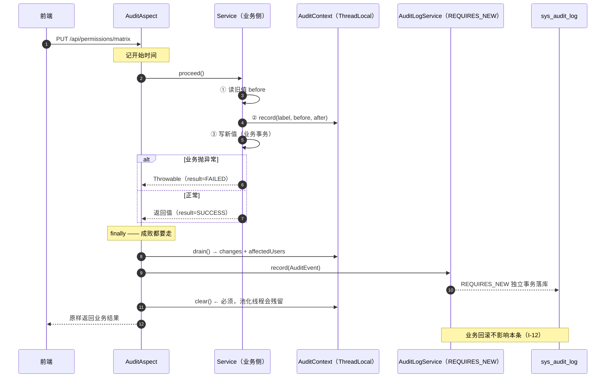

> 状态：🟡 进行中 · Sprint S3 · 阶段 A（M03 审计 · 契约先行）· 建档 2026-09-14

# 2026-09-14 · S3 · M03 · 阶段 A —— 变更前后对照产出方式（T-300）+ 高危判定口径（T-301）

> 任务：`T-300`（P0）+ `T-301`（P1）· 来源：`docs/进度/03-Sprint排期.md` §S3「开工顺序」阶段 A
> 上游计划：无（本批是 S3 首个计划文件）
> 本批性质：**契约先行** —— 定 `changes` 的产出方式与高危标注口径，供 B 阶段（M04）边写接口边打注解

---

## 1. 开工条件检查

### 1.1 依赖清单（来源：`docs/进度/02-任务清单.md` 的「依赖」列）

| # | 依赖项 | 档位 | 现状（实证） | 结论 |
|---|---|---|---|---|
| 1 | `T-300` ← `T-005` 审计 AOP 框架 | ✅ | `core/audit/AuditAspect.java` + `AuditLogService.java` 齐备；`AuditChainVerificationTest` 4 条钉住（G0-3/G0-4/I-12） | 满足 |
| 2 | `T-300` ← `T-212` 数据范围求交引擎 | ✅ | S2 结项，`DataScopeSqlEvidenceTest` 取证 | 满足 |
| 3 | `T-301` ← `T-300` | ⚠️ | 同批内，顺序在 3.1 步骤里定 | 满足（批内串行） |
| 4 | 表 `sys_audit_log.changes_json` / `affected_users` | ✅ | `V1__init_skeleton_schema.sql:238`；实体 `SysAuditLog.java:106/110` | 满足，**无需迁移** |
| 5 | 前端消费契约 `{label,before,after}` + 空值 `'—'` | ✅ | `types/index.ts:250`；`AuditLogView.vue:316` 按 `'—'` 字面量分支 | 满足 |
| 6 | Jackson（序列化 `changes_json` 用） | ⚠️ | 见第 5 节 —— 有两个实现并存（见下） | 步骤 1 探测后定 |

### 1.2 ⛔ BLOCKER 汇总

**无。**

### 1.3 ⚠️ 已知偏差（不拒绝施工，第 9 节销账）

| # | 偏差 | 影响 | 归属 |
|---|---|---|---|
| W1 | **`§4.2 采集范围` 多处未打点**：登录成功/失败、新建用户、角色 CRUD、部门 CRUD、用户**停用**均无 `@AuditLog`（全项目仅 10 处注解，集中在 S2 那批高危） | 这些操作在审计页查不到，与 §4.2 的采集范围不符。⚠️ 「用户停用」属危险动作且无痕 | S3-C（审计可查批次） |
| W2 | `AuditModule.ROLE` 零使用，且前端 `MODULES` 无「角色」 | 死常量，留着会被误用（放了日志前端筛不到） | 本批（步骤 4 处置） |
| W3 | `AuditModule.AUDIT` 零使用 | `T-304` 审计自审要用 | S3-C |
| W4 | `changes_json` 列**自建表起从未有数据**；业务侧无人登记、`AuditLogService` 无 `setChangesJson`；`affectedUsers` 同理恒 `null` | 前端 `AuditLogView.vue:307-326`（变更明细）+ `:336`（影响用户 N 人）**现在渲染的是 mock 编的数据**，切真后端整块消失 | **本批修复** |

### 1.4 结论

- [x] ✅ **可以开工** —— 无 BLOCKER；4 条 WARN 中 W2/W4 本批处理，W1/W3 登记顺延

---

## 2. 开工时间

| 项 | 值 |
|---|---|
| 建档 / 开工日 | 2026-09-14 |
| 预计投入 | 1.5 人天（Sprint 容量 ≈ 10 人天） |
| 实际投入 | *回填时补* |

---

## 3. 开工内容

### 3.1 步骤

| 步 | 做什么（文件 → 动作 → 产出） | 依赖 | 可并行 |
|---|---|---|---|
| 1 | **探测 Jackson 3**：确认 Boot 4 自动配置的 `ObjectMapper` 是 `tools.jackson.databind.ObjectMapper`（3.0.2）还是旧 `com.fasterxml` 路径；在两个包同时存在（实测 3.0.2 + 2.20.1）下确定可注入的那个。产出：可注入类型 + 结论 | — | 否 |
| 2 | **新增 `core/audit/AuditChange.java`**：`record AuditChange(String label, String before, String after)`。含**空值规范化**：`null` / 空串 → `"—"`（与 `AuditLogView.vue:316` 同一字面量） | — | 可 |
| 3 | **新增 `core/audit/AuditContext.java`**（ThreadLocal 持有者，命名对齐既有 `LoginUserContext` / `TraceContext`）：`record(label, before, after)` · `affectedUsers(int)` · `drain()` · `clear()`。**只由业务侧写、切面读**，切面读完即清 | 2 | 可 |
| 4 | **处置 `AuditModule.ROLE`**：删除该死常量（W2），javadoc 注明原因与迁移约定 | — | 可 |
| 5 | **改 `core/audit/AuditEvent.java`**：新增 `List<AuditChange> changes` 分量（现有 `affectedUsers` 保留） | 2 | 否 |
| 6 | **改 `core/audit/AuditAspect#build`**：`finally` 里 `drain()` 取 changes + affectedUsers 填进 `AuditEvent`，随后 `clear()`（**必须 finally**，否则池化线程残留） | 3/5 | 否 |
| 7 | **改 `core/audit/AuditLogService#record`**：`changes` 序列化为 JSON 字符串写 `changes_json`（空集合写 **null**，不写 `[]` —— 前端 `changes?.length` 判空，`[]` 会让"无变更"与"未采集"无法区分） | 1/6 | 否 |
| 8 | **`AuditRiskPolicy.java`（T-301 的落地形态）**：把 §4.3 四类 + 第 5 类扩展写成**可断言的表**（`action → RiskLevel`），供反射用例逐条比对 | — | 可 |
| 9 | **接线 3 处调用点**（T-300 的真实 before/after，证明契约可用）：<br>① `RoleAdminService#saveMatrix` —— 逐项 before = 改前 `sys_role_matrix.level`、after = 提交值；label = `group·label`（对齐 mock `文档 · 上传文档`）；`affectedUsers` = 该角色成员数<br>② `KbGrantService#save` —— before = 改前 level + 角色集，after = 提交值；label「授权级别」「可见角色」<br>③ `UserAdminService#update` —— before/after 角色集与部门；`affectedUsers` = 1 | 3 | 可（三处独立） |
| 10 | **门禁用例 `AuditChangeContractTest`**：反射扫全项目 `@AuditLog`，逐条比对 `AuditRiskPolicy`（T-301）；真 HTTP 取证 3 处调用点的 `changes_json`（T-300） | 8/9 | 否 |
| 11 | **文档回填**：《05》§4.3 补第 5 类扩展说明、《10》§14 补 `changes` 契约与 `'—'` 口径 + §15 变更记录 | 10 | 可 |

### 3.2 业务流程图

> 触发条件核对：② 涉及事务边界（`REQUIRES_NEW`）✅ ④ 有并发/上下文传递（ThreadLocal + 池化线程）✅ → **必须画**



**关键点**：`before` **只能由业务侧提供** —— 切面不知道表里的旧值。这是 T-300 的实质：
不是加字段，而是定义「业务侧读旧值的时机（必须在写之前）+ 提交通道」。

### 3.3 明确不做（范围控制）

| 不做的事 | 原因 | 归属批次 |
|---|---|---|
| 补齐 W1 的 8 处缺失打点（登录/建用户/角色 CRUD/部门 CRUD/停用） | A 是契约先行；这属对已完工 Sprint 的**回填债务**，与本批契约无耦合 | S3-C |
| `GET /audit/logs` 及详情（消费 `changes_json`） | C 阶段主体；本批只保证**产出**正确 | S3-C |
| `T-304` 审计导出 + `AuditModule.AUDIT` | 同上 | S3-C |
| `T-305` Key 脱敏、`T-306` 180 天留存 | 同上 | S3-C |
| M04 知识库接口的注解 | B 阶段主体 | S3-B |

### 3.4 本批假设

| # | 假设 | 若被证伪的后果 |
|---|---|---|
| 1 | 空值字面量 `'—'` 是**已冻结的前端契约**，后端迁就它而非反过来 | 需改 2 处前端渲染分支，并同步 §14；本批的规范化逻辑与测试要一起改 |
| 2 | `changes_json` 用 JSON 字符串存**足够**，不需要建子表 | C 阶段按 `id` 查详情时若需按 label 检索，要重新设计存储 |
| 3 | 前端 `changes` 为空时**整块不渲染**（`v-if="detail.changes && length"`），因此空集合写 `null` 与写 `[]` 视觉等价 | 若前端改为渲染空表，需区分"未采集"与"无变更"，届时 `null` 语义要写进 §14 |

---

## 4. 数据变更清单

| 类型 | 内容 | 回滚方式 |
|---|---|---|
| 新建表 / 改表 | **无** —— `sys_audit_log.changes_json (TEXT)` 与 `affected_users (INT)` 已在 `V1__init_skeleton_schema.sql:238` 建好 | 不适用 |
| 迁移文件 | **无**（下一个可用编号仍是 `V9`，留待 B 阶段） | — |
| 种子数据 | **无**（本批不写演示数据；审计演示数据在 C 阶段随查询侧一起造） | — |
| NULL 分支 | `changes_json` **无变更时写 `NULL`**，不写 `[]`（见步骤 7 与假设 3）。历史行为：该列自建表起恒 `NULL` | 不适用 |

> ⚠️ 跑过的迁移只增不改 —— 本批**不碰任何 `V*.sql`**，故无校验和风险。

---

## 5. 依赖与工具决策

**默认不引。** 本批唯一的技术选择点：`changes` ⇄ JSON 的序列化/反序列化怎么做。

| 方案 | 做法 | 代价 | 结论 |
|---|---|---|---|
| **A · 不引（手写 JSON）** | 仿 `ResponseWriter`（`core/web/ResponseWriter.java:20` 的先例：4 字段扁平对象手写更快更稳），抽出共享 `JsonText.escape()` | 3 字段扁平数组，**产出**可手写；但 C 阶段要**反解析**回来，手写解析器脆弱 | ❌ 只解决一半 |
| **B · 用既有 Jackson** | 注入 Boot 4 自动配置的 `ObjectMapper` | **两个实现并存**：`tools.jackson.core:jackson-databind:3.0.2`（Boot 4 默认，Jackson 3）与 `com.fasterxml.jackson.core:jackson-databind:2.20.1`（传递依赖）。注入错的那个会在运行期才暴露 | ✅ 推荐 |
| C · 引新库（如 org.json / Gson） | 额外依赖 | 为 3 个字段引库，且与既有 JSON 口径分叉 | ❌ 明确不做 |

**同类对比**（方案 B 内部的选型）：Jackson 3 (`tools.jackson`) 是 Boot 4 的**默认实现**，由 `spring-boot-starter-jackson` 显式引入，
自动配置的 `ObjectMapper` bean 就是它；Jackson 2 (`com.fasterxml`) 在本项目只是 JWT 库 `jjwt-jackson` 的传递依赖，**没有对应的自动配置 bean**。

**推荐**：**方案 B，且必须注入 Boot 自动配置的那个 `ObjectMapper`。**

**理由**：① 双向（序列化 + C 阶段反序列化）都要用，手写不划算；② 用 `new ObjectMapper()` 绕开注入会失去 Boot 的统一配置（如 `JavaTimeModule`），后续加字段容易踩坑；③ 两个同名类并存是本批**最容易写错的一处**，故列为步骤 1 单独探测。

> ⚠️ **风险**：`ResponseWriter` 的 javadoc 明确记录了「注入哪个 ObjectMapper 会随版本与依赖而变化」，说明本仓已被这个坑咬过一次。
> 步骤 1 必须**实证**（写一个最小的注入 + 启动），不靠推断。

---

## 6 + 7. 验收方法与标准

> 判据与验证方法合并成一张表（分家必然漂移）。判据号对齐需求门禁。

| # | 判据 | 验收方法 | 期望结果 | 证据落点 |
|---|---|---|---|---|
| 1 | **T-301 · 高危口径成文且可断言**：§4.3 四类 + 第 5 类扩展（账号安全变更）全部登记在 `AuditRiskPolicy` | `export JAVA_HOME='F:/work/dev_tools/jdk/jdk-25.0.4.1'` + `mvn -B -f F:/work/code/ai-knowledge/ai_knowledge_web/pom.xml test -Dtest=AuditChangeContractTest` | 反射扫出的每处 `@AuditLog` 的 `(action → risk)` 与策略表逐条一致；**新增注解未登记 → 用例失败** | 测试名 + `AuditRiskPolicy` 表 |
| 2 | **T-301 · 单文件下载不标高危**（§4.3「明确不计入」） | 同上用例内断言 | `doc:download` 单文件形态为 `NORMAL`；批量形态（`/doc/batch-download`）为 `HIGH` | 同上 |
| 3 | **T-300 · 产出契约**：`changes_json` 为 `[{label,before,after}]` | 真 HTTP `PUT /api/permissions/matrix` 后查库 | JSON 数组，3 字段名逐字正确 | `S2AuditFlowTest` 同型的新用例 |
| 4 | **空值字面量一致**：`null`/空串 → `'—'` | 用例内造一条 before 为 null 的变更 | 落库为 `"—"`（与 `AuditLogView.vue:316` 同一字符） | 同上 |
| 5 | **无变更时写 NULL**（不写 `[]`） | 触发一个未登记 `AuditContext` 的审计动作 | `changes_json IS NULL` | SQL |
| 6 | **`affectedUsers` 落库**（T-300 后半） | 矩阵保存后查库 | 等于该角色成员数（非 null、非 0） | SQL |
| 7 | **3 处调用点的 before 是真旧值** | 矩阵：先读 `sys_role_matrix` 原值 → 改 → 比对 `changes_json.before` | `before` == 改前库值（**不是**提交值，也不是硬编码） | 用例名 + 前后 SQL |
| 8 | **I-12 不回退**：业务回滚后审计仍在，且 `changes` 一并保留 | 复用 `AuditChainVerificationTest#auditSurvivesBusinessRollback` 场景 + 本批 `changes` 断言 | 业务行 = 0，审计行 = 1 且 `changes_json` 非空 | 测试名 |
| 9 | **上下文不串线程**：切面 `clear()` 生效 | 连续两次请求（第一次带 changes、第二次不带） | 第二次 `changes_json IS NULL`（不残留第一次的） | 用例名 |
| 10 | **G3 前置不必回退**：既有 89 条测试全绿 | `mvn -B -f .../pom.xml test` | `Tests run: 89+N, Failures: 0, Errors: 0` | 构建输出 |
| 11 | **`AuditModule.ROLE` 已删且无残留引用** | `mvn -B test`（编译期即可发现） | 编译通过；`grep -r "AuditModule.ROLE"` 为空 | 编译 + grep |

**观察项**（不计成败）：

- 前端 `AuditLogView.vue` 的 diff 表在**本批结束后仍显示 mock 数据** —— 因为消费侧（`GET /audit/logs/{id}`）是 C 阶段。本批只保证**库里产出正确**，页面级验证在 C 阶段做。

**挂起判据**（见铁律 3）：

| 判据 | 挂起原因 | 待哪一批合并验收 |
|---|---|---|
| 审计页「变更明细」真实渲染 / 「影响用户 N 人」真实渲染 / 「共 N 项其中 M 项变更」计数正确 | 消费侧接口 C 阶段才有 | **S3-C** |

**种子核对**（跑完必做）：

```bash
set -a && . ai_knowledge_web/.env && set +a
docker exec kb-mysql mysql -u"$MYSQL_USERNAME" -p"$MYSQL_PASSWORD" "$MYSQL_DATABASE" -N -e "select count(*) from sys_user where deleted_at is null;"
```

期望 `128`。另核 `sys_role_matrix` / `sys_kb_grant` 与 seed 一致（本批的矩阵与授权取证会真写库，必须还原）。

---
---

# 以下为开工后回填

> **提交节奏（两次）**：1~7 节写完即提交一次（`docs(plan): S3-M03-A 开工计划`）；
> 8~10 节写完再提交一次（`docs(plan): S3-M03-A 验收回填`）。让 git log 上「计划 → 结果」成对可查。

## 8. 验收结果

| # | 判据 | 实测结果 | 证据（命令 / 文件:行 / 测试名） |
|---|---|---|---|

**测试基线**：`Tests run: N, Failures: 0, Errors: 0, Skipped: 0`（上批 89 → 本批 M）

---

## 9. 遗留问题

| # | 项 | 原因 | 归属批次 | 是否有判定点/注释留在代码里 |
|---|---|---|---|---|

---

## 10. 建议

- *回填时写*

---

## 附：本批同步的文档回填

- [ ] `docs/进度/02-任务清单.md` → `T-300` / `T-301` 置 ✅
- [ ] `docs/进度/03-Sprint排期.md` → 「交付状态」段
- [ ] `docs/进度/README.md` → 看板 + §7 变更记录
- [ ] `docs/需求文档/05-需求-权限与审计.md` §4.3 → 第 5 类扩展说明
- [ ] `docs/需求文档/10-接口约定汇总.md` → §14 `changes` 契约 + `'—'` 口径 + §15 变更记录
- [ ] `ai_knowledge_web/plan/README.md` → 索引表加行
- [ ] 本文件状态行 → ✅ 已完成
- [ ] `.workbuddy/memory/2026-09-14.md` → 交接
