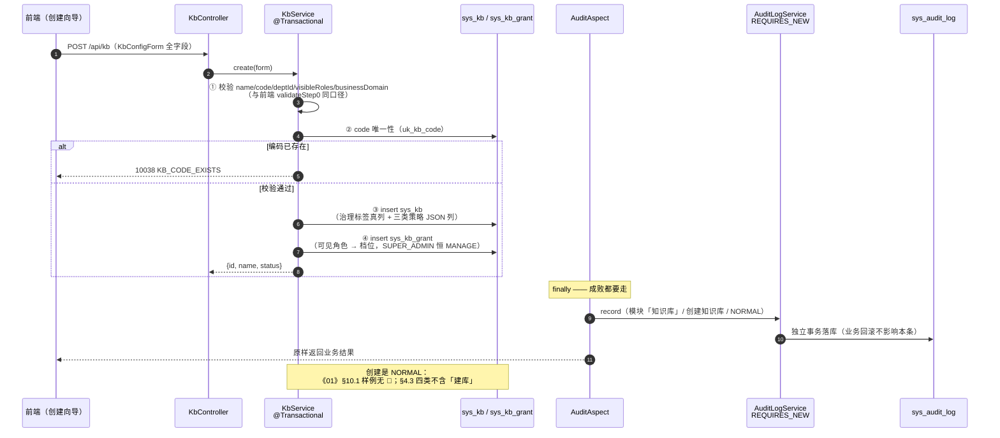
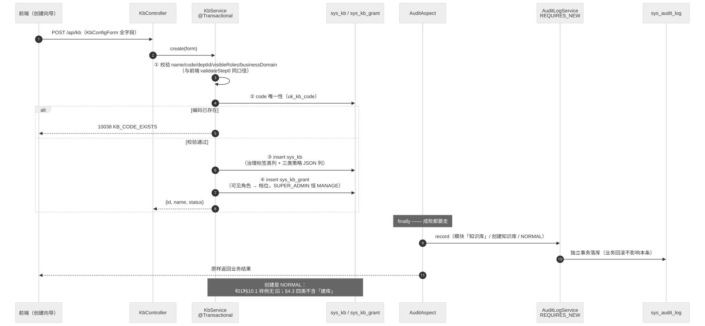

> 状态：🟡 进行中 · Sprint S3 · 阶段 B（M04 知识库主体）· 建档 2026-09-14

# 2026-09-14 · S3 · M04 · 阶段 B1 —— 知识库列表 / 创建 / 分片预设 / 配置读取

> 任务：`T-400` `T-401` `T-402` `T-403`（4 项，全 P0）· 来源：`docs/进度/03-Sprint排期.md` §S3「开工顺序」阶段 B
> 上游计划：`ai_knowledge_web/plan/2026-09-14-S3-M03-A.md`（本批要销的账见第 1 节）
> 本批性质：**M04 的读 + 建库**。`T-404`（保存配置）起的写侧与重建索引分到 B2/B3 —— 边界落在「本批全部接口都**不产生需重建的副作用**」，可独立验收。

---

## 1. 开工条件检查

### 1.1 依赖清单（来源：`docs/进度/02-任务清单.md` M04 表的「依赖」列）

| # | 依赖项 | 档位 | 现状（代码/文档实证） | 结论 |
|---|---|---|---|---|
| 1 | `T-400` ← `T-212` 数据范围求交引擎 | ✅ | `DataScopeService#kbVisibility`（`DataScopeService.java:99`，SQL 层过滤）+ `KbGrantService#visibleKbIds`（`:217`）；`KbGrantFlowTest` 8 条 + `DataScopeSqlEvidenceTest` 已取证 | 满足 |
| 2 | `T-401` ← `T-400` | — | 同批内，`T-400` 先做（步骤 3.1 定序） | 满足（批内串行） |
| 3 | `T-402` ← `T-014` 模型注册中心 | ✅ | `ModelClientRegistry#activeSpec/embeddingModel`（`ModelClientRegistry.java:82/92`）；`.env` 四类端点齐备 | 满足，**但见 W2（`locked` 需投影）** |
| 4 | `T-403` ← `T-401` | — | 同批内，`T-401` 先做 | 满足（批内串行） |
| 5 | 表 `sys_kb`（库身份 + 归属部门 + 计数 + 创建人） | ⚠️ | `V7__s2_kb_skeleton_and_grants.sql:10` 建表 + `V8__s3_kb_owner.sql:31` 补 `owner_id`；**但密级/业务域/三类策略/描述列全都不存在** | **不满足 → 本批 V9 迁移** |
| 6 | 表 `sys_kb_grant`（可见角色落库位） | ✅ | `V5:55` 建表，`uk_kb_grant (kb_id, principal_type, principal_id)`；`KbGrantService#save` 已在写 | 满足 |
| 7 | 审计框架（`T-400`/`T-401` 的 🚩 打点） | ✅ | A 阶段交付 `AuditChange`/`AuditContext`/`AuditRiskPolicy`；`AuditChangeContractTest` 9 条 | 满足 |
| 8 | 环境：docker 六服务 + 种子 | ✅ | 六容器全 `Up (healthy)`；宿主 `127.0.0.1:9000/7474` 返 200、MySQL 直连可查（S3-A 的端口转发阻塞已解除）；`sys_kb=8 · sys_kb_grant=34 · sys_user=128 · sys_role_matrix=60` | 满足 |
| 9 | 错误码位（编码冲突/无权限） | ⚠️ | `ErrorCode` 已有 `KB_NOT_FOUND(10043)` / `KB_ACCESS_DENIED(10022)` / `DEPT_NOT_FOUND(10065)`；**`1003x` 参数类到 `10037` 为止，无「知识库编码已存在」** | 本批补 `KB_CODE_EXISTS(10038)` |

### 1.2 ⛔ BLOCKER 汇总

**无。**

> 第 5 条虽标 ⚠️，但判据是「这条不满足，代码写下去会不会白写」—— 缺的是**本批自己就能建的列**，
> 不依赖任何上游模块或他人交付，故不构成 BLOCKER，直接进第 4 节数据变更清单。

### 1.3 ⚠️ 已知偏差（不拒绝施工，第 9 节销账）

| # | 偏差 | 影响 | 归属 |
|---|---|---|---|
| W1 | **`sys_kb.status` 的词表与前端类型对不上**：seed 用 `READY`/`INDEXING`（`V7:31-36`，与《01》§3「已就绪 / 索引中」、《06》§1.1 一致），而前端 `KnowledgeBase['status'] = 'ACTIVE'\|'BUILDING'\|'PAUSED'`（`types/index.ts:84`）、mock 返 `'ACTIVE'`、`KbDetailView.vue:362` 按 `'ACTIVE'` 分支渲染「正常」 | 真后端返 `READY` 时，设置页标签会显示裸字符串「READY」。**页面级验收必现** | **本批处理**（见 3.1 步骤 8） |
| W2 | **`embedding.locked` 无现成来源**（`03-Sprint排期.md` 已点名）：`ModelClientRegistry#embeddingModel` 是全局单例，`ModelConfigSpec` 无 `locked` 概念 | `G3-2` 要求 `/kb/presets` 与 `/kb/{id}/config` 都带 `locked: true` | **本批处理**（响应体单独投影，步骤 5/7） |
| W3 | **`vlModel.appliedAt` 无来源**：mock 从模型配置表取（`activeVlModel()`），后端 `sys_model_config` **0 行**（S6 才接 DB），引导配置 `ModelConfigSpec` 无该字段 | 设置页 `自 {{ appliedAt }} 起生效` 会渲染成「自  起生效」 | **本批处理**（返回空串 + 前端加 `v-if`，步骤 8） |
| W4 | **`vlModel.name` 语义分叉**：mock 返 `displayName`（如「Qwen3-VL-8B」），后端只有 `ModelConfigSpec#model()`（如 `Qwen/Qwen3-VL-8B-Instruct`） | 展示文案变型号标识。不报错，但需登记 | 本批按 `model()` 返（诚实口径）· 差异进《10》§14.1 |
| W5 | `GET /kb?scope=mine` **是前端真实发的参数**（`KbListView.vue:24` → `kbApi.list(scope)`），而《06》§1.7 / 《10》§5 只登记了 `keyword/deptId/status/page/size` | 不实现 `scope` → 列表页「我创建的」按钮点了没反应（**静默失效**） | **本批处理**（步骤 2）+ 补登记《10》§14.1 |
| W6 | `AuditModule.KB`（「知识库」）**零使用** | `T-401` 是它的第一个消费者 | 本批销 |
| W7 | 《08》§七 遗留 1：「`DISABLED` 账号允许登录、知识库不可见」的实现偏差 | 与 `/kb` 列表强相关（`03-Sprint排期.md` 明确「`/kb` 就绪后一次做完」） | **随 M04 修 —— 但不在 B1**：见 3.3，定 B2 |

### 1.4 结论

- [x] ✅ **可以开工** —— 无 BLOCKER；7 条 WARN 中 W1/W2/W3/W5/W6 本批处理，W4 登记口径，W7 明确定到 B2

---

## 2. 开工时间

| 项 | 值 |
|---|---|
| 建档 / 开工日 | 2026-09-14 |
| 预计投入 | 2.5 人天（Sprint 容量 ≈ 10 人天；B 阶段共 12 项，B1 取 4 项） |
| 实际投入 | *回填时补* |

---

## 3. 开工内容

### 3.1 步骤

| 步 | 做什么（文件 → 动作 → 产出） | 依赖 | 可并行 |
|---|---|---|---|
| 1 | **`V9__s3_kb_governance_and_policies.sql`**（新增迁移）：给 `sys_kb` 加 `description / secret_level / business_domain / custom_tags / split_policy_json / table_policy_json / retrieval_config_json`；按 `dept_id` 回填演示库的业务域与默认策略 | — | 否（后续全部依赖它） |
| 2 | **`service/KbService.java`（新建）`#list`**：`GET /kb` —— 数据范围走 `KbGrantService#visibleKbIds`（SQL 层，复用不重写）；支持 `keyword / deptId / status / scope`；`scope=mine` → `owner_id = 当前用户`（W5）；返回 `{list:[{id,name,docCount,chunkCount}], total}` | 1 | 可 |
| 3 | **`controller/KbController.java`（新建）** + `dto/kb/KbDtos.java`（新建）：`GET /kb`（挂 `kb:view`）、`GET /kb/presets`（只要求登录）、`GET /kb/{id}/config`（挂 `kb:list` + 可见性校验）、`POST /kb`（挂 `kb:create`）。**类注释写明与 `KbGrantController` 同居 `/api/kb` 前缀的路径优先级** | 2 | 可 |
| 4 | **`core/enums` 补两张可断言口径表**：`KbPresets`（5 预设 × chunkSize/overlap/semanticSplit/tableAtomic，**数值逐个对齐 `ai_knowledge_app/src/mock/data.ts:380`**）+ `KbConfigDefaults`（`defaultKbConfig()` 的后端版本）。与 `AuditRiskPolicy` 同型：口径写成表，供用例逐条比对 | — | 可（与 2/3 独立） |
| 5 | **`KbService#presets`**（`T-402`）：组装 `{presets, defaults, embedding, vlModel}`；`embedding` 走 `activeSpec(EMBEDDING)` **投影补 `locked:true`**（W2）；`vlModel` 走 `activeSpec(VL)`，取不到时返 `{name:'', enabled:false, appliedAt:''}` 而非抛错 | 4 | 否 |
| 6 | **`SysKb` 实体（新建 `entity/SysKb.java`）**：与 V9 后的表逐列对齐（`ddl-auto: validate`，错一列启动即失败）；`customTags`/三策略列在实体里保持 `String`，JSON 解析放在 Service | 1 | 可 |
| 7 | **`KbService#create`**（`T-401`，🚩 打点）：校验（名称 2-40 / 编码 `^kb_[a-z0-9_]{2,}$` / 部门存在 / **≥1 可见角色** / 业务域非空，**与前端 `validateStep0` 同口径**）→ `insert sys_kb` → 按 `visibleRoles` 写 `sys_kb_grant`（档位映射见 3.4 假设 1）→ 返 `{id,name,status,note}`；`@AuditLog(module=KB, action="创建知识库", risk=NORMAL)`，**同步在 `AuditRiskPolicy` 登记一行** | 3/6 | 否 |
| 8 | **`KbService#config`**（`T-403`）：`{id,name,code,description,department,deptId,docCount,chunkCount,status,statusLabel,createdAt,updatedAt,visibleRoles,config,embedding,vlModel,presetOptions}`；`status` 原样返 `READY/INDEXING`，**另加派生字段 `statusLabel`**（已就绪/索引中）修 W1；`visibleRoles` 取自 `sys_kb_grant` 的角色 code | 3/6 | 否 |
| 9 | **前端 2 处跟进**（页面级验收的前提）：`KbDetailView.vue:362` 状态标签改用 `statusLabel`；`:478` 的 `appliedAt` 加 `v-if` 守卫 | 8 | 可 |
| 10 | **门禁用例 `KbModuleFlowTest`**（真 HTTP + 查库 + 存量 SQL 抓取）：列表数据范围在 SQL 层（Logback `ListAppender` 抓 `org.hibernate.sql`，照 `DataScopeSqlEvidenceTest` 的形状）；`T-401` 四步全字段落库 + 回读一致 + 审计落库；`T-402` 预设 5 条 / 默认值 / `locked:true`；`T-403` 可见性拒绝 | 7/8 | 否 |
| 11 | **页面级 E2E `scripts/e2e-kb-flow.mjs`（新增）**：`/kb` 列表渲染真后端 8 库 → `/kb/create` 向导加载预设与部门/角色 → `/kb/:id` 设置页回显；脚本用固定 `code` 建库并在**开头幂等清理**（`docker exec kb-mysql mysql -e "delete from sys_kb where code='kb_e2e_probe'"`，spawn 已有先例、零新增依赖） | 9 | 否 |
| 12 | **文档回填**：《10》§14 补 `kb` 四条响应体 + §14.1 补 `scope` 与 `status/statusLabel` 差异 + §15 变更记录；《06》§1.7 补 `scope` | 10 | 可 |

**顺序**：1 → 6 → (2‖3‖4) → 5 → 7 → 8 → 9 → 10 → 11 → 12。
**可并行**：`KbService#list` 与 `presets` 无耦合；口径表（步 4）可与迁移（步 1）同做。

### 3.2 业务流程图

> 触发条件核对：① 跨 ≥3 个组件（Controller / Service / sys_kb+sys_kb_grant / 切面 / 审计库）✅
> ② 事务边界（业务事务 + 审计 `REQUIRES_NEW`）✅ ④ 并发/幂等（`uk_kb_code` 唯一约束）✅ → **必须画**


<!-- diagram: ./2026-09-14-S3-M04-B1/01-sequence.svg -->

<!-- diagram: 渲染后由 gen-diagram.mjs 插入 marker -->
<!--  -->

**渲染图**（点开看，不用装 mermaid 插件）：`./2026-09-14-S3-M04-B1/01-sequence.svg`
重新生成：`cd ai_knowledge_app && node scripts/gen-diagram.mjs ../ai_knowledge_web/plan/2026-09-14-S3-M04-B1.md`


**关键点**：`T-400`/`T-403` 的可见性**不是**本批新写的逻辑，而是复用 A 阶段之前就冻结的求交引擎（② 数据范围 ∩ ③ 知识库授权，**没有"或"分支**）。本批要做的只是**把它的结果投影成前端要的形状** —— 凡是绕过 `visibleKbIds` 直接 `select * from sys_kb` 的写法，都会让 `G2-7/G2-8` 已有的取证失去意义。

### 3.3 明确不做（范围控制）

| 不做的事 | 原因 | 归属批次 |
|---|---|---|
| `PUT /kb/{id}/config`（`T-404`）、影响预估（`T-405`） | 本批是**读 + 建库**；保存配置会引入 `needReindex` 状态与 before/after 登记 | S3-B2 |
| `POST /kb/{id}/reindex`（`T-406`）、清空索引 / 软删（`T-407`） | 同上，且是「重建原子性 `G3-5`」的主战场，需独立取证 | S3-B3 |
| `GET /kb/{id}/stat`（`T-408`）、`/kb/{id}/tags`（`T-409`）、`GET /kb/{id}`（`T-410`）、`/kb/{id}/parse-config`（`T-411`） | 均依赖 `T-403` 的就绪形态；`T-411` 内容全继承自知识库配置，等 `T-404` 的写侧定形后一次做完更省 | S3-B2 / S3-B3 |
| **`DISABLED` 账号「允许登录 + 知识库不可见」**（W7 / 《08》§七 遗留 1） | 判据要「能登录但看不到库」，**必须等 `/kb` 列表与 `kb:view` 权限链路都就位**才能端到端取证；本批末尾正好具备全部前置 | **S3-B2**（`03-Sprint排期` 原话「`/kb` 列表就绪后一次做完」，本批即为该时点） |
| 密级下传文档「可提高不可降低」（I-6）的强制校验 | 文档表 `sys_document` 是 S4 才建 | S4 |
| 知识库模板 / 分组 / 跨库检索预设持久化 | 《06》§1.9 明确「不做」 | 不做 |
| `sys_kb_preset` 建表 | 预设是产品口径、不是用户数据，硬编码成 Java 表即可（见第 5 节） | 不做 |

### 3.4 本批假设

> 信息不足下拍的决策。**假设被证伪 → 进第 9 节遗留**，否则没人知道当初赌了什么。

| # | 假设 | 若被证伪的后果 |
|---|---|---|
| 1 | **创建时按已冻结的角色档位映射写 `sys_kb_grant`**：`SUPER_ADMIN→MANAGE`、`KB_ADMIN→UPLOAD`、其余→`READ`（口径来自 `V7:49-52` 与《01》§2.5）。且**超管恒加授 MANAGE**（即便向导里没勾） | 若改为「勾选的统一给 READ」，新建库的超管只剩只读、KbGrantFlowTest 的种子口径也要跟着改；若允许把超管取消，**建完的库会变成自己都看不见的孤儿** |
| 2 | `scope` 的 `mine` = **`owner_id = 当前登录用户 id`**（不是"本部门"） | 前端按钮文案「我创建的」与语义不符，需改前端文案或改判定 |
| 3 | 三类策略用 **JSON 列**存（`*_json`），治理标签用**真列**存 | 若后续要按策略字段 SQL 筛选（如"按 chunkSize 找库"），需再开迁移把 JSON 拆列 |
| 4 | `KbConfigDefaults` 的默认值**与前端 `defaultKbConfig()` 逐字一致**（含 `businessDomain: '研发 / 平台'`、`recallThreshold: 0.15`） | 前端第 4 步的「非默认项」diff 会把大量默认值算成"已改"，页面出现无意义的变更提示 |
| 5 | 后端返 `status` 用 `READY/INDEXING`（域内真值），由**新增派生字段 `statusLabel`** 承担展示；前端同步改用它 | 若判定应以 `ACTIVE/BUILDING/PAUSED` 为准，则需新迁移改 seed 值 + 同步《01》§3 与《06》§1.1 两处文档 |
| 6 | `/kb/presets` 只要求登录（表单数据源口径，与 §14.1-7 的 `/depts/tree`、`/roles` 同型） | 若要求挂 `kb:create`，需确认创建页之外无第三方消费者（当前只有 `KbCreateView` 调它） |

---

## 4. 数据变更清单

| 类型 | 内容 | 回滚方式 |
|---|---|---|
| **改表** | `sys_kb` 增 7 列：<br/>`description VARCHAR(200) NULL`<br/>`secret_level VARCHAR(16) NOT NULL DEFAULT 'INTERNAL'`<br/>`business_domain VARCHAR(64) NOT NULL DEFAULT ''`<br/>`custom_tags TEXT NULL`（JSON 数组）<br/>`split_policy_json TEXT NULL`<br/>`table_policy_json TEXT NULL`<br/>`retrieval_config_json TEXT NULL`<br/>**不加索引**：本批无按策略字段筛选的查询 | 可逆（`DROP COLUMN`）；回填值可由 V9 重算 |
| 迁移文件 | **`V9__s3_kb_governance_and_policies.sql`**（现有最大编号 = `V8`） | — |
| 种子数据 | **8 个演示库就地回填**（不新增行）：`secret_level` 统一 `INTERNAL`；`business_domain` 按 `dept_id` 映射（1→研发 / 平台 · 2→销售 / 售前 · 3→人力资源 · 4→运维 / 安全 · 5→培训 / 赋能）；三策略列全部按 `KbConfigDefaults` 的默认值写；`kb_prod_doc` 的 `custom_tags` 写 `["2026 年度","技术白皮书"]`（对齐 mock `kbConfigOf`）。**行数不变：8 库 / 34 授权** | — |
| **NULL 分支** | `custom_tags IS NULL` → 读侧归为 `[]`（前端 `customTags: []`）；三策略列若 `NULL` → 读侧用 `KbConfigDefaults` 兜底，**不报错**（防御历史上手工插的行）。`secret_level`/`business_domain` 有 `NOT NULL DEFAULT`，不存在 NULL 路径 | — |

> ⚠️ 跑过的迁移**只增不改** —— V1~V8 一行不动，改动全部落在 V9。
> ⚠️ `ddl-auto: validate` 会拿 `SysKb` 实体逐列对表；**实体与 V9 必须同批提交**，否则启动即失败。

---

## 5. 依赖与工具决策

**默认不引。** 本批两个技术选择点：

### 5.1 三类策略怎么落库

| 方案 | 做法 | 代价 | 结论 |
|---|---|---|---|
| **A · 不引（拆真列）** | `chunk_size` / `overlap` / `semantic_split` … 逐字段建列（约 20 列） | 表宽 20 列，且每加一个策略参数就要开迁移；与前端 `KbConfigForm` 的嵌套结构之间多一层手工映射，**两处结构会各自演化** | ❌ |
| **B · JSON 列（既有 Jackson）** | `split_policy_json` / `table_policy_json` / `retrieval_config_json` 三列，注入 Boot 4 自动配置的 `ObjectMapper` 读写 | 无法按策略字段 SQL 筛选（本批无此需求） | ✅ 推荐 |
| C · 引新库（Jackson 之外的 JSON 实现） | — | 为已有能力再引一个库，且与 T-300 已定的 JSON 口径分叉 | ❌ 明确不做 |

**推荐：B。** **理由**：① 三类策略是**整体读写单元**（页面上一个 Tab 一次提交），从没有"单独改 `rowWindow`"的接口；② JSON 列让后端结构与 `KbConfigForm` **逐字同构**，省掉手工映射这一层漂移源；③ 序列化/反序列化用 **T-300 已经实证过的那个 `ObjectMapper`**（`JacksonProbeTest` 钉住了 Jackson 3 的注入），不新增任何依赖。
**边界**：治理标签（密级 / 业务域 / 自定义标签）**不**进 JSON —— 密级是检索期的过滤维度（`MilvusConstants.FIELD_SECRET_LEVEL`）、业务域是治理语义列，两者都可能有 SQL 筛选需求。

### 5.2 五个预设放哪

| 方案 | 做法 | 代价 | 结论 |
|---|---|---|---|
| **A · Java 常量表（不引/不建表）** | `core/enums/KbPresets`，5 行硬编码 | 改预设要发版 | ✅ 推荐 |
| B · 建 `sys_kb_preset` 表 | 迁移 + 种子 + 仓储 + 缓存失效 | 预设是**产品口径不是用户数据**，入库后立刻要处理"谁能改、改了已建的库怎么办" | ❌ |
| C · 读前端 mock 的 JSON 文件 | 跨模块读源码目录 | 运行时依赖前端仓库，构建不可复现 | ❌ 明确不做 |

**推荐：A。** **理由**：与 `AuditRiskPolicy`（T-301）同型 —— **把口径写成可被用例逐条比对的表**，于是"后端预设与前端 mock 漂移"会直接测试失败，而不是等联调时发现参数对不上。数值源是 `ai_knowledge_app/src/mock/data.ts:380`（前端唯一的现成口径），逐条抄过来并在类注释里写明出处。

> 无新依赖：**JSON 用既有 Jackson 3（注入）· 预设用 Java 常量表 · 不建新表**。

---

## 6 + 7. 验收方法与标准

> 判据与验证方法合并成一张表（分家必然漂移）。判据号对齐 `03-Sprint排期` §S3 门禁。

| # | 判据（对齐门禁号） | 验收方法（可直接粘的命令/脚本） | 期望结果 | 证据落点 |
|---|---|---|---|---|
| 1 | **`G3-1` 创建向导四步全字段落库** | `export JAVA_HOME='F:/work/dev_tools/jdk/jdk-25.0.4.1'` + `mvn -B -f F:/work/code/ai-knowledge/ai_knowledge_web/pom.xml test -Dtest=KbModuleFlowTest` | 真 HTTP `POST /api/kb`（含非默认 `splitPolicy`/`tablePolicy`/`retrievalConfig`/`customTags`）后，`select` 回的 7 列与提交值**逐字相等** | 测试名 + 前后 SQL |
| 2 | **`G3-1` `CUSTOM` 预设由手改参数触发** | 同上用例（提交 `preset='CUSTOM'` + 自定义 `chunkSize`） | 落库 `split_policy_json` 中 `preset == "CUSTOM"`，且 `chunkSize` 为手改值（**不是**预设带的 512） | 同上 |
| 3 | **`G3-1` 创建立即可回读** | 同上（`POST /kb` → `GET /kb/{新id}/config`） | `config` 与提交的 `KbConfigForm` 深等（`visibleRoles` 亦一致） | 同一用例串起 |
| 4 | **`G3-2` 嵌入模型只读** | `GET /api/kb/presets` 与 `GET /api/kb/{id}/config` | 两处的 `embedding.locked == true`；响应中**不存在**可选模型列表字段 | 用例断言 `$.embedding.locked` |
| 5 | **`G3-2` 预设为 5 条且与前端一致** | `GET /api/kb/presets` | `presets` 长度 5、有序（GENERAL/STRUCTURED/CONTRACT/TABLE_HEAVY/QA_PAIR），逐条的 `chunkSize/overlap/semanticSplit/tableAtomic` **等于 `mock/data.ts:380` 的值**；`defaults.splitPolicy.chunkSize == 512`、`defaults.retrievalConfig.recallThreshold == 0.15` | `KbPresets` 表 + 用例 |
| 6 | **`G3-1` 四步默认值** | `GET /api/kb/presets` → `$.defaults` | 与前端 `defaultKbConfig()` 深等（假设 4） | 同上 |
| 7 | **`T-400` 数据范围在 SQL 层** | `mvn -B test -Dtest=KbModuleFlowTest`（Logback `ListAppender` 挂 `org.hibernate.SQL`） | 真 HTTP `GET /api/kb` 时抓到的 SQL **含 `sys_kb_grant` 的 `EXISTS` 子查询**；`DEPT_AND_CHILD` 用户另含 `parent_id` 展开 | 用例名 + 抓到的 SQL 片段 |
| 8 | **`T-400` 可见性数值** | 用例内按 `LoginUser` 构造 ALL / DEPT_AND_CHILD / DEPT / SELF 四种范围调 `KbGrantService#visibleKbIds` 与 `GET /kb` 对照 | ALL(admin) → 8 库；`zhang.wei`(DEPT_AND_CHILD, dept 1) → 恰 1 库；部门外授权 → 0 库（**I-7 正反向**） | 沿用 `KbGrantFlowTest` 的夹具 |
| 9 | **`T-400` `scope=mine` 生效** | `GET /api/kb?scope=mine`（admin，`owner_id IS NULL`） | 返回 `total == 0`；改用一个 `owner_id` 非空的账号 → 等于其拥有的库数 | 用例名（W5 的回归） |
| 10 | **`T-403` 越权读配置被拒** | 构造一个对 kb1 无授权的 `LoginUser` → `GET /api/kb/1/config` | `code == 10022`（`KB_ACCESS_DENIED`），**不是** 200 带数据 | 用例名 |
| 11 | **`T-403` 不存在返回 10043** | `GET /api/kb/999999/config` | `code == 10043`（`KB_NOT_FOUND`） | 用例名 |
| 12 | **`T-401` 校验口径与前端一致** | 提交 ①名称 1 字 ②编码 `kb_X`（大写）③ `visibleRoles=[]` ④ `deptId` 不存在 | 四种各返 `10030`/`10038`/`10030`/`10065` 中的对应码；**库表零新增行** | 用例名（4 条断言） |
| 13 | **`T-401` 编码唯一** | 同一 `code` 连发两次 `POST /api/kb` | 第二次 `code == 10038`（`KB_CODE_EXISTS`），且 `sys_kb` 仍只 1 行 | 用例名 |
| 14 | **`G3-7`（产出半边）建库落审计** | 建库后 `select module, action, risk_level, target from sys_audit_log order by id desc limit 1` | `知识库 / 创建知识库 / NORMAL / 含新库名`；`changes_json IS NULL`（建库无 before —— 与 A 阶段判据 5 同口径） | 用例名 + SQL |
| 15 | **`T-301` 策略表不漂移** | `mvn -B test -Dtest=AuditChangeContractTest` | 反射扫全项目 `@AuditLog` 与 `AuditRiskPolicy` 逐条一致（**新增注解未登记 → 直接失败**） | 既有用例 |
| 16 | **既有 101 条不回退** | `mvn -B -f F:/work/code/ai-knowledge/ai_knowledge_web/pom.xml test` | `Tests run: 101+N, Failures: 0, Errors: 0` | 构建输出 |
| 17 | **页面级：KB 三页切真后端零未捕获** | `cd ai_knowledge_app && node scripts/e2e-kb-flow.mjs --base=http://127.0.0.1:5174`（dev 须 `--host 127.0.0.1` + `VITE_USE_MOCK=false`；后端 8080） | 列表 8 库渲染 / 向导预设与部门角色来自真后端 / 设置页回显一致；脚本自清并核对 `sys_kb` 回到 8 行 | 脚本输出 + 种子核对 |
| 18 | **页面级：全站 console 零未捕获** | `node scripts/console-check.mjs --base=http://127.0.0.1:5174` | 25/25，`Runtime.exceptionThrown` 为 0（未实现接口的 404 只留降噪提示，属观察项） | 脚本输出 |

**观察项**（不计成败）：

- 设置页的「VL 视觉模型」显示的是**型号标识**（`Qwen/Qwen3-VL-8B-Instruct`）而非 mock 的展示名 —— W4，等 S6 接 `sys_model_config` 后统一。
- `/kb/{id}/upload` 页（创建成功后的跳转目标）会调 `GET /kb/{id}/docs` 与 `/parse-config`，**在 S4/S3-B3 之前必然是 404 降噪提示** —— 本批只保证跳转发生、console 无未捕获异常。
- 列表页的「知识库总数 / 文档总数 / 向量分片数 / 存储占用」四个统计卡（《06》§1.1）当前是前端写死值，**本批不改**（无对应接口，`T-408` 才有 `storage-quota`）。

**挂起判据**（见铁律 3）：

| 判据 | 挂起原因 | 待哪一批合并验收 |
|---|---|---|
| `G3-7` 的**「在 `/audit/logs` 可查」**（消费侧渲染） | 查询侧接口 `T-302` 是 C 阶段才做，本批只有产出侧证据（判据 14） | **S3-C** |
| `G3-1` 的「创建成功跳转文档上传页并正常引导」 | 上传页的真实数据源依赖 S4 的 `/kb/{id}/docs` | **S4**（合并回填） |

**种子核对**（跑完必做）：

```bash
set -a && . ai_knowledge_web/.env && set +a
docker exec kb-mysql mysql -u"$MYSQL_USERNAME" -p"$MYSQL_PASSWORD" "$MYSQL_DATABASE" -N -e \
  "select (select count(*) from sys_kb) kb, (select count(*) from sys_kb_grant) grants, \
          (select count(*) from sys_user where deleted_at is null) users, \
          (select count(*) from sys_role_matrix) matrix, \
          (select count(*) from sys_kb where code like 'kb_e2e_%' or code like 'kb_probe_%') residue;"
```

期望 `8 · 34 · 128 · 60 · 0`。**带 `kb_e2e_`/`kb_probe_` 前缀的残留必须为 0**（用例与 E2E 自建库的自清判据）。

---
---

# 以下为开工后回填

> **提交节奏（两次）**：1~7 节写完即提交一次（`docs(plan): S3-M04-B1 开工计划`）；
> 8~10 节写完再提交一次（`docs(plan): S3-M04-B1 验收回填`）。让 git log 上「计划 → 结果」成对可查。

## 8. 验收结果

| # | 判据 | 实测结果 | 证据（命令 / 文件:行 / 测试名） |
|---|---|---|---|

**测试基线**：`Tests run: N, Failures: 0, Errors: 0, Skipped: 0`（上批 101 → 本批 M）

---

## 9. 遗留问题

| # | 项 | 原因 | 归属批次 | 是否有判定点/注释留在代码里 |
|---|---|---|---|---|

---

## 10. 建议

- 对下批的排期 / 口径 / 风险建议。没有写「无」。

---

## 附：本批同步的文档回填

- [ ] `docs/进度/02-任务清单.md` → `T-400`~`T-403` 置 ✅（未做的不动）
- [ ] `docs/进度/03-Sprint排期.md` → 「交付状态」段
- [ ] `docs/进度/README.md` → 看板状态 + 完成日期 + §7 变更记录
- [ ] `docs/需求文档/10-接口约定汇总.md` → §14 四条响应体 + §14.1 `scope`/`statusLabel` 差异 + §15 变更记录
- [ ] `docs/需求文档/06-需求-知识库与文档.md` §1.7 → 补 `scope` 参数
- [ ] `ai_knowledge_web/plan/README.md` → 索引表加行
- [ ] `ai_knowledge_web/plan/汇总.md` → §1 定位 / §2 加行 / §3 并入遗留 / §4 挂起判据
- [ ] 本文件状态行 → ✅ 已完成
- [ ] `.workbuddy/memory/2026-09-14.md` → 交接
