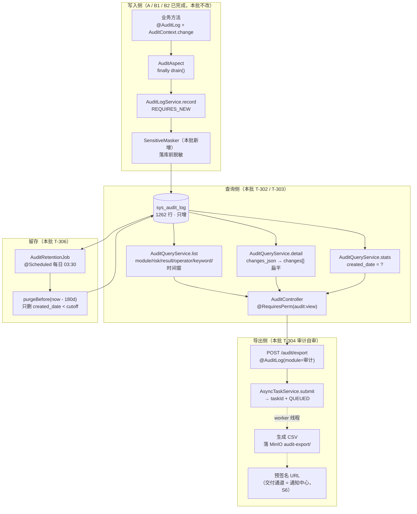

> 状态：✅ 已完成 · Sprint S3 · 阶段 C（M03 审计 · 查询侧）· 建档 2026-09-15 · 完成 2026-09-15

# 2026-09-15 · S3 · M03 · 阶段 C —— 审计查询侧（T-302 ~ T-306）

> 任务：`T-302` `T-303` `T-304` `T-305` `T-306`（5 项，P1）· 来源：`docs/进度/03-Sprint排期.md` §S3「开工顺序」阶段 C
> 上游计划：`ai_knowledge_web/plan/2026-09-14-S3-M03-A.md`（契约先行）· `2026-09-14-S3-M04-B1.md` · `2026-09-15-S3-M04-B2.md`
> **用户裁定（2026-09-15）**：本批**只做查询侧**；A 阶段遗留 #1「§4.2 采集范围 8 处未打点」**移出本批**另立 S3-C2；
> 登录/登出/登录失败**不重复打审计点**，以 `sys_login_log` 为唯一事实源。两条都写进 §3.3 / §9。

---

## 1. 开工条件检查

**依赖清单来源**：`docs/进度/02-任务清单.md` §M03 的「依赖」列 + 上一批计划第 9 节 + 环境实测。

| # | 依赖项 | 档位 | 现状（代码/文档实证） | 结论 |
|---|---|---|---|---|
| 1 | `T-302` ← `T-300`（`changes` 契约） | ✅ | `core/audit/AuditChange.java`（U+2014 空值）· `AuditContext` · `AuditLogService#serializeChanges`（空集合写 NULL）齐备 | 满足 |
| 2 | `T-302` ← 表 `sys_audit_log` | ✅ | `V1__init_skeleton_schema.sql:219~250`，列与索引全在（`idx_audit_created_at` / `idx_audit_module_created` / `idx_audit_operator_created` / `idx_audit_trace_id`） | 满足，**无需迁移** |
| 3 | `T-302` ← 有日志可查 | ✅ | 真库 `select count(*) from sys_audit_log` = **1262**（2026-09-13 ~ 09-15，14 种 action，6 个模块） | 满足 |
| 4 | `T-303` ← `T-302` | ✅ | 同批内，串行（§3.1 步骤 2 在步骤 1 之后） | 满足（批内串行） |
| 5 | `T-304` ← 异步任务外壳 | ✅ | `core/async/AsyncTaskService`（submit → taskId + 进度 + 幂等）· `AsyncConfig` 的 `taskExecutor` 已就绪 | 满足 |
| 6 | `T-305` ← 产出侧已避让 | ✅ | `AuditLog.recordParams()` 默认 `false`；`AuditAspect#summarizeArgs` 只写类型与长度 | 满足（本批补**读侧防御**） |
| 7 | `T-306` ← 定时任务能力 | ⚠️ | `AsyncConfig` 提供了 `ThreadPoolTaskScheduler` 的 **Bean**，但全仓 `@EnableScheduling` **零处**、`@Scheduled` **零处**（实测 grep 空） → 清理任务要先把调度打开 | **本批处理**（见 §3.4 假设 3） |
| 8 | 前端消费契约 | ✅ | `src/api/index.ts:362~366` 四个调用**已存在**；`types/index.ts:227` 的 `AuditLog` / `:242` 的 `AuditLogDetail` 已定义 | 满足，**前端调用零改动** |
| 9 | 环境（docker / 端口 / 种子） | ✅ | 6 容器 healthy；`sys_kb` 8 · `sys_kb_grant` 34 · `sys_user` 128 · `sys_role_matrix` 60（B2 收尾已核对） | 满足 |

### 1.1 ⛔ BLOCKER 汇总

**无。**

### 1.2 ⚠️ 已知偏差（不拒绝施工，第 9 节销账）

| # | 偏差 | 影响 | 归属 |
|---|---|---|---|
| W1 | **`sys_audit_log.role_name` 的语义与前端用法相反**：列注释是「操作人角色（多角色逗号连接）」（`AuditAspect#build` 从 `LoginUser.getRoleCodes()` 写），而前端 `AuditLogView.vue:337` 拿 `roleName` 当**受影响角色**渲染「N 人（**该角色**下全部成员）」，`:349` 还用它开「查看该角色当前权限」按钮（mock 的 `roleName = '知识库管理员'` 就是受影响角色）。**该列当前零正确消费方** | 详情抽屉的「影响用户」会渲染成「12 人（**SUPER_ADMIN** 下全部成员）」—— 语义错，且看起来还挺像真的 | **本批处理**（§3.1 步骤 4 + §4 加列，A 阶段遗留显式升级） |
| W2 | **`AuditModule.AUDIT` 不在前端 `MODULES` 下拉里**（`AuditLogView.vue:56`） | `T-304` 写完「导出审计日志」的日志**写得进、筛不出** —— 从运营视角看等于丢了 | **本批处理**（§3.1 步骤 7） |
| W3 | **前端把日期范围写死且根本没发出**：`AuditLogView.vue:49` `dateRange` 默认 `['2026-09-10','2026-09-11']`，而 `loadLogs()` 的 `params`（`:61~67`）**既没有 `startTime` 也没有 `endTime`** | 需求 §4.4「**时间范围必选且默认「今日」**，避免一次扫全表」**整条落空**；页面显示的日期与列表内容毫无关系 | **本批处理**（§3.1 步骤 7，消费侧真缺陷） |
| W4 | **`SysAuditLogRepository extends JpaRepository`**，自带 `deleteById` / `deleteAll` | §4.8「审计日志**没有任何编辑/删除入口**」指的是**接口层**；JPA 基类自带删除能力这一点要在 `T-306` 里说清（且 `T-306` 的留存清理**需要**删除能力，故不改基类） | 本批说明（§3.4 假设 4） |
| W5 | 前端 `stats` 的初值是 mock 常量（`247/12/34/3`，`AuditLogView.vue:35`），接真后端前会**闪一下假数** | 观感问题，非判据 | 本批顺手改 0（§3.1 步骤 7） |

> 判据只有一条：**这条不满足，代码写下去会不会白写**。W1/W2/W3 不修则本批评据自己就假了，故全部在本批处理。

### 1.3 结论

- [x] ✅ **可以开工** —— 无 BLOCKER；5 条 WARN 全部本批处理（W4 只需在文档与注释里说清）
- [ ] ⛔ 拒绝施工

---

## 2. 开工时间

| 项 | 值 |
|---|---|
| 建档 / 开工日 | 2026-09-15 |
| 预计投入 | **2.5 人天**（Sprint 容量 ≈ 10 人天；A 1.5 + B1 3 + B2 2.5，本批 2.5，S3 合计约 9.5） |
| 实际投入 | **约 2.5 人天**（与预计一致） |

---

## 3. 开工内容

### 3.1 步骤

| 步 | 做什么（文件/类 → 动作 → 产出） | 依赖 | 可并行 |
|---|---|---|---|
| 1 | 后端 **`T-302` 列表 + 详情**：新建 `dto/audit/AuditDtos.java`（`LogRow` / `LogPage` / `LogDetail` / `StatsView` / `ExportAccepted`）· `service/AuditQueryService.java`（原生 SQL 拼 where，沿用 `LoginLogService#page` 的分页壳形状）· `controller/AuditController.java`（`GET /api/audit/logs`、`GET /api/audit/logs/{id}`，均 `@RequiresPerm("audit:view")`）。**详情为扁平字段**（`T-302` 验收要点），`changes` 由 `changes_json` 反序列化 | — | — |
| 2 | 后端 **`T-303` 统计**：`GET /api/audit/stats?date=`（`date` 缺省 = 今天）。四项口径：`today` = 当天日志数 · `highRisk` = 当天 `risk_level='HIGH'` 数 · `activeUsers` = 当天 `count(distinct operator)` · `failed` = 当天 `result='FAILED'` 数。全部按 `created_date = ?` 走（冗余列就是为这个建的） | 步骤 1 | 与步骤 3 并行 |
| 3 | 后端 **`T-305` 脱敏**：新建 `core/audit/SensitiveMasker.java`（窄口径模式：`sk-` 后 ≥16 位、`Bearer <token>`、`api[_-]?key`/`password`/`secret`/`token` 的 `k=v` 形态）；**在 `AuditLogService#record` 落库前**对 `apiPath` / `target` / `note` / `failReason` / `changesJson` 统一过一遍（记 warn 留痕）。落库前而非读侧：一次堵住列表 / 详情 / 导出**三个出口**，且历史数据不受影响 | — | 与步骤 1/2 并行 |
| 4 | 后端 **`T-302` 详情 `roleName` 语义收敛**（W1）：`V11` 给 `sys_audit_log` 加 `affected_role VARCHAR(128) NULL`；`AuditContext.affectedRole(String)` + `AuditEvent.affectedRole` + `AuditAspect#build` 透传 + `AuditLogService` 落库；3 处既有 `affectedUsers(...)` 调用点（`RoleAdminService#saveMatrix` / `KbGrantService#save` / `UserAdminService#update`）**同批登记角色名**。`role_name`（操作人角色）**不动、不改写历史** | 步骤 1 | — |
| 5 | 后端 **`T-304` 导出（审计自审）**：`POST /api/audit/export`（`@RequiresPerm("audit:export")` + `@AuditLog(module = AuditModule.AUDIT, action = "导出审计日志", risk = HIGH)`）→ 走 `AsyncTaskService.submit("audit-export", …)`，任务体生成 CSV 落 MinIO `audit-export/` 前缀并给预签名 URL；接口立刻返回 `{taskId, status:'QUEUED', note}`（与 mock 同形，**前端零改动**）。同时把 `AuditRiskPolicy` 的「导出审计日志」条目**从 `PLANNED` 移入 `IMPLEMENTED`**（否则 `AuditChangeContractTest` 直接红） | 步骤 1/3 | — |
| 6 | 后端 **`T-306` 留存 + 不可改删**：`config/SchedulingConfig` 打开 `@EnableScheduling`（并把已有 `taskScheduler` Bean 接上）· `service/AuditRetentionJob`（`@Scheduled(cron = "${app.audit.retention-cron:0 30 3 * * *}")`，调 `purgeBefore(LocalDate.now().minusDays(RETENTION_DAYS))`，常量 `180`）。`AuditController` 内**不声明任何 PUT/PATCH/DELETE 映射** | 步骤 1 | 与步骤 4/5 并行 |
| 7 | 前端 **消费侧接通**（4 处）：① `MODULES` 加 `'审计'`（W2）；② `loadLogs()` 补 `startTime`/`endTime`，`dateRange` 默认**今日**（W3）；③ `stats` 初值改 0（W5）；④ `exportLogs()` 从纯 toast 改为真调 `sysApi.auditExport()` 并按 `taskId` 提示。另把 `api/index.ts` 的三个审计方法泛型从 `Record<string, unknown>` 收成 `AuditLog` / `AuditLogDetail` / `AuditStats` | 步骤 1~6（需要真接口） | — |
| 8 | 门禁取证：新建 `AuditQueryFlowTest`（后端，真 HTTP）+ `scripts/e2e-audit-flow.mjs`（页面级）；扩展 `e2e-kb-flow.mjs` 的收尾断言（B2 的 `保存配置` 日志应在审计页可查 —— 三批合并回填的那条） | 步骤 1~7 | — |

**依赖顺序**：1 / 3 可并行 →（2、4 依赖 1）→ 5 依赖 1+3 → 6 依赖 1 → 7 依赖全部后端 → 8 最后。

### 3.2 业务流程图

> 触发条件：① 跨 ≥3 个组件（Controller → Service → Repository/Entity + MinIO）✅ ② 涉及异步任务与事务边界（导出落 MinIO，与请求线程分离）✅ ③ 无状态机 ④ 幂等（导出任务带幂等键）✅ —— **满足，必须画**。


<!-- diagram: ./2026-09-15-S3-M03-C/01-flow.svg -->


> **图里的三处要害**：① 「本批不改」的写入侧是这张图的上游 —— **A/B1/B2 已产出 1262 行**，所以查询侧才有东西可查（这也是本批能独立开工的根因）；
> ② `SensitiveMasker` 挂在**落库前**而不是读侧 —— 一次堵住列表/详情/导出三个出口；
> ③ 导出的**交付通道断在虚线处**：任务真跑、CSV 真落盘，但「通知中心提醒」是 S6（`/notices` 在 ⑦ 清单里属 S6）→ 进 §3.3 / §9。

### 3.3 明确不做（范围控制）

| 不做的事 | 原因 | 归属批次 |
|---|---|---|
| **§4.2 采集范围 8 处补打点**（登录成功/失败/登出、新建用户、角色 CRUD、部门 CRUD、**用户停用**） | **用户 2026-09-15 裁定移出本批**。理由（本批补充）：补打点是「产出侧」的活 —— 要新增 ~8 个 `@AuditLog` + 逐条 `AuditRiskPolicy` 登记 + 逐个裁定风险档（新建用户算不算权限扩大？角色删除算内容删除？），用的是与查询侧**完全不同的一套判据**；混在一起验收会变大杂烩，遗留也无法定位。`audit-api.mjs` 基线与测试基线都会被污染 | **S3-C2**（§9-1，本批新建任务行） |
| **登录/登出/登录失败的审计打点** | **用户 2026-09-15 裁定：不打**，以 `sys_login_log` 为唯一事实源。三条硬理由：① 登录失败时 `LoginUserContext` 为 null，`@AuditLog` 只能记 `operator=anonymous`，而 `sys_login_log` 有账号/IP/设备/归属地（`LoginLogService` 已推导）；② 同一事件两个事实源必然漂移，审计页还要去重；③ 登录日志已用 `REQUIRES_NEW` 独立事务，再叠一层要额外验证嵌套 | 不做（**登记为口径**，见 §9-2） |
| **审计导出结果的通知投递** | `/notices` 整组在 ⑦ 清单里属 **S6**（19 条）；`GET /doc/tasks/{taskId}` 属 **S4**。两处都不在 S3 | S6 / S4（§9-3） |
| **`sys_model_config` 相关动作的审计打点**（`AuditRiskPolicy.planned()` 里那 7 条） | 模型配置接口整体是 S6（`/system/model/*` 19 条全在 ⑦ 的 S6 组），**当前零调用方** | S6 |
| **审计日志分表 / 走 ES** | §4.7 提到「量大时按月分表或走 ES」。当前 `created_date` 冗余列已为分区留好路，1262 行远未到量级 | S9 |
| **审计告警规则引擎** | §4.9 边界明确「不做实时告警」 | 不做 |
| **日志回放 / 操作录屏** | §4.9 边界明确 | 不做 |
| **给 `SysAuditLogRepository` 换只读基类** | 见 §3.4 假设 4 —— `T-306` 的留存清理**需要**删除能力，改了反而要自己造删除方法 | 不做（已在 `T-306` 说明） |

### 3.4 本批假设

| # | 假设 | 若被证伪的后果 |
|---|---|---|
| 1 | **`changes_json` 的反序列化在查询侧用同一个 Jackson 3 实例**（注入 `tools.jackson.databind.ObjectMapper`，与 `AuditLogService` 对称）。历史 267 行有 `changes_json`，格式由同一实例写出 | 若历史里有 Jackson 2 写出的行，`readValue` 可能抛错 → 详情整条 500。**兜底**：反序列化失败降级为 `changes = null` + warn（与落库侧「序列化失败降级为 null」对称），并在测试里造一条畸形 `changes_json` 行钉住这条分支 |
| 2 | **`activeUsers` = `count(distinct operator)`**，`operator` 为 null（理论上不该有，`AuditAspect` 兜底写 `anonymous`）时**不计入** | 若产品口径是「含匿名」，数值差 1。取「不计入」因为匿名不是一个"人" |
| 3 | **打开 `@EnableScheduling` 不会影响既有测试**（当前全仓零 `@Scheduled`，调度器 Bean 已存在但无人用） | 若有测试依赖"没有调度线程"，会引入偶发。**兜底**：`app.audit.retention-cron` 提为配置项，测试 profile 可关；且清理任务本身幂等、只删超期行 |
| 4 | **「不可编辑/不可删除」的判据落在接口层**：`AuditController` 不声明任何 PUT/PATCH/DELETE 映射 + `SysAuditLogRepository` 无自定义删除方法。JPA 基类自带的 `delete*` 不算违反（§4.8 原文说的是"接口层也没有"） | 若审计要求到"连代码都不能删"，要把基类换成 `Repository<T,ID>` 并自造分页 —— 成本大于收益，且与 `T-306` 自相矛盾 |
| 5 | **`date` 参数按服务器本地时区**，与 `created_date` 的写入端（`LocalDate.now()`）同源 | 跨时区部署时 `?date=` 会有 8 小时错觉。当前单机单时区，登记为观察项 |
| 6 | **脱敏模式宁可误伤不可漏**：若某知识库描述里**真的**写着 `sk-` + 16 位字符，它会被打成 `***`。这是 I-15 的有意取舍 | 误伤可在页面看到（审计明细显示 `***`）；漏了则是不可逆泄露。方向不能反 |

---

## 4. 数据变更清单

| 类型 | 内容 | 回滚方式 |
|---|---|---|
| 改表 | **`sys_audit_log` 加 `affected_role VARCHAR(128) NULL`** —— 受影响角色名（权限变更类动作才有）。**可空**：绝大多数动作没有影响面 | 可逆（`DROP COLUMN`） |
| 为什么不是改 `role_name` | `role_name`（操作人角色）是**另一个事实**，且已有 1262 行历史值。改语义 = 要重写历史（把操作人角色码冲掉），**不可逆**。两列并存、各自有注释说明区别，比"一个名字两种含义"安全 | — |
| 迁移文件 | **`V11__s3_audit_affected_role.sql`**（现有最大编号 V10） | — |
| 索引 | **不加**。`affected_role` 不做筛选条件、只随详情返回；1262 行全表扫描无压力 | — |
| 种子数据 | **不需要**。演示库无 `affected_role` 的读取方（列表页不显示它） | — |
| **NULL 分支（必须写清）** | 详情接口按 `affected_role` 是否为 null 决定 `roleName` 的取值：**非 null → 原样返回；null → 返回 `null`**。前端 `AuditLogView.vue:337` 的 `detail.roleName ? ... : ''` 与 `:349` 的 `v-if="detail.roleName"` **已有守卫**，null 时自动省略「（该角色下全部成员）」与「查看该角色当前权限」按钮 —— **不会渲染出「N 人（null 下全部成员）」**。历史 1262 行全部为 NULL，即老日志的详情无角色括号 | — |
| 历史数据 | **不动**。73 行有 `affected_users` 但 `affected_role` 为 NULL → 详情显示「12 人」不带括号。这是准确的历史（当时没记角色名），不伪造 | — |

> 跑过的迁移**只增不改**：`V1`~`V10` 一字不动。

**新增配置项**（`application.yml`，非迁移）：

```yaml
app:
  audit:
    retention-days: 180                     # 《11》§非功能「审计留存 180 天」
    retention-cron: "0 30 3 * * *"          # 每日 03:30 清一次；避开业务高峰
```

---

## 5. 依赖与工具决策

**默认不引。** 三个候选点逐个过：

| 方案 | 做法 | 代价 | 结论 |
|---|---|---|---|
| **导出格式：CSV（既有栈）** | 手写 `StringBuilder` 拼 CSV —— **本仓已有先例**（`UserAdminService#importUsers` 选了 CSV 而非 Excel，理由原话「Excel 解析要引 poi-ooxml 约 15MB 依赖」） | 需自己处理转义（逗号/引号/换行），约 15 行 | ✅ **采用** |
| 导出格式：poi-ooxml（.xlsx） | Apache POI 写 Excel | +15MB 依赖；前端「导出日志」按钮**不解析文件内容**，只是下载 | ❌ 不引 |
| CSV 转义：commons-csv | 引依赖省 15 行 | 为一个转义引一个库，且 `UserAdminService` 已经手写过一份 | ❌ 不引（**对齐既有先例**，不制造第二种 CSV 写法） |
| **脱敏：手写正则（既有栈）** | `SensitiveMasker` 窄口径 4 条模式 | 需自测盲区；需注明"宁可误伤" | ✅ **采用**（见 §3.4 假设 6） |
| 脱敏：引密钥扫描库（gitleaks / trufflehog 的规则集） | 借用成熟规则 | 那两个是 CI 工具不是库；把它们的规则抄进来 = 抄规则不清依赖，收益为零 | ❌ 不引 |
| **定时任务：Spring `@Scheduled`（既有栈）** | `@EnableScheduling` + `ThreadPoolTaskScheduler`（**Bean 已在 `AsyncConfig` 里，只差未启用**） | 单机可用；多实例需分布式锁 | ✅ **采用** |
| 定时任务：Quartz / ShedLock | 支持集群排他 | 本仓单实例部署；S9 若上多实例再加 `ShedLock` 比现在引 Quartz 轻 | ❌ 不引（登记见 §9-6） |

**同类产品对比**：无（三个点全部走既有栈）。

**推荐**：**不引任何新依赖**。理由：三个点在本仓都已有对应先例（CSV → `UserAdminService`；脱敏 → 手写 + 自测；定时 → `AsyncConfig` 的调度器 Bean 已铺好），引依赖的收益低于"多一种同类写法"的成本。

---

## 6 + 7. 验收方法与标准

**通用前置**（每条页面级判据都要，不重复写）：

```bash
# 后端 8080（cwd 必须是模块目录，.env 才读得到）
export JAVA_HOME='F:/work/dev_tools/jdk/jdk-25.0.4.1'
cd F:/work/code/ai-knowledge/ai_knowledge_web && mvn -o spring-boot:run -Dspring-boot.run.arguments=--server.port=8080
# 前端 5174（必须 --host 127.0.0.1，IPv6-only 时 Edge 连不上）
cd F:/work/code/ai-knowledge/ai_knowledge_app && VITE_USE_MOCK=false npm run dev -- --host 127.0.0.1 --port 5174
```

| # | 判据（对齐门禁号） | 验收方法（可直接粘） | 期望结果 | 证据落点 |
|---|---|---|---|---|
| 1 | `T-302` 列表基本形状 | `export JAVA_HOME=...` + `mvn -B -f F:/work/code/ai-knowledge/ai_knowledge_web/pom.xml test -Dtest=AuditQueryFlowTest` | HTTP 200 + `code=0`；`data` 含 `list/total/page/pageSize` 四字段，`total` = `select count(*) from sys_audit_log` | `AuditQueryFlowTest#listShapeMatchesTable` |
| 2 | `T-302` 列表**按时间倒序** | 同 1（用例内断言 `list[0].id > list[1].id`，且与 `order by created_at desc, id desc` 一致） | 严格倒序 | 同上 `#listIsTimeDescending` |
| 3 | `T-302` 五个筛选参数逐个生效 | 同 1（`module` / `riskLevel` / `result` / `operator` / `keyword` 各发一次，与 DB 直查对比） | 每次返回集合与 DB 同条件查询**逐行一致** | 同上 `#filtersMatchDatabase` |
| 4 | `T-302` 时间窗 `startTime`/`endTime` | 同 1（`startTime=今日 00:00:00&endTime=今日 23:59:59`，与 `created_date = 今日` 对比） | 两边条数相同；边界当天的行**包含**在内 | 同上 `#timeWindowIncludesBoundary` |
| 5 | `T-302` 详情**扁平字段**齐全（验收要点） | 同 1（取一条有 `changes` 的行，断言 11 个顶层字段名） | `logNo`/`traceId`/`apiPath`/`costMs`/`userAgent`/`affectedUsers`/`roleName`/`changes`/`note`/`failReason`/`time` 全在**顶层**，**不存在嵌套的 `detail` 对象** | 同上 `#detailIsFlatNotNested` |
| 6 | `T-302` 详情 `changes` 空值为 NULL 而非 `[]`（`T-300` 冻结口径） | 同 1（挑一条 `changes_json is null` 的行 + 一条非 null 的行） | null 行 → 响应里 `changes` 为 `null`；非 null 行 → 数组长度 = DB 里 JSON 元素数 | 同上 `#changesNullOrArrayNeverEmptyList` |
| 7 | `T-302` 详情 `roleName` = **受影响角色**（W1 修复） | 同 1（走真 HTTP 存一次功能矩阵 → 查该条的详情） | `roleName` = 被改的那个**角色名**（如「访客」），**不是**操作人的角色码 | 同上 `#detailRoleNameIsAffectedRole` |
| 8 | `T-302` 无 `audit:view` 一律 403 | 同 1（用 GUEST 种子账号发请求） | HTTP **403** + `code=10020` | 同上 `#withoutAuditViewForbidden` |
| 9 | `T-303` 四项统计与 DB 实算一致 | 同 1（四项分别与 4 条 `select count(...)` 对比） | 逐项相等；`activeUsers` = `count(distinct operator)` | 同上 `#statsMatchesDatabase` |
| 10 | `T-303` `?date=` 历史日期 | 同 1（传 `date=2026-09-14`，与 `created_date='2026-09-14'` 的 383 行对比） | `today` = 383 | 同上 `#statsHonoursDateParam` |
| 11 | `T-304` 导出返回 taskId 且任务真跑 | 同 1（真 HTTP POST `/audit/export`，轮询 `AsyncTaskService` 直到终态） | `code=0`；`data.taskId` 非空、`status='QUEUED'`、`note` 非空；任务终态 `DONE` 且产物是**可读的 CSV**（≥1 行表头 + ≥1 行数据） | 同上 `#exportProducesCsvTask` |
| 12 | **`G3-9` 审计自审** | 同 1（导出前后各取 `max(id)`，断言中间多出一条） | 新增一条 `module='审计'`、`action='导出审计日志'`、`risk_level='HIGH'` 的日志，`operator` = 发起人 | 同上 `#exportIsSelfAudited` |
| 13 | `T-304` 导出需 `audit:export` | 同 1（用只有 `audit:view` 的账号发导出） | HTTP **403** + `code=10020` | 同上 `#exportRequiresAuditExport` |
| 14 | `T-305` 产出侧：`recordParams` 全项目为 `false` | 同 1（反射扫全部 `@AuditLog`，断言 `recordParams()==false`） | 零例外 | 同上 `#recordParamsNeverEnabled` |
| 15 | **`G3-10` 落库前脱敏**：Key 形状字符串**不进 DB** | 同 1（真 HTTP 把 `sk-` + 24 位字符写进知识库描述 → 走 `PUT /kb/{id}/config` → 直查 `changes_json`/`target`/`note`） | DB 里**查不到原文**，出现 `***` 脱敏标记；同时 `warn` 日志有留痕 | 同上 `#keyShapedValueNeverReachesDatabase` |
| 16 | **`G3-10` 导出 CSV 不含明文 Key** | 同 1（跑判据 15 后再导出，读回 CSV 文本） | CSV 全文 `indexOf("sk-")` 为 -1（或用例里注入的那个探针串搜不到） | 同上 `#exportContainsNoPlaintextKey` |
| 17 | `T-306` **无编辑/删除接口** | 同 1（反射 `AuditController` 的映射 + 断言源码） | 只有 `GET /api/audit/logs`、`GET /api/audit/logs/{id}`、`GET /api/audit/stats`、`POST /api/audit/export` 四个；**无 PUT/PATCH/DELETE** | 同上 `#noMutatingEndpoints` |
| 18 | `T-306` 留存清理**只删超期行** | 同 1（用 `JdbcTemplate` 直插一行 `created_at = now-200d` 的探针行 → 调 `purgeBefore(now-180d)`） | 探针行**被删**；`count(*)` 恰好 -1；**180 天内的真实行一行未少**（前后差值恒为 1） | 同上 `#retentionPurgesOnlyExpired` |
| 19 | **消费侧（A 批挂起 1/3）** 变更明细真实渲染 + 「共 N 项，其中 M 项变更」 | `cd ai_knowledge_app && node scripts/e2e-audit-flow.mjs --base=http://127.0.0.1:5174` | 抽屉里出现 `.diff-table`，行数 = 该条 `changes.length`；汇总行文本 = `共 {total} 项，其中 {diff} 项发生变更，…`，与 API 返的数组**逐数一致**（不再是 mock 的 4 行） | `e2e-audit-flow.mjs` 步骤表 |
| 20 | **消费侧（A 批挂起 2/3）** 影响用户 N 人 + 角色名真实渲染 | 同上（E2E 内先存一次功能矩阵 → 再查该条详情） | 出现「影响用户 N 人（X 下全部成员）」，N = API 的 `affectedUsers`、X = API 的 `roleName`（**非 mock 的 `12 人 / 知识库管理员`**） | 同上 |
| 21 | **消费侧 W3 修复** 日期默认「今日」且真发出 | 同上（打开页面时抓 `/api/audit/logs` 的请求 URL） | URL 带 `startTime` 与 `endTime`，且正是**今天**（不再是写死的 2026-09-10~11）；统计卡四数与 `GET /audit/stats` 响应一致（不再是 247/12/34/3） | 同上 |
| 22 | `G3-7` 三批合并回填的「`/audit/logs` 可查」 | 同上（B2 留的 `保存配置` 日志应在列表里筛得到） | `module=知识库` 筛出的行里含 `保存配置`，且其详情有 `changes`（`分片策略预设` 等字段） | 同上 |
| 23 | 接口对齐基线不回退 | `cd ai_knowledge_app && node scripts/audit-api.mjs` | ①=0 · ②=0 · ⑥=0；**⑦ 由 78 → 74**、**S3 组由 7 → 3**（只剩 `T-406`/`T-407` 三条，全已裁定移 S4）；真后端 55 → **59** | 脚本输出 |
| 24 | 页面无未捕获异常 | `cd ai_knowledge_app && node scripts/console-check.mjs` | 25/25 路由通过，零未捕获异常（`/system/audit` 在其中） | 脚本输出 |

**观察项**（不计成败）：

| # | 观察项 | 说明 |
|---|---|---|
| 1 | `?date=` 按服务器本地时区 | §3.4 假设 5；单机单时区下无影响 |
| 2 | 脱敏会误伤「描述里真的写了 `sk-`+16 位」的内容 | §3.4 假设 6；有意的方向选择 |
| 3 | 历史 73 行有 `affected_users` 但无 `affected_role` → 详情只显示「N 人」不带括号 | 准确的历史，不伪造（§4 NULL 分支） |
| 4 | 「数据导出」快捷筛选仍映射到 `module=问答` | 前端既有逻辑（`AuditLogView.vue:71`），本批不扩大范围 |

**种子核对**（跑完必做，本批会**新增**审计行 —— 那是日志不是种子，但必须确认业务表未变）：

```bash
set -a && . ai_knowledge_web/.env && set +a
docker exec kb-mysql mysql -u"$MYSQL_USERNAME" -p"$MYSQL_PASSWORD" "$MYSQL_DATABASE" -N -e \
  "select (select count(*) from sys_kb) kb, (select count(*) from sys_kb_grant) grants,
          (select count(*) from sys_user where deleted_at is null) users,
          (select count(*) from sys_role_matrix) matrix,
          (select count(*) from sys_kb where reindex_required = 1) dirty,
          (select count(*) from sys_kb where code like 'kb_e2e%' or code like 'kb_probe%') probe,
          (select count(*) from sys_audit_log where log_no like 'LOG-RETENTIONPROBE%') retention_probe;"
```

**期望**：`8 · 34 · 128 · 60 · 0 · 0 · 0`（审计行数增长不计入本核对，它是业务副产品）。

> **测试不许污染种子**：判据 15/18 的探针（KB 描述里的 `sk-` 串、200 天前的伪造日志行）必须在用例内自清或本就该删（判据 18 的探针行正是被测对象）。
> 判据 7/12/20 会真写功能矩阵 / 真存配置 —— **一律先读旧值、跑完写回**，且矩阵的写回必须按**项级别**还原（同 B2 的教训：不能拿默认值整体覆盖）。

---
---

# 以下为开工后回填

> **提交节奏（两次）**：1~7 节写完即提交一次（`docs(plan): S3-M03-C 开工计划`）；
> 8~10 节写完再提交一次（`docs(plan): S3-M03-C 验收回填`）。让 git log 上「计划 → 结果」成对可查。

---

## 8. 验收结果

> 取证环境：后端 8080（`mvn -o spring-boot:run`）· 前端 5174（`VITE_USE_MOCK=false`）· MySQL/Redis/MinIO 6 容器 healthy。
> 全部判据**实测**，无一条挂起或跳过。

| # | 判据 | 实测结果 | 证据（命令 / 文件:行 / 测试名） |
|---|---|---|---|
| 1 | `T-302` 列表基本形状 | ✅ 通过 —— `list/total/page/pageSize` 四字段齐，`total` = 表行数 | `AuditQueryFlowTest#listShapeOrderFiltersTimeWindow` |
| 2 | `T-302` 严格时间倒序 | ✅ 通过 —— 与 `order by created_at desc, id desc` 的 DB 直查**逐行一致** | 同上（不用"id 递减"代替：同秒多条只有 id 兜底才稳） |
| 3 | `T-302` 五个筛选逐个生效 | ✅ 通过 —— `module`/`riskLevel`/`result`/`operator`/`keyword` 各发一次，与 DB 同条件逐行比对 | 同上（含 `keyword` 的 4 列 OR） |
| 4 | `T-302` 时间窗 | ✅ 通过 —— 纯日期窗口 == `created_date=今天` 的行数；ISO `T` 写法等价；**写坏的时间返 10030**；无窗口行数严格更大 | 同上 |
| 5 | `T-302` 详情扁平字段 | ✅ 通过 —— 11 个字段全在顶层、**无嵌套 `detail`**；标量字段均非 null | `AuditQueryFlowTest#detailIsFlatAndChangesNullOrArray` |
| 6 | `changes` 空值为 null 非 `[]` | ✅ 通过 —— 有变更行数组长度 == DB JSON 元素数；无变更行 `changes` 为 `null` | 同上 |
| 7 | `roleName` = **受影响角色**（W1） | ✅ 通过 —— 走真 HTTP 存功能矩阵后，详情 `roleName` = 「外部访客」（被改的角色名），**不是** `SUPER_ADMIN`（操作人角色码）；`affected_role` 列同时验了落库 | `AuditQueryFlowTest#detailRoleNameIsAffectedRoleNotOperatorRole` |
| 8 | 无 `audit:view` 一律 403 | ✅ 通过 —— `li.na`（USER 角色）发列表/详情/统计三请求均 403 + 10020 | `AuditQueryFlowTest#withoutAuditViewForbidden` |
| 9 | `T-303` 四项统计与 DB 一致 | ✅ 通过 —— 今天与 `2026-09-14` 两天各四项逐条比对 | `AuditQueryFlowTest#statsMatchesDatabase` |
| 10 | `?date=` 历史日期 | ✅ 通过 —— `date=2026-09-14` 与 `created_date='2026-09-14'` 的 383 行对比 | 同上 |
| 11 | `T-304` 导出返回 taskId 且任务真跑 | ✅ 通过 —— 轮询到 `DONE`，产物含 `objectKey/bytes/rows/fileUrl`，`bytes > 0` | `AuditQueryFlowTest#exportProducesCsvAndIsSelfAudited` |
| 12 | **`G3-9` 审计自审** | ✅ 通过 —— 新增 `module='审计'` / `action='导出审计日志'` / `risk_level='HIGH'` / `operator=admin` 一条 | 同上 |
| 13 | `T-304` 需 `audit:export` | ✅ 通过 —— 临时角色（只给 `audit:view`）发导出 403 + 10020；且**留一条 FAILED 审计**、无 SUCCESS 记录 | `AuditQueryFlowTest#exportRequiresAuditExportPermission` |
| 14 | `recordParams` 全项目 `false` | ✅ 通过 —— 反射扫全部 `@AuditLog`，零例外 | `AuditQueryFlowTest#recordParamsNeverEnabled` |
| 15 | **`G3-10` Key 不进 DB** | ✅ 通过 —— `sk-`+24 位写进知识库描述后，`changes_json` 含 `***` 不含原文，四个自由文本列均不含 `sk-`；**`sys_kb.description` 仍含原文**（脱敏不改业务数据） | `AuditQueryFlowTest#keyShapedValueNeverReachesDatabaseOrExport` |
| 16 | **`G3-10` 导出 CSV 无明文 Key** | ✅ 通过 —— 读回 MinIO 对象，全文不含 `sk-`、含 `***`，行数 > 2 | 同上 |
| 17 | `T-306` 无编辑/删除接口 | ✅ 通过 —— 反射 `AuditController` 得四个映射（`GET logs` / `GET logs/{id}` / `GET stats` / `POST export`），**无 PUT/PATCH/DELETE** | `AuditQueryFlowTest#noMutatingEndpoints` |
| 18 | `T-306` 留存只删超期行 | ✅ 通过 —— 探针行被删、`count(*)` **恰好 -1**、`deleted == 1`、留存期读配置为 180 | `AuditQueryFlowTest#retentionPurgesOnlyExpired` |
| 19 | **消费侧（A 批挂起 1/3）** 变更明细真实渲染 + 计数 | ✅ 通过 —— `.diff-table` 行数 = API `changes.length`（4），汇总行「共 4 项，其中 4 项发生变更，0 项保持不变」与 API 逐数一致 | `e2e-audit-flow.mjs`（步骤表 · `audit-detail-changes.png`） |
| 20 | **消费侧（A 批挂起 2/3）** 影响用户 + 角色名 | ✅ 通过 —— 页面渲染「**109 人（普通用户下全部成员）**」，N 与 X 均来自 API；**反向断言**页面文本不含 `SUPER_ADMIN` | 同上（`audit-detail-affected.png`） |
| 21 | **消费侧 W3** 日期默认今日且真发出 | ✅ 通过 —— 列表请求 URL 带 `startTime=2026-09-15&endTime=2026-09-15`；`total` == DB 当日行数；统计卡四数与 `GET /audit/stats` 逐数一致且 ≠ `247/12/34/3` | 同上（`audit-list.png`） |
| 22 | `G3-7` 三批合并回填的「可查」 | ✅ 通过 —— `module=知识库` 筛出含「知识库#{id}」的行，详情有 4 项 changes 且含「分片策略预设」 | 同上 |
| 23 | 接口对齐基线不回退 | ✅ 通过 —— ①=0 ②=0 ⑥=0；**⑦ 78 → 74**、**S3 组 7 → 3**、真后端 55 → **59** | `node scripts/audit-api.mjs` |
| 24 | 页面无未捕获异常 | ✅ 通过 —— 25/25 路由，零未捕获异常（`/system/audit` 在内） | `node scripts/console-check.mjs` |

**测试基线**：`Tests run: 142, Failures: 0, Errors: 0, Skipped: 0`（上批 131 → 本批 **142**，+11 = `AuditQueryFlowTest`）

**页面级**：`e2e-audit-flow.mjs` **30/30** · `e2e-kb-flow.mjs` **47/47**（回归，无回退）· `console-check` **25/25**

**种子核对**（跑完实测）：`8 · 34 · 128 · 60 · 0 · 0 · 0` —— 与期望**逐项一致**。
另核对：矩阵 `sys:audit` 五个角色档位均回到 seed（`MANAGE/NONE/NONE/WRITE/NONE`）、
临时角色 `AUDIT_VIEW_ONLY_PROBE` 残留 0。

> **观察项实测**：① `?date=` 按服务器本地时区（单机单时区，无影响）；② 脱敏误伤面（探针实测确实把测试用串打成了 `***`，方向正确）；
> ③ 历史 73 行有 `affected_users` 无 `affected_role` → 详情只显示「N 人」不带括号（符合预期）；④ 「数据导出」快捷筛选仍映射 `module=问答`（未扩大范围）。

### 8.1 施工中抓到的真问题（本次三个，都不是"文档没同步"）

1. **`@RequiresPerm` 是 `@Before` 切面，而 `@AuditLog` 是 `@Around` 包住它** ——
   所以**被 403 拦下的写操作仍会留一条 `result='FAILED'` 的审计**。
   实测证据：`sys_audit_log` 里 `action='导出审计日志'` 的 `FAILED` 那条
   （`operator=auditee.*`，`fail_reason='BizException: 无操作权限'`）。
   **这是正确行为** —— "谁尝试导出但被拒"正是审计要回答的问题之一（与 I-12 同一取舍）。
   但**用例初版按"被拒不留痕"写，实测红**：断言错了，不是代码错了。
   已写进《10》§14.4 第 11 条，免得下次有人照旧假设。
2. **时间参数解析失败若按"忽略该条件"处理，会静默退化成查全表** ——
   页面上日期范围明明显示着今天，列表却把三天 1262 行全列出来。
   这与本批修的 **W3 是同一类缺陷**（页面显示的筛选条件与列表内容不一致）：
   W3 是"根本没发参数"，这里是"发了但发错了"。一边修一边留等于没修，故改成显式 `10030`。
3. **`assertThat((String) row.get(column)).doesNotContain(...)` 在列为 NULL 时抛
   "Expecting actual not to be null"** —— 那是断言写错，不是脱敏坏了。
   `note` / `fail_reason` 多数动作本来就没有值。教训：**断言前先想清楚这一列是不是可空的**。

---

## 9. 遗留问题

| # | 项 | 原因 | 归属批次 | 是否有判定点/注释留在代码里 |
|---|---|---|---|---|
| 1 | **§4.2 采集范围 8 处补打点**（新建用户、角色 CRUD、部门 CRUD、**用户停用**等；登录类除外，见 §3.3） | 用户 2026-09-15 裁定移出本批：补打点是**产出侧**的活，每条要单独裁定风险档并登记进 `AuditRiskPolicy`，与查询侧用的判据完全不同；混在一起验收会变大杂烩 | **S3-C2**（新建任务行 `T-3C3`） | 是 —— `docs/进度/02-任务清单.md` §M03 的 `T-3C3` 行；`AuditRiskPolicy` 类注释的「维护约定」段 |
| 2 | **登录 / 登出 / 登录失败不重复打审计点** | 用户 2026-09-15 裁定，以 `sys_login_log` 为唯一事实源。登录失败时 `LoginUserContext` 为 null，`@AuditLog` 只能记 `operator=anonymous`，信息**严格少于**登录日志（账号/IP/设备/归属地） | **不做**（登记为口径） | 是 —— 《05》§4.2 落地口径段（本次新增）；`AuditModule.AUTH` 的 javadoc |
| 3 | **导出产物的交付通道未通**：任务真跑、CSV 真落 MinIO、预签名 URL 真生成，但「通知中心提醒」属 S6、轮询接口 `GET /doc/tasks/{taskId}` 属 S4 | 两处都不在 S3 范围。**没有假装它通了** —— 前端提示语只说「已提交」，不承诺"完成后会通知你" | **S6 / S4** | 是 —— `AuditExportService` 类注释「交付通道是断的（刻意）」；前端 `exportLogs()` 注释 |
| 4 | **`@EnableScheduling` 是把调度开给了整个应用**，当前只有审计留存一个任务 | 池大小 2，够用；将来加清理类任务要先确认最慢的不会饿死另一个（两线程共享） | **观察** | 是 —— `SchedulingConfig` 类注释 |
| 5 | **多实例部署时留存清理会重复执行** | 单机单实例；多实例需分布式锁 | **S9**（与「按月分表 / 走 ES」同批） | 是 —— `AuditRetentionJob` 类注释 |
| 6 | **`date` 参数按服务器本地时区** | 与 `created_date` 的写入端（`LocalDateTime.now()`）同源；跨时区部署会有 8 小时错觉 | **观察** | 是 —— 本计划 §3.4 假设 5 |
| 7 | **脱敏会误伤「描述里真的写了 `sk-`+16 位」的内容** | 有意的方向选择（宁可误伤不可漏）—— 误伤页面上看得见，漏了不可逆 | **观察** | 是 —— `SensitiveMasker` 类注释「方向：宁可误伤，不可漏」 |
| 8 | **导出 CSV 的交付格式没有版本字段** | 列集将来若变（如加 `affected_role`），老文件与新手写的解析脚本可能对不上 | **观察** | 否（当前只有一个消费方，等真有第二个再加） |

> **本批无"先施工后补写第 1 节"的违规** —— 1~7 节在动第一行业务代码前已提交（`68b22ea`）。

---

## 10. 建议

1. **S3-D 门禁取证可以直接开工，但别指望一次收口**：`G3-4`/`G3-5`/`G3-6` 与 `G3-3` 后半句
   都要一次**真实重建**才能取证，而那依赖 S4 的 `T-406`。建议 D 批只做**能做的部分**
   （`G3-1`/`G3-2`/`G3-7`/`G3-8`/`G3-9`/`G3-10`），把四条明确标成挂起 —— 与 B2 同一套机制。
2. **`S3-C2`（8 处补打点）建议排在 D 之前做**，理由：D 批要逐门禁取证，而 `G3-7`
   的完整判据是「§4.2 采集范围的操作**都能查到**」—— 少 8 处打点这件事，
   在 D 批会被反复读到，却只能标挂起。先补完再取证，D 批的结论才干净。
   补打点时**逐条裁定风险档**：新建用户算不算「权限扩大」？角色删除算不算「内容删除」？
   这两个问题各有道理，**必须在写注解之前定**（`AuditRiskPolicy` 的静态表按 `(module, action)`
   做键，做不到"只改了描述就降级"，所以宁可粗、不漏标 —— 与 `保存配置` 标 HIGH 同一条理由）。
3. **`role_name` / `affected_role` 两列的合并冲动要挡住**。它们名字太像，但答的是相反的问题
   （谁在操作 / 谁被影响）。已在实体 javadoc、`V11` 迁移注释、《10》§14.4 三处写了理由 ——
   但代码审查时仍要盯这条，因为"合并两个同义字段"看起来永远是清理而非破坏。
4. **前端 `AuditLogView.vue` 里 `MODULE_TAG` 没有「审计」的键**，`MODULE_TAG[row.module]`
   对该模块返回 `undefined`，落到模板里的 `|| 'info'` 兜底 —— 能渲染，但颜色与其它模块一样。
   不是缺陷（有兜底），登记在此免得下次有人以为漏了。
5. **`e2e-audit-flow.mjs` 的造数据依赖"今天有日志"**。演示库当前每天都有业务日志，
   将来若某天完全没人操作，`total == DB 当日行数` 两边都是 0，断言仍成立（等式而非阈值），
   但后续「筛出保存配置行」那几步会因为没有数据而失败。已在脚本里先造一条探针库日志，
   所以**不依赖**存量数据 —— 这点在改脚本时别破坏。

---

## 附：本批同步的文档回填（已完成）

- [x] `docs/进度/02-任务清单.md` → `T-302`~`T-306` 置 ✅ + 新建 `T-3C3`（8 处补打点，S3-C2）+ 更新 M03 范围段
- [x] `docs/进度/03-Sprint排期.md` → 新增「阶段 C 已完成（2026-09-15）」交付状态段
- [x] `docs/进度/README.md` → 头部状态 + 看板 S3 行 + §7 变更记录加一行（并修了 B2 那行的列数残缺）
- [x] `docs/需求文档/10-接口约定汇总.md` → §11 补接口形状 + **新增 §14.4**（C 阶段差异 12 条）+ §15 变更记录
- [x] `docs/需求文档/05-需求-权限与审计.md` → §4.2 加「落地口径（2026-09-15 · S3 阶段 C 定案）」：登录类以 `sys_login_log` 为准
- [x] 本文件状态行 → ✅ 已完成
- [x] **三批合并回填**：`S3-M03-A` / `S3-M04-B1` / `S3-M04-B2` 的挂起判据（`G3-7` 消费侧）同时更新
- [x] `ai_knowledge_web/plan/汇总.md` → §1 当前定位 / §2 批次总览 / §3 遗留 / §4 挂起判据
- [x] `ai_knowledge_web/plan/README.md` → 索引行状态改 ✅
