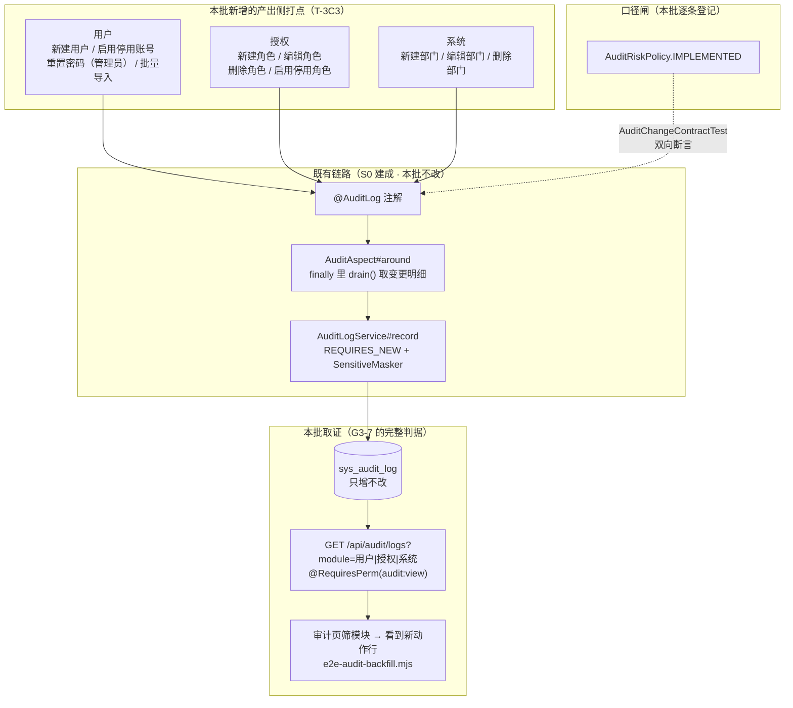

> 状态：🟡 进行中 · Sprint S3 · 阶段 C2（M03 审计 · 产出侧补打点）· 建档 2026-09-15

# 2026-09-15 · S3 · M03 · 阶段 C2 —— 审计采集范围补打点（T-3C3）

> 任务：`T-3C3`（1 项，P1）· 来源：`docs/进度/02-任务清单.md` §M03 的 `T-3C3` 行
> 上游计划：`ai_knowledge_web/plan/2026-09-15-S3-M03-C.md`（§9-1 遗留 1）· `2026-09-14-S3-M03-A.md`（§1.3 W1）
> **用户裁定（2026-09-15）**：① 登录 / 登出 / 登录失败**不重复打点**，以 `sys_login_log` 为唯一事实源
> （口径见《05》§4.2 落地口径段）；② 风险档逐条裁定 —— 「新建用户 / 启用停用账号 / 管理员重置密码」
> **三个都 HIGH**；「角色编辑 / 角色启停」**HIGH**，其余 NORMAL。
> **使命**：`G3-7` 的完整判据是「§4.2 采集范围的操作**都能查到**」。本批之前只落了 10 处注解
> （集中在 S2 那批高危），少掉的那些会让 D 批逐门禁取证时反复读到、却只能标挂起。

---

## 1. 开工条件检查

**依赖清单来源**：`docs/进度/02-任务清单.md` 的 `T-3C3` 「依赖」列（= `T-301`）+ 上一批计划第 9 节 + 环境实测。

| # | 依赖项 | 档位 | 现状（代码/文档实证） | 结论 |
|---|---|---|---|---|
| 1 | `T-3C3` ← `T-301`（高危四类判定口径） | ✅ | `core/audit/AuditRiskPolicy.java`（`IMPLEMENTED` / `PLANNED` 两张静态表 + `register` 去重）+ `AuditChangeContractTest` 双向断言已在跑 | 满足 |
| 2 | 采集链路本身（切面 → 落库） | ✅ | `AuditAspect#around`（`@Around`，`finally` 落库）· `AuditLogService#record`（`REQUIRES_NEW`）· `AuditLog` 注解 | 满足，**本批只加注解与登记** |
| 3 | 表 `sys_audit_log` 的列够用 | ✅ | `V1` 建表 + `V11`（`affected_role`）；本批新增动作**不需要新列** | 满足，**无迁移** |
| 4 | `AuditContext`（变更前后对照的登记通道） | ✅ | `change / affectedUsers / affectedRole` 三个登记口，C 批已用过（3 处调用点） | 满足 |
| 5 | 待打点的写端点都存在且被前端调用 | ✅ | `UserAdminController`（`POST /users`、`PATCH /users/{id}/status`、`POST /users/{id}/reset-password`、`POST /users/import`）· `RoleController`（`POST|PUT|DELETE /roles`、`PATCH /roles/{id}/status`）· `DeptController`（`POST|PUT|DELETE /depts`） | 满足 |
| 6 | 前端能筛出新增的模块 | ✅ | `AuditLogView.vue:60` 的 `MODULES` = `['认证','用户','授权','知识库','文档','问答','系统','审计']` —— 本批三个模块**全在内** | 满足，**前端零改动** |
| 7 | 审计查询侧可消费（本批判据靠它验） | ✅ | C 批已交付 `GET /audit/logs`（module / riskLevel / keyword 筛选、`@RequiresPerm("audit:view")`） | 满足 |
| 8 | 环境（docker / 端口 / 种子） | ✅ | 6 容器 healthy；实测 `sys_department 9 · sys_role 5 · sys_user 128 · sys_kb 8 · sys_kb_grant 34 · sys_role_matrix 60 · sys_audit_log 1408` | 满足 |

### 1.1 ⛔ BLOCKER 汇总

**无。**

### 1.2 ⚠️ 已知偏差（不拒绝施工，第 9 节销账）

| # | 偏差 | 影响 | 归属 |
|---|---|---|---|
| W1 | **`T-3C3` 的字面「8 处」与实际缺口数不一致**：A 批 §1.3 W1 的原始清点是「登录成功/失败 + 新建用户 + 角色 CRUD(3) + 部门 CRUD(3) + 用户停用」= 10 处；扣掉已裁定不做的登录类 2~3 处后是 **8 处**。但 §4.2 的用户行还写着「**重置密码**」、授权域还有「角色启停」，两者都是**无痕的写端点** | 只补 8 处会让 `G3-7` 的「§4.2 都能查到」留两个洞 —— 而这两个洞恰好是**账号接管**（管理员改密）与**权限批量升降**（角色启停）里最该有痕迹的两类 | **本批处理**（§3.1 步骤 2/4/7，2026-09-15 用户已就两者分别裁定档次 = HIGH） |
| W2 | **`importUsers` 有 `🚩` 标注（《10》§3）但无任何 `@AuditLog`**，且前端**零调用方**（`sysApi.importUsers` 在 `src/**/*.vue` 里搜不到） | 接口是「批量新建 + 批量赋角色」，属权限扩大面；不补则 `G3-7` 仍有一处断点 | **本批处理**（§3.1 步骤 3，与「新建用户」同档） |
| W3 | **部门写端点在前端零调用方**：`sysApi.createDept` 无人调，`updateDept` / `deleteDept` **连 `api/index.ts` 里都没有** | 本批判据**不能靠页面级 E2E 驱动部门 CRUD**（无 UI 入口），只能用真 HTTP 后端取证 | 本批说明（§3.4 假设 4；不再另立前端任务，见 §9-2） |
| W4 | `AuditModule` 的 javadoc 里 `MODULES` 列表**过期**（写的是 7 项、不含「审计」），而前端 C 批已加到 8 项 | 纯注释与代码不一致，会让下次加模块的人误判"哪些模块可筛" | 本批顺手订正（§3.1 步骤 8） |

> 判据只有一条：**这条不满足，代码写下去会不会白写**。W1/W2 不补则 `G3-7` 的判据自己就不成立，故本批处理；W3/W4 只需说明/订正。

### 1.3 结论

- [x] ✅ **可以开工** —— 无 BLOCKER；4 条 WARN 全部本批处理（W3 只需在文档里说清）
- [ ] ⛔ 拒绝施工

---

## 2. 开工时间

| 项 | 值 |
|---|---|
| 建档 / 开工日 | 2026-09-15 |
| 预计投入 | **1.5 人天**（Sprint 容量 ≈ 10 人天；A 1.5 + B1 3 + B2 2.5 + C 2.5 = 9.5，本批 1.5 → S3 合计 11） |
| 实际投入 | *回填时补* |

> ⚠️ S3 合计预计 11 人天，**已超 10 人天的排期容量**。本批是 A 批遗留债的回填，不是新增范围；
> 若 D 批还要 1 人天，S3 会落到 12 —— 记在 §10 供排期校准（口径是"偏差要留痕"，不是"不许超"）。

---

## 3. 开工内容

### 3.1 步骤

| 步 | 做什么（文件/类 → 动作 → 产出） | 依赖 | 可并行 |
|---|---|---|---|
| 1 | **用户 · 新建用户**：`UserAdminService#create` 加 `@AuditLog(module = USER, action = "新建用户", risk = HIGH, target = "#request.name()")`；登记 `AuditContext.change("账号", null, username)` + `change("部门", null, deptName)` + `change("角色", null, roleCodes)`（新建的 before 侧全是「—」）+ `affectedUsers(1)` | — | 与 5~7 并行 |
| 2 | **用户 · 启用/停用账号**：`UserAdminService#patchStatus` 加 `@AuditLog(USER, "启用/停用账号", HIGH, target = "'用户#' + #id")`；**读旧状态后再登记** `change("状态", 旧label, 新label)`（`UserStatus` 已有 `label()`） | — | 同上 |
| 3 | **用户 · 管理员重置密码**：`UserAdminService#resetPassword` 加 `@AuditLog(USER, "重置密码（管理员）", HIGH, target = "'用户#' + #id")`；登记 `change("登录密码", "已设置", "已重置，待首次修改")` + `change("登录态", "有效", "已全部撤销")`（N 条 refreshToken）。**绝不登记新密码本身**（I-15） | — | 同上 |
| 3b | **用户 · 批量导入用户**：`UserAdminService#importUsers` 加 `@AuditLog(USER, "批量导入用户", HIGH)`；登记 `change("导入结果", null, "成功 N 行 / 失败 M 行")`。与「新建用户」同档（批量赋角色 = 权限扩大面） | 步骤 1（同档口径） | — |
| 4 | **授权 · 角色增改删启停**：`RoleAdminService#create` / `#update` / `#delete` / `#patchStatus` 分别加 `@AuditLog(GRANT, "新建角色" / "编辑角色" / "删除角色" / "启用/停用角色", risk = NORMAL / **HIGH** / NORMAL / **HIGH**, target = 角色名或 `'角色#' + #id`)。**编辑角色**登记 `change("权限点", "N 项", "M 项")` + `change("数据范围", 旧, 新)`；**启停角色**登记 `change("状态", 启用, 停用)` 且 `affectedUsers(成员数)` + `affectedRole(角色名)`（停用会让全体成员权限降级，《05》§242） | — | 与 1~3 并行 |
| 5 | **部门 · 增改删**：`DeptService#create` / `#update` / `#delete` 分别加 `@AuditLog(SYSTEM, "新建部门" / "编辑部门" / "删除部门", NORMAL, target = "#name" / "'部门#' + #id" / "'部门#' + #id")`；编辑登记 `change("名称", 旧, 新)` + `change("上级部门", 旧, 新)` | — | — |
| 6 | **策略表登记**：`AuditRiskPolicy.IMPLEMENTED` 逐条 `register(...)`，每条带**为什么这么定**的理由（新建用户→权限扩大；启停用→账号安全变更第 5 类；角色编辑/启停→权限扩大；部门三项→不计入高危并写明"§4.3 四类不含组织结构维护"）。**漏登记 = `AuditChangeContractTest` 直接红** | 步骤 1~5 | — |
| 7 | **`AuditModule` 订正**（W4）：javadoc 里的 `MODULES` 列表补「审计」，并说明「新建部门等组织结构动作归 SYSTEM」的判断依据 | — | — |
| 8 | **门禁取证**：新建 `AuditCoverageFlowTest`（后端，**走真 HTTP**——`operator` / `apiPath` 取自请求上下文，直调 Service 会测成空值）；新建/扩展页面级 `scripts/e2e-audit-backfill.mjs`（在用户管理页真建一个探针账号 → 审计页筛「用户」看到「新建用户」行 → 清理） | 步骤 1~7 | — |

**依赖顺序**：1 / 2 / 3 / 4 / 5 五组互相独立可并行 → 6 依赖全部（否则契约用例红）→ 7 独立 → 8 最后。

### 3.2 业务流程图

> 触发条件：① 跨 ≥3 个组件（Controller → Service → `AuditAspect` → `AuditLogService` → MySQL）✅
> ② 涉及事务边界（业务事务 vs `REQUIRES_NEW` 审计事务）✅ ③ 无状态机 ④ 无并发 —— **满足，必须画**。


<!-- diagram: ./2026-09-15-S3-M03-C2/01-flow.svg -->


> **图里的两处要害**：① 本批**只动最上面一层**（注解 + 策略登记），既有的采集链路与落库链路一行不改 ——
> 这是"补打点"与"改链路"的分界，也是本批风险低的原因；
> ② `AuditRiskPolicy` 那个虚线闸门是**编译期就生效**的：注解改了策略表没改 → `AuditChangeContractTest` 直接红，
> 所以「补打点」这件事本身不可能悄悄漏登记。

### 3.3 明确不做（范围控制）

| 不做的事 | 原因 | 归属批次 |
|---|---|---|
| **登录 / 登出 / 登录失败的审计打点** | **用户 2026-09-15 裁定：不打**，以 `sys_login_log` 为唯一事实源（理由见《05》§4.2 落地口径段：登录失败时 `LoginUserContext` 为 null，审计只能记 `anonymous`，信息**严格少于**登录日志；两个事实源必然漂移；登录日志已用 `REQUIRES_NEW`） | 不做（**登记为口径**，已在《05》§4.2 + `AuditModule.AUTH` javadoc） |
| **「账号锁定」打点** | 同上 —— 风控计数触发，落在 `sys_login_log` 的 `FAILED` 记录里 | 不做（同上） |
| **`resendInvite`（重发邀请）打点** | 《10》§3 的该行**没有 `🚩`**（同行其它写端点都有）；且它不改变任何权限或账号状态 —— 只是重签一个邀请令牌 | 不做（§9-3 登记） |
| **文档 / 问答 / 系统（模型配置）模块的打点** | §4.2 的这三行对应的接口**尚未实现**（`sys_document` 不存在、`/system/model/*` 零调用方），`AuditRiskPolicy.PLANNED` 已冻结口径 | S4 / S5 / S6（口径已在 `PLANNED` 表） |
| **`RoleAdminService#saveMatrix` / `KbGrantService#save` / `KbService#create|saveConfig`** | **已实现且已取证**（S2 + B1/B2 那批），本批只做查漏 | 不做（已覆盖） |
| **给 `AuditLogView.vue` 的 `MODULE_TAG` 补「审计」键** | C 批已裁定「不是缺陷」（模板有 `|| 'info'` 兜底，只是颜色与其它模块相同） | 不做（C 批 §10-4 已登记） |
| **审计日志的推送 / 实时告警** | §4.9 边界明确「不做实时告警」 | 不做 |

### 3.4 本批假设

| # | 假设 | 若被证伪的后果 |
|---|---|---|
| 1 | **部门维护归属 `AuditModule.SYSTEM`**（「系统」）。依据：《05》§4.2 的模块表**没有部门行**，而前端路由把部门归在「系统管理」组、`MODULES` 下拉里有「系统」 | 若要单列「部门」模块，需**前后端同时改**（`AuditModule` 常量 + `AuditLogView.vue` 的 `MODULES`），否则日志写得进、筛不出 —— 与 `T-304` 踩过的 `AuditModule.AUDIT` 同一个坑 |
| 2 | **「管理员重置密码」与「启用/停用账号」应当打点**，尽管不在 A 批字面「8 处」清点内 | 二者是 §4.2 用户行的「重置密码」「启停用」两格；漏掉则 `G3-7` 仍不完整。**2026-09-15 用户已就档次分别裁定 HIGH**，故按裁定纳入 |
| 3 | **`importUsers` 按「新建用户」同档 HIGH** | 它是批量形态的「新建 + 赋角色」，权限扩大面比单个新建更大；若产品认为应降档，改 `AuditRiskPolicy` 一行即可（用例会跟着红） |
| 4 | **部门 CRUD 无法做页面级取证**（前端无调用方，W3），只能用真 HTTP 的后端用例 | 判据 11~13 的"证据落点"是后端用例而非 E2E 脚本 —— 这**不是**挂起，是取证姿势的选择 |
| 5 | **新增打点不登记任何敏感值**：密码只记"已重置"、令牌只记"已撤销"（I-15） | 若某处 `change()` 里混进了明文密码，判据 9 会红（断言审计行与响应都不含新密码串） |
| 6 | **`@AuditLog` 的 `target` SpEL 在 Service 层方法参数上有名字可用**（`DefaultParameterNameDiscoverer` 已在本仓工作，`UserAdminService#update` 的 `'用户#' + #id` 是既成事实） | 求值失败不会让业务失败（`AuditAspect` 降级为 `类名#方法名`），但「对象」列会退化成类名 —— 判据里断言了具体文案，能立刻发现 |

---

## 4. 数据变更清单

| 类型 | 内容 | 回滚方式 |
|---|---|---|
| 新建表 / 改表 | **无**。本批新增的 11 个动作全部复用既有列（`module` / `action` / `risk_level` / `target` / `changes_json` / `affected_users` / `affected_role`） | — |
| 迁移文件 | **无**（现有最大编号 `V11`；本批不新增） | — |
| 索引 | **无**（新增动作只走 `idx_audit_module_created` 这类既有索引；`module` 取值仍是既有 8 个之一） | — |
| 种子数据 | **不需要**。演示库无"新建用户/角色/部门"的历史行要补 —— 补打点只影响**从此以后**产生的操作 | — |
| NULL 分支 | **不适用**（无新列）。但要写清一条：新动作若某次没登记 `changes`（如 `@AuditLog` 加了但 `AuditContext.change` 漏写），`changes_json` 落 **NULL**（不是 `[]`，T-300 冻结口径），详情抽屉会**不显示**变更明细表 —— 判据 1~8 逐条断言 `changes_json` 非空，正是为了钉住这条 | — |
| 历史数据 | **不动**。已产生的审计行（含 `action` 拼写、风险档）一律不改写 —— 改了等于伪造历史 | — |

> 跑过的迁移**只增不改**：`V1`~`V11` 一字不动。

---

## 5. 依赖与工具决策

**无新依赖。** 本批只加注解、登记静态表、写用例，全部用既有栈：

| 方案 | 做法 | 代价 | 结论 |
|---|---|---|---|
| **既有 `@AuditLog` + `AuditContext`** | 加注解 + 在各 Service 里 `AuditContext.change(...)` | 无 | ✅ **采用** |
| 引审计框架（Spring Data Envers / JaVers） | 自动记录实体变更 | 与本仓既有采集链路**并存**会产出两套事实源（漂移）；且它记的是"表行差异"，答不了"谁在什么请求上下文里做的" | ❌ 不引 |
| 用 `@Audited` 之类的 AOP 自造注解 | —— | 已有 `@AuditLog`，再造一个等于两套写法 | ❌ 不引 |

**同类产品对比**：无（零候选）。

**推荐**：**不引任何新依赖**。理由：本批的性质是"把既有机制铺到漏掉的调用点上"，机制本身已由 S0 建成并取证。

---

## 6 + 7. 验收方法与标准

**通用前置**（每条页面级判据都要，不重复写）：

```bash
# 后端 8080（cwd 必须是模块目录，.env 才读得到）
export JAVA_HOME='F:/work/dev_tools/jdk/jdk-25.0.4.1'
cd F:/work/code/ai-knowledge/ai_knowledge_web && mvn -o spring-boot:run -Dspring-boot.run.arguments=--server.port=8080
# 前端 5174（必须 --host 127.0.0.1，IPv6-only 时 Edge 连不上）
cd F:/work/code/ai-knowledge/ai_knowledge_app && VITE_USE_MOCK=false npm run dev -- --host 127.0.0.1 --port 5174
```

| # | 判据（对齐门禁号） | 验收方法（可直接粘） | 期望结果 | 证据落点 |
|---|---|---|---|---|
| 1 | **`G3-7` 采集范围补全**：11 处新注解全部登记进策略表 | `export JAVA_HOME=...` + `mvn -B -f F:/work/code/ai-knowledge/ai_knowledge_web/pom.xml test -Dtest=AuditChangeContractTest` | 正向（注解→策略）与反向（策略→注解）**双向零差异**；`@AuditLog` 总数由 12 → 23 | `AuditChangeContractTest` |
| 2 | `@AuditLog` 总数与动作清单 | 同上（`AuditCoverageFlowTest` 反射扫描，断言 23 个动作的 `(module, action, risk)` 三元组集合） | 与 §3.1 步骤 1~5 列出的 11 个动作**逐条一致**，等级 = 用户裁定的档次 | `AuditCoverageFlowTest#annotationInventory` |
| 3 | **用户 · 新建用户**真 HTTP 落库 | 同上（`POST /api/users`，body 含 `roleIds`，`inviteMode=PASSWORD`） | 新增一行 `module='用户' / action='新建用户' / risk='HIGH' / operator='admin'`；`changes_json` 含账号、部门、角色三项；`target` = 新用户姓名 | `AuditCoverageFlowTest#createUserIsAudited` |
| 4 | **用户 · 启用/停用账号** | 同上（对自建探针账号发 `PATCH /users/{id}/status`，`DISABLED` → `ACTIVE`） | 两次各落一行；`changes_json` 的 `before/after` = `正常→已停用` / `已停用→正常`（`UserStatus.label()`） | `AuditCoverageFlowTest#patchUserStatusIsAudited` |
| 5 | **用户 · 重置密码（管理员）** | 同上（`POST /users/{id}/reset-password`） | 落 `HIGH` 一行；**审计行与响应体里都不含**新密码明文（`data.initialPassword` 是响应的一部分，**断言它不出现在 `changes_json` / `note` / `target` 里**） | `AuditCoverageFlowTest#adminResetPasswordIsAuditedWithoutPlaintext` |
| 6 | **用户 · 批量导入** | 同上（`POST /users/import`，multipart CSV，含 1 行合法 + 1 行部门不存在） | 落 `HIGH` 一行；`changes_json` 记「成功 1 / 失败 1」；导入产生的用户由用例清理（`trackUser`） | `AuditCoverageFlowTest#importUsersIsAudited` |
| 7 | **授权 · 角色增改删**三条 | 同上（`POST /roles` → `PUT /roles/{id}` → `DELETE /roles/{id}`，全程用自建探针角色） | 三行齐全；等级 `NORMAL / HIGH / NORMAL`；编辑那行的 `changes_json` 含「权限点」`before≠after` | `AuditCoverageFlowTest#roleCrudIsAudited` |
| 8 | **授权 · 启用/停用角色** | 同上（`PATCH /roles/{id}/status`） | 落 `HIGH` 一行，且 `affected_users` = 该角色真实成员数、`affected_role` = 角色名（与 C 批 W1 的 `affected_role` 语义一致，**不是**操作人角色码） | `AuditCoverageFlowTest#roleStatusIsAuditedWithBlastRadius` |
| 9 | **系统 · 部门增改删**三条（W3：无 UI 入口，仅后端） | 同上（`POST /depts` → `PUT /depts/{id}` → `DELETE /depts/{id}`，自建探针部门） | 三行齐全，均 `NORMAL`；编辑那行 `changes_json` 含名称/上级的 before→after | `AuditCoverageFlowTest#deptCrudIsAudited` |
| 10 | **失败也留痕**（`AuditAspect` 包 `finally` 的既有契约，新动作同样成立） | 同上（用「停用最后一个超管」这个**必被拒**的路径触发 `HOME` 级自锁防护） | 仍落一行、`result='FAILED'`、`fail_reason` 非空；**被拒的操作不留业务副作用**（账号状态未变） | `AuditCoverageFlowTest#deniedOperationsStillLeaveTrace` |
| 11 | **`G3-7` 消费侧**：新增动作在 `/audit/logs` **筛得到** | 同上（跑完判据 3~9 后发 `GET /api/audit/logs?module=用户`、`?module=授权`、`?module=系统`） | 三个模块的响应里分别含本批新增动作；`module=用户` 的 `total` **严格大于**本批之前的值 | `AuditCoverageFlowTest#newActionsAreQueryable` |
| 12 | 新动作对**其它模块**无串扰 | 同上（断言新增行的 `module` **不是** `AUDIT` / `KB`；且 `?module=审计` 的 `total` 不变） | 无串扰（防止 `AuditModule` 复制粘贴写错常量） | 同上 |
| 13 | **页面级**：用户管理页真操作 → 审计页可查 | `cd ai_knowledge_app && node scripts/e2e-audit-backfill.mjs --base=http://127.0.0.1:5174` | 审计页在「用户」模块下渲染出「新建用户」行并带 🚩 高危标签；点开抽屉看到「账号 / 部门 / 角色」三行变更明细；跑完探针账号已清理 | `scripts/e2e-audit-backfill.mjs` 步骤表 + 截图 |
| 14 | 接口对齐基线不回退 | `cd ai_knowledge_app && node scripts/audit-api.mjs` | ①=0 · ②=0 · ⑥=0；⑦ = **74**（本批不新增/不删除接口）、S3 组 = 3、真后端 = 59 | 脚本输出 |
| 15 | 既有页面级用例不回退 | `cd ai_knowledge_app && node scripts/e2e-kb-flow.mjs --base=http://127.0.0.1:5174` 与 `node scripts/e2e-audit-flow.mjs --base=http://127.0.0.1:5174` | 47/47 与 30/30 全绿 | 脚本输出 |
| 16 | 页面无未捕获异常 | `cd ai_knowledge_app && node scripts/console-check.mjs` | 25/25 路由通过，零未捕获异常 | 脚本输出 |

**观察项**（不计成败）：

| # | 观察项 | 说明 |
|---|---|---|
| 1 | 部门维护归「系统」模块 | §3.4 假设 1；若产品要单列模块需前后端同改 |
| 2 | 审计页的「用户」模块行会**开始明显变多**（新建/停用/重置密码都是日常管理动作） | 这不是噪声 —— 它们不是高危（新建/停用/重置密码**是** HIGH，见裁定）；反映的是"账号管理动作从此有痕" |
| 3 | 部门 CRUD 的前端无入口 | W3；本批不补前端（§9-2） |
| 4 | `action` 文案（「启用/停用账号」等）会直接显示在审计页「操作」列 | 文案冻结在本批；改文案 = 改历史行的可读性（但历史行仍是旧文案，不做回写） |

**种子核对**（跑完必做 —— 本批会**新建**用户/角色/部门探针，必须确认全部清干净）：

```bash
set -a && . ai_knowledge_web/.env && set +a
docker exec kb-mysql mysql -u"$MYSQL_USERNAME" -p"$MYSQL_PASSWORD" "$MYSQL_DATABASE" -N -e \
  "select (select count(*) from sys_department) dept, (select count(*) from sys_role) roles,
          (select count(*) from sys_user where deleted_at is null) users,
          (select count(*) from sys_kb) kb, (select count(*) from sys_kb_grant) grants,
          (select count(*) from sys_role_matrix) matrix,
          (select count(*) from sys_user where username like 'auditprobe%') probe_user,
          (select count(*) from sys_role where code like 'AUDITPROBE%') probe_role,
          (select count(*) from sys_department where name like '审计探针%') probe_dept;"
```

**期望**：`9 · 5 · 128 · 8 · 34 · 60 · 0 · 0 · 0`（**前六项与开工前实测逐字相同**；`sys_audit_log` 会增长 —— 那是日志不是种子）。

> **测试不许污染种子**：判据 3~10 造的探针用户/角色/部门必须在用例内自清
> （用户走 `ApiTestSupport#trackUser`；角色与部门用 `try/finally` + 直连 `jdbc` 删，
> **不能用"原值回写"当 no-op** —— 角色/部门是新增对象，回写没有意义）。
> 判据 10 的失败路径用**自建**的探针超管账号，绝不动种子里的 `admin`。

---

---

# 以下为开工后回填

> **提交节奏（两次）**：1~7 节写完即提交一次（`docs(plan): S3-M03-C2 开工计划`）；
> 8~10 节写完再提交一次（`docs(plan): S3-M03-C2 验收回填`）。让 git log 上「计划 → 结果」成对可查。

## 8. 验收结果

| # | 判据 | 实测结果 | 证据（命令 / 文件:行 / 测试名） |
|---|---|---|---|

**测试基线**：`Tests run: N, Failures: 0, Errors: 0, Skipped: 0`（上批 142 → 本批 M）

> 失败就照实写失败，不许改成"部分通过"。
> **取证条件不具备时**，该行实测结果填 `⏸️ 挂起 —— 待 <批次> 取证`，
> 并在那批的 8 节做**合并回填**（两批计划文件同时更新、同时提交）。

---

## 9. 遗留问题

| # | 项 | 原因 | 归属批次 | 是否有判定点/注释留在代码里 |
|---|---|---|---|---|

> 没有遗留写「无」。**本批若"先施工后补写第 1 节"，也必须在此登记一条**（违规留痕）。

---

## 10. 建议

- 对下批的排期 / 口径 / 风险建议。没有写「无」。

---

## 附：本批同步的文档回填

- [ ] `docs/进度/02-任务清单.md` → `T-3C3` 置 ✅（未做的不动）
- [ ] `docs/进度/03-Sprint排期.md` → 「交付状态」段
- [ ] `docs/进度/README.md` → 看板状态 + 完成日期 + §7 变更记录
- [ ] `docs/需求文档/05-需求-权限与审计.md` → §4.2 落地口径段补「已补全」+ §4.3 风险档新条目（若口径有增补）
- [ ] `docs/需求文档/10-接口约定汇总.md` → §15 变更记录（接口无增删，只补审计口径）
- [ ] 本文件状态行 → ✅ 已完成（合并回填时写 `✅ 已完成（与 <批次> 合并回填）`）
- [ ] `ai_knowledge_web/plan/汇总.md` → §1 / §2 / §3 / §4
- [ ] `.workbuddy/memory/<日期>.md` → 交接
