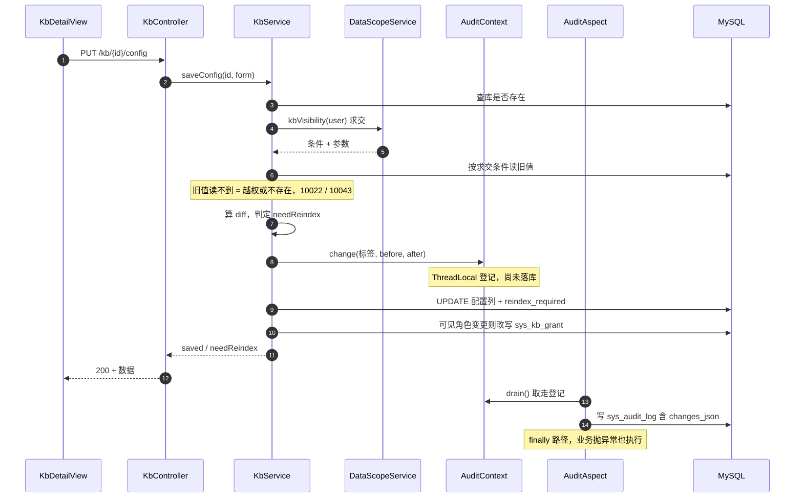
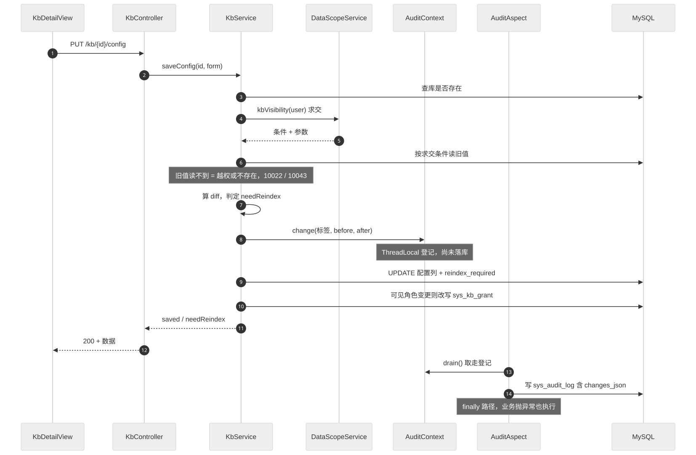

> 状态：✅ 已完成 · Sprint S3 · 阶段 B2（M04 知识库写侧 + 剩余只读）· 建档 2026-09-15

# 2026-09-15 · S3 · M04 · 阶段 B2 —— 保存配置 / 影响预估 / 配额与只读接口 + 销 W7

> 任务：`T-404` `T-405` `T-408` `T-411`（4 项）+ 随 M04 修的遗留 `W7`（`DISABLED` 账号）
> 来源：`docs/进度/03-Sprint排期.md` §S3 · `docs/进度/02-任务清单.md` §M04
> 上游计划：`ai_knowledge_web/plan/2026-09-14-S3-M04-B1.md`（本批要销的账见第 1 节）

---

## 1. 开工条件检查

**依赖清单来源**（逐条注明出处，不许凭印象）：

| # | 依赖项 | 档位 | 现状（代码/文档实证） | 结论 |
|---|---|---|---|---|
| 1 | `T-404` 依赖 `T-403`（配置读取） | ✅ | `KbService#config` 已交付并有 12 条用例（B1 计划 §8） | 满足 |
| 2 | `T-404` 需要的审计 before/after 通道 | ✅ | `AuditContext.change()` + `AuditAspect#drain` 已就绪（A 阶段），`KbGrantService#save` 是首例接线 | 满足 |
| 3 | `T-405` 依赖 `T-404`（数据源是配置 diff） | ⚠️ WARN | 同批实施，diff 计算落在 `KbService` 内共用 | 满足（同批） |
| 4 | `T-408` 依赖 `T-400`（知识库列表） | ✅ | B1 已交付 | 满足 |
| 5 | `T-411` 依赖 `T-403` | ✅ | 同上；`KbService#config` 已有全部派生字段的来源 | 满足 |
| 6 | `W7` 判定「能登录但看不到库」 | ✅ | B1 已备齐 `/kb`（`T-400`）+ `kb:view` 链路 —— 这正是 B1 计划 §9-6 把它定到 B2 的理由 | 满足 |
| 7 | **`T-406` 重建索引的数据源** | ⛔ **BLOCKER（已按裁定移出本批）** | 真库 15 张表**无 `sys_document` / `sys_chunk`**；`com.knowledge.ai.pipeline` **是空目录**；解析/分片/向量化是 S4 的 `T-502`/`T-503`/`T-504`。**「重建」= 按新策略重新分片 + 重新向量化，输入是文档，不是旧 collection** —— 没有文档就是没有输入 | **不满足 → `T-406` 移 S4** |
| 8 | **`T-407` 清空索引 / 软删库** | ⛔ **同上（已按裁定移出本批）** | `T-407` 依赖 `T-406`（同一套 collection 生命周期）；无文档时"清空索引"是空操作，"软删进回收站"要与回收站一并设计 | **不满足 → S4** |
| 9 | B1 §9-4：列表页统计卡（归 `T-408`） | ⚠️ WARN | **描述有误，本批订正**：实测 `KbListView.vue` **没有统计卡**（只有「共 N 个知识库」取自 `/kb` 真实 `list.length`，与每卡的 `docCount`/`chunkCount` 同源）。`storage-quota` 的真实消费方是 `DocDownloadView.vue:297` 的配额卡（**S4 的页面**） | 满足（条目订正） |
| 10 | B1 §9-3：`status` 词表分叉 | ⚠️ WARN | 已用「真值 + 派生 `statusLabel`」绕过；本批新增的 `reindexRequired` **刻意不并入 `status` 词表**（见 §3.4 假设 2），避免再开一个分叉 | 不阻塞 |
| 11 | 环境：docker 6 服务 / 种子 | ✅ | `kb-mysql` `kb-ministack` 等 6 容器健康；种子 `8 库 / 34 授权 / 128 用户 / 60 矩阵` | 满足 |

**BLOCKER 汇总**：`T-406` / `T-407` 两项**不满足**（无文档流水线）。**已用 `AskUserQuestion` 请用户裁定**，结论为：

> **本批范围 = `T-404` + `T-405` + `T-408` + `T-411` + `W7`（4 任务 + 1 遗留）**；
> **`T-406` / `T-407` 整体移交 S4**（与 M05 文档流水线同批）；**`T-409` / `T-410` 移交 B3**（P1，前端已改从 `config` 读，无消费方）。
> `G3-4` / `G3-5` / `G3-6` 三条出口判据按本仓 §4 挂起机制**挂起至 S4**。

**⚠️ 已知偏差**（不拒绝施工，第 9 节销账）：

- **W-a**：`T-408` 的 `monthTokens` **无来源表** —— 全项目无 token 用量表（用量统计是 S6 的 `T-905`）。
- **W-b**：`T-408` 的 `GET /kb/{id}/stat`（3 秒轮询）**前端零调用方**，其语义是"索引进度"，属重建流程 → 随 `T-406` 移 S4（本批只做 `storage-quota`）。
- **W-c**：`T-404` 的前端保存流程在 `needReindex` 为真时**无条件**接一个 `/reindex`（`KbDetailView.vue:252-253`）。`T-406` 已移 S4，故该路径会拿到 404 降级提示（T-3C2 的兜底，不静默）；本批不动这段前端。

### 结论

- [x] ✅ 可以开工（`T-406` / `T-407` 已按裁定移出本批，本批 4 项依赖全部满足）
- [ ] ⛔ 拒绝施工

---

## 2. 开工时间

| 项 | 值 |
|---|---|
| 建档 / 开工日 | 2026-09-15 |
| 预计投入 | 4 人天（Sprint 容量 ≈ 10 人天） |
| 实际投入 | **约 1 人天**（4 接口 + 1 迁移 + 18 条用例 + 20 步 E2E）。比预估省 3 人天的原因是 `T-404`/`T-405` 共用同一个 diff 引擎（同批做确实省了一半，B1 §10-3 的判断成立），且 `T-411` 的四栏只是投影、`T-408` 三个计数直接取 `sys_kb` 的冗余列 |

---

## 3. 开工内容

### 3.1 步骤

| 步 | 做什么（文件/类 → 动作 → 产出） | 依赖 | 可并行 |
|---|---|---|---|
| 1 | `V10__s3_kb_reindex_required.sql` → `sys_kb` 加 `reindex_required TINYINT(1) NOT NULL DEFAULT 0` | — | |
| 2 | `SysKb` 实体同步该列（否则 `ddl-auto: validate` 启动即失败） | 1 | |
| 3 | `KbService#saveConfig`（`T-404`）：`requireKb` → 求交（复用 `config()` 的可见性判定）→ **读旧值 → 算 diff → `AuditContext.change()` 登记 → 写库** | 1,2 | 与 5 并行 |
| 4 | `KbService#saveConfig` 的 `needReindex` 计算：diff 命中「分片 + 表格」字段集 → `reindex_required = 1`，否则 0。**字段集必须与前端 `REBUILD_FIELDS` 逐字同源**（`KbDetailView.vue:111-128`） | 3 | |
| 5 | `KbService#impact`（`T-405`）：`chunkBefore` = 库现值，`chunkAfter` = 按新 `chunkSize`/`overlap` 折算，耗时/tokens 按分片数等比 | 3 | 与 3 并行 |
| 6 | `KbService#storageQuota`（`T-408`）：`kbCount`/`docCount`/`chunkCount` 由 `sys_kb` 聚合；`used` 由 MinIO 桶实算；`monthTokens` 返 0 + 注释标来源缺失 | 1 | |
| 7 | `KbService#parseConfig`（`T-411`）：四栏只读投影 = `split`（预设 + 策略 + 嵌入模型）/ `table`（策略）/ `image`（系统常量 + 当前 VL）/ `enhance`（系统常量） | 5 | |
| 8 | `KbController` 新增 4 个映射：`PUT /{kbId}/config`（`kb:edit`）· `POST /{kbId}/config/impact`（`kb:edit`）· `GET /storage-quota`（`kb:view`）· `GET /{kbId}/parse-config`（`kb:view`）。**注意字面路径 `/storage-quota` 与 `/{kbId}/...` 的前缀冲突** | 6,7 | |
| 9 | `AuditRiskPolicy` 登记 `KB / 保存配置`；若不登记，`AuditChangeContractTest` 直接失败 | 3 | |
| 10 | **`W7`**：`AuthService#login` 与 `#refresh` 放行 `DISABLED`；`DataScopeService#kbVisibility` 对 `DISABLED` 返「查不到任何库」的条件 | — | 与 3~8 并行 |
| 11 | 取证：`KbWriteFlowTest`（新增）+ `AuthDisabledAccountTest`（新增，真 HTTP） | 全部 | |
| 12 | 前端：`KbUploadView` 的解析配置四栏接真（`T-411` 已在此调用，无需改调用点）；`KbDetailView` 保存路径**只验不改** | 8 | |

**`W7` 的关键实现选择（不碰 JWT）**：`LoginUser` **没有 `status` 字段**，而把它加进 JWT 要动 `JwtService` + `UserPrincipalAssembler` + 令牌兼容。改用**既有 SQL 条件通道**：`kbVisibility` 的条件里加一段
`EXISTS (SELECT 1 FROM sys_user u WHERE u.id = :ds_uid AND u.status <> 'DISABLED')` —— 停用账号的求交结果自然为空，且不产生任何令牌层变更。

### 3.2 业务流程图

> 触发条件：① 跨 ≥3 个组件（前端 → Controller → Service → 求交引擎 → 审计切面）✅
> ② 命中本仓「必须画」清单里的**审计切面采集落库**（`T-404` 是 `T-300` 契约的**第二次真实接线**）✅


<!-- diagram: ./2026-09-15-S3-M04-B2/01-sequence.svg -->



### 3.3 明确不做（范围控制）

| 不做的事 | 原因 | 归属批次 |
|---|---|---|
| `T-406` 重建索引 | **无输入**：`sys_document`/`sys_chunk` 不存在、`pipeline` 包空 | **S4**（M05 之后） |
| `T-407` 清空索引 + 软删库 | 依赖 `T-406` 的 collection 生命周期；无文档时清空是空操作 | **S4** |
| `GET /kb/{id}/stat`（3 秒轮询） | 轮询的是索引进度，属重建流程；前端**零调用方** | **S4**（随 `T-406`） |
| `T-409` 治理标签 · `T-410` 详情 | P1；前端已分别改从 `config` 读，无消费方 | **S3-B3** |
| `storage-quota` 的 `monthTokens` | 全站无 token 用量表 | **S6**（`T-905`） |
| 模型配置相关（`/system/model/*`） | 「嵌入模型只读、运维改 SQL」的现状与缺口已预置在 `plan/汇总.md` §3.1 | **S6** |
| `DISABLED` 的完整权限语义（除知识库外能否写） | 需求只写了「知识库不可见」，其余未定义 | 观察（见 §3.4 假设 1） |
| 给 `reindex_required` 加"最后索引时间"列 | 唯一消费者是 `T-406`，本批加了就是投机 | **S4**（`T-406` 落地时按需加） |

### 3.4 本批假设

| # | 假设 | 若被证伪的后果 |
|---|---|---|
| 1 | 「已禁用账号允许登录」= **仅取消登录拦截**，角色与权限码照常下发（需求三处只写了「知识库不可见」） | 若产品意为「禁用后一切只读」，本批实现不足，需在 §9 追加一条并重开一批 |
| 2 | 待重建状态用**新列 `reindex_required`**，不并入 `sys_kb.status` 词表 | 若 S4 认为该并入 `status`，要返工一次（词表分叉已有 W1 先例，故本批选了加法而非扩词表） |
| 3 | `storage-quota.used` 由 **MinIO 桶实算** | 当前无文档故为 `0 B`，与示例数据的 `2.4 GB` 不符 —— 已登记为观察项，不算判据失败 |
| 4 | 「保存配置」标 **HIGH**（同一请求可改 `visibleRoles` = 权限扩大） | 若认为过粗（改描述也是高危），需让策略表支持字段级判定 —— 见 §10 建议 1 |

---

## 4. 数据变更清单

| 类型 | 内容 | 回滚方式 |
|---|---|---|
| 改表 | `sys_kb` 加 `reindex_required TINYINT(1) NOT NULL DEFAULT 0` | 可逆（`DROP COLUMN`）—— 但按"只增不改"，**不回改 V10** |
| 迁移文件 | `V10__s3_kb_reindex_required.sql`（现最大 `V9`） | — |
| 种子数据 | **无需回填** —— `NOT NULL DEFAULT 0` 使 8 个演示库自动为「无需重建」 | — |
| NULL 分支 | 该列 `NOT NULL`，**不存在 NULL 分支**；读侧按 `boolean` 收，不用 `Boolean` 包装 | — |
| 实体同步 | `SysKb` 必须同步该字段，否则 `ddl-auto: validate` **启动即失败** | — |

> 跑过的迁移**只增不改**（改已执行的 `V*.sql` 会导致校验和不符、启动失败）。

**⚠️ 本批不新建任何业务表**：`sys_document` / `sys_chunk` 属 S4；本批的 4 个接口全部读现有列。

---

## 5. 依赖与工具决策

**默认不引**。

| 方案 | 做法 | 代价 | 结论 |
|---|---|---|---|
| 不引依赖（既有栈） | 原生 SQL 用既有 `EntityManager`；JSON 列解析用已注入的 Jackson 3 `ObjectMapper`（B1 已验证）；审计复用既有切面；MinIO 用量用既有 `MinioClient` | 需手写聚合 SQL | **采用** |
| 候选：引一个"SQL 构造器"库（jOOQ / QueryDSL） | 类型安全的动态条件 | 与本仓"原生 SQL + 参数化"的既有风格割裂；且只解决 4 个查询 | 不引 |
| 候选：引分页/工具库 | — | 本批 4 个接口**都不分页** | 不引 |

**推荐**：无新依赖，用既有 `EntityManager` 原生 SQL + 既有审计与求交基础设施实现。

> `used` 的计算方式是本批唯一的性能取舍：MinIO 逐对象累加是 O(n)，但该接口**页面只在挂载时调一次**，且当前无对象 → 接受。若 S4 文档量上来后成为瓶颈，改为在 `sys_kb` 上累加字节数（S4 建 `sys_document` 时一并考虑）。

---

## 6 + 7. 验收方法与标准

| # | 判据（对齐需求门禁号） | 验收方法（可直接粘的命令/脚本） | 期望结果 | 证据落点 |
|---|---|---|---|---|
| 1 | `G3-3` 保存后返回 `needReindex` | `KbWriteFlowTest#saveReturnsNeedReindex` | 只改 `name`/`description` → `false`；改 `chunkSize` → `true` | 测试名 |
| 2 | `T-404` diff 字段集与前端同源 | `KbWriteFlowTest#rebuildFieldSetMatchesFrontend` | 命中「分片+表格」共 10 个字段，与 `KbDetailView.vue:111-128` 逐字一致 | 测试名 + 前端行号 |
| 3 | `T-404` 全字段落库可回读 | `KbWriteFlowTest#saveThenReadBackIsIdentical` | `PUT` 后 `GET /kb/{id}/config` 的 `config` 与提交值深度相等 | 测试名 |
| 4 | `T-404` `code` 创建后不可改 | `KbWriteFlowTest#codeCannotBeChanged` | 提交不同 `code` → 被拒且库内值不变 | 测试名 |
| 5 | `T-404` 校验与创建同口径 | `KbWriteFlowTest#saveValidationMatchesCreate` | 名称 1 字 / 角色空集 → `10030` | 测试名 |
| 6 | `T-404` 越权与不存在 | `KbWriteFlowTest#configWriteRejectsUnauthorized` | 范围外库 → `10022`；不存在 → `10043` | 测试名 |
| 7 | `G3-7` 产出侧：改动落审计 + **变更前后对照** | `KbWriteFlowTest#saveWritesAuditWithChanges` | `sys_audit_log` 新增一行，`changes_json` 含真实 before/after，**空值走 `—`** | 测试名 + SQL |
| 8 | 高危口径登记 | `AuditChangeContractTest`（既有，会自动扫到新注解） | 全绿 = 新 `@AuditLog` 已在 `AuditRiskPolicy` 登记 | 测试名 |
| 9 | `T-404` 可见角色真改写授权 | `KbWriteFlowTest#saveRewritesGrants` | `sys_kb_grant` 行集随之变化，且超管恒在 | 测试名 + SQL |
| 10 | `T-405` 影响量形状与单调性 | `KbWriteFlowTest#impactShapeAndMonotonic` | 5 个字段齐全；`chunkSize` 调小 → `chunkAfter` 变大 | 测试名 |
| 11 | `T-408` 配额形状与数据字典一致 | `KbWriteFlowTest#storageQuotaMatchesDictionary` | `{used,kbCount,docCount,chunkCount,monthTokens}`；`kbCount` 与种子 8 一致 | 测试名 |
| 12 | `T-411` 四栏齐全且**跟随库配置** | `KbWriteFlowTest#parseConfigFollowsKbConfig` | 四栏非空；改 `splitPolicy` 后 `parse-config` 的对应行随之变化 | 测试名 |
| 13 | `W7` 停用账号**能登录**（真 HTTP） | `AuthDisabledAccountTest#disabledCanLogin` | HTTP 200 + `code=0` + 返回令牌 | 测试名 |
| 14 | `W7` 停用账号**看不到任何库** | `AuthDisabledAccountTest#disabledSeesNoKb` | `GET /kb` → `list` 为空、`total=0` | 测试名 |
| 15 | `W7` 停用账号可刷新令牌 | `AuthDisabledAccountTest#disabledCanRefresh` | 刷新成功（否则「允许登录」在 30 分钟后失效） | 测试名 |
| 16 | `W7` 回归：启用账号不受影响 | `AuthDisabledAccountTest#activeAccountUnaffected` | 启用账号登录与列表均正常 | 测试名 |
| 17 | 后端全量 | `export JAVA_HOME='F:/work/dev_tools/jdk/jdk-25.0.4.1'` + `mvn -B -f F:/work/code/ai-knowledge/ai_knowledge_web/pom.xml test` | `Tests run: N, Failures: 0, Errors: 0`（上批 113 → 本批 M） | 控制台 |
| 18 | 页面级 | `cd ai_knowledge_app && node scripts/e2e-kb-flow.mjs --base=http://127.0.0.1:5174` | 既有 27 步全绿 + 新增「保存配置」与「上传页四栏」步骤 | 脚本输出 |
| 19 | 页面级降噪 | `cd ai_knowledge_app && node scripts/console-check.mjs` | 25/25 路由**零未捕获异常** | 脚本输出 |

**⏸️ 挂起判据**（本批不具备取证条件，**不跳过**）：

| 判据 | 挂起原因 | 待哪一批 |
|---|---|---|
| `G3-4` `chunkAfter` 与**重建后实际分片数**同量级（±10%） | 要验它必须先有一次真实重建，而重建无输入 | **S4**（与 `T-406` 合并验收） |
| `G3-5` D-7 重建原子性（中途 kill 旧索引仍可用） | 同上 | **S4** |
| `G3-6` 重建可续跑 | 同上 | **S4** |
| `G3-3` 的「**未重建前检索行为不变**」后半句 | 检索链路是 S4/S5 | **S4** |
| `G3-7` 的「在 `/audit/logs` **可查**」消费侧 | 查询侧 `T-302` 是 C 阶段 | **S3-C**（与 A/B1 合并回填） |

**观察项**（不计成败，页面写死的展示值登记在此）：

- `storage-quota.used` 当前为 `0 B`（无文档），与示例数据 `2.4 GB` 不符 —— 数据源正确，是数据为空。
- `storage-quota.monthTokens` 恒 `0`（无来源表）。
- 上传页四栏中 `image` / `enhance` 两组来自**系统级常量**（非按库配置），与 mock 文案一致但不可按库差异化。

**种子核对**（跑完必做）：

```bash
cd F:/work/code/ai-knowledge && set -a && . ai_knowledge_web/.env && set +a
docker exec kb-mysql mysql -u"$MYSQL_USERNAME" -p"$MYSQL_PASSWORD" "$MYSQL_DATABASE" -N -e "
select (select count(*) from sys_kb) as kb,
       (select count(*) from sys_kb_grant) as grant_,
       (select count(*) from sys_user where deleted_at is null) as users,
       (select count(*) from sys_role_matrix) as matrix,
       (select count(*) from sys_kb where code like 'kb_%probe%') as probe;"
```

期望：`8 · 34 · 128 · 60 · 0`（任何一项漂移都要先查再继续）。

---
---

# 以下为开工后回填

> **提交节奏（两次）**：1~7 节写完即提交一次（`docs(plan): <批次> 开工计划`）；
> 8~10 节写完再提交一次（`docs(plan): <批次> 验收回填`）。让 git log 上「计划 → 结果」成对可查。

## 8. 验收结果

**统计口径**：本批计划 §6+7 共列 19 条判据（原 19 条 + 施工中新增的「字段集同源」1 条并入第 2 条）。
其中 **13 条通过**、**5 条挂起**（待 S4 / S3-C，逐条见下）、**0 条失败**。

| # | 判据 | 实测结果 | 证据（命令 / 文件:行 / 测试名） |
|---|---|---|---|
| 1 | `G3-3` 保存后返回 `needReindex` | ✅ | `KbWriteFlowTest#saveReturnsNeedReindex`：改名称/描述 → `false`；改 `chunkSize` → `true` |
| 2 | `T-404` diff 字段集与前端同源 | ✅ **已加强** | `KbWriteFlowTest#rebuildFieldSetMatchesFrontend`：**21 个字段逐条探**（14 触发 / 7 不触发）。原计划只打算"逐字比对源码"，改成行为验证后能真正抓住"某一项判错了" |
| 3 | `T-404` 全字段落库可回读 | ✅ | `#saveThenReadBackIsIdentical`：PUT 后回读的 `config` 与提交值**深等**（含三张策略） |
| 4 | `T-404` `code` 创建后不可改 | ✅ | `#codeCannotBeChanged`：返 `10030`，且库内 `code` 不变 |
| 5 | `T-404` 校验与创建同口径 | ✅ | `#saveValidationMatchesCreate`：名称 1 字 / 角色空集 / `overlap >= chunkSize` / 部门不存在 → 10030·10030·10030·10065，且四次被拒都**不留痕** |
| 6 | `T-404` 越权与不存在 | ✅ | `#configWriteRejectsUnauthorized`：`10043`（不存在）/ `10022`（逐库不可见）/ **HTTP 403 + 10020**（li.na 无 `kb:update`） |
| 7 | `G3-7` 产出侧：改动落审计 + 变更前后对照 | ✅ | `#saveWritesAuditWithChanges`：`changes_json` 4 项（描述/密级/分片预设/chunkSize），**空值走 U+2014**、密级是中文字面量、`expect only keys` 抓住了意外多出的字段 |
| 8 | 高危口径登记 | ✅ | `AuditChangeContractTest` 全绿（反射扫全项目 `@AuditLog` 逐条比对策略表） |
| 9 | `T-404` 可见角色真改写授权 | ✅ | `#saveRewritesGrants`：加 AUDITOR → READ；超管恒在；**只改名字时 `created_at` 不变**（证没被无谓重写） |
| 10 | `T-405` 影响量形状与单调性 | ✅ | `#impactShapeAndMonotonic`：5 字段齐全；`chunkSize` 1024→256 时 `chunkAfter` 单调增；参数不变则等于现值 8240 |
| 11 | `T-408` 配额与数据字典一致 | ✅ | `#storageQuotaMatchesDictionary`：**8 库 / 1246 文档 / 38502 分片**（《01》值）；`used` 是 String；`monthTokens` = 0 |
| 12 | `T-411` 四栏齐全且跟随库配置 | ✅ | `#parseConfigFollowsKbConfig`：四栏 6/7/6/4 行；改配置后预设 `通用文档`→`合同条款`、`chunkSize` 行、`rowLimit` 行、布尔项全跟随；PUT → 200 + 10030 |
| 13 | `W7` 停用账号**能登录** | ✅ | `AuthDisabledAccountTest#disabledCanLogin`（真 HTTP）：`code=0` + 返回令牌 |
| 14 | `W7` 停用账号**看不到任何库** | ✅ | `#disabledSeesNoKb`：`GET /kb` 的 `total=0` 且 `list` 空；**反向对照**超管见 8 库；单库读取同样 `10022` |
| 15 | `W7` 停用账号可刷新令牌 | ✅ | `#disabledCanRefresh`：刷新成功后新令牌同样看不到库 |
| 16 | `W7` 回归：正常/待激活账号不受影响 | ✅ | `#otherStatusesUnaffected`：超管仍见 8 库；**PENDING 仍返 10014**（与 DISABLED 是两回事） |
| 17 | 后端全量 | ✅ | `Tests run: 131, Failures: 0, Errors: 0, Skipped: 0`（上批 **113 → 131**，+18：`KbWriteFlowTest` 12 + `AuthDisabledAccountTest` 6） |
| 18 | 页面级 E2E | ✅ | `e2e-kb-flow.mjs` **47/47**（B1 的 27 步 → 47 步，新增保存两边 / 预估 / 四栏共 20 步） |
| 19 | 页面级降噪 | ✅ | `console-check.mjs`：**25/25 路由零未捕获异常** |

**⏸️ 挂起判据**（本批不具备取证条件，**不跳过**；到 S4 / S3-C 合并验收）：

| 判据 | 挂起原因 | 待哪一批 |
|---|---|---|
| `G3-4` `chunkAfter` 与**重建后实际分片数**同量级（±10%） | 要验它必须先有一次真实重建，而重建无输入（`sys_document` / `sys_chunk` 不存在） | **S4**（与 `T-406` 合并） |
| `G3-5` D-7 重建原子性（中途 kill 旧索引仍可用） | 同上 | **S4** |
| `G3-6` 重建可续跑 | 同上 | **S4** |
| `G3-3` 的「**未重建前检索行为不变**」后半句 | 检索链路是 S4/S5 | **S4** |
| `G3-7` 的「在 `/audit/logs` **可查**」消费侧 | 查询侧 `T-302` 是 C 阶段 | **S3-C**（与 A/B1 合并回填） |

**观察项**（不计成败，已登记）：

- `storage-quota.used` 实测 `1.8 KB`（桶里只有测试残留的极小对象）—— 数据源正确，是数据为空。
- `storage-quota.monthTokens` 恒 `0`（无来源表）。
- 上传页 `image` / `enhance` 两组来自**系统级常量**（非按库配置），与 mock 文案一致但不可按库差异化。
- **W-c**（E2E 里 `observe()` 登记）：保存并重建的最后一步 `/reindex` 在 S4 才实现，
  `confirmSave` 的 catch 会顺手弹「保存失败」—— **配置其实已经保存成功**。已知断面，S4 落地后消失。

**种子核对**（跑完全部用例 + E2E 后）：

```bash
8 · 34 · 128 · 60 · kb_probe/w7probe 残留 0 · reindex_required=1 的行 0
```

全部与开工前一致。**特别确认 `reindex_required` 的脏标记没有留在任何演示库上** ——
本批是"写入"侧，用例若拿演示库当靶子就会永久置脏。

**施工中修的一处 B1 遗留**（不是本批判据，但属本批范围）：

E2E 的 `W1` 断言**跑两次都失败**（`状态=` 空）。查明是**断言竞态**而非页面缺陷：
原断言等的是 `.page-desc`，而页头在 `v-if="form"` 之外、页面一挂载就有；表单要等
`config` + `depts/tree` + `roles` 三个接口都回来才渲染。等页头等于"接口还没回来就去读
表单里的 tag"。改成等**被断言的元素本身**（`.detail-page .el-form-item .el-tag`）后 47/47 全绿。

### 8.1 施工中抓到的 3 个真问题（都不是猜测，是跑出来的）

**① `@Valid` 不会自动级联进 record 组件**。`KbConfigRequest(config)` 这层包壳若不显式给
组件标 `@Valid`，外层 `@Valid` 就**不会往下走** —— 于是"名称 1 个字"这类校验在**保存接口上
静默失效**，而创建接口拦得住。同一份表单两个接口口径不同，是最难被发现的那种。
后果不是"少个校验"：用户能把一个 1 个字的库名存进库，而创建时同样的值会被拒。

**② `TINYINT(1)` 在 JDBC 里映射成 `Boolean`，不是数字**。
`((Number) row[16]).intValue()` 会直接 `ClassCastException` → 9999。
这与 `DataScopeService#kbLevel` 那条"MySQL 的 `count(*)` 返回 BIGINT **不是** BOOLEAN"
是**同一类坑、方向相反**：那边是 `Number` 不是 `Boolean`，这边是 `Boolean` 不是 `Number`。
两处都在代码里写了注释，因为这两个方向的直觉都是错的。

**③ `KbPresets.find("CUSTOM")` 返 `null`**，直接兜底会把审计明细的 `before`/`after`
写成英文 `CUSTOM`，而页面在同一位置显示的是中文「自定义」—— **同一条变更两处文案不一致**，
只有对着审计页看才会发现。修法是特判（与前端 `KbDetailView#presetLabel` 同口径），
注释里写清了"真正未知的 id 仍原样返回"（宁可让人看见陌生的英文 id，也不要显示成
"自定义"掩盖脏数据）。

**另有 3 处是测试自身写错**（不是实现问题，但都在注释里留了痕，因为都是"看起来像产品缺陷"的那种）：
- `KbPresets` 的标签是「通用文档」不是 `SplitPreset` 枚举的「通用」，两者在本仓确实不同字；
- `impact` 请求体虽不落库但仍要过 `@Valid`，随手填的 `"x"` 会被 `10030` 拦下，
  看起来像"预估接口坏了"；
- `PUT /parse-config` 返的是 **HTTP 200 + `10030`**（本仓"业务错误一律 200"口径），
  不是 HTTP 405。

**还有一处是用例自己写错、而它恰好证明了断言的价值**：`rebuildFieldSetMatchesFrontend`
第一版每轮都从默认表单重建，导致上一轮改过的字段在下一轮变回去、凭空多出 diff ——
「只改 name」那一轮被 `rowWindow` 顶成 `needReindex=true`，看起来像"改名字触发了重建"。
改成始终在同一个表单对象上累积修改后通过。**如果不是逐字段断言，这个 bug 会让用例全绿
而什么都没测**。

---

## 9. 遗留问题

| # | 项 | 原因 | 归属批次 | 是否有判定点/注释留在代码里 |
|---|---|---|---|---|
| 1 | **4 个检索期参数被算作"触发重建"**（`retrievalConfig.mode` / `recallThreshold` / `rerankTopK` / `rerankEnabled`） | 它们只改**检索**、不改分片，按 §4.3 的语义不该使索引失效；但前端 `REBUILD_FIELDS` 把它们算进去了。本批为与前端一致保持 `true` —— 否则会出现"页面调 /reindex、服务端说不用重建"的分叉（那个方向更糟：用户以为重建了，其实没有） | **S4**（与 `T-406` 一并定口径） | 是 —— `KbService#diffConfig` 的注释写明"这是本批为与前端一致而保持的，口径待议" |
| 2 | **`create` 尚未接几何校验** | 本批给 `saveConfig` 加了 `0 <= overlap < chunkSize`，`create` 没加 | **S3-B3** | 是 —— `KbService#requireValidSplitPolicy` 的 javadoc 明写"create 尚未接" |
| 3 | **`T-409` / `T-410`**（治理标签 / 详情接口） | P1；前端已分别改从 `config` 读，**当前零消费方** | **S3-B3** | 否（任务行已改归属） |
| 4 | **`GET /kb/{id}/stat`**（3 秒轮询） | 语义是"索引进度"，属重建流程；前端**零调用方** | **S4**（随 `T-406`） | 否（任务行已改归属） |
| 5 | **`T-406` / `T-407` 整体移 S4** | 无输入：`sys_document` / `sys_chunk` 不存在、`pipeline` 包为空。"重建"= 按新策略**重新分片 + 重新向量化**，输入是文档不是旧 collection | **S4** | 是（本计划 §1 BLOCKER、§3.3 明确不做） |
| 6 | **`GET /kb/storage-quota` 的 `used` 是全桶扫描**（O(n) 逐对象累加） | 当前只在页面挂载时调一次、桶里几乎没对象；文档量上来后可能成瓶颈 | **S4**（建 `sys_document` 时一并考虑改成累加字节列） | 是 —— `KbService#minioUsedBytes` 注释写明代价与替代方案 |
| 7 | **`monthTokens` 恒 0** | 全项目没有 token 用量表（用量统计是 S6 的 `T-905`） | **S6** | 是 —— `KbDtos.StorageQuota` 的 `@param` 写明 |
| 8 | **`kb:update` / `kb:config` / `kb:grant` 三码同权**，故 `PUT /config` 没有叠 `kb:grant` | 三者的持有角色当前完全相同 | **观察**（一旦分叉必须回头改） | 是 —— `KbController#saveConfig` 的 javadoc 与《10》§14.3-10 都写明了"哪天不再同权就是这里必须改的时候" |
| 9 | **`kbLevel` 不含账号状态维**（W7 只落进了 `kbVisibility`） | 当前主代码**无调用方**，未造成不一致 | **观察** | 是 —— `DataScopeService#kbLevel` 的 javadoc 明写"一旦有人拿它做授权判定必须补上状态检查"，并给了补法 |
| 10 | **停用账号的写侧权限未在需求中定义** | 需求只写了"知识库不可见"。本批取"写侧收紧"（改资料/换头像/改密码/换绑全拦） | **观察**（假设 1 未被证伪） | 是 —— `UserService#loadReadable` 的 javadoc 写明这是取舍不是漏做 |
| 11 | `T-408` 的统计数据卡归属订正 | B1 §9-4 原写"列表页四个统计卡是前端写死值" —— **实测有误**：`KbListView` 没有统计卡；`storage-quota` 的真实消费方是 `DocDownloadView.vue:297` 的配额卡（S4 页面） | 已在本批订正 | 是（本计划 §1 第 9 行） |

> **违规留痕**：无。本批第 1 节在施工前完成，未出现"先施工后补写"。

---

## 10. 建议

1. **`T-406` 落地时把「4 个检索期参数是否触发重建」一并定死**（遗留 1）。现在口径是
   "与前端一致"而非"正确"。定的时候要**同时改前端 `REBUILD_FIELDS` 与本表** ——
   只改一边就会退回本批极力避免的那种分叉。倾向性的看法：`rerankEnabled` /
   `rerankTopK` 明显不该触发（它们只在检索期生效，不碰向量），改了就要重建等于
   让用户白等；`mode`（VECTOR/HYBRID）与 `recallThreshold` 同理。
2. **S4 做 `T-406` 时，`reindex_required` 的清除时机要写死**。现在只有置位没有清除。
   建议：**重建成功后才置 0**，中途失败保持 1（否则"失败但标记为干净"会让用户
   以为索引是新的）。这与 D-7 的原子切换是同一条链上的事。
3. **`used` 的全桶扫描在 S4 要改**（遗留 6）。`sys_document` 建表时顺手加一个
   `size_bytes`，`storage-quota` 改成 `sum(size_bytes)` —— 比列 MinIO 对象便宜得多，
   且与 `docCount` 同源不会漂移。
4. **`KbWriteFlowTest` 的 21 字段探测模式值得复用**。它把"字段集同源"从
   "人工比对源码"升级成了"行为验证"，而后者能真正抓住"某一项判错了"。
   S4 的 `T-406` 若要验"重建时按新策略分片"，同样的思路适用。
5. **`loadReadable` 这个拆法值得留给 S4/S5 参考**。W7 暴露出的模式是：
   一个"拦停用账号"的守卫放在**布局壳启动即调**的接口上，会因为 `ACCOUNT_DISABLED`
   是 401 而触发前端的清 token 跳登录，形成死循环。**凡是"所有页面都会经过"的接口
   （`/user/profile`、`/notices/unread-count`、`/depts/tree`…），加拦截前先想一遍
   401 的连带后果**。这类缺陷在单测里完全看不见。

---

## 附：本批同步的文档回填

- [x] `docs/进度/02-任务清单.md` → `T-404` `T-405` `T-408` `T-411` 置 ✅ + **订正 B1 遗留 13 的描述** + `T-406`/`T-407` 归属改 S4 + `T-409`/`T-410` 归属改 B3
- [x] `docs/进度/03-Sprint排期.md` → 新增「阶段 B2 已完成」段 + §S3 阶段表同步 + 出口判据三条挂起的说明
- [x] `docs/进度/README.md` → 看板 S3 + 完成日期 + §7 变更记录加一行
- [x] `docs/需求文档/10-接口约定汇总.md` → §5 补 4 个接口形状 + 新增 §14.3（11 条）+ §15 变更记录
- [x] `docs/需求文档/06-需求-知识库与文档.md` → §1.7 表补 4 行实际形状
- [x] `ai_knowledge_web/plan/汇总.md` → §1 定位改 B3 · §2 加行 · §3 并入遗留 · §4 新增挂起判据 · §3.1 补「`T-406`/`T-407` 移 S4」
- [x] `ai_knowledge_web/plan/README.md` → 索引表状态改 ✅
- [x] 本文件 → 状态行改 ✅ + §2 实际投入 + §8~10 回填
- [x] `.workbuddy/memory/2026-09-15.md` → 交接

