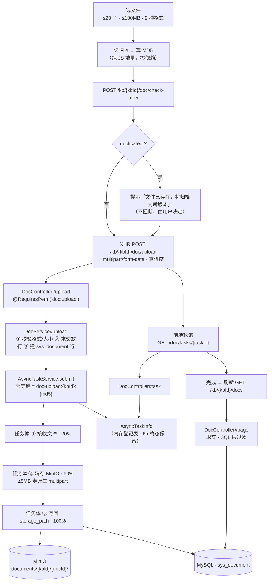

> 状态：🟡 进行中 · Sprint S4 · 阶段 A（M05 文档管线 · **D-5 契约冻结 + 上传入库**）· 建档 2026-09-16

# 2026-09-16 · S4 · M05 · 阶段 A —— 冻结 D-5 契约，把「上传」从演示变成真的

> 任务：`T-500` · `T-501` · `T-509` · `T-510`（4 项）· 来源：`docs/进度/03-Sprint排期.md` §Sprint 4
> 上一批计划：`ai_knowledge_web/plan/2026-09-16-S3-D.md`（S3 出口门禁取证，已收口）
> 上游：`S3-M04-B2`（`T-404`/`T-405`/`T-408`/`T-411`）· `S3-M03-C2`（审计打点冻结清单）

---

## 0. 为什么 S4 的第一批切在「上传」而不是「解析」

S4 的交付物是**一条流水线**：`上传 → MD5 去重 → 解析 → 两级分片 → 索引增强 → 嵌入 → Milvus 写入 → 通知`。
`03-Sprint排期.md` §S4 的前置里写着「**必须在本 Sprint 第一天冻结 D-5 的两个契约**（分片产出契约 / 回表消费契约），否则 M07 无法并行开工」。

于是有两个问题要先回答：**契约冻结算不算一批**、**流水线的入口先做还是解析先做**。

- **契约冻结不单独立批**。它是**文档产出**，没有可独立验收的运行时行为；单独立批就变成"写一份 md 然后结项"。
  按本仓既有做法（A 阶段的「契约先行」就是与主体同批），把它并入 S4 的第一批，作为**第 1 步**。
- **入口先做**。理由有三，且都是硬理由：
  1. `T-509`（`GET /doc/tasks/{taskId}`）依赖 `T-500` 产出 `taskId`，而它又是 `T-510`（文档列表）的依赖 —— 顺序上入口就是第一个；
  2. **本批建 `sys_document`**。`T-502` 起的解析流水线**全部以文档行为输入**，没有这张表，解析写出来的东西无处可落；
  3. 前端 `/kb/:id/upload` 页**已经存在且已经调了这 5 个接口**（`KbUploadView.vue` 902 行），
     但**上传是假的**（见 §1 W1）—— 先把它真化，后面每一批都能在**真页面**上验，而不是在 curl 上验。

> 一句话：本批交付的是「**文件真进 MinIO、真落库、真能查到、真能去重**」，
> 以及「**M07 能照着写的分片契约**」。解析、分片、向量化**一件不做**。

---

## 1. 开工条件检查

**依赖清单来源**（逐条注明出处，不许凭印象）：

| # | 依赖项 | 档位 | 现状（代码/文档实证） | 结论 |
|---|---|---|---|---|
| 1 | `T-500` 的依赖 `T-006`（异步任务外壳） | ✅ | `core/async/AsyncTaskService.java:59` 已实现（submit 幂等 + `TaskContext` 进度 + traceId 跨线程重绑定）；`AuditExportService:91` 是现成消费者范式 | 满足 |
| 2 | `T-500` / `T-510` 依赖表 `sys_document` | ⛔ → **本批第一步自建** | 真库 `show tables` **无 `sys_document`**；`V1__init_skeleton_schema.sql:5` 原话「知识库 / 文档 / 分片 / 会话 / 未命中问题等**业务表随各自模块的 Sprint 再建**」 | **不构成拒绝理由** —— 唯一路径就是本批建 V12，见下 |
| 3 | `T-509` 的依赖 `T-500` | ✅ | 同批，`taskId` 由 `T-500` 产出，`AsyncTaskInfo` 已含 `stage/percent/chunkDone/chunkTotal/errorMsg`（`AsyncTaskInfo.java:26-38`，与《10》§14 逐字对齐） | 满足 |
| 4 | `T-510` 的依赖 `T-509` | ✅ | 同上；列表的 4 个质量字段（`tableTotal/tableParsed/imageTotal/imageParsed`）本批先落列，值由 S4-B 填 | 满足（值挂 S4-B，见 §6+7 判据 11） |
| 5 | MinIO 可写（文件真落桶） | ✅ | `kb-minio` Up (healthy)；`MinioBucketInitializer` 建私有桶；`AvatarStorage#store:64` 是现成的"校验 → putObject → 返回对象名"范式 | 满足 |
| 6 | 权限码 `doc:upload` 已在 38 个权限点内 | ✅ | `core/enums/PermissionCode.java:55`（`DOC_UPLOAD("doc:upload", "上传文档", "文档")`） | 满足 |
| 7 | 前端 `/kb/:id/upload` 路由与页面 | ✅ | `ai_knowledge_app/src/views/kb/KbUploadView.vue`（902 行），已调 `config` / `docs` / `parseIssues` / `parseConfig` / `checkMd5` / `uploadDoc` 六个 | 满足（上传链路是假的，见 W1） |
| 8 | **D-5 两个契约** 必须先冻结 | ⛔ → **本批第 1 步产出** | `docs/进度/01-业务模块拆分.md:187` 已把 ①分片产出契约 ②回表消费契约 ③索引增强调用边界**逐字写死**；`docs/需求文档/10-接口约定汇总.md` 的 `parentId` 口径段已定案（顶层块 `null`、**禁止用 `0` 做哨兵**） | **不构成拒绝理由** —— 契约原文齐备，本批只需**落成独立文档 + 认领**，见 §3.1 步 1 |
| 9 | **`G3-8` 的出口口径裁定**（S3-D §10-2 点名要 S4 开工前定） | ✅ | **用户 2026-09-16 裁定：接受「口径冻结 + 静态断言」作为该门禁的部分证据** | 满足 —— 销掉 S3-D §9 第 41 条（见 §9） |
| 10 | `G4-2` 的「分片续传」落法 | ✅ | **用户 2026-09-16 裁定：单请求 multipart + 真进度**；「断点续传」明确不做 | 满足 —— 但**门禁原文的口径要收窄**，见 §3.4 假设 5 与 §9 第 2 条 |
| 11 | 环境：docker 6 服务 / 8080 / 5174 | ✅ | `milvus-standalone` `kb-neo4j` `milvus-etcd` `kb-minio` `kb-mysql` `kb-valkey` **全部 Up (healthy)**；`8080`（pid 68824）与 `127.0.0.1:5174`（pid 64980）均 LISTENING | 满足 |
| 12 | 测试样本（真实 PDF/DOCX） | ⚠️ | `docs/测试文件/`（**gitignored**）有 3 个 PDF + 1 个 DOCX + 8 个 MD；**无报价单、无带表格扫描件**（`docs/后端开发文档/02-spike-T0S1-表格识别.md` §五已登记） | 软缺 —— 本批只验"能传能存"，PDF/DOCX/MD 够用；**样本缺口归 S4-B** |
| 13 | S3-D 挂起的 6 条门禁片段 | — | `G3-7`删除类 / `G3-8`运行时 跟 `T-407`；`G3-3`后半 / `G3-4` / `G3-5` / `G3-6` 跟 `T-406` | **本批不销**（`T-406`/`T-407` 不在本批）→ §3.3 明确不做 |

**BLOCKER 汇总**：**无**。第 2、8、9 三条看着像硬缺，实测都不是：

- 第 2 条（`sys_document` 不存在）是**建表顺序问题**，不是"依赖没落地"——建表本身就是本批第一个动作，且 `V1` 的注释已经把这条设计意图写明（业务表随各自 Sprint 建）。**唯一路径 = 本批落 `V12`，不发明假选项。**
- 第 8 条（D-5 未冻结）是**认领问题**：契约原文（字段名、`parentId` 语义、回表 30 行/±5）已经逐字存在于《01》§M05 与《10》§14，本批把它**从"两处散落"收敛成"一处分片产出契约文档"**，第 1 步即可完成。
- 第 9 条已由用户当场裁定。

**⚠️ 已知偏差**（不拒绝施工，第 9 节销账）：

| # | 偏差 | 实证 | 处置 |
|---|---|---|---|
| **W1** | **前端上传是"演的"**：`kbApi.uploadDoc(id, {name, size, md5})` 发的是 **JSON**（`api/index.ts:180`），**一个字节的文件内容都没发**；进度条是 `runItem` 里的 `setInterval` 编的（`KbUploadView.vue:145-158`）；失败是 `willFail = !failedOnce && /\.txt$/i.test(item.name)` **按扩展名演的**（`:175`） | 三处均在 `KbUploadView.vue` 内 | **本批必须真化**（§3.1 步 7） |
| **W2** | `simpleHash()`（`:205`）是 31 进制滚动 hash，**不是 MD5**，且只吃 `name::size`（同名同大小必然同 hash） | `KbUploadView.vue:205` | 本批换纯 JS MD5（§3.1 步 8） |
| **W3** | **`sys_kb.doc_count/chunk_count` 与 `sys_document` 不同源**：前者是 S2 seed 的示例冗余列（`V7` 写入 128/8240…），本批起 `/kb/{kbId}/docs` 的 `list`/`total` 改从 `sys_document` 实查 —— 于是**知识库列表页说「128 篇」、上传页说「共 0 篇」** | `V7__s2_kb_skeleton_and_grants.sql:23-30`；`KbService.java:90/145` 读冗余列 | 本批**不回写**这两列（回写会把 128 打回 0，动静更大）；**显式登记为遗留**，归 S4-C（T-510 定型时）裁定 → §3.4 假设 2 + §9 第 3 条 |
| **W4** | **I-8 的「同库内不允许 MD5 重复」与《06》§3.2「命中 → 提示覆盖 → 覆盖即产生新版本」互相张力**：硬唯一约束一旦加上，"覆盖"归档出的 v2 与 v1 共享同一 md5，约束立刻被违反 | `docs/需求文档/03-术语与领域模型.md` I-8 vs `06-需求-知识库与文档.md` §3.2 | 本批把去重实现为**提示型（查询）而非约束**，理由写进 §3.4 假设 1 + `V12` 注释；**口径分叉登记为遗留** → §9 第 4 条 |
| **W5** | `GET /doc/tasks/{taskId}`（`T-509`）**前端零消费方** —— `docApi.task()` 已定义（`api/index.ts:202`）但 `KbUploadView` 不调，解析进度是自己 `setInterval` 编的 | `KbUploadView.vue:178-198` | 本批接上（§3.1 步 7） |
| **W6** | `GET /kb/{kbId}/parse-issues`（`T-511`）**后端未实现**（前端已调、mock 已备）；本批不做的后果是**上传页顶部告警条在真后端下永远不显示** | `KbController` 7 个映射中无此项 | **本批不做**（依赖解析结果）→ §3.3；G4-11 归 S4-B |
| **W7** | **「无文本层」检测（P0，T-0S1 结论 §六-1）尚未落地** —— 扫描件 21.8MB 产出 0 字节却报"成功"，是本项目最不能接受的一类静默故障 | `docs/后端开发文档/02-spike-T0S1-表格识别.md` §六 | 属 `T-502`（解析），**本批不做**；**S4-B 的 P0 必做项**，在此点名以免遗漏 |
| **W8** | `hasBusinessData`（`UserAdminService.java:575`）的「上传过文档」半边是 `TODO(S4)`，恒 `false` | 代码注释原话 | **本批销账**（表建好了，§3.1 步 9）—— 销《08》§七 遗留 2 / `汇总.md` §3 #6 |

> 判据只有一条：**这条不满足，代码写下去会不会白写**。W1~W8 逐条过一遍，没有一条会让本批的产物白写。

### 结论

- [x] ✅ **可以开工**
- [ ] ⛔ 拒绝施工

---

## 2. 开工时间

| 项 | 值 |
|---|---|
| 建档 / 开工日 | 2026-09-16 |
| 预计投入 | **3 人天**（S4 容量 ≈ 12 人天；本批是"入口 + 契约"，最重的是前端 XHR/MD5 真化） |
| 实际投入 | *回填时补* |

> 排期口径：S4 容量 **12**（`03-Sprint排期.md` 排期总表），`T-500~T-513` 共 14 项。
> 本批 4 项 + 一份契约文档 + 一张表，按 S3 的批均（B1 3 人天 / 4 项）估，**3 人天**是合理起点。

---

## 3. 开工内容

### 3.1 步骤

| 步 | 做什么（文件/类 → 动作 → 产出） | 依赖 | 可并行 |
|---|---|---|---|
| **1** | **冻结 D-5 两个契约** → 新建 `docs/后端开发文档/10-M05-分片产出契约（D-5）.md`：把《01》§M05 的 ①分片产出契约 ②回表消费契约 ③索引增强调用边界**逐字收录**，加上 `parentId` 硬口径（顶层块 `null`、**禁止 `0` 哨兵**）、`blockType`（接口名）↔ `chunk_type`（入库名）的映射、以及**本批的边界声明**（表结构随 `T-502~T-505` 落 `V13`，字段名以本文件为准） | — | 与步 2~4 并行 |
| **2** | `src/main/resources/db/migration/V12__s4_document_skeleton.sql`（**新建**）→ 建 `sys_document`，逐列在 §4 列明来源；含 `uk_doc_kb_md5`（**非唯一**，见假设 1）等索引 | 步 1 | 与步 1 并行 |
| **3** | `dto/doc/DocDtos.java`（**新建**）→ `DocRow`（对齐前端 `KbDocRow` 逐字段）/ `UploadAccepted`（`{docId, taskId, name, kbId, chunkTotal}`）/ `Md5Check`（`{duplicated, docId?, docTitle?, hint}`）/ `DocPage`（`{list, total, displayed}`）/ `TaskView`（`{taskId, stage, percent, chunkDone, chunkTotal, errorMsg}`） | 步 2 | — |
| **4** | `service/DocService.java`（**新建**）→ ① `upload(kbId, MultipartFile)` ② `checkMd5(kbId, name, md5)` ③ `page(kbId, keyword, status, quality, page, size)` ④ `taskView(taskId)`；权限/越权复用 `DataScopeService#kbVisibility`（**不自己写 where**，与 `KbService#configRowOrDeny:567` 同范式） | 步 3 | — |
| **5** | `core/storage/DocStorage.java`（**新建**）→ 上传字节流转存 MinIO，对象名 `documents/{kbId}/{docId}/{safeName}`；**≥5MB 自动走 MinIO 原生 multipart**（`putObject` 的 `partSize` 参数），<5MB 单次 PUT。与 `AvatarStorage` **同构**（同一个桶、只收前缀） | 步 2 | 与步 3~4 并行 |
| **6** | `controller/DocController.java`（**新建**）+ `KbController` **补 2 个映射** → `POST /api/kb/{kbId}/doc/upload`（`@RequestPart("file")`）· `POST /api/kb/{kbId}/doc/check-md5` · `GET /api/kb/{kbId}/docs` · `GET /api/doc/tasks/{taskId}`。**`@RequiresPerm` 分别挂 `doc:upload` / `doc:upload` / `kb:list`**（登录即可看任务状态，与《10》§6 一致） | 步 4 | — |
| **7** | **`application.yml` 补 multipart 上限** → `spring.servlet.multipart.max-file-size=100MB` / `max-request-size=110MB`（Boot 默认 **1MB**，不改则任何真实文件都进不来，且报的是 `MaxUploadSizeExceededException` 而不是我们的错误码）；顺带确认 `server.tomcat.max-swallow-size` 不被卡在 2MB | 步 6 | 与步 8 并行 |
| **8** | **异步任务体**：`DocService#upload` 内 `asyncTaskService.submit("doc-upload", "doc-upload:" + kbId + ":" + md5, 0, work)` → 任务体三步上报进度（`接收文件` 20% → `转存对象存储` 60% → `写入文档记录` 100%），末尾 `context.complete(payload)`。**幂等键含 md5**：连点两下只跑一次 | 步 5/6 | — |
| **9** | **前端真化（4 个文件）**：① `src/api/request.ts` 新增 `upload<T>()` —— 用 `XMLHttpRequest` 暴露 `upload.onprogress`（`fetch` **没法**报上传进度），其余解包/鉴权/401 逻辑与 `request()` 同源；② `src/api/index.ts` 的 `uploadDoc(id, form: FormData, onProgress)` 改 FormData；③ `src/utils/md5.ts`（**新建**）纯 JS 增量 MD5（**零依赖**，见 §5）；④ `KbUploadView.vue`：`onFileChange` 真读文件 → 真算 MD5 → 真 XHR 上传（真进度）→ 真轮询 `docApi.task()`；删掉 `simpleHash` 与 `willFail` 的表演分支 | 步 6 | — |
| **10** | **审计打点 1 处**：`DocService#upload` 加 `@AuditLog(module = AuditModule.DOC, action = "上传文档", risk = RiskLevel.NORMAL)`；**同步三处**（本仓 S3-C2 冻结口径）：① 注解 ② `AuditRiskPolicy.IMPLEMENTED` 逐条 `register(...)` 带理由 ③ `AuditCoverageFlowTest#expectedActions()` 冻结清单 **24 → 25** | 步 4 | 与步 9 并行 |
| **11** | **销 W8**：`UserAdminService#hasBusinessData:567` 并入「上传过文档」的存在性查询 | 步 2 | — |
| **12** | **取证**：新建 `src/test/java/com/knowledge/ai/service/DocUploadFlowTest.java`（真 HTTP + 真 multipart，§6+7 表逐条落用例）；扩展 `ai_knowledge_app/scripts/e2e-kb-flow.mjs`（或新增 `e2e-doc-upload.mjs`）走真页面 | 步 9/10 | — |
| **13** | **文档回填**（§附录 checklist） | 全 | — |

> **可并行结论**：步 1（契约文档）与步 2（迁移）无依赖，可同时起；步 5（MinIO 存储）与步 3/4（DTO/Service）可同时起；
> 步 8（前端）与步 10/11（打点/销账）可同时起。**唯一硬串行链是 2 → 3 → 4 → 6 → 8 → 12**。

### 3.2 业务流程图

> 触发条件：① 跨 ≥3 个组件 **✔**（前端 XHR → Controller → Service → MinIO / MySQL / 异步登记表，共 6 个）
> ② 涉及异步任务 **✔**（任务体在工作线程跑，进度靠轮询）④ 有并发/幂等 **✔**（幂等键 `doc-upload:{kbId}:{md5}`，防连点）。
> 三条同时命中，**必须画**。


<!-- diagram: ./2026-09-16-S4-M05-A/01-flow.svg -->


> ⚠️ **图中三个"没画"的部分就是本批的边界**：① 没有 `PARSING`/`INDEXING` 节点（无解析管线）；
> ② 没有 `sys_chunk`（S4-B）；③ 没有 Milvus（S4-C）。**边界画出来比写在表里更难含糊过去**。

### 3.3 明确不做（范围控制）

| 不做的事 | 原因 | 归属批次 |
|---|---|---|
| `T-502` 解析流水线（opendataloader + Tika）· 含 **「无文本层」检测（P0）** | 本批的边界是"文件进得来、落得下、查得到"；解析是流水线主体 | **S4-B** |
| `T-503` 两级分片 · `T-504` 表格双表示 · `T-505` 父子块模型 | 同上；且 `sys_chunk` 的列要由 T-504/T-505 的真实产出定型，**现在建表等于先猜一遍** | **S4-B**（落 `V13`） |
| `T-506` 标识符保护分词 · `T-507` 索引增强 · `T-508` 向量化 + Milvus 写入 | 依赖分片产物 | **S4-C** |
| `T-511` `GET /kb/{kbId}/parse-issues`（未识别表格清单） | 依赖解析结果；本批落地会返回恒空，反而是"假绿" | **S4-B**（G4-11） |
| `T-512` 图片处理 · `T-513` 文件夹批量导入 | P1 / P2 | 后续 Sprint |
| **`T-406` 重建索引 · `T-407` 删除知识库** | 不在本批任务行内；`T-406` 还依赖 `sys_chunk` | **S4-D**（销 S3-D 的 6 条挂起片段） |
| **断点续传** | 用户 2026-09-16 裁定：单请求 multipart；《06》§3.10 本就只禁"跨会话恢复" | **不做** → §9 第 2 条 |
| 文档预览 / 下载 / 删除 / 版本 | `T-600` 起，S7 域 | **S7** |
| 单位换算 / 前端类型重构等"顺手优化" | 与验收判据无关 | 不做 |

### 3.4 本批假设

> 信息不足下拍的决策。**假设被证伪 → 进第 9 节遗留**，否则没人知道当初赌了什么。

| # | 假设 | 若被证伪的后果 |
|---|---|---|
| 1 | **去重是「提示型」而不是数据库约束** —— 不加 `UK(kb_id, md5)` 或 `UK(owner_id, md5)`，只在 `check-md5` 时查询命中并返回 `duplicated` | 若出口要求"物理上不允许重复"，则与《06》§3.2 的"覆盖即产生新版本"直接冲突（v1/v2 共享 md5）—— 那时要改的是**需求口径**，不是加个索引 |
| 2 | **`sys_kb.doc_count/chunk_count` 本批不回写**，`/kb/{kbId}/docs` 的 `list`/`total` 一律从 `sys_document` 实查 | 若不回写导致"列表页 128 篇 / 上传页 0 篇"被认为是缺陷，则 S4-C 必须把这两列改成**派生**（或由索引任务回写），并同步 `KbService` 的三处读点 |
| 3 | **上传任务不跑解析**，文档停在 `UPLOADED` —— `PARSING`/`INDEXING`/`READY` 三个状态在本批**不可达** | 若出口要求 `G4-3` 的状态机在本批全绿，则本批必须把 T-502 拉进来（批次边界失效，工期翻倍） |
| 4 | **浏览器端 MD5 自己实现**（约 80 行纯 JS，零依赖），不引 `spark-md5` | 若自研实现与后端 `DigestUtils.md5Hex` 对不上，`check-md5` 会**永远不命中**（表现为"秒传功能静默失效"）—— 判据 2/3 就是钉这一条的 |
| 5 | **单请求 multipart 能满足 `G4-2` 的"大文件可完成"**（100MB 实测通过即算）；「断点续传」按用户裁定不做 | 若出口坚持门禁原文的"分片续传可完成"，则 `G4-2` 本批 0 通过、整体挂——**这是口径决定，不是技术问题**，已登记 §9 第 2 条 |
| 6 | **D-5 契约本批只有文档，无可执行断言**（表随 S4-B 落 `V13`） | 若 M07 照着契约写完后 `sys_chunk` 的字段名有出入，返工面覆盖 M07 —— S4-B 落表时**必须补一条「实体字段集 == 契约字段集」的反射用例**（同 `AuditChangeContractTest` 的手法） |
| 7 | **`displayed` = 本页条数（筛选后）**，`total` = 该库文档总数（筛选前） | mock 的 `kbDocsOf` 里 `total` 给的是 `kb.docCount`（示例值），若前端某处按"total = 筛选后总数"渲染，会出现"共 128 篇，显示 3 篇"的困惑 |

---

## 4. 数据变更清单

| 类型 | 内容 | 回滚方式 |
|---|---|---|
| **新建表** | `sys_document` —— 逐列如下表 | **需人工**（`DROP TABLE sys_document`；表内无历史数据，安全） |
| **迁移文件** | **`V12__s4_document_skeleton.sql`**（现存最大编号 `V11`，故下一个是 `V12`） | — |
| **种子数据** | **不 seed** —— 理由见下 | — |
| **NULL 分支** | `error_msg` 可空（非失败态为 `NULL`）；`storage_path` 可空（`UPLOADED` 建行时尚未转存完成，任务体回写）；`table_total/table_parsed/image_total/image_parsed` `NOT NULL DEFAULT 0`（本批恒 0，S4-B 填）；`deleted_at` `NULL` = 未删（软删位，`T-611` 用） | — |
| **配置变更** | `application.yml` **无改动**；`ai_knowledge_web/src/main/resources/application.yml` 的 `spring.servlet.multipart.max-file-size` / `max-request-size` **新增两行**（Boot 默认 1MB） | 可逆（删两行） |

**`sys_document` 列清单（每列注明来源，不猜）**：

| 列 | 类型 | 来源 / 理由 |
|---|---|---|
| `id` | `BIGINT PK AUTO_INCREMENT` | 项目惯例 |
| `kb_id` | `BIGINT NOT NULL` | I-2（文档必属恰好一个知识库）；`KEY idx_doc_kb` |
| `owner_id` | `BIGINT NOT NULL` | **I-8 的去重键半边**（`owner_id + md5`）；`KEY idx_doc_owner` |
| `title` | `VARCHAR(256) NOT NULL` | 前端 `KbDocRow.title`（**不含扩展名**，见 mock `KB1_DOCS`） |
| `file_name` | `VARCHAR(256) NOT NULL` | 原始文件名（含扩展名）—— 下载与 `T-612` 打包要用 |
| `type` | `VARCHAR(16) NOT NULL` | `KbDocRow.type`，取值 `PDF/DOC/DOCX/XLS/XLSX/PPT/PPTX/TXT/MD`（《06》§3.1 的 9 种） |
| `size_bytes` | `BIGINT NOT NULL` | `KbDocRow.size`；也是把 `storage-quota.used` 从"全桶扫描"改成 `sum` 的前提（`汇总.md` §3 #21） |
| `md5` | `CHAR(32) NOT NULL` | `T-501` 去重键；`KEY idx_doc_md5(kb_id, md5)`（**非唯一**，见假设 1） |
| `storage_path` | `VARCHAR(512) NULL` | MinIO 对象名（**不存 URL**，与 `AvatarStorage` javadoc 同一条原则：存事实不存视图） |
| `status` | `VARCHAR(16) NOT NULL DEFAULT 'UPLOADED'` | `DocStatus` 枚举：`UPLOADED/PARSING/INDEXING/READY/FAILED`（与前端 `DocInfo['status']` 逐字一致） |
| `error_msg` | `VARCHAR(512) NULL` | `G4-3`「失败态给出**具体原因**（非"失败"两字）」；也是任务表的 `errorMsg` |
| `chunk_count` | `INT NOT NULL DEFAULT 0` | `KbDocRow.chunkCount`；**口径见 `BlockType#countsInChunkTotal`（只计顶层块，表格子块不计）** |
| `table_total` | `INT NOT NULL DEFAULT 0` | `KbDocRow.tableTotal`（`G4-4`） |
| `table_parsed` | `INT NOT NULL DEFAULT 0` | `KbDocRow.tableParsed`（`G4-4`，**与 status 独立成列**是《06》§3.6 的核心设计） |
| `image_total` | `INT NOT NULL DEFAULT 0` | `KbDocRow.imageTotal?`（V2 新增） |
| `image_parsed` | `INT NOT NULL DEFAULT 0` | `KbDocRow.imageParsed?`（V2 新增） |
| `created_at` / `updated_at` | `DATETIME NOT NULL` | 项目惯例 |
| `deleted_at` | `DATETIME NULL` | 软删位（`T-611`）；`hasBusinessData` 与回收站都按它过滤 |

**不 seed 的理由**（这是本批的一个刻意决策，不是遗漏）：

- `sys_kb.doc_count` 已 seed 成示例值（128/42/316/…共 1246），**若再 seed 12 行 `sys_document`，
  两个口径会同时存在且都不完整** —— 反而制造出"三处数字互相打架"的局面（W3 已经是一个了，不要再加一个）。
- 本批的验收靠**真上传**产生数据（E2E 与用例都不依赖预设行），seed 只会污染"上传了 N 篇"这个可数事实。
- 代价：上传页初始显示「共 0 篇」。**这是真值**，登记在 §9 第 3 条与 W3 一起裁定。

> 跑过的迁移**只增不改**（改已执行的 `V*.sql` 会导致校验和不符、启动失败）。`V1`~`V11` **一字未动**。

---

## 5. 依赖与工具决策

**默认不引**。逐项说明：

| 需求 | 方案 | 做法 | 代价 | 结论 |
|---|---|---|---|---|
| 浏览器端算 MD5 | **自研纯 JS 增量实现** | `src/utils/md5.ts`，约 80 行（标准 MD5 四轮 + 512 位分块），`file.arrayBuffer()` → 一遍算出 32 位十六进制 | 100MB 文件约阻塞主线程 1s（登记为观察项） | **采用** |
| 同上·候选 A | `spark-md5` | 11KB，成熟，支持 `ArrayBuffer` 分块 | **新增前端依赖**；本仓从 S0 起维持"前端仅 element-plus / vue / pinia / vue-router 4 个直接依赖"；本功能是**一次性算法**，不是持续演化的库 | ❌ 不引 |
| 同上·候选 B | `crypto.subtle.digest('SHA-256')` | 浏览器原生，零代码 | **SubtleCrypto 不提供 MD5**；改算法 = 改《06》§3.2 与 `T-501` 的口径（去重键的语义是"内容指纹"，换成 SHA-256 也成立，但要**同步改需求文档**） | ❌ 不引（本批不改需求口径） |
| 上传真进度 | **原生 `XMLHttpRequest.upload.onprogress`** | `request.ts` 新增 `upload<T>()`，与既有 `request()` 共用解包/鉴权 | `fetch` 至今无上传进度事件（streaming request body 未普及） | **采用**（零依赖） |
| 大文件转存 | **MinIO 客户端原生 multipart** | `putObject(..., .stream(in, size, partSize))`，`partSize` ≥5MB 时自动分片 | 无需自己实现分片协议 | **采用**（`minio` 已是既有依赖） |
| 解析（本批不用） | `opendataloader-pdf-core:2.5.0` + Tika 3.2.2 | **S0 已加入 `pom.xml`**（`pom.xml:178/185/191`，含"为何不能用 1.11.0"的注释） | — | **本批零改动** |
| 后端 multipart 上限 | Spring MVC 原生配置 | `spring.servlet.multipart.*` 两行 | 不改则 1MB 上限 | **采用** |

**同类产品对比（MD5 部分）**：`spark-md5`（11KB、~3 年无更新、周下载量高）vs `js-md5`（体积相近、API 更旧）
vs `crypto-js`（**体积 200KB+，为 4 个哈希拉整个库，不值得**）。三者都不如"80 行自研 + 判据 2/3 钉住正确性"。

**推荐**：**本轮零新增依赖** · **理由**：① 本仓 S0 起的前端依赖面刻意维持极小（`package.json` 的 `dependencies` 只有 4 项），
② 上传链路的两处新能力（MD5、上传进度）**都有零依赖的原生/自研路径**，
③ 唯一有诱惑力的是 `spark-md5`，但它的收益是"省 80 行"，代价是"多一个不再演化的第三方包要跟着升级 React 时代的锁文件" —— **不值**。

> 后端：**无新依赖**（`minio` / `AsyncTaskService` / Spring MVC multipart 全是既有栈）。

---

## 6 + 7. 验收方法与标准

> **本批起每批判据表加一列「门禁号」**（`S3-D` §10-4 / `汇总.md` §5 的冻结口径）——
> 结项时按**门禁号**建表，不按批次汇总。

| # | 判据（对齐需求门禁号 `G?-?`） | 门禁号 | 验收方法（可直接粘的命令/脚本） | 期望结果 | 证据落点 |
|---|---|---|---|---|---|
| 1 | **D-5 契约已冻结且与《01》逐字一致** | — | `diff <(sed -n '/对外契约（seam）/,/^---/p' docs/进度/01-业务模块拆分.md) <(sed -n '/## 一、分片产出契约/,/## 三、/p' docs/后端开发文档/10-M05-分片产出契约（D-5）.md)`（人工比对字段名清单） | 5 个字段名 + `parentId` 规则 + 30/±5 全部在册 | `docs/后端开发文档/10-M05-分片产出契约（D-5）.md` |
| 2 | 上传落库：全字段回读与提交值一致 | `G4-1` | 后端：`DocUploadFlowTest#uploadPersistsAllFieldsAndReadsBack`（真 multipart） | `title/file_name/type/size_bytes/md5/owner_id/status=UPLOADED` 逐字段相等 | `DocUploadFlowTest` |
| 3 | 同一文件二次上传**命中秒传**（返回 `duplicated=true` 且给出 docId/docTitle） | `G4-1` | 后端：`#secondUploadHitsMd5Dedup`（同账号连传两次 + 页面级 E2E） | `duplicated=true`、`docId` 指向第一次的文档、`hint` 非空 | 同上 |
| 4 | **去重键是 `(owner_id, md5)` 而非「库内 md5」** —— 换个人传同 md5 **不命中** | `G4-1` | 后端：`#dedupKeyIsOwnerScoped`（探针账号 A 传 → 账号 B 传同一字节） | A 命中、B 不命中 | 同上 |
| 5 | 去重是**提示型**：命中后仍可继续上传，且产生新行（"覆盖 = 新版本"的前置） | — | 后端：`#dedupHintDoesNotBlockUpload` | 第二次上传仍成功、`sys_document` 增 1 行、两行同 `md5` 不同 `id` | 同上（假设 1 的可执行版） |
| 6 | 单次 >20 个文件被拦（前端） | `G4-2` | `cd ai_knowledge_app && node scripts/e2e-doc-upload.mjs --base=http://127.0.0.1:5174` | 第 21 个起出现「单次最多 20 个文件」提示；`/api/*` 请求数 **= 20** | `e2e-doc-upload.mjs` |
| 7 | 单个 >100MB 被拦（前端）+ 后端兜底拒 | `G4-2` | 前端同上；后端 `#oversizeRejected`（直接发 101MB multipart） | 前端提示「超过 100 MB 上限」；后端 `10035 FILE_TOO_LARGE` | E2E + `DocUploadFlowTest` |
| 8 | **100MB 文件能真实传完并落 MinIO**（本批 `G4-2` 的收窄判据） | `G4-2` | 后端：`#hundredMbUploadLandsInMinio`（`dd` 合成的 100MB 文件 → `statObject` 比对 size） | 上传成功；MinIO 对象存在且 `size == 104857600`；耗时打印 | `DocUploadFlowTest` |
| 9 | 任务状态可查（`T-509`）：`stage/percent/chunkDone/chunkTotal/errorMsg` 五字段可读且**进度单调不减** | `G4-3` | 后端：`#taskProgressIsMonotonic`（上传后轮询至终态，采样序列断言非递减） | 终态 `percent=100`、`status=DONE`；不存在的 taskId → `10045 TASK_NOT_FOUND` | 同上 |
| 10 | 状态机 `UPLOADED→PARSING→INDEXING→READY` **可观测** | `G4-3` | 同判据 9 | ⚠️ **前半 ✅**（`UPLOADED` 可真达）· **后半 ⏸️ 挂 S4-B**（无解析管线，见假设 3） | 同上 |
| 11 | 失败态给出**具体原因**（非"失败"两字） | `G4-3` | 后端：`#unsupportedTypeGivesActionableReason`（传 `.exe`） | `10034`，`message` 含被拒扩展名与支持清单 | 同上 |
| 12 | 列表**状态列与解析质量列独立** | `G4-4` | `e2e-doc-upload.mjs` 断言两列是两个独立单元格 | ⚠️ **列结构 ✅**（两列渲染、`tableTotal=0` 时质量列显示占位而非「表格 0/0」）· **质量值 ⏸️ 挂 S4-B** | E2E |
| 13 | 列表 `list` 与 `total` **同源**（都来自 `sys_document` 实查） | `G4-4` | 后端：`#pageListAndTotalShareOneSource`（上传 3 篇后 `list.size()` 与 `total` 同时 +3） | 两者同增同减 —— **防 W3 那类"两个答案"** | `DocUploadFlowTest` |
| 14 | 越权：无权访问该库的用户上传被拒 | — | 后端：`#uploadDeniedWithoutKbAccess`（构造无授权的探针账号） | `10022 KB_ACCESS_DENIED`（越权）/ `10043 KB_NOT_FOUND`（不存在）**分开报** | 同上 |
| 15 | 权限：无 `doc:upload` 的用户被 403 | — | 后端：`#uploadRequiresDocUploadPerm` | HTTP **403** + `10020`（不是 200+非0 code —— 权限类是唯二例外） | 同上 |
| 16 | 审计打点：落一条「文档 / 上传文档 / NORMAL」，且 `apiPath` / `operator` 取自真请求 | `G3-7` 邻接 | 后端：`#uploadWritesAuditRow`（真 HTTP 后查 `sys_audit_log` 最新行） | `module=文档`、`action=上传文档`、`risk_level=NORMAL`、`operator=admin`、`result=SUCCESS` | 同上 |
| 17 | **审计契约双向零差异**（注解 ↔ `AuditRiskPolicy`，冻结清单 25 条） | — | `mvn -B -o -f F:/work/code/ai-knowledge/ai_knowledge_web/pom.xml test -Dtest='AuditChangeContractTest+AuditCoverageFlowTest'` | 全绿；`@AuditLog` 总数 **24 → 25** | `AuditChangeContractTest` · `AuditCoverageFlowTest` |
| 18 | **`hasBusinessData` 含「上传过文档」半边**（销 W8 / 《08》§七 遗留 2） | `G2-6` 回补 | 后端：`#userWithUploadedDocCannotBeDeleted`（传 1 篇 → `DELETE /users/{id}`） | `10069 USER_HAS_BUSINESS_DATA`，文案含「或文档」 | `DocUploadFlowTest` / `UserAdminFlowTest` |
| 19 | 前端真上传：**进度条来自真实 `upload.onprogress`**（不是定时器） | `G4-2` | `e2e-doc-upload.mjs` 用 CDP `Network.emulateNetworkConditions` 限速 512kbps 传 3MB 文件，采样进度值 | 进度值在真实网络时间内**分多档**变化（限速下至少 5 档），且末档 = 100 | E2E |
| 20 | 页面级端到端：选文件 → 上传 → 列表出现该行 → 状态「已上传」 | `G4-1` | 同上传 E2E，断言 `/api/kb/{id}/docs` 的 `list` 含真上传的文件名 | 行内 `size/chunkCount=0/tableTotal=0` 与真值一致 | E2E |
| 21 | `audit-api.mjs` 的 **【S4】组 5 → 2** | — | `cd ai_knowledge_app && node scripts/audit-api.mjs` | ①=0 ②=0 ⑥=0；**【S3】组仍为 3**（本批不动 `T-406/407`） | 对账输出 |
| 22 | **种子零污染** + 测试基线 | — | `set -a && . ai_knowledge_web/.env && set +a && docker exec kb-mysql mysql -u"$MYSQL_USERNAME" -p"$MYSQL_PASSWORD" "$MYSQL_DATABASE" -N -e "select count(*) from sys_user where deleted_at is null;"` + 全量 `mvn test` | 种子 `128 用户 / 5 角色 / 8 库 / 34 授权 / 60 矩阵`、探针残留 0、`sys_document` 探针行 0；后端 **151 → N** 全绿 | 命令输出 |

**观察项**（不计成败）：

| # | 观察项 | 说明 |
|---|---|---|
| 1 | 自研 MD5 在 100MB 文件上约阻塞主线程 1s | 未做 Worker 化。若后续成为体验问题，迁到 `Worker` 或改 `requestIdleCallback` 分块 —— **不影响判据 3/4 的正确性** |
| 2 | 上传页「解析中」状态在本批不可达 | 队列四态里 `PARSING` 无来源（假设 3）；页面在 `UPLOADED` 之后直接进「已完成」。**不是缺陷，是流水线未到** |
| 3 | `sys_kb.doc_count` 与列表页可见篇数不一致 | W3 / 假设 2，已在 §9 登记 |
| 4 | `KbUploadView` 的 `failedOnce` 表演分支被删后，页面不再演示"编码失败" | 该演示意图由真实的 `FAILED` 取代（S4-B 起） |
| 5 | MinIO 对象名 `documents/{kbId}/{docId}/{safeName}` 中的 `safeName` 做了字符清洗 | 仅替换路径分隔符与不可见字符；**不去中文**（`storage_path` 只进库不下发 URL） |

**种子核对**（跑完必做）：

```bash
set -a && . ai_knowledge_web/.env && set +a
docker exec kb-mysql mysql -u"$MYSQL_USERNAME" -p"$MYSQL_PASSWORD" "$MYSQL_DATABASE" -N -e "select count(*) from sys_user where deleted_at is null;"
docker exec kb-mysql mysql -u"$MYSQL_USERNAME" -p"$MYSQL_PASSWORD" "$MYSQL_DATABASE" -N -e "select count(*) from sys_document;"
```

---
---

# 以下为开工后回填

> **提交节奏（两次）**：1~7 节写完即提交一次（`docs(plan): S4-M05-A 开工计划`）；
> 8~10 节写完再提交一次（`docs(plan): S4-M05-A 验收回填`）。让 git log 上「计划 → 结果」成对可查。

## 8. 验收结果

| # | 判据 | 实测结果 | 证据（命令 / 文件:行 / 测试名） |
|---|---|---|---|

**测试基线**：`Tests run: N, Failures: 0, Errors: 0, Skipped: 0`（上批 **151** → 本批 M）

> 失败就照实写失败，不许改成"部分通过"。
> **取证条件不具备时**，该行实测结果填 `⏸️ 挂起 —— 待 <批次> 取证`，
> 并在那批的 8 节做**合并回填**（两批计划文件同时更新、同时提交）。

---

## 9. 遗留问题

| # | 项 | 原因 | 归属批次 | 是否有判定点/注释留在代码里 |
|---|---|---|---|---|

> 没有遗留写「无」。**本批若"先施工后补写第 1 节"，也必须在此登记一条**（违规留痕）。

---

## 10. 建议

- 对下批的排期 / 口径 / 风险建议。没有写「无」。

---

## 附：本批同步的文档回填

- [ ] `docs/后端开发文档/10-M05-分片产出契约（D-5）.md` → **新建**（D-5 ①②③ 落成独立文档）
- [ ] `docs/进度/02-任务清单.md` → `T-500` / `T-501` / `T-509` / `T-510` 置 ✅（未做的不动）
- [ ] `docs/进度/03-Sprint排期.md` → §Sprint 4 补「交付状态」段
- [ ] `docs/进度/README.md` → 看板 S4 状态 + 完成日期 + §7 变更记录
- [ ] `docs/需求文档/10-接口约定汇总.md` → §6「上传」标注 `multipart/form-data`（§14 的 `uploadDoc` 行）+ §15 变更记录
- [ ] `docs/需求文档/06-需求-知识库与文档.md` → §3.2 补「去重为提示型、不加唯一约束」的口径（若假设 1 成立）
- [ ] `ai_knowledge_web/plan/汇总.md` → §1 当前定位 / §2 批次总览 / §3 遗留（并入本批 §9）/ §4 挂起 / §5 口径
- [ ] `ai_knowledge_web/plan/README.md` → 批次索引加一行
- [ ] `docs/进度/02-任务清单.md` → 跨模块段补「S4 阶段 A 已完成」
- [ ] **订正 S3-D §9 第 41 条**（`G3-8` 口径待裁定）→ **已裁定**（用户 2026-09-16：接受静态断言为部分证据）
- [ ] 本文件状态行 → ✅ 已完成
- [ ] `.workbuddy/memory/<日期>.md` → 交接
