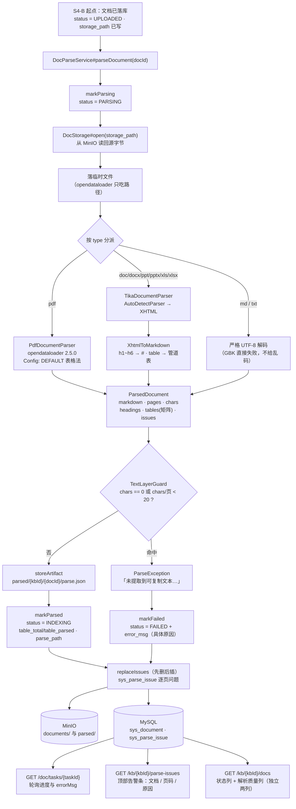

> 状态：🟡 进行中 · Sprint S4 · 阶段 B（M05 文档管线 · **解析流水线 + 未识别表格清单**）· 建档 2026-09-16

# 2026-09-16 · S4 · M05 · 阶段 B —— 把「文件进来了」推进到「内容出来了」

> 任务：`T-502` · `T-511`（2 项）· 来源：`docs/进度/03-Sprint排期.md` §Sprint 4
> 上游计划：`ai_knowledge_web/plan/2026-09-16-S4-M05-A.md`（本批要销的账见第 1 节）
> 契约：`docs/后端开发文档/10-M05-分片产出契约（D-5）.md`（**本批不碰分片**，但解析产物是它的上游）

---

## 0. 为什么这批切在「解析」而不是「分片」

S4-A 把流水线的**入口**做实了：文件真进 MinIO、真落库、真能查到、真能去重，终态 `UPLOADED`。
S4-B 要回答的是下一个问题：**这个文件里到底有什么内容？**

- **必须做解析而不是先做分片**：分片（`T-503`）的输入是解析产物，`T-504`/`T-505` 的表格矩阵也来自解析。
  先做分片等于凭空造输入。
- **`T-511`（未识别表格清单）必须跟解析同批**：清单的**内容**只能由解析阶段发现 ——
  它是解析质量的**出口**，不是独立功能。分两批做就会出现"接口先落地、永远返回空"的假绿（S4-A §9 第 2 条已登记）。
- **「无文本层」检测（`T-0S1` §六-1 的 P0 必做项）就在这批**：扫描件 21.8MB 产出 0 字节却报"成功"
  是本项目最不能接受的一类故障（《02》「静默降级视为缺陷」）。
  S4-A 已经把「失败必须给具体原因」的通道（`error_msg` + `errorMsg` 轮询）建好了，**这批把它填上**。

> 一句话：本批交付的是「**内容真的被抽出来了、抽不出来时真的说得出为什么、说不出的地方真的列得出来**」。
> 分片、表格双表示、父子块、索引增强、向量化**一件不做**（`sys_chunk` 仍为空，见 §3.3）。

---

## 1. 开工条件检查

**依赖清单来源**（逐条注明出处，不许凭印象）：

| # | 依赖项 | 档位 | 现状（代码/文档实证） | 结论 |
|---|---|---|---|---|
| 1 | `T-502` 的依赖 `T-0S1`（表格识别 spike 结论） | ✅ | `docs/后端开发文档/02-spike-T0S1-表格识别.md` 已出结论：**表格识别够用，真风险是"识别不到时静默返回空"**；`pom.xml:178` 已锁 `opendataloader-pdf-core:2.5.0`（含"为何不能用 1.11.0"的注释） | 满足 |
| 2 | `T-511` 的依赖 `T-510`（文档列表） | ✅ | S4-A 已落地（`DocController#page` + `sys_document` 18 列） | 满足 |
| 3 | 解析输入 = 源文件字节 | ✅ | S4-A 已把原文件转存 MinIO（`sys_document.storage_path`，`DocStorage`）；**但 `DocStorage` 只有 `store`/`sizeOf`/`remove`，没有读回** | **本批新增 `open()`**，见 §3.1 步 3 |
| 4 | 解析产物落点（对象存储） | ✅ | 同桶、前缀隔离的既有范式（`AvatarStorage` / `DocStorage` / `AuditExportService` 三处先例） | 满足 |
| 5 | 解析结果落库（质量列） | ✅ | `sys_document` 的 `table_total/table_parsed/image_total/image_parsed` **S4-A 已建好列**，本批填真值 | 满足 |
| 6 | 「未识别表格」需要**行级**存储（含页码） | ⛔ → **本批自建** | `sys_document` 是**文档级**表，装不下"每页一条、原因不同"；真库无任何 issue 表 | **不构成拒绝理由** —— 唯一路径是本批落 `V13`，见下 |
| 7 | 异步任务外壳 `T-006` | ✅ | `AsyncTaskService`（`submit` 幂等 + `TaskContext#stage/percent`）；S4-A 的 `doc-upload` 任务体是现成范式 | 满足 |
| 8 | 环境：docker 6 服务 / 种子 | ✅ | `milvus-standalone` `kb-neo4j` `milvus-etcd` `kb-minio` `kb-mysql` `kb-valkey` **全部 Up (healthy)**（2026-09-16 复核） | 满足 |
| 9 | 解析样本（真实 PDF / DOCX / XLSX / MD / TXT） | ✅ | `docs/测试文件/`（gitignored）有 5 个 PDF（含 **21.8MB 无文本层扫描件**）、4 个 DOCX、1 个 XLSX、6 个 MD、1 个 TXT；**全部已用探针跑过一遍**，产出见下 | 满足（**无报价单/带表格扫描件**仍是样本缺口 → W7） |
| 10 | **Tika 3.2.2 在本依赖环境下能否真跑** | ⛔ → **本批修** | **实测会崩**：`tika-core` 的 `DefaultZipContainerDetector` 调 `ZipFile.builder()`（commons-compress ≥1.26 才有），而 `minio:8.5.7` 传递引入 **commons-compress 1.24.0**，Maven 就近取胜 → `NoSuchMethodError`。**任何 DOCX/XLSX 解析都会直接抛错** | **本批必修**（`T-502` 就是"接入 Tika"），见 §3.1 步 9 与 §5 |
| 11 | S4-A 挂起的判据（本批要销的） | — | `G4-3` 后半（状态机）· `G4-4` 质量值 · `G4-11`（`parse-issues`）；`G4-5`/`G4-6`/`G4-7` 依赖 `sys_chunk` → **不在本批** | 消费侧见 §6+7 |
| 12 | S4-A `§9` 第 6 条「`MaxUploadSizeExceededException` 无处理器」 | ⚠️ | `GlobalExceptionHandler` 现有 12 个 `@ExceptionHandler`，**无 multipart 上限项**；超限异常在 DispatcherServlet 之前抛出，绕过本类 | **本批顺手销**（S4-A §10-3 明确要求） |

**BLOCKER 汇总**：**无**。第 6、10 两条看着像硬缺，实测都不是：

- 第 6 条（issue 表不存在）是**建表顺序问题**：本批的交付物之一就是"让失败可见"，而可见需要页码级存储。
  **唯一路径 = 本批落 `V13`（`sys_parse_issue` + `sys_document.parse_path`），不发明假选项。**
  ⚠️ 编号说明：S4-A 的契约文档 §三曾写「`sys_chunk` 随 `T-504/T-505` 落 `V13`」——
  本批先占了 `V13`，**`sys_chunk` 顺延到 `V14`**，该文档 §三已同步订正（见 §9 第 1 条）。
- 第 10 条（Tika 版本冲突）**不改变批次边界**：`T-502` 的字面任务就是"接入 Tika"，装上一个跑不起来的
  Tika 等于没做。修法拉齐 S0 的既有先例（`opendataloader` 因 `NoSuchMethodError` 从 1.11.0 锁到 2.5.0），
  同样**只改一行 + 写清理由**，见 §5。

**⚠️ 已知偏差**（不拒绝施工，第 9 节销账）：

| # | 偏差 | 实证 | 处置 |
|---|---|---|---|
| **W1** | **S4-A 的部分后端用例上传的是假字节**（`"判据2：上传落库与回读".getBytes()` 之类，文件名叫 `.pdf` 但内容不是 PDF）——接入解析后这些行会走到 `FAILED`，而它们断言的是 `status = 'UPLOADED'` | `DocUploadFlowTest` 判据 2/3/5/9/11/13 等多处；`e2e-doc-upload.mjs` 的 `smallBytes`/`bigBytes`（`Buffer.alloc`） | **本批改用真实可解析内容并把断言改到新终态**（`INDEXING`）；100MB 那条保留（它只断言 MinIO 字节数，与解析无关）→ §9 第 2 条 |
| **W2** | **`sys_kb.doc_count/chunk_count` 与 `sys_document` 不同源**（S4-A 的 W3/遗留 45）：知识库列表说「128 篇」、上传页说「共 0 篇」 | `plan/2026-09-16-S4-M05-A.md` §1 W3 · §9 第 3 条 | **本批仍不回写**（归 S4-C 裁定）→ §9 第 3 条 |
| **W3** | **图片质量列（`image_total/image_parsed`）本批仍恒 0**：图片处理是 `T-512`（P1，依赖 `T-907` VL 模型，S6），本批**不统计** | 《06》§1.4.7 标注为「V2 新增」；任务行 `T-512` 依赖 `T-508`/`T-907` | **0/0 表示"未评估"，不表示"没有图片"**；前端此时显示「无表格 / 图片」对含图文档不准确 → §9 第 4 条 |
| **W4** | **`chunk_count` 本批仍恒 0**（分片是 `T-503`） | 任务行 `T-503` 依赖 `T-502` | 诚实留 0（有 `parse_path` 与质量列可证明解析真的跑了）→ §9 第 5 条 |
| **W5** | **opendataloader 的线程安全性未验证** | 其 API 是静态入口（`OpenDataLoaderPDF.processFile` / `shutdown`），spike 里是串行调用；而 `taskExecutor` 是 core=4/max=8 的池 | **取保守串行**（一把锁），吞吐优化按《03》排期归 S9 → §3.4 假设 5 |
| **W6** | **解析任务在工作线程跑，没有登录态** | `AuditContext`/`LoginUserContext` 不跨线程（`汇总.md` §3 #5 已登记） | 解析**不打审计点**、**不复核权限**（提交时已复核，且幂等键含 `ownerId`）→ §9 第 6 条 |
| **W7** | 样本缺口：**没有报价单、没有带表格的扫描件**（`T-0S1` §五点名"建议 S4 开工前补两份样本"） | `docs/测试文件/` 现有 5 PDF / 4 DOCX / 1 XLSX / 6 MD / 1 TXT，全是技术文档与手册 | **本批不补**（无法凭空造出真实报价单）。影响：`G4-5`~`G4-7`（表格双表示/父子块）的取证将来要用的正是这类样本；本批的表格判据用 `1-DeepSeek使用.pdf`（9 张真实表 + 若干版式误判）代偿 → §9 第 7 条 |

> 判据只有一条：**这条不满足，代码写下去会不会白写**。W1~W7 逐条过一遍，没有一条会让本批的产物白写。

**本批实测的样本事实**（不是推断，是 `target/probe` 里跑出来的；见 §5 的探针说明）：

| 样本 | 类型 | 页数 | 实测产出 | 用于判据 |
|---|---|---|---|---|
| `1-DeepSeek使用.pdf` | PDF 有文本层 | 42 | 9 张表（其中 2 张是 `1×1` 版式误判）· 75 图 · markdown 18581 B | 2 · 7 · 8 · 10 |
| `江西省…项目管理章程.pdf` | PDF 有文本层 | 20 | 7 张表（含 `rowspan=2`/`colspan=2` 的合并单元格） | 2 · 10 |
| `百福云PaaS平台…v1.0.pdf` | PDF 有文本层 | 20 | 0 张表 | 4（不触发阈值） |
| `2-提示词工程.pdf` | PDF 有文本层 | - | 0 张表（原文确无表格） | 4 |
| `健康生活方式（指导手册）.pdf` | **PDF 无文本层** | 15 | **0 字符 · 15ms** · 只有 15 个整页 `image` | **3 · 4 · 12 · 13（核心）** |
| `…会计分录及差错处理方案.docx` | DOCX | — | 1741 字符 · `h2`/`h3` 各若干 | 7 |
| `…业务需求规格说明书_V2.4.docx` | DOCX | — | 27400 字符 · **97 张表** | 7 |
| `软件需求计划20200811.xlsx` | XLSX | 1 sheet | 897 个 `td` · 111 个 `tr` | 8 |
| `第01讲-…Netty-笔记.md` | MD | — | 5512 字符；**Tika 报 `text/x-web-markdown` 但走的是 `TextAndCSVParser`** → 印证 §3.4 假设 2 | 9 |

> ⚠️ 这张表是**跑出来的**：`target/probe/OdlProbe.java`（opendataloader 的 JSON 元素树）+ `TikaProbe.java`（Tika 的 detect / `parseToString` / XHTML 标签分布）。
> 两个探针都在 `target/` 下（不入库），跑完即弃 —— 但**结论抄进了本文件**，所以 §5 的两条决策与 §3.4 的三条假设都有实测依据，不是猜的。

### 结论

- [x] ✅ **可以开工**（批次边界经用户 2026-09-16 裁定：`T-502` + `T-511`）
- [ ] ⛔ 拒绝施工

---

## 2. 开工时间

| 项 | 值 |
|---|---|
| 建档 / 开工日 | 2026-09-16 |
| 预计投入 | **3 人天**（S4 容量 12；已用 3，本批后累计 6）。最重的三块：① `pipeline` 包首次落地（两条解析路径 + XHTML→Markdown 转换器）② 「无文本层」检测与**逐页**问题的产出 ③ S4-A 既有用例因流水线接入需要改夹具 |
| 实际投入 | *回填时补* |

> 排期口径：`T-500~T-513` 共 14 项 / S4 容量 12 人天；S4-A 用 3，本批 2 项 + 首次落地整个 `pipeline` 包，取 **3 人天**。

---

## 3. 开工内容

### 3.1 步骤

| 步 | 做什么（文件/类 → 动作 → 产出） | 依赖 | 可并行 |
|---|---|---|---|
| **1** | `src/main/resources/db/migration/V13__s4_parse_artifact_and_issues.sql`（**新建**）→ ① `ALTER TABLE sys_document ADD COLUMN parse_path VARCHAR(512) NULL`（解析产物对象名）② `CREATE TABLE sys_parse_issue`（`doc_id`/`kb_id`/`page_no`/`reason`，见 §4）。**只增不改**，`V1`~`V12` 一字未动 | — | 与步 2 并行 |
| **2** | `pipeline/ParsedDocument.java`（**新建**）→ 统一解析产物的**领域模型**：`format`/`pages`/`chars`/`markdown`/`headings[]`/`tables[]`（含 cell 矩阵）/`imageCount`/`issues[]`。**它是 `T-503` 分片的唯一输入**，所以字段名即契约（与 `V13` 的 `parse_path` 内 JSON 同构） | — | — |
| **3** | `core/storage/DocStorage.java`（**改**）→ 补 ① `open(objectKey)`（读回源文件，`getObject`）② `storeArtifact(kbId, docId, name, bytes)`（写 `parsed/{kbId}/{docId}/{name}`）。与既有 `store` 同桶、同前缀纪律；**存对象名不存 URL** | 步 1 | 与步 2 并行 |
| **4** | `pipeline/PdfDocumentParser.java`（**新建**）→ opendataloader 2.5.0：临时目录 + `Config`（`DEFAULT` 表格法、`keepLineBreaks`、关 HTML/Text、`IMAGE_OUTPUT_OFF`）→ 读 `*.json`（元素树：`heading level` / `table.rows[].cells[].kids[].content` / `image`）→ `ParsedDocument`。**临时目录 `finally` 必删** | 步 2 | 与步 5 并行 |
| **5** | `pipeline/TikaDocumentParser.java` + `pipeline/XhtmlToMarkdown.java`（**新建**）→ `AutoDetectParser` + `ToXMLContentHandler` → 把 XHTML 转成 Markdown（`h1~h6`→`#`、`p`→段落、`table`→管道表、`img`→占位、`li`→`-`）。**`.md`/`.txt` 不走 Tika**：直接按 UTF-8 严格解码（理由见 §3.4 假设 2 —— Tika 把 MD 当 `TextAndCSVParser`，`#` 层级会丢） | 步 2 | 与步 4 并行 |
| **6** | `pipeline/ParseException.java`（**新建**）→ 承载**可执行原因**的业务异常（如「文件编码为 GBK，无法按 UTF-8 解码，请转存为 UTF-8 后重新上传」）。`T-0S1` 的核心结论是"真风险不在准不准，在识别不到时静默返回空"，所以失败必须是**一句能照着做的话** | 步 4/5 | — |
| **7** | **「无文本层」检测**（落在 `pipeline/TextLayerGuard.java`，**新建**）→ 判据：`chars == 0` **或** `pages > 0 && chars/pages < 20` → 抛 `ParseException`「未提取到可复制文本（疑似扫描件/纯图片），该文档内容无法被检索命中；建议补录文本或启用 OCR 后重新上传」。阈值出处与余量见 §3.4 假设 3 | 步 4/5 | — |
| **8** | `service/DocParseService.java`（**新建**）→ 编排：`markParsing` → 读回源文件 → 落到临时文件 → 按类型分派解析 → 检测 → 写产物到 MinIO → `markParsed`（状态 `INDEXING` + 质量列 + `parse_path`）/ `markFailed`（状态 `FAILED` + `error_msg`）+ 写 `sys_parse_issue`（先删后插，保证重跑幂等）。**幂等键沿用 `doc-upload:{kbId}:{ownerId}:{md5}`** | 步 3/4/5/6/7 | — |
| **9** | `pom.xml`（**改**）→ `dependencyManagement` 里**锁 `commons-compress 1.28.0`**（Tika 3.2.2 的 `tika-parent` 声明值），压过 `minio` 传递来的 1.24.0。**带注释写清为何**（同 `opendataloader` 那个先例） | — | 与步 1~8 并行 |
| **10** | `service/DocService.java`（**改**）→ ① 上传任务体在 `markStored` 之后**接着调 `DocParseService#parseDocument(docId)`**，阶段文案 `接收文件 20% → 转存对象存储 60% → 解析中 → 解析完成，等待建立索引`；② 新增 `parseIssues(kbId)` 查询（求交放行 + `deleted_at is null` + 按 `page_no, id` 排序 + 截断 100 条） | 步 8 | — |
| **11** | `service/DocRecordWriter.java`（**改**）→ 补 `markParsing` / `markParsed`（质量列 + `parse_path` + 状态）/ `replaceIssues`（删旧插新）。事务语义与既有三个方法一致（`markFailed` 仍 `REQUIRES_NEW`） | 步 1 | 与步 9 并行 |
| **12** | `controller/DocController.java`（**改**）+ `dto/doc/DocDtos.java`（**改**）→ `GET /api/kb/{kbId}/parse-issues`（`@RequiresPerm("kb:list")`）+ `ParseIssueRow`/`ParseIssuePage` 两个 record。**接口路径、字段名逐字对齐《10》§6/§14 与前端 `ParseIssue`** | 步 10 | — |
| **13** | `core/exception/GlobalExceptionHandler.java`（**改**）→ 补 `@ExceptionHandler(MaxUploadSizeExceededException)` → `10035`（销 S4-A §9 第 6 条：现在超限请求拿到的是 HTML 错误页，现象是"选个 101MB 文件，转一下就没反应"） | — | 与步 9 并行 |
| **14** | **前端**（2 个小改动）→ ① `KbUploadView.vue` 的告警条**按 `docId` 去重计数**（现在用 `issues.length` 当"篇数"，逐页 issue 会把它算成"15 篇"）；② 文案从「存在未识别的表格」改为**与真实原因一致的**「存在解析问题」 | 步 12 | — |
| **15** | **取证** → 新建 `src/test/java/com/knowledge/ai/service/DocParseFlowTest.java`（真 HTTP + 真文件 + 真解析）；新建页面级 `ai_knowledge_app/scripts/e2e-doc-parse.mjs`；**改** `DocUploadFlowTest` 的假字节夹具（W1）与 `e2e-doc-upload.mjs` 的终态断言 | 步 10~14 | — |
| **16** | **文档回填**（§附录 checklist） | 全 | — |

> **可并行结论**：步 1（迁移）与步 2（模型）无依赖可同时起；步 4（PDF 路径）与步 5（Tika 路径）**互不相干，可同时起**
> （两条路径只在 `ParsedDocument` 处汇合，这正是把领域模型先抽出来的价值）；步 9/13（依赖锁 + 异常处理器）与主链完全解耦。
> **唯一硬串行链是 1 → 2 → 4/5 → 6/7 → 8 → 10 → 12 → 14 → 15**。

### 3.2 业务流程图

> 触发条件：① 跨 ≥3 个组件 **✔**（前端 → Controller → Service → MinIO 读 → 解析器 → MinIO 写 → MySQL，7 个）
> ② 涉及异步任务 **✔**（解析在 `ak-task-*` 工作线程，进度靠轮询）③ 有状态机 **✔**（`UPLOADED→PARSING→INDEXING/FAILED`）
> ④ 有并发/幂等 **✔**（同一文件连点、重跑解析都要幂等）—— 四条全中，**必须画**。


<!-- diagram: ./2026-09-16-S4-M05-B/01-flow.svg -->

<!-- diagram: ./2026-09-16-S4-M05-B/01-flow.svg -->


> ⚠️ **图中两个"没画"的部分就是本批的边界**：① `ParsedDocument` 之后**没有分片节点**（`T-503` 起）；
> ② 没有 `sys_chunk`、没有 Milvus、没有摘要/HyQ（`T-504`~`T-508`）。
> 终态是 `INDEXING`（**表示"已解析，等待建立索引"，不表示内容已被检索到**）——`READY` 要等向量真的写进 Milvus。

### 3.3 明确不做（范围控制）

| 不做的事 | 原因 | 归属批次 |
|---|---|---|
| `T-503` 两级分片（结构边界锁定 + 超长兜底） | 本批交付的是**解析产物**，分片是它的下游；`ParsedDocument` 已把 `headings`/`tables` 备好，下游直接消费 | **S4-B2 / S4-C** |
| `T-504` 表格双表示 · `T-505` 父子块 · **落 `V14`（`sys_chunk`）** | 同上；且这两项要一起定型，拆开做会先猜一遍列 | **后续**（`V14`） |
| `T-506` 标识符保护分词 · `T-507` 索引增强 · `T-508` 向量化 + Milvus | 依赖分片产物 | **S4-C** |
| **`INDEXING → READY`**（`G4-3` 的后半） | `READY` 的语义是"唯一可被检索的状态"，没有向量就不该是 `READY` —— **标记 `READY` 正是本项目最怕的那种"报告说成功"** | **S4-C**（`T-508`） |
| **图片质量列统计 / `IMAGE` 分片 / VL 描述**（`T-512`） | P1，依赖 `T-907`（VL 模型配置，S6）；本批 `image_total/image_parsed` 恒 0 = **未评估** | **S6** |
| `T-513` 文件夹批量导入 | P2 | 后续 Sprint |
| **`T-406` 重建索引 · `T-407` 删除知识库** | 不在本批任务行；`T-406` 才能把本批的 `parseDocument` 复用成"重跑解析"的入口 | **S4-D**（销 S3-D 的 6 条挂起片段） |
| **OCR 兜底 / TSR** | `T-0S1` §一-5 已定：v1 不做，但**失败必须可见** —— 本批交付的正是"可见"那一半 | **不做** |
| **`chunk_count` 回填** | 分片未做 | **S4-C** |
| 乱码猜测 / 多编码嗅探（`GBK`→自动转码） | 见 §3.4 假设 2：宁可显式失败，也不把乱码静默放进索引 | **不做**（口径决定） |

### 3.4 本批假设

> 信息不足下拍的决策。**假设被证伪 → 进第 9 节遗留**，否则没人知道当初赌了什么。

| # | 假设 | 若被证伪的后果 |
|---|---|---|
| 1 | **`ParsedDocument` 内嵌 `markdown` 全文，产物落成单个 `parse.json`**（而不是 `content.md` + `meta.json` 两个对象） | 单对象换来**原子性**（一次读、不存在两个对象版本不一致），代价是 MinIO 控制台上不能直接预览 markdown。若下游（`T-503`）需要独立 markdown 对象，补一个 `content.md` 即可，`parse.json` 仍是事实源 |
| 2 | **`.md`/`.txt` 不走 Tika，直接严格 UTF-8 解码**；GBK 等非 UTF-8 **显式失败** | 若出口认为"能读就该读"，则 GBK 文件本可被 Tika 正确解码 —— 但那会让「文件编码为 GBK，无法按 UTF-8 解码」这个《03》§4.2 亲口举的例子永不发生，且**用替换字符解出的乱码会静默进索引**（正是《02》「静默降级视为缺陷」）。**这是口径决定，不是技术限制** |
| 3 | **「无文本层」阈值取 `chars == 0` 或 `chars/页 < 20`** | `T-0S1` §六-1 只给了"建议"，没给数。实测余量极大：扫描件 **0 字/页**，其余样本最低 **294 字/页**（幻灯片型 PDF）。20 是保守下限（一页正文哪怕只有几行也有几十字）。若阈值偏高，会把"图多字少"的正常文档误判为失败 —— 那时应下调而不是取消检测 |
| 4 | **单列空表按 `T-0S1` §六-3 过滤**（不计入 `table_total`），**多行全空单元格的表计 `table_total` 但不计 `table_parsed`** | 过滤后 `table_parsed` 与 `table_total` 在演示样本上可能长期相等（都是 N/N），`G4-4` 的"两列能看出差别"要靠后者体现。若出口要求"未识别的表也要出现在 N/M 的 M 里"，则必须能知道扫描页里**原本**有几张表 —— 那需要 OCR，见 §3.3 |
| 5 | **opendataloader 调用全局串行**（一把 `ReentrantLock`） | 其 API 是静态入口（含 `shutdown()`），线程安全性未验证。串行的代价是并发上传时解析排队；按《03》排期"解析吞吐低 → S4 只保证功能正确，吞吐优化放 S9"，本批取保守。若后续证实线程安全，去掉锁即可 |
| 6 | **解析在工作线程跑，不复核权限、不打审计点** | 提交时已复核（S4-A 的 `requireKbVisible`），且幂等键含 `ownerId`。若出口要求"每次解析都要有审计痕迹"，则要先把 `AuditContext` 改成可跨线程（`汇总.md` §3 #5 是既有取舍，不是本批引入） |
| 7 | **`parse-issues` 的行粒度 = (文档, 页码)**，前端按 `docId` 去重算"篇数" | 契约 `{docId, docTitle, pageNo, reason}` 天然允许一文档多行（mock 恰好是 3 行 3 文档，所以历史上看不出来）。若出口要求"一行一文档"，后端应聚合成 `pageNo = 首页` 并在 `reason` 里带处数 —— 但那样会丢掉"第几页"这个 `G4-11` 明确点名的字段 |
| 8 | **`issues` 的落库在解析成功与失败两条路上都执行**（失败也要看得见） | 若失败时只写 `error_msg`，则"哪些页有问题"就查不到了；`07` §2.6 的原话是"让上传的人**当场**就知道" |

---

## 4. 数据变更清单

| 类型 | 内容 | 回滚方式 |
|---|---|---|
| **改表** | `sys_document` **加一列** `parse_path VARCHAR(512) NULL`（解析产物对象名；`NULL` = 尚未解析成功） | 可逆（`DROP COLUMN`） |
| **新建表** | `sys_parse_issue`（逐页解析问题） | 需人工（`DROP TABLE`；表内数据可重跑解析再生） |
| **迁移文件** | **`V13__s4_parse_artifact_and_issues.sql`**（现存最大编号 `V12`，故下一个是 `V13`）。⚠️ 契约文档原写「`sys_chunk` 落 `V13`」→ **顺延 `V14`**，文档已订正 | — |
| **种子数据** | **不 seed** —— `sys_parse_issue` 由真实解析产出；演示库没有文档行（S4-A 已定不 seed），凭空造 issue 只会制造"有告警条但没有文档"的怪状态 | — |
| **NULL 分支** | `parse_path` 可空：`UPLOADED`/`PARSING`/`FAILED` 态为 `NULL`，只有解析成功才写。`sys_parse_issue.reason` **NOT NULL**（"原因"是这张表存在的唯一理由）；`page_no` `INT NOT NULL`（**无"全文级"哨兵值** —— 全长性失败走 `sys_document.error_msg`，不进本表，见 §3.4 假设 8） | — |
| **配置变更** | **无**（`application.yml` / `.env` 一字未动） | — |
| **依赖声明变更** | `pom.xml` 的 `dependencyManagement` 加 `commons-compress 1.28.0`（**版本收敛，不新增 artifact**） | 可逆（删 5 行） |

**`sys_parse_issue` 列清单（每列注明来源，不猜）**：

| 列 | 类型 | 来源 / 理由 |
|---|---|---|
| `id` | `BIGINT PK AUTO_INCREMENT` | 项目惯例 |
| `doc_id` | `BIGINT NOT NULL` | 归属文档；`KEY idx_issue_doc`（重跑解析时按它先删后插） |
| `kb_id` | `BIGINT NOT NULL` | 列表按库查（`GET /kb/{kbId}/parse-issues`）；冗余但**必要** —— 否则每次都要 join `sys_document` 才知道属于哪个库，而这是本接口的主要过滤条件；`KEY idx_issue_kb` |
| `page_no` | `INT NOT NULL` | `G4-11` 点名的字段（`{docId, docTitle, pageNo, reason}`）；1-based，与 PDF 页序一致 |
| `reason` | `VARCHAR(512) NOT NULL` | 「失败必须可见**可行动**」（《02》§静默降级视为缺陷；`T-511` 判据原文） |
| `created_at` | `DATETIME NOT NULL` | 项目惯例；也是重跑后可看出"什么时候发现的问题" |

> 跑过的迁移**只增不改**（改已执行的 `V*.sql` 会导致校验和不符、启动失败）。`V1`~`V12` **一字未动**。

---

## 5. 依赖与工具决策

**默认不引**。本批**唯一**的依赖动作是**版本收敛**（不是新增 artifact），逐项说明：

| 需求 | 方案 | 做法 | 代价 | 结论 |
|---|---|---|---|---|
| PDF 解析 | **opendataloader-pdf-core 2.5.0** | S0 已加入并锁版本（`pom.xml:178`，含"为何不能用 1.11.0"的注释） | — | **本批零改动** |
| DOC/DOCX/PPT/PPTX/XLS/XLSX 解析 | **Tika 3.2.2**（`tika-core` + `tika-parsers-standard-package`） | 同已加入 | — | **本批零新增** |
| **Tika 运行时崩溃（commons-compress 版本冲突）** | **`dependencyManagement` 锁 1.28.0** | 加 5 行：`<org.apache.commons:commons-compress:1.28.0>`，压过 `minio:8.5.7` 传递来的 1.24.0 | 无（同一 artifact 的版本收敛） | **采用** |
| 同上·候选 A | 从 `minio` 依赖里 `<exclusion>` 掉 commons-compress | 语义上"Tika 要的版本由 Tika 带" | minio 若真用到该类会 `NoClassDefFoundError`（**静默埋雷**），而"就近取胜"改版本是标准做法 | ❌ 不采用 |
| 同上·候选 B | 把 minio 升级到自带高版本 commons-compress 的版本 | — | 为一个**传递依赖**升级整个存储客户端，影响面远大于收益 | ❌ 不采用 |
| PDF/Word → Markdown | **自研 `XhtmlToMarkdown`**（约 150 行） | Tika 的 XHTML 是标准 SAX 事件流，`h1~h6/p/table/tr/td/li/img` 七个标签就覆盖了 M05 需要的一切结构 | 需要自己处理 `rowspan/colspan`（**本批不还原**，见下） | **采用** |
| 同上·候选 | `flexmark` / `commonmark` / `docx4j` | 成熟 | 都是"为转换而引一个 Markdown 全家桶"；而我们只需要**出** markdown，不需要解析它 | ❌ 不引 |
| 「无文本层」检测 | **自研两行判据**（`chars == 0` 或 `chars/页 < 20`） | 见 §3.4 假设 3 | 需要样本校准（`T-0S1` 只给了"建议"） | **采用** |
| 解析产物 JSON 序列化 | **既有 Jackson**（Spring Boot 已带，`JacksonProbeTest` 在用） | `ObjectMapper` 写 `parse.json` | 无 | **采用** |

**推荐**：**零新增依赖，只做一次版本收敛** · **理由**：① `T-502` 的两条解析路径**都已在上个 Sprint 装好**，
本批的工作是"让它们真跑起来"，而 `commons-compress` 的版本冲突正是**"装上了但跑不起来"**那类问题
（与 S0 的 `opendataloader 1.11.0` 是同一形状：`NoSuchMethodError`）；
② 合并单元格还原（`rowspan/colspan`）**《07》§2.8 已明确不做**（"保留为解析质量提示"），
所以自研转换器不需要那些复杂分支；③ 其余各项都有零依赖路径。

> 后端：**无新 artifact**（`opendataloader` / `tika` / Jackson / MinIO 全是既有栈）。

---

## 6 + 7. 验收方法与标准

> **每批判据表加一列「门禁号」**（`S3-D` §10-4 冻结口径）—— 结项时按门禁号建表，不按批次汇总。
> 本批要销的 S4-A 挂起判据：`G4-3` 后半（状态机）· `G4-4` 质量值 · `G4-11`。

| # | 判据 | 门禁号 | 验收方法（可直接粘的命令/脚本） | 期望结果 | 证据落点 |
|---|---|---|---|---|---|
| 1 | **解析产物真落 MinIO**（`parse.json` 存在、`markdown` 非空、`parse_path` 回读一致） | `T-502` | 后端：`DocParseFlowTest#parseArtifactLandsInMinio`（真上传一篇 MD → 查库取 `parse_path` → `statObject` + 读回 JSON） | 对象存在；`markdown` 含上传文件的原文；`parse_path` 形如 `parsed/{kbId}/{docId}/parse.json` | `DocParseFlowTest` |
| 2 | 正常 PDF → 状态推进到 `INDEXING`，质量列填**真值** | `G4-3` `G4-4` | 后端：`#realPdfReachesIndexingWithQualityColumns`（用 `docs/测试文件/1-DeepSeek使用.pdf`） | `status=INDEXING`；`table_total >= 5`（实测该篇 9 张表）且 `table_parsed = table_total`；`chunk_count` 仍 0（诚实） | 同上 |
| 3 | **「无文本层」检测：21.8MB 扫描件必须失败且给出具体原因** | `G4-3`（P0 · `T-0S1` §六-1） | 后端：`#scannedPdfWithoutTextLayerFailsLoudly`（`健康生活方式（指导手册）.pdf`，0 字 / 15 页） | `status=FAILED`；`error_msg` 含「未提取到可复制文本」且含可执行建议；**绝不出现"已就绪"或"索引中"** | 同上（**本批最重要的一条**） |
| 4 | 阈值判据本身可复现（`chars/页 < 20` 触发，正常文档不触发） | `G4-3` | 后端：`#textLayerThresholdDiscriminatesScannedFromReal` | 扫描件触发；其余 5 个样本 PDF 全部不触发；打印两者 `chars/页` 实测值 | 同上 |
| 5 | 非 UTF-8 文本文件 → **显式失败**并给出编码级原因 | `G4-3` | 后端：`#gbkTextFileFailsWithActionableReason`（用 `new String(bytes, "GBK")` 造 GBK 字节上传） | `10034`？否 —— 上传成功但解析 `FAILED`；`error_msg` 含「GBK」与「转存为 UTF-8」 | 同上（《03》§4.2 亲口举的那个例子） |
| 6 | 空文件 → 失败（不是"成功但空"） | `G4-3` | 后端：`#emptyFileFailsInsteadOfSilentlySucceeding` | `status=FAILED`，`error_msg` 非空 | 同上 |
| 7 | DOCX 解析：**标题层级保留**（markdown 以 `#` 开头） | `T-502` | 后端：`#docxKeepsHeadingHierarchyViaTika`（`渠道整合对接营销会计分录及差错处理方案.docx`） | `markdown` 以 `#` 开头；`headings` 非空；`chars > 1000` | 同上（**顺带证明 commons-compress 冲突已修**：不修则本用例直接抛 `NoSuchMethodError`） |
| 8 | XLSX 解析：表格计入 `table_total` | `T-502` `G4-4` | 后端：`#xlsxTablesAreCounted`（`软件需求计划20200811.xlsx`） | `table_total >= 1`；`markdown` 含管道表 | 同上 |
| 9 | MD 解析：**`#` 标题层级不被 Tika 吃掉** | `T-502` | 后端：`#mdKeepsHeadingSyntax`（`第01讲-为什么AI应用需要Netty-笔记.md`） | `headings` 非空且 `markdown` 中 `#` 保留 | 同上（§3.4 假设 2 的可执行版） |
| 10 | 单列空表被过滤（不计入 `table_total`） | `T-0S1` §六-3 | 后端：`#layoutArtifactTablesAreFiltered`（用 probe 实测的 `rows=1 cols=1` 空表所在的真实 PDF） | `table_total` 等于"有内容的表"数，小于 JSON 里的原始 `table` 元素数 | 同上 |
| 11 | 检出但**无文本**的表 → 计 `table_total` 不计 `table_parsed`，且出现在 issue 清单里 | `G4-4` `G4-11` | 后端：`#detectedButEmptyTableIsVisible` | `table_parsed < table_total`；`sys_parse_issue` 有对应行，`reason` 可读 | 同上 |
| 12 | **`G4-11`：`/kb/{kbId}/parse-issues` 返回文档、页码、原因** | `G4-11` | 后端：`#parseIssuesListDocPageAndReason`（扫描件 15 页各一行 + 文档标题） | `list[].pageNo ∈ [1,15]` 且**真实页码**；`docTitle` 与 `sys_document.title` 一致；`total == list.size()` | 同上 |
| 13 | 解析**失败**的文档也在 issue 清单里（失败要看得见） | `G4-11` | 同判据 12 | 扫描件的每页有行，且该文档 `status=FAILED` —— **两处证据指向同一件事** | 同上 |
| 14 | 越权：无权访问该库 → `10022`；库不存在 → `10043`（**分开报**） | — | 后端：`#parseIssuesRespectsKbVisibility` | `10022` 与 `10043` 分别命中，不合并 | 同上 |
| 15 | 权限：无 `kb:list` → HTTP **403** + `10020` | — | 后端：`#parseIssuesRequiresKbListPerm` | 403（不是 200+非 0） | 同上 |
| 16 | 重跑解析**幂等**：同一 doc 连解两次，`sys_parse_issue` 不翻倍 | — | 后端：`#reparseIsIdempotentForIssues`（直调 2 次 `parseDocument`） | 行数与单次一致；`parse_path` 不变 | 同上 |
| 17 | 状态机 `UPLOADED→PARSING→INDEXING` **可观测**（采样） | `G4-3` | 后端：`#statusTransitionsAreObservable`（上传后密集轮询采状态序列） | 序列中出现 `UPLOADED`→`PARSING`→`INDEXING`（**顺序单调，不回退**）；任务 `stage` 终态 = 「解析完成，等待建立索引」 | 同上 |
| 18 | `INDEXING → READY` | `G4-3` | —— | ⏸️ **挂起 —— 待 S4-C（`T-508` 向量入库）取证**。理由：`READY` = "唯一可被检索的状态"，没有向量就不该标 | 本文件 §8 |
| 19 | >100MB 请求 → `10035`（不是 HTML 错误页） | — | 后端：`#oversizeRequestGetsUnifiedErrorBody`（发 101MB multipart） | HTTP 200 + `{"code":10035}`（**销 S4-A §9 第 6 条**） | `DocUploadFlowTest` |
| 20 | `audit-api.mjs` 的 **【S4】组 1 → 0** | — | `cd ai_knowledge_app && node scripts/audit-api.mjs` | ①=0 ②=0 ⑥=0；**【S4】组 = 0**（S4 接口全部落地）；**【S3】组仍为 3**（`T-406/407` 不在本批） | 对账输出 |
| 21 | 页面级：上传真实 MD → 列表「索引中」；上传 GBK TXT → 「解析失败」**并显示原因** | `G4-3` | `cd ai_knowledge_app && node scripts/e2e-doc-parse.mjs --base=http://127.0.0.1:5174` | 两行状态列文本分别命中；失败行的原因文案**含编码与建议**（不是"失败"两字） | `e2e-doc-parse.mjs` |
| 22 | 页面级：告警条按 `docId` 去重计数并显示真实页码 | `G4-11` | 同 E2E（造一个多页扫描件，断言告警条文案） | 「1 篇文档…第 N 页」——**不是「15 篇」**（销 §3.4 假设 7 的前端半边） | 同上 |
| 23 | 种子零污染 + 测试基线 | — | `set -a && . ai_knowledge_web/.env && set +a && docker exec kb-mysql mysql -u"$MYSQL_USERNAME" -p"$MYSQL_PASSWORD" "$MYSQL_DATABASE" -N -e "select count(*) from sys_user where deleted_at is null;"` + 全量 `mvn test` | 种子 `128 用户 / 5 角色 / 8 库 / 34 授权 / 60 矩阵`、探针残留 0、`sys_document`/`sys_parse_issue` 探针行 0；后端 **166 → N** 全绿 | 命令输出 |

**观察项**（不计成败）：

| # | 观察项 | 说明 |
|---|---|---|
| 1 | 解析需把源文件落到**临时文件**（`opendataloader` 只吃路径；Tika 走流更省） | 100MB 文档会临时占用等量磁盘。S9 的吞吐优化里可以只让 PDF 走临时文件 |
| 2 | opendataloader 全局串行（§3.4 假设 5） | 并发上传时解析排队；功能正确性不受影响 |
| 3 | 合并单元格（`rowspan/colspan`）**不还原** | 《07》§2.8 明确不做（"保留为解析质量提示"）；本批的 XHTML 转换器把它们当作普通单元格 |
| 4 | opendataloader 的 `Detected background on page N` 警告会刷日志 | 上游行为，非本项目日志 |
| 5 | 扫描件解析耗时 | 21.8MB / 15 页实测 **15ms**（无文本层直接返回），是"失败得快"而非"失败得久" |
| 6 | `sys_kb.doc_count` 与列表页可见篇数仍不一致 | S4-A 的 W3，归 S4-C |

**种子核对**（跑完必做）：

```bash
set -a && . ai_knowledge_web/.env && set +a
docker exec kb-mysql mysql -u"$MYSQL_USERNAME" -p"$MYSQL_PASSWORD" "$MYSQL_DATABASE" -N -e "select count(*) from sys_user where deleted_at is null;"
docker exec kb-mysql mysql -u"$MYSQL_USERNAME" -p"$MYSQL_PASSWORD" "$MYSQL_DATABASE" -N -e "select count(*) from sys_document;"
docker exec kb-mysql mysql -u"$MYSQL_USERNAME" -p"$MYSQL_PASSWORD" "$MYSQL_DATABASE" -N -e "select count(*) from sys_parse_issue;"
```

---
---

# 以下为开工后回填

> **提交节奏（两次）**：1~7 节写完即提交一次（`docs(plan): S4-M05-B 开工计划`）；
> 8~10 节写完再提交一次（`docs(plan): S4-M05-B 验收回填`）。让 git log 上「计划 → 结果」成对可查。

## 8. 验收结果

| # | 判据 | 实测结果 | 证据（命令 / 文件:行 / 测试名） |
|---|---|---|---|

**测试基线**：`Tests run: N, Failures: 0, Errors: 0, Skipped: 0`（上批 166 → 本批 M）

> 失败就照实写失败，不许改成"部分通过"。
> **取证条件不具备时**，该行实测结果填 `⏸️ 挂起 —— 待 <批次> 取证`。

---

## 9. 遗留问题

| # | 项 | 原因 | 归属批次 | 是否有判定点/注释留在代码里 |
|---|---|---|---|---|

> 没有遗留写「无」。**本批若"先施工后补写第 1 节"，也必须在此登记一条**（违规留痕）。

---

## 10. 建议

- 对下批的排期 / 口径 / 风险建议。没有写「无」。

---

## 附：本批同步的文档回填

- [ ] `docs/后端开发文档/10-M05-分片产出契约（D-5）.md` → §三 的「`sys_chunk` 落 `V13`」订正为 **`V14`**
- [ ] `docs/进度/02-任务清单.md` → `T-502` / `T-511` 置 ✅（未做的不动）
- [ ] `docs/进度/03-Sprint排期.md` → §Sprint 4 门禁表 `G4-3`/`G4-4`/`G4-11` 的取证状态 + 补「阶段 B 已完成」段
- [ ] `docs/进度/README.md` → 看板 S4 状态 + 完成日期 + §7 变更记录
- [ ] `docs/需求文档/10-接口约定汇总.md` → §6/§14 的 `parse-issues` 行补实测口径（行粒度 = 文档×页码）+ §15 变更记录
- [ ] `ai_knowledge_web/plan/汇总.md` → §1 当前定位 / §2 批次总览 / §3 遗留（并入本批 §9）/ §4 挂起 / §5 口径
- [ ] `ai_knowledge_web/plan/README.md` → 批次索引加一行
- [ ] **订正 `2026-09-16-S4-M05-A.md` §8 的 3 条挂起判据**（10 后半 / 12 质量值 / 21 的【S4】组）→ 合并回填实测值
- [ ] 本文件状态行 → ✅ 已完成
- [ ] `.workbuddy/memory/2026-09-16.md` → 交接（追加 S4-B 段）
