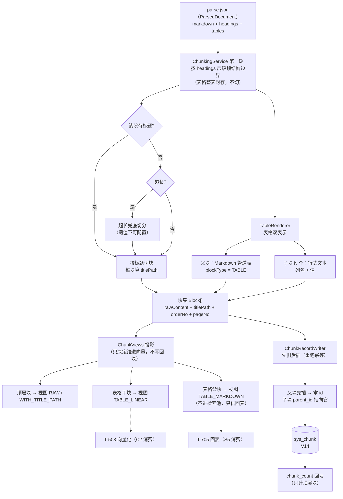

> 状态：🟡 进行中 · Sprint S4 · 阶段 C1（M05 分片产出：契约视图分离 + 两级分片 + 表格双表示 + 父子块）· 建档 2026-09-16

# 2026-09-16 · S4 · M05 · 阶段 C1 —— 块从哪来：分片契约 + 两级分片 + 表格双表示 + 父子块

> 任务：`T-503` / `T-504` / `T-505`（3 项）+ **认领 `优化/O8`**（契约视图分离，本批步 0）· 来源：`docs/进度/03-Sprint排期.md` §Sprint 4
> 上游计划：`ai_knowledge_web/plan/2026-09-16-S4-M05-B.md`（本批要销的账见第 1 节）
> **本批是 S4-C 的第一半**：S4-C 共 6 个 `T-xxx`（超出工序 ≤5 的批次粒度），按「产出侧 / 索引侧」拆成 C1、C2。
> C2 = `T-506` 标识符保护 + `T-507` 索引增强 + `T-508` 向量化 + `优化/O3` 逐文档清洗（届时另立计划）。

---

## 1. 开工条件检查

**依赖清单来源**：`docs/进度/02-任务清单.md` M05 段「依赖」列 · `2026-09-16-S4-M05-B.md` §9/§10 · `plan/汇总.md` §3/§4 · `优化/README.md` §2。

| # | 依赖项 | 档位 | 现状（代码/文档实证） | 结论 |
|---|---|---|---|---|
| 1 | `T-503` ← `T-502` 解析流水线 | ✅ | `T-502` 已 ✅（2026-09-16，S4-M05-B）。`ParsedDocument`（`pipeline/ParsedDocument.java:36`）已备齐分片第一级的**全部原料**：`headings`（层级 + 页码）、`tables`（cell 矩阵）、`markdown`（统一正文）、`titlePathAt(int)`（TOC 栈算法，已测） | 满足 |
| 2 | `T-504`/`T-505` ← `T-503` | ✅ | 同批内串行，无外部前置 | 满足 |
| 3 | 迁移编号 `V14` 可用 | ✅ | `src/main/resources/db/migration/` 实测最大为 `V13__s4_parse_artifact_and_issues.sql`。`V14` 已被 S4-B 与 D-5 §三**明确预约给 `sys_chunk`**（S4-B §9 第 1 条） | 满足 |
| 4 | 环境：MySQL / Milvus / MinIO 等 6 服务 | ✅ | `docker ps` 实测 6 容器全 `Up (healthy)`（`kb-mysql`/`kb-minio`/`milvus-standalone`/`milvus-etcd`/`kb-neo4j`/`kb-valkey`） | 满足 |
| 5 | **`优化/O8` 未落地**（D-5 契约仍是「拼进内容」形态） | ✅ **本批步 0 消化** | `优化/O8` 硬要求「必须在 `T-503` 开工前定案」；`sys_chunk` 尚未落 → **现在改是改文档，之后改是改数据模型 + 重解析全库**（`O8` §4 原话）。用户 2026-09-16 授权「按最优计划开始」，故 O8 认领为本批步 0 | 满足（本批内解决） |
| 6 | **「实体字段集 == D-5 契约字段集」反射用例**（S4-A §10-2 → S4-B §10-2 连续两批挂账） | ⛔ **本批必交** | 该要求从 S4-A 说到现在**从未落地**（D-5 §三「给后续批次的硬要求」原文）。`sys_chunk` 本批落地 = 唯一自然落点；`M07` 返工面是整个 S5 | **不满足 → 列为本批判据，不许再顺延** |
| 7 | 表格样本：`T-504`/`T-505` 的表格双表示判据要用 | ⚠️ WARN | `docs/测试文件/` 有真表格样本：`1-DeepSeek使用.pdf`（**实测 7 张有效表**，S4-B 判据 12 的硬数字）、`软件需求计划20200811.xlsx`、4 份 docx。**但 S4-B §9 第 7 条点名的「报价单 / 带表格的扫描件」仍缺** —— 无法凭空造出真实报价单 | 不拒绝（有可用样本），第 9 节销账 |
| 8 | Tika 路径（docx/xlsx）**无 cell 合并信息、无页号** | ⚠️ WARN | `ParsedDocument` 类注释原话：「DOCX/XLSX 走 Tika（只有 XHTML 流，合并单元格信息已丢）」。→ 行式文本对这类的保真度低于 PDF 路径，且 `pageNo` 恒 1 | 不拒绝（如实体现，第 9 节销账） |
| 9 | `优化/O8` 需同步改**需求文档** `07` §附 的措辞 | ⚠️ WARN | `docs/需求文档/07-需求-检索与问答.md:411` 的「产出块」列现写「**原地改造原分片（不新增块）**」。O8 要把它改成「索引期投影」——**行为不变**（`O8` 判据 3：嵌入文本仍含标题路径；判据 5：表格规则逐条等价），**只改"何时拼接"** | 不拒绝（同义收窄），第 3.4 假设 1 + 第 9 节登记 |
| 10 | **`ParsedDocument` 拿不出「段落 ↔ 标题」的归属关系** —— `T-503` 的「第一级标题层级」无输入 | ⛔ **BLOCKER（施工中暴露）** | `PdfDocumentParser.fromJson`（`:121-163`）虽按文档顺序遍历 `kids[]`，却把元素**分桶**进 `headings`/`paragraphs`/`tables` 三个列表 —— 归属关系在解析时就丢了；`buildMarkdown`（`:256-273`）随即**先拼全部标题、再拼全部段落、再拼全部表格**，`markdown` 也不是文档顺序的忠实还原。对照：`TikaDocumentParser` 是**流式按序**拼 `md` 的 → **两条路径产出的 markdown 结构不一致**。**影响面已实测**：`markdown()`/`headings()`/`paragraphs()` 目前**零生产消费方**（分片本该是第一个），前端不读 `parse.json`，仅 `DocParseFlowTest` 一条 MD 路径断言 | ✅ **2026-09-16 用户裁定：方案 A** —— 给 `ParsedDocument` 补**按文档顺序的 `elements` 序列**（`heading`/`paragraph`/`table`/`image` + `pageNo` + `level`），两条解析路径都产出它，`headings`/`paragraphs`/`markdown` 改为**由它派生**（顺带修掉两条路的不一致）。列为 **步 0.6** |

> **第 10 条的性质**：这是**施工中才暴露**的 —— §1 的条件检查基于任务清单/上批遗留/环境三处来源，
> 看不到"代码形状"，只有真去读解析器才发现。**它不推翻 §1 的开工结论**（步 0 已独立完成），
> 但**卡住步 1**（步 2/3 均依赖步 1 的块）。按工序铁律 2，出现 BLOCKER 即停下来给选项，
> 不自行选路 —— 用户裁定为方案 A（另两条候选：B 只改 `buildMarkdown` 为文档序 + 扫 `#` 行反解；
> C 退化为纯长度切分、放弃第一级标题边界 —— 均因"多一份会漂移的事实源"或"改验收标准而非做功能"被否）。

**BLOCKER 汇总**：
- **施工前**：**无外部 BLOCKER**。第 6 条「反射用例」不满足，但它是**本批自身的交付物**（不是外部前置），
  故不构成拒绝施工的理由 —— 按工序列为判据即可。
- **施工中（2026-09-16）**：第 10 条暴露 —— 步 0 完成后进步 1 时发现 `T-503` 无结构输入。
  已按工序铁律 2 停下来给选项，**用户裁定方案 A**，解锁方式 = 新增**步 0.6**。

**⚠️ 已知偏差**（不拒绝施工，第 9 节销账）：第 7、8、9 条。

> 判据只有一条：**这条不满足，代码写下去会不会白写**。逐条核过：没有一条会让本批代码白写。

### 结论

- [x] ✅ **可以开工**
- [ ] ⛔ 拒绝施工

---

## 2. 开工时间

| 项 | 值 |
|---|---|
| 建档 / 开工日 | 2026-09-16 |
| 预计投入 | 8 人天（`O8` 3 + `T-503` 2 + `T-504` 1.5 + `T-505` 1.5；Sprint 容量 ≈ 10 人天） |
| 实际投入 | *回填时补* |

> **容量说明**：8 人天落在 10 人天的 Sprint 容量内。这正是把 S4-C 拆成两半的理由之一 —— 合起来（+ `T-506`/`T-507`/`T-508`）约 16 人天，**超过一个 Sprint 容量**，验收也会变成大杂烩。

---

## 3. 开工内容

### 3.1 步骤

**步 0 —— `优化/O8` 契约视图分离（必须先于 `T-503`）**

| # | 文件/类 → 动作 → 产出 | 依赖 | 可并行 |
|---|---|---|---|
| 0.1 | `docs/后端开发文档/10-M05-分片产出契约（D-5）.md` §1.1 → **增列 `rawContent`（原始内容，永不改写）**，写明「块存事实，视图是投影」；§1.4 → 表格双表示改写为**视图配置的默认值**（规则逐条等价，**不是**行为变更）；§四 → 加变更记录行 | — | 否 |
| 0.2 | `docs/需求文档/07-需求-检索与问答.md` §附（`:411`）→ 「产出块」列由「原地改造原分片（不新增块）」改为「**索引期投影**（不新增块；块内容保留原文）」。**第二列「做什么」原文保留** —— 检索侧语义没变 | 0.1 | 与 0.1 串行 |
| 0.3 | **新增** `core/enums/ChunkView.java` → 视图枚举 `RAW` / `WITH_TITLE_PATH` / `TABLE_MARKDOWN` / `TABLE_LINEAR` / `IMAGE_DESC`；每个 `BlockType` 声明「我有哪些视图、哪个进向量」 | 0.1 | 否 |
| 0.4 | **新增** `pipeline/ChunkViews.java` → 投影纯函数 `project(Block, ChunkView) -> String`（**不写回块**） | 0.3 | 否 |
| 0.5 | `ChunkViewsTest` → 判据 2/3/5/6 的单测（块内容不变 · 两视图分别投影 · 表格规则等价 · `IMAGE_DESC` 预留可插） | 0.4 | 否 |

**步 0.6 —— 解析产物补「有序元素序列」（施工中暴露的 BLOCKER，2026-09-16 裁定方案 A）**

| # | 文件/类 → 动作 → 产出 | 依赖 | 可并行 |
|---|---|---|---|
| 0.6.1 | `pipeline/ParsedDocument.java` → **新增 `List<DocElement> elements`**（按文档顺序的元素序列）+ 嵌套 record `DocElement(kind, text, pageNo, level)`；`kind` 取 `HEADING`/`PARAGRAPH`/`TABLE`/`IMAGE` | 步 0 | 否 |
| 0.6.2 | `PdfDocumentParser#fromJson` → 遍历 `kids[]` 时**同步追加 elements**（保持文档顺序），`headings`/`paragraphs`/`tables` 改为**由 elements 派生** | 0.6.1 | 否 |
| 0.6.3 | `PdfDocumentParser#buildMarkdown` → 改为**遍历 elements 顺序拼**（向 Tika 的流式形态靠拢）—— **顺带修掉两条路径 markdown 结构不一致**（见 §1 第 10 条） | 0.6.2 | 否 |
| 0.6.4 | `TikaDocumentParser` → 同样产出 elements（它本就是流式按序的，改动更小）；`headings`/`paragraphs` 由 elements 派生 | 0.6.1 | 与 0.6.2 并行 |
| 0.6.5 | `PlainTextParser` → 产出 elements（每段一条 `PARAGRAPH`；MD 的 `#` 行是 `HEADING`） | 0.6.1 | 与 0.6.2 并行 |
| 0.6.6 | `ParsedDocumentTest`（新增）→ **三条解析路径的 elements 都按文档顺序**；`markdown` 与 elements **逐段对应**（同一条记录的两面，不得漂移） | 0.6.2~0.6.5 | 否 |

> ⚠️ **老 `parse.json` 没有 `elements` 字段**（Jackson 对缺失字段给 null/空）→ 那些文档在分片时会得到空块集。
> 处置：**重解析**（本批计划 §4 已预期"落表后需对既有文档重跑一次解析"）。
> `DocParseService#parseDocument` 加一条断言式防御：elements 为空且 `chars > 0` 时**显式失败**，
> 不要让"老产物"静默产出 0 个块。

**步 1 —— `T-503` 两级分片**

| # | 文件/类 → 动作 → 产出 | 依赖 | 可并行 |
|---|---|---|---|
| 1.1 | **新增** `pipeline/Block.java` → 块领域类型：`rawContent` / `blockType` / `orderNo` / `pageNo` / `titlePath` / `parentRef`（子块指向父块**序号**，落库时才换 id） | 步 0 | 否 |
| 1.2 | **新增** `pipeline/ChunkingService.java` → **第一级：结构边界锁定**（按 `ParsedDocument.headings` 的层级切；叶子节点 = 一个候选块，依据《06》§1.4.2） | 1.1 | 否 |
| 1.3 | 同上 → **第二级：超长兜底**（**仅「无标题且超长」**触发，阈值不可配置 —— `T-503` 已定口径；**默认不做语义切分**） | 1.2 | 否 |
| 1.4 | 同上 → 表格**不参与正文切分**（I-4 的前提），整表封存交步 2 | 1.2 | 否 |
| 1.5 | `ChunkingServiceTest` → 结构边界 / 超长兜底 / 语义切分默认关 三类用例 | 1.4 | 否 |

**步 2 —— `T-504` 表格双表示**

| # | 文件/类 → 动作 → 产出 | 依赖 | 可并行 |
|---|---|---|---|
| 2.1 | **新增** `pipeline/TableRenderer.java` → 由 `ParsedTable` 的 cell 矩阵产出两份内容：① **Markdown 管道表**（父块 `rawContent`）② **行式文本**（子块 `rawContent`，形如「型号 A-100，产品名称 智能网关，单价 ￥1,200，交期 7 天」） | 步 1 | 可与 1.x 尾部并行 |
| 2.2 | 同上 → **列名拼进每一行**（D-5 §1.4 硬约束第二条：「只 embed 一行数据等于没写」） | 2.1 | 否 |
| 2.3 | 同上 → 复用 `ParsedDocument#tableTotal()` 的**同一口径**排除 `layoutArtifact()`（`1×1` 空表）—— 版式分隔线不得被切成的块 | 2.1 | 否 |
| 2.4 | `TableRendererTest` → G4-7 的判据（子块是自然语言，**不含竖线**；列名在每行里） | 2.3 | 否 |

**步 3 —— `T-505` 父子块 + `V14` 落库**

| # | 文件/类 → 动作 → 产出 | 依赖 | 可并行 |
|---|---|---|---|
| 3.1 | **新增** `V14__s4_chunk.sql` → 建 `sys_chunk`（列见第 4 节）+ 三个索引 | 步 2 | 否 |
| 3.2 | **新增** `entity/SysChunk.java` + `mapper/SysChunkMapper.java` | 3.1 | 否 |
| 3.3 | **新增** `service/ChunkRecordWriter.java` → 写入编排：**父块先插拿自增 id → 子块的 `parent_id` 指向它**；重跑时**先删后插**（沿用 `DocParseService#replaceIssues` 的幂等手法） | 3.2 | 否 |
| 3.4 | **新增** `ChunkContractTest.java` → **反射用例：实体业务字段集 == D-5 §1.1 契约字段集**（双向比对，审计列白名单排除）。**销连续三批的挂账**（第 1 节第 6 条） | 3.2 | 与 3.3 并行 |
| 3.5 | `DocParseService` → 编排接入：`markParsed` 之后调分片 + 落库（幂等键沿用同一个） | 3.3 | 否 |
| 3.6 | `DocRecordWriter` → `chunk_count` 由占位 `0` 改为 `sys_chunk` 的**顶层块计数**（口径见 D-5 §1.5：只计顶层块，表格子块不计） | 3.5 | 否 |
| 3.7 | `DocParseFlowTest` → 追加端到端用例：真 PDF → 分片 → `sys_chunk` 行可查 + `chunk_count > 0` | 3.6 | 否 |

> **步间依赖**：0 → 0.6 → 1 → 2 → 3 严格串行（0 是契约与枚举，**0.6 补齐分片唯一缺失的输入**，
> 1 产出块，2 依赖块的表格形态，3 依赖最终块集落表）。
> **可并行对**：`2.1` 与 `1.x` 的尾部（`TableRenderer` 只吃 `ParsedTable`，不依赖正文切分结果）；
> `3.4` 与 `3.3`；`0.6.4`/`0.6.5` 与 `0.6.2`（三条解析路径互不相干，只共用 `0.6.1` 的类型）。

### 3.2 业务流程图

> 触发条件：① 跨 ≥3 个组件（`DocParseService` → `ChunkingService`/`TableRenderer` → `ChunkRecordWriter` → MySQL）✅ ② 落库有事务边界 ✅ ④ 重跑需幂等 ✅ —— 满足，必须画。



### 3.3 明确不做（范围控制）

| 不做的事 | 原因 | 归属批次 |
|---|---|---|
| **`T-506` 标识符保护分词** | 与分片契约无关；依赖分片产物已就绪后单独验 | **S4-C2** |
| **`T-507` 索引增强**（标题路径注入实调 + 摘要 + HyQ） | 是**消费**本批的块，不是产出块；且要 LLM 调用 | **S4-C2** |
| **`T-508` 向量化 + Milvus 写入** | 同上；`READY` 的可达性随它落地 | **S4-C2** |
| **`优化/O3` 逐文档清洗**（页眉页脚 / 装饰图） | 本批是「块**怎么产生**」，清洗是「**质量规则**」；混在一起验收会变成大杂烩（工序原文警告）。**硬窗是 `T-508` 之前**，放 C2 头部正好；清洗是 `ParsedDocument` 上的纯函数，落在其后只需**重切块**、不需重解析 | **S4-C2 头部** |
| **`优化/O9` 跨文档样板抑制 / 内容指纹去重** | 依赖 O8（本批交付）但属语料级，需全库回扫 | **S4-C 之后** |
| `IMAGE` 分片与 VL 描述 | `T-512` P1，依赖 `T-907`（S6）；本批只在 `ChunkView` 里**留 `IMAGE_DESC` 路由位** | **S6** |
| 跨页表格合并（`tablePolicy.mergeCrossPage`） | S4-B §9 第 8 条：本批只处理单表双表示，跨页合并是另一条策略 | **S4-C2 / M06** |
| 图片质量列（`image_total`）填真值 | S4-B §10 第 6 条：`imageCount` 已采到但未回填 | **S6**（`T-512`） |

### 3.4 本批假设

| # | 假设 | 若被证伪的后果 |
|---|---|---|
| 1 | **`O8` 是"重构"而非"口径变更"** —— `07` §附 只改「产出块」列的措辞（原地改造 → 索引期投影），**检索侧语义与嵌入文本逐字不变**。依据 `O8` 判据 3（嵌入文本仍含标题路径）与判据 5（表格规则与 D-5 §1.4 逐条等价） | 若用户判定这是**需求口径变更**，需回滚 `07` §附 的措辞并重新裁定 O8 是否采纳。**代码侧不受影响**（视图投影是超集：把视图固定为 `WITH_TITLE_PATH` 即等价旧行为）→ 进第 9 节 |
| 2 | `sys_chunk.raw_content` **不对外暴露为接口字段** —— `ChunkInfo` 的 `content` 仍返回**该块的展示内容**（正文块 = raw；表格父块 = Markdown）。`rawContent` 是**存储侧事实** | 若需求要求接口暴露「原文 vs 投影」两份，需扩 `ChunkInfo`（`10` §14）→ 进第 9 节 |
| 3 | `titlePath` **既进块字段（Milvus 标量 `title_path`，供过滤）又进视图（供语义）**，两件事互不替代 | `O8` §6 已点名的风险；若 `I-9`（标签不进 Milvus）被解释为「结构信息也不进」，需去掉标量字段 → 进第 9 节 |
| 4 | 「超长」阈值取 **现有解析配置的 `chunkSize`**（`KbService#defaultTablePolicy` 同层），不新造配置项 | 若与前端「分片设置」Tab 的字段对不上，需同步前后端 → 进第 9 节 |
| 5 | Tika 路径（docx/xlsx）的 `pageNo` 恒 `1`、子块行式文本保真度低于 PDF | 格式事实，非缺陷（`ParsedDocument` 类注释已写明）；判据按"如实体现"验收 |

---

## 4. 数据变更清单

| 类型 | 内容 | 回滚方式 |
|---|---|---|
| **新建表** | `sys_chunk` —— 列：`id` BIGINT PK AUTO_INCREMENT（**D-5 的 `chunkId`；Milvus 主键与之同值**）· `doc_id` BIGINT NOT NULL · `kb_id` BIGINT NOT NULL · `chunk_type` VARCHAR(32) NOT NULL（`BlockType` 8 值）· `parent_id` BIGINT **NULL**（顶层块 null，**禁用 `0` 当哨兵** —— D-5 §1.2 硬口径）· `title_path` VARCHAR(512) NULL · **`raw_content` MEDIUMTEXT NOT NULL**（O8 新增，**永不改写**）· `order_no` INT NOT NULL（文档内顺序）· `page_no` INT NULL（引用卡片显示「第 N 页」）· `created_at` / `updated_at` DATETIME | 可逆（`drop table`） |
| **索引** | `idx_chunk_doc (doc_id, order_no)` —— 列表与回表的顺序读 · `idx_chunk_parent (parent_id)` —— G4-6 的父子断言与 `T-705` 回表 · `idx_chunk_kb (kb_id)` —— 按库统计 `chunk_count` | 随表 |
| **迁移文件** | `V14__s4_chunk.sql`（现有最大为 `V13`，**编号已被 S4-B 与 D-5 §三预约**） | — |
| **产物格式变更**（步 0.6） | `parse.json` 新增 `elements` 字段（按文档顺序的元素序列）；**`markdown` 的形态同时改变**（由"分桶拼"改为"按序拼"）。两者都**只增不改名** —— `ParsedDocument` 类注释的既定纪律是"加字段可以（Jackson 对缺失字段有默认值），改名要先想清楚" | 需人工（**老产物没有 `elements`** → 重解析；无回滚必要，产物可再生） |
| **种子数据** | **无新种子**。演示库的文档行由 S4-A/S4-B 的上传产生；本批落表后**需对既有文档重跑一次解析**才能填出 `sys_chunk`（见判据 9） | — |
| **NULL 分支** | ① `parent_id` 为 NULL = **顶层块**（正文 / 标题 / 表格父块 / 摘要 / 图片），**这是常态不是异常**；② `title_path` 为 NULL = 该块在标题之前（如封面段），投影 `WITH_TITLE_PATH` 时退化为 `raw`；③ `page_no` 为 NULL = 非分页格式（TXT/MD） | — |

> ⚠️ 跑过的迁移**只增不改**（`V1`~`V13` 一字不动，改已执行的 `V*.sql` 会导致校验和不符、启动失败）。
> ⚠️ **契约字段集 == 实体字段集**（第 1 节第 6 条）：本表列集合 = D-5 §1.1 字段集 + 本批增补（`raw_content`/`order_no`/`page_no`）。**增补项必须同步写进 D-5 §1.1**，否则 `ChunkContractTest` 会红 —— 这正是那条用例存在的意义。

---

## 5. 依赖与工具决策

**结论：无新依赖（用既有栈实现）。**

| 方案 | 做法 | 代价 | 结论 |
|---|---|---|---|
| **不引依赖（既有栈）** | 分片是 `ParsedDocument` 上的**纯算法**（TOC 栈 + 阈值切分）；表格渲染是 `List<List<String>>` → 字符串拼接；视图是纯函数。全部用 JDK 25 + 既有 Jackson 即可 | 需自写约 150~250 行 | ✅ **采纳** |
| 候选 A：引入 LangChain4j 的 document splitter | 现成的 `RecursiveCharacterTextSplitter` 等 | ① 与项目已定的**结构边界优先**口径不符（它按字符递归切）；② 引入一整条链依赖（本项目 S4-B 刚从依赖冲突里爬出来）；③ 不可控的切分行为与判据冲突 | ❌ 不采纳 |
| 候选 B：引入 flexmark / commonmark 做 Markdown 往返 | 用成熟的 Markdown AST | `T-503` 只需**出** Markdown（表格渲染），**不需要解析**它；S4-B §5 已定「不出 markdown 全家桶」 | ❌ 不采纳（与 S4-B §5 一致） |

**推荐**：`无（用既有 JDK + Jackson 实现）`。
**理由**：本批全部是字符串与列表上的确定性算法，既没有解析格式的需求，也没有引入链式框架的理由。`优化/README.md` §4 已把「引入 Markdown 全家桶」列为**不采纳**项，本批沿用同一口径。

> **同类产品对比**：不适用（无候选入选）。

---

## 6 + 7. 验收方法与标准

> 后端命令统一：
> ```bash
> export JAVA_HOME='F:/work/dev_tools/jdk/jdk-25.0.4.1'
> mvn -B -f F:/work/code/ai-knowledge/ai_knowledge_web/pom.xml test
> ```

| # | 判据（对齐门禁号） | 验收方法 | 期望结果 | 证据落点 |
|---|---|---|---|---|
| 1 | **D-5 契约已更新**（`O8` 判据 1） | 读 `docs/后端开发文档/10-M05-分片产出契约（D-5）.md` §1.1/§1.4/§四 | `rawContent` 与**视图概念**写明；`parentId`/`blockType`/`chunk_type` **口径逐字未变**（硬要求，勿改回）；§四有变更记录行 | D-5 §1.1 表格 + §四 |
| 2 | **块内容不因注入而改变**（`O8` 判据 2） | `mvn test -Dtest=ChunkViewsTest` + 建索引后 `select raw_content from sys_chunk where doc_id=? and chunk_type='PARAGRAPH'` | 与解析产物**逐字一致**，**不含标题路径前缀** | `ChunkViewsTest#rawContentIsNeverRewritten` |
| 3 | **嵌入文本含标题路径**（`O8` 判据 3） | `mvn test -Dtest=ChunkViewsTest` | `WITH_TITLE_PATH` 投影**含**前缀（如 `3. 接口设计 > 3.1 鉴权流程`）；`RAW` **不含** | `ChunkViewsTest#viewProjectionDiffersByTitlePath` |
| 4 | 切换视图**不需要重解析**（`O8` 判据 4） | 关闭「标题路径注入」后重建索引 | ⏸️ **挂起 —— 待 S4-C2**（`T-508` 向量化落地后才有"重建索引"可跑；本批只有块，没有向量） | 与 S4-C2 计划**合并验收** |
| 5 | **表格规则等价**（`O8` 判据 5 · 本次是重构不是行为变更） | `mvn test -Dtest=ChunkViewsTest` | 与 D-5 §1.4 现有规则**逐条等价**：父块 Markdown **不进检索**、子块行式文本**进检索** | `ChunkViewsTest#tableViewsMatchD5Clause14` |
| 6 | `IMAGE_DESC` 视图**预留可插**（`O8` 判据 6） | `mvn test -Dtest=ChunkViewsTest` | 枚举存在但**无实现**；`T-512` 落地时只加实现、不改管线 | `ChunkViewsTest#imageViewIsReservedNotImplemented` |
| 7 | **`G4-5` I-4 表格父块不切分** | `mvn test -Dtest=TableRendererTest` + SQL：`select count(*) from sys_chunk where doc_id=? and chunk_type='TABLE'` | 一张表 → **恰好 1 个父块 + N 个子块**；父块**不参与检索**（不出现在 `TABLE_LINEAR` 视图的投影集合里） | `TableRendererTest#oneTableYieldsOneParentAndNChildren` |
| 8 | **`G4-7` 行式文本形态** | `mvn test -Dtest=TableRendererTest` + `select raw_content from sys_chunk where parent_id is not null limit 3` | 内容是「**列名 + 值**」自然语言；**不含 Markdown 竖线 `|`**；列名在**每一行**里（D-5 §1.4 硬约束第二条） | `TableRendererTest#childPhrasingIsNaturalLanguage` |
| 9 | **`G4-6` I-3 父子块 100% 成立**（**SQL 断言**） | `set -a && . ai_knowledge_web/.env && set +a` + `docker exec kb-mysql mysql -u"$MYSQL_USERNAME" -p"$MYSQL_PASSWORD" "$MYSQL_DATABASE" -N -e "select count(*) from sys_chunk c where c.parent_id is not null and not exists (select 1 from sys_chunk p where p.id = c.parent_id and p.chunk_type = 'TABLE');"` | 返回 **0**（不存在 parent_id 指向非 TABLE 父块的子块）。另：`select count(*) from sys_chunk where parent_id = 0` 亦须为 **0**（**禁用 `0` 当哨兵**） | `ChunkContractTest#childAlwaysPointsToTableParent`（真 HTTP 全链路后跑 SQL） |
| 10 | **反射用例：实体字段集 == D-5 契约字段集**（第 1 节第 6 条 · **连续三批挂账，不许再顺延**） | `mvn test -Dtest=ChunkContractTest` | 双向比对**零差异**：实体的业务字段 ↔ D-5 §1.1 清单（审计列 `created_at`/`updated_at` 白名单排除）。**增补列（`raw_content`/`order_no`/`page_no`）已在契约里** | `ChunkContractTest#entityFieldsMatchContractFields` |
| 11 | **两级分片：结构边界优先**（`T-503` 验收要点） | `mvn test -Dtest=ChunkingServiceTest` | 有标题的文档按 `headings` 层级切；**语义切分默认关**（只在「无标题且超长」兜底触发且**不可配置**） | `ChunkingServiceTest#structureBoundaryWins` + `#semanticSplitIsOffByDefault` |
| 12 | **整篇分片端到端**（真 PDF） | `mvn test -Dtest=DocParseFlowTest` | `1-DeepSeek使用.pdf` 真上传 → 解析 → 分片 → `sys_chunk` 有行；`chunk_count > 0`（销 `汇总.md` §3 #54「`chunk_count` 恒 0」） | `DocParseFlowTest#realPdfProducesChunks` |
| 13 | **重跑幂等** | 对同一文档连续重解析 2 次 | `sys_chunk` 行**不翻倍**、`order_no` 不重复（沿用 S4-B 判据 16 的"先删后插"保证） | `DocParseFlowTest#reparseIsIdempotent` |
| 14 | **不回归既有判据** | `mvn test`（全量） | `DocUploadFlowTest` / `DocParseFlowTest` 既有用例全绿，尤其 S4-B 的硬数字 `table_total = table_parsed = 7` **不变** | surefire 报告 |
| 15 | **页面级：文档列表分片数列不再显示占位「—」** | 起后端 + `cd ai_knowledge_app && node scripts/e2e-doc-parse.mjs --base=http://127.0.0.1:5174` | 分片数列显示**真值**（`> 0`）；`e2e-doc-parse` 既有断言不回归 | `e2e-doc-parse.mjs` 输出 |
| 16 | **步 0.6：`elements` 按文档顺序 · 三条解析路径一致** | `mvn test -Dtest=ParsedDocumentTest` | ① PDF / Tika / 纯文本三条路径的 `elements` 都严格按文档顺序；② `markdown` 与 `elements` **逐段对应**（同一条记录的两面，不得漂移）；③ **PDF 与 Tika 的 markdown 结构不再分叉**（§1 第 10 条的症状） | `ParsedDocumentTest#elementsFollowDocumentOrder` + `#markdownMirrorsElements` |
| 17 | **老产物不静默产 0 块**（步 0.6 的防御） | 手工造一份无 `elements` 的 `parse.json` 走分片 | **显式失败**并给可执行原因（"产物版本过旧，请重解析"），不是静默 0 块 | `DocParseFlowTest#staleArtifactFailsLoudly` |

**观察项**（不计成败）：

| # | 观察项 | 说明 |
|---|---|---|
| O1 | 表格父块的 `chunkCount` 口径 | D-5 §1.5：**只计顶层块**（表格父块计、子块不计，单列 `tableSubBlocks`）。前端 `ChunkStat.tableSubBlocks` 属 M06，本批**不验前端消费** |
| O2 | `titlePathCoverage` 指标 | 《10》§14 的 `ChunkStat` 字段；M06 接口未落，本批只保证 `title_path` 有值可算 |
| O3 | Tika 路径的 `pageNo` 恒 1 | 格式事实（无页概念），不是缺陷 |

**种子核对**（跑完必做）：

```bash
set -a && . ai_knowledge_web/.env && set +a
docker exec kb-mysql mysql -u"$MYSQL_USERNAME" -p"$MYSQL_PASSWORD" "$MYSQL_DATABASE" -N -e "select count(*) from sys_user where deleted_at is null;"
```

> ⚠️ **测试不许污染种子**：临时文档与 `sys_chunk` 行用完删；`sys_chunk` 随 `sys_document` 级联的清理规则本批**不定义**（属 `S7` `T-616`，见第 9 节）。

---
---

# 以下为开工后回填

> **提交节奏（两次）**：1~7 节写完即提交一次（`docs(plan): S4-M05-C1 开工计划`）；
> 8~10 节写完再提交一次（`docs(plan): S4-M05-C1 验收回填`）。

## 8. 验收结果

| # | 判据 | 实测结果 | 证据（命令 / 文件:行 / 测试名） |
|---|---|---|---|

**测试基线**：*回填时补*（上批 **184** → 本批 ?）

---

## 9. 遗留问题

| # | 项 | 原因 | 归属批次 | 是否有判定点/注释留在代码里 |
|---|---|---|---|---|

> 没有遗留写「无」。

---

## 10. 建议

*回填时补。*

---

## 附：本批同步的文档回填

- [ ] `docs/进度/02-任务清单.md` → `T-503`/`T-504`/`T-505` 置 ✅（未做的不动）
- [ ] `docs/进度/03-Sprint排期.md` → `G4-5`/`G4-6`/`G4-7` 取证状态 + 「交付状态」段
- [ ] `docs/进度/README.md` → 看板状态 + 完成日期 + §7 变更记录
- [ ] `docs/后端开发文档/10-M05-分片产出契约（D-5）.md` → §1.1/§1.4/§四（**本批步 0.1 已改，回填时补"实际落地列"**）
- [ ] `docs/需求文档/07-需求-检索与问答.md` → §附「产出块」列措辞（步 0.2）
- [ ] `ai_knowledge_web/plan/优化/README.md` → `O8` 状态 `⬜ 待认领` → `🟡 进行中（S4-M05-C1）`，回填后 → `✅ 已完成`
- [ ] `ai_knowledge_web/plan/汇总.md` → §1 当前定位 · §2 批次总览 · §3 遗留逐条并入 · §4 挂起判据
- [ ] 本文件状态行 → ✅ 已完成
- [ ] `.workbuddy/memory/2026-09-16.md` → 交接
