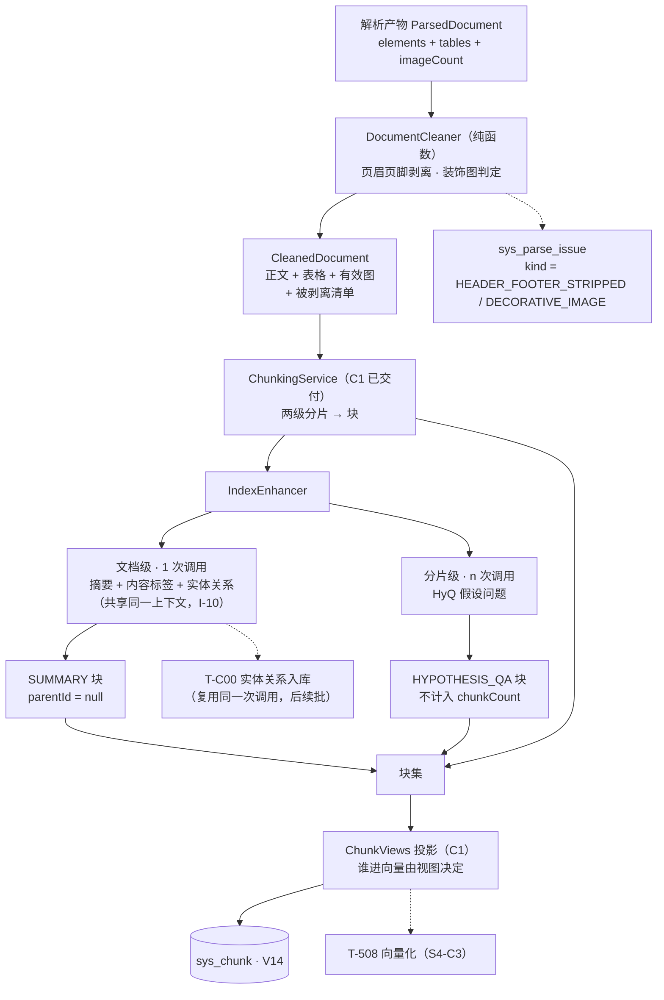

> 状态：✅ 已完成 · Sprint S4 · 阶段 C2（M05 文本处理：噪音清洗 + 标识符保护分词 + 索引增强）· 建档 2026-09-16 · 完成 2026-09-16

# 2026-09-16 · S4 · M05 · 阶段 C2 —— 块里装什么：噪音清洗 + 标识符保护 + 索引增强

> 任务：`T-506` / `T-507`（2 项）+ **认领 `优化/O3`**（逐文档清洗）· 来源：`docs/进度/03-Sprint排期.md` §Sprint 4
> 上游计划：`ai_knowledge_web/plan/2026-09-16-S4-M05-C1.md`（本批要销的账见第 1 节）
> **本批是 S4-C 的第二半**。S4-C 按「产出侧 / 索引侧」拆两半，本批做**索引前的内容准备**；
> **`T-508`（向量化）移到 `S4-C3`** —— 理由见 §2。

---

## 1. 开工条件检查

**依赖清单来源**：`docs/进度/02-任务清单.md` M05 段「依赖」列 · `2026-09-16-S4-M05-C1.md` §9/§10 · `优化/README.md` §2 依赖图 · 环境实测。

| # | 依赖项 | 档位 | 现状（代码/文档实证） | 结论 |
|---|---|---|---|---|
| 1 | `T-506` ← `T-503` 分片产物 | ✅ | C1 已交付：`sys_chunk` 有块、`rawContent` 永不改写、`ChunkView` 投影可用 | 满足 |
| 2 | `T-507` ← `T-503` 同上 | ✅ | 同上；`ParsedDocument#titlePathAt`（TOC 栈）与 `ChunkingService` 的 `titlePath` 已实测 | 满足 |
| 3 | **`优化/O3` ← `O8`**（真实依赖） | ✅ | `O3` §6 风险段原话：清洗会引入**语义断裂**，对策是 **`O8` 的父子块 + 回表**。`O8` 已在 `S4-M05-C1` 步 0 交付 | 满足 |
| 4 | **`优化/O3` ← `O1`**（`优化/README.md` §2 依赖图画的那条） | ⚠️ **WARN** | `O1` 已按 2026-09-16 裁定**推后到 `S4-C` 收口之后**。但它是**软依赖**（排序偏好，非技术前置）：清洗是对 `ParsedDocument` 的**纯函数变换**，`O1` 把解析搬进独立 worker **不会让清洗层白写** —— 变换发生在 `dispatch` 之后、`chunk` 之前，与"跑在哪个进程"无关 | 不拒绝，见第 9 节 |
| 5 | **`T-506` 的「查询侧」半边不在 S4** | ⚠️ **WARN** | `docs/进度/01-业务模块拆分.md:237` 明确把「**FR-RET-03 查询侧**标识符保护」划给 **M07（S5）**；`M05`（`:160`/`:172`）只拥有**分词器本身**。而 `G4-8` 的判据写的是「**搜索** `A-100` **不命中** `A-1000`」—— 那需要一个**检索接口**，S4 没有（`T-700` 属 S5）。**→ `G4-8` 必须拆两半**：口径侧（分词器的可执行断言）本批能做，运行时侧（搜索不命中）挂 S5 | 不拒绝（本批交付的分词器是 `T-507`/`T-C00`/`avgTokens` 都要用的），见第 9 节 |
| 6 | **`T-507` 依赖 chat 模型**（文档级摘要 + HyQ） | ⚠️ **WARN** | `ModelClientRegistry#chatClient()`（`T-014`，S0 已 ✅）是唯一取模型的入口。本仓对真网络调用的既有约定是 `@Tag("network")` + `Assumptions.assumeTrue(hasCredentials())`（见 `core/ai/AiCallVerificationTest`）；⚠️ **pom 的 surefire 没有 `excludedGroups`**，故这类用例在默认跑里会**真调模型**（本机走 relay）。→ 设计上必须把「组装逻辑」（可单测、确定性）与「模型调用」分开，让**主判据不依赖真实模型** | 不拒绝，见 §3.4 假设 3 |
| 7 | 环境：6 容器 | ✅ | `docker ps` 实测 6 容器全 `Up (healthy)`；种子 `sys_kb=8 / sys_document=0 / sys_chunk=0 / sys_parse_issue=0` | 满足 |
| 8 | 样本：`O3` 判据 1 点名的样本 | ✅ | `docs/测试文件/江西省农村信用社联合社_…_项目管理章程.pdf` 在（另 5 份 PDF / 4 份 DOCX / 1 份 XLSX / 6 份 MD / 1 份 TXT） | 满足 |
| 9 | 图片质量列（`image_total`）可回填 | ✅ | `sys_document.image_total` 列已存在（`V12`）；`ParsedDocument#imageCount` 已在采（S4-B §9 第 3 条点名的"采了不用"） | 满足 |
| 10 | **`T-502` 的解析产物是完整的**（`fromJson` 覆盖全部元素类型） | ⛔ **BLOCKER（步 0.1 探针暴露）** | 探针实测：opendataloader 的元素类型全集 = `heading`·`image`·`list`·`paragraph`·`table`·**`text block`**。而 `PdfDocumentParser#fromJson`（`:122-163`）**只遍历顶层 `kids[]`、不递归** —— `text block` 是**容器**，真内容是它的 `kids[]`（形如 `"content" : "：孔发龙"` 的段落与列表），整个子树落进 `default ->` 被静默丢弃。**实测丢 8.1%**（20 页样本：32 个后代元素 / 200 字符，顶层保留 2278 字符）。⚠️ 既有测试抓不到它：`table × 7` 全在顶层，故 `table_total = 7` 照旧成立 —— 正是"少了一点东西而没人发现"的形态 | ✅ **2026-09-16 用户裁定：先修再继续** —— 列为 **步 0.5**，在清洗层之前 |

> **第 10 条的连带影响**（为什么必须在清洗层之前修，而不是记遗留）：
> ① **O3 的页眉页脚检测建立在逐页文本上** —— 缺内容的页（本样本第 3 页独有 17 个 `text block`）会比其他页"看起来更空"，跨页重复检测的分子/分母都失准，可能**误判**；
> ② `T-507` 的文档级摘要基于正文字，缺内容 = 摘要失真；
> ③ `chars` 低估 → `charsPerPage` 低估 → **富文本块文档可能被 `TextLayerGuard` 误判成扫描件**（误报，恰是 S4-B 的 W1' 教训）；
> ④ 越晚修越贵：T-508 之后修要重建索引。
>
> **它是怎么被发现的**：`优化/O3` §4 步 1 要求「先查 opendataloader 是否已分类 header/footer —— 这是一次探针就能确认的事，成本极低」。
> 探针回答了那个问题（**没有原生分类** → O3 的启发式确实要自己写），顺带逮到了本缺陷。一次探针付了两次账。

**BLOCKER 汇总**：
- **施工前**：**无**。第 4/5/6 条都是 WARN —— 逐条按「这条不满足，代码写下去会不会白写」核过，没有一条会让本批代码白写。
- **施工中（2026-09-16）**：第 10 条暴露 —— 步 0.1 探针发现 `T-502`（S4-B 已闭批）**静默丢 8.1% 内容**。
  已按工序铁律 2 停下来给选项，**用户裁定「先修再继续」**，解锁方式 = 新增**步 0.5**。

**⚠️ 已知偏差**（不拒绝施工，第 9 节销账）：第 4、5、6 条。

### 结论

- [x] ✅ **可以开工**
- [ ] ⛔ 拒绝施工

---

## 2. 开工时间

| 项 | 值 |
|---|---|
| 建档 / 开工日 | 2026-09-16 |
| 预计投入 | 10 人天（`O3` 4 + `T-506` 2 + `T-507` 4；Sprint 容量 ≈ 10 人天） |
| 实际投入 | *回填时补* |

### `T-508` 为什么移到 `S4-C3`

| 方案 | 合计 | 判断 |
|---|---|---|
| `O3` + `T-506` + `T-507` + `T-508` 一批 | **13 人天** | ❌ 超 Sprint 容量（≈10），且验收会变成大杂烩 —— 与 `S4-C` 拆两半是同一条理由 |
| **`O3` + `T-506` + `T-507`**（本批）· **`T-508`**（C3） | 10 + 3 | ✅ **采纳** |

**拆点选在 `T-508` 之前的理由**：`O3` 的硬窗是「**建向量之前**」（向量一旦生成，事后清洗等于全库重建），
所以清洗必须落在 `T-508` 所在批次之前或批首。而 `T-507` 的产物（`SUMMARY` / `HYPOTHESIS_QA` 块）
**也是要被向量化的内容** —— 放在 `T-508` 之前，`C3` 就能**一次性**把所有块送进 Milvus，
不必"先索引一遍、加了摘要再重建一遍"。

> 另：`G4-9`（索引增强）的判据是「分片内容含标题路径 · 存在 `SUMMARY` 类型分片 · HyQ 分片已生成」——
> **全部可在 `sys_chunk` 层验证，不需要 Milvus**。所以把 `T-507` 留在本批不损失任何可验证性。

---

## 3. 开工内容

### 3.1 步骤

**步 0 —— `优化/O3` 探针 + 逐文档清洗层**

| # | 文件/类 → 动作 → 产出 | 依赖 | 可并行 |
|---|---|---|---|
| 0.1 | **探针**：跑 `opendataloader` 在既有样本上的 JSON 元素树，**看它的 `type` 里有没有 `header`/`footer`** | — | 与 0.2 并行 |
| 0.2 | `pipeline/cleaning/CleanedDocument.java` → 清洗产物（正文块 + 表格块 + 有效图 + **被剥离清单**） | — | 与 0.1 并行 |
| 0.3 | `pipeline/cleaning/HeaderFooterStripper.java` → 0.1 有原生分类则直接用；**没有才**做跨页重复检测（每页首/尾 N 行归一化去数字后计数，>60% 页出现即判定） | 0.1 / 0.2 | 否 |
| ~~0.4~~ | ~~`pipeline/cleaning/DecorativeImageDetector.java` → 装饰图判定~~ → **⏸️ 挂起，2026-09-16 用户裁定移到 S6**，理由见 §3.5 | 0.2 | — |
| 0.5 | `pipeline/cleaning/DocumentCleaner.java` → **纯函数**：`ParsedDocument → CleanedDocument`；阈值**做成配置**（不是常量） | 0.3 | 否 |
| 0.6 | `ParsedDocument.DocumentIssue` 增 `kind` → 被剥离内容**不静默丢弃**，进 `sys_parse_issue`（`HEADER_FOOTER_STRIPPED`；`DECORATIVE_IMAGE` 随 0.4 一起推迟） | 0.5 | 否 |
| 0.7 | `DocParseService` → 在 `dispatch` 与 `chunk` **之间**插一环清洗 | 0.5 | 否 |
| 0.8 | `image_total` 回填（销 S4-B §9 第 3 条「采了不用」）—— **按原始 `imageCount`**，不含装饰图扣减；`image_parsed` 仍等 `T-512` | 0.6 | 否 |

> **为什么清洗层与解析层分开**（`O3` §4 原话）：解析器的职责是「忠实抽取」，清洗的职责是「判定什么是噪音」。
> 混在一起会让解析器变成一个"各文档类型各有一套规则"的泥球，且**改清洗规则要重新解析**。
> 分开后清洗是**纯函数** —— 可单测、可回放、可 A/B。

### 3.5 ⏸️ 0.4 装饰图判定为什么挂起（2026-09-16 用户裁定，施工中）

**探针推翻了本计划写 0.4 时依据的两条前提**：

| # | 计划里写的 | 探针实测 | 后果 |
|---|---|---|---|
| 1 | §5 候选 B：「尺寸/位置固定**解析产物里已有**（`imageCount` + 元素位置）」 | ❌ 假。opendataloader 的 JSON **确实给** `image` 元素带 `bounding box`（实测字段集 = `alt_source/bounding box/id/page number/pdfua_tag/type`），但 `ParsedDocument.DocElement.image` **只存页号**，解析器压根没读 box | 要做「尺寸/位置固定」得先给解析产物扩字段 = 动契约 |
| 2 | §5 候选 B：「本批**拿不到图** → 降级为『尺寸/位置固定 + 无题注』**两条**」 | ✅ 拿不到图是对的，但降级后的两条**一条也没现成**：位置要扩字段（见 #1），「无题注」要读 `caption` 的 `linked content id` 与 `image` 的 `id` 配对 —— 那条路现在直接把 `caption` 丢进 `default ->` | 两条都要新建管道 |

**关键的计量结果**（干跑，三份真样本）：**没有一份含跨页同位置的图**。
`江西省…项目管理章程.pdf` 有 3 个包围盒各出现在 **4 页**（门槛 12），另两份**一个都没有**。
也就是说：**这条判据的正向证据只能靠合成用例**，`O3` §5 判据 3 写的"含 logo 的样本"手上根本没有。

**而它没有硬窗**。`O3` 对清洗的硬要求是「**建向量之前**」（向量一旦生成，事后清洗等于全库重建）——
那约束只对**页眉页脚**成立（正文会进向量）；图片本批**根本不进索引**
（`ChunkingService` 的 `case IMAGE -> {}`，`IMAGE` 块等 `T-512`）。
等到 `T-512` 落地时能从 MinIO 取回图片字节，**pHash 那条最强的判据也就有了**，
三条件齐全、不必动解析产物契约、也不必先做一半再重做一遍。

**所以本批只做 0.3（页眉页脚），0.4 移 S6 与 `T-512` 合并。** 连带两处：

- `image_total` 本批按**原始 `imageCount`** 回填（仍销掉 S4-B §9 第 3 条的"采了不用"，
  前端立刻从"无图片"变成"图片 0/23 ⚠"），但**不含**装饰图扣减 —— 数字里可能混着 logo；
- `IssueKind` 保留 `HEADER_FOOTER_STRIPPED`，**不加** `DECORATIVE_IMAGE`（等 0.4 真的做时再加，
  加一个永远用不上的枚举值只会让人以为它已经生效）。

**步 0.5 —— 修 `T-502` 的静默丢内容（施工中暴露的 BLOCKER，2026-09-16 裁定「先修再继续」）**

| # | 文件/类 → 动作 → 产出 | 依赖 | 可并行 |
|---|---|---|---|
| 0.5.1 | `PdfDocumentParser#fromJson` → **改为递归遍历 `kids[]`**：容器类型（`text block`）**不产出元素、但它的子树要照常走**；叶子类型按既有分支处理 | 0.1 | 否 |
| 0.5.2 | 同上 → 递归时**继承父容器的 `page number`**（容器与子元素的页号可能不同；子元素自身有页号时以子为准） | 0.5.1 | 否 |
| 0.5.3 | `ParsedDocument` 的 javadoc → 把「元素树形状」的实测清单补全（**6 种，含 `text block`**），并写明"容器要递归、不要当未知类型丢" | 0.5.1 | 否 |
| 0.5.4 | `PdfDocumentParserTest`（新增）→ **回归判据**：造一份含 `text block` 容器的合成 JSON，断言其**后代元素的 `content` 出现在 `elements`/`markdown` 里**。**要点是这条用例本身要能抓住旧实现** —— 用旧代码跑它必须红 | 0.5.1 | 否 |
| 0.5.5 | 既有夹具随 `chars` 上升调整 —— `DocParseFlowTest` 里对真样本的断言（`table_total = 7` 应**不变**，因为表格在顶层；受影响的只有 `chars` 类断言） | 0.5.4 | 否 |
| 0.5.6 | **删掉一次性探针** `O3HeaderFooterProbeTest`（或按 `TableRecognitionSpikeRunner` 的先例保留为**不进 CI 的 spike**）—— 二选一，见 §3.4 假设 5 | 0.5.5 | 否 |

> **为什么"递归"是正解而不是"给 `text block` 加一个 case"**：`text block` 是**容器**（它的 `kids[]` 里是
> `paragraph` / `list` / `list item`）。给它加 case 而不递归，等于只处理一层 —— 遇到嵌套更深的容器时会再丢一次。
> 递归是**结构上正确**的写法：容器不产出元素，但它的后代要照常处理。
>
> ⚠️ **这一修会改变既有产物的 `chars`**（只增不减）—— 而 `TextLayerGuard` 的判据**吃 `chars`**。
> 所以 0.5.5 必须**同时看两类样本**（扫描件仍须命中 / 单页短文档仍须不命中，S4-B 的 W1' 教训）。

**步 1 —— `T-506` 标识符保护分词**

| # | 文件/类 → 动作 → 产出 | 依赖 | 可并行 |
|---|---|---|---|
| 1.1 | **新增** `core/text/IdentifierTokenizer.java` → 规则：`A-100` / `￥1,200` / `2026-09-11` **整体成 token**；中日韩 **1 字 = 1**；连续 ASCII 词整体算 1（`07` §501 的 Q-4 口径逐字） | — | 与步 0 并行 |
| 1.2 | 同上 → 提供 `count(String)`（Q-4 的「长度口径」）与 `tokenize(String)`（M07 的 BM25 侧将来要用同一份规则） | 1.1 | 否 |
| 1.3 | `ChunkingOptions#estimateTokens` → **改为委托 `IdentifierTokenizer`**（C1 的字符加权近似是权宜，本步替换为口径统一的分词器）；`ChunkStat.avgTokens` 同源 | 1.2 | 否 |
| 1.4 | `T-C00` 的图谱旁路阈值（`≥ 6`）将来直接用 `count` —— **本批只在 javadoc 里指明落点**（`T-C00` 属后续） | 1.2 | 否 |
| 1.5 | `IdentifierTokenizerTest` → 判据 8 的口径侧（`A-100` 是 1 个 token 而非 2；`￥1,200`/日期整体；中日韩逐字） | 1.1 | 否 |

**步 2 —— `T-507` 索引增强**

| # | 文件/类 → 动作 → 产出 | 依赖 | 可并行 |
|---|---|---|---|
| 2.1 | **新增** `pipeline/enhance/IndexEnhancer.java` → 编排：**文档级 1 次调用**（摘要 + 内容标签 + 实体关系，**共享同一上下文**，I-10）+ **分片级 n 次调用**（HyQ） | 1.2 / 步 0 | 否 |
| 2.2 | 同上 → **两次调用不可合并**（D-5 §1.6 / I-10）；摘要块 `blockType = SUMMARY` 且 **`parentId = null`** | 2.1 | 否 |
| 2.3 | **新增** `pipeline/enhance/EnhancePrompts.java` → 提示词集中一处（可测、可换） | 2.1 | 否 |
| 2.4 | `ChunkingService` → 增强产物**接进块集**：`SUMMARY` 块（顶层）+ `HYPOTHESIS_QA` 块（顶层，**不计入 `chunkCount`** —— `BlockType#countsInChunkTotal()` 已返回 `false`） | 2.2 | 否 |
| 2.5 | **标题路径注入**：核对既有交付即算完成（`ChunkView.WITH_TITLE_PATH` + `sys_chunk.title_path` 在 C1 已落地），本步只**补判据**不重复实现 | — | 与 2.1 并行 |
| 2.6 | `IndexEnhancerTest` → **组装逻辑**（拆块、拼 prompt、把结果装成 `Block`）用**假 client** 单测；真调模型的用例按既有约定 `@Tag("network")` + `assumeTrue` | 2.5 | 否 |

> **步间依赖**：步 0 → 步 2 严格串行（摘要基于**清洗后**的正文，否则摘要里会混进页眉页脚）。
> **步 1 与步 0 可并行**（分词器不依赖清洗）。**唯一必须串行的跨步点**：`1.3` 改 `estimateTokens` 之后，
> 步 0 的清洗阈值若也用 token 计量，需跟同一口径 —— **统一走 `IdentifierTokenizer.count`**。

### 3.2 业务流程图

> 触发条件：① 跨 ≥3 个组件（解析 → 清洗 → 分片 → 增强 → 落库）✅ ② 异步任务 ✅ ④ 重跑幂等 ✅ —— 满足，必须画。



### 3.3 明确不做（范围控制）

| 不做的事 | 原因 | 归属批次 |
|---|---|---|
| **`T-508` 向量化 + Milvus 写入** | 移到独立一批 —— 见 §2 | **S4-C3** |
| **装饰图判定**（`O3` §4 步 3） | 探针推翻了计划的两条前提，且本批缺最强的 pHash 判据、图片又不进索引（无硬窗）—— 详见 §3.5 | **S6**（与 `T-512` 合并） |
| **跨文档样板抑制**（`O3` §4 步 5 的语料级那一半） | ① 它是**语料级**的（要看到多个文档才知道什么重复），单个文档的解析阶段做不了；② `O3` §6 自己写明「冷启动期不生效，需**定期离线回扫**」；③ 它与 **`O9` §3 的 ③ 是同一件事**（`O9` 的流程图里图形就是 `样板 chunk 抑制`）。放本批会做两遍 | **`O9`**（P2，`S4-C` 之后） |
| **水印去除（图像级 inpainting）** | `O3` §6 已判：代价远大于收益。本批只做**文本型水印的检测与剥离**（若 0.1 的探针发现 opendataloader 已分类，则白捡） | —— |
| **「用 LLM 判断哪段是噪音」** | `O3` §6：不可复现、成本高，且逐文档不确定性会传染到检索质量 | **不做** |
| 图片的 `IMAGE` 块 + VL 描述 | `T-512`（P1，依赖 `T-907`，S6）；本批只回填 `image_total` | **S6** |
| **查询侧标识符保护**（`G4-8` 的运行时半边） | 归 **M07（S5）**（`01-业务模块拆分.md:237`）；S4 没有检索接口 | **S5**（`T-700`） |
| `T-C00` 实体关系**入库**（Neo4j） | 复用 `T-507` 的同一次调用，但写图谱是另一件事（`MERGE` 幂等、按版本删旧建新） | **后续**（`T-C00`） |

### 3.4 本批假设

| # | 假设 | 若被证伪的后果 |
|---|---|---|
| 1 | **opendataloader 没有原生 `header`/`footer` 分类**（故需要自研跨页重复检测） | 若有原生分类 → 0.3 的启发式整段不写，直接用它的 `type`（**这是 0.1 探针存在的意义**，成本极低、收益是少写一整个启发式）→ 进第 9 节 |
| 2 | **清洗阈值取保守值**（跨页重复 >60% 页 · 装饰图三条件同时成立），宁可漏剥离也不误杀 | 误杀比漏杀更伤（S4-B W1' 的教训原话）。阈值做成**配置**，`O5` 的基线上加「清洗前后 `chars` 比值」作为观察指标 → 若实测误杀，调阈值而非改架构 |
| 3 | **`T-507` 的判据以「组装逻辑」为主**，真实模型调用只做 `@Tag("network")` 的冒烟 | 若出口要求"摘要质量"本身作为判据，那是**无法自动评分**的（需要 golden set），应改为人工抽查 → 进第 9 节 |
| 4 | **`SUMMARY` / `HYPOTHESIS_QA` 不需要新的表列**（`sys_chunk` 的 `chunk_type` 已支持 8 值） | 若摘要需要版本指纹（"这份摘要由哪个模型/提示词产出"），要加列 → 那是 `O5` 的版本指纹，**本批不加**，进第 9 节 |
| 5 | **修完递归后 `chars` 上升不影响 `TextLayerGuard` 的既有两类样本**（扫描件仍命中 / 单页短文档仍不命中） | 若受影响，**先看两类样本再动阈值**（S4-B 的 W1'：误报比漏报更伤）。真受影响则阈值调整要有样本依据，进第 9 节 |

---

## 4. 数据变更清单

| 类型 | 内容 | 回滚方式 |
|---|---|---|
| **新建表 / 改表** | **无** —— `SUMMARY` / `HYPOTHESIS_QA` 块落在既有 `sys_chunk`（`chunk_type VARCHAR(32)` 已覆盖 8 值）；`image_total` 是 `sys_document` 的既有列；清洗的剥离记录进既有 `sys_parse_issue` | 不适用 |
| **迁移文件** | **无**（`V14` 是当前最大编号，本批不递增） | — |
| **种子数据** | **无新种子**。本批会改变既有文档的分片内容（清洗后 `chars` 下降、多出 `SUMMARY`/HyQ 块），故**既有文档需重解析**才能对齐 | — |
| **NULL 分支** | ① `sys_parse_issue` 的 `kind` 若新增列则需处理老行 —— **本批选择不新增列**，把 `kind` 编进 `reason` 的文字前缀（见 §3.4 假设 4 的取舍）；② `image_total = 0` 仍表示"未评估"（`image_parsed` 等 `T-512`） | — |

> ⚠️ 跑过的迁移**只增不改**（`V1`~`V14` 一字不动）。
> **本批无迁移**这件事本身值得记：`sys_chunk` 的 `chunk_type` 是 8 值枚举列、`parent_id` 可空、
> `raw_content` 是 MEDIUMTEXT —— C1 建表时按 **D-5 的完整字段集**建的，所以摘要与 HyQ 块**装得进去**。
> 这是"契约先行"省下的一次迁移。

---

## 5. 依赖与工具决策

**结论：无新依赖（用既有栈实现）。**

| 方案 | 做法 | 代价 | 结论 |
|---|---|---|---|
| **不引依赖（既有栈）** | 分词器 = 正则 + 规则（约 120 行）；清洗 = 纯函数；LLM = 复用 `ModelClientRegistry`（`T-014`） | 自研分词器 | ✅ **采纳** |
| 候选 A：引 HanLP / jieba 做中文分词 | 成熟的中文分词 | **与本需求方向相反** —— FR-RET-03 要解决的正是"标准分词把 `A-100` 切成 `A`/`100`"。而且本批只需要**计数 + 保标识符**，不需要词性/词典；引一整套 NLP 栈只为这个，是 `O3` §6 那种"代价远大于收益" | ❌ 不采纳 |
| 候选 B：引 pHash 图像库做装饰图判定 | 现成的感知哈希 | ⚠️ 这段写错了、已订正：原写「前两项**解析产物里已有**（`imageCount` + 元素位置）」，实测**位置不在产物里**（`DocElement.image` 只存页号，解析器没读 `bounding box`）；而 opendataloader 的 JSON **不给图像字节**，pHash 那条本批做不了 → 剩下两条**都要新建管道**。→ **整条挂起到 S6**，见 §3.5 | ❌ 不采纳（**本批整条不做**） |

**推荐**：`无（用既有 JDK + Jackson + ModelClientRegistry 实现）`。

> ⚠️ **候选 B 的连带影响**：`O3` §4 步 3 的**三条件**里，pHash 那条本批做不到（解析产物不含图像字节）。
> 本批只做另外两条，并在 `DecorativeImageDetector` 的 javadoc 里写明**缺的那一条、以及为什么缺**
> —— 少一条判据意味着**误杀风险上升**，这件事必须让人看得见，而不是静默降级成"两条也算装饰图判定"。
> 补 pHash 需要 `T-512` 落地后从 MinIO 取回图片字节，属 **S6**。

---

## 6 + 7. 验收方法与标准

> 后端命令统一：
> ```bash
> export JAVA_HOME='F:/work/dev_tools/jdk/jdk-25.0.4.1'
> mvn -B -f F:/work/code/ai-knowledge/ai_knowledge_web/pom.xml test
> ```

| # | 判据（对齐门禁号） | 验收方法 | 期望结果 | 证据落点 |
|---|---|---|---|---|
| 1 | **`O3` 判据 1**：页眉页脚被剥离 | `mvn test -Dtest=DocumentCleanerTest` | 20 页合成文档：每页首尾的重复样板（含**逐页在变的页码**）被剥掉，正文一段不少；`sys_parse_issue` 有 `HEADER_FOOTER_STRIPPED` 记录。⚠️ **判据的载体是 `elements`，不是 `markdown`** —— 清洗刻意不改写 `markdown`（理由见 `CleanedDocument` 的 javadoc） | `DocumentCleanerTest#headerFooterStripped` + `#strippingIsRecordedAsIssue` |
| 2 | **`O3` 判据 2**：正文中的重复句**不被误剥离** | 同上 | 同一份文档里：页边的重复剥掉、**正文位置**的同样重复保留（逐条核对剥离清单，不只看条数） | `DocumentCleanerTest#repeatedTextInPageBodySurvives` + `#strippedPatternsNeverContainBodyText` |
| 3 | **`O3` 判据 4**：质量列不再是恒 0 | 含图文档 `GET /kb/{kbId}/docs` | `image_total = 23`（该样本实测）；前端由 `DocDetailView` 渲染成「图片 0/23」并标危险色，不再是「无表格 / 图片」。**销 S4-B §9 第 3 条「采了不用」** | `DocParseFlowTest#imageTotalIsFilled` + `DocDetailView.vue:97-101` |
| 4 | **`O3` 判据 5**：清洗是纯函数、可回放 | `mvn test -Dtest=DocumentCleanerTest` | 同一 `ParsedDocument` 跑两次，产物 `equals` 逐字段相等；**没剥到东西时返回入参本身（同一引用）** | `DocumentCleanerTest#cleaningIsReplayable` + `#noStrippingReturnsSameInstance` |
| 5 | **`O3` 判据 6**：剥离可见 + 不回归 | `mvn test` | 剥离进 `sys_parse_issue` 且带种类前缀；`DocParseFlowTest` 全绿（尤其 `table_total = 7` 这类硬数字） | 全量 245 + `DocParseFlowTest` |
| 5b | **`O3` 判据 3**：装饰图被识别 | —— | ⏸️ **挂起 —— 待 S6（`T-512`）**：本批缺 pHash（无图像字节）且无正向样本。**与 S6 计划合并验收**，见 §3.5 | 与 `03-Sprint排期.md` 的 `O3` 行同时更新 |
| 5c | **防误杀对照（本批自加）** | `mvn test -Dtest=DocumentCleanerTest` | 三份真 PDF 上剥离数 **= 0**、`chars` 一字不减；并断言页数 ≥ `minPages`（否则该用例根本没进入判定，是空断言） | `DocumentCleanerTest#realSamplesAreUntouched` |
| 6 | **`G4-8` 口径侧**：标识符整体成 token | `mvn test -Dtest=IdentifierTokenizerTest` | `A-100` / `￥1,200` / `2026-09-11` 各算 **1 个 token**；`A-1000` 与 `A-100` **不是同一个 token**；中日韩 **1 字 = 1**；`订单系统分片方案` = 8（`07` §501 的 Q-4 示例逐字） | `IdentifierTokenizerTest` |
| 7 | **`G4-8` 运行时侧**（搜索不命中） | —— | ⏸️ **挂起 —— 待 S5**（`T-700` 混合检索落地后才有检索接口）。**与 S5 计划合并验收** | 与 `03-Sprint排期.md` G4-8 行同时更新 |
| 8 | **`T-506` 替换 `estimateTokens` 后分片不回归 | `mvn test -Dtest=ChunkingServiceTest` | C1 的 17 条全绿（`chunkSize` 的计量口径换了，切分结果可能变但**约束不变**：每片不超窗口、无内容丢失） | `ChunkingServiceTest` |
| 9 | **`G4-9` 分片内容含标题路径** | `mvn test -Dtest=ChunkingServiceTest` + SQL | `sys_chunk.title_path` 非空且形如 `3. 接口设计 > 3.1 鉴权流程`；投影 `WITH_TITLE_PATH` 含前缀 | C1 已交付，本批补判据 |
| 10 | **`G4-9` 存在 `SUMMARY` 类型分片** | SQL + 测试 | `select count(*) from sys_chunk where doc_id=? and chunk_type='SUMMARY'` > 0，且该行 **`parent_id is null`** | `DocParseFlowTest#summaryBlockIsProduced` |
| 11 | **`G4-9` HyQ 分片已生成** | SQL + 测试 | `chunk_type='HYPOTHESIS_QA'` 的行存在；⚠️ **不计入 `chunk_count`**（`BlockType#countsInChunkTotal()` 对 HyQ 返回 `false`）—— 断言 `chunk_count` **不等于** 顶层块总数 | `DocParseFlowTest#hypothesisQaBlocksExistButAreNotCounted` |
| 12 | **I-10：两次调用不可合并**（计数取证） | `mvn test -Dtest=IndexEnhancerTest` | 一篇文档 → **文档级恰好 1 次** + **分片级 n 次**（n = 参与增强的块数）；两次调用的**提示词不同** | `IndexEnhancerTest#documentLevelIsCalledOncePerDoc` + `#chunkLevelIsCalledPerBlock` |
| 13 | **组装逻辑不依赖真实模型** | `mvn test -Dtest=IndexEnhancerTest` | 用假 client 即可跑完全部组装判据（拆块 / 拼 prompt / 装成 `Block`）；真实调用单独 `@Tag("network")` + `assumeTrue` | `IndexEnhancerTest`（无网络依赖） |
| 14 | **重跑幂等**（回归） | `mvn test -Dtest=DocParseFlowTest` | `sys_chunk` 行不翻倍；`order_no` 无重复（C1 的保证不回归） | `DocParseFlowTest#reparseIsIdempotent` |
| 15 | **不回归既有判据** | `mvn test`（全量） | 全绿；基线 **223** → 本批 ? | surefire 报告 |
| 16 | **页面级** | `cd ai_knowledge_app && node scripts/e2e-doc-parse.mjs --base=http://127.0.0.1:5174` | 既有 25 步不回归；`image_total` 若前端有展示列则同步核 | `e2e-doc-parse.mjs` 输出 |
| 17 | **步 0.5：容器元素的子树不再被丢弃** | `mvn test -Dtest=PdfDocumentParserTest` | 含 `text block` 容器的合成 JSON → 其后代元素的 `content` **出现在 `elements` 与 `markdown` 里**。⚠️ **反证**：用旧实现（不递归）跑本用例必须**转红** —— 否则这条判据是空断言 | `PdfDocumentParserTest#containerDescendantsAreNotDropped` |
| 18 | **步 0.5：真样本的丢弃量归零** | 探针脚本（保留期）或 `mvn test -Dtest=PdfDocumentParserTest` | 20 页样本的「丢弃占比」从 **8.1% → 0%**；`chars` 只增不减 | 探针输出 / 测试断言 |
| 19 | **步 0.5：`TextLayerGuard` 两类样本不回归** | `mvn test -Dtest=DocParseFlowTest` | 扫描件（21.8MB → 0 字/页）**仍命中**；单页短文档（27 字节 MD）**仍不命中** —— `chars` 变了，阈值判据必须重新核一遍 | `#textLayerThresholdDiscriminatesScannedFromReal` + `#singlePageShortDocIsNotFlaggedAsScanned` |

**观察项**（不计成败）：

| # | 观察项 | 说明 |
|---|---|---|
| O1 | 「清洗前后 `chars` 比值」 | `O3` §6 建议把它作为**误杀信号**（比值突变即误杀）。本批**记录实测值**，阈值判定归 `O5` 的基线 |
| O2 | `image_parsed` 仍恒 0 | `T-512` 属 S6；0 表示"未评估"而非"没有图片" |
| O3 | `Tika` 路径的装饰图判定 | XHTML 里 `` 只有元素标记、无尺寸位置 → 该路径的装饰图判定**恒不命中**（格式事实） |

**种子核对**（跑完必做）：

```bash
set -a && . ai_knowledge_web/.env && set +a
docker exec kb-mysql mysql -u"$MYSQL_USERNAME" -p"$MYSQL_PASSWORD" "$MYSQL_DATABASE" -N -e "select count(*) from sys_user where deleted_at is null;"
```

> ⚠️ **测试不许污染种子**。本批新增 `SUMMARY` / `HYPOTHESIS_QA` 两类块 —— 探针清理必须**同时**清它们
> （C1 已经踩过一次：新表/新类型落地后清理函数没跟上，留下 405 行孤儿分片，见 `汇总.md` §3 #66）。

---
---

# 以下为开工后回填

> **提交节奏（两次）**：1~7 节写完即提交一次（`docs(plan): S4-M05-C2 开工计划`）；
> 8~10 节写完再提交一次（`docs(plan): S4-M05-C2 验收回填`）。

## 8. 验收结果

> 三条提交：`9b67058`（步 0 清洗层）· `5098e6c`（步 1 分词器）· `34df3a3`（步 2 索引增强）。
> 全部取证跑在**进程 21:56 启动的干净后端**上（我先杀掉了一个占着 8080 的陈旧 java 进程
> —— `TaskStop` 杀了 shell 但没杀 java 子进程，与 `S4-M05-C1` 的陈旧构建是同一类陷阱）。

| # | 判据 | 实测结果 | 证据（命令 / 文件:行 / 测试名） |
|---|---|---|---|
| 1 | `O3` 判据 1：页眉页脚被剥离 | ✅ 20 页合成文档剥掉 40 行（20 页 × 页眉页脚各 1），正文 40 段一段不少；2 个模式**归一化后**归并了逐页在变的页码；2 条 issue（kind=`HEADER_FOOTER_STRIPPED`，锚在首次出现的第 1 页） | `DocumentCleanerTest#headerFooterStripped` + `#strippingIsRecordedAsIssue` |
| 2 | `O3` 判据 2：正文重复句不被误剥 | ✅ 同一份文档里，第 4 行那句重复 20 次**全部保留**，页边位置的页眉页脚照剥；剥离清单逐条核对**不含**正文那句 | `#repeatedTextInPageBodySurvives` + `#strippedPatternsNeverContainBodyText` |
| 3 | `O3` 判据 4：质量列不再恒 0 | ✅ `image_total = 23`（与探针实测的 image 元素数一致）；`image_parsed = 0`；前端渲染「图片 0/23」并标危险色，不再是「无表格 / 图片」。销 S4-B §9 第 3 条 | `DocParseFlowTest#imageTotalIsFilled` + `DocDetailView.vue:97-101` |
| 4 | `O3` 判据 5：纯函数、可回放 | ✅ 两次跑产物 `equals` 逐字段相等；**没剥到东西时返回入参本身**（`isSameAs`，同一引用） | `#cleaningIsReplayable` + `#noStrippingReturnsSameInstance` |
| 5 | `O3` 判据 6：剥离可见 + 不回归 | ✅ 剥离进 `sys_parse_issue` 且带种类前缀（`DocParseFlowTest` 断言 `startsWith(kind.tag())`）；全量 **274 绿**；`table_total = 7` 不变 | 全量 + `DocParseFlowTest` |
| 5b | `O3` 判据 3：装饰图被识别 | ⏸️ **挂起 —— 待 S6（`T-512`）**。与 S6 计划合并验收，见 §3.5 | 与 `03-Sprint排期.md` 的 `O3` 行同时更新 |
| 5c | 防误杀对照（本批自加） | ⚠️ **通过但灵敏度有限** —— 三份真 PDF 剥离 0 处、`chars` 一字不减，且断言了页数 ≥ `minPages`（否则没进判定=空断言）。**但反证时它仍是绿的**（见下方"反证"） | `#realSamplesAreUntouched` |
| 6 | `G4-8` 口径侧：标识符整体成 token | ✅ 五类标识符逐条整体成 token；`A-100` 与 `A-1000` **不共享任何 token**；Q-4 的四个例子逐字对上（8/7/4/3） | `IdentifierTokenizerTest` 13 条 |
| 7 | `G4-8` 运行时侧（搜索不命中） | ⏸️ **挂起 —— 待 S5**（`T-700`）。S4 没有检索接口 | 与 S5 计划合并验收 |
| 8 | `T-506` 替换 `estimateTokens` 后分片不回归 | ⚠️ **部分偏离**：`ChunkingServiceTest` 18 条全绿，但 `estimateTokens` 委托的是 `windowTokens` 而**不是**计划写的 `count` —— 理由见 §9 第 3 条，硬切用例当场抓出来的 | `ChunkingServiceTest` |
| 9 | `G4-9` 分片内容含标题路径 | ✅ `sys_chunk.title_path = '3. 接口设计'` 有 2 行（标题块自身 + 其下正文块）；摘要块该列为 NULL（空串与 NULL 是两种值） | `IndexEnhanceFlowTest#summaryBlockIsProducedAndStored` |
| 10 | `G4-9` 存在 `SUMMARY` 类型分片 | ✅ SQL 断言 1 行、`parent_id is null`、计入 `chunk_count`；**真后端日志**：`docId=743 摘要 170 字 · 标签 6 个 · 关系 4 条`，`chunks=3` | `IndexEnhanceFlowTest` + `/tmp/backend-c2-final.log:759` |
| 11 | `G4-9` HyQ 分片已生成 | ⏸️ **挂起 —— 待 S5**（用户 2026-09-16 裁定），见 §9 第 2 条 | 与 S5 计划合并验收 |
| 12 | `I-10`：两次调用不可合并 | ⚠️ **一半**：文档级**恰好 1 次**已证（且一次拿到摘要+标签+关系三样）；分片级 n 次随 HyQ 挂起 | `IndexEnhancerTest#documentLevelIsCalledOncePerDoc` |
| 13 | 组装逻辑不依赖真实模型 | ✅ 13 条无网络用例跑完全部组装判据（含**断言提示词原文带正文**）；真实调用单独一个类 `@Tag("network")` + `assumeTrue(hasCredentials())` | `IndexEnhancerTest` / `IndexEnhancerNetworkTest` |
| 14 | 重跑幂等 | ✅ | `DocParseFlowTest#reparseIsIdempotent` |
| 15 | 不回归既有判据 | ✅ **274 绿**（基线 **229** → **+45**） | surefire |
| 16 | 页面级 | ✅ `e2e-doc-parse` **25/25**；`e2e-doc-upload` **39/39**（⚠️ 首次跑超时一次，重跑通过，原因与处置见 §9 第 5 条） | 两个脚本输出 |
| 17–19 | 步 0.5 三条 | ✅ 已在 `d544a7a` 的提交说明与当时报告中取证 | `PdfDocumentParserTest` / `O3HeaderFooterProbeTest` |

**测试基线**：**229 → 274（+45）**。
> ⚠️ **订正**：上一批记的是 **230**，那**多算了 1 条**。本批按每个测试文件的 `@Test` 数逐项对账
> （探针 +3 · `DocumentCleanerTest` +12 · `DocParseFlowTest` +1 · `IdentifierTokenizerTest` +13 ·
> `IndexEnhancerTest` +13 · `IndexEnhanceFlowTest` +2 · `IndexEnhancerNetworkTest` +1 = **+45**），
> 由 `274 − 45 = 229` 反推，且与 `git show HEAD~3:<file> | grep -c '@Test'` 逐文件核对一致。
> 上一批那个 230 是当时目测记下的，没有对账 —— **这类数字必须能反推，否则它只是一个传闻**。

### 反证（本批最重要的一次实测，因为它同时废掉了自己的一个证据）

把 `HeaderFooterStripper` 的位置判据去掉、退化成"凡重复即剥"：

| 用例 | 结果 |
|---|---|
| `repeatedTextInPageBodySurvives` | ❌ **转红** —— `Expected size: 20 but was: 0`，20 处正文被判为样板**全部剥掉** |
| `strippedPatternsNeverContainBodyText` | ❌ **转红** |
| `realSamplesAreUntouched` | ✅ **仍然是绿的** |

第三行是意外收获，也是必须写下来的一条：**真样本对照对这类缺陷不敏感**。
原因是三份样本里根本没有"重复到 60% 页"的正文，退化版也误杀不到它们。
所以那条反向证据能证明的是"当前这版规则在真实文档上不乱删"，
**不是**"规则错了会被发现"。真正起区分作用的是合成用例 ——
这个界限写进了该用例的 javadoc，免得下一个人把它当护身符。

### 观察项实测

| # | 观察项 | 实测 |
|---|---|---|
| O1 | 清洗前后 `chars` 比值 | 三份真样本 **1.00**（一处未剥）。合成文档 80 → 40 行、`chars` 同比例下降，与"页数 × 页眉行数"吻合。阈值标定归 `O5` |
| O2 | `image_parsed` 仍恒 0 | 0/23 —— 0 表示"未理解"，`T-512` 才填 |
| O3 | Tika 路径的装饰图判定 | 本批不适用（0.4 挂起）；且 Tika 路径 `pages = 1`，跨页规则**结构性不触发**（`singlePageFormatsAreNeverCleaned` 钉住） |

---

## 9. 遗留问题

| # | 项 | 原因 | 归属批次 | 是否有判定点/注释留在代码里 |
|---|---|---|---|---|
| 1 | **装饰图判定**（`O3` §4 步 3） | 探针推翻了计划的两条前提（位置不在产物里、降级后的两条也要新建管道）；缺最强的 pHash；且**没有正向样本** | **S6**（与 `T-512` 合并） | 是 —— `DocumentCleaner` 与 `CleaningOptions` 的 javadoc；计划 §3.5 |
| 2 | **HyQ 假设问题**（`D-5` §1.6 的分片级那 n 次调用） | ⚠️ **硬约束**：`D-5` 没给 HyQ 块任何回指源块的字段，而 `G4-6` 的 SQL 断言（已收口）要求「凡有 `parent_id` 的块，父块必须是 `TABLE`」—— 最自然的那条路是封死的。命中之后拿什么给大模型，只能在有检索实现时回答 | **S5**（与 `T-700` 合并） | 是 —— `IndexEnhancer` 的类 javadoc 写了一整节 |
| 3 | **`estimateTokens` 委托 `windowTokens` 而非 `count`**（偏离计划 §3.1 的 1.3） | `count` 是长度口径（连续 ASCII 词整体算 1），"A"×4000 于是算 1 个 token → "超过窗口就切断"永不触发 → 硬切兜底永不启动 → 产出 4000 字符的块去撞嵌入模型 | 本批已处置（拆两个方法） | 是 —— 两个方法的 javadoc + `IdentifierTokenizerTest` 的两条用例专门钉这个区别 |
| 4 | **`CleanedDocument` 不改写 `markdown`** | 重建需要文档标题（`ParsedDocument` 没存），且当前**无消费者**；不改写换来"没剥到东西时产物逐字节不变"这条可证的性质 | 等真有消费者时定（`O5`/`T-512` 之后） | 是 —— `CleanedDocument` 类 javadoc 写明差异与理由 |
| 5 | **`e2e-doc-upload` 的 30s 等待因增强而变紧** | 实测：开启增强后单篇解析从 **~300ms** 涨到 **8.5~13s**（`backend-c2-final.log`：docId 747 失败无增强 532ms / docId 748 有增强 8521ms）。首跑曾在 30s 等待处超时，重跑通过 | **E2E 卫生 / `O9` 成本控制** | 是 —— 本节 + §8 判据 16 |
| 6 | **增强失败没有面向用户的信号** | 模型炸 / 输出不合约定时，文档正常入库但**没有摘要块**，只有日志（warn）。`sys_parse_issue` 的 `page_no` 无全文级哨兵值（`V13` 建表口径），装不下文档级问题 | **`T-511` 告警条 / `O6`** | 是 —— `IndexEnhancer` 类 javadoc + `DocParseService#logEnhancement` |
| 7 | **标签与实体关系解析了但没落库** | 关系落 Neo4j 属 `T-C00`；**标签至今没有归属表**（`D-5` 未定义）。本批把它们解析出来是为 `I-10` 取证，避免 `T-C00` 落地时再加一次调用 | **`T-C00`**（关系）· 标签归属待定 | 是 —— `IndexEnhancer.Enhancement` 的 javadoc |
| 8 | **`sys_kb.chunk_count` 是否该由 `sys_document` 派生** | `S4-M05-C1` 报告末尾提出，用户尚未答复 | 待定 | 否（本条即为登记） |
| 9 | **`avatars/` 与 `audit-export/` 仍在泄漏 MinIO 对象** | 本批修了 `documents/`+`parsed/`（那两个是压垮 storage-quota 的主因：1030 个对象里 966 个是它俩）；这两个每轮各涨 1 个，量级小得多 | **E2E/测试卫生** | 是 —— 本节 |
| 10 | **`O5` 的基线尚未建立** | 清洗的阈值（0.6 / 3 行 / 3 页）**没有任何真样本可标定** —— 三份样本一条都判不出。当前只能保证"不误杀"，保证不了"该剥的都剥了" | **`O5`** | 是 —— `CleaningOptions` 类 javadoc |

> 另外两条**不变量层面**的确认（不是遗留，但值得记）：
> ① 摘要块 `parent_id = null` 与 `G4-6` 的全局断言相容（SQL 断言只约束"有 `parent_id` 的块"）；
> ② 新加的两类块**没有引入迁移** —— `sys_chunk` 是 C1 按 `D-5` 完整字段集建的，
> `chunk_type` 已覆盖 8 值、`parent_id` 可空。这是"契约先行"省下的一次迁移。

---

## 10. 建议

1. **「先探针」这次付了四次账，应当固化成本仓的默认动作。**
   本批开工前跑的那一次探针，顺带逮到了 `T-502` 静默丢 8.1% 内容（步 0.5）、
   推翻了 `O3` 关于"位置已在产物里"的假设（0.4 挂起）、量出了**三份真样本一条页眉都判不出**
   （判据 1 只能靠合成）、以及"image 元素带 `bounding box` 但解析器没读"。
   代价是十几分钟。建议：**凡是"计划里假定某个输入已经存在"的地方，开工第一件事就是量一次**。

2. **`S4-C3`（`T-508` 向量化）开工前，先定一件事：HyQ 与装饰图都推到 S5/S6 之后，
   `C3` 要向量化的就是「正文 + 表格 + 摘要」三类。** 前两类是 C1 的产物、摘要本批已落地，
   **不要**在 `C3` 里顺手把 HyQ 补上 —— 那会在没有回指字段的情况下先写进向量，
   而向量一旦生成，改回来就是全库重建（这正是本批把清洗卡在 `T-508` 之前的那条理由）。

3. **`O9`（去重与成本控制）的优先级应当上调。** 本批实测：开启增强后单篇文档解析
   从 ~300ms 涨到 **8.5~13s**，全部来自那一次文档级 LLM 调用（`D-5` §1.6 要求的分片级
   n 次调用**还没做**）。按 1,246 文档估算，串行模型时间就是数小时量级；
   而 `O9` 目前排在 `S4-C` 之后。**建议至少把"上传即增强"改成可配的批处理**，
   否则 `S4-C3` 之后每篇文档都要用户等十几秒。

4. **下一个做清洗相关改动的人，先读 `DocumentCleanerTest` 顶部那段 javadoc。**
   它写明了本批证据的不对称：**正向证据是合成的，反向证据是真的、而且灵敏度有限**。
   不知道这一点的人，很容易把 `realSamplesAreUntouched` 当成安全网。

5. **测试卫生值得单独一批。** 本批顺带修了三处同源污染（`sys_chunk` 未清、MinIO 对象未清、
   MSYS 路径转换让 `rm` 静默失效），根因都是同一个：
   **新增持久化产物时，没人回头查所有清理函数**。这与 `汇总.md` §3 #66 是同一个教训的
   第二、三、四次。建议把"清理"写成一个共用的测试基类方法，而不是散在 4 个文件里各写一遍。

---

## 附：本批同步的文档回填

- [x] `docs/进度/02-任务清单.md` → `T-506` 置 ✅、`T-507` **部分完成**（HyQ 挂 S5）
- [x] `docs/进度/03-Sprint排期.md` → `G4-9` 取证状态 + `G4-8` 拆两半的订正 + 「交付状态」段
- [x] `docs/进度/README.md` → 看板状态 + 完成日期 + §7 变更记录
- [x] `docs/需求文档/07-需求-检索与问答.md` → `G4-8` 口径拆两半（口径侧 M05 / 运行时侧 M07）
- [x] `ai_knowledge_web/plan/优化/README.md` → `O3` 状态 → 部分完成（页眉页脚 ✅ / 装饰图挂 S6）
- [x] `ai_knowledge_web/plan/汇总.md` → §1 当前定位 · §2 批次总览 · §3 遗留逐条并入 · §4 挂起判据
- [x] 本文件状态行 → ✅ 已完成
