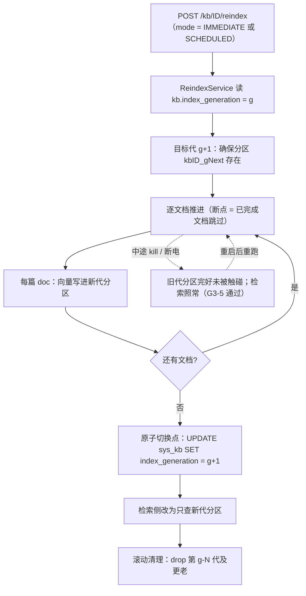

> 状态：🟡 进行中 · Sprint S4 · 阶段 D（M04 重建/删除 + **跨模块 `O7`/`O4`**）· 建档 2026-09-17

# 2026-09-17 · S4 · 阶段 D —— 重建索引（按代原子切换）+ 删除知识库 + 删库留存规则 + 入库准入加固

> 任务：`T-406` · `T-407` · `T-O07`（降级版）· `T-O04`（降级版）—— **4 项**（`T-xxx` 2 + `T-Oxx` 2，≤5 达标）
> 来源：`docs/进度/03-Sprint排期.md` §Sprint 4 · §优化配额 · 本批是**跨 Sprint 合并验收**（S3 的 6 处缺口）
> 上游计划：`2026-09-17-S4-M05-C3.md`（§9 遗留 6/8 条本批要销）· `2026-09-16-S3-D.md`（§8 的挂起片段本批合并回填）

---

## 1. 开工条件检查

**依赖清单来源**：`docs/进度/00-开工速览.md` §2/§4 · `docs/进度/02-任务清单.md` §M04（`T-406`/`T-407` 行）·
`plan/汇总.md` §4 挂起判据 · `plan/优化/O7`·`O4` · 上一批 §9。

| # | 依赖项 | 档位 | 现状（实证） | 结论 |
|---|---|---|---|---|
| 1 | `T-406` 依赖 `T-404`（变更影响预估） | ✅ | `02-任务清单.md:195` 依赖列写 `T-404`；`T-404` 已于 S3-M04-B2 ✅ | 满足 |
| 2 | `T-406` 依赖 `T-508`（向量写入能力） | ✅ | S4-M05-C3 交付，真跑 88 块 → **81 条向量**落 `knowledge_vectors` | 满足 |
| 3 | `T-407` 依赖 `T-406`（collection 生命周期） | ✅ | 两者同批，批内排序 `T-406` 先做；分区落点由 `T-406` 建 | 满足 |
| 4 | 环境：Docker 六服务 | ✅ | `docker ps` 实测 `milvus-standalone`/`kb-mysql`/`kb-minio`/`kb-neo4j`/`kb-valkey`/`milvus-etcd` 全 **healthy** | 满足 |
| 5 | 迁移编号 | ✅ | `db/migration/` 最大 **`V14`** → 本批落 **`V15`** | 满足 |
| 6 | `kb:delete` 权限点已存在 | ✅ | `V2__seed_reference_data.sql:66` + `V5__s2_rbac_matrix_and_grants.sql:111`（超管 `MANAGE`） | 满足 |
| 7 | **`D-7`「写新 collection + 原子切换」与 `D-4`/`R-8`「单 collection」在「按库重建」上不可同时成立** | ⛔ **BLOCKER** | `docs/进度/README.md:132`（D-7）vs `:133`（D-4）；`10-接口约定汇总.md:127` 的 `POST /kb/{id}/reindex` 是**按库**，而 collection 是**全库共用** | **用户已裁定** → 单 collection + **按代 partition** |
| 8 | **需求 `06`:279「重建期间该知识库的检索质量会下降」与 `D-7` 的原子切换语义相反** | ⛔ **BLOCKER** | `06-需求-知识库与文档.md:279` 逐字 | **用户已裁定**：取 `D-7` 语义（原子切换 = **零下降窗口**）→ 该文案与实现不符，**登记改文案**（§9-1） |
| 9 | **`O7` §6 自陈与 `T-407` 冲突**（内容寻址让「按库前缀删除」不可用） | ⛔ **BLOCKER** | `优化/O7-content-addressed-storage.md` §6 尾行逐字要求「需与产品确认优先级」 | **用户已裁定** → `O7` **只做留存规则表那一半** |
| 10 | `O4` 的 ClamAV 走**异步**、且设计为进 `T-O01` 的 worker 队列 —— 而 `T-O01` 排 **`S4-E`（本批之后）** | ⚠️ WARN | `优化/O4-ingest-admission-hardening.md` §6 末行 | **用户已裁定** → 本批只做**同步四道**，ClamAV 随 `T-O01` |
| 11 | `O4` 方案文档写的错误码 `10070~10073` **已过期** | ⚠️ WARN | `ErrorCode.java:152,154` —— `10070`=`INVITE_INVALID`、`10071`=`IMPORT_TEMPLATE_INVALID`（都比 O4 建档早落地，但文档未回头改） | 本批改用 **`10072`~`10075`**（接当前最大码顺延）；顺手订正 `O4` 文档（§9-2） |
| 12 | `sys_kb` **无软删列** | ⚠️ WARN | `V7__s2_kb_skeleton_and_grants.sql` 的 `CREATE TABLE sys_kb` 列清单里没有 `deleted_at` | 本批 `V15` 加列（§4） |
| 13 | **Milvus 2.6 的 partition 能力未验证**（建分区 / 按分区检索 / 切代 / 删分区 / 分区数上限） | ⚠️ WARN | 本机 `milvus-standalone` 2.6.17 在跑，但本项目从未用过 partition | **步 0 探针实测**；不通过则回落到 `§3.4 假设 2` 的备选 |

**BLOCKER 汇总**：3 条（#7 `D-7` vs `D-4/R-8`、#8 需求文案 vs `D-7`、#9 `O7` vs `T-407`）—— **全部已由用户 2026-09-17 裁定**，无残留。
**⚠️ 已知偏差**（不拒绝施工，第 9 节销账）：#10 `O4` 的 ClamAV 顺延 · #11 错误码段订正 · #12 软删新列 · #13 步 0 探针。

> 判据只有一条：**这条不满足，代码写下去会不会白写**。#7~#9 三条都属于「选错了要重写整批」——所以它们是 BLOCKER 而不是 WARN。

### 结论

- [x] ✅ **可以开工** —— 三条 BLOCKER 已裁定，其余为 WARN（逐条进 §9）
- [ ] ⛔ 拒绝施工

> **裁定记录**（用户 2026-09-17，`AskUserQuestion` 三项全取推荐值）：
> ① `T-406` 原子性 = **单 collection + 按代 partition**（`kb{N}_g{K}`）
> ② `O7` = **只做留存规则表**（不做内容寻址）
> ③ `O4` = **本批只做同步四道**（ClamAV 随 `T-O01`）

---

## 2. 开工时间

| 项 | 值 |
|---|---|
| 建档 / 开工日 | 2026-09-17 |
| 预计投入 | **10 人天**（`T-406` 4 · `T-407` 2 · `T-O07` 1 · `T-O04` 3）· Sprint 容量 ≈ 10 |
| 实际投入 | *回填时补* |

---

## 3. 开工内容

### 3.1 步骤

| 步 | 做什么（文件/类 → 动作 → 产出） | 依赖 | 可并行 |
|---|---|---|---|
| **0** | **探针：Milvus partition 能力实测** —— 用既有 `MilvusServiceClient` 建分区 / 写点进指定分区 / `search(withPartitionNames)` / `releasePartitions` / `dropPartition`，并压一个**分区数上限**结论 | — | 否（后面全依赖它） |
| **0.5** | **定案：分区命名与留存代数** —— 命名 `kb{kbId}_g{gen}`；保留代数 N（滚动删除更老的分区） | 步 0 | 否 |
| **1** | `V15__s4_kb_lifecycle.sql` —— `sys_kb` 加 `deleted_at`（软删）+ `index_generation`（INT NOT NULL DEFAULT 1，切代落点） | — | ✅ 与步 0 并行 |
| **2** | **`T-406` 重建索引**：`POST /kb/{id}/reindex`（`IMMEDIATE`/`SCHEDULED`）→ `ReindexService`：写**新代分区** → 逐文档推进并记断点 → 完成后**一次 `UPDATE sys_kb.index_generation`** 切代 → 滚动删旧代 | 步 0.5/1 | 否 |
| **3** | **`T-407` 清空索引 + 软删**：`DELETE /kb/{id}/index`（drop 该库全部分区 + 清 `sys_chunk`/`sys_document` 索引态）· `DELETE /kb/{id}`（软删 → `deleted_at` + 审计 🚩HIGH） | 步 2 | ✅ 与步 4/5 并行 |
| **4** | **`T-O07` 留存规则表**（降级版）：改 `DocStorage` **类 javadoc** + 新增 `docs/后端开发文档/11-M05-存储生命周期规则（O7）.md`，把**源文件 / 解析产物 / 向量 / 审计日志**四类的删除与留存规则写成明文 | — | ✅ |
| **5** | **`T-O04` 准入加固（同步四道）**：`DocStorage#validate` 加 MIME 交叉校验（`Tika.detect`）+ ZIP 炸弹限额（解压字节/条目数/嵌套）+ 宏检测 + 加密检测；错误码 `10072`~`10075` | — | ✅ |
| **6** | 门禁取证 + 页面级 E2E + 回填 | 全部 | 否 |

> **步 2 的断点续跑落点**：不新建表 —— 复用 `sys_kb.index_generation` + 逐文档过滤（已完成文档的向量已在新代分区里，重跑时跳过）。**每篇文档的替换是幂等的**（C3 已证：按 `doc_id` 先删后插）。

### 3.2 业务流程图

> 触发条件：跨 ≥3 个组件 ✅ · 异步任务 ✅ · 状态机 ✅ · 幂等/并发 ✅ —— **必须画**。

> **图里的关键点**：切代是**一次 MySQL UPDATE**，不是 Milvus 操作 —— 所以它是真原子；
> 而**旧代在切换前一个字节都没动**，这就是 `G3-5`「中途 kill 旧索引仍可用」的实现基础。

### 3.3 明确不做（范围控制）

| 不做 | 归属 |
|---|---|
| **内容寻址（sha256）+ 引用计数** | `O7` 降级项 —— **用户 2026-09-17 裁定不做**（与 `T-407` 抢设计；且删库要干净优先） |
| **ClamAV 恶意扫描** | 随 `T-O01`（`S4-E`）；`O4` 判据 4 与 6 本批**挂起** |
| `O4` 判据 6 的「未部署降级」标记 | 同上（ClamAV 本批不引入，该判据无处可验） |
| 装饰图判定 | `S6`（与 `T-512` 合并，`S4-C2` 已裁定） |
| 解析执行架构解耦 | `T-O01`（`S4-E`） |
| 前端页面改动 | **本批不碰前端** —— `DELETE /kb/{id}` 的调用方已存在（`audit-api.mjs` ⑦ 把它列为「前端已调用」）；若页面级 E2E 暴露缺口，另立前端小批 |
| 审计查询侧改动 | `T-407` 只**产出**审计事件；查询已在 S3-C 交付 |

### 3.4 本批假设

| # | 假设 | 若证伪的备选 |
|---|---|---|
| 1 | Milvus 2.6 支持「创建分区 + 按分区检索 + 删除分区」，且分区数上限**够用**（8 库 × 保留 2 代 = 16） | 步 0 探针若证伪 → **回落备选**：单 collection + 加 `generation` 标量字段。⚠️ 那要**一并改刚拍板的 `G4-10` 口径**（可过滤字段 4 → 5），须先与用户确认 |
| 2 | `sys_kb.index_generation` 一次 `UPDATE` 即可作为原子切换点（检索侧每查询读一次该值） | 若读放大不可接受 → 检索侧进程内缓存 + 失效通知（`ModelClientRegistry` 有同型先例） |
| 3 | 逐文档幂等替换（C3 已证）在新代分区上同样成立 | 不成立则按 doc 维度重跑，等价性有 C3 的 `replaceDocument` 用例兜底 |

---

## 4. 数据变更清单

| 项 | 内容 |
|---|---|
| **迁移 `V15__s4_kb_lifecycle.sql`** | ① `sys_kb` 加 `deleted_at DATETIME NULL`（软删；`NULL` = 未删）② `sys_kb` 加 `index_generation INT NOT NULL DEFAULT 1`（切代落点）③ `idx_kb_deleted`（列表按软删过滤） |
| **无新表** | `O7` 降级后**不需要** `sys_content_blob`（引用计数表是内容寻址的伴生物） |
| **无表改列的破坏性变更** | 两个新列都**可空/有默认值**，8 个演示库无需回填（`deleted_at` 默认 NULL = 未删；`index_generation` 默认 1 = 首代） |
| **Milvus 侧** | **无 schema 变更** —— partition 是**运行时创建**的，`knowledge_vectors` 的 8 列一字不动。✅ 这正是选 partition 方案的关键优点（不动 `G4-10` 刚拍板的口径） |
| 种子数据 | 8 个演示库**不需要**同步（新列默认值即正确语义） |
| 回滚方式 | **加列可逆**（`DROP COLUMN`）；⚠️ 但 `index_generation` 一旦切过代，回滚版本读不到新代分区 → 回滚前须把分区数据写回 g1。**Milvus 分区可 drop，不可逆** |

---

## 5. 依赖与工具决策

**结论：无新依赖。**

| 问题 | 不引依赖的做法 | 代价 |
|---|---|---|
| MIME 交叉校验（`O4` 步 1） | 用**已在依赖树里**的 `Tika.detect(bytes, filename)` —— `TikaDocumentParser` 本来就在用 `AutoDetectParser` | 无（Tika 是既有依赖） |
| ZIP 炸弹限额（`O4` 步 2） | 用 **JDK 自带 `java.util.zip.ZipFile` 预扫中央目录**（读条目数 + 声明大小），不引 `commons-compress` 的新用法 | 声明大小可被伪造 → 需**双重判据**（声明值 + 实读上限），本批两条都做 |
| 宏 / 加密检测（`O4` 步 4） | Tika 的 `Metadata` 已给 `hasMacro`；加密在解析前用 `EncryptedDocumentException` 捕获 | 无 |
| ClamAV | **本批不引**（见 §3.3） | 判据 4/6 挂起 |
| Milvus 分区 | 用**既有裸 SDK** `MilvusServiceClient`（`T-508` 已定「写入走裸 SDK」，`MilvusVectorStore` 表达不了多标量列） | 无新依赖 |

> 引依赖**必须证明既有栈做不到**。上表四条全部用既有栈落地，故不引。

---

## 6 + 7. 验收方法与标准

> 判据 **对齐门禁号**（`G3-*` / `G4-*`）；`T-Oxx` 的判据取自 `plan/优化/O*` 各方案。
> **门禁证据按门禁号盘账**（硬口径）—— 本批是**跨 Sprint 合并验收**，`G3-*` 的片段要回填到 `S3-D` 的计划文件。

| # | 判据 | 验收方法（可粘命令） | 期望结果 | 证据落点 |
|---|---|---|---|---|
| 1 | **`G3-3` 后半**：未重建前检索行为不变 | 改配置 → 不重建 → 查该库向量所在分区 | 仍指向**旧代**分区；`reindex_required = 1` 但检索结果不变 | `ReindexFlowTest` |
| 2 | **`G3-4`**：`chunkAfter` 与重建后实际分片数同量级（±10%） | 调 `POST /kb/{id}/config/impact` 拿 `chunkAfter` → 真重建 → SQL 数实际块 | 偏差 ≤10% | `ReindexFlowTest` + SQL |
| 3 | **`G3-5`**：**中途 kill 旧索引仍可用** | 重建跑到一半 `Stop-Process` 杀进程 → 重启 → 不重建直接查 | 检索**正常返回旧代结果**（分区 `kb{id}_g{g}` 未被触碰） | `ReindexFlowTest#killMidwayOldIndexStillServes` |
| 4 | **`G3-6`**：重建可**续跑** | kill 后重启 → 再次 `reindex` | **已完成文档不重跑**（新代分区里已有的 doc_id 被跳过；日志给出跳过计数） | `ReindexFlowTest#resumesFromBreakpoint` |
| 5 | **`G3-7`「删除」类**：删除操作在 `/audit/logs` 可查 + 含变更前后对照 | `DELETE /kb/{id}` → 查审计 | 有记录，`module`/`action` 正确，`changes` 含前后对照（空值用字面量 `'—'`） | `KbDeleteFlowTest` + `e2e-audit-flow` |
| 6 | **`G3-8` 运行时半边**：删除知识库标高危 | `DELETE /kb/{id}` → 查 `sys_audit_log.risk_level` | `HIGH`（口径侧 `AuditRiskPolicy` 已冻结） | `KbDeleteFlowTest` |
| 7 | **`D-7` 不原地删旧索引**（本批新判据） | 重建全程监控旧代分区点数 | **切换点之前**旧代点数**只增不减**（一次 delete 都没有） | `ReindexFlowTest` + Milvus 查询 |
| 8 | 切代是**一次 UPDATE** | 切代前后读 `sys_kb.index_generation` | 从 g → g+1，**单条 SQL**；无中间态 | `ReindexFlowTest` |
| 9 | 滚动清理保留 N 代 | 连续重建 3 次 | 只保留最近 N 代分区，更老的已 drop | `ReindexFlowTest` |
| 10 | `T-407` 清空索引只清该库 | `DELETE /kb/{id}/index` → 查另 7 库 | 该库分区清空；**其余 7 库向量一条不少** | `KbDeleteFlowTest` |
| 11 | `T-407` 软删进回收站 | `DELETE /kb/{id}` → 查列表 + 查库 | 列表不再出现；`deleted_at` 非空；**行还在**（不是物理删） | `KbDeleteFlowTest` + SQL |
| 12 | 软删后**不再可检索** | 软删 → 检索该库 | 查不到（检索侧按 `deleted_at` 过滤） | `KbDeleteFlowTest` |
| 13 | `O7` 判据 7：**生命周期规则表已入库** | 查新增文档 `11-M05-存储生命周期规则（O7）.md` | 源文件 / 解析产物 / 向量 / 审计日志**四类逐条写明**，`T-616` 可直接照着实现 | 文档本身 |
| 14 | `O4` 判据 1：伪装扩展名被拒 | `.zip` 改名 `.pdf` 上传 | `10072 FILE_TYPE_MISMATCH`；**不建行**（列表无假文档） | `IngestAdmissionTest` |
| 15 | `O4` 判据 2：**正常 9 种格式全放行**（回归保护） | 每类各传一份真样本 | 全部通过准入 | `IngestAdmissionTest` |
| 16 | `O4` 判据 3：ZIP 炸弹被拦 | 造高压缩比 docx（解压 >2GB） | `10073 FILE_BOMB_SUSPECTED`；**worker 内存不飙升** | `IngestAdmissionTest` |
| 17 | `O4` 判据 5：加密 PDF 提示**不同于**扫描件 | 加密 PDF 上传 | 提到「加密/密码」，**不是**「未提取到可复制文本」 | `IngestAdmissionTest` |
| 18 | `O4` 判据 7：`.md` 不被误拒 | 6 份 MD 样本 | 全放行（Tika 报 `text/x-web-markdown`，映射表已覆盖） | `IngestAdmissionTest` |
| 19 | 全量测试基线不降 | `mvn -B -f .../pom.xml test` | ≥ **288** 绿（C3 基线） | 命令输出 |
| 20 | 页面级 E2E | `node ai_knowledge_app/scripts/e2e-*.mjs` | `e2e-kb-flow` / `e2e-audit-flow` / `e2e-doc-upload` / `e2e-doc-parse` 全绿 | 脚本输出 |
| 21 | 跑完零残留 | 6 容器 + 种子核对 | `sys_kb=8`、`doc=0`、`chunk=0`、Milvus 向量 0、MinIO 空 | SQL + `docker exec` |

> **⏸️ 本批挂起**：`O4` 判据 4（恶意样本被拦）· 判据 6（未部署 ClamAV 的行为）—— **待 `S4-E`（`T-O01`）**。
> **观察项（不计成败）**：分区数量与 Milvus 内存占用的关系（步 0 探针给结论，不做判据）。

---

# 以下为开工后回填

## 8. 验收结果

*回填时补*

## 9. 遗留问题

*回填时补*（已预登记四条：§1 的 #10~#13）

## 10. 建议

*回填时补*

## 附：本批同步的文档回填

*回填时补* —— 按 `docs/进度/00-开工速览.md` §8 的 13 处清单（含新增的 O 项回填三处）。
