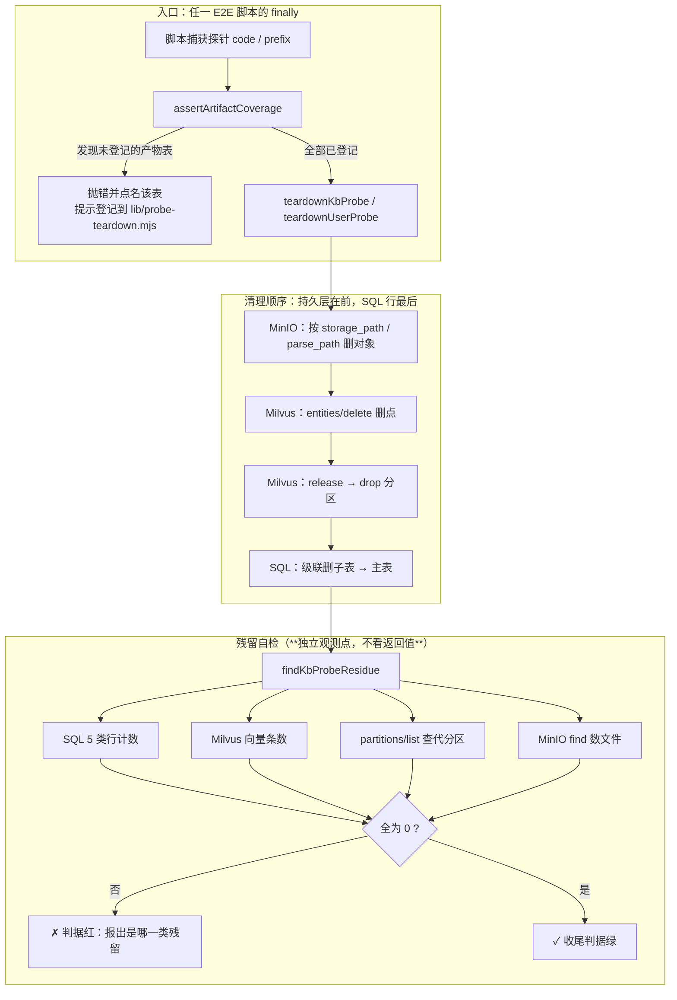

> 状态：✅ 已完成 · Sprint S4 · 阶段 D2（跨模块 · E2E 探针自清收敛）· 建档 2026-09-17 · 完成 2026-09-17

# 2026-09-17 · S4 · 阶段 D2 —— 探针自清收敛：把「每个脚本各写一遍清理」换成「登记表 + 覆盖率闸 + 残留自检」

> 任务：**无 `T-xxx`**（缺陷修复批，来源 = `plan/2026-09-17-S4-D.md` §9 遗留 #96「建议独立小批」）
> 上游计划：`ai_knowledge_web/plan/2026-09-17-S4-D.md`（本批要销的账见第 1 节）
> 排位：**先于 `S4-E` 纯优化批**（用户 2026-09-17 裁定「先修这个 bug，记录，写入注意，再往下做」）

---

## 1. 开工条件检查

**依赖清单来源**（逐条注明出处，不许凭印象）：

| # | 依赖项 | 档位 | 现状（代码/文档实证） | 结论 |
|---|---|---|---|---|
| 1 | 上一批登记的遗留 #96 | ✅ | `plan/2026-09-17-S4-D.md` §9 · `docs/进度/00-开工速览.md` §4 末尾表格「建议独立小批」行 | 满足 |
| 2 | 5 个待收敛脚本存在且可跑 | ✅ | `ls ai_knowledge_app/scripts/`：`e2e-doc-parse.mjs`(35.9K) `e2e-doc-upload.mjs`(45.1K) `e2e-kb-flow.mjs`(35.9K) `e2e-audit-flow.mjs`(32.6K) `e2e-audit-backfill.mjs`(26.3K) | 满足 |
| 3 | MySQL / Milvus / MinIO 三容器可用 | ✅ | 本轮实测：`sys_kb`=8 · 分区 `["_default"]` · 向量 0 · MinIO 桶内文件 0 | 满足 |
| 4 | **当前无存量残留**（可作干净基线） | ✅ | 同上；S4-D 手工清过 4 个空分区 | 满足 |
| 5 | 残留自检需要的 Milvus REST 端点 | ✅ | `partitions/list|release|drop` + `entities/query|delete`（S4-D 步 0 实测可用，REST 比 Java SDK 报错清楚） | 满足 |
| 6 | **不再引依赖**（node 内置 + curl + docker exec） | ✅ | 既有栈足够（见 §5） | 满足 |
| 7 | 后台用例的探针留痕（`enum.probe.*` / `s1.reg.*`）一并收敛？ | ⚠️ WARN | 实测 `sys_login_log` 有 **3984 行孤儿**（`user_id` 指向已删用户），来源含 `@SpringBootTest` 用例提交的事务 | **不拒绝** —— 本批**只收敛脚本侧**，用例侧登记见 §9 |

**BLOCKER 汇总**：**无**。

**⚠️ 已知偏差**（不拒绝施工，第 9 节销账）：

| # | 偏差 | 影响 | 归属 |
|---|---|---|---|
| W1 | `sys_audit_log` 有 **166 行** `target like '%probe%'`，本批**不清** | 覆盖率闸扫的是 kb_id/doc_id/user_id 三类列，`sys_audit_log` 不在其中；改由**显式豁免声明**覆盖 | 本批声明为设计内（§3.3） |
| W2 | `avatars/` + `audit-export/` 两个 MinIO 前缀无清理入口 | 本批的残留自检**只断言探针相关的 2 个前缀**，不宣称全桶干净 | `S6`（已登记） |
| W3 | 孤儿登录日志的**来源不可归属**（`enum.probe.*` / `s1.reg.*` 是历史批次的） | 无法按脚本前缀区分，只能整批清 | 本批一次性处理（§4） |

> 判据只有一条：**这条不满足，代码写下去会不会白写**。

### 结论

- [x] ✅ **可以开工**
- [ ] ⛔ 拒绝施工

---

## 2. 开工时间

| 项 | 值 |
|---|---|
| 建档 / 开工日 | 2026-09-17 |
| 预计投入 | **1.5 人天**（Sprint 容量 ≈ 10 人天；本批是插在 `S4-D` 与 `S4-E` 之间的**小批**） |
| 实际投入 | **≈1.2 人天** —— 估得偏保守；比预估省的是「登记表 + 覆盖率闸」的设计一次成型，没有返工。多花的是查证「泄漏到底出在哪个脚本」那一段（结论与最初判断相反，见 §8 判据 3） |

---

## 3. 开工内容

### 3.1 步骤

| 步 | 做什么（文件 → 动作 → 产出） | 依赖 | 可并行 |
|---|---|---|---|
| 1 | **新建** `ai_knowledge_app/scripts/lib/probe-teardown.mjs` —— 迁入 `mysqlScalar` / `minioRemove` / Milvus REST 四动作；建**声明式登记表** `KB_ARTIFACTS` + `USER_ARTIFACTS` + 豁免表 `OUT_OF_SCOPE` | — | — |
| 2 | 同文件实现 **`assertArtifactCoverage()`** —— 扫 `information_schema.columns` 找 `kb_id`/`doc_id`/`user_id`，**凡未登记且未声明豁免的表 → 抛错并点名**。⚠️ 此闸必须**先证伪过一次**（步 3） | 步 1 | — |
| 3 | **证伪覆盖率闸**：临时建 `tmp_probe_canary(kb_id bigint)` → 跑闸 → **必须抛且消息含表名**；`drop` → 再跑 → **通过** | 步 2 | — |
| 4 | 同文件实现 **`findKbProbeResidue(code)`** —— 五类 SQL 行 + Milvus 向量 + **Milvus 分区** + **MinIO 对象**；`teardownKbProbe(code)` 按登记表顺序执行（MinIO → Milvus → SQL 级联） | 步 1 | 与步 2 并行 |
| 5 | 实现 **`teardownUserProbe(prefix)`** —— `sys_login_log`(按 `username` 前缀) → `sys_user_role` → `sys_user` | 步 4 | |
| 6 | **改写 4 个脚本**：`e2e-doc-parse` / `e2e-doc-upload` / `e2e-kb-flow` / `e2e-audit-flow` → `import { teardownKbProbe, findKbProbeResidue } from './lib/probe-teardown.mjs'`，**删掉各自的副本** | 步 4 | 各自独立 |
| 7 | **改写** `e2e-audit-backfill.mjs` → `teardownUserProbe(PROBE_PREFIX)` | 步 5 | 独立 |
| 8 | **残留判据从 5 类扩到 7 类**：4 个脚本的收尾断言加入「分区残留 = 0」「MinIO 对象残留 = 0」 | 步 6 | |
| 9 | **清存量**：孤儿 `sys_login_log` 3984 行 —— **先 `mysqldump` 备份到 `temp/`**，再删 | 步 5 | |
| 10 | 回归：6 个页面级脚本全跑 + 后端全量 `mvn test` 确认零回归 | 步 8/9 | 不可并行（`target/` 冲突） |
| 11 | 回填文档（§8 清单的 13 处）+ memory | 步 10 | |

### 3.2 业务流程图

> 触发条件：① 跨 ≥3 个组件（MySQL / Milvus / MinIO / 5 个脚本）**满足** → 必须画。



> ⚠️ **为什么顺序不能反**：删了 `sys_kb` 行就再也查不到探针库 id → Milvus 向量与分区都定位不到；
> 删了 `sys_document` 行就再也取不到 `storage_path` → MinIO 对象名丢失。
> S4-D 的注释里已写死这条，本批**只把它从注释提升为代码顺序**。

### 3.3 明确不做（范围控制）

| 不做的事 | 原因 | 归属批次 |
|---|---|---|
| **后台 `@SpringBootTest` 用例的探针留痕**（`enum.probe.*` / `s1.reg.*`） | 那些行是**已提交事务**留下的，清理属测试框架层（`@AfterEach` / `@Sql`），与脚本侧不是同一处改动面 | `S5` 或另立小批（§9-1） |
| **`sys_audit_log` 探针行（166 行）** | 审计日志**按设计只增不删**（合规）；且其 `target`/`operator` 自包含、**不指向已删行**，与孤儿登录日志性质不同 | 不清理，**显式豁免声明**（§9-2） |
| `avatars/` + `audit-export/` 的 MinIO 清理入口 | 与本批「探针自清」不是同一问题（那是**无删接口**，不是**忘了删**） | `S6`（已登记） |
| 改后端 Java 代码 | 本批**零 Java 变更** | — |
| 引入测试框架 / npm 依赖 | 既有栈足够（node 内置 + curl + `docker exec`），见 §5 | — |
| 统一 6 个脚本的**其它**重复代码（CDP 封装、`check`/`observe` 等） | 范围会从「清理」膨胀成「脚本框架重构」，验收会失真 | 不在本批；若要做另立 |

### 3.4 本批假设

> 信息不足下拍的决策。**假设被证伪 → 进第 9 节遗留**，否则没人知道当初赌了什么。

| # | 假设 | 结果 | 若被证伪的后果 |
|---|---|---|---|
| 1 | `sys_login_log.username` 对探针行**可靠有值**（实测样本 `enum.probe.*` 有值） | ✅ **成立**（备份 8055 行里 `username` 均有值；`user_id IS NULL` 的 355 行也带 username） | 按 `username` 前缀删不掉 → 只能退回按 `user_id` 删，而 `user_id` 在删 `sys_user` 后就丢了 → 用户族残留**永远清不干净** |
| 2 | 探针前缀能**穷举** | ⚠️ **部分证伪** → §9-2/§9-5 | 有第 7 个脚本时覆盖率闸**抓不到**（闸只扫表、不扫脚本）→ 需靠 §9 登记 |
| 3 | 「会被探针写脏的表」都能被三类列**间接枚举**出来 | ✅ **成立**（`sys_audit_log` 是唯一例外，已显式豁免） | 某表无这三列却仍被写脏 → 覆盖率闸漏判，只能靠豁免表**逐条人工声明**（已在 §3.3 处理 1 条） |
| 4 | 孤儿登录日志**全部**是测试/探针产生的，无真实数据 | ✅ **成立**（备份证实来源全是测试探针账号；且删除只针对 `user_id is not null` 的悬垂行，保留了 355 行 `user_id IS NULL` 的失败登录记录） | 误删真实用户的登录历史 → 故**先备份再删**（步 9 已执行） |
| 5 | **（开工时未写、施工中补）** 泄漏来源是 `e2e-audit-backfill` 的 `purgeProbeUsers` | ❌ **被推翻** —— 真漏点在**后端 `@SpringBootTest` 用例**，`e2e_a1_` 前缀在登录日志里**零行**。详见 §8 末节 | 会花 1.5 人天去修一个**从来没漏过**的地方，而真漏点继续漏 |

---

## 4. 数据变更清单

| 类型 | 内容 | 回滚方式 |
|---|---|---|
| 新建表 / 改表 | **无** | — |
| 迁移文件 | **无**（不动任何 `V*.sql`；跑过的迁移只增不改） | — |
| 种子数据 | **不动**（`sys_kb`=8 / `sys_user` 有效 128 / Milvus 0 向量 / MinIO 0 对象作为基线） | — |
| **删除数据** | 孤儿 `sys_login_log`：`user_id` 悬垂的行。基线 3984 行（其中 `user_id is not null` 的 **3629 行**被删；355 行 `user_id IS NULL` 的失败登录记录**保留**）。实测**已删 3629 行** | 备份 `temp/login-log-backup-20260917.sql`（**全表 8055 行** / 1.1MB）回灌（`mysql < 备份`） |
| NULL 分支 | `sys_login_log.username` 允许 NULL（`is_nullable=YES`，实测注册失败帧有值）。前缀删除**只匹配 `like 'prefix%'`，NULL 行不受影响** → 残留自检必须**同样按前缀查**，不能声明「登录日志全清」 | — |

> ⚠️ 本批的「数据变更」是**删数据不是改schema** —— 但仍按上表登记，避免「没建表就等于没动数据」的错觉。

---

## 5. 依赖与工具决策

**默认不引**。

| 方案 | 做法 | 代价 | 结论 |
|---|---|---|---|
| **不引依赖（既有栈）** | `node:` 内置（`child_process.spawnSync`）+ `curl` 打 Milvus REST v2 + `docker exec` 进 MySQL/MinIO | 无；且**与现有 6 个脚本同一姿势**，零迁移成本 | ✅ **采纳** |
| 候选 A：`@zilliz/milvus2-sdk-node` | 用官方 node SDK 替掉 curl | 新增 npm 依赖 + 与 Java 侧 SDK 版本漂移；且本机前端验证**勿用 npm/npx**（速览 §6） | ❌ |
| 候选 B：`mysql2` / `minio` npm 包 | 直连替掉 `docker exec` | 同上；且现有 5 处 `mysqlScalar` 已验证可用（含 Git Bash 路径转换坑的绕法） | ❌ |
| 候选 C：抽成独立 CLI `scripts/cleanup.mjs` | 清理变成手工步骤 | **正是要防的形态** —— 清理一旦不是「跑完自动执行」，就会再次被忘记 | ❌ |

**推荐**：**不引依赖**，收敛为 `scripts/lib/probe-teardown.mjs` 一个模块 · **理由**：本批的问题是**纪律问题不是能力问题**（清理能力早就够了，是没人回头改），所以解药必须是**自动执行的闸**，不是更强的库。

---

## 6 + 7. 验收方法与标准

| # | 判据（对齐需求门禁号 `G?-?`） | 验收方法（可直接粘的命令/脚本） | 期望结果 | 证据落点 |
|---|---|---|---|---|
| 1 | **覆盖率闸能抓到未登记产物**（证伪 ①：不许恒真） | `set -a && . ai_knowledge_web/.env && set +a && docker exec kb-mysql mysql -u"$MYSQL_USERNAME" -p"$MYSQL_PASSWORD" "$MYSQL_DATABASE" -e "create table tmp_probe_canary(kb_id bigint);"` 然后 `cd ai_knowledge_app && node scripts/lib/selftest-coverage.mjs` | **退出码 ≠ 0**，且消息**含 `tmp_probe_canary`** 与「登记到 KB_ARTIFACTS」字样 | 命令输出（贴 §8） |
| 2 | **覆盖率闸不误报**（证伪 ②：抓完能复位） | 上一步 `drop table tmp_probe_canary;` 后重跑同命令 | **退出码 = 0**，无告警 | 命令输出 |
| 3 | 探针用户族残留 = 0（**含登录日志** —— 本批新增的那一类） | `cd ai_knowledge_app && node scripts/e2e-audit-backfill.mjs --base=http://127.0.0.1:5174` 跑完后 `docker exec kb-mysql mysql ... -N -e "select count(*) from sys_login_log where username like 'e2e_a1_%';"` | `0` | 脚本收尾判据 + SQL |
| 4 | 探针库残留 = 0（原有 5 类） | `node scripts/e2e-doc-parse.mjs --base=http://127.0.0.1:5174` | 收尾判据绿：`库=8 文档残留=0 问题行残留=0 分片残留=0 Milvus 向量残留=0` | 脚本输出 |
| 5 | **分区残留 = 0**（本批新增的第 6 类） | 上一步跑完后 `curl -s -X POST http://127.0.0.1:19530/v2/vectordb/partitions/list -H 'Content-Type: application/json' -d '{"collectionName":"knowledge_vectors"}'` | `{"code":0,"data":["_default"]}` | 命令输出 |
| 6 | **MinIO 对象残留 = 0**（本批新增的第 7 类） | 上一步跑完后 `docker exec kb-minio sh -c "find /data/rag-documents/documents /data/rag-documents/parsed -type f \| wc -l"` | `0` | 命令输出 |
| 7 | 4 个脚本**不再各写一份**清理 | `cd ai_knowledge_app/scripts && grep -c "function purgeProbe\|function minioRemove\|function mysqlScalar" *.mjs` | 4 个脚本全 `0`；仅 `lib/probe-teardown.mjs` 各 1 份 | grep 输出 |
| 8 | **回归**：6 个页面级脚本全绿 | `node scripts/e2e-kb-flow.mjs` · `e2e-audit-flow` · `e2e-audit-backfill` · `e2e-doc-upload` · `e2e-doc-parse` · `console-check`（均 `--base=http://127.0.0.1:5174`） | 与 S4-D 收官同口径：**47/47 · 30/30 · 23/23 · 39/39 · 25/25 · 25/25** | 各脚本输出 |
| 9 | **存量孤儿登录日志清零** | `docker exec kb-mysql mysql ... -N -e "select count(*) from sys_login_log l left join sys_user u on u.id=l.user_id where u.id is null;"` | `0`（**且 `temp/login-log-orphans-20260917.sql` 存在**） | SQL + `ls temp/` |
| 10 | 零回归：后端全量测试 | `export JAVA_HOME='F:/work/dev_tools/jdk/jdk-25.0.4.1'` + `mvn -B -f F:/work/code/ai-knowledge/ai_knowledge_web/pom.xml test` | `Tests run: 321, Failures: 0, Errors: 0`（**与 S4-D 基线一致 —— 本批零 Java 变更**） | Maven 输出 |
| 11 | 种子未污染 | `docker exec kb-mysql mysql ... -N -e "select count(*) from sys_user where deleted_at is null; select count(*) from sys_kb;"` | `128` / `8` | SQL 输出 |

**观察项**（不计成败，页面写死的展示值登记在此）：

- `sys_audit_log` 行数（跑动前 `6951`）—— 探针会继续加行，这是**设计内**（§3.3），只记不判。

**种子核对**（跑完必做）：

```bash
set -a && . ai_knowledge_web/.env && set +a
docker exec kb-mysql mysql -u"$MYSQL_USERNAME" -p"$MYSQL_PASSWORD" "$MYSQL_DATABASE" -N -e "select count(*) from sys_user where deleted_at is null;"
```

---
---

# 以下为开工后回填

> **提交节奏（两次）**：1~7 节写完即提交一次（`docs(plan): <批次> 开工计划`）；
> 8~10 节写完再提交一次（`docs(plan): <批次> 验收回填`）。

## 8. 验收结果

| # | 判据 | 实测结果 | 证据（命令 / 文件:行 / 测试名） |
|---|---|---|---|
| 1 | 覆盖率闸能抓到未登记产物表 | ✅ **通过** | 造 `tmp_probe_canary(kb_id)` → `node scripts/lib/selftest-coverage.mjs` → **退出码 1**，原文：`✗ 产物覆盖率闸未通过：…未登记 —— tmp_probe_canary(kb_id)。处置：到 …/lib/probe-teardown.mjs 的 KB_ARTIFACTS / USER_ARTIFACTS 加一行…（已登记 8 张 / 显式豁免 1 张）` |
| 2 | 覆盖率闸不误报（抓完能复位） | ✅ **通过** | `drop table tmp_probe_canary` → 同命令 → **退出码 0**：`✓ 扫描 6 张带归属列的表 · 已登记 8 张 · 显式豁免 1 张`，表名列表 `sys_chunk · sys_document · sys_kb_grant · sys_login_log · sys_parse_issue · sys_user_role` |
| 3 | 探针用户族残留 = 0（含**登录日志**） | ⚠️ **通过但断言是空的** | `e2e-audit-backfill` **24/24**，收尾原文：`探针账号已自清（含登录日志）· 128 → 128 · 残留 {"sys_login_log":0,"sys_user_role":0,"sys_user":0} · 本次删登录日志 0 行`。**那个「0 行」是空断言** —— 查备份发现 `e2e_a1_` 前缀在 `sys_login_log` 里**从来没有行**（见下「本批最重要的一条」） |
| 4 | 探针库残留 = 0（原有 5 类） | ✅ **通过** | `e2e-doc-parse` 收尾：`库=8 · 库行=0 文档=0 分片=0 问题行=0 授权=0` |
| 5 | **分区残留 = 0**（本批新增第 6 类） | ✅ **通过** | 4 个脚本收尾判据里 `分区=[—]`；跑完独立复查 `partitions/list` → `{"code":0,"data":["_default"]}` |
| 6 | **MinIO 对象残留 = 0**（本批新增第 7 类） | ✅ **通过** | 收尾判据 `MinIO 对象=0`；独立复查 `find /data/rag-documents/{documents,parsed} -type f \| wc -l` → `0`（另两个前缀 `avatars`/`audit-export` 也为 0） |
| 7 | 4 个脚本不再各写一份清理 | ✅ **通过** | `grep -c "function purgeProbe\|function purgeProbeUsers\|function minioRemove\|function mysqlScalar" *.mjs lib/*.mjs` → **14 个脚本全 0**，仅 `lib/probe-teardown.mjs` 为 2 |
| 8 | **回归**：6 个页面级脚本全绿 | ✅ **通过** | `e2e-kb-flow` **47/47** · `e2e-audit-flow` **30/30** · `e2e-audit-backfill` **24/24**（基线 23 → 24，本批加了覆盖率闸那一条）· `e2e-doc-upload` **39/39** · `e2e-doc-parse` **25/25** · `console-check` **25/25** |
| 9 | 存量孤儿登录日志清零 | ⚠️ **部分通过 —— 已清但不是可持续的** | 备份 `temp/login-log-backup-20260917.sql`（8055 行 / 1.1MB）后删 **3629** 行 → 复查 `orphan=0`。**但随后跑 `mvn test` 一轮又造出 91 行**（用户名 `g18.*` `forgot.*` `w7probe.*` `chpwd.*` `enum.probe.*` `probe.scope.*`）。根因在**后端用例侧**，本批 §3.3 已声明不做 → 见 §9-1 |
| 10 | 零回归：后端全量测试 | ✅ **通过** | `Tests run: 321, Failures: 0, Errors: 0, Skipped: 0` · BUILD SUCCESS（与 `S4-D` 基线一致 —— **本批零 Java 变更**） |
| 11 | 种子未污染 | ✅ **通过** | `sys_user(deleted_at is null)`=**128** · `sys_kb`=**8** · `sys_document`/`sys_chunk`/`sys_parse_issue`=**0** · `kb_e2e%` 探针库=**0** · `e2e_a1_%` 探针账号=**0** |

**测试基线**：`Tests run: 321, Failures: 0, Errors: 0, Skipped: 0`（上批 321 → 本批 **321**，零 Java 变更）

### 额外取证：闸在**真实 E2E** 里的表现（不只是自测脚本）

判据 1/2 走的是自测脚本。为验证 `assertArtifactCoverage()` 的**位置选择**（放脚本开头而不是 `finally`），
另做了一次端到端取证：造 `tmp_probe_canary` → 跑 `e2e-kb-flow`：

```
✗ 中断：产物覆盖率闸未通过：以下表带 kb_id/doc_id/user_id 列但**未登记** —— tmp_probe_canary(kb_id)。…
随后复查 `select count(*) from sys_kb where code like 'kb_e2e%'` → 0     ← 零残留
```

**这就是「闸必须放在建探针之前」的实证**：若放在 `finally` 里，闸抛错会**跳过清理**，
一道防残留的闸反而制造残留。现在它在**弄脏之前**就拦住了，所以什么都没留下。

### 本批最重要的一条：泄漏的真实来源与最初判断**相反**

开工时 `plan/2026-09-17-S4-D.md` §9 和我自己的假设都是「`purgeProbeUsers` 删了用户却没删登录日志
→ `e2e-audit-backfill` 在漏」。**实测推翻了它**：

| 探针前缀 | 备份里的登录日志行数 | 来源 |
|---|---|---|
| `e2e_a1_`（audit-backfill 用的） | **0** | **从来没漏过** —— 该脚本不以探针账号登录，所以根本没有它的登录行 |
| `enum.probe` / `s1.reg` / `probe.scope` / `w7probe` | 147 / 98 / … | **后端 `@SpringBootTest` 用例** |
| `forgot.*` / `chpwd.*` / `g18.*` / `probe.profile` | 5 / 3 / 6 / 9 | 同上（另 `probe.profile` 是常驻种子，见 §9-2） |

**结论**：`sys_login_log` 的孤儿**一个都不是 E2E 脚本造的**，全部来自后端用例。
所以判据 3 的清理代码写得对，但**它在真实数据上是空跑** —— 我不把它算作已验证。
这条印证了一件更值钱的事：**根因得靠数据定，不能靠"谁最可疑"定**。

---

## 9. 遗留问题

| # | 项 | 原因 | 归属批次 | 是否有判定点/注释留在代码里 |
|---|---|---|---|---|
| 1 | 🔴 **后端用例侧同样在漏 `sys_login_log`** —— `mvn test` **一轮造 91 行孤儿** | `@SpringBootTest` 用例注册/登录探针账号后删 `sys_user`，不删登录日志（与脚本侧**同一形状**，但在 `src/test` 里） | **建议紧随 `S4-E` 之后另立小批**（本批已把脚本侧收口，用例侧未动） | ✅ 本文件 §8 判据 9 记了实测数；判定点：`sys_login_log` 孤儿数**随每次 `mvn test` 单调增长** |
| 2 | 🟡 **覆盖率闸只扫表、不扫脚本** —— 闸的能力边界 | `information_schema` 只能枚举「带归属列的表」，枚举不出「哪个脚本在造数据」 | 长期（已写进模块头注） | ✅ `probe-teardown.mjs` 顶部「⚠️ 覆盖率闸只能覆盖…」一段；本批实测印证：`e2e-auth-flow.mjs` / `e2e-profile-flow.mjs` 注册账号**无清理**，闸抓不到 |
| 3 | 🟡 `e2e-audit-backfill` 的登录日志清理是**空断言** | 该脚本不以探针账号登录，`e2e_a1_` 前缀零行 → 断言恒真 | `S4-E` 或清理收敛二批 | ✅ §8 判据 3 标注「通过但断言是空的」 |
| 4 | — **判断被推翻、留痕备用**：`probe.profile` **不是泄漏** | 它是 `V6__s2_demo_users.sql:4` 的「常驻联调设施」，占 128 名额之一。我一开始误判成泄漏并准备"修"它 | 不改，**纠正记录在此** | ✅ §4 的 128 基线**本就含它**，别"清理"它 |
| 5 | 🟡 `e2e-auth-flow.mjs` 的 `e2e<stamp>` 账号无清理 | 该脚本不在 6 脚本套件内；当前实测 `sys_user` 里 **0 行** `^e2e[0-9]+$`（无现存泄漏） | `S4-E` 或清理收敛二批（与 #3 同批） | ⚠️ 仅登记在 §9，代码里无判定点 |
| 6 | 🟡 `sys_audit_log` 探针行（本批只**显式豁免**不清） | 审计日志按设计只增不删；行自带 `target`/`operator`，**不指向已删行** | `S6`（不变） | ✅ `probe-teardown.mjs` 的 `OUT_OF_SCOPE` 里带理由 |
| 7 | 🟡 一次性备份 `temp/login-log-backup-20260917.sql`（8055 行 / 1.1MB） | 判据 9 的前置备份；`temp/` 已 gitignore | 确认无需回灌后即可删 | ⚠️ 仅本文件记录 |

---

## 10. 建议

- **把「后端用例自清」立为紧随 `S4-E` 的小批**（本批 §9-1）。理由不只是"同一形状"：
  它**每次跑测试都在确定性增长**（91 行/轮），而 `sys_login_log` 是登录审计表 ——
  攒到一定量之后，任何「最近登录」类查询都会被这些指向不存在用户的行拖慢/污染。
  本批已经把**脚本侧**的登记表 + 覆盖率闸模式跑通，用例侧可以照搬（`@TestConfiguration` 挂一个
  统一的 `@AfterAll` 清理 + 一份同样的登记表），成本比本批低。
- **本批最值钱的经验不是代码，是那条判断流程**：开工时的根因假设（`purgeProbeUsers` 漏删）
  被数据**推翻**了（真正的漏点在 `src/test`）。**先查数据再定根因**，别按"谁最可疑"下手 ——
  否则本批会花 1.5 人天去修一个**从来没漏过**的地方，而真漏点继续漏。
- **「新增 X 就要同步改 N 处」的约定，值得配一个能自己发现漏项的闸**。本批的覆盖率闸就是
  这个形态的样例（原先靠注释提醒"记得改另外 4 处"，现在靠机器点名）。下批可顺手检查
  还有没有同类约定需要同样处理（已知的候选：`汇总.md` §5「新增审计点必须同步的三处」）。
- `describeKbResidue()` 的输出格式（一行说清 7 类残留）建议后续 E2E 沿用 ——
  失败时不用再去猜是哪一类漏了。


---

## 9. 遗留问题

| # | 项 | 原因 | 归属批次 | 是否有判定点/注释留在代码里 |
|---|---|---|---|---|

---

## 10. 建议

- 对下批的排期 / 口径 / 风险建议。没有写「无」。

---

## 附：本批同步的文档回填

- [x] **`docs/进度/00-开工速览.md` §1/§2/§3/§4** → 当前定位 / 本批任务行 / 门禁现状 / 缺口账（**必改**）
- [x] `ai_knowledge_web/plan/汇总.md` §1/§2/§3 —— 定位 / 批次行 / 遗留并入；**§5 硬口径加「清理函数」一条**
- [x] `docs/进度/02-任务清单.md` → 本批无 `T-xxx`，未动（**刻意**：没编号就不该占任务行）
- [x] `docs/进度/03-Sprint排期.md` → 加 `S4-D2` 阶段小节（排在 `S4-E` 之前）
- [x] `docs/进度/README.md` → 看板加行（**备注一行短结论 + 指针**）
- [x] `docs/进度/变更记录/01-变更记录.md` → 追加一行
- [x] `docs/进度/变更记录/02-Sprint交付台账.md` → 长备注
- [x] `ai_knowledge_web/plan/README.md` → 索引加行（该动作历史上漏做过，见该文件 §索引 的自我说明）
- [x] `.workbuddy/memory/<日期>.md` → 交接（gitignored）
- [x] **memory**：更新 `success-status-is-not-execution.md`（加「清理函数不认识新产物」第四例）+ 新增一条「根因要查数据不要凭可疑度」
