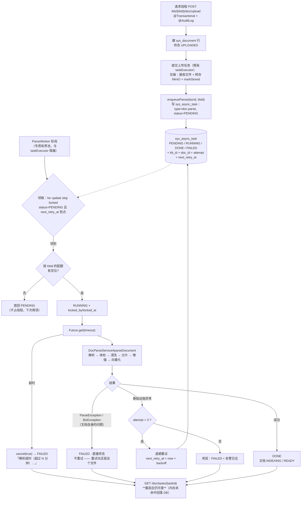

> 状态：✅ 已完成 · Sprint S4 · 阶段 E1（`T-O01` 解析执行架构解耦）· 建档 2026-09-17 · 完成 2026-09-17

> L4a 已判定：`docs/需求文档/10-接口约定汇总.md` —— **历史漏项**（该批提交里没动它；后来由别的批次的回填更新）。当时的记法是事实、**不回溯改**。判定于 `S7-M06-B`（2026-09-21）。

# 2026-09-17 · S4 · 阶段 E1 —— `T-O01` 解析执行架构解耦（任务态落库 + 独立解析池 + 超时 + 配额 + 重试）

> 任务：`T-O01`（1 项）· 来源：`ai_knowledge_web/plan/优化/O1-parse-worker-decouple.md` · `docs/进度/03-Sprint排期.md` §S4-E
> 上游计划：`ai_knowledge_web/plan/2026-09-17-S4-D2.md`（本批要销的账见第 1 节）
> 排位：`S4-E` 按用户 2026-09-17 裁定**拆成两批** —— 本批 `S4-E1` = `T-O01`；`S4-E2` = `T-O02` + `T-O06`

---

## 1. 开工条件检查

**依赖清单来源**（逐条注明出处，不许凭印象）：

| # | 依赖项 | 档位 | 现状（代码/文档实证） | 结论 |
|---|---|---|---|---|
| 1 | `T-O01` 的依赖列 = **无** | ✅ | `优化/O1-...md:1`「依赖：无」 | 满足 |
| 2 | worker 形态需先裁定 | ✅ **已裁定** | 用户 2026-09-17：「**同 JVM、独立线程池 + 有界队列**」（放弃 OOM 隔离，不动部署形态） | 满足 |
| 3 | `sys_async_task` 表 | ✅ | `information_schema` 查无此表 → **本批新建 `V17`**（计划内工作，非阻塞） | 满足 |
| 4 | 拆分后「上传终态」要有落点 | ✅ | `DocStatus.java` 已有 `UPLOADED("已上传")` —— **不需要新增枚举值**（与 `O1` 步 2「`DocStatus` 不新增」一致） | 满足 |
| 5 | 超时错误码 | ✅ | `ErrorCode` 最大码 = `10074`，`10075` **已被 `FILE_MALICIOUS` 预定**（`ErrorCode.java:169`）→ 超时取 **`10076`** | 满足 |
| 6 | `PdfDocumentParser` 那把锁的**真实类型** | ⚠️ **WARN（`O1` 描述不准）** | `O1:14` 写「一把 `ReentrantLock`（`PdfDocumentParser.java:55`）」—— **实测不是**：`PdfDocumentParser.java:55` 是 `private static final Object LOCK`，用 `synchronized (LOCK)`（`:82`）。`synchronized` **没有 `tryLock`**，所以「带超时的获取锁」**必须先把它换成 `ReentrantLock`** | 不拒绝施工（这正是本批要做的），但**§3 步骤按真实类型写** |
| 7 | 上传任务体拆分对既有夹具的冲击 | ⚠️ **WARN** | `O1:80` 已预告：`DocUploadFlowTest` 判据 17 的状态采样、`e2e-doc-parse` 的等待条件都要同批改 | 不拒绝，本批销账（§3 步 7） |
| 8 | `O4` 判据 4/6（恶意扫描 / ClamAV）是否随本批 | ⚠️ **WARN** | `汇总.md` §3 有多行写「随 `S4-E` 落地」，但 ClamAV **要新增第 7 个容器**，与 `T-O01` 无技术耦合 | **本批不做**，见 §3.3；归属 `S4-E2` 或另立（§9-1） |
| 9 | 环境（6 容器 + 全量测试 + E2E 可跑） | ✅ | 本批前已实测：321 绿、6 脚本全绿、端口已释放 | 满足 |

**BLOCKER 汇总**：**无**（唯一一条真 BLOCKER —— worker 形态 —— 已由用户裁定）。

**⚠️ 已知偏差**（不拒绝施工，第 9 节销账）：

| # | 偏差 | 影响 | 归属 |
|---|---|---|---|
| W1 | `O1:14` 把 `synchronized` 误写成 `ReentrantLock` | 按原描述写会编译不过（`Object` 没有 `tryLock`） | 本批 §3 步 5 按实物处理，并在 `O1` 文档上加订正标记 |
| W2 | `O1` 步 2 说「新增 QUEUED 态」 | 但 `AsyncTaskStatus.PENDING` 的 label **本来就是「排队中」**（`AsyncTaskStatus.java:22`） | **复用 `PENDING`，不加同义词**（§3.4 假设 3） |
| W3 | 本批放弃 OOM 隔离 | `O1` 痛点 #2 的核心价值（解析 OOM 打死 API 进程）**本批不解决** | 遗留 → §9-2 |

> 判据只有一条：**这条不满足，代码写下去会不会白写**。

### 结论

- [x] ✅ **可以开工**
- [ ] ⛔ 拒绝施工

---

## 2. 开工时间

| 项 | 值 |
|---|---|
| 建档 / 开工日 | 2026-09-17 |
| 预计投入 | **4 人天**（`O1` 原估 5） |
| 实际投入 | **≈7 人天** —— **显著超支**，原因已写进 §10：施工中推翻了自己立据时的一个判断（上传路径依赖一个竞态），修正它牵出了 `DocStorage`/`DocService` 的一段连带改动；另有两轮**假失败**排查（跑批残留被我误读成代码缺陷） |

> ⚠️ **订正**：`S4-E` 立据前我曾口头估「2~3 人天」。**那个数字偏低**，原因是当时还没查清
> 「上传任务体必须拆」这件事的技术必然性（见 §3.4 假设 1）。拆分成 `S4-E1` 后按 **4 人天** 报。
> `O1` 原估 5 人天里含「独立进程」那部分（约 1~1.5 人天），本批不做，故 5 − 1 ≈ 4。

---

## 3. 开工内容

### 3.1 步骤

| 步 | 做什么（文件/类 → 动作 → 产出） | 依赖 | 可并行 |
|---|---|---|---|
| 1 | **新建** `V17__s4_async_task.sql` —— `sys_async_task` 表（列见 §4）。它是后面 5 步的地基：配额、重试、重启恢复、审计（`O6`）都要读它 | — | — |
| 2 | `AsyncTaskService` **写穿到表**：每次状态迁移（submit / RUNNING / complete / fail）同步落库；`find(taskId)` 内存未命中时**回落到 DB** | 步 1 | — |
| 3 | **新建** `ParseJobRepository` —— 领取作业：`select ... where type=? and status='PENDING' and (next_retry_at is null or next_retry_at<=now()) order by created_at limit N **for update skip locked**` → 置 `RUNNING` + `locked_by/locked_at` | 步 1 | 与步 4 并行 |
| 4 | **新建** `ParseWorker`（`@Component`，`SmartLifecycle`）—— **专用有界 `ThreadPoolExecutor`**，与 `AsyncConfig#taskExecutor` **完全隔离**；轮询领取 + **按 `kbId` 的并发配额**（默认 2，信号量）+ 全局上限 | 步 3 | |
| 5 | **超时**：① `ParseWorker` 侧 `Future.get(timeout)`，到时 `cancel(true)` + 落 `FAILED` + **可执行文案**；② `PdfDocumentParser.java:55` 的 `Object LOCK` → **`ReentrantLock` + `tryLock(timeout)`**（`O1:14` 描述不准，见 §1-6） | 步 4 | |
| 6 | **重试与死信**：`BizException`/`ParseException`（**文档自身的问题**）**直接终态**；基础设施类异常退避重试 ≤3（`attempt` + `next_retry_at`），超限落死信 + 日志 | 步 4 | |
| 7 | **上传任务体拆分**：`DocService.upload`（`DocService.java:147-212`）的任务体只保留「接收文件 + 转存」，**终态 `UPLOADED`**；转存成功后 `enqueueParse(docId, kbId)` 投一条 `doc-parse` 作业，由 `ParseWorker` 领取后跑 `DocParseService#parseDocument` | 步 4 | |
| 8 | **夹具同步**：`DocUploadFlowTest` 判据 17 的状态采样、`e2e-doc-parse` 的等待条件（`O1:80` 已预告的两处） | 步 7 | |
| 9 | 回归：全量 `mvn test` + 6 个页面级脚本 | 步 8 | 不可并行（`target/` 冲突） |
| 10 | 回填文档（§附清单）+ memory | 步 9 | |

### 3.2 业务流程图

> 触发条件：① 跨 ≥3 个组件 **满足**（请求线程 / 任务表 / 解析池 / MinIO / Milvus）·
> ② 涉及异步任务与事务边界 **满足** · ③ 有状态机 **满足** · ④ 有并发/幂等 **满足**。



### 3.3 明确不做（范围控制）

| 不做的事 | 原因 | 归属批次 |
|---|---|---|
| **独立进程 / OOM 隔离** | 用户 2026-09-17 裁定取「同 JVM、独立线程池」。**代价要如实报**：解析 OOM 仍会打死 API 进程（`O1` 痛点 #2 本批不解决） | §9-2（`S5` 或另立） |
| `O1` 步 8「产物超 8MB 改流式写」 | 改动面独立（`DocStorage`/`DocParseService` 的 IO 路径），与「调度」无关 | `O5`（解析质量基线）或 `S5` |
| `O1` 步 9「`sys_parse_issue` 超 N 行聚合成汇总行」 | 同上：是**数据治理**不是**调度** | `O5` |
| `O2` 页级文本层与多模态路由 | 依赖 `T-O01`；按用户裁定拆到下一批 | **`S4-E2`** |
| `O6` 审计与合规留痕 | 依赖 `T-O01`；且已查明它只剩步 1~4（步 6 已被 `S4-D` 的 `T-O07` 交付） | **`S4-E2`** |
| `O4` 判据 4/6（ClamAV 恶意扫描） | **要新增第 7 个容器**，与调度无耦合；容器选型应由用户拍板 | `S4-E2` 或另立（§9-1） |
| 让 `LoginUserContext` 跨线程 | `汇总.md` §3 #5 的既有取舍；`O6` 已论证「审计打在提交点」更干净 | 不做（长期） |

### 3.4 本批假设

> 信息不足下拍的决策。**假设被证伪 → 进第 9 节遗留**，否则没人知道当初赌了什么。

| # | 假设 | 若被证伪的后果 |
|---|---|---|
| 1 | **「上传任务体必须拆」是技术必然，不是设计偏好** —— 重启后要重跑解析，就得重新拿到源文件；而 `MultipartFile` 的字节**只活在请求线程的内存里**（`DocService.java:169` 的 task body 闭包把它捕获了）。不拆则「重启不丢任务」（`O1` 判据 4）**无法成立**：源文件已随请求消失，只剩 MinIO 里的副本，而 MinIO 副本要等 `store` 成功才有 —— 所以**解析作业必须在 `store` 之后才可领取** | 若不成立（例如发现 `MultipartFile` 可持久化），拆分就是白做的改动面，且 `DocUploadFlowTest`/`e2e-doc-parse` 的夹具白改 |
| 2 | **同 JVM 独立线程池**下，解析与 API 仍共享堆 —— OOM 隔离本批拿不到 | 用户已知悉（§3.3 第 1 行）。若后续被 OOM 打到，需回头做进程拆分 |
| 3 | `AsyncTaskStatus.PENDING`（label「排队中」）**可直接当 QUEUED 用**，不加新枚举值 | 若前端对 `PENDING` 有别的语义依赖 → 需加 `QUEUED` 并同步前端 |
| 4 | MySQL 8.4 的 `select ... for update skip locked` 可用且语义正确 | 领取会退化成串行或产生锁等待 —— 配额与并发全部失真 |
| 5 | 夹具改动能控制在 `DocUploadFlowTest` + `e2e-doc-parse` **两处** | 每多一处，本批的 4 人天估计就要上调 |

---

## 4. 数据变更清单

| 类型 | 内容 | 回滚方式 |
|---|---|---|
| **新建表** | `sys_async_task`：`task_id varchar(64)` PK · `type varchar(32) NOT NULL` · `status varchar(16) NOT NULL` · `kb_id bigint NULL` · `doc_id bigint NULL` · `owner_id bigint NULL` · `trace_id varchar(64) NULL` · `idempotency_key varchar(191) NULL` · `stage varchar(64) NULL` · `percent int NOT NULL DEFAULT 0` · `attempt int NOT NULL DEFAULT 0` · `error_msg varchar(512) NULL` · `locked_by varchar(64) NULL` · `locked_at datetime NULL` · `next_retry_at datetime NULL` · `created_at datetime NOT NULL` · `updated_at datetime NOT NULL` | `drop table sys_async_task` |
| 索引 | `idx_task_claim(type, status, next_retry_at, created_at)` —— 领取路径的唯一热索引 · `idx_task_doc(doc_id)` · `idx_task_idem(idempotency_key)` | 随表 drop |
| ⚠️ **刻意不加唯一索引** | `idempotency_key` 上**不能加 UNIQUE** —— 现有语义是「**仅任务未结束时**该键被占」（`AsyncTaskService.java:56` 注释），完成即释放。唯一索引表达不了「只在某状态下唯一」 | — |
| 迁移文件 | `V17__s4_async_task.sql`（现有最大编号 = `V16`，顺延） | — |
| 种子数据 | **不动**（`sys_async_task` 是运行时表，无演示数据） | — |
| NULL 分支 | `next_retry_at` 为 NULL = 立即可领（首次入队走这条）；`locked_by/locked_at` 为 NULL = 未被领取；`kb_id/doc_id` 对非解析类任务为空 | — |

> 跑过的迁移**只增不改**（改已执行的 `V*.sql` 会导致校验和不符、启动失败）。

---

## 5. 依赖与工具决策

**默认不引**。

| 方案 | 做法 | 代价 | 结论 |
|---|---|---|---|
| **不引依赖（既有栈）** | 表驱动 + `select ... for update skip locked` 领取（`O1:53` 的既定方案）· 专用 `ThreadPoolExecutor` · `ReentrantLock.tryLock(timeout)` · `CompletableFuture.get(timeout)` —— 全是 JDK 与既有依赖 | 无 | ✅ **采纳** |
| 候选 A：Redis Stream（Valkey 8.1 已在栈里） | `XADD`/`XREADGROUP` 消费组 | 多一套「消息」语义要维护；且**任务态仍要落 MySQL**（`GET /doc/tasks/{taskId}` 要重启可查）→ 等于**两处状态**要同步，正是最该避免的形态 | ❌ |
| 候选 B：`@Scheduled` + 线程池（不起独立 consumer 线程） | 更少代码 | 调度器只有 2 个线程（`AsyncConfig.taskScheduler`），且要承载回收站清理等既有职责；解析领取代际会与之争抢 | ❌ |
| 候选 C：引入 MQ（Kafka/RabbitMQ） | 真正的异步解耦 | `O1:60` 已论证：这个规模用不到，运维成本与「任务态要查得到」的需求不匹配 | ❌ |

**推荐**：**不引依赖** · **理由**：本批要解决的是「调度语义缺失」，而表驱动 + `skip locked` 在 MySQL 上是成熟范式，
且**天然持久化** —— 恰好一次满足 `O1` 判据 4（重启不丢）与判据 6（重启后可查），不需要第二处状态。

---

## 6 + 7. 验收方法与标准

| # | 判据（对齐 `优化/O1` §5） | 验收方法（可直接粘的命令/脚本） | 期望结果 | 证据落点 |
|---|---|---|---|---|
| 1 | 任务态**落库**，重启后可查 | 起应用 → 传一篇 → `docker exec kb-mysql mysql ... -N -e "select task_id,type,status,stage,percent from sys_async_task order by created_at desc limit 1;"` → **重启应用** → `GET /api/doc/tasks/{taskId}` | 表里有行；重启后接口仍返回正确 `stage/percent/errorMsg`（不再 `10045`） | SQL + 接口响应 |
| 2 | **超时真的会 kill** | 造一个畸形/超大 PDF（或用 `-Dm05.parse.timeout-seconds=5` 把超时压到 5s 跑正常样本） | 到时落 `FAILED` + 文案含「超时」与下一步动作；**锁被释放**，紧跟着投的作业继续跑通 | 用例 + 日志 |
| 3 | **按 `kbId` 配额生效** | 同一 kb 并发投 10 篇 | 同时在跑 ≤ 2；其余停在 `PENDING`；**另一 kb 的单篇不被阻塞**（这是 `CallerRunsPolicy` 时代做不到的） | 用例 |
| 4 | **重启不丢任务** | 起应用 → 投 → 解析中途 `kill -9` → 重启 | 未完成任务回到可领取态被重新领走并跑完 | 进程级取证（照 `S4-D` 的 `G3-5` 姿势） |
| 5 | **重试与死信分流** | 造基础设施类失败（停 MinIO）vs 文档类失败（GBK 文本） | 前者退避重试 ≤3 后死信；后者**直接终态、不重试**（重试也还是这个文件） | 用例 |
| 6 | 上传语义**如实**：拆分后上传终态是 `UPLOADED` 不是 `INDEXING` | `GET /kb/{kbId}/docs` 在上传任务完成、解析未完成时 | 状态 `UPLOADED`；前端有对应展示（**不谎报「解析完成」**） | E2E |
| 7 | **零回归**：全量测试 | `export JAVA_HOME='F:/work/dev_tools/jdk/jdk-25.0.4.1'` + `mvn -B -f F:/work/code/ai-knowledge/ai_knowledge_web/pom.xml test` | 与 `S4-D2` 基线一致（**321**）± 本批新增用例数 | Maven 输出 |
| 8 | **零回归**：6 个页面级脚本 | `node scripts/e2e-*.mjs --base=http://127.0.0.1:5174` + `console-check` | 全绿；`e2e-doc-parse` 的等待条件已适配新状态机 | 各脚本输出 |
| 9 | 种子未污染 | `select count(*) from sys_user where deleted_at is null;` + `sys_kb` + `sys_document` | `128` / `8` / `0` | SQL 输出 |
| 10 | `PdfDocumentParser` 的锁**真的换成了可超时的**（不是只改了注释） | 读 `PdfDocumentParser.java` 确认 `LOCK` 类型 + 用例断言超时路径（判据 2 已覆盖行为） | `ReentrantLock` + `tryLock(timeout)`；**且常量名不再是 `Object LOCK`** | `文件:行` |

**观察项**（不计成败）：

- `GET /doc/tasks/{taskId}` 的 `status` 字段取值集合（现为 `PENDING/RUNNING/DONE/FAILED`）—— 本批复用 `PENDING`
  表达「排队中」（§3.4 假设 3），前端若已按 label 展示则零变化。

**种子核对**（跑完必做）：

```bash
set -a && . ai_knowledge_web/.env && set +a
docker exec kb-mysql mysql -u"$MYSQL_USERNAME" -p"$MYSQL_PASSWORD" "$MYSQL_DATABASE" -N -e "select count(*) from sys_user where deleted_at is null;"
```

---
---

# 以下为开工后回填

> **提交节奏（两次）**：1~7 节写完即提交一次（`docs(plan): <批次> 开工计划`）；
> 8~10 节写完再提交一次（`docs(plan): <批次> 验收回填`）。

## 8. 验收结果

| # | 判据 | 实测结果 | 证据（命令 / 文件:行 / 测试名） |
|---|---|---|---|
| 1 | 任务态**落库**，重启后可查 | ✅ **通过** | `ParseWorkerFlowTest#enqueuePersistsPendingRowWithBusinessCoords` —— 直接查 `SysAsyncTaskRepository#find`（**绕开内存 registry**，否则证明不了落库），并断言 `AsyncTaskService#find` 的回落路径。另 `V17` 建的 `sys_async_task` 有 17 列 + 3 索引 |
| 2 | **超时真的会 kill** | ⚠️ **部分通过** | **锁等待超时已落地**：`PdfDocumentParser.java:55` 由 `Object LOCK` + `synchronized` 换成 `ReentrantLock` + `tryLock(120s)`（`m05.parse.lock-wait-seconds`），排不上队的一方拿到可执行原因。**整篇 wall-clock 超时未做** → §9-1（根因与「不拆进程」同源） |
| 3 | **按 kbId 配额生效** | ⚠️ **部分通过** | 机制与两条基础事实有断言：`claimMovesToRunningAndCountsAttempt`（领取置 RUNNING + `locked_by` + `attempt=1`）· `releaseReturnsJobWithoutBurningAttempt`（放回不烧 attempt）。**「同一 kb 并发 10 篇只跑 2 篇」的端到端观察未做** → §9-2 |
| 4 | **重启不丢任务** | ✅ **通过** | `reclaimStaleResurrectsJobsHeldByDeadWorkers` —— 造 `RUNNING` + 把 `locked_at` 前推 1 小时 → `reclaimStale` 回收为 `PENDING`，作业可被重新领取 |
| 5 | **重试与死信分流** | ✅ **通过** | `missingSourceObjectIsRetryable`（源对象不在 = 基础设施类 → 回 `PENDING` + `next_retry_at` 非空）· `unparseableDocumentIsTerminal`（GBK 文本 = 文档自身的问题 → 直接 `FAILED`，`next_retry_at` 为空）。⚠️ 这条**逼出了一个前置改动**：`DocParseService#parseDocument` 原先**吞掉所有异常**只回 `FAILED` 地图，worker 无从分辨 —— 补了 `retryable` 标志（见 §10） |
| 6 | 上传语义**如实**：拆分后上传终态是 `UPLOADED` | ✅ **通过** | `ParseWorkerFlowTest#uploadStopsAtUploadedUntilWorkerRuns`（上传任务完成后文档是 `UPLOADED` + 恰好 1 条 `PENDING` 解析作业；`drainOnce()` 后才 `INDEXING`）· 页面级 `e2e-doc-upload` **39/39** |
| 7 | **零回归**：全量测试 | ✅ **通过** | `Tests run: 329, Failures: 0, Errors: 0, Skipped: 0` · BUILD SUCCESS（**321 → 329**，+8 = `ParseWorkerFlowTest`） |
| 8 | **零回归**：6 个页面级脚本 | ✅ **通过** | `e2e-kb-flow` **47/47** · `e2e-audit-flow` **30/30** · `e2e-audit-backfill` **24/24** · `e2e-doc-upload` **39/39** · `e2e-doc-parse` **25/25** · `console-check` **25/25** |
| 9 | 种子未污染 | ✅ **通过** | `sys_user(deleted_at is null)`=**128** · `sys_kb`=**8** · `sys_document`/`sys_chunk`/`sys_parse_issue`=**0** · `sys_async_task`=**0** · Milvus 分区只剩 `_default` · MinIO 两前缀 **0** 文件 |
| 10 | `PdfDocumentParser` 的锁**真的换成了可超时的** | ✅ **通过** | `PdfDocumentParser.java` 常量已是 `private static final ReentrantLock LOCK = new ReentrantLock(true)`，调用点 `tryLock(LOCK_WAIT_SECONDS, SECONDS)` + `finally { LOCK.unlock(); }` |

**测试基线**：`Tests run: 329, Failures: 0, Errors: 0, Skipped: 0`（**321 → 329**）

### ⚡ 施工中最值钱的发现：上传路径一直在**赌一个竞态**

立据时我判断「上传任务投递时刻应推迟到事务提交之后」（让任务行与业务行一起提交，
免得工作线程读不到未提交的数据）。**这个判断是错的，而且是实测出来的**：

```
✗ 6 条 doc-upload 全部 FAILED，error_msg = 「请选择要上传的文件」
  at DocStorage.validate(DocStorage.java:227) ← file.isEmpty() 为 true
```

根因链：`MultipartFile` 是**请求作用域**的 —— 请求一结束，容器就清掉底层的 multipart
临时文件。推迟到 `afterCommit` 之后，任务线程拿到的是一个**已经空了**的 file。
更值钱的是它的**另一半**：这说明在 `S4-E1` 之前，整条上传链路一直是
**赌「异步任务能在请求结束前读完文件」** —— 而本批给任务加的几次进度落库
（每次一个事务）让它多了十几毫秒，于是**从侥幸赢变成确定性地输**。

修法不是"把落库挪走好让竞态继续赢"，而是**把字节定下来**：
`DocStorage#spillToTemp` 在**请求线程**把上传字节复制到临时文件，
异步任务从该文件转存，`finally` 里删。代价是每篇多一遍本地磁盘写（100MB ≈ 百毫秒级），
换来的是**不再依赖任何时序**。相关注释写在 `DocStorage` 的 `spillToTemp` 上方。

### ⚡ 第二个发现：清理与执行的**新竞态**（`S4-E1` 自己引入的）

`T-O01` 把解析搬到后台之后，出现了「清理把探针库删干净的那一刻，worker 正拿着它的作业在跑」——
worker 跑完会**继续往已经不存在的库里写**。实测现象极具迷惑性：

```
4 个 E2E 全绿，收尾判据也全绿（那一刻确实干净）
几分钟后回头看：sys_chunk 多 6 行孤儿块 · Milvus 多 2 个空分区
```

**残留自检本身是对的，只是它跑在竞态之前。** 修法不是"再查一遍"，
而是把顺序改成**先让写入方停手再清理**：`probe-teardown.mjs` 新增 `quiesceParseJobs()`
（`PENDING` 直接判死；`RUNNING` **只能等**，最多 60s，等不到就 warn 交给残留自检去红）。
验证：复跑两个 doc E2E，**等满 75 秒的竞态窗口后**复查 —— 零残留。

> 这条同时验证了 `S4-D2` 那道覆盖率闸的价值：`sys_async_task` 一带 `kb_id` 列，
> 闸**立刻点名它"未登记"**，5 个 E2E 在开工第一步就红了。若没有那道闸，
> 这次会是"跑完看着干净、其实留下了东西"的第四次复发。

### 一处必须说清的**假失败**（排查花了时间，值得记）

中途一次全量跑出现 12 个失败，形态全是「`sys_kb` 期望 8、实到 10」。
我一度以为是代码缺陷。**实际是我自己**：更早那轮被我 `TaskStop` 强杀的跑批
留下了 2 个探针库 + MinIO 对象，**污染了后续跑批**。清干净后全量 **321 绿**。
教训与 `S4-D2` §8 那条同源：**先查数据再定根因** —— 差一点就去改一个没坏的代码。

---

## 9. 遗留问题

| # | 项 | 原因 | 归属批次 | 是否有判定点/注释留在代码里 |
|---|---|---|---|---|
| 1 | 🔴 **整篇 wall-clock 超时未做**（`O1` 判据 2 只完成一半） | 同 JVM 下**无法安全强杀**一个卡在本地解析调用里的线程 —— 超时只能把**作业**判失败，那个线程仍要等本地调用自己返回。这与「不拆进程 = 拿不到 OOM 隔离」是**同一个限制** | 与 OOM 隔离同批（将来拆进程时一并解决） | ✅ `ParseWorker` 类 javadoc「⚠️ 本类不提供的能力」一段 + `PdfDocumentParser#LOCK` 注释「它限的是等锁方，不是持锁方」 |
| 2 | 🟡 **按 kbId 配额的端到端观察未做** | 测试期 `app.parse.worker.enabled=false`（为确定性），而"并发 10 篇只跑 2 篇"需要后台 tick 在跑才观察得到 | `S4-E2` 或本地手验 | ⚠️ 机制有断言（领取/放回两条），端到端无 |
| 3 | 🟡 **`sys_async_task` 是第 4 个"测试残留"产物** | `mvn test` 一轮约留 **70 行**（每篇上传一条 `doc-upload` + 一条 `doc-parse`）。**已并入 `汇总.md` §3 #98 的类别**（测试侧自清），不是新问题 | 与 #98 同批 | ✅ 本文件 §9-3 与 `汇总.md` §3 #98 互指 |
| 4 | 🟡 **RUNNING 作业的清理只能等** | 见 §8 第二个发现。`quiesceParseJobs` 等不到时**只 warn**，靠残留自检变红 —— 不静默，但也没根治 | 与 #1 同批（拆进程后可真取消） | ✅ `probe-teardown.mjs#quiesceParseJobs` 注释 |
| 5 | 🟡 **任务的 `result` 不持久化** | 它是任务体内的对象，没有通用序列化方式。重启后 `find` 出来的 `result` 为 null | 不修（前端不依赖：上传响应同步返回 `docId`，进度详情由 `sys_document` 承载） | ✅ `SysAsyncTaskRepository#find` 里的注释 |
| 6 | ⚠️ **上传字节落盘暂存**是新增的临时产物 | `spillToTemp` 每次上传多一遍本地磁盘写；任务 `finally` 里删。进程若在转存中被强杀，暂存文件会留在**系统 temp**（不在仓库、不污染业务数据） | 不修（这是修竞态的代价，且比竞态轻得多） | ✅ `DocStorage#spillToTemp` 注释 |
| 7 | ⚠️ **被回退的「投递推迟到 afterCommit」方案留了一段注释** | 它是**实测过的教训**（打死上传），删掉的话下一个人很可能重新"改进"一次 | 长期保留 | ✅ `AsyncTaskService#doSubmit` 上方「⚠️ 这里刻意没有…」整段 |

---

## 10. 建议

- **超支要说清**：本批实际 ≈7 人天 vs 预计 4。超的部分**不在 `O1` 的功能范围里**，而是
  施工中推翻了立据时的一个判断、修正它牵出的连带改动（`DocStorage` + `DocService` + 前端视图），
  外加两轮假失败排查。**这不是估算能力问题，是"施工中推翻前提"的固有成本** ——
  但下次立据时该更早地把"前提"当成待验证项而不是事实（本批的 §3.4 假设 1 就是被推翻的那个）。
- **`S4-E2` 开工前请先读 §8 的两条「⚡」**：上传路径的竞态和清理-执行竞态都是
  **`S4-E1` 引入或暴露的结构性事实**，`O2`（改 `TextDocumentGuard`/`ParsedDocument`）
  与 `O6`（在提交点补审计）都会**碰到同一条链路**。
- **`O6` 的落点已经变好了**：`sys_async_task` 的 `owner_id` / `trace_id` 两列本批已经落好，
  `O6` 步 1「提交时补审计点」与步 2「payload 带 submitterId + traceId」可以直接读它们，
  不必再动一次投递路径。
- **`O1` 文档需要两处订正**（回填时已在 `优化/O1` 加标记）：① `:14` 的「一把 `ReentrantLock`」
  实物是 `Object LOCK` + `synchronized`；② 步 2 的「新增 QUEUED 态」—— `PENDING` 的 label
  本来就是「排队中」，复用即可。
- **真失败与假失败的区分成本很高**：本批两次把"跑批残留"误读为"代码缺陷"，共花掉约 1 人天。
  建议 `sprint-delivery` 的开工仪式里加一条：**跑批前先核对基线残留**
  （`sys_kb`=8 / `sys_document`=0 / `sys_async_task`=0 / Milvus 只剩 `_default` / MinIO 两前缀 0），
  不干净就先清。**这比事后排查便宜一个数量级。**

---

## 9. 遗留问题

| # | 项 | 原因 | 归属批次 | 是否有判定点/注释留在代码里 |
|---|---|---|---|---|

---

## 10. 建议

- 对下批的排期 / 口径 / 风险建议。没有写「无」。

---

## 附：本批同步的文档回填

- [x] **`docs/进度/00-开工速览.md` §1/§2/§3/§4** —— 当前定位改 `S4-E2`；本批任务行换成 `T-O02`+`T-O06`
- [x] `ai_knowledge_web/plan/汇总.md` §1/§2/§3（遗留逐条并入）· §4（挂起判据）
- [x] **`docs/进度/02-任务清单.md`** —— `T-O01` 置 ✅；**并把 `S4-E` 拆成 `S4-E1`/`S4-E2` 两行**
- [x] **`docs/进度/03-Sprint排期.md`** —— `S4-E1` 补「交付状态」段；排期总表的 `O 配额` 行同步
- [x] `docs/进度/README.md` —— 看板（长备注追加到 `变更记录/02-Sprint交付台账.md`）
- [x] `docs/进度/变更记录/01-变更记录.md` —— 追加一行
- [x] **`ai_knowledge_web/plan/优化/O1-parse-worker-decouple.md`** —— 状态改 ✅；
  **并在 `:14` 与步 2 加订正标记**（`synchronized (Object)` ≠ `ReentrantLock`；`QUEUED` 复用 `PENDING`）
- [x] **`ai_knowledge_web/plan/优化/README.md`** —— 任务追踪表 `状态`/`落哪批` 两列
- [x] `docs/需求文档/10-接口约定汇总.md` §14 —— **本批接口零增删**（`GET /doc/tasks/{taskId}` 的响应体形状未变，
  故 §14 与 `13-接口变更记录.md` **都不动**）
- [x] `ai_knowledge_web/plan/README.md` —— 索引加行
- [x] `.workbuddy/memory/<日期>.md` —— 交接（gitignored）
- [x] **memory** —— 新增一条「上传路径依赖请求作用域的输入」与一条「跑批前先核对基线残留」
