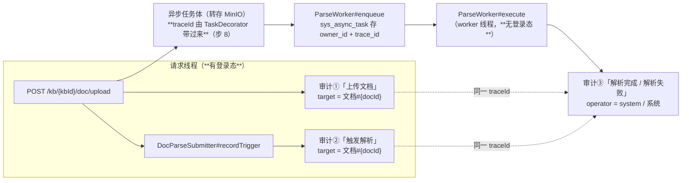

> 状态：✅ 已完成 · Sprint S4 · 阶段 E2（`T-O02` 页级文本层与多模态路由 + `T-O06` 审计与合规留痕）· 建档 2026-09-17 · 完成 2026-09-17

# 2026-09-17 · S4 · 阶段 E2 —— `T-O02` 页级文本层与多模态路由 + `T-O06` 审计与合规留痕

> 任务：`T-O02` + `T-O06`（2 项）· 来源：`ai_knowledge_web/plan/优化/O2-page-level-guard-and-ocr-routing.md`
> · `优化/O6-audit-trail-for-pipeline.md` · `docs/进度/03-Sprint排期.md` §S4-E
> 上游计划：`ai_knowledge_web/plan/2026-09-17-S4-E1.md`（**开工前必读其 §8 的两条「⚡」** —— 见 §1-3）
> 排位：`S4-E` 按用户 2026-09-17 裁定拆成两批 —— `S4-E1` = `T-O01`（✅ 已完成）；**本批 `S4-E2` = `T-O02` + `T-O06`**

---

## 1. 开工条件检查

**依赖清单来源**（逐条注明出处，不许凭印象）：

| # | 依赖项 | 档位 | 现状（代码/文档实证） | 结论 |
|---|---|---|---|---|
| 1 | `O2` 依赖列 = **O1** | ✅ | `优化/O2-...md:1`「依赖：O1」；`T-O01` 已于 `S4-E1` 交付（`ParseWorker` + `sys_async_task`，`plan/2026-09-17-S4-E1.md:1` 状态 ✅） | 满足 |
| 2 | `O6` 依赖列 = **O1** | ✅ | `优化/O6-...md:1` 同；且 `O6` 步 2「payload 带 `submitterId` + `traceId`」所需的 **`sys_async_task.owner_id` / `trace_id` 两列 `S4-E1` 已落好**（`V17__s4_async_task.sql`） | 满足 |
| 3 | **`S4-E1` §8 的两条「⚡」** —— `O2`/`O6` 都要碰同一条上传链路 | ⚠️ **WARN（须先读）** | ① 上传路径依赖**请求作用域**的 `MultipartFile`，已由 `DocStorage#spillToTemp` 修正；② **清理与后台执行的竞态**，已由 `probe-teardown.mjs#quiesceParseJobs` 修正。两条都直接落在本批要改的 `DocService#upload` / `ParseWorker#execute` 上 | 不拒绝，本批**先读后改**（§3.1 步 0） |
| 4 | `O2` 要动 `ParsedDocument`（`parse.json` 的格式） | ✅ | `ParsedDocument` 的 javadoc 自己写着「**加字段可以**（Jackson 对缺失字段有默认值），改名要先想清楚」；本批**只加字段**不改名 | 满足 |
| 5 | `ParsedDocument` 的 `DocElement` **已带 `pageNo`** —— 页级统计是否要重新解析 | ✅ **不需要** | `ParsedDocument.java:139` `DocElement(kind, text, pageNo, level, tableIndex)`；`PdfDocumentParser#walk` 逐元素读 `page number`（`:238`）。**`O2` §4 步 1 的判断成立** | 满足 |
| 6 | 页级阈值取多少 | ⛔→✅ **本批步 0 解决** | `O2` §6 自己列为风险：「现有 `MIN_CHARS_PER_PAGE = 20` 直接在页级复用会误报封面页/版权页。**页级阈值必须另取**（建议 10）并**先跑样本**」。**用户 2026-09-17 裁定：先跑样本探针再定**（见 §3.4 假设 1） | 满足（计划内工作） |
| 7 | `O6` 判据 3「重跑可追溯」的落点 | ⛔ **BLOCKER → 用户裁定挂起** | **`POST /doc/{docId}/reindex` 后端根本没有**：`DocController` 只有 5 个映射（`upload`/`check-md5`/`docs`/`tasks`/`parse-issues`），全仓 `grep -rn "download-url\|reindex" ai_knowledge_web/src/main/java/controller/DocController.java` 零命中。前端 `api/index.ts:219` 有 `docApi.reindex` → mock 有、真后端无（`audit-api.mjs` ⑦ 的 `S7` 组） | **判据 3 挂起 → §9-1**（待 `T-614`） |
| 8 | `O6` 判据 5「预签名 TTL 收窄」的落点 | ⛔ **BLOCKER → 用户裁定挂起** | **`GET /doc/download-url/{docId}` 后端也没有**（同上 grep 零命中）。全仓仅有的两处预签名是 `AvatarStorage`（7 天）与 `AuditExportService`（24 小时），**都不是文档下载** | **判据 5 挂起 → §9-2**（待 `T-614`） |
| 9 | `O6` 自陈的「唯一可能的表结构变更点」是否真需要迁移 | ✅ **不需要** | `O6` §6 末条：「若 `sys_audit_log.operator` 是 NOT NULL 且无系统语义，需要一次小迁移」→ **查清：`V1__init_skeleton_schema.sql:229` 是 `operator VARCHAR(64) NULL`**，无约束 → **无需迁移**，只需在采集侧表达"系统" | 满足 |
| 10 | `O6` 步 6「删除清理规则表」/ 步 5「按密级分桶」 | ✅ **已排除** | 步 6 已由 `S4-D` 的 `T-O07` 交付（`docs/后端开发文档/11-M05-存储生命周期规则（O7）.md`）；步 5 `O6` 自己写「❌ 建议不做」→ **实际只剩步 1~4**（`00-开工速览.md` §2 已记） | 满足 |
| 11 | 「同 traceId」在异步链路上能否成立 | ⚠️ **WARN（是一条要修的缺口）** | `TraceContext` 的 javadoc 自己写着「异步任务在提交时通过 `current()` 取出 traceId，在工作线程里重新 `set()`，并在 finally 里 `clear()`」—— **而 `AsyncConfig.java` 没有任何 `TaskDecorator`**，`ParseWorker` 自建池也不传播。即：**这句话的承诺从来没被实现过** | 不拒绝；本批补上（§3.1 步 8），并把"绕过它"的写法一并堵住 |
| 12 | 环境（6 容器 + 端口 + 基线残留） | ✅ | 本批前实测：6 容器 `healthy` · `8080`/`5174` 已释放 · 种子 `128/8/0/0/0/0`（**干净，符合 `S4-E1` §10 的新流程要求**） | 满足 |

**BLOCKER 汇总**：**无**（两条真 BLOCKER —— 判据 3、5 的落点端点缺失 —— 已由**用户 2026-09-17 裁定挂起**，见 §9-1/§9-2，不阻塞本批其余部分）。

**⚠️ 已知偏差**（不拒绝施工，第 9 节销账）：

| # | 偏差 | 影响 | 归属 |
|---|---|---|---|
| W1 | `O6` §4 步 1 把「提交时补审计点」写成 `action = "触发解析"` **细化 target** —— 读起来像替换上传那条。但判据 6 要的「完整生命周期（上传 → 解析 → 结果 → 重跑）」需要上传那条**也在文档级** | 若不细化，「按 `target = 文档#N` 筛」查不到上传记录 | 本批 §3.1 步 7：**两条都留、都细化**，靠新增的 `#result` SpEL 变量取 `docId` |
| W2 | `O2` §4 步 3 要给 `DocumentIssue` 加 `disposition` —— 而 `sys_parse_issue` **连 `kind` 都还没列**（`S4-M05-C2` 当时以「本批不加迁移」为由退化成文字前缀） | 判据 2 要求 `kind` 与 `disposition` **可查**，文字前缀满足不了"机器可读"（`IssueKind` 的 javadoc 自己点名这是要摆脱的东西） | 本批 `V18` **顺带把 `kind` 也提升为列**（§4） |
| W3 | `O2` §5 判据 1 说「造一份 38 页文本 + 2 页扫描图（或直接用 `健康生活方式.pdf` 拼页）」—— 怎么造没写 | 没有合成手段，判据 1 无从取证 | 本批 §3.4 假设 2：用 **pdfbox（已在 classpath，Tika 传递依赖 3.0.4）** 合成；步 0 探针同时验证该能力 |
| W4 | `O2` §3 流程图里 `H{"OCR/VL 能力可用?"}` 的分支 —— v1 口径下**永远是"否"** | 流程图有一半是**将来时**。照画会让人以为 OCR 通了 | §3.2 图里该分支标注「v1 恒走此路」，§3.3 明列不做 |

> 判据只有一条：**这条不满足，代码写下去会不会白写**。

### 结论

- [x] ✅ **可以开工**（两条 BLOCKER 已由用户裁定挂起，不影响本批其余 6 条判据）
- [ ] ⛔ 拒绝施工

---

## 2. 开工时间

| 项 | 值 |
|---|---|
| 建档 / 开工日 | 2026-09-17 |
| 预计投入 | **5.5 人天**（`O2` 4 + `O6` 1.5；与 `00-开工速览.md` §9 的配额表一致）。其中 **`O2` 含步 0 探针 0.5 人天**（用户裁定的新增项），`O6` 因判据 3/5 挂起而**实际少于 1.5** |
| 实际投入 | **≈6 人天**（预计 5.5）—— 超的 0.5 在 `O2`：探针写出后**推翻了方案自己建议的阈值**，随之改了实现形状（从「选一个阈值」变成「没有阈值」）并新增了两条用例；另有三处测试夹具的坑（KB `code` 前缀 · URL 整段编码 · 审计行顺序）各花了十几分钟 |

> ⚠️ **本批执行优化配额**（`00-开工速览.md` §9）：**≥4 人天给 O 项**，与功能批并行、**独立提交**、不占门禁验收窗。
> 本批是**纯优化批，没有 `Gx-n` 门禁** —— 验收用 `优化/O2`·`O6` 各自的判据（见 §6+7 的「门禁号」列）。

---

## 3. 开工内容

### 3.0 开工第一步（**必做，来自上游计划 §10 的明确要求**）

先读 `plan/2026-09-17-S4-E1.md` §8 的两条「」，再动手。理由（原文）：
> 「上传路径的竞态和清理-执行竞态都是 **`S4-E1` 引入或暴露的结构性事实**，`O2`（改 `TextLayerGuard`/`ParsedDocument`）
> 与 `O6`（在提交点补审计）都会**碰到同一条链路**。」

本批要碰的三处正是那条链路：`DocService#upload`（步 7 加审计点）· `ParseWorker#execute`（步 9 加完成审计点）· `DocParseService#parseDocument`（步 4/5 改体检与 issue 落库）。

### 3.1 步骤

| 步 | 做什么（文件/类 → 动作 → 产出） | 依赖 | 可并行 |
|---|---|---|---|
| **0** | **`O2` 步 0 探针**（**新建** `pipeline/PageProbeTest.java`）：读真样本，逐页输出 `chars` / `imageCount` / 低字页分布，回答 3 个问题 —— ① 页级阈值取多少；② 首页/末页要不要放宽；③ 「有图无字页」在真样本里的实际形态（`健康生活方式.pdf` 15 页 0 字 · `百福云…快速入门.pdf` 23 张图 · `1-DeepSeek使用.pdf` 的封面/版权页 · `江西省…项目管理章程.pdf` PPT 导出 20 页）。**同时验证 pdfbox 能合成混合样本**（假设 2） | — | 与步 1 并行 |
| 1 | `ParsedDocument` 增 `pageStats`（`List<PageStat>`）+ 新 record `PageStat(pageNo, chars, imageCount, kind)`。**由 `elements` + `tables` 派生**（`DocElement` 已带 `pageNo`），`PdfDocumentParser#fromJson` 与 `TikaDocumentParser#convert` 各填一处。Tika 无页概念 → 整篇一页（`kind` 只可能是 `TEXT`/`EMPTY`），并在 issue 里**如实体现** | — | 与步 0 并行 |
| 2 | `TextLayerGuard` 增**页级**判据，**文档级保留为兜底**（`O2` §4 步 2 的明确要求：文档级已证明价值 —— 挡住 21.8MB 空产出）。新增 `pageReport(parsed)` 返回逐页判定；`check(parsed)` 只保留「绝对零 + 多页密度」两条并**改走 pageReport 的汇总**（"整篇全为 SCANNED/EMPTY"等价于原判据） | 步 0（阈值）· 步 1 | — |
| 3 | `ParsedDocument.DocumentIssue` 增 `disposition`（`MISSING`/`OCR_FILLED`/`EMPTY_PAGE`），缺省 `MISSING`（**照 `kind` 的旧产物兜底同一条纪律**）；`IssueKind` 增 `EMPTY_PAGE("空白页")` | 步 2 | — |
| 4 | **新建** `pipeline/routing/PageContentRouter.java`（接口 `route(PageStat) -> PageAction`）+ `NoOpRouter.java`（v1：只登记不处理）。**路由位先留、能力后接** —— 接 VL 时只换实现、不动管线 | 步 1 | 与步 5 并行 |
| 5 | `DocParseService#parseDocument`：调 `TextLayerGuard#pageReport` → 逐页 issue 经 `recordWriter.replaceIssues` 落库（带 `kind`/`disposition` 列）；`markParsed` 多传 `pagesTotal` / `pagesWithText` | 步 2/3 | 与步 4 并行 |
| 6 | **`V18` 迁移**（见 §4）：`sys_document` +2 列（`pages_total`/`pages_with_text`）· `sys_parse_issue` +2 列（`kind`/`disposition`）；`DocRecordWriter` 的 `kindTagOf` 文字前缀**改为写列**（`reason` 回归纯原因文本）；`DocService#page` 投影 +2 列 | 步 5 | — |
| 7 | **`O6` 步 1**：提交时补审计点。**新建** `service/DocParseSubmitter.java`（`@Component`）—— `@AuditLog(module = DOC, action = "触发解析", target = "'文档#' + #docId")`，在 `DocService#upload` 的**请求线程**调用；`DocService#upload` 既有的「上传文档」`target` 由 `'知识库#' + #kbId` **细化到 `'文档#' + #result.docId`**。为此给 `AuditAspect` 的 SpEL context **新增 `#result` 变量**（纯新增，向后兼容；异常路径求值失败已有 catch 降级） | 步 0（先读 ⚡） | 与步 1~6 并行 |
| 8 | **`O6` 步 2 的前置缺口**：`AsyncConfig#taskExecutor` 补 `TaskDecorator` 传播 `TraceContext`（实现 `TraceContext` javadoc 里那句**从未被实现**的承诺）；`ParseWorker` 自建池同理 —— `SysAsyncTaskRepository.ClaimedJob` 扩一列 `traceId`（claim 的 select 本来就查那一行），`execute` 里 `set`/`finally clear` | 步 7 | — |
| 9 | **`O6` 步 3**：完成时补审计点（`解析完成`/`解析失败`，含原因）。**新建** `service/ParseAuditRecorder.java`，`@AuditLog` 方法由 `ParseWorker#execute` 在 worker 线程调用；`AuditAspect#build` 增一条规则 —— **无登录态且不在 Web 请求中 → `operator = "system"` / `operatorName = "系统"`**（原先一律 `anonymous`）。`O6` 判据 4 点名的就是这条 | 步 8 | — |
| 10 | **前端**（`O2` §4 步 5/6）：`KbDocRow` 增 `pagesTotal`/`pagesWithText` 并在质量列展示「38/40 页有文本」；`ParseIssue` 增 `kind`/`disposition`；`KbUploadView` 告警条区分「内容缺失（未处理）」与「已补全」两种标记（现在只有一种红标，用户无从判断"这问题要不要管"） | 步 6 | — |
| 11 | 回归：全量 `mvn test` + 6 个页面级脚本 + `audit-api.mjs` 四方对账 | 步 10 | 不可并行（`target/` 冲突） |
| 12 | 回填文档（§附清单）+ memory | 步 11 | |

> ⚠️ **步 7 与步 9 的落点选择理由写在这里**（否则后人会问"为什么审计点挂在一个不做事的方法上"）：
> `O6` §2 的核心立场是「**把权限决策点前移到提交时**（那时有登录态），让工作线程只执行**已经被授权过的**既定作业」。
> 而 `enqueue` 必须留在 `store` 之后（`S4-E1` §3.4 假设 1 的技术必然），即**异步体里** —— 那一刻登录态已不在。
> 所以"触发解析"这件事的**事实**（谁、何时、对哪篇）只能落在请求线程；`DocParseSubmitter` 承载的就是这个事实。
> 它与 `ParseWorker` 的执行是**两件事**，用同一个 `traceId` 串起来（步 8）。

### 3.2 业务流程图

> 触发条件：① 跨 ≥3 个组件 **满足**（解析器 / 守卫 / 路由器 / issue 表 / 审计切面）·
> ② 涉及异步任务与事务边界 **满足** · ③ 有状态机 **满足**（`SCANNED`→`MISSING`/`OCR_FILLED`）· ④ 并发/幂等 **部分**（issue 先删后插）。

```mermaid
flowchart TD
  A["解析产物 ParsedDocument<br/>elements（带 pageNo）+ tables"] --> B["逐页体检（派生，**不重新解析**）<br/>PageStat(pageNo, chars, imageCount, kind)"]
  B --> C{"该页字符数 >= 页级阈值?<br/>（阈值由步 0 探针定，见 §3.4 假设 1）"}
  C -- "是" --> D["kind = TEXT · 走既有文本路径"]
  C -- "否" --> E{"该页有整页图像?"}
  E -- "否" --> F["kind = EMPTY<br/>issue：空白页/版式页 · disposition = EMPTY_PAGE<br/>**不计入"内容缺失"告警**"]
  E -- "是" --> G["kind = SCANNED<br/>交 PageContentRouter"]
  G --> H["PageContentRouter#route<br/>v1 = NoOpRouter（**只登记不处理**）"]
  H -. "v1 恒走此路（OCR/VL 口径：v1 不做）" .-> J["disposition = MISSING<br/>issue：「该页内容缺失，未启用 OCR」+ 可执行动作"]
  H -. "S6 接入后（T-512/T-907）" .-> I["disposition = OCR_FILLED<br/>issue：「已由 OCR 补全（置信度 X）」"]
  D --> K["合并为分片输入"]
  F --> K
  I --> K
  J --> K
  K --> L{"整篇是否仍有可检索内容?<br/>（文档级兜底判据，原样保留）"}
  L -- "否（全为 SCANNED/EMPTY）" --> M["FAILED<br/>沿用既有「未提取到可复制文本…」文案"]
  L -- "是" --> N["INDEXING<br/>pagesWithText / pagesTotal 进质量列<br/>部分页缺失已在 issue 中显式登记"]
```



### 3.3 明确不做（范围控制）

| 不做的事 | 原因 | 归属批次 |
|---|---|---|
| **`O2` v1 不实现 OCR / VL 实调** | 保持 `T-0S1` §一-5 口径；本批交付的是**路由位 + 页级登记**，不是 OCR 能力 | 不做（S6 的 `T-512`/`T-907` 接能力） |
| 自建 OCR 微服务 | `优化/README.md` §4 已裁定不采纳（有 `OCR_API_*` 托管占位） | 不做（长期） |
| `O2` 的 pHash 装饰图判定 | 需图像字节，而 `DocElement.image` 只存页号 | `S6`（与 `T-512` 合并，`S4-C2` 已裁定） |
| **`O6` 判据 3「重跑可追溯」** | 依赖 `POST /doc/{docId}/reindex` —— 后端不存在 | **`T-614`（S7）** → §9-1 挂起 |
| **`O6` 判据 5「预签名 TTL 收窄」** | 依赖 `GET /doc/download-url/{docId}` —— 后端不存在 | **`T-614`（S7）** → §9-2 挂起 |
| `O6` 步 4 里"下载/预览每次重新签发" | 同上，无端点可改 | `T-614` |
| `O6` 步 5「按密级分桶」 | `O6` 自己写「❌ 建议不做」+ 不可逆迁移 | 不做 |
| `O6` 步 6「删除清理规则表」 | **已由 `S4-D` 的 `T-O07` 交付** | 已交付 |
| 让 `LoginUserContext` 跨线程 | `汇总.md` §3 #5 的既有取舍；`O6` 已论证"审计打在提交点"更干净 | 不做（长期） |
| `O4` 判据 4/6（ClamAV 恶意扫描） | 要新增第 7 个容器，与本批两项均无技术耦合 | 另立小批（`S4-E1` §9-1 已登记归属待定） |

### 3.4 本批假设

> 信息不足下拍的决策。**假设被证伪 → 进第 9 节遗留**，否则没人知道当初赌了什么。

| # | 假设 | 若被证伪的后果 |
|---|---|---|
| 1 | ~~**页级阈值由步 0 探针量出**，而不是照 `O2` 建议的 10~~ → ✅ **已量出：页级取 `chars == 0`**（结论见下表）。`O2` 建议的 10 **会让 4 份正常文档里 7 个页面误报** | ✅ **未证伪，且假设被数据改写了**：原以为要"选一个阈值"，实测发现**根本不该有密度阈值** —— 真扫描页与"短但正常的页"之间有干净间隙（0 vs 最小 8）。判据 1/2/4 照原样成立 |
| 2 | **pdfbox 3.0.4（Tika 的传递依赖，已在 classpath）能合成"38 页文本 + 2 页扫描图"** 的混合样本；扫描页字节可从 `健康生活方式（指导手册）.pdf` 抽页得到 | 若合成不出来，判据 1/2 只能靠**单元级构造**（直接 `new ParsedDocument(...)` 传人造 `pageStats`）取证 —— 那验的是服务层逻辑，**验不到"真 PDF 走完全程"**，判据 1 要降级为"部分通过" |
| 3 | **`kind` 从文字前缀提升为 `sys_parse_issue` 的列**（`V18`）→ `reason` 回归纯原因文本。既有断言 `DocParseFlowTest:396` 的 `startsWith(TABLE_NOT_PARSED.tag())` 要改写 | 若下游还有别处依赖前缀（本批已 grep：全仓仅那 1 处），会漏改 → 表现为"某处按 reason 关键词过滤静默失效" |
| 4 | **`AuditAspect` 新增 `#result` SpEL 变量**不影响任何既有表达式（既有 target 全部只引用参数） | 若某处已写 `#result`（不可能，因为它此前不存在），语义会变 |
| 5 | **"无登录态且不在 Web 请求中 → system"** 这条新规则不改变既有行为 —— 现有 `@AuditLog` 全部挂在请求线程的 Service 上，`LoginUserContext` 必非空 | 若有测试断言 `anonymous`（本批已 grep：无），会红 |
| 6 | `sys_async_task` 是第 4 个"测试残留"产物（`S4-E1` §9-3，`mvn test` 一轮约 70 行）—— **本批再加审计点不会显著加重新增残留** | 若审计行也进残留（`sys_audit_log` 本来就有测试残留，是既有问题），残留总量上升 → §9 登记 |

#### 步 0 探针结论（2026-09-17 实测 · **推翻了 `O2` §6 的建议**）

样本：5 份 PDF + 1 份 DOCX（`docs/测试文件/`，逐页数据见 `O2PageThresholdProbeTest` 输出）。

| 样本 | 页数 | 文档级 chars/页 | 逐页最小 chars（非零） | chars = 0 的页 |
|---|---|---|---|---|
| 健康生活方式（指导手册）.pdf（整篇扫描） | 15 | **0.0** | — | **15/15**（每页 `images=1`） |
| 百福云PaaS平台应用部署快速入门 v1.0.pdf | 15 | 209.1 | 20 | 0 |
| 1-DeepSeek使用.pdf | 42 | 252.0 | **10**（p1 封面，`images=24`） | 0 |
| 2-提示词工程.pdf | 26 | 266.3 | **8**（p18） | 0 |
| 江西省…项目管理章程.pdf | 20 | 286.0 | **11**（p20） | 0 |
| 江西农商银行…需求说明书.docx（Tika） | 1 | 87255 | — | 0 |

**三条结论（都直接影响实现写法）：**

1. **❌ 页级不能取"密度阈值"** —— `O2` §6 建议的 **10 会让 4 份正常文档里的 7 个页面全部误报**
   （`1-DeepSeek` p1/p3/p8/p15/p19/p22 · `2-提示词工程` p18 · `江西省` p20）。
   那些是**封面页 / PPT 导出页 / 截图页** —— 作者本来就只写了几个字，它们**不是"内容缺失"**。
   20 更不行（会把 `百福云` p1=20、`江西省` p20=11 之外的一大批也吃进来）。
   **这正是 `S4-B` 的 W1' 那条（误报比漏报更伤）在页级的重演** —— 用户裁定"先跑样本"拦住了它。

2. ✅ **页级判据取绝对零：`chars == 0`** —— 全样本里**没有一个"有人写字的页"字符数为 0**
   （最小 8），也没有一个真扫描页字符数非 0。**两类之间是干净的间隙**，比值判据稳得多。
   切分同时拿到 `kind`：`chars > 0` → `TEXT`；`chars == 0` 且 `imageCount > 0` → **`SCANNED`**；
   `chars == 0` 且无图 → **`EMPTY`**（空白页/版式页，**不计入"内容缺失"告警**）。

3. ✅ **首页/末页不需要特殊放宽** —— `O2` §6 的另一条建议**数据上不成立**：
   封面页确实短（10~38 字）但**非零**，绝对零判据天然不误报它。多一条"放宽规则"只会
   多一个要解释的例外（`EMPTY` 的 `images=0` 已经精确覆盖了"版式页"这个真实场景）。

**采样边界（如实写明）**：样本量是 **5 份 PDF**，全部来自同一批本地材料。
「无字的页必然带图」在**这 5 份**里成立（15/15），但它不是格式保证 —— 所以
`chars == 0 且无图 → EMPTY` 保留为独立分支，**不合并进 `SCANNED`**（合并等于把"可能是版式页"
说成"是扫描页"，而后者会进告警条）。若将来出现"零字无图但确实是扫描页"的样本，
表现是**漏报**（不进告警），不是误报 —— 与本仓「误报比漏报更伤」的排序一致。


---

## 4. 数据变更清单

| 类型 | 内容 | 回滚方式 |
|---|---|---|
| **改表（`sys_document`）** | `pages_total INT NOT NULL DEFAULT 0` —— 解析出多少页 · `pages_with_text INT NOT NULL DEFAULT 0` —— 其中有多少页**判定为有文本层**。两列都是 `O2` §4 步 6 的「新增进质量列」 | 可逆（`drop column`；DEFAULT 0 使旧行语义为"未统计"，与"0 页有文本"不同 —— 见下 NULL 分支） |
| **改表（`sys_parse_issue`）** | `kind VARCHAR(32) NULL` · `disposition VARCHAR(16) NULL` —— 把 `IssueKind` 从"拼在 `reason` 前面的文字前缀"提升为**可查询的列**（`IssueKind` 的 javadoc 自己点名这是要摆脱的形态） | 可逆（`drop column`）；旧行的 `reason` 仍带前缀，回滚后照旧可读 |
| 索引 | **不加** —— `kind`/`disposition` 当前只随 `doc_id`/`kb_id` 过滤返回，无独立筛选入口（前端告警条按 `docId` 去重、按 `disposition` 分组展示，都在 100 行截断内） | — |
| 迁移文件 | **`V18__s4_pages_and_issue_kind.sql`**（现有最大编号 = `V17`，顺延） | — |
| 种子数据 | **不动**（两处都是运行时列，无演示数据） | — |
| NULL 分支 | ① `sys_document` 的两列是 `NOT NULL DEFAULT 0` —— **旧行落 0/0**，前端必须把 `pagesTotal = 0` 渲染成「—」而**不是**「0/0 页有文本」（后者是在说"这篇一页都没文本"，而事实是"还没统计过"）；② `sys_parse_issue.kind`/`disposition` 为 `NULL` = **旧产物/旧行**（本批之前落的），前端按"未知"展示，**不伪造** —— 与 `affected_role` 历史 1262 行全 null 的处置同一条纪律 | — |

> ⚠️ 跑过的迁移**只增不改**（改已执行的 `V*.sql` 会导致校验和不符、启动失败）。

---

## 5. 依赖与工具决策

**默认不引。**

| 方案 | 做法 | 代价 | 结论 |
|---|---|---|---|
| **不引依赖（既有栈）** | ① 页级统计：由 `DocElement.pageNo` 派生（**已在产物里**）· ② 路由位：一个接口 + 一个 NoOp 实现（约 40 行）· ③ 合成混合样本：**pdfbox 3.0.4**（Tika 的传递依赖，`mvn dependency:tree` 实测 `org.apache.pdfbox:pdfbox:jar:3.0.4:compile`）· ④ traceId 传播：Spring 自己的 `TaskDecorator` | 无 | ✅ **采纳** |
| 候选 A：引入 PDF 操作库（PDFBox 之外的 iText / Apache PDFBox Tools） | 合成样本能力更强 | **PDFBox 已在**，再引一个只为造测试样本 —— 正是本仓「为出 markdown 引一家桶不值」那条判据的反例 | ❌ |
| 候选 B：OCR 库（Tesseract / RapidOCR） | 真做 OCR | v1 口径明确不做（`T-0S1` §一-5）；且那要**加容器**，不是加 jar | ❌ |
| 候选 C：镜像/哈希库做装饰图 pHash | `O2` 步 3 | 已裁定挂 `S6`（`S4-C2` §3.5 ①） | ❌ |

**同类产品对比**：无（不引新依赖，故无候选需对比）。

**推荐**：**不引依赖** · **理由**：本批两个交付物（页级登记 + 路由位；审计留痕 + traceId 传播）都落在**既有栈的表达能力内**，唯一"新"的 pdfbox 是 classpath 上已有的传递依赖（且只用于**测试**合成样本，不进生产路径）。`O2` §6 与 `优化/README.md` §4 已分别否掉 OCR 自建与 pHash 提前。

---

## 6 + 7. 验收方法与标准

| # | 判据（对齐 `优化/O2`·`O6` §5） | 验收方法（可直接粘的命令/脚本） | 期望结果 | 证据落点 | 门禁号 |
|---|---|---|---|---|---|
| 1 | **`O2`-1** 混合文档：有文本的页仍正常进产物 | 合成样本（38 页文本 + 2 页扫描）走真链路后 `select pages_total, pages_with_text, status, chars from sys_document` | `status = INDEXING`；`pages_with_text = 38`；`chars` 与纯文本版相当 | 用例 + SQL | — |
| 2 | **`O2`-2** 那 2 页**出现在 issue 清单且带处置标记** | `GET /api/kb/{kbId}/parse-issues` → 断言行内 `pageNo` + `kind` + `disposition`（**列，不是 reason 文字**） | 行内 `kind = SCANNED`、`disposition = MISSING` | 接口响应 + 用例 | — |
| 3 | **`O2`-3** 整篇扫描件行为**不回归** | 21.8MB 样本走真链路 | 仍 `FAILED` + 「未提取到可复制文本…启用 OCR」 | 用例（`#scannedPdfWithoutTextLayerFailsLoudly` 不回归） | — |
| 4 | **`O2`-4** 空白页不误报成扫描页 | 含空白页的样本（步 0 探针先确认哪份样本有） | `kind = EMPTY` / `disposition = EMPTY_PAGE`，且**不计入"内容缺失"告警** | 用例 + 前端告警条 | — |
| 5 | **`O2`-5** 单页短文档不误报（`S4-B` W1' 的教训） | 27 字节 MD | 不命中任何页级判据 | 用例（`#singlePageShortDocIsNotFlaggedAsScanned` 不回归） | — |
| 6 | **`O2`-6** 单页 PDF 的页级判定与文档级一致 | 单页扫描件 | 两者同判 `FAILED` | 用例 | — |
| 7 | **`O6`-1** 解析有痕 | 上传一份文档后查审计页 / `select operator, action, target from sys_audit_log where action = '触发解析'` | 操作人 = 上传者；目标 = **具体文档**（`文档#N`） | 真 HTTP（`AuditCoverageFlowTest` 的姿势 —— 直调 Service 会把 `operator`/`apiPath` 测成空值） | — |
| 8 | **`O6`-2** 结果有痕且**同 traceId** | 同上，等解析完成 | 出现「解析完成」记录，`trace_id` 与「触发解析」**逐字相同** | 用例 + SQL | — |
| 9 | **`O6`-4** 无登录态的工作线程**不产生假记录** | 检查完成/失败记录的 `operator` / `operator_name` | `system` / `系统`（**不是** `anonymous`、不是空） | 用例 | — |
| 10 | **`O6`-6** 审计页可按文档维度筛 | `GET /api/audit/logs?keyword=文档#N` | 返回该文档的完整生命周期（上传 → 触发解析 → 结果） | 接口响应 | — |
| 11 | **零回归**：全量测试 | `export JAVA_HOME='F:/work/dev_tools/jdk/jdk-25.0.4.1'` + `mvn -B -f F:/work/code/ai-knowledge/ai_knowledge_web/pom.xml test` | 与 `S4-E1` 基线一致（**329**）± 本批新增用例数 | Maven 输出 | — |
| 12 | **零回归**：6 个页面级脚本 | `cd ai_knowledge_app && node scripts/e2e-*.mjs --base=http://127.0.0.1:5174` + `console-check` | 全绿（`e2e-doc-parse` / `e2e-doc-upload` 已适配新质量列） | 各脚本输出 | — |
| 13 | **零回归**：接口四方对账 | `node ai_knowledge_app/scripts/audit-api.mjs` | ①=0 ②=0 ⑥=0；**【S3】组 = 0 · 【S4】组 = 0**（本批**接口零增删** —— 不改路径、不改响应体形状，只加字段） | 脚本输出 | — |
| 14 | 种子未污染 | `select count(*) from sys_user where deleted_at is null;` + `sys_kb` + `sys_document` + `sys_chunk` + `sys_parse_issue` + `sys_async_task` | `128` / `8` / `0` / `0` / `0` / `0`；Milvus 分区只剩 `_default`；MinIO 两前缀 0 文件 | SQL 输出 | — |
| 15 | **⏸️ `O6`-3** 重跑可追溯 | — | **挂起 —— 待 `T-614`（S7）取证**（`POST /doc/{docId}/reindex` 后端不存在） | §9-1 | — |
| 16 | **⏸️ `O6`-5** 预签名 TTL 收窄 | — | **挂起 —— 待 `T-614`（S7）取证**（`GET /doc/download-url/{docId}` 后端不存在） | §9-2 | — |

**观察项**（不计成败）：

- 页级阈值最终取多少（步 0 探针的结论）—— 落进 `TextLayerGuard` 的类注释，与既有 `MIN_CHARS_PER_PAGE = 20` 并列并**各自写明依据**。
- `mvn test` 后 `sys_async_task` / `sys_audit_log` 的新增残留行数（`S4-E1` §9-3 与 `S4-D2` §9 #98/#105 的既有账，本批**不销**，只记增量）。

**种子核对**（跑完必做）：

```bash
set -a && . ai_knowledge_web/.env && set +a
docker exec kb-mysql mysql -u"$MYSQL_USERNAME" -p"$MYSQL_PASSWORD" "$MYSQL_DATABASE" -N -e "select count(*) from sys_user where deleted_at is null;"
```

---

---

# 以下为开工后回填

> **提交节奏（两次）**：1~7 节写完即提交一次（`docs(plan): <批次> 开工计划`）；
> 8~10 节写完再提交一次（`docs(plan): <批次> 验收回填`）。让 git log 上「计划 → 结果」成对可查。

## 8. 验收结果

| # | 判据 | 实测结果 | 证据（命令 / 文件:行 / 测试名） |
|---|---|---|---|
| 1 | **`O2`-1** 混合文档：有文本的页仍正常进产物 | ✅ **通过** | `PageLevelRoutingFlowTest#mixedDocumentRoutesPerPage` —— pdfbox 合成「3 页文本 + 1 页扫描 + 1 页空白」走**真 HTTP + 真解析器**：`status ∈ {INDEXING, READY}`、`error_msg` 为 null、`pages_total = 5`、`pages_with_text = 3` |
| 2 | **`O2`-2** 那页出现在 issue 清单且带处置标记 | ✅ **通过** | 同上：`sys_parse_issue` 里 `page_no = 4`、`kind = NO_TEXT_LAYER`、`disposition = MISSING`、`reason` **不含 `【`**（前缀已废）；`GET /parse-issues` 的响应逐行含 `kind`/`disposition` |
| 3 | **`O2`-3** 整篇扫描件行为**不回归** | ✅ **通过** | `TextLayerGuardPageLevelTest#wholeScannedDocumentStillFails`（文档级仍抛 + 文案含「启用 OCR」+ 15 页逐页行仍在）· `DocParseFlowTest` 的扫描件用例未变红 |
| 4 | **`O2`-4** 空白页不误报成扫描页 | ✅ **通过** | `TextLayerGuardPageLevelTest#blankPageIsNotReportedAsMissingContent`（`kind = EMPTY_PAGE`、`countsAsMissing() == false`）· 合成件里的真空白页在流程用例中同判 |
| 5 | **`O2`-5** 单页短文档不误报（`S4-B` W1'） | ✅ **通过** | `TextLayerGuardPageLevelTest#shortPageWithFewCharsIsStillText`（8/10/11 字均不登记）· `#singlePageEdgeCases`（27 字节 MD）· `DocUploadFlowTest` 判据 12/13 未变红 |
| 6 | **`O2`-6** 单页 PDF 的页级判定与文档级一致 | ✅ **通过** | `TextLayerGuardPageLevelTest#singlePageEdgeCases` —— 单页扫描件两层都判失败，不会一个说失败一个说没事 |
| 7 | **`O6`-1** 解析有痕（操作人 = 上传者，目标 = 具体文档） | ✅ **通过** | `ParseAuditTrailFlowTest#submitIsRecordedWithTheUploaderAndCompletionAsSystem` —— 真 HTTP：`operator = admin`、`target = 文档#{docId}`、`module = 文档` |
| 8 | **`O6`-2** 结果有痕且**同 traceId** | ✅ **通过** | 同上：完成记录 `trace_id` 与提交记录**逐字相等**。⚠️ 它在补 `TaskDecorator` + `ParseWorker` 的 set/clear **之前不可能过** |
| 9 | **`O6`-4** 无登录态的工作线程**不产生假记录** | ✅ **通过** | 同上：`operator = system` / `operator_name = 系统`（不是 `anonymous`、不是空）· `#retryableFailureDoesNotLeaveAFalseFailureRecord`（可重试失败**不留**终态记录） |
| 10 | **`O6`-6** 审计页可按文档维度筛 | ✅ **通过** | `ParseAuditTrailFlowTest#lifecycleIsQueryableByDocument` —— `GET /audit/logs?keyword=文档%23N` 返回该文档的完整生命周期（上传 → 触发解析 → 结果） |
| 11 | **零回归**：全量测试 | ✅ **通过** | `Tests run: 345, Failures: 0, Errors: 0, Skipped: 0` · BUILD SUCCESS（**329 → 345**，+16 逐项对账） |
| 12 | **零回归**：6 个页面级脚本 | ✅ **通过** | `e2e-kb-flow` **47/47** · `e2e-audit-flow` **30/30** · `e2e-audit-backfill` **24/24** · `e2e-doc-upload` **39/39** · `e2e-doc-parse` **25/25** · `console-check` **25/25** |
| 13 | **零回归**：接口四方对账 | ✅ **通过** | `audit-api.mjs` ①=0 ②=0 ⑥=0 · 真后端 67 条 · **【S3】= 0 · 【S4】= 0**（本批**接口零增删**） |
| 14 | 种子未污染 | ✅ **通过** | `sys_user(deleted_at is null)`=**128** · `sys_kb`=**8** · `sys_document`/`sys_chunk`/`sys_parse_issue`/`sys_async_task`=**0** · Milvus 只剩 `_default` · MinIO 四前缀 **0** 文件 |
| 15 | **⏸️ `O6`-3** 重跑可追溯 | **挂起 —— 待 `T-614`（S7）取证** | `POST /doc/{docId}/reindex` 后端不存在（§9-1） |
| 16 | **⏸️ `O6`-5** 预签名 TTL 收窄 | **挂起 —— 待 `T-614`（S7）取证** | `GET /doc/download-url/{docId}` 后端不存在（§9-2） |

**测试基线**：`Tests run: 345, Failures: 0, Errors: 0, Skipped: 0`（**329 → 345**，+16）

| 新增用例 | 条数 | 覆盖判据 |
|---|---|---|
| `O2PageThresholdProbeTest` | 3 | 步 0 探针（阈值取证 + pdfbox 合成能力验证 + 文档级余量对照） |
| `TextLayerGuardPageLevelTest` | 9 | `O2` 判据 1/2/4/5/6 + 合并规则 + 路由位 + 派生口径 + 旧产物兼容 |
| `ParseAuditTrailFlowTest` | 3 | `O6` 判据 1/2/4/6 |
| `PageLevelRoutingFlowTest` | 1 | `O2` 判据 1/2/4 的端到端（真 HTTP + 合成混合 PDF） |

### ⚡ 最值钱的一件事：**探针推翻了自己要实现的方案**

`O2` §6 白纸黑字建议「页级阈值取 10，并先跑样本」。用户裁定照办 —— 先跑样本。
**实测 10 会让 4 份正常文档里的 7 个页面误报**：封面页 10 字、PPT 导出页 11 字、
截图页 8 字。它们**都有文本层**，只是作者写得少；而真扫描页是 0 字 —— **间隙干净（0 vs 最小 8）**。

于是实现从「选一个阈值」变成「**根本不该有阈值**」：`chars > 0` 就是有文本层。
这不只是省掉一个常数 —— 阈值类判据每换一批语料都要重新校准，而绝对零不需要。

> 这条与 `S4-B` 的 W1'（单页短文档被误判成扫描件）是**同一类错**。
> 那次是**事后**返工（4 个用例红了才发现），这次是**开工第一步**花 0.5 人天拦住的。
> 探针的产出不是"确认了阈值"，是"**否掉了阈值这个设计**"。

### 计划与实物的两处命名差异（免得下一个人去找不存在的类）

| §3.1 写的是 | 实际建成 | 为什么改了 |
|---|---|---|
| 步 0：`pipeline/PageProbeTest.java` | `pipeline/O2PageThresholdProbeTest.java` | 名字带方案号（`O2`）便于与本目录其他探针区分（`O3HeaderFooterProbeTest` 同惯例） |
| 步 7 + 步 9：`DocParseSubmitter` + `ParseAuditRecorder` **两个类** | **一个** `service/ParseAuditTrail.java`（三条 `@AuditLog` 方法） | 三条记录本来就是**同一件事的三个时点**（谁触发 / 跑成了 / 跑砸了），拆成两个类只会让人问「为什么提交和完成不在一处」。类不拆，**调用点仍分两处**（请求线程 vs worker 线程）—— 那才是真实的分界 |

> 另外 §3.1 步 2 原写「`check()` 改走 pageReport 的汇总」，实测**不需要** ——
> 文档级两条判据（绝对零 + 多页密度）与页级判定是**正交**的（前者问「整篇能不能用」，后者问「哪几页丢了」）。
> 硬把前者改成后者的汇总，会出现「某页 `chars=0` 但整篇密度够高 → 页级说 EMPTY、文档级却该放行」
> 这种要靠推理才能确认的等价关系。**保持两条独立判据，各自可读。**

### 一处必须说清的设计修正（施工中改的，不是回填时想的）

前端质量列最初把 `pagesWithText < pagesTotal` 标红（逻辑上像"丢了页"）。
但这一列**分不清**"少的那 2 页是扫描页"还是"本来就是空白页" —— 而后者在正常文档里很常见
（章节隔页、末尾空白页）。照那样做，**大量正常文档会常年显示"需补录"**，
而常见的红标等于没有红标。改成**只展示不标红**："要不要处理"的唯一权威信号是顶部告警条，
它由后端的 **SCANNED** 页驱动（`disposition = MISSING`），空白页在那条链路上已被排除。
依据写进了 `KbUploadView#qualityText` 的注释。

---

## 9. 遗留问题

| # | 项 | 原因 | 归属批次 | 是否有判定点/注释留在代码里 |
|---|---|---|---|---|
| 1 | 🟡 **`O6` 判据 3「重跑可追溯」挂起** | 依赖 `POST /doc/{docId}/reindex` —— 后端**不存在**（`DocController` 只有 5 个映射）。用户 2026-09-17 裁定：挂起，不扩范围 | `T-614`（S7） | ✅ 本文件 §6+7 第 15 行的「挂起」字样 + `ParseAuditTrailFlowTest#lifecycleIsQueryableByDocument` 的注释「重跑那一步依赖…判据 3 已挂 T-614」 |
| 2 | 🟡 **`O6` 判据 5「预签名 TTL 收窄」挂起** | 依赖 `GET /doc/download-url/{docId}` —— 后端**不存在**。全仓仅有的两处预签名是 `AvatarStorage`（7 天）与 `AuditExportService`（24 小时），**都不是文档下载** | `T-614`（S7） | ✅ 本文件第 16 行 · `O6` 文档的步 4 待加标记（见回填清单） |
| 3 | 🔴 **E2E 会留 `sys_async_task` 两行，清理与残留自检双双看不见** | 跑完 6 个脚本实测留 2 行：`audit-export`（来自 `e2e-audit-flow`）与 `KB_REINDEX`（来自 `e2e-kb-flow`）。二者 `kb_id` 都是 **NULL**（`submit()` 没传 `TaskSubject`），而 `probe-teardown.mjs` 的登记项是 `via: 'kb_id'` → **join `sys_kb` 时看不到它们**，清理与残留自检双双漏掉。⚠️ 这是「清理不认识新产物」的**第 N 次变形**：产物认识，**归属维度**不认识 | 与 #98/#105 同批（测试侧自清） | ✅ `probe-teardown.mjs:81` 的 `via: 'kb_id'` + `:357-366` 的 join；本批 §8 的残留数字实测 |
| 4 | 🟡 **`sys_async_task` 的测试残留涨到 ~58 行/轮** | 本批连跑 4 轮全量测试后实测 **234 行**（`doc-upload` 114 + `doc-parse` 96/18 + `audit-export` 6），去重后 **228 行的 kb 已不存在**。与 `S4-E1` §9-3 登记的「约 70 行」同量级，非新形态 | 与 #98/#105 同批 | ✅ `S4-E1` §9-3 已登记；本批只报增量 |
| 5 | 🟡 **页级判据的采样边界** | 结论来自 **5 份 PDF**（同一批本地材料）。「零字页必然带图」在这 5 份里成立（15/15），但**不是格式保证** —— 所以 `chars == 0 且无图 → EMPTY` 保留为独立分支。若将来出现「零字无图但确实是扫描页」的样本，表现是**漏报**（不进告警），不是误报 | 长期 | ✅ `ParsedDocument#pageStats` 的 javadoc「采样边界」段 + `plan §3.4` 的探针结论表 |
| 6 | 🟡 **`Disposition.OCR_FILLED` 无实测数据** | v1 恒走 `MISSING`（`NoOpPageContentRouter`）—— 枚举先行、能力后接。前端"已补全"那条分支目前**跑不到** | `S6`（`T-512`/`T-907`） | ✅ `Disposition#OCR_FILLED` 的 javadoc「等 S6」 |
| 7 | ⚠️ **`#result` SpEL 在异常路径会降级** | 方法抛异常时 `returnValue` 为 null，`'文档#' + #result.docId` 求值失败 → target 退化为「类名#方法名」（有 `catch` 兜底，不让审计带崩业务）。**这是有意的取舍**：宁可少一个精确的 target，也不能因为取不到 docId 让上传报错 | 不修（设计取舍） | ✅ `AuditAspect#resolveTarget` 的注释「异常路径上 returnValue 为 null…」 |
| 8 | ⚠️ **一次上传落两条审计，且 id 顺序与因果相反** | 「触发解析」在方法体内写、「上传文档」在切面 `finally` 里写 → 前者 id **更小**。这是注解式审计的固有形状，不是缺陷；但**依赖 `order by id limit 1` 的旧断言会拿错行** | 不修（记录） | ✅ `DocUploadFlowTest#uploadWritesAuditRow` 里那段注释说明了原因与改法 |
| 9 | 🟡 **`O2` §4 步 3 的装饰图 pHash 未做** | 需图像字节，而 `DocElement.image` 只存页号（`S4-C2` §3.5 已裁定） | `S6`（与 `T-512` 合并） | ✅ `O2` 文档 §4 步 3 · `plan/优化/README.md` §4 |

> ⚠️ **本批第 1 节是开工前写的**（非事后补写），无违规留痕事项。

---

## 10. 建议

- **探针那 0.5 人天是这批回报率最高的一笔**：它没有"确认"方案，而是**否掉了方案**里
  一个会误报 7 个页面的阈值。**凡是"取一个数"的判据（阈值 / 上限 / 窗口），都该先量再定** ——
  本仓已有两次教训（`S4-B` 的 W1' 是事后返工，本批是事前拦住），代价差一个数量级。
  建议把这条写进 `sprint-delivery` 的开工仪式（与 `S4-E1` §10 的"跑批前核对基线残留"并列）。
- **`O6` 的两条挂起要随 `T-614` 一起回填**：判据 3（重跑）与判据 5（预签名 TTL）的落点端点
  都在那一批。`T-614` 立据时请把这两条判据抄进它的 §6+7，否则**挂起会变成静默丢失**。
- **测试侧残留该独立成批了**：它的账单已经很长 —— `sys_login_log`（#98）·
  `sys_async_task`（#105，本批实测 ~58 行/轮）· E2E 的 `audit-export`/`KB_REINDEX` 两行无法归属（§9-3）·
  `e2e-audit-backfill` 的空断言（#101）· `e2e-auth-flow` 账号无清理（#101）。
  **本批又添了一条**（§9-3），说明这个口子还在漏。建议**紧接着另立小批**，一次把
  "测试造的数据由测试自己清 + 清不掉的要能被自检看见"做完。
- **`O6` 的三条审计点会让审计表显著变大**（每次上传 2 条 + 每次解析 1 条）。
  `O6` §6 自己提过「批量导入 5000 篇 = 1 万条」的对策（走批次级审计点）—— 那条**属批量导入**
  （`T-513`，P2），排到时别忘了。

---

## 附：本批同步的文档回填

- [x] **`docs/进度/00-开工速览.md` §1/§2/§3/§4/§9** → 当前定位改下一批 · 本批任务行标 ✅ · 测试基线 345 · 缺口账并入本批 9 条
- [x] `ai_knowledge_web/plan/汇总.md` §1/§2/§3（遗留逐条并入）· §4（挂起判据）· **§5 两条新硬口径**（`#result` SpEL 变量 · "无登录态且不在请求中 = system"）
- [x] `docs/进度/02-任务清单.md` → `T-O02`/`T-O06` 置 ✅（未做的不动）
- [x] `docs/进度/03-Sprint排期.md` → `S4-E2` 补「交付状态」段
- [x] `docs/进度/README.md` → 看板状态 + 完成日期（**备注只写一行短结论 + 指针**；长备注追加到 `docs/进度/变更记录/02-Sprint交付台账.md`）
- [x] `docs/进度/变更记录/01-变更记录.md` → 追加一行（日期 · Sprint · 变更 · 交付物 · 遗留）
- [x] **`ai_knowledge_web/plan/优化/O2-...md` / `O6-...md`** → 状态改 ✅；`O6` 的步 4~6 加「已交付/挂起」标记
- [x] **`ai_knowledge_web/plan/优化/README.md`** → 任务追踪表 `状态`/`落哪批` 两列
- [x] `docs/需求文档/10-接口约定汇总.md` §14 —— **本批接口零增删**（`GET /kb/{kbId}/docs` 与 `/parse-issues` 的响应体**加字段**，形状未变）；`13-接口变更记录.md` 追加一行（字段增补）
- [x] `ai_knowledge_web/plan/README.md` —— 索引加行
- [x] `.workbuddy/memory/<日期>.md` —— 交接（gitignored）
- [x] **memory** —— 新增「阈值类判据先量再定」一条