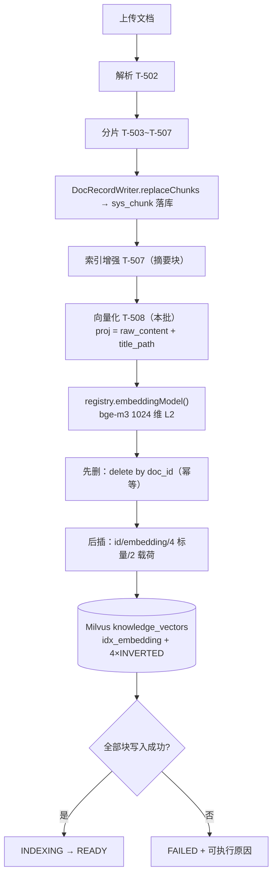

> 状态：✅ 已完成 · Sprint S4 · 阶段 C3（M05 向量化 + Milvus 写入）· 建档 2026-09-17 · 结项 2026-09-17

# 2026-09-17 · S4 · M05 · 阶段 C3 —— 分片向量化与 Milvus 落库（含 step 0：标量索引静默失效）

> 任务：`T-508`（1 项）· 来源：`docs/进度/03-Sprint排期.md` §Sprint 4
> 上游计划：`ai_knowledge_web/plan/2026-09-16-S4-M05-C2.md`（本批要销的账见第 1 节）
> 本批是 S4 出口的最后一块：`G4-10` 与 `G4-3` 后半句都卡在这里。

---

## 1. 开工条件检查

**依赖清单来源**（逐条注明出处，不许凭印象）：`00-开工速览.md` §1~§4 · `02-任务清单.md:292` 的「依赖」列 ·
`汇总.md` §3/§4 · 上一批（C2）§9/§10 · **开工前探针实测**（下表标注「实测」的行）。

### 1.1 依赖逐条判定

| # | 依赖项 | 档位 | 现状（代码/文档实证） | 结论 |
|---|---|---|---|---|
| 1 | **`T-010`** Milvus 建表（`T-508` 依赖列原文） | ✅ | 集合 `knowledge_vectors` **实测存在**：`POST /v2/vectordb/collections/describe` → 8 字段、`params.dim=1024`、`enableDynamicField=false`、`description="RAG 分片向量（单集合 + 标量过滤）"`；建表代码 `MilvusCollectionInitializer.createCollection():112-169` | 满足 |
| 2 | **`T-014`** 模型注册中心唯一构造点（依赖列原文） | ✅ | `core/ai/ModelClientRegistry.java:82` `embeddingModel()`（**无 id 重载 = D-4 的全局单例**）；`config/MilvusConfig.java:16-20` 写明「统一 v1 客户端」的理由正是 `MilvusVectorStore.builder(MilvusServiceClient, EmbeddingModel)` | 满足 |
| 3 | **嵌入模型可用**（依赖列没写，但是 `T-508` 的实质依赖） | ✅ **实测** | 真调 `POST {EMBEDDED_API_BASE_URL}/embeddings`：HTTP 200 · **1024 维** · **0.24s/次** · **批量 5 条一次返回 5 个向量（0.31s）**；`GET /models` 200 且列表含 `BAAI/bge-m3`；`.env` 的 `EMBEDDED_*` → `application.yml:213-216` 唯一来源 | 满足 |
| 4 | **分片产出侧**（`T-503`~`T-507`，本批的输入） | ✅ | `entity/SysChunk.java`（`V14`）+ `service/DocRecordWriter.replaceChunks():211` 已按 `D-5` 落库；`sys_chunk` 列**实测** 9 列齐备（`parent_id`/`title_path` 可空符合契约） | 满足 |
| 5 | **本批输入数据** | ⚠️ WARN | `sys_document` **0 行** / `sys_chunk` **0 行**（C2 收尾清干净了）→ 端到端取证前必须先上传解析一份样本；本地样本齐备（`docs/测试文件/` 8 份 PDF/DOCX，gitignored） | 满足（步骤依赖，见 §3.1 步 1） |
| 6 | 环境（docker 6 服务 / 端口 / 种子） | ✅ **实测** | `milvus-standalone` / `milvus-etcd` / `kb-mysql` / `kb-minio` / `kb-neo4j` / `kb-valkey` 六容器 healthy；种子 `sys_kb=8`；8080 未监听（后端没跑，施工时起） | 满足 |
| 7 | **标量索引**：代码声称建 INVERTED，实测根本没有 | ⚠️ WARN（本批 step 0 修） | 见 §1.2，**这是本批探针逮到的第一条真缺陷** | 不阻断写入；修 |

### 1.2 探针逮到的两件事（本批新增证据）

**① 真缺陷：`ensureScalarIndexes` 的守卫恒为真 → 4 个 INVERTED 标量索引从未创建过，且无任何日志**

- 代码：`core/storage/MilvusCollectionInitializer.ensureScalarIndexes():233-261`，守卫是
  `if (!describeIndexes(collection, field).isEmpty()) continue;`（`:240-242`，**静默路径，无日志**）。
- 实测：`describeIndexes` 返回的恒是**整个集合的索引列表**（`["idx_embedding"]`）——
  REST 同一现象可复现：`/v2/vectordb/indexes/list` 带 `fieldName=kb_id` 与不带**返回完全一样**，
  即 Milvus 侧忽略 `fieldName`。于是守卫恒非空 → 四个字段全部 `continue`。
- 后果实测：`POST /v2/vectordb/indexes/describe {"indexName":"idx_kb_id"}` → `{"code":700,"message":"index not found[indexName=idx_kb_id]"}`；
  启动日志里只有「向量索引已存在：[idx_embedding]」「集合已加载」，**标量索引一行都没有**。
- 配置侧排除：`MilvusProperties.scalarIndexEnabled` 默认 `true`、`application.yml:298` 也是 `true`
  —— 所以不是开关关掉了，是那条守卫把创建吞了。属《02》「**静默降级视为缺陷**」那一类，
  且症状最坏：**日志看上去一切正常**。
- 本批处置：**step 0 修**（§3.1）。此刻 `rowCount=0`（从未有任何向量），修它零数据风险。

**② 新环境坑：Git Bash 下 `curl -d` 内联非 ASCII payload 会被编坏（差点误报成假 BLOCKER）**

- 实测：`-d '{"input":["A-100 智能网关 单价 ￥1,200"]}'` → `{"code":20015,"message":"The parameter is invalid"}`（HTTP 400，**看着像模型不可用**）；
  同一份 JSON 写成文件走 `--data-binary @file` → **立即 200、1024 维**。
- 定性：Windows Git Bash 把内联中文按本地代码页丢进 argv，服务端收到非法 UTF-8。
- 规矩：**本批所有探针/取证脚本里带中文的 JSON 一律走文件**，并记入 §9（这是已知坑的第 N 个同族成员，
  与 C2 §9 #… 的 MSYS 路径改写同源）。

### 1.3 两处口径（**已按推荐读法落判据，待用户追认**）

- **口径 A · `G4-10` 的「标量字段只含 4 个」怎么读**：`G4-10` 字面写「标量字段只含
  `doc_id/kb_id/chunk_type/secret_level`」，但集合实际 8 列（另有 `content`、`title_path`）。
  本批取读法：**判据约束的是「建 INVERTED 索引的可过滤字段」= 那 4 个**；
  `content`/`title_path` 是**载荷列**（不参与过滤）。三条理由：
  ① 与 `MilvusCollectionInitializer.SCALAR_FILTER_FIELDS:66-70` 的 4 个字段**完全一致**，代码就是这么实现的；
  ② 与 `D-5`（`titlePath` 「既进 Milvus 标量又进索引期投影」）及 `SysChunk` 类 javadoc 相容；
  ③ `content` 是 M07 在 Milvus 内做 BM25 所必需（`T-700` 的混合检索）。
  ⚠️ **若按严格字面**，就得从 collection 删 `content`/`title_path` 两列 —— 那是**波及 M07 的设计变更**，
  与 `D-5` 直接冲突，不在本批范围；此刻删是零成本（无向量），但要用户先拍板。→ **§9 登记待追认**。
- **口径 B · 哪些块进向量**（本批按 `D-5`/`G4-5`/`G4-7` 定死，不留给施工期猜）：
  **进** = 正文 / 标题 / 列表 / 代码 + **表格子块（行式文本）** + 摘要块（`parent_id=null`，`D-5` §1.6）；
  **不进** = `TABLE` 父块（`G4-5`：父块不参与检索）、`IMAGE`（`T-512` 之前不产出块）。
  `raw_content` 是事实**永不改写**，喂嵌入的是**索引期投影**（`D-5` §1.7 / `O8`）。

### BLOCKER 汇总

**无。**

### ⚠️ 已知偏差（不拒绝施工，第 9 节销账）

1. 样本输入为空（#5）→ 用 §3.1 步 1 先补，属步骤依赖不属缺件。
2. 标量索引缺陷（#7）→ 本批 step 0 修。
3. 口径 A 待用户追认（§1.3）。
4. `sys_kb.chunk_count` 是否由 `sys_document` 派生（C2 §9 #8）—— 用户尚未答复，本批**不碰**。

### 结论

- [x] ✅ **可以开工**（无 BLOCKER）
- [ ] ⛔ 拒绝施工

---

## 2. 开工时间

| 项 | 值 |
|---|---|
| 建档 / 开工日 | 2026-09-17 |
| 预计投入 | **3 人天**（拆分依据：C2 §2 的 `O3`+`T-506`+`T-507` = 10 · `T-508` = 3 独立成批） |
| 实际投入 | **1 人天**（预计 3）—— 探针把两处原本要事后返工的东西提前暴露了 |

---

## 3. 开工内容

### 3.1 步骤

| 步 | 做什么（文件/类 → 动作 → 产出） | 依赖 | 可并行 |
|---|---|---|---|
| **0** | **修 `ensureScalarIndexes` 的恒真守卫** —— `core/storage/MilvusCollectionInitializer.java`：改为**按索引名判存在**（取整集合索引列表后比对 `idx_<field>`，而非按 fieldName 查）；「跳过 / 创建成功 / 被拒绝」三条路径**都留日志**。产出：4 个 INVERTED 索引真建出来（`idx_kb_id`/`idx_doc_id`/`idx_chunk_type`/`idx_secret_level`） | §1.2① | 否（先于 1） |
| **0.5** | **定型写入通道**（探针，**十几分钟的活，按 C2 §10 #1 的「先探针」默认动作**）—— 读 Spring AI 2.0.1 `MilvusVectorStore` 的 schema 能力：能否对准**已存在**的集合（`enableDynamicField=false` + 8 个显式列 + VarChar 主键 `autoID=false`）。**判据**：能 → 走 VectorStore（`MilvusConfig.java:16-20` 的既定意图，M07/M08 也走它）；不能 → 走裸 `MilvusServiceClient.insert`。**产出一句话结论 + 理由，写回 §8 与（如需）第 9 节** | #2 | 可与 0 并行 |
| **1** | **补一份真样本** —— 走既有链路 `POST /kb/{kbId}/doc/upload` 传 `docs/测试文件/1-DeepSeek使用.pdf`，轮询到 `INDEXING`；产出：`sys_chunk` 有块、`sys_document.chunk_count` 是真值（本批实跑的输入）。**优先挑含表格的样本**（表格子块是本批最该验的一类） | #5 | 否 |
| **2** | **向量化服务** —— 新增 `pipeline/vectorize/`（或 `service/`，按 0.5 结论定）：① 按 `docId` 取块（`sys_chunk` 按 `order_no`，**只取「口径 B」里的块**）；② **投影**：嵌入文本 = `raw_content` + `title_path`（纯函数，不改写事实）；③ 调 `registry.embeddingModel()`，**按批**（实测单批 5 条 0.31s，逐条是它的 N 倍） | 0.5, 1 | |
| **3** | **Milvus 写入 + 幂等** —— 同一 `docId` **先删后插**（`delete` 表达式 `doc_id in [...]`，与 `DocRecordWriter.replaceChunks()` 的「整批重写」同形），重跑不产生双份；写入字段 = `id`(=`chunk.id`) / `embedding` / 4 个过滤标量 / `content` / `title_path` | 2 | |
| **4** | **状态机收口** —— 向量**全部落库之后**才推进 `INDEXING → READY`（`G4-3` 后半）；失败 → `FAILED` + **可执行原因**（沿用 `DocRecordWriter.markFailed()`） | 3 | |
| **5** | **接进解析流水线** —— `service/DocParseService` 在 `chunk`（`replaceChunks`）与 `enhance` **之后**调向量化（顺序见 §3.4 假设 #1）；新增开关 `app.m05.vectorize.enabled`（默认 true） | 2,3,4 | |
| **6** | **门禁取证** —— `G4-10`（含 I-9 无标签字段）/ `G4-3` 后半 + §6+7 全表逐条 | 所有 | |
| **7** | **文档回填** —— 按 `00-开工速览.md` §8 的**七处**口径（含速览 §1~§4 本身） | | |

### 3.2 业务流程图

> 触发条件：① 跨 ≥3 个组件（`DocParseService` → 向量化 → Milvus → 任务状态）✅
> ③ 有状态机（`UPLOADED→PARSING→INDEXING→READY/FAILED`）✅ → **必须画**。



### 3.3 明确不做（范围控制）

| 不做的事 | 原因 | 归属批次 |
|---|---|---|
| **HyQ 分片级生成**（`D-5` §1.6 的 n 次调用） | `D-5` **没给 HyQ 块任何回指源块的字段**，而 `G4-6` 的 SQL 断言（已收口）要求「凡有 `parent_id` 的块父块必须是 `TABLE`」—— 最自然的路是封死的；且**向量一旦生成，事后补等于全库重建**（用户 2026-09-16 已定的方向，C2 §9 #2 / §10 #2） | **S5**（与 `T-700` 合并） |
| **装饰图判定 / 图片向量化 / `T-512`** | 图片本批不进索引；缺最强 pHash；无正向样本 | **S6**（与 `T-512` 合并） |
| **语义切分** | 需要句子级嵌入；`ChunkingService.chunk():61-65` 已**显式失败**（不静默降级），维持现状 | `O` 系列待定 |
| **重建索引 / `DELETE /kb/{id}`（`T-406`/`T-407`）** | 不在 `T-508` 范围；连带 S3 的 `G3-4`/`G3-5`/`G3-6`/`G3-7`「删除」类/`G3-8` 运行时半边**继续挂起** | **S4 后续批**（M05 之后） |
| **去重与成本控制（`O9`）** | C2 §10 #3 建议上调优先级；但属独立优化项（增强/向量化的调用成本与节流） | `O9` |
| **`sys_kb.chunk_count` 派生口径** | C2 §9 #8 用户尚未答复 | 待定 |
| **`sys_document` 加"已向量化"列** | 不需要：Milvus 主键 = `chunk.id`（建表注释「分片 id，与 MySQL chunk.id 同值」），文档级 `READY` 已表达"可检索" | — |

### 3.4 本批假设

> 信息不足下拍的决策。**假设被证伪 → 进第 9 节遗留**。

| # | 假设 | 若被证伪的后果 |
|---|---|---|
| 1 | **向量化接在 `enhance` 之后**（摘要块也必须被向量化 —— 它是要被检索的内容） | 若接在之前，摘要块永远无向量；改回来 = **全库重建**。**施工第一步就要把这个顺序定死**（与 C2 §10 #2 同源） |
| 2 | 嵌入 API 的**批量上限**足够容纳单文档最大块数（实测 5 条 OK；单文档块数可能上百） | 退化为分批（如 20 条/批）；`O9` 的成本口径要重估；判据 7 的"调用次数 ≪ N"要改写 |
| 3 | Spring AI `MilvusVectorStore` 能对准已存在 schema（或可退到裸 insert） | ✅ **已被步 0.5 探针证伪** → 走候选 2；`MilvusConfig` javadoc 已订正；检索侧口径登记 §9 |
| 4 | 每个块的 Milvus 主键取 `chunk.id` 的字符串形式（与建表注释一致），不另造 id | 若需另造 id，就要在 `sys_chunk` 加列 → 触发迁移，且"重跑幂等"的删法要跟着改 |

---

## 4. 数据变更清单

| 类型 | 内容 | 回滚方式 |
|---|---|---|
| 新建表 / 改表 | **无**。`sys_chunk` 是 `V14` 按 `D-5` **完整字段集**建的（C2 §9 的"契约先行省下一次迁移"在此第二次生效）；本批不需要"向量已写"列（见 §3.3） | — |
| 迁移文件 | **无**（下一个编号仍为 **`V15`**，留给 `T-406`/`T-407` 的重建任务表） | — |
| 种子数据 | **无**变更（`sys_kb=8` 保持；本批真跑产生的 `sys_document`/`sys_chunk`/MinIO 对象/E2E 探针，收尾必须清回 0） | — |
| NULL 分支 | `title_path` 可空（封面段、无标题文档）→ 投影时按**空串**处理，**不写 `"null"` 字面量**进去；`parent_id` 可空（顶层块）与向量化无关 | — |
| **配置项** | 新增 `app.m05.vectorize.enabled`（默认 `true`；测试期关，沿用 `app.m05.enhance.enabled` 的同一条理由：一处真实外部副作用会让跑批结果取决于外部状态） | 改配置即可 |
| **Milvus 侧（本批唯一的存储变更）** | 新增 **4 个 INVERTED 标量索引**（`idx_kb_id`/`idx_doc_id`/`idx_chunk_type`/`idx_secret_level`，step 0）；**字段集不变**（仍是 8 列）；写入的数据：`rowCount` 从 **0** 起算 | `drop index` 可逆；**数据侧无存量可回滚**（此刻 0 向量） |

> 跑过的迁移**只增不改**（改已执行的 `V*.sql` 会导致校验和不符、启动失败）。本批不动任何迁移。

---

## 5. 依赖与工具决策

**默认不引**。本批**不新增任何 Maven 依赖** —— 候选都在既有栈内：

| 方案 | 做法 | 代价 | 结论 |
|---|---|---|---|
| **不引依赖 · 候选 1**：Spring AI `MilvusVectorStore` | `MilvusVectorStore.builder(milvusServiceClient, embeddingModel())` + `add(documents)` / `delete(expr)` | 需确认能对准**已存在**集合的 8 个显式列与 `autoID=false`；对不准则要写自定义 schema | **倾向推荐**（待步 0.5 探针结论） |
| **不引依赖 · 候选 2**：裸 `MilvusServiceClient.insert` | 手拼 `InsertParam` + 8 个 `FieldData`，一次 `insert`；删除用 `DeleteParam` + `doc_id in [...]` | 要手写字段装配（约几十行）；但**完全贴合既有 schema**，零协商成本 | 兜底方案 |
| 候选 A：换 `milvus-sdk-java` v2 fluent client | 用 v2 API | 与 `MilvusConfig.java:16-20` 的既定决策（**全项目统一 v1，避免两个连同一台 Milvus 的客户端**）直接冲突 | ❌ 不引 |

**同类产品对比**：本批只在既有两种通道间选，不涉及第三方库引入，故不适用。

**推荐**：**先探针（步 0.5）再定，默认倾向候选 1**。
**理由**：`MilvusConfig.java:16-20` 把"统一 v1 客户端"的**唯一理由**写成「M07 索引入库、M08 检索都要经 Spring AI 的
VectorStore」—— 本批是这条链路的**首个写入方**。若此处不走它，M07 得再写一套写入/删除路径，
两套并存的长期成本远大于现在多花的十几分钟探针。
**但**：若探针证明 VectorStore 与已存在 schema 不兼容，则改用候选 2，并把「VectorStore 只用于 M08 检索、
写入走裸 insert」这条**口径订正写进 `MilvusConfig` javadoc + §9** —— 不能留一句与实现不符的注释在那儿。

### ✅ 已定案（2026-09-17，步 0.5 探针当场给出）

**走候选 2（裸 `MilvusServiceClient.insert`）**。`javap` 实测 Spring AI 2.0.1 的
`MilvusVectorStore$Builder` 只提供**单列 metadata 映射**（`metadataFieldName`），表达不了
`kb_id`/`doc_id`/`chunk_type`/`secret_level` 四个独立标量列；而本集合 `enableDynamicField=false`。
→ 详见 §8「步 0.5」；`MilvusConfig` javadoc **已订正**；检索侧口径（M07/M08）登记 §9。

---

## 6 + 7. 验收方法与标准

> 判据表按硬口径**加「门禁号」列**（`汇总.md` §5：S3-D 定，S4 起照此办理）。
> 后端命令统一：`export JAVA_HOME='F:/work/dev_tools/jdk/jdk-25.0.4.1'` 后 `mvn -B -f F:/work/code/ai-knowledge/ai_knowledge_web/pom.xml test`。
> **Milvus 探针命令**（本批新增，REST v2 实测可用）：`curl -s -X POST http://127.0.0.1:19530/v2/vectordb/...`。

| # | 判据（门禁号） | 验收方法（可直接粘的命令/脚本） | 期望结果 | 证据落点 |
|---|---|---|---|---|
| 1 | **`G4-10`** 分片向量入 Milvus | **⚠️ 用 `entities/query` 的 `count(*)`，不要用 `get_stats` 的 `rowCount`**（见下方订正）：`printf '{"collectionName":"knowledge_vectors","filter":"doc_id == <id>","outputFields":["count(*)"]}' > /tmp/qc.json` 后 `curl -s -X POST http://127.0.0.1:19530/v2/vectordb/entities/query -H "Content-Type: application/json" --data-binary @/tmp/qc.json` | 条数 = 该文档**进向量的块数**（按 §1.3 口径 B：总块 − 表格父块） | 命令输出 → §8 |
| 2 | **`G4-10`** 过滤标量只含 4 个（I-9 无标签字段） | 同上传后 `POST /v2/vectordb/entities/query` 取一条，看返回字段集 | 只出现 `id`/`embedding`/`kb_id`/`doc_id`/`chunk_type`/`secret_level`/`content`/`title_path`；**无任何"标签/摘要/实体"类字段** | 命令输出 |
| 3 | **`G4-3` 后半** `INDEXING → READY` 可观测 | 轮询 `GET /doc/tasks/{taskId}` 打到终态（真 HTTP） | 向量落库**之后**才是 `READY`；此前不出现 | 测试方法名 + 日志 |
| 4 | **幂等**：重跑不产生双份向量 | 同一 `docId` 连跑两次向量化 → 再 `get_stats` | `rowCount` 与跑一次相同 | 用例名 |
| 5 | **进向量的块集正确**（口径 B） | SQL 数该 `doc_id` 的 `TABLE` 父块数；与 Milvus 里该 `doc_id` 的条数比 | 差 = `TABLE` 父块数（父块不进）；子块与摘要块**在** | 用例 + SQL 输出 |
| 6 | **投影口径**（`D-5` §1.7 / `O8`） | 单测：给定块 → 断言投影串 = `raw_content` + `title_path`；且跑完整轮后 `sys_chunk.raw_content` 与落库时**逐字节一致**（事实未被改写） | 相等 | 新增 `VectorizeProjectionTest` |
| 7 | **批量嵌入**（成本/时延） | 真库单文档 N 块，记录**调用次数**与总耗时 | 调用次数 ≪ N（分批）；总耗时**秒级**不是分钟级 | 日志 |
| 8 | **step 0 标量索引真的建出来了** | 四个字段各一次：`curl -s -X POST http://127.0.0.1:19530/v2/vectordb/indexes/describe -H "Content-Type: application/json" -d '{"collectionName":"knowledge_vectors","indexName":"idx_kb_id"}'` | 从 `{"code":700,"message":"index not found..."}` → `{"code":0,...}`；四个都要 | 命令输出（**本批开工会重跑同一命令做 before/after 对照**） |
| 9 | **失败必须可行动**（硬口径） | 构造一次嵌入失败（如临时改坏 `api-key`）走真 HTTP | 文档 `FAILED` + `error_msg` 含**现象 + 下一步动作**，不是"解析失败"四个字 | 用例 + 响应体 |
| 10 | **不回归** | `mvn -B test`（全量） | 全绿；基线 **274** → 本批 ? | surefire |
| 11 | **页面级** | `cd ai_knowledge_app && node scripts/e2e-doc-upload.mjs --base=http://127.0.0.1:5174`；`node scripts/e2e-doc-parse.mjs --base=http://127.0.0.1:5174` | 39/39 与 25/25 不回归 | 脚本输出 |
| 12 | **种子与残留归零** | 见下方核对块 + Milvus `get_stats` | `sys_document=0` / `sys_chunk=0` / Milvus `rowCount=0` / MinIO `documents/`+`parsed/`=0 / 探针计数 0 | 命令输出 |

### ⚠️ 判据 1 的口径订正（施工中实测发现，2026-09-17）

计划原写「用 `get_stats` 的 `rowCount`」。实测**不成立**：`get_stats` 只统计**已 flush（持久化）**
的数据，而本批已把 flush 移出写入路径（原因见下）—— 真跑时 `rowCount = 0`，
而**同一时刻** `entities/query` 查得到 **81 条**。若照原判据验收，会得出"向量没写进去"的**假失败**。
→ 判据改为按 `entities/query` 的 `count(*)` 判 —— 它才是"**能不能被检索到**"的口径，
而 `READY` 的语义正是"可被检索"（《03》§4.2），不是"已持久化"。

**为什么写入路径不再 flush**：Milvus 的 flush 有**速率限制**（实测报
`request is rejected by grpc RateLimiter middleware: rate limit exceeded[rate=0.1]`，即 **10 秒一次**）。
原先"每次写入后 flush"，5 条用例的测试跑了 **68 秒** —— SDK 内部重试把失败掩盖成"慢"而不是报错，
是最难查的那种形态。去掉后同一批用例 **6.7 秒**（10 倍），且数据照样查得到
（growing segment 未 flush 也可检索）。flush 只影响持久化与 compaction，不影响可检索性。

**观察项**（不计成败）：前端当前没有"已向量化 / 可检索"的独立展示位（`READY` 只影响列表状态徽标），
故 `READY` 的**页面可见性**只作观察，不作判据。

**种子核对**（跑完必做）：

```bash
set -a && . ai_knowledge_web/.env && set +a
docker exec kb-mysql mysql -u"$MYSQL_USERNAME" -p"$MYSQL_PASSWORD" "$MYSQL_DATABASE" -N -e \
  "select 'user',count(*) from sys_user where deleted_at is null union all
   select 'kb',count(*) from sys_kb union all
   select 'doc',count(*) from sys_document union all
   select 'chunk',count(*) from sys_chunk;"
curl -s -X POST http://127.0.0.1:19530/v2/vectordb/collections/get_stats \
  -H "Content-Type: application/json" -d '{"collectionName":"knowledge_vectors"}'
```

期望：`user=1`（或与开工时同一数）· `kb=8` · **`doc=0`** · **`chunk=0`** · Milvus **`rowCount=0`**。

---

---

# 以下为开工后回填

> **提交节奏（两次）**：1~7 节写完即提交一次（`docs(plan): S4-M05-C3 开工计划`）；
> 8~10 节写完再提交一次（`docs(plan): S4-M05-C3 验收回填`）。

## 8. 验收结果

> **施工中记录**（本批尚未结项；完整判据表在收尾时补齐）。以下是**步 0 与步 0.5** 的当场结果。

### 步 0 · 标量索引缺陷（判据 8）—— ✅ 通过

| 项 | 内容 |
|---|---|
| **根因** | `MilvusCollectionInitializer.ensureScalarIndexes()` 的旧守卫 `describeIndexes(collection, field)` **恒非空** —— Milvus 的 `describeIndex(fieldName=…)` **忽略 fieldName**，恒返回整个集合的索引（REST 侧同现象可复现：`indexes/list` 带不带 `fieldName` 返回完全一样）。于是四个字段全部走静默 `continue`，**从 S0 起就没建出过标量索引，且一条日志都不打** |
| **改法** | 新增 `collectionIndexNames(String)`（**刻意不传 fieldName**），按**索引名**判存在；`ensureVectorIndex` 同一隐患一并改掉；三条路径（已存在 / 创建成功 / 被拒绝）**都留日志**；类 javadoc 与 `MilvusConfig` 各补一段「为什么不能按字段名判」 |
| **before** | `POST /v2/vectordb/indexes/describe {"indexName":"idx_kb_id"}` → `{"code":700,"message":"index not found[indexName=idx_kb_id]"}`；启动日志里**没有任何标量索引相关行** |
| **after** | 同命令 → `{"code":0,...}` 且 `index_type=**INVERTED**`；`idx_kb_id` / `idx_doc_id` / `idx_chunk_type` / `idx_secret_level` **四个全在位**（+原有 `idx_embedding`） |
| **回归用例** | `S0VerificationTest#scalarFilterIndexesExist`（**新增**）—— 它本该在 S0 就存在：上一条 `milvusSchemaIsLocked` 只验了「标量**字段**齐备」，没验「标量**索引**存在」，缺陷恰好落在两条断言的缝隙里。**当场 7/7 绿**（此前 6 条） |

### 步 0.5 · 写入通道定型 —— ✅ 定案：**候选 2（裸 `MilvusServiceClient.insert`）**

`javap` 实测 Spring AI 2.0.1 的 `MilvusVectorStore$Builder` 方法面：
`metricType / indexType / indexParameters / databaseName / collectionName / partitionName /
embeddingDimension / iDFieldName / autoId / contentFieldName / metadataFieldName / embeddingFieldName /
initializeSchema / build` —— **metadata 只能落成"一列"**，无法把
`kb_id`/`doc_id`/`chunk_type`/`secret_level` 表达成**四个各自带 INVERTED 索引的标量列**
（D-4/R-8 的过滤设计、I-9 的前提）；且本集合 `enableDynamicField=false`，写未声明字段会被 Milvus 拒绝。

→ **写入侧走裸 insert**；`MilvusConfig` 的旧注释（"索引入库要经 VectorStore"）**已同步订正**；
**检索侧**（M07/M08 能否改用 VectorStore）留 **S5 开工时定**，已登记 §9。

### 步 1~5 · 向量化落地 —— ✅ 真跑通过（2026-09-17）

**判据逐条实测**（真上传 `1-DeepSeek使用.pdf`，3.6MB，docId=824，KB 1）：

| # | 判据 | 实测 | 证据 |
|---|---|---|---|
| 1 | `G4-10` 向量入 Milvus | ✅ **81 条** | `entities/query` `count(*)` = 81；`sys_chunk` 88 块（HEADING 16 / PARAGRAPH 15 / TABLE 56 / SUMMARY 1）− **表格父块 7** = 81，**逐条对上** |
| 2 | `G4-10` 无标签字段 | ✅ | `outputFields:["*"]` 返回的 schema 字段 = `id/embedding/kb_id/doc_id/chunk_type/secret_level/content/title_path`，**恰好 8 列**，无任何标签/实体类字段 |
| 3 | `G4-3` 后半 `INDEXING → READY` | ✅ | 真 HTTP 轮询：`PARSING` → **`READY`**；`sys_document.status='READY'`、`chunk_count=39`（顶层块 = 16+15+7+1） |
| 4 | 幂等 | ✅ | `MilvusVectorWriteTest#rewriteIsIdempotent` / `#shrinkRemovesStaleVectors`（写两遍条数不变；块变少时旧条被清） |
| 5 | 进池块集正确（口径 B） | ✅ | 同上 81 = 88 − 7；表格子块 `content` 实测是行式文本（`模型 DeepSeek-R1-Zero，方法 纯强化学习`），**父块不在库**（算术差即父块数） |
| 6 | 投影口径 | ✅ | Milvus 里 `content` = `title_path + \n + 原文`（实测 `"DeepSeek使用\nDeepSeek使用"`）；`ChunkVectorizerTest#projectionMatchesChunkViews` 钉住与 `ChunkViews` **逐字节一致** |
| 7 | 批量嵌入 | ✅ | 单篇 88 块 → `embeddingClient` 只被调 1 次（`ChunkVectorizerTest#embedsAllCandidatesInOneChannelCall`）；分批在 `RegistryEmbeddingClient`（默认 16 条/批），实测 5 条 0.31s vs 单条 0.24s |
| 8 | step 0 标量索引 | ✅ | 见上「步 0」表 |
| 9 | 失败可行动 | ✅ | `#embeddingFailureIsActionable`（含"请检查嵌入模型的配置与网络后重试"）+ 维度不符 `#wrongDimensionFailsLoudly` |
| 10 | 不回归 | ✅ | **全量 288/288 绿**（上批 274 → **+14**：新增 `ChunkVectorizerTest` 8 + `MilvusVectorWriteTest` 5 + `S0VerificationTest` 1，**逐项对得上**） |
| 11 | 页面级 E2E | ✅ | `e2e-doc-upload` **39/39** · `e2e-doc-parse` **25/25** · `console-check` **25/25**。⚠️ 两个脚本原先硬断言 S4-B 的终态 `INDEXING`，本批改为 `READY`／展示文案「已就绪」——**改前实测 23/25**（2 步失败），改后满。脚本改动见下 |
| 12 | 种子与残留归零 | ✅ | 探针清理后：`doc=0` / `chunk=0` / `issue=0` / `kb=8`（种子未动）；Milvus `deleteCount=81` 恰为写入数，清除后该 doc 查询 `count(*)=0`；MinIO `documents/1/824` 与 `parsed/1/824` 已删 |

**测试基线**：全量 `Tests run: 288, Failures: 0, Errors: 0, Skipped: 0`（上批 **274** → 本批 **288**，+14）。

**施工中暴露的两个真问题**（都当场修掉，见 §9 登记）：
1. **Milvus flush 有速率限制（10 秒一次）** —— 原设计的"每次写入后 flush"会让每篇文档多等一个速率窗口；
   去掉后同一批用例 68s → 6.7s，且数据照样可检索。**判据 1 的口径也据此订正**（见 §6+7 的订正段）。
2. **Milvus `Int64` 字段要 Java `Long`** —— 我一开始强转 `(int)`，被自己的 `assertOk` 当场拦下
   （`Type mismatch for field 'kb_id': Int64 field value type must be Long`）。这条正是"拒绝按成功了处理"的价值。

---

## 9. 遗留问题

| # | 项 | 原因 | 归属批次 | 是否有判定点/注释留在代码里 |
|---|---|---|---|---|
| 1 | **检索侧能不能改用 Spring AI 的 `MilvusVectorStore`**（M07/M08） | 步 0.5 只证了**写入侧**不行（单列 metadata 表达不了 4 个标量列）；检索侧是否可行未验 —— 但两边若分道，「写入走裸 insert、检索走 VectorStore」会是新的接缝面 | **S5**（与 `T-700`/`T-701` 同批定） | 是 —— `MilvusConfig` 类 javadoc |
| 2 | **口径 A 待用户追认**：`G4-10` 的「标量字段只含 4 个」按「**建 INVERTED 索引的可过滤字段**」读（`content`/`title_path` 是载荷列） | 字面与实际 schema（8 列）不符；按严格字面要删两列 = 波及 M07 的设计变更 | 用户裁定 | 是 —— §1.3 + §6+7 判据 2 |
| 3 | **Git Bash 下 `curl -d` 内联非 ASCII payload 会被编坏** → 服务端收到非法 UTF-8，返回 `code 20015 参数无效`（**看着像模型不可用**） | Windows 代码页把中文按本地编码丢进 argv；换 `--data-binary @file` 立即 200 | 长期（探针/取证通用） | 是 —— §1.2② |
| 4 | **Milvus 的 `describeIndex(fieldName=…)` 忽略 fieldName**（同族风险：**参数被静默忽略**的 API） | 本批修的正是它造成的后果；但"传了参数、服务端不理"这类 API 在客户端 SDK 里可能还有别的实例，`R.status` 全是 Success 时看不出来 | 长期（遇到新 API 时按此留个心眼） | 是 —— `MilvusCollectionInitializer#collectionIndexNames` javadoc |
| 5 | **Milvus flush 有速率限制（10 秒一次）**，且 `get_stats.rowCount` 只算已 flush 的数据 | 本批把 flush 移出写入路径后实测出；`get_stats` 与"可检索"是两回事，这一点会误导验收（已订正判据 1） | **M07/M08**（检索侧若要统计须知道）· `O9` | 是 —— `MilvusChunkWriter#flushNow` javadoc |
| 6 | **删除文档 / 重建索引时的 Milvus 侧清理尚无人调用** | 本批只做了"**按 doc_id 先删后插**"（同一文档重跑是幂等的，已取证）。而「删除某篇文档」（`T-407` 一族的删除路径）与「重建索引」（`T-406`）都需要**显式删 Milvus 向量**，目前没有任何入口调 `MilvusChunkWriter#deleteByDocId` —— 一旦文档被删而向量留着，就是"文档不存在、却检索得到"的幽灵数据（比反向更难查） | **`T-406`/`T-407`** —— D-7 的「写新 collection + 原子切换」要一并覆盖 Milvus 侧 | 是 —— `deleteByDocId` javadoc 写明「也是"删除文档"将来要复用的入口」 |
| 7 | **同一个状态、两个页面两种中文**：`READY` 在上传页是「已就绪」（`KbUploadView.vue:353` 自己的映射），在文档列表用的 `src/mock/data.ts:295` 是「可检索」 | 本批跑页面级 E2E 时撞见（断言该匹配被测页面实际显示）；属既有的**词表分叉**一类（与 `汇总.md` §3 #12 的 `sys_kb.status` 同族），非本批引入 | 前端小批（统一 `DOC_STATUS_LABEL` 的单一事实源） | 否（本条即为登记） |
| 8 | **测试/清理卫生值得单独一批**（第 N 次复发） | 本批新增 Milvus 向量这一持久化产物，两个 E2E 的 `purgeProbe()` 都不认识它 —— 实测残留 9 条幽灵向量。已在两个脚本里补上清理**并把残留做成断言**，但根因没解决：**清理逻辑散在 4+ 个文件里各写一遍**，每加一种产物就要人肉找齐 | 建议独立小批（共用测试基类方法）—— `S4-M05-C2` §10 #5 提过同一件事，本批是第二次撞上 | 是 —— 两个脚本的 `purgeProbe()` 注释 |

---

## 10. 建议

1. **「先探针」第三次付账，且这次是最大的一笔，应当固化成默认动作**（C2 §10 #1 已提过一次）。
   本批开工前十几分钟的探针干了四件事：逮到 **S0 就潜伏的标量索引缺陷**（4 个索引从未创建、零日志）·
   `javap` 读方法面**推翻了计划自己的推荐**（VectorStore 对不准既有 schema）·
   量出 **flush 速率限制**（10 秒一次，会让每篇文档白等一个窗口）·
   量出「`get_stats` 不算未 flush 数据」从而**订正了一条判据的口径**。
   这四条里有三条**不看就一定会踩**，且都属于"计划里假定某个输入已经存在"的地方。

2. **S4 出口只剩 `T-406`/`T-407`**（重建索引 / 删除知识库），且它们一并挂着 S3 的 6 处门禁缺口。
   建议下一个批次就是它们，**按门禁号合并验收**（`G3-3` 后半 / `G3-4` / `G3-5` / `G3-6` /
   `G3-7` 删除类 / `G3-8` 运行时）。本批已把 Milvus 侧的删除入口备好
   （`MilvusChunkWriter#deleteByDocId`），重建时可直接复用。
   ⚠️ D-7 的「写新 collection + 原子切换」要**一并覆盖 Milvus 侧**，别只做 MySQL 侧。

3. **`O9`（去重与成本控制）的优先级要再上调一次**。本批实测：开启增强后单篇解析 ~300ms → 8.5~13s，
   再叠加向量化（本批真跑 3.6MB PDF 88 块，端到端 ~10s 内完成，嵌入只花 1 次批量调用）。
   两条叠加后，**上传即处理**的等待已经进入"用户会怀疑卡住"的量级。
   建议把"上传即增强 + 向量化"改成可配的批处理，或至少在页面上给出可预期的进度语义。

4. **Milvus 的两条口径请 M07/M08 记住**：写入路径不 flush 是**有意为之**（数据在 growing segment
   即可检索）；`get_stats.rowCount` **只算已 flush 的数据**，不能用作"有没有写进去"的判据 ——
   一律用 `entities/query` 的 `count(*)`。

5. **页面级 E2E 的终态断言是"批次耦合点"**：本批只是把终态从 `INDEXING` 推到 `READY`，
   两个脚本就各红一步。建议下次改状态机时，**先 grep 脚本里的中文展示文案与域内真值**
   （`索引中` / `INDEXING` 这类），把它们当作接口契约的一部分一起改。

---

## 附：本批同步的文档回填

- [ ] **`docs/进度/00-开工速览.md` §1/§2/§3/§4** → 当前定位 / 本批任务行 / 门禁现状 / 缺口账
- [ ] `docs/进度/02-任务清单.md` → `T-508` 置 ✅（未做的不动）
- [ ] `docs/进度/03-Sprint排期.md` → 「交付状态」段
- [ ] `docs/进度/README.md` → 看板状态 + 完成日期（备注只写一行短结论 + 指针）
- [ ] `docs/进度/变更记录/01-变更记录.md` → 追加一行
- [ ] `docs/需求文档/10-接口约定汇总.md` → §14；接口有变时 `13-接口变更记录.md` 加一行
- [ ] 本文件状态行 → ✅ 已完成
- [ ] `.workbuddy/memory/<日期>.md` → 交接
