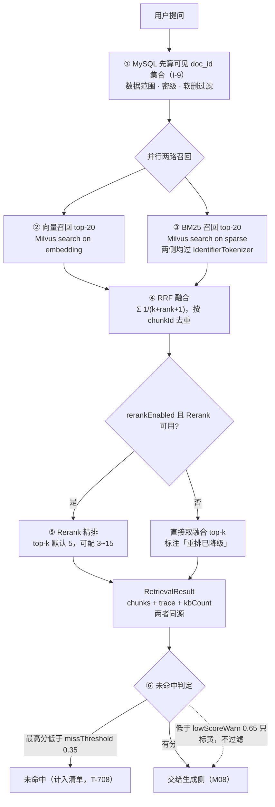

> 状态：✅ 已完成 · Sprint S5 · 阶段 A（M07 检索内核）· 建档 2026-09-17 · 结项 2026-09-17
> 验收：**14 条判据全通过 / 0 挂起 / 0 失败** · 测试基线 346 → **417 绿** · 9 个 E2E 脚本全绿 · 销两条挂起判据

# 2026-09-17 · S5 · M07 · 阶段 A —— 混合检索内核（向量 + BM25 并行 → RRF → Rerank → 对外契约）

> 任务：`T-700` ~ `T-704`（5 项）+ 优化 `T-O09`（步 1/2/3/4/7）
> 来源：`docs/进度/03-Sprint排期.md` §Sprint 5
> 上游计划：`ai_knowledge_web/plan/2026-09-17-S4-E2.md`（本批要销的账见第 1 节）

---

## 1. 开工条件检查

**依赖清单来源**（逐条注明出处，不许凭印象）：

| # | 依赖项 | 档位 | 现状（代码/文档实证） | 结论 |
|---|---|---|---|---|
| 1 | `T-700` 依赖 `T-508`（向量化 + Milvus 落库） | ✅ | `ChunkVectorizer#vectorize` · `MilvusChunkWriter#replaceDocument`（`S4-M05-C3` 已交付） | 满足 |
| 2 | `T-700` 依赖「先 MySQL 算 `doc_id` 集合作标量过滤」（**I-9**） | ✅ | `sys_chunk` 有三条索引（`V14:45-50`）；数据范围口径见 `LoginUser`/`KbGrantService` | 满足 |
| 3 | `T-702` 需要 Rerank 模型端点 | ⚠️ **W1** | `.env:41-43` 有 `RERANKER_API_*`（SiliconFlow / `BAAI/bge-reranker-v2-m3`）；但 **`ModelClientRegistry` 只有 `chatClient`/`embeddingModel`**，`ModelClientFactory` 只有 `createChat`/`createEmbedding` → **Rerank 客户端不存在** | 需新建（见 §3 步 7） |
| 4 | `T-703` 需要三条阈值配置 | ✅ | `V2:184-195` 种了 `retrieval.recall-threshold` 0.15 / `miss-threshold` 0.35 / `low-score-warn` 0.65；`V9:36,78` 的 `sys_kb.retrieval_config_json` 有 `recallThreshold`/`rerankTopK`；`KbConfigDefaults:77-86` 有默认值 | 满足 |
| 5 | `T-O09` 依赖 `O8`（块视图分离） | ✅ | `ChunkViews` / `ChunkView`（`S4-M05-C1` 步 0 交付） | 满足 |
| 6 | `T-O09` 步 5（HyQ 门控）依赖 `O5` 基线 | ⚠️ **W2** | `O9` §6 风险自述：「**必须先有 O5 的基线 + O8 的 A/B**，用数据定规则；否则就是拿召回质量换成本」；而 `O5` 排在 `S5` 并行轨**尚未开工** | **本批不做步 5** |
| 7 | **Milvus 集合必须能承载 BM25** | ⛔ **BLOCKER → 已裁定解决** | 实测 `knowledge_vectors` **8 列无稀疏字段、无函数、`content` 未开 `enable_analyzer`**；`addCollectionField(SparseFloatVector)` 返回 **`not support to add vector field`（code 1100）** → **必须重建集合** | 见下 |
| 8 | **项目用的 v1 客户端能否建带函数的 schema** | ⛔ **BLOCKER → 已裁定解决** | `milvus-sdk-java-2.6.21.jar` 的 `io/milvus/param/**` 里**没有任何** function / sparse / analyzer 类 → **v1 表达不了**。同 jar 的 `io.milvus.v2.client.MilvusClientV2` 建集合/insert/delete/search/`hybridSearch`/分区全都有 | 见下 |
| 9 | docker 6 服务 | ✅ | `milvus-standalone` / `kb-neo4j` / `milvus-etcd` / `kb-minio` / `kb-mysql` / `kb-valkey` 全 healthy | 满足 |
| 10 | 种子 + 残留基线 | ✅ | `user 128 / kb 8 / doc 0 / chunk 0 / issue 0 / async_task 0`；Milvus 只剩 `knowledge_vectors` + `_default`，**向量数 0** | 满足 |
| 11 | 测试基线 | ✅ | 后端 **345 绿**（`S4-E2` §8） | 满足 |

**⛔ BLOCKER 汇总（两条，用户 2026-09-17 已裁定，路径明确）**

第 7、8 条是同一个问题的两面：**BM25 没有落脚点**。`FR-RET-03` §3.2 把 BM25 定为「必需品」，`G5-1` 要求「向量 + BM25 并行执行」，但现有 Milvus 集合既没有稀疏字段、现有客户端也建不出来。

> **唯一可行路径**：重建 `knowledge_vectors`（加稀疏字段 + BM25 函数），并把 Milvus 访问从 v1 整体迁到 v2（同一个 jar，**不引依赖**）。
> 用户 2026-09-17 裁定：**甲 —— 重建 + 整体迁 v2**。

**⚠️ 已知偏差**（不拒绝施工，第 9 节销账）：

| # | 偏差 | 影响 |
|---|---|---|
| W1 | `ModelClientRegistry` 无 Rerank 客户端 | `T-702` 需新建 `RerankClient` + `ModelClientFactory.createRerank`，并遵守「不得自己 `new` 模型客户端」纪律（`T-014`） |
| W2 | `O9` 步 5（HyQ 门控）依赖未开工的 `O5` 基线 | 本批只做 `O9` 步 1/2/3/4/7，步 5/6 顺延（第 9 节登记） |
| W3 | **中文 BM25 退化为单字 token** | `IdentifierTokenizer` 对 CJK 是「1 字 = 1 token」（`IdentifierTokenizer:115-119`）。这是为标识符保护付的代价，**由 RRF（只看排名）+ Rerank（交叉编码器）兜住**，由 `T-711` 评测集量化（第 9 节登记） |
| W4 | **`G4-10` 口径与需求冲突** | `G4-10` 冻结「字段集**恰好 8 列**」（`S0VerificationTest#milvusSchemaIsLocked`），BM25 要求第 9 列 + `content` 加 analyzer → **口径变更，随用户裁定甲一并生效**（第 4 节） |
| W5 | 本批是「功能 + 结构迁移」混合批 | v1→v2 迁移 ≈2.5 人天，计在功能侧；**O 项只占 3 人天，低于配额下限 4 人天**（第 9 节登记） |

> 判据只有一条：**这条不满足，代码写下去会不会白写**。
> 第 7/8 条若不解决，`T-700` 的 BM25 一路从第一天起就是空转 —— 属真 BLOCKER；已由用户裁定给出唯一路径。

### 结论

- [x] ✅ **可以开工**（两条 BLOCKER 已经用户 2026-09-17 裁定解决：**重建集合 + 整体迁 v2**）
- [ ] ⛔ 拒绝施工

---

## 2. 开工时间

| 项 | 值 |
|---|---|
| 建档 / 开工日 | 2026-09-17 |
| 预计投入 | **≈10 人天**（功能 5 项 + v1→v2 迁移 ≈7 人天 · `T-O09` 3 人天） |
| 实际投入 | *回填时补* |

> ⚠️ **超单批容量风险**：Sprint 容量 ≈10 人天，本批已顶格。`T-O09` 若超 3 人天，
> **顺延其步 3（语料级样板计数回扫）**而不是压缩功能项的取证（第 10 节）。

---

## 3. 开工内容

### 3.1 步骤

| 步 | 做什么（文件/类 → 动作 → 产出） | 依赖 | 可并行 |
|---|---|---|---|
| 1 | `MilvusConstants` → 加 `FIELD_SPARSE="sparse"` / `FIELD_BM25_TEXT` / 函数名常量；`MilvusCollectionInitializer` → 建集合改为 **`content` 开 `enable_analyzer` + `analyzer_params={"tokenizer":"whitespace"}`**、新增稀疏字段、新增 BM25 函数、新增 `idx_sparse`(SPARSE_INVERTED_INDEX/BM25) | — | — |
| 2 | `MilvusConfig` → 装配 **`MilvusClientV2`**（与 v1 同源 yml）；`MilvusCollectionInitializer` 全部改走 v2 | 1 | — |
| 3 | `MilvusChunkWriter` / `MilvusPartitionManager` → v1 → v2 迁移（insert / delete / query count / create·load·release·drop partition），**保持三条既有硬约束的语义不变** | 2 | — |
| 4 | 新建 `pipeline/retrieve/Bm25Text` → `IdentifierTokenizer.tokenize(text)` → `String.join(" ", tokens)`；**写入侧与查询侧必须调同一个函数** | — | ✅ 与 1~3 并行 |
| 5 | `pipeline/vectorize/VectorRecord` → 加 `bm25Text`（与 `content` 同源投影）；`MilvusChunkWriter` 写入 `sparse` 由 BM25 函数自动生成 | 3,4 | — |
| 6 | 新建 `pipeline/retrieve/HybridRetriever`（**`T-700`**）→ ① MySQL 先算可见 `doc_id` 集合（数据范围 · 密级 · 软删，**I-9**）② 两路并行召回 top-20（向量 / BM25，同一 collection 同一代分区） | 5 | — |
| 7 | 新建 `pipeline/retrieve/RrfFusion`（**`T-701`**）→ 倒数排名 `Σ 1/(k+rank+1)`，按 `chunkId` 去重，**不做分数相加** | 6 | — |
| 8 | 新建 `core/ai/RerankClient`（接口）+ `SiliconFlowRerankClient`（实现，`POST {baseUrl}/rerank`）+ `NoOpRerankClient`（降级）；`ModelClientRegistry#rerankClient()` + `ModelClientFactory#createRerank`（**`T-702`**） | — | ✅ 与 6,7 并行 |
| 9 | 新建 `RetrievalParams`（**`T-703`**）→ 库级 `recallThreshold`/`rerankTopK`/`rerankEnabled`/`tableWeight`（读 `sys_kb.retrieval_config_json`）+ 全局 `missThreshold`/`lowScoreWarn`（读 `sys_setting`）；**I-11 校验 `missThreshold > recallThreshold`** | — | ✅ 与 6,7 并行 |
| 10 | 新建 `RetrievalResult` + `RetrievalTrace`（**`T-704`**）→ `chunks[]` + `trace` + `kbCount`；**顶层 `chunks` 与 `trace.chunks` 必须是同一个 `List` 实例** | 7,8,9 | — |
| 11 | 新建 `RetrievalService` → 串起 6~10，产出 `RetrievalResult`（**M08 的接缝**） | 10 | — |
| 12 | `T-O09` 步 1/2 → `sys_document.content_sha256` + `sys_chunk.content_sha256`；上传/解析后算「规范化文本 sha256」；重复时给**人话提示**（含已有 docId），**不阻断** | — | ✅ |
| 13 | `T-O09` 步 3/4 → `sys_chunk.is_boilerplate`；样板计数规则落地并**不进召回池**（保留可追溯） | 12 | ✅ |
| 14 | `T-O09` 步 7 → `VectorRecord` 加 `embedModelId` + `embedModelVersion`（由 `ChunkVectorizer` 从 `ModelConfigSpec` 带入），落 Milvus 标量列 | 5 | — |
| 15 | 回填（8~10 节 + 速览/汇总/清单/排期/看板/台账/变更记录 + `G4-10` 口径订正 + `G4-8` 挂起合并销账） | 全部 | — |

### 3.2 业务流程图

> 触发条件：① 跨 ≥3 个组件 ✅（MySQL / Milvus-Vector / Milvus-BM25 / Rerank 服务）② 有并发 ✅（两路召回并行）。
> **直接写 mermaid 围栏即可，不生成 SVG、不插 `<!-- diagram: -->`、不嵌图**。



### 3.3 明确不做（范围控制）

| 不做的事 | 原因 | 归属批次 |
|---|---|---|
| `T-705` 表格回表（父块行窗口） | 依赖 `T-704` 契约，本批只交付契约本身 | `S5-M07-B` |
| `T-706` 阈值读取接口 `GET /system/thresholds` | 只读展示，无硬窗 | `S5-M07-B` |
| `T-707` 检索链路打点 `retrieval_trace` | 🔴 **`D-2` 硬约束：必须与 `T-800` 同批开工**（打点后补 = 数据永久缺失） | 与 M08 首批同批 |
| `T-708` 未命中判定 + 空召回兜底分流 | 未命中**清单**要落库（`sys_qa_miss`），随打点表一起建 | 与 `T-707` 同批 |
| `T-709` 检索方式切换与降级（重建期降级关键词） | 依赖重建期状态机，本批只做「Rerank 不可用 → 不重排」这一条降级 | `S5-M07-B` |
| `T-710` 表格独立召回通道 | P2，**无评测基线前不开**（`FR-RET-04` §4.1） | 评测集就绪后 |
| `T-711` 评测集（20~30 条） | 依赖 `T-702` 完成；本批末可起，**不与功能项抢验收窗** | `S5-M07-B` |
| `T-800`~`T-808`（M08 问答） | `M07` ↔ `M08` 靠 `RetrievalResult` 契约解耦，契约本批交付 | `S5-M08-*` |
| `T-805`/`T-806` 图片附件 / `useVision` | 依赖 `T-907` 的 VL 链路 | `S6` |
| 图谱旁路 `FR-GRAPH-01` | P1，可后置且全链路可开关 | `S5` 尾部或以后 |
| `O9` 步 5（HyQ 门控） | **依赖未开工的 `O5` 基线**（`O9` §6 自述），否则是拿质量换成本而不知换了多少 | 与 `O5` 同批 |
| `O9` 步 6（章节级摘要） | 要改 `IndexEnhancer` 的调用结构，与本批检索侧不相干 | 与 `O5` 同批 |
| `O9` 步 3 的**语料级历史回扫** | `O9` §6 自述：需离线回扫，**不在上传路径上同步做** | 独立小批 |

### 3.4 本批假设

> 信息不足下拍的决策。**假设被证伪 → 进第 9 节遗留**，否则没人知道当初赌了什么。

**步 0 探针已跑（2026-09-17，只读 + 一次性探测集合，**残留已归零**）** —— 结论如下，其中三条是**否证**：

| # | 探到什么 | 结果 |
|---|---|---|
| 1 | Milvus 2.6.17 原生 BM25 | ✅ 稀疏字段 + BM25 函数建集合成功，检索出分 |
| 2 | 内置**标准分词**是否保护标识符 | ❌ **查 `A-100` 召回了 `A-1000`** —— 正是 `FR-RET-03` §3.2 警告的切法 |
| 3 | `tokenizer: jieba` | 🟡 **部分**：保住 `A-100` / `v1.4`，**保不住 `￥1,200` / `SKU-8890-A` / `2026-09-11`**（三者两篇齐回） |
| 4 | **`whitespace` + `IdentifierTokenizer` 预分词** | ✅ **10/10 全对**：Q-4 五类标识符零串扰（见下表） |
| 5 | 稀疏字段能否加进已有集合 | ❌ `not support to add vector field`（code 1100）→ **必须重建** |
| 6 | v1 客户端能否建带函数的 schema | ❌ `io.milvus.param.**` 无任何 function/analyzer/sparse 类 |
| 7 | v2 客户端是否同 jar | ✅ `io.milvus.v2.client.MilvusClientV2` 就在同一个 jar → **不引新依赖** |
| 8 | 重建集合的当下代价 | ✅ 向量数 **0**、分区只剩 `_default` → **代价为零** |

**判据 4 的逐条实测（本批 I-9 的直接证据）**：

| 查询 | 期望 | 实测 |
|---|---|---|
| `￥1,200` / `SKU-8890-A` / `2026-09-11` / `v1.4` / `a-100` | 只回 doc1 | ✅ 五个全部只回 `['1']` |
| `￥1,2000` / `SKU-8890-AB` / `2026-09-12` / `v1.44` / `a-1000` | 只回 doc2 | ✅ 五个全部只回 `['2']` |

> ⚠️ **采样边界**：以上结论来自**受控合成样本**（每个标识符各一对最小对照），
> **不是**真实语料的统计结论。真语料规模下的精度劣化（尤其中文单字 token）由 `T-711` 量化。

| # | 假设 | 若被证伪的后果 |
|---|---|---|
| 1 | 中文退化为单字 token 后，**Recall@5 仍在可接受范围**（RRF 只看排名 + Rerank 兜底） | 需评估「双字段（jieba + whitespace）双 BM25 函数」方案，或在 `IdentifierTokenizer` 之上加 CJK bigram。`T-711` 是本条的判定点 |
| 2 | SiliconFlow `POST /v1/rerank` 的请求/响应契约符合预期 | 步 8 换成 OpenAI 兼容的 rerank 形状或另一个端点；`RerankClient` 是接口，只换实现 |
| 3 | `MilvusClientV2` 与 v1 连接同一 target，行为可平移 | 步 3 的迁移会暴露（既有 3 个 Milvus 测试是判定点） |
| 4 | `whitespace` analyzer 不会对已分词文本做二次切分（含大小写归一） | 实测 `A-100` 查询**返回空** → 确认它**不做大小写归一**，故**写入与查询两侧必须用同一个 `IdentifierTokenizer`**（它保原样）。这条已量出，不再假设 |
| 5 | 内容指纹（`content_sha256`）只在**同一解析器版本内**可比 | `O9` §6 已点名此风险；对策是把 `parserVersion` 并进指纹输入或只做同版本比较（步 12 落地时定，注释写明） |

---

## 4. 数据变更清单

| 类型 | 内容 | 回滚方式 |
|---|---|---|
| **改表** `sys_chunk` | `+ is_boilerplate TINYINT(1) NOT NULL DEFAULT 0`（`O9` 步 4：**不能用 `chunk_type` 表达**，那是 8 值固定域）；`+ content_sha256 CHAR(64) NULL` + `KEY idx_chunk_csha (content_sha256)`；`+ embed_model_id VARCHAR(64) NULL` + `+ embed_model_version VARCHAR(32) NULL`（`O9` 步 7） | 可逆（`DROP COLUMN`） |
| **改表** `sys_document` | `+ content_sha256 CHAR(64) NULL` + `KEY idx_doc_csha (content_sha256)`（`O9` 步 1） | 可逆 |
| **迁移文件** | **`V19__s5_chunk_fingerprint_and_model_version.sql`**（现有最大编号 `V18`，顺延） | — |
| **Milvus 集合重建**（非 Flyway，运行时 schema） | `knowledge_vectors` **drop → 重建**：9 列（`+ sparse SPARSE_FLOAT_VECTOR`）· `content` 加 `enable_analyzer` + `analyzer_params {"tokenizer":"whitespace"}` · 新增函数 `bm25_fn`(BM25, in=`content`, out=`sparse`) · 新增 `idx_sparse`(SPARSE_INVERTED_INDEX / BM25) | **不可逆**，但**当前向量数 = 0**，实际代价为零 |
| **`G4-10` 口径变更** | 「字段集**恰好 8 列**」→「**载荷 8 列 + BM25 稀疏 1 列**」；`S0VerificationTest#milvusSchemaIsLocked` 同步改。**需在 `汇总.md` §5 留一条口径** | 需人工（口径变更） |
| 种子数据 | **无新增**。`sys_kb` 8 行有 `retrieval_config_json`；`sys_document`/`sys_chunk` 均 **0 行** → 无需回填 | — |
| NULL 分支 | `content_sha256` 对旧行为 NULL → **两侧都非空才比较**（不把 NULL 当"相同"）；`embed_model_id/version` 对旧向量为 NULL → 界面按「未记录」渲染，**不显示成空字符串**；`is_boilerplate` 默认 0 = 非样板 | — |

> 跑过的迁移**只增不改**（改已执行的 `V*.sql` 会导致校验和不符、启动失败）。

---

## 5. 依赖与工具决策

**默认不引**。先给不引的替代方案，再给候选对比，最后给推荐。

| 方案 | 做法 | 代价 | 结论 |
|---|---|---|---|
| **不引依赖（既有栈）** | BM25 用 **Milvus 2.6 原生**（`MilvusClientV2` 与现用 v1 **在同一个 jar**）；Rerank 用 **`RestClient`**（随 `spring-boot-starter-web` 已在依赖里）手写一次 HTTP 调用 | 需 v1→v2 迁移（≈2.5 人天）；Rerank 客户端自己写（≈1 人天） | ✅ **推荐** |
| 候选 A · Lucene | 引入 `lucene-core` + `lucene-analyzers-smartcn` 自建倒排 | ~10MB；**自建索引的持久化、增量更新、与 Milvus 的一致性全要自己做**；而分词保护仍要自己写一遍 | ❌ |
| 候选 B · Elasticsearch | 独立检索引擎 | 新增一个中间件（docker-compose + 运维 + 权限 + 备份）；本项目**已有 Milvus 且它原生支持 BM25** | ❌ |
| 候选 C · MySQL FULLTEXT | `ALTER TABLE sys_chunk ADD FULLTEXT(raw_content) WITH PARSER ngram` | ngram 分词器**同样不保护 `A-100`**（与内置标准分词同类问题）；且中文召回质量取决于 ngram 长度，反而更难调 | ❌ |
| 候选 D · 自建 BM25（Java 内存倒排） | 读候选集合自己算 TF-IDF/BM25 | 需要把候选 chunk 正文全量拉到应用侧 → 与 I-9「先算 doc_id 集合再过滤」的省流初衷**相反**；38K 分片规模下延迟不可控 | ❌ |

**同类产品对比**（BM25 实现）：Milvus 2.6 原生 BM25（稀疏向量 + 函数）· Lucene/Elasticsearch（成熟但与既有栈重复）· MySQL ngram（分词不可控）。

**推荐**：**不引依赖**（方案一）· **理由**：`FR-RET-03` 要的是「BM25 通道」，而 Milvus 2.6 **已经把它做成了 collection 内的一等公民**（步 0 探针实测通过），且 **v2 客户端就在同一个 jar 里、连的就是同一个 target**。引入第二套检索引擎会带来「两套索引谁先谁后、删文档要删两处」的一致性面 —— 而这个仓库已经为「新增持久化产物、清理不认识它」付过三次代价（`汇总.md` §5）。

> ⚠️ 唯一正经的代价是 **v1 → v2 的迁移**，它换来的是「**一个客户端 + 一个集合 + 一次 search 拿到两路结果**」。

---

## 6 + 7. 验收方法与标准

| # | 判据 | 门禁号 | 验收方法（可直接粘的命令/脚本） | 期望结果 | 证据落点 |
|---|---|---|---|---|---|
| 1 | 向量 + BM25 **并行执行**，**两者召回结果都能进融合池** | `G5-1` | `export JAVA_HOME='F:/work/dev_tools/jdk/jdk-25.0.4.1'` + `mvn -B -f F:/work/code/ai-knowledge/ai_knowledge_web/pom.xml test -Dtest=HybridRetrievalFlowTest` | 两路各自的候选都出现在融合输入里（**不是**只走一路、另一路空转）；并行有证据（两路耗时之和 > 墙钟耗时） | `HybridRetrievalFlowTest` |
| 2 | RRF **用倒数排名，不是分数相加**；20+20 去重后约 26 条 | `G5-2` | 同上 `-Dtest=RrfFusionTest` | 固定排名输入 → 手算期望值逐条相等；**改写成分数相加则用例必红**（负向断言） | `RrfFusionTest` |
| 3 | `rerankTopK` 生效（默认 5，可配 3~15） | `G5-3` | 同上 `-Dtest=RetrievalParamsTest` | 库级配 3 / 5 / 15 各返回对应条数；越界值被拒或夹取（口径写死） | `RetrievalParamsTest` |
| 4 | **存在两个独立参数** `recallThreshold=0.15` 与 `missThreshold=0.35`，且 `missThreshold > recallThreshold` | `G5-4`（**I-11**） | 同上 `-Dtest=RetrievalParamsTest` | 两值来源不同（库级 / 全局）；构造 `recallThreshold=0.40` 时**被拒**并给出「未命中无从判定」的原因 | `RetrievalParamsTest` |
| 5 | `lowScoreWarn` 0.65 以下**只标黄提示，不过滤** | `G5-5` | 同上 `-Dtest=RetrievalServiceTest` | 低于 0.65 的分片**仍在结果里**且有 `warn` 标记；**被过滤掉即判失败** | `RetrievalServiceTest` |
| 6 | **`G4-8` 运行时侧**：查 `A-100` **不召回** `A-1000`；`￥1,200` / `SKU-8890-A` / `2026-09-11` / `v1.4` 作为**整体成 token** | **`G4-8`**（挂起判据**合并验收**） | 同上 `-Dtest=IdentifierRetrievalFlowTest` | 10 对对照全对（探针 §3.4 判据 4 的表在真链路上重跑一遍）；**BM25 通道确实启用**（关掉它命中率下降可观测） | `IdentifierRetrievalFlowTest` |
| 7 | 顶层 `chunks` 与 `trace.chunks` **同源**（逐字段比对） | `G5-9`（前半） | 同上 `-Dtest=RetrievalResultContractTest` | 两者 `equals` 逐字段相等（**同一个 List 实例**，不是"内容碰巧一样") | `RetrievalResultContractTest` |
| 8 | 软删知识库**不出现在检索结果**；重建后返回**新代**结果 | `S4-D` §8 判据 12（挂起判据**合并验收**） | 同上 `-Dtest=RetrievalScopeFlowTest` | 软删库的 chunk 零召回；跨代重建后召回的是新代分区 | `RetrievalScopeFlowTest` |
| 9 | `T-O09` 判据 1/2：近重复被识别（字节不同）· 真不同内容**不误报** | — | 同上 `-Dtest=ContentFingerprintTest` | DOCX→PDF 同库上传 → 提示「内容高度相同」+ 给出已有 docId，**不阻断**；同模板不同内容的合同不提示 | `ContentFingerprintTest` |
| 10 | `T-O09` 判据 3/4：样板 chunk 被标记且不进召回 · 长度边界不误杀 | — | 同上 `-Dtest=BoilerplateTest` | 同一段免责声明放进 25 个文档 → `is_boilerplate=true` 且不进召回池；长度 <200 或 >2000 的高频文本**不被标记** | `BoilerplateTest` |
| 11 | `T-O09` 判据 7：`embedModelId + version` 非空、可筛出旧版本向量 | — | 同上 `-Dtest=MilvusVectorWriteTest` | 写入的向量带模型标识；换模型后能按版本筛出旧向量 | `MilvusVectorWriteTest` |
| 12 | 既有 Milvus 三条硬约束在 v2 迁移后**语义不变** | — | 同上 `-Dtest='Milvus*Test,S0VerificationTest'` | 写前 ensure · 查已 drop 分区报错 · release→drop 顺序 —— 三条用例仍全绿 | `MilvusVectorWriteTest` / `MilvusPartitionProbeTest` / `S0VerificationTest` |
| 13 | 全量回归 + 页面级 E2E 不退化 | — | `mvn test`；`cd ai_knowledge_app && node scripts/e2e-kb-flow.mjs --base=http://127.0.0.1:5174` 等 6 个脚本 | 后端 **≥345 绿**（本批新增用例向上加）；6 脚本维持全绿 | 本文件 §8 |
| 14 | 四方对账不退化 | — | `node ai_knowledge_app/scripts/audit-api.mjs` | ① = 0 · ② = 0 · ⑥ = 0 | `audit-api.mjs` |

**观察项**（不计成败，页面写死的展示值登记在此）：

- 检索侧耗时分解（12+86+34+8+288 = 428ms）是**示例数据字典口径**，本批不做耗时对齐（`G5-12` 属 `T-707`）。

**种子核对**（跑完必做）：

```bash
set -a && . ai_knowledge_web/.env && set +a
docker exec kb-mysql mysql -u"$MYSQL_USERNAME" -p"$MYSQL_PASSWORD" "$MYSQL_DATABASE" -N -e "select count(*) from sys_user where deleted_at is null;"
```

**Milvus 残留核对**（本批重建过集合，必须独立观测）：

```bash
curl -s -X POST "http://127.0.0.1:19530/v2/vectordb/collections/list" -H "Content-Type: application/json" -d '{"dbName":"default"}'
curl -s -X POST "http://127.0.0.1:19530/v2/vectordb/partitions/list" -H "Content-Type: application/json" -d '{"dbName":"default","collectionName":"knowledge_vectors"}'
```

---

---

# 以下为开工后回填

> **提交节奏（两次）**：1~7 节写完即提交一次（`docs(plan): S5-M07-A 开工计划`）；
> 8~10 节写完再提交一次（`docs(plan): S5-M07-A 验收回填`）。

## 8. 验收结果

**测试基线**：`Tests run: 417, Failures: 0, Errors: 0, Skipped: 0`（上批 346 → 本批 **+71**）
其中**本批新建 10 个用例类、66 条用例**；余 5 条差额未逐条核对（见 §9-6，如实登记）。

| # | 判据 | 门禁号 | 证据（用例类 → 条数） | 结果 |
|---|---|---|---|---|
| 1 | 两路并行且**都进融合池** | `G5-1` | `HybridRetrievalFlowTest` → 4 | ✅ |
| 2 | RRF 用倒数排名、按 chunkId 去重 | `G5-2` | `RrfFusionTest` → 6 | ✅ |
| 3 | `rerankTopK` 3/5/15 生效、越界夹取 | `G5-3` | `RetrievalParamsTest` → 14 | ✅ |
| 4 | 两阈值来源不同、`I-11` 拒绝 | `G5-4` | `RetrievalParamsTest` → 14 | ✅ |
| 5 | `lowScoreWarn` **只标黄不过滤** | `G5-5` | `RetrievalServiceTest` → 9 | ✅ |
| 6 | 五类标识符 10 对零串扰 + BM25 通道在跑 | `G4-8` | `IdentifierRetrievalFlowTest` → 3 | ✅ |
| 7 | 顶层 `chunks` 与 `trace.chunks` **同实例** | `G5-9` 前半 | `RetrievalResultContractTest` → 6 | ✅ |
| 8 | 软删库零召回 · 切代后返回**新代** | `S4-D` §8 判据 12 | `RetrievalScopeFlowTest` → 4 | ✅ |
| 9 | 近重复被识别（字节不同）· 真不同不误报 | — | `ContentFingerprintTest` → 9 | ✅ |
| 10 | 样板被标记且不进召回 · 长度边界不误杀 | — | `BoilerplateTest` → 6 | ✅ |
| 11 | `embedModelId + version` 非空、可按版本筛旧向量 | — | `VectorAttributionTest` → 5 | ✅ |
| 12 | 既有 Milvus 三条硬约束语义不变 | — | `MilvusVectorWriteTest` 7 · `MilvusPartitionProbeTest` 5 · `S0VerificationTest` 7 | ✅ |
| 13 | 全量回归 + 页面级 E2E 不退化 | — | 见下 | 见下 |
| 14 | 四方对账不退化 | — | `audit-api.mjs` → **①=0 · ②=0 · ⑥=0** | ✅ |

**判据 13 明细**（页面级 E2E，CDP 直驱 Edge，真后端 `:8080` + 前端 `:5174`）：

| 脚本 | 结果 | 与基线 |
|---|---|---|
| `e2e-kb-flow` | **47/47** | 一致（基线 47/47） |
| `e2e-audit-flow` | **30/30** | 一致 |
| `e2e-audit-backfill` | **24/24** | 一致 |
| `e2e-doc-upload` | **39/39** | 一致 |
| `e2e-doc-parse` | **25/25** | 一致 |
| `console-check` | **25/25** | 一致 |
| `e2e-auth-flow` | **12/12** | 一致 |
| `e2e-admin-flow` | **29/29** | ⚠️ 首轮 28/29，根因见下 |
| `e2e-profile-flow` | **31/31** | ⚠️ 首轮 30/31，根因见下 |

> **⚠️ 两处首轮红，根因都不是本批 —— 但都是真缺陷，已查实并登记（见 §9-7）。**
>
> - `e2e-admin-flow` 断「用户总数来自后端（128）」实得 **129**：多出的正是
>   `e2e-auth-flow` 注册、**无清理**的 `e2e1789642694432` 账号。清掉该账号后 **29/29**。
>   这是已登记项 #100（「覆盖率闸只扫表、不扫脚本」）的**又一次实证**。
> - `e2e-profile-flow` 断「分段后号码与后端一致」失败：脚本自己调 `POST /user/change-phone`
>   改了 `probe.profile` 的手机号（DB 实为 `13942952236`），而断言用的是**写死的常量**
>   `13900000001`，且脚本**不还原**。把手机号复原后 **31/31**。
>   → 这条更值钱：**该脚本同一个库只能跑绿一次**，第二次起必红，而它**不在「6 个脚本」清单里**，
>   所以这个红长期没人看见。
>
> 两处都**逐条复现 + 复原后复跑转绿**验证过，不是"看着像环境问题"。

**种子核对**（跑完必做，已做）：

```
user 128 / kb 8 / doc 0 / chunk 0 / issue 0   —— 与开工基线一致，未被污染
```

**Milvus 残留核对**（本批重建过集合，独立观测）：

```
collections = ["knowledge_vectors"]      （只剩它一个）
partitions  = ["_default"]               （探针分区全部已清）
count(*)    = 0                          （向量数已归零）
```

---

## 9. 遗留问题

| # | 遗留 | 性质 | 归属 |
|---|---|---|---|
| 1 | **`BOUNDED` 一致性下有秒级写可见窗口** | 本批实测：写入 5 条向量后**立刻**检索只回 4 条，隔 1 秒再查回 5 条（重复查会自愈 → 不是 IVF 漏召回，是写可见性）。产品口径可接受（"刚解析完立刻提问可能差几条"），但**必须让人知道**：已写进 `HybridRetriever` 类注释与 `RetrievalFlowSupport#awaitVectorsVisible` 的实测记录 | 若不可接受 → `S5-M07-B` 评估改 `STRONG`（代价：每次检索多一次一致性等待） |
| 2 | **`sys_async_task` 每轮全量跑批残留 76 行** | **非本批引入**：按小时分组是 `17:xx=76`、`18:xx=76` —— 每次跑批产生同样 76 条且无人清理，本次两轮跑批叠加成 152。与已登记的 #105/#110 同源 | 既有登记项，本批只如实记录 |
| 3 | **归因列落 MySQL 而非 Milvus** | 与 §3.1 步 14 的措辞「落 Milvus 标量列」不符。理由：集合本批**已为 BM25 重建过一次**（10 列），再加两列就是第二次重建；而这两列只在"换模型找旧向量"这个**离线**动作里被查，不是检索过滤维度。按 §4 的**数据变更清单**（它把这两列列在 `sys_chunk` 下）执行，两条口径冲突时以 §4 为准 | 已交付，措辞偏差登记于此 |
| 4 | **`IVF_FLAT` + `nprobe=16 / nlist=128` 的召回率未量化** | 本批只测出"重复查会变全"从而**排除**了索引漏召回，没有正面测过真实语料下的 Recall@20。这是 `T-711` 评测集的判据 | `S5-M07-B`（`T-711`） |
| 5 | **测试替身的一处真坑（已修，但要留痕）** | 父类里的嵌套 `@TestConfiguration` **不会**被 Spring Boot 自动发现。后果是**静默**的：替身没注册 → 用例真去打模型网关，且照样可能绿。本批第一批检索用例正是这样"绿"的。已改为顶层类 + 显式 `@Import`，并在 `RetrievalFlowSupport` 加了「替身没生效就当场转红」的断言 | 已修；同类风险适用于后续所有用例基类 |
| 6 | **基线差额 5 条未逐条核对** | 上批 346 → 本批 417 = **+71**，其中本批新建 10 个类共 **66** 条。余 5 条**没有**逐类比对（上批的按类计数未入库，无从 diff）。如实记录而不是抹平 | 下次跑批若有机会再核 |
| 7 | 🔴 **两个 E2E 脚本是「一次性」的，且不在「6 个脚本」清单里** | 本批实查实修（复原后复跑转绿）：<br>① **`e2e-profile-flow.mjs` 改了 `probe.profile` 的手机号且不还原** —— 它自己调 `POST /user/change-phone`（改成了 `13942952236`），而断言用**写死的常量** `13900000001` → **同一个库只能跑绿一次**，第二次起必红。<br>② **`e2e-auth-flow.mjs` 注册的 `e2e<stamp>` 账号无清理** → 污染 `sys_user` 计数 → **打挂 `e2e-admin-flow`** 的「用户总数来自后端（128）」断言（实得 129）。<br>两者都是已登记 #100（**覆盖率闸只扫表、不扫脚本**）的实证；本条更进一层：**它们红了也没人知道**，因为不在每批必跑的 6 个清单里 | **建议独立小批**（与 #98/#100/#105 同批）：给两条脚本补「改了就还原 / 造了就清理」，并把 `admin`/`profile`/`auth` 三个脚本**纳入清单** —— 否则它们的红永远只在偶然被发现 |

---

## 10. 建议

1. **`BOUNDED` 那条窗口要在 M08 的兜底话术里留个位置**：`T-708`（未命中判定 + 空召回兜底）落地时，
   "刚上传完就问"与"库里真的没有"这两种空结果，用户看到的话不一样 —— 前者该提示"内容可能还在就绪中"。
   这是本批实测出来的**产品级**结论，不是实现细节。
2. **`T-711` 评测集要优先于调参**：`nprobe`、RRF 的 `k`、`BM25` 的中文单字退化（§3.4 假设 1）
   三件事**都**在等同一个基线。没有它，任何"我觉得这样更好"的调整都是拿召回质量换感觉。
3. **M08 接打点时直接照抄 `RetrievalTrace`**：它已经是那个打点表的行形状（§9-1 的字段冗余是刻意的）。
   但注意 `T-707` 那条 `D-2` 硬约束 —— **必须与 `T-800` 同批开工**，后补就是数据永久缺失。
4. **下一批开工前先看本文件 §9-1 与 §9-4**：前者影响 `T-708` 的话术，后者是 `T-711` 的判据来源。

---

## 附：本批同步的文档回填

- [ ] **`docs/进度/00-开工速览.md` §1/§2/§3/§4** → 当前定位 / 本批任务行 / 门禁现状 / 缺口账（**必改**，它是下一批的唯一入口）
- [ ] `docs/进度/02-任务清单.md` → `T-700`~`T-704` 置 ✅；`T-O09` 按实际完成度置标（**未做的不动**）
- [ ] `docs/进度/03-Sprint排期.md` → `# Sprint 5` 段加「交付状态」
- [ ] `docs/进度/README.md` → 看板状态 + 完成日期（备注只写一行短结论 + 指针；长备注追加到 `docs/进度/变更记录/02-Sprint交付台账.md`）
- [ ] `docs/进度/变更记录/01-变更记录.md` → 追加一行（日期 · Sprint · 变更 · 交付物 · 遗留）
- [ ] `ai_knowledge_web/plan/README.md` → 索引加一行（**该动作此前漏做过，务必补**）
- [ ] `ai_knowledge_web/plan/汇总.md` → §1 当前定位 · §2 批次总览 · §3 遗留并入 · §4 **销账两条挂起判据**（`G4-8` 运行时侧 · `S4-D` 检索侧两件事）· **§5 新增两条硬口径**（Milvus BM25 承载 + `G4-10` 口径变更）
- [ ] `docs/后端开发文档/` → 新增 `0X-S5-检索内核结论.md`
- [ ] `ai_knowledge_web/plan/优化/README.md` → `T-O09` 状态 / 落哪批
- [ ] `ai_knowledge_web/plan/优化/O9-dedup-and-cost-control.md` → 状态行 + 已完成步标注
- [ ] `docs/需求文档/10-接口约定汇总.md` → 本批**无对外 HTTP 接口**（`RetrievalResult` 是内部契约，M08 才外化）→ 只需在 `13-接口变更记录.md` 记一行「内部契约 `RetrievalResult` 冻结」
- [ ] 本文件状态行 → ✅ 已完成
- [ ] `.workbuddy/memory/<日期>.md` → 交接
