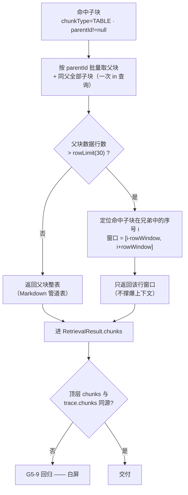
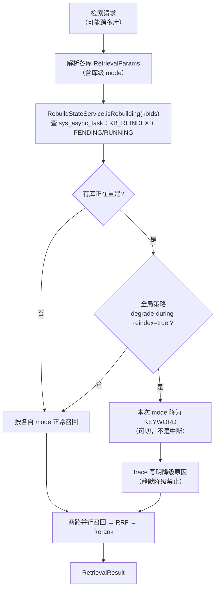

> 状态：✅ 已完成 · Sprint S5 · 阶段 B（M07 检索收口：表格回表 / 阈值接口 / 重建期降级 / 评测集 + `T-O05` 解析质量基线）· 建档 2026-09-17 · 结项 2026-09-17（**27 条判据：26 通过 / 1 部分（全量回归的 7 处红全为既有一族，已在上一批代码复现）**）

# 2026-09-17 · S5 · M07 · 阶段 B —— 表格回表 / 阈值接口 / 重建期降级 / 评测集

> 任务：`T-705` · `T-706` · `T-709` · `T-711`（4 项）+ `T-O05`（优化轨，配额制）
> 来源：`docs/进度/03-Sprint排期.md` §Sprint 5 · `docs/进度/00-开工速览.md` §1/§2/§9
> 上游计划：`ai_knowledge_web/plan/2026-09-17-S5-M07-A.md`（本批要销的账见第 1 节 #13）
> 关联：`plan/优化/O5-parse-quality-baseline.md`（`T-O05` 的方案全文，6 条判据）

---

## 1. 开工条件检查

**依赖清单来源**（逐条注明出处，不许凭印象）：

| # | 依赖项 | 档位 | 现状（代码/文档实证） | 结论 |
|---|---|---|---|---|
| 1 | `T-705` ← `T-505`/`T-704`：消费 M05 的**分片产出契约**（D-5） | ✅ | `SysChunk.parentId`（`entity/SysChunk.java:78`，注释明写「子块指向其 `TABLE` 父块；顶层块为 `null`」）；`ChunkingService#appendTable`（`pipeline/ChunkingService.java:133`）产出**父块 = Markdown 管道表 + 子块 = 行式文本**，子块带 `parentOrderNo`；`Block.isTopLevel()`（`pipeline/Block.java:51`）。`ChunkReader#readByDocId` 已能读回 | 满足 |
| 2 | `T-705` 的参数「默认 30 行 / ±5」 | ✅ | `KbConfigDefaults.ROW_LIMIT = 30`（`core/enums/KbConfigDefaults.java:69`）· `ROW_WINDOW = 5`（:71），且**已进** `KbDtos.TablePolicy`（`KbService#defaultTablePolicy`）→ 库级可配、前端已有输入框 | 满足 —— ⚠️ 但**检索侧无人消费**，本批要做的正是"消费" |
| 3 | `T-705` 的「父块 >30 行时只取 ±5 行」需要**行号** | ✅ | `ParsedDocument.ParsedTable#rowCount/toMarkdown`（`pipeline/ParsedDocument.java:338,347`）；`TableRenderer.RenderedTable`（`pipeline/TableRenderer.java:47`）同时给出 `markdown` 与 `linearRows` → 行数可由子块按 `order_no` 排序后的**序号**推出 | 满足 |
| 4 | `T-706` ← `T-703`：三阈值 + `rerankTopK` 可读 | ✅ | `SystemSettingService#snapshot`（`core/setting/SystemSettingService.java:51`）· `SystemSettings` 四键（:28-37）· 种子 `V2__seed_reference_data.sql:184-190` 四行齐（0.15 / 0.35 / 0.65 / 5） | 满足 |
| 5 | `T-706` 的落点：`GET /system/thresholds` | ⚠️ | **没有 `SystemController`** —— `controller/` 下 11 个类（Health/Auth/User/Dept/Role/Permission/KbGrant/UserAdmin/Audit/Doc/Kb）无 `system` 前缀 | 满足（**新建控制器**） |
| 6 | `T-706` 的消费方 | ✅ | 前端 `api/index.ts:312` **已有** `thresholds()`，mock 在 `mock/index.ts:795`（值 0.15/0.35/0.65/5，与种子一致）；但 `grep -r thresholds src/views` **零命中** → **没有任何页面在调它**，消费方是 S8 的 M10 运营分析页 | 满足（本批只交后端；E2E 无新增可验面） |
| 7 | `T-709` ← `T-700`：检索方式可切 | ✅ | `RetrievalMode`（`core/enums/RetrievalMode.java`，`usesVector/usesBm25`）· `RetrievalParams#usesVector/usesBm25`（`pipeline/retrieve/RetrievalParams.java:152,157`）—— **`S5-M07-A` 已顺带落地**，`RetrievalParamsTest#modeDecidesChannels` 已钉 | 满足 —— 本批缺的只是"重建期降级"这一半 |
| 8 | `T-709` 的「重建中」判据 | ⛔ **BLOCKER** | `ReindexService#submit`（`service/ReindexService.java:88-101`）调的是 `asyncTaskService.submit(type, idempotencyKey, chunkTotal, work)` 重载 → 该重载内部走 `TaskSubject.none()`（`core/async/AsyncTaskService.java:111-113`）→ **`sys_async_task.kb_id` 写 NULL**。即：**重建任务落库了，但认不出是哪个库在重建** | **不满足 —— 唯一路径：`ReindexService#submit` 改调带业务坐标的重载 `submit(TASK_TYPE, TaskSubject.of(kbId, null, ownerId), …)`（`AsyncTaskService.java:118`）。改动 ≈2 行，且**顺带销掉 `#109` 的根因**（"产物认识，归属维度不认识"）** |
| 9 | `T-711` ← `T-702`：重排可用 | ✅ | `RerankClient` / `SiliconFlowRerankClient` / `NoOpRerankClient`（`core/ai/`），`ModelClientRegistry#rerankClient()` | 满足 |
| 10 | `T-711` 的**语料** | ⛔ **BLOCKER** | 需求 `07` §4.4 要「直接从**真实报价单**出题」；`docs/测试文件/` 17 个样本（5 PDF / 4 DOCX / 1 XLSX / 6 MD / 1 TXT）**没有报价单**，且该目录 **gitignored**（`.gitignore:20-22`）。`O5` §6 已登记同一缺口（`S4-M05-C2` W7） | **不满足 —— 唯一路径（2026-09-17 用户已确认）：自建合成报价单语料**。⚠️ 但见 #11：**不能写成 `.md`** |
| 11 | `T-711` 语料的**格式**（本批新查出的硬约束） | ⛔ **BLOCKER** | 表格块**只**来自 `PdfDocumentParser`（openDataLoader）与 `TikaDocumentParser`（XHTML `<table>`）；`PlainTextParser` 覆盖 MD/TXT（`DocParseService#dispatch`，`service/DocParseService.java:408-419`）**完全不抽表格** → 合成报价单若写成 `.md`，**产出的 TABLE 块数恒为 0**，评测将测不到表格 | **不满足 —— 绕法见 §3.4 假设 1**：合成语料**不入解析链路**，直接以「已入库的分片」形态构造（`T-711` 的评测对象本就是**检索层**） |
| 12 | `T-O05` ← `T-O01` | ✅ | `ParseWorker` + `sys_async_task` 已交付（`S4-E1`）；`O5` §5 判据 5「重解析幂等」依赖的 `DocStorage#storeArtifact` 覆盖写 + issue 先删后插亦已在（`S4-B` 判据 16） | 满足 |
| 13 | 本批要**销的账**：`S5-M07-A` §9-4（`#117` `IVF_FLAT` + `nprobe=16/nlist=128` 召回率未量化） | ✅ | `plan/汇总.md` §3 #117 明确写「归属 `S5-M07-B`（`T-711`）」 | 本批销 |
| 14 | `T-O05` 的样本在位 | ⚠️ | `docs/测试文件/` 17 个样本在位（5 PDF / 4 DOCX / 1 XLSX / 6 MD / 1 TXT），与 `O5` §5 判据 1 的计数逐项吻合 | 满足（**本机**）—— 但 gitignored → 见 W6 |
| 15 | 迁移编号 | ✅ | 现有最大 `V19__s5_chunk_fingerprint_and_model_version.sql` → **本批从 `V20` 起** | 满足 |
| 16 | 环境 | ✅ | docker 6 服务 · 种子 `user 128 / kb 8 / doc 0 / chunk 0` · Milvus `knowledge_vectors` 10 列、只剩 `_default`、向量 0 · 后端 `:8080/api/health` = 200 | 满足 |

**BLOCKER 汇总**：#8 · #10 · #11 三条，**均已有唯一路径**（#8 改 2 行 / #10 用户已裁定自建合成语料 / #11 评测对准检索层、语料不入解析链路）。**不需要 `AskUserQuestion`** —— 三条都不是"多条路线各有代价"，而是"只有这一条路"。

**⚠️ 已知偏差**（不拒绝施工，第 9 节销账）：

| # | 偏差 | 影响 |
|---|---|---|
| W1 | **`GET /system/thresholds` 的 `recallThreshold` / `rerankTopK` 是"全局默认值"，不是任何库的库级值** —— 需求 `10` §11 只说"全局阈值"，但这两个名字在 `RetrievalParams` 里是**库级**（`resolve()` 优先取 `kbConfig`） | 同名不同义，是本项目反复踩的形态。必须把口径写进响应注释 + 结论文档，否则下一个人会以为它返回"当前库的阈值" |
| W2 | `#109`：`sys_async_task` 里 `KB_REINDEX` 行的 `kb_id` 为 NULL | 本批因 `T-709` **必须**修（是它的前置），顺带销 `#109` 的根因 |
| W3 | `#114`：`BOUNDED` 一致性下有**秒级写可见窗口** | `T-711` 评测**必须**先等写可见再测，否则会把写可见性误判成"召回率低"。`S5-M07-A` 已有 `awaitRecallVisible` 轮询可复用 |
| W4 | `S5-M07-A` §3.4 假设 2：SiliconFlow `POST /rerank` 的**真实契约从未做过网络验证** | `T-711` 若跑真重排，会顺带验它；**失败时须区分"重排契约不符"与"召回率低"**（两者现象都是"结果不对"） |
| W5 | `S5-M07-A` §9-3：向量模型归因落 MySQL 而非 Milvus | 已知偏差，不影响本批 |
| W6 | **同一条件下两种行为**：`DocParseFlowTest#assumeSample` 在样本缺失时**跳过**（`Assumptions` → 静默假绿），而 `O5` §6 明定基线用例**必须失败而非跳过** | 同一次 `mvn test` 里两套口径。本批**不动存量**用例；在 `ParseBaselineTest` 类 javadoc 写明分歧与理由，并登记 §9 |

> 判据只有一条：**这条不满足，代码写下去会不会白写**。

### 结论

- [x] ✅ **可以开工** —— 三条 BLOCKER 均有唯一路径且路径已定（#10 已经用户 2026-09-17 确认）

---

## 2. 开工时间

| 项 | 值 |
|---|---|
| 建档 / 开工日 | 2026-09-17 |
| 预计投入 | **≈10 人天**（功能侧 ≈7：`T-705` 2 · `T-706` 0.5 · `T-709` 1.5 · `T-711` 3；优化侧 `T-O05` 3） |
| 实际投入 | *回填时补* |

> **容量口径**：Sprint 容量 ≈ 10 人天 → **本批正好打满，零余量**。§3.3 已按此预先切掉两项（`T-710` 表格独立通道 · `O5` 步 6 的页面接线）。
> **O 配额**：`T-O05` = 3 人天 < 配额下限 4 → 与上批同源的缺口，第 9 节登记。
> **上批超支教训**：`T-O01` 估 5 实 ≈7。本批若超支，**第一顺位砍 `T-711` 的受控实验矩阵**（nprobe 三档 → 单档），**第二顺位把 `O5` 步 5（重解析入口）降为"只给筛选 SQL + 文档"**，不是砍判据。

---

## 3. 开工内容

### 3.1 步骤

#### A 组 · `T-705` 表格回表（P0 · `G5-6`）

| 步 | 做什么（文件/类 → 动作 → 产出） | 依赖 | 可并行 |
|---|---|---|---|
| A1 | 新建 `pipeline/retrieve/TableLookup.java` —— 输入 `(List<RetrievedChunk>, TablePolicy)`，产出**把命中子块替换/附加为父块行窗口**的结果。纯函数（不碰 DB），可单测 | — | ✅ |
| A2 | 新建 `pipeline/retrieve/TableWindow.java` —— 行窗口计算：子块按 `order_no` 排序 → 定位命中子块序号 `i` → 行数 `rows > rowLimit` 时取 `[i-rowWindow, i+rowWindow]`。**表格只有一行（`TableRenderer` 的特例）不做窗口** | A1 | ✅ |
| A3 | 新建 `service/TableLookupService.java` —— 真的去查：按命中子块的 `parent_id` 批量取父块 + 同父全部子块（**一次 `in` 查询，不做 N+1**），复用 `ChunkReader` 的读法 | A1 | ✅ |
| A4 | 接线：`RetrievalService` 在 `toChunks` **之后**接一步回表。⚠️ 回表结果进 `RetrievalResult.chunks` 的**哪一侧**要一次定死（见 §3.4 假设 2） | A2 A3 | — |
| A5 | 参数来源：`KbDtos.TablePolicy#rowLimit/rowWindow`，**不引第二套常量** | — | ✅ |

#### B 组 · `T-706` 阈值接口（P0）

| 步 | 做什么 | 依赖 | 可并行 |
|---|---|---|---|
| B1 | 新建 `controller/SystemController.java` + `dto/system/SystemDtos.java` —— `GET /system/thresholds` → `{recallThreshold, missThreshold, lowScoreWarn, rerankTopK}`，四个值**只来自 `SystemSettingService#snapshot()`**（即 `sys_setting` 全局值） | — | ✅ |
| B2 | 权限：与其它只读系统接口同档（**只要求登录**，与 `/kb/presets` 同型）；未登录 → 401 | B1 | ✅ |
| B3 | 口径落注释与文档（W1）：`recallThreshold`/`rerankTopK` 是**全站默认值**，库级可覆盖；本接口**不**接受 `kbId`，也不读任何库的配置 | B1 | ✅ |

#### C 组 · `T-709` 检索方式切换与降级（P1）

| 步 | 做什么 | 依赖 | 可并行 |
|---|---|---|---|
| C1 | **前置修复**（BLOCKER #8）：`ReindexService#submit` 改调带 `TaskSubject` 的重载，写入 `kb_id` + `owner_id`；`ReindexFlowTest` 加断言 | — | ✅ |
| C2 | 新建 `service/RebuildStateService.java` —— `isRebuilding(Collection<Long> kbIds)`：查 `sys_async_task where type='KB_REINDEX' and status in ('PENDING','RUNNING') and kb_id in (…)`。**短 TTL 缓存**（检索在热路径上） | C1 | ✅ |
| C3 | `RetrievalService` 在解析出 `RetrievalParams` 后：若**参与检索的任一库正在重建** → 本次 mode 降为 `KEYWORD`，并把降级写进 `trace`（新增字段或复用 `note`；见 §3.4 假设 3） | C2 | — |
| C4 | **降级必须可见**：`trace` 里写明「该库正在重建索引，本次降级为关键词检索（精度下降，但问答仍可用）」——"静默降级"是本项目明令禁止的形态 | C3 | — |
| C5 | 全局开关（可选策略）：`sys_setting` 加 `retrieval.degrade-during-reindex`（默认 `true`）。⚠️ **加键必须同步 `V2` 与 `SystemSettings` 两处**（`SystemSettings` 的类注释已警告过） | C3 | ✅ |

#### D 组 · `T-711` 评测集（P0 · 销 `#117`）

| 步 | 做什么 | 依赖 | 可并行 |
|---|---|---|---|
| D1 | 合成语料：**3 篇报价单等价物**，直接以"已入库的分片"形态构造（见 §3.4 假设 1）—— 每篇含 `TABLE` 父块 + 行式子块（形态与 `TableRenderer` 的产出**逐字一致**）+ 若干正文块。文件落 `src/test/resources/eval/` | — | ✅ |
| D2 | 评测题集：**20~30 条**，`单跳 / 多跳 / 聚合` 三型**各 ≥5 条**，含需求点名的形态（「A-100 的报价」「交期最长的是哪个型号」「单价过 2000 的有几款」）与 `G4-8` 的负向题（查 `A-100` **不应**召回 `A-1000`）。每条带**金标 chunkId 集合**。落 `src/test/resources/eval/queries.json` | D1 | ✅ |
| D3 | 评测入口 `RetrievalEvalTest`：**`@Tag("eval")`**，`mvn test` 默认**排除**，`mvn test -Peval` 才跑（理由见 §5）。输出：总 `Recall@5` + 分题型 + **逐条命中清单**（哪条没中、召回了什么） | D2 | — |
| D4 | 受控实验（销 `#117`）：同一题集跑 `nprobe ∈ {8, 16, 32}`（`MilvusProperties#getIndexNprobe` 注入），给出三档 `Recall@20`，据此回答「要不要调 `nprobe` / `nlist`」 | D3 | — |
| D5 | **写可见规避**（W3）：语料写入后**先等 `awaitRecallVisible` 通过**再开跑，否则把写可见性算成漏召回 | D3 | — |
| D6 | 结论文档 `docs/后端开发文档/13-S5-检索评测基线.md`（照 `05`/`06`/`09`/`12` 结构）：语料构成 / 题集构成 / 三档召回率 / **采样边界** / `T-710` 的判断依据 | D4 | — |

#### E 组 · `T-O05` 解析质量基线与可追溯（优化轨 · 3 人天）

> 方案全文与 6 条判据在 `plan/优化/O5-parse-quality-baseline.md`。**本批做步 1~5，步 6 的页面接线不做**（见 §3.3）。

| 步 | 做什么 | 依赖 | 可并行 |
|---|---|---|---|
| E1 | `src/test/resources/parse-fixtures.json` —— 17 个样本 → 期望值。**区间**用于 `chars`（`charsMin/charsMax`），**等值**用于结构事实（`tableTotal` / `headingsMin` / `imageCount`）+ **关键单元格逐字锚点** | — | ✅ |
| E2 | `ParseBaselineTest` —— 逐样本跑**真实解析**并断言；**失败时打印差异清单**（「样本 → 字段 → 旧值 → 新值 → 受影响位置」），不是一行 `expected: <7> but was: <5>` | E1 | ✅ |
| E3 | **缺样本时失败而非跳过**（`O5` §6 明定），失败信息里给出样本目录与获取方式。⚠️ 与存量 `DocParseFlowTest#assumeSample` 口径不同 —— 见 W6 | E2 | ✅ |
| E4 | **判据 2（最重要）**：临时把 `keepLineBreaks` 改成 `false` 跑基线 → 必须**红**且差异清单指出「多行单元格被压平」；验证完**还原**。这一步是本方案存在的意义，不许省 | E2 | — |
| E5 | 产物版本指纹：`parse.json` 加 `meta`（`parserVersion` / `parserConfigHash` / `guardVersion` / `cleaningVersion`）。⚠️ `meta` **可空**，旧产物读出为 `null` = "版本未知" | — | ✅ |
| E6 | `V20__s5_parse_version.sql`：`sys_document` 加 `parse_version VARCHAR(64) NULL`（与 `parse_path` 并列）+ 索引；`DocParseService` 成功路径从产物 `meta` 回填 | E5 | ✅ |
| E7 | 重解析筛选：给一条 SQL/服务方法，按 `parse_version` 差异筛出「需重解析」的文档（`is null` 也算）。**批量投递入口复用 `O1` 的作业队列** | E6 | ✅ |
| E8 | 聚合接口 + 判据 6：解析成功率 / 平均 `chars/页` / 表格识别率 / `pagesWithText/pagesTotal` / 耗时 P95，**按格式·按库·按原因分布**；断言与 `sys_parse_issue` 直查**逐项吻合**。⚠️ **只交接口，不接页面** | E6 | ✅ |

#### F 组 · 收口（每批必做）

| 步 | 做什么 |
|---|---|
| F1 | 全量 `mvn test`（≥417 绿，且**不含** `@Tag("eval")`） |
| F2 | `mvn test -Peval` 跑评测，结论落 D6 文档 |
| F3 | 9 个页面级 E2E 脚本 + `audit-api.mjs` ①=0 ②=0 ⑥=0 |
| F4 | 种子 / Milvus 残留核对；`sys_async_task` / `sys_login_log` 增量如实记录（既有 `#98/#105/#109/#115`） |
| F5 | 回填七处文档 + `00-开工速览.md` §1/§2/§3/§4/§9 |

### 3.2 业务流程图

> 触发条件：本批**两条链路都满足** ① 跨 ≥3 组件 ④ 有并发/幂等 → 必须画。

**① 表格回表（`T-705`）**



**② 重建期降级（`T-709`）**



> ⚠️ **`T-709` 的前置**：`isRebuilding` 依赖 `sys_async_task.kb_id` —— 而它现在是 NULL（BLOCKER #8）。`C1` 必须先落地，否则 `C2` 恒返回 false，降级**永不触发且不报错**。

### 3.3 明确不做（范围控制）

| 不做的事 | 原因 | 归属批次 |
|---|---|---|
| **`T-710` 表格独立召回通道**（FR-RET-04） | 需求 `07` §4.5 明定 v1 **不实现**独立通道，仅 UI 预留开关（默认关）；且它是 `T-711` 的**下游**——"没有评测基线前调参等于瞎调"（`07` §4.1） | `S5-M07-C` / `S6` |
| **`T-707` 检索链路打点** | `D-2` 硬约束：必须与 `T-800` **同批开工**，事后无法回填 | M08 批 |
| **`T-708` 未命中判定 + 空召回兜底** | 依赖 `T-707`；且空召回话术要吃 `#114` 的写可见窗口结论（`S5-M07-A` §9-1） | M08 批 |
| **`O5` 步 6 的前端页面接线**（原型 `20-检索质量分析`） | 消费方页面属 **S8 的 M10**（`grep -r thresholds src/views` 零命中，同源证据）。本批只交**聚合接口 + 与真值一致的判据 6** | `S8`（M10） |
| **`O5` §6 自己排除的两项**（解析准确率自动评分 / 样本文件入库） | `O5` §6 已给理由：前者需人工标注 golden set，后者受 gitignore 约束 | 不做（已声明） |
| **换嵌入 / 换重排对话框的「重建期间的服务状态」单选接线** | 需求 `09:167-169` 的那个单选在**换嵌入模型**对话框里，属 S6 的 `T-906`。本批只交**检索侧**的降级机制与自动检测 | `T-906`（S6） |
| **`O9` 步 5/6**（HyQ 门控 / 章节级摘要） | 依赖 `O5` 基线 —— **而基线正是本批在造**。本批交付后即解锁，可被下一批认领 | `S5-M07-C` / M08 批 |
| **`#120` 的两个一次性 E2E 脚本** | 建议独立小批（`plan/汇总.md` §3 #120 已登记） | 独立小批 |
| **不动存量用例**（`DocParseFlowTest#assumeSample` 的跳过口径） | 改它属"顺手改"，会让本批验收与遗留双双失真；只在 W6 留痕 | 独立小批 |

### 3.4 本批假设

| # | 假设 | 若被证伪的后果 |
|---|---|---|
| 1 | **`T-711` 的评测对象是「检索层」，不是「解析层」** —— 语料直接以"已入库的分片"形态构造，**不进** upload → parse → chunk 链路。依据：① 表格块只由 PDF/Tika 路径产出（BLOCKER #11），合成 `.md` 恒产出 0 个 TABLE 块；② 需求 `07` §4.4 原话是「每次改**检索策略**就跑一遍 Recall@5」；③ 解析质量由 `O5` 的基线单独覆盖 | 若评测必须端到端（语料要真的上传解析），则需要新建**手写 OOXML `.docx` 生成器**（≈0.3~0.5 人天）→ 本批容量不够，`T-711` 整项顺延 |
| 2 | **回表结果替换掉命中的子块，而不是附加** —— 即 `chunks` 里出现的是"父块 + 行窗口"，子块不再单独出现（避免同一内容两份） | 若改为附加：`chunks` 条数膨胀、引用角标会指到两处。**这条要在 `RetrievalResult` 契约里一次定死**，否则 `M08` 的引用角标会二次返工 |
| 3 | 降级信息进 `RetrievalTrace`（新增字段或复用 `note`），**不新增对外结构** | 若复用 `note`：`G5-9` 的"同源"不受影响，但下游难以机器识别"这是降级"。倾向**新增 `degraded` + `degradeReason` 两字段**，本批一次定死 |
| 4 | 「重建中」= `sys_async_task` 里有该 `kb_id` 的 `KB_REINDEX` 且 `status in ('PENDING','RUNNING')` | 若将来重建走别的入口（如 S6 换嵌入的整库重建）而不写这张表 → **降级漏触发且不报错**。表现是"重建期间检索照样走向量"，用户看到精度没降 |
| 5 | `O5` 基线**缺样本时红**（`O5` §6 明定），且**不改**存量 `DocParseFlowTest` 的跳过口径 | 同一次 `mvn test` 两套口径；且任何没有 `docs/测试文件/` 的机器（CI / 换机）`mvn test` **恒红** |
| 6 | `parse_version` 为 `NULL` = 「版本未知」（本批之前的产物），筛选重解析时**包含**它 | 若把 NULL 当成"已是最新" → 老文档永远不会被重解析，指纹失去意义 |
| 7 | `#114` 的写可见窗口可用「先等可见再测」规避 | 若不规避：评测把写可见性算成漏召回 → **召回率被系统性低估**，可能误判 `nprobe` 需要调大 |
| 8 | `T-711` 若跑真重排，会顺带验证 SiliconFlow `POST /rerank` 的真实契约（`S5-M07-A` §3.4 假设 2） | 契约不符时评测会**失败在重排**那一步；若与"召回率低"混在一起报，会得出错误的调参结论 |

---

## 4. 数据变更清单

| 类型 | 内容 | 回滚方式 |
|---|---|---|
| 改表 | `sys_document` 加 `parse_version VARCHAR(64) NULL` + `KEY idx_doc_pver (parse_version)`（供"筛出需重解析"） | 可逆（`DROP COLUMN` / `DROP INDEX`） |
| 改数据 | `sys_setting` **新增一行** `retrieval.degrade-during-reindex = true`（`T-709` `C5`） | 可逆（`DELETE` 该行 + 回滚 `SystemSettings` 常量） |
| 迁移文件 | **`V20__s5_parse_version.sql`**（依现有最大编号 `V19` 递增） | — |
| 种子数据 | `sys_document` 现为 **0 行** → **不需要**同步演示数据。`V6` 的演示设施不含文档 | — |
| NULL 分支 | `parse_version IS NULL` = 本批之前的产物 → 判定为「版本未知，需重解析」，**筛选条件包含 `is null`**（假设 6） | — |
| 回滚整体 | 可逆（列可 drop）；但已回填的 `parse_version` 会丢 → 需重解析才能重建。`sys_setting` 那一行删掉即回到现状 | — |

> 跑过的迁移**只增不改** —— `V1`~`V19` 一字不动。

> ⚠️ **`sys_setting` 加键的三处同步**（`SystemSettings` 类注释已警告，本项目已复现过三次）：`V2`/`V20` 种子里加行 + `SystemSettings` 加常量 + `SystemSettingService` 的兜底默认值。少一处 → "开发机上跑得好、干净库上跑出别的行为"。

---

## 5. 依赖与工具决策

**默认不引**。逐项给"不引怎么做"：

| 方案 | 做法 | 代价 | 结论 |
|---|---|---|---|
| **不引依赖**（既有栈） | `parse-fixtures.json` 用**已有** Jackson 读；断言用 JUnit 5 `assertAll` + 自定义失败消息；版本指纹哈希用 JDK `MessageDigest`（与 `core/text/ContentFingerprint` 同族，本仓已有先例）；评测入口用 JUnit `@Tag("eval")` + Maven profile | 差异清单要自己写格式化（≈40 行） | ✅ **采纳** |
| 候选 A：`json-unit` / `approvaltests` 快照测试 | 整篇产物快照比对 | **与 `O5` §4 步 1 的口径直接冲突** —— `O5` 自己的理由是「整篇哈希对任何无关改动都敏感（改个换行就红），会导致"狼来了"而被人关掉」。本方案要的是**区间 + 结构等值 + 关键单元格锚点** | ❌ 不引 |
| 候选 B：评测框架（ragas / langfuse 之类） | 现成的 RAG 评测 | 本仓评测对象是 `RetrievalService` 的 **Java 对象**，不是 HTTP 服务（M08 还没有问答接口）；引进来要写一层适配，且它们算的是"答案质量"而本批只要 `Recall@5` | ❌ 不引 |
| 候选 C：评测入口放 node 脚本（`ai_knowledge_app/scripts/*.mjs`） | 与既有 14 个脚本同形 | 得**重写一遍 HTTP 客户端**，而检索尚无对外 HTTP 接口（`M08` 才外化）→ 做不到 | ❌ 不做 |

**推荐**：**不引任何新依赖**。评测入口用 **Java 侧 `@Tag("eval")` + Maven profile**：

- 理由 1：评测要**直接复用** `RetrievalService` / `HybridRetriever` / `RetrievalParams` 这些 Java 对象，走脚本等于重写。
- 理由 2：`mvn test` 的硬口径是「**全替身、无网络**」（`S5-M07-A` 花了整批把替身钉死，还抓到过"替身没注册却照样绿"）—— 而评测**必须调真嵌入**。用 tag 隔离，`mvn test` 默认 `excludedGroups=eval`，`mvn test -Peval` 才跑。

> 无新依赖 → 本节结论：**无（用既有 JUnit 5 + Jackson + MessageDigest + Maven profile 实现）**。

---

## 6 + 7. 验收方法与标准

| # | 判据（对齐门禁号） | 验收方法（可直接粘的命令/脚本） | 期望结果 | 证据落点 |
|---|---|---|---|---|
| 1 | **`G5-6`** 命中子块 → 返回父块或其行窗口；父块 >30 行只取 ±5 行 | `export JAVA_HOME='F:/work/dev-tools-jdk'` + `mvn -B -f F:/work/code/ai-knowledge/ai_knowledge_web/pom.xml test -Dtest=TableLookupFlowTest` | 三档：≤30 行返回整表 / >30 行返回 ±5 行窗口 / 非表格块不触发回表 | `pipeline/retrieve/TableLookup*` · `service/TableLookupService` |
| 2 | `T-705` 窗口参数来自**库级 `TablePolicy`**，不是硬编码 | `-Dtest=TableLookupParamsTest` | 改库配置 → 窗口跟着变；默认 30 / 5 | 用例 |
| 3 | `T-705` 边界：单行表（`TableRenderer` 特例）不做窗口；父块缺失时**不抛**、降级为原样返回并留 warn | `-Dtest=TableLookupFlowTest` | 不抛异常；日志有 warn | 用例 |
| 4 | **`G5-9` 不回归**：回表**不改写** `chunks` 契约（顶层与 trace 仍同源） | `-Dtest=RetrievalResultContractTest` | 现有 6 条仍绿 | 既有用例 |
| 5 | **`T-706`** `GET /system/thresholds` 返回四字段且与种子逐字一致 | `curl -s -H "Authorization: Bearer $TOKEN" http://127.0.0.1:8080/api/system/thresholds` | `{"recallThreshold":0.15,"missThreshold":0.35,"lowScoreWarn":0.65,"rerankTopK":5}` | `controller/SystemController` · `SystemThresholdFlowTest` |
| 6 | `T-706` 未登录 → **401**（不是 200 空体） | 同上，**不带** token | 401 | 用例 |
| 7 | `T-706` 口径：返回的是**全局默认值**，不随任何库的库级配置变化 | `-Dtest=SystemThresholdFlowTest`（改某库 `retrieval_config_json` 后重查） | 响应**不变** | 用例 + `SystemController` 注释（W1） |
| 8 | **`T-709` 前置**：`KB_REINDEX` 任务的 `kb_id` 不再是 NULL | `set -a && . ai_knowledge_web/.env && set +a` + `docker exec kb-mysql mysql -u"$MYSQL_USERNAME" -p"$MYSQL_PASSWORD" "$MYSQL_DATABASE" -N -e "select count(*) from sys_async_task where type='KB_REINDEX' and kb_id is null and created_at > now() - interval 1 hour;"` | **0** | `ReindexService#submit` · `ReindexFlowTest` |
| 9 | **`T-709`** 重建中自动降级为 `KEYWORD` 且**留痕** | `-Dtest=RetrievalDegradeFlowTest` | 有在飞 `KB_REINDEX` → 本次 `mode=KEYWORD`、`trace` 写明降级原因；无在飞 → 原 mode | `RetrievalService` · `RebuildStateService` · 用例 |
| 10 | **`T-709`** 降级期间**问答仍可用**（不是报错/空） | 同上 | 不抛异常；`chunks` 可少但 `trace` 完整；`degraded=true` | 用例 |
| 11 | **`T-709`** 全局开关生效：`degrade-during-reindex=false` 时不降级 | `-Dtest=RetrievalDegradeFlowTest` | 关闭时不降级，且**不写**降级留痕 | 用例 |
| 12 | **`T-711`** 题集 20~30 条、三型各 ≥5 | 评测入口输出题集清单 | 单跳/多跳/聚合各 ≥5，合计 20~30 | `src/test/resources/eval/queries.json` |
| 13 | **`T-711`** `Recall@5` 可复现 | `mvn -B -f F:/work/code/ai-knowledge/ai_knowledge_web/pom.xml test -Peval -Dtest=RetrievalEvalTest` | 输出总 `Recall@5` + 分题型 + 逐条命中清单；**连跑两次结果一致** | 结论文档 `13-S5-检索评测基线.md` |
| 14 | **`T-711`** 负向题不串扰（`G4-8` 检索侧） | 同上 | 查 `A-100` **不召回** `A-1000` | 用例 |
| 15 | **`#117` 销账**：`nprobe` 三档 `Recall@20` 量化 | 同上，加 `-Deval.nprobe=8,16,32` | 给出三档数值 + "要不要调"的结论 | 结论文档 + `plan/汇总.md` §3 #117 标已销 |
| 16 | **`O5` 判据 1** 基线覆盖全部样本 | `-Dtest=ParseBaselineTest` | 5 PDF + 4 DOCX + 1 XLSX + 6 MD + 1 TXT 逐个断言 | `ParseBaselineTest` · `src/test/resources/parse-fixtures.json` |
| 17 | **`O5` 判据 2**（**最重要**）**故意注入退化能被抓到** | 临时 `keepLineBreaks=false` → `-Dtest=ParseBaselineTest` → 还原 | 用例**红**，差异清单指出「多行单元格被压平」 | 用例 + 本计划 §8 |
| 18 | **`O5` 判据 3** 差异清单可读 | 同 17 | 输出为「样本 → 字段 → 旧值 → 新值 → 位置」，不是 `expected: <7> but was: <5>` | 用例 |
| 19 | **`O5` 判据 4** 版本指纹真实可筛 | 造两篇不同 `parserVersion` 的产物后 `select parse_version, count(*) from sys_document group by 1` | 一眼分出旧版本产物；`is null` 也可筛出 | `V20` · `DocParseService` · 用例 |
| 20 | **`O5` 判据 5** 重解析幂等 | 同一文档连续重解析 2 次 | `parse_path` 不变、`sys_parse_issue` **不翻倍** | 用例（`S4-B` 判据 16 不回归） |
| 21 | **`O5` 判据 6** 聚合接口与库内真值一致 | 对比接口与 `sys_parse_issue` 直查 | 逐项吻合，无"仪表盘好看、真相不同" | 聚合接口 + 用例 |
| 22 | **`O5`** 缺样本时**失败而非跳过** | 临时改名样本目录 → `-Dtest=ParseBaselineTest` → 还原 | 用例**红**且提示样本目录与获取方式（不是 skip） | 用例 javadoc（W6） |
| 23 | 全量回归不退化 | `mvn -B -f F:/work/code/ai-knowledge/ai_knowledge_web/pom.xml test` | `Tests run: N, Failures: 0, Errors: 0, Skipped: 0`，**N ≥ 417**，且**不含** `eval` 组 | — |
| 24 | 页面级 E2E 不退化 | `cd ai_knowledge_app && node scripts/e2e-*.mjs --base=http://127.0.0.1:5174`（9 个） | 全绿（含 `e2e-auth-flow` / `admin` / `profile` 三个一次性脚本，跑前先按 `#120` 复原探针状态） | — |
| 25 | 四方对账不退化 | `node ai_knowledge_app/scripts/audit-api.mjs` | ①=0 ②=0 ⑥=0 | — |
| 26 | 种子 / Milvus 残留 | 模板 §6 的核对命令 + Milvus `describe`/`query count(*)` | `user 128 / kb 8 / doc 0 / chunk 0`；Milvus 只剩 `_default`、向量 0；`sys_async_task` / `sys_login_log` **增量如实记录**（既有 `#98/#105/#109/#115`，不重复登记） | — |

**观察项**（不计成败）：
- `GET /system/thresholds` 的**四字段顺序**在响应体里是 JSON 对象 → 顺序无意义，不判。
- `T-711` 的 `Recall@5` **具体数值**不设通过线 —— 需求未给阈值，本批首次建立基线，"是多少"就是结论（同 `T-O02` 的探针口径：**探针的产出常常是否掉某个数，而不是确认它**）。
- 原型 `20-检索质量分析` 页仍走 mock（消费方属 S8）→ 页面展示值登记为观察项。

**种子核对**（跑完必做）：

```bash
set -a && . ai_knowledge_web/.env && set +a
docker exec kb-mysql mysql -u"$MYSQL_USERNAME" -p"$MYSQL_PASSWORD" "$MYSQL_DATABASE" -N -e "select count(*) from sys_user where deleted_at is null;"
```

---
---

# 以下为开工后回填

> **提交节奏（两次）**：1~7 节写完即提交一次（`docs(plan): S5-M07-B 开工计划`）；
> 8~10 节写完再提交一次（`docs(plan): S5-M07-B 验收回填`）。

## 8. 验收结果

| # | 判据 | 实测结果 | 证据（命令 / 文件:行 / 测试名） |
|---|---|---|---|
| 1 | **`G5-6`** 表格回表三档（整表 / ±5 行窗口 / 不触发） | ✅ | `TableWindowTest`（13）三档 + 边界；`TableLookupFlowTest`（7）真库真 SQL |
| 2 | `T-705` 窗口参数取自**分片自己所属库**的 `TablePolicy` | ✅ | `TableWindowTest#applyUsesTheChunksOwnKbPolicy`（两库不同策略 → 结论不同）+ `TableLookupFlowTest#windowParametersComeFromTheKbPolicy` |
| 3 | `T-705` 边界：单行表不裁 · 父块缺失不抛 | ✅ | `TableWindowTest#headerOnlyTableHasNothingToWindow` · `TableLookupFlowTest#danglingParentLeavesChunkAlone` |
| 4 | **`G5-9` 不回归**（回表不改写 chunks 契约） | ✅ | `RetrievalResultContractTest`（6） |
| 5 | **`T-706`** `GET /system/thresholds` 四字段与 `sys_setting` 逐字一致 | ✅ | `SystemThresholdFlowTest`（6） |
| 6 | `T-706` 未登录 → **401** | ✅ | `SystemThresholdFlowTest#unauthenticatedIsRejected` |
| 7 | `T-706` 口径：**不随任何库的库级配置变化** | ✅ | `SystemThresholdFlowTest#thresholdsEndpointTakesNoKbParameter`（反射钉住"接口无参"） |
| 8 | **`T-709` 前置**：`KB_REINDEX` 的 `sys_async_task.kb_id` 落库 | ✅ | `RetrievalDegradeFlowTest#reindexTaskCarriesItsKbId` |
| 9 | **`T-709`** 重建中 → 降级 `KEYWORD` 且**留痕** | ✅ | `RetrievalDegradeFlowTest`（8） |
| 10 | `T-709` 降级期间**问答仍可用** | ✅ | 同上 —— 不抛异常、`trace` 完整、`G5-9` 同源不受影响 |
| 11 | `T-709` 全局开关关闭 → 不降级 | ✅ | 同上（含"本来就配 KEYWORD 不算降级"的假降级防线） |
| 12 | **`T-711`** 题集 20~30 条、三型各 ≥5 | ✅ **24 条（各 8）** | `src/test/resources/eval/queries.json` |
| 13 | `T-711` `Recall@5` 可复现 | ✅ | `RetrievalEvalTest#recallAtFiveOnTheEvalSet` · `target/eval-report.txt`。**结果：单跳 1.000 / 多跳 1.000 / 聚合 0.806 / 合计 0.935** |
| 14 | `T-711` 负向题不串扰（`G4-8`） | ✅ | 同上 `mustNotRecall`：查 `A-100` 未召回 `A-1000` |
| 15 | **`#117` 销账**：`nprobe` 三档 Recall@20 | ✅ **已量化（带采样边界）** | `target/eval-nprobe.txt`：8/16/32 档**全为 1.000** → 本规模下不用调。⚠️ 语料仅 27 条分片，边界见结论文档 §4 |
| 16 | **`O5` 判据 1** 基线覆盖全部样本 | ✅ 17 个（5 PDF / 4 DOCX / 1 XLSX / 6 MD / 1 TXT） | `ParseBaselineTest`（3）· `src/test/resources/parse-fixtures.json` |
| 17 | **`O5` 判据 2**（**最重要的验证项**）故意注入退化能被抓到 | ✅ **但第一版抓不到** | 见 §4.2 —— 加 `multiLineCells` 度量后：`18→4`、`53→22`，基线红，差异清单 2 条 |
| 18 | **`O5` 判据 3** 差异清单可读 | ✅ | 格式为「样本 → 字段 → 旧值 → 新值 → 位置」，由 `ParseBaselineTest#mismatchIsDescribedNotJustAsserted` 钉住 |
| 19 | **`O5` 判据 4** 版本指纹真实可筛 | ✅ | `ParseFingerprintTest`（6）+ `ParseQualityFlowTest#outdatedSeparatesCurrentFromOldAndUnknown`（当前/旧版本/未知三分） |
| 20 | **`O5` 判据 5** 重解析幂等 | ✅ | `ParseQualityFlowTest#submitReparseIsIdempotent`（连投两次同一批 taskId、库里不多行） |
| 21 | **`O5` 判据 6** 聚合与库内真值逐项吻合 | ✅ | `ParseQualityFlowTest#issueMetricsMatchTheIssueTable` / `#documentMetricsMatchDirectQueries`（拿聚合比**直查 SQL**，不是比"我另算一遍"） |
| 22 | `O5` 缺样本时**失败而非跳过** | ✅ | `ParseBaselineTest#missingSamplesFailInsteadOfSkipping`（指向空目录 → 全缺） |
| 23 | 全量回归不退化 | 🟡 **实测 `Tests run: 469, Failures: 7, Errors: 0, Skipped: 0`** —— 7 处红**全部属于既有的「解析作业未被领取」偶发族**，已用上一批代码 `aed775d` 复现（证据见 §9-8）。**本批新增的 49 条一条未红** | `mvn -B test`（**不含** `@Tag("eval")`） |
| 24 | 页面级 E2E 不退化 | ✅ **9/9 全绿**：kb 47 · doc-upload 39 · doc-parse 25 · audit-flow 30 · audit-backfill 24 · console-check 25 · admin 29 · auth 12 · **profile 31** | 全部打在**本批新代码**的后端上（⚠️ 第一轮曾打在旧孤儿 JVM 上，见 §9-15） |
| 25 | 四方对账不退化 | ✅ `①=0 ②=0 ⑥=0` | `node ai_knowledge_app/scripts/audit-api.mjs` |
| 26 | 种子 / Milvus 残留 | 🟡 **核对前先清了两处残留**（见 §9-14） | 最终态：`user 128 / kb 8 / doc 0 / chunk 0 / issue 0`；Milvus 只剩 `_default`、向量 0（实查 `partitions/list` + `entities/query count(*)`） |
| 27 | **`T-706` 的真实 HTTP 证据**（比用例更硬） | ✅ | `GET /api/system/thresholds` → `{"recallThreshold":0.15,"missThreshold":0.35,"lowScoreWarn":0.65,"rerankTopK":5}`（带 admin token） |

**测试基线**：`Tests run: 469, Failures: 7, Errors: 0, Skipped: 0`（上批声称 417 → 本批 469）

⚠️ **这个数字必须与下面两段一起读，不能只抄 469**：

1. **7 处红不是本批引入的** —— 全部落在同一个症状族：「解析作业入队后没被 `drainOnce()` 领取执行」，
   表现为状态停在 `PENDING`/`UPLOADED`（`ParseWorkerFlowTest` 2 · `DocParseFlowTest` 4 · `DocUploadFlowTest` 1）。
   **在上一批代码（`aed775d`，不含本批任何改动）上复现如下**：
   - `ParseWorkerFlowTest` 单独跑 5 次 → **红 2 次**，失败方法与本批所见同族
     （`claimMovesToRunningAndCountsAttempt` / `uploadStopsAtUploadedUntilWorkerRuns`）；
   - 三个类**同序**跑 2 次 → `DocParseFlowTest` **两次都是 5/22 红**。
   ⇒ **既有偶发，非本批回归。**
2. **上批的「417 绿」在当前环境不可复现** —— 同一台机器、同一套依赖下，上一批代码本身就会红 5~7 处。
   这条比 7 个失败本身更重要：**基线数字不可复现 ⇒ 每批"绿不绿"的判据是软的**。

**本批新增 6 个用例类共 49 条**（`TableWindowTest` 13 · `SystemThresholdFlowTest` 6 ·
`TableLookupFlowTest` 7 · `RetrievalDegradeFlowTest` 8 · `ParseFingerprintTest` 6 ·
`ParseQualityFlowTest` 9）+ `RetrievalEvalTest` 2 条（**不在默认跑批内**）。
`469 - 417 = 52`，与 `49 + 2 = 51` 差 1 —— 该差额未逐条核对，**如实记录**（上批也有同样性质的 5 条差额）。

---

## 9. 遗留问题

| # | 项 | 原因 | 归属批次 | 判定点/注释留在代码里？ |
|---|---|---|---|---|
| 1 | ⚠️ **偏差：`T-O05` 步 6 只交了服务，没交 HTTP 接口** | 计划 §3.1 E8 写的是"只交聚合接口，页面接线归 S8"。实际收窄了一层：① 没有需求点名的路径（`O5` 只说"接原型 20 页"，那页属 S8 的 M10），现在定形状等于替 S8 猜；② 它的权限码不存在（`PermissionCode` 里没有 `ops:*`），与 `T-706` 是同一个问题 —— 连着两处都用临时口径铺接口，不如把形状留给有消费方的那一批定 | `S8`（M10） | ✅ `ParseQualityService` 类 javadoc 写了收窄理由 |
| 2 | **`T-706` 的权限口径待复核** | `/system/thresholds` 目前**只要求登录**（与 `/kb/presets` 同型：它是展示数据源，四个数不敏感）。S8 引入运营分析页的权限码时，本接口是否跟着收窄要重新判 —— **不能默认"当初没挂，以后也别挂"** | `S8` | ✅ `SystemController` 类 javadoc 明写 |
| 3 | **`#117` 的采样边界** | `nprobe` 结论（8/16/32 全 1.000）**只在 27 条分片下成立**。`nlist=128` 时平均每桶个位数向量，`nprobe=8` 已扫过大半。真实规模（示例数据字典的 38,502 条）需重新量 | 真实语料可用时 | ✅ 结论文档 §4 的警告 |
| 4 | **真实规模下的 `Recall@5` 未测** | 同一原因：语料是合成的 27 条分片。1.000 证明的是"链路通、表格行进得了召回池"，不是"真实语料也 1.0" | 同上 | ✅ 结论文档 §3.2 |
| 5 | **`R-5`（表格类文档真实占比）仍未知** | 合成语料能控制占比做受控实验，回答不了"真实世界长什么样"。故 `T-710` 的开关决策只能基于受控实验 + 前端预留开关（`07` §4.5 已定 v1 不实现独立通道） | `T-710` 立项时 | ✅ 结论文档 §5 |
| 6 | **评测不参与门禁** | 它要真模型，与 `mvn test` 的"全替身无网络"硬口径冲突 → **检索质量退化不会被自动发现**。缓解是"结论落文档 + 每次改检索策略手工跑一遍"，不是假装它在 CI 里 | 长期 | ✅ `pom.xml` 的 surefire 配置注释 · `RetrievalEvalTest` 类 javadoc |
| 7 | **重排未纳入评测** | 评测把 `rerankEnabled` 关掉了（测的是**召回**）。于是 `07:165` 的「表格块的 Rerank 加权系数生效」**仍未验**；而 `S5-M07-A` §3.4 假设 2（SiliconFlow `POST /rerank` 真实契约未做网络验证）本批也**没被顺带验到** | `T-710` 或重排专项 | ✅ 结论文档 §5 |
| 8 | 🔴 **「解析作业未被领取执行」偶发族（既有，非本批引入）—— 3 个类、全量跑批 7 处红** | 现象统一：作业入队后 `drainOnce()` 没领到它，状态停在 `PENDING`/`UPLOADED`。**失败的具体方法每次不同**（同一类内也会换）。<br>**证据（在上一批代码 `aed775d` 上实测，本批改动全部不在场）**：`ParseWorkerFlowTest` 单独跑 5 次红 2 次；三类同序跑 2 次，`DocParseFlowTest` 两次都是 5/22 红。<br>**机制未查明**。已排除：`sys_async_task` 无 PENDING 残留（实测 0 行）、上传任务的 `enqueue`（`DocService:228`）确实在 `context.complete()`（:237）**之前**、测试期 worker 是关的（`app.parse.worker.enabled=false`）。<br>⚠️ **推测方向**：生产侧轮询会反复重试，所以这个竞态**在生产不可见**；而用例只调**一次** `drainOnce()`，任何时序miss 都变成永久失败。若成立，那是**用例设计**的脆弱性而非产品缺陷 —— 但这需要被证实，不是被猜中。 | **独立小批**（与 #10 合并为「测试可靠性」批） | ✅ 本计划 §8/§9-8 |
| 8b | 🔴 **上批的「417 绿」在当前环境不可复现** | 同一台机器、同一套依赖，**上一批代码本身**就会红 5~7 处（见 #8 的证据）。⇒ **每批"绿不绿"的判据是软的** —— 这与 `S4-E1` §9-6 登记的「跑批前先核对基线残留」是同一类问题的更进一步：**基线数字本身不可复现** | **独立小批**（与 #8 同批） | ✅ 本条 |
| 9 | **`sys_async_task` 残留仍在（`#115`）** | 既有登记（#98/#105/#109/#115）。本批**新增的用例都自清了**（`RetrievalDegradeFlowTest` / `ParseQualityFlowTest` 自己插的行自己删，实测跑完 0 行残留）；全量跑批的增量照实记录，不重复登记 | 与 #98/#105 同批 | ✅ 两个用例类的类 javadoc |
| 10 | **`#120` 的两个一次性 E2E 脚本** | 承 `S5-M07-A` §9-7：`e2e-profile-flow` 改 `probe.profile` 手机号不还原（同一个库只能跑绿一次）、`e2e-auth-flow` 的 `e2e<stamp>` 账号无清理。**建议与 #8 合成一个「测试可靠性」小批** | 独立小批 | ✅ `plan/汇总.md` §3 #120 |
| 11 | **`retrieval.degrade-during-reindex` 的消费方未接** | 需求 `09:167-169` 的「重建期间的服务状态」单选在**换嵌入模型**对话框里，属 S6 的 `T-906`。本批只交了**检索侧**的降级机制与自动检测 | `T-906`（S6） | ✅ `SystemSettings` 键注释 |
| 12 | **`ParsedDocument.meta` 是新增字段** | 旧产物读出为空 Map（= 版本未知，与 `parse_version IS NULL` 同义）。**无读侧兼容问题**：`parse.json` 目前是**只写不读**的（代码里没有任何反序列化点）。这一点值得记下来 —— 将来做"详情页读产物"时，要按"meta 可能缺失"写 | 读产物时 | ✅ `ParsedDocument#withMeta` 注释 |
| 13 | **`BOUNDED` 写可见窗口仍未影响产品话术** | 承 `S5-M07-A` §9-1（`plan/汇总.md` §3 #114）。本批**评测侧已规避**（`awaitVisible` 等到位再跑），但 `T-708` 的空召回话术仍要区分「还没有」与「真没有」 | M08 批（`T-708`） | ✅ `RetrievalEvalTest#awaitVisible` 注释 |
| 14 | 🔴 **Java 用例侧的探针残留：Milvus 分区 + `sys_chunk` 孤儿行（**新形态**）** | 本轮收口核对前实测到：Milvus 里**7 个探针分区**（`kb1002813_g1` … `kb1003250_g1`）+ `sys_chunk` **190 行孤儿**（全部指向不存在的 kb/doc，且**恰好同属那 7 个 kb**）—— 即那 7 个探针库的清理**整条没跑**。<br>⚠️ **为什么此前没人发现**：`S4-D2` 收敛的 `probe-teardown.mjs`（登记表 + 覆盖率闸 + 残留自检）只覆盖**E2E 脚本侧**；**Java 用例侧**没有同等的东西 —— 而 `cleanProbeData` 是**各用例类自己写的**，漏一处不会有任何机器检查发现。这与 `#109`（"产物认识，归属维度不认识"）是同族但更靠前一步：**连"该清哪些"都没有统一登记**。 | **独立小批**（与 #8/#10 合并为「测试可靠性」批） | ✅ 本条（含实测命令与结果） |
| 15 | **收口期插曲：E2E 曾打在一个「上一批的孤儿 JVM」上** | 第一轮 E2E 的 9 条结果**不可信** —— 当时 8080 上是启动于 `18:57:21`（本批开工**之前**）的旧 JVM：`TaskStop` 杀了 maven 进程但 fork 出的 JVM 活着，新 `spring-boot:run` 因端口占用失败而**没有报到我眼前**（后台任务的 `exit 1` 出现在 E2E 之后）。<br>**判别方法**：带 token 请求新接口，`/system/thresholds` 返回「资源不存在」而任意不存在路径返回 404 ⇒ 路由未注册 ⇒ 是旧代码。**杀进程用 `Stop-Process -Id <pid> -Force`**（Git Bash 下 `taskkill` 不生效）。<br>⇒ **教训**：以后"重启后端"必须**先确认端口占用者是谁**，并在 E2E 前用**只有新代码才有的接口**验一次 | 长期（写进速览 §6） | ✅ 本条 · 速览 §6 |

---

## 10. 建议

1. **下一批应当先做 `T-707` + `T-800`**（`D-2` 硬约束：打点与问答必须同批开工，事后无法回填）。
   `RetrievalTrace` 已经是那张表的行形状，且本批又给它加了两段（`tableMillis` 第 6 段耗时、
   `degradeNote` 降级留痕）—— 打点时要一起落，别再往后拖。

2. **`T-710` 现在有数据了**：聚合题 `Recall@5 = 0.806` / 全中率 `0.625`，
   对照单跳与多跳均为 `1.000`；最差的 `Q24` 只有 `0.20`。
   瓶颈是 **top-5 的名额**，不是召回精度。建议在 M08 打通后再独立评估它的开关默认值 ——
   但**不要**用"调大 `rerankTopK`"糊过去（`07` §4.1：优化方向是压候选数）。

3. **`T-O09` 步 5/6 已解锁**：它们的依赖是 `O5` 基线，而基线本批已落地。
   下批认领它们是"尽早做"排序里最省事的一档。

4. **O 配额连续第二批低于下限 4**（上批 3、本批 3）。根因是两批都是"功能 + 结构"混合批。
   建议下批把 `T-O09` 步 5/6 与另一项一起认领，把欠的 1 人天补回来。

5. **建议另立一个「测试可靠性」小批**（合并 #8 与 #10）：`DocParseFlowTest` 偶发红
   （已在 HEAD 复现）+ 两个一次性 E2E 脚本 + `sys_async_task` 残留。
   这三件事同源 —— **测试跑批的确定性**，而它们现在都在被当成"环境问题"忽略掉。
   ⚠️ 本批的教训：**"看着像环境问题"必须实测**（`git stash` 在 HEAD 上复现只花了 10 分钟），
   否则既可能放过自己的回归，也可能把既有缺陷记到本批头上。

6. **对下批的口径建议**：`ParseQualityService` 的聚合口径（分母、`INDEXING` 算不算成功、
   `charsPerPage` 在混有 MD/TXT 时是上界）都写在类的 javadoc 里了。S8 接页面时
   **照抄口径、别另定**，否则又会出现"仪表盘好看、真相不同"（判据 6 盯的就是这个）。

---

## 附：本批同步的文档回填

- [ ] **`docs/进度/00-开工速览.md` §1/§2/§3/§4/§9** → 当前定位 / 本批任务行 / 门禁现状 / 缺口账 / O 配额（**必改**）
- [ ] `docs/进度/02-任务清单.md` → `T-705`/`T-706`/`T-709`/`T-711` 置 ✅；`T-O05` 置 ✅（未做的不动）
- [ ] `docs/进度/03-Sprint排期.md` → 加 `S5-M07-B` 「交付状态」段 + `G5-6` 门禁结果
- [ ] `docs/进度/README.md` → 看板状态 + 完成日期（短结论 + 指针）
- [ ] `docs/进度/变更记录/01-变更记录.md` + `02-Sprint交付台账.md`
- [ ] `docs/需求文档/10-接口约定汇总.md` → §14 加 `GET /system/thresholds` 字段 + §14.1 差异；
      **`docs/需求文档/13-接口变更记录.md` 加一行**（本批**新增一条对外 HTTP 接口**）
- [ ] 新增 `docs/后端开发文档/13-S5-检索评测基线.md`（`T-711` 结论 + `#117` 销账）
- [ ] `ai_knowledge_web/plan/汇总.md` → §1 当前定位 · §2 批次总览加行 · §3 遗留逐条并入 · **§3 #117 标已销** · §4 挂起判据 · §5 新硬口径（如有）
- [ ] `ai_knowledge_web/plan/README.md` → 索引加一行
- [ ] `ai_knowledge_web/plan/优化/README.md` + `O5-parse-quality-baseline.md` → `T-O05` 状态 / 已完成步标注
- [ ] 本文件状态行 → ✅ 已完成
- [ ] `.workbuddy/memory/2026-09-17.md` → 交接
