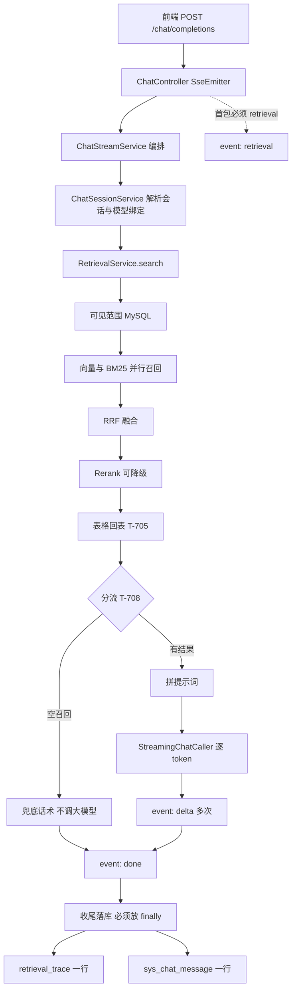
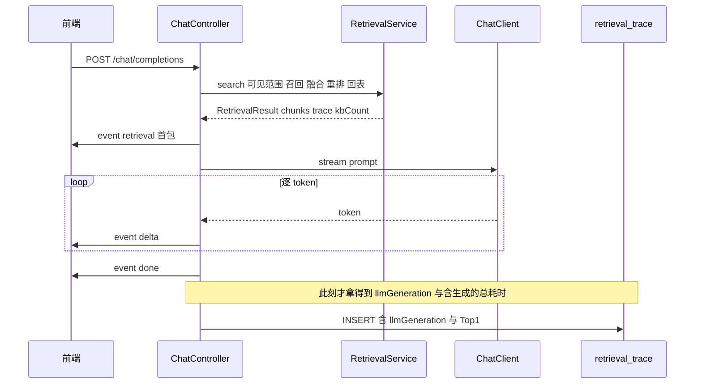

> 状态：🟡 进行中 · Sprint S5 · 阶段 A（M08 问答 SSE + `T-707` 打点）· 建档 2026-09-17

# 2026-09-17 · S5 · M08 · 阶段 A —— 问答 SSE 打通 + 检索链路打点落库

> 任务：`T-707` / `T-800` / `T-801` / `T-708` + `T-802` 的**建表半边**（5 项）
> 来源：`docs/进度/03-Sprint排期.md` §S5（行 705 / 765）· `docs/进度/02-任务清单.md` 行 342/354/355/356/343
> 上游计划：`ai_knowledge_web/plan/2026-09-17-S5-M07-B.md`（本批要销的账见第 1 节）

---

## 1. 开工条件检查

**依赖清单来源**：`docs/进度/00-开工速览.md` §1/§2/§9 · `docs/进度/02-任务清单.md`（grep 定位）·
`ai_knowledge_web/plan/汇总.md` §3/§4/§5 · 上一批计划 §9 · 环境实查（MySQL / Flyway / 表清单）。

> ⚠️ **本批是 `S5` 唯一带 `D-2` 硬约束的一批**：`T-707` 打点必须与 `T-800` 同批开工，
> 「后补 = 数据永久缺失」。下面 3 条 BLOCKER 全部围绕这一点。

| # | 依赖项 | 档位 | 现状（代码/文档实证） | 结论 |
|---|---|---|---|---|
| 1 | `T-707` 的依赖 `T-704`（`RetrievalResult` 对外契约） | ✅ | `RetrievalResult.java:27` + `RetrievalTrace.java:55`，`S5-M07-A` 已交付；`S5-M07-B` 又给它加了 `tableMillis`（第 6 段耗时）与 `degradeNote`（降级留痕） | 满足 |
| 2 | **`T-707` 的目标表 `retrieval_trace`** | ⛔ BLOCKER | `flyway_schema_history` 最大版本 = **21**（19:55:01）；库内 19 张表**无** `retrieval_trace` | 不满足 |
| 3 | `T-800` 的依赖 `T-704` | ✅ | 同 #1 | 满足 |
| 4 | **SSE 端点与请求契约** | ✅ | 前端**实查**：`request.ts:245` → `POST ${BASE}/chat/completions`；body `{message, modelId?, attachmentIds?, useVision?}`（`request.ts:240`）。⚠️ 字段名是 **`message`**，且**不带 `kbIds`** | 满足 |
| 5 | **§9 线格式 vs 后端 `RetrievalTrace`** | ⛔ BLOCKER | §9（`10:240-255`）与前端 `types/index.ts:123` 是 **7 个数 + `stages[]` + `chunks[]` + 3 个 `graph*`**；后端 `RetrievalTrace.java:55` 是 **26 字段** ⇒ **同名不同型**。且 §9 的 `totalMs`/`llmGeneration` 落在【首包】里，而首包发出时生成尚未开始 | 不满足 → **已裁定** |
| 6 | **流式生成能力** | ⛔ BLOCKER | `ChatCaller.call(String)→String` 是**一次性**接口；`RegistryChatCaller.java:26-30` 注释明写**刻意丢弃 `ChatResponse`**（"元数据在这里没有消费者"），而 `T-801` 点名要 `modelId/modelName/tokenUsage/finishReason` | 不满足 → **有解，不引依赖** |
| 7 | **`done.messageId` 的持久化落点** | ⛔ BLOCKER | 实查 19 张表**无** `sys_chat_session`/`sys_chat_message`；`sys_chat_session` 全仓仅出现在 `12-模型能力升级-变更清单.md:102` 的一行草稿里 | 不满足 → **已裁定** |
| 8 | `T-708` 的空召回话术须区分「还没有」与「真没有」 | ⚠️ WARN | `汇总.md` §5 末条 + `#114`：`BOUNDED` 下**秒级写可见窗口**（写 5 条立刻查回 4 条，隔 1 秒再查回 5 条）；重复查会自愈 ⇒ 不是 IVF 漏召回 | 不拒绝，判据 15/16 显式覆盖 |
| 9 | 审计模块名「问答」 | ✅ | `AuditModule.java:26` `QA = "问答"`；前端 `AuditLogView.vue` MODULES 已含「问答」 | 满足 |
| 10 | 问答侧权限码 | ⚠️ WARN | `PermissionCode` 无 `chat:*`。仓库既有先例是**只要求登录**（`/system/thresholds`、`/kb/presets`） | 不拒绝，按"只要求登录"实现并登记（§9） |
| 11 | `T-802` 的列表/删除/导出半边 | ⚠️ WARN | 前端 `chatApi.sessions/messages`（`api/index.ts:306-307`）已真调 `/chat/sessions` ⇒ 本批不交则该处仍 404 | 不拒绝，§3.3 明确不做 + §9 登记 |
| 12 | **图谱旁路**（§9 的 `graphUsed/graphCostMs/graphFallback`） | ⚠️ WARN | 实查：**未实现** —— 全仓只有 `RetrievalSource.java:22` 的枚举值与 `IdentifierTokenizer.java:28` 的「⏭️ 属 `T-C00`」注记；`HybridRetriever` 只跑向量 + BM25 | 不拒绝，线格式**照 §9 保留三字段**但恒为 `false`/缺省（§3.3 明确不做） |
| 13 | 环境 | ✅ | MySQL 19 表 / Milvus 只剩 `_default` / 后端 `:8080` / 前端 `:5174` 均在跑 | 满足 |
| 14 | ⚠️ **工作区里有两份未提交草稿** | ⚠️ WARN | `controller/ChatController.java`（mtime 20:53:14）与 `db/migration/V22__s5_retrieval_trace.sql`（20:57:51），**未提交、未执行**（Flyway 最大版本 21 即证）。`V22` 只有 11 列（缺 `table_millis` 等 15 列）；`ChatController` 发 `event: trace` + `{query,kbIds}`，与 §9 及前端 `request.ts` **均不符**（详见 §3.4 假设 1） | 不拒绝 —— §3.1 步 0 处置 |

**BLOCKER 汇总**：3 条（#2 / #5 / #7）。**已按「唯一路径 + 用户裁定」全部消解**，无一条挂起：

- **#2 是唯一路径** —— 依赖的表没建，只能本批建（`V22`）。**请确认**。
- **#5 已裁定（2026-09-17）**：**后端加适配 DTO**。内部 26 字段不动，M08 侧新增线格式类型映射到 §9 的 7 数 + `chunks`；
  `stages[]` 追加后端**真实测到**、§9 没有的段（可见范围 / RRF 融合 / 表格回表）；
  `llmGeneration` 与 `totalMs` 首包**不填真值**（见 #6 的连带结论）。**代价**：两套类型长期并存，`10` §14 要登记一张映射表（判据 20）。
- **#6 有解且不引依赖**：`ModelClientRegistry.chatClient()`（`ModelClientRegistry.java:60`）返回 Spring AI 的 `ChatClient`，
  `.stream()` 与 `.call().chatResponse()` 元数据**都在**。新增 `StreamingChatCaller`；**`ChatCaller` 原样保留**给 `IndexEnhancer`（26 处测试不动）。**代价**：问答侧与增强侧从此是两条模型调用路径（§9 登记）。
- **#7 已裁定（2026-09-17）**：**`T-802` 的建表半边随本批**。`messageId` 是**真行 id**，`T-808` 归因与 `T-807` 反馈不会"永久缺失"。
  `T-802` 的列表/删除/导出半边顺延；**`T-O09` 步 5/6 一并顺延**（优化配额连续第三批低于下限 4，§9 登记）。

> 判据只有一条：**这条不满足，代码写下去会不会白写**。#2 白写（表不存在）、#5 白写（前端按 7 数渲染，喂 26 字段直接白屏 —— `10:369` 把它列为 **P0**）、#6 白写（`done` 要的元数据被刻意丢了）、#7 白写（`messageId` 没有落点）。

### 结论

- [x] ✅ 可以开工 —— 3 条 BLOCKER 已消解，均记录在上方；施工从 §3.1 **步 0**（重写 `V22` + 处置草稿）开始
- [ ] ⛔ 拒绝施工

**⚠️ 已知偏差**（不拒绝施工，第 9 节销账）：`#8` 秒级写可见窗口 · `#10` 无 `chat:*` 权限码 · `#11` 会话查询半边 404 · `#12` 图谱旁路未实现 · `#14` 两份未提交草稿。

---

## 2. 开工时间

| 项 | 值 |
|---|---|
| 建档 / 开工日 | 2026-09-17 |
| 预计投入 | **10 人天**（Sprint 容量 ≈ 10 人天，本批用满）—— `T-707` 2 · `T-800` 3.5 · `T-801` 1.5 · `T-708` 1 · `T-802`建表半边 2 |
| 实际投入 | *回填时补* |

> ⚠️ **优化配额**：本批 `T-O09` 步 5/6 **顺延**（为会话表腾容量），**连续第三批低于下限 4 人天**。

---

## 3. 开工内容

### 3.1 步骤

| 步 | 做什么（文件/类 → 动作 → 产出） | 依赖 | 可并行 |
|---|---|---|---|
| **0** | **处置未提交草稿**（不写业务码）：① `V22__s5_retrieval_trace.sql` **整份重写**为 `RetrievalTrace` 的 26 字段行形状（草稿只有 11 列，缺 `table_millis` 等 15 列）；② `controller/ChatController.java` **整份重写**（草稿走 `event: trace` + `{query,kbIds}`，与 §9 与前端 `request.ts` 均不符） | — | 否 |
| 1 | `db/migration/V23__s5_chat_session_message.sql`（新）→ `sys_chat_session` + `sys_chat_message` 两表 + 索引 | — | 与步 2 并行 |
| 2 | `HybridRetriever#vectorChannel` → **把 embedding 与 search 拆成两个计时器** → 产出真实的 `embedMillis`/`vectorSearchMillis`（§9 的 `embed` 与 `vectorRecall` 从此有真值，**不填 0**） | — | 与步 1 并行 |
| 3 | `RetrievalTrace`（改）→ 加 `embedMillis` / `vectorSearchMillis` 两格（**只加，不动既有格**）；`RetrievalService` 的 `stages` 段一起填 | 2 | 否 |
| 4 | `pipeline/retrieve/TraceWriter`（新）→ 一次 `INSERT`；**失败只 warn 不抛**（打点是旁路证据，不是业务前置 —— 与 `LoginLogService` 同型） | 0 | 否 |
| 5 | `pipeline/chat/ChatDtos`（新）→ 线格式类型：`RetrievalEvent{chunks, trace, kbCount}` · `TraceWire{queryAnalysis, embed, vectorRecall, bm25Recall, rerank, llmGeneration, totalMs, stages[], chunks[], graphUsed?, graphCostMs?, graphFallback?}` · `DeltaEvent{content}` · `DoneEvent{messageId, modelId, modelName, tokenUsage, finishReason, usedVision}` · `AttachmentEvent`（本批恒不发） | — | 与步 4 并行 |
| 6 | `pipeline/chat/TraceWireMapper`（新）→ 后端 `RetrievalTrace` → `TraceWire`。**映射规则逐条写死在类注释里**（判据 20 要查它）：`queryAnalysis←0`（后端无此步，**不拿 `scopeMillis` 冒充**）· `embed`/`vectorRecall`←步 2 的真值 · `bm25Recall`←`bm25Channel` · `rerank`←`rerankMillis` · `llmGeneration←0`（**首包拿不到**）· `totalMs`←检索端到端 · `stages[]`←6 段 + **追加**「可见范围/RRF 融合/表格回表」三段 | 5 | 否 |
| 7 | `pipeline/chat/StreamingChatCaller`（新，`@Component`）→ 走 `ModelClientRegistry.chatClient()` 的 `.stream()`；**`ChatCaller` 原样保留**给 `IndexEnhancer` | — | 与 4/5 并行 |
| 8 | `service/ChatStreamService`（新）→ 编排：检索 → 分流（步 10）→ 拼提示词 → 流式生成 → 收尾落库。**收尾落库必须在 `finally` 里**（客户端中途断开也必须留痕，否则 [I-13] 的"无遗漏"不成立） | 3,4,6,7,9 | 否 |
| 9 | `service/ChatSessionService`（新）→ 会话解析 + `modelId` 与会话绑定不一致时**服务端开新会话**（`G5-10` 的运行时半边）+ 消息落库（真 `messageId`）+ `used_model_id` 落库（`T-808` 的**落点**，本批只落不问） | 1 | 否 |
| 10 | `service/ChatStreamService` 内**分流**（`T-708`）：`RetrievalResult.empty()` → **不调大模型**，直接兜底话术；话术**必须区分「还没有」与「真没有」**（`#114`）· `miss()` → 照常调，`done` 带未命中标记 | 8 | 否 |
| 11 | `controller/ChatController`（重写）→ `POST /api/chat/completions`，`SseEmitter`；事件序列 `retrieval → delta* → done`（**首包必须是 `retrieval`**，`G5-7`）；`error` 事件（前端 `request.ts:276` 已分发，但 §9 **未登记** —— §9 登记） | 8 | 否 |
| 12 | `10-接口约定汇总.md` §14 + `13-接口变更记录.md` → 登记**线格式映射表**与 `error` 事件 | 6,11 | 否 |
| 13 | 用例 + 页面级 E2E | 全部 | 否 |

**顺序要点**：步 0 **必须最先**（草稿 `V22` 若不先重写，步 4 会照着 11 列建表，`table_millis` 等字段当场丢）。
步 1 与步 2 互不相干，可并行；步 4/5/7 三条互不相干，可并行。

### 3.2 业务流程图

> 触发条件：① 跨 ≥3 组件 ✅（Controller / Service / Retrieval / ChatClient / DB）
> ② 涉及异步与事务边界 ✅（SSE 长连接 + 流式回调 + 收尾落库）③ 有状态机 ✅（会话 ↔ 模型绑定）
> ④ 有并发/幂等 ✅（同一会话并发提问）。**故画两张。**



**第二张 —— 为什么打点行必须由 M08 在流结束时写**（[I-13] 要求 `llmGeneration` 齐全，而它在首包时不存在）：



> ⚠️ **这条是 [I-13] 与 `D-2` 联立逼出来的结论**：`RetrievalService` **不能**自己写这一行 ——
> 它在检索结束时就返回了，那时 `llmGeneration` 还不存在。所以落库点**必须**在 M08 的收尾，
> 而这正是 `D-2` 说「打点后补 = 数据永久缺失」的原因：打点与问答**在物理上是同一次请求**。

### 3.3 明确不做（范围控制）

| 不做的事 | 原因 | 归属批次 |
|---|---|---|
| `T-802` 的**列表 / 消息列表 / 删除 / 导出**半边 | 本批只取它的**建表半边**（`messageId` 要有真落点）；导出是**高危数据导出**，要单独过审计风险档 | `S5-M08-B` |
| `T-803` 完整模型绑定语义（不支持同会话中途换模型的**全部**分支） | 本批只落 `G5-10` 点名的**一跳**：不一致 → 服务端开新会话且原会话保留 | `S5-M08-B` |
| `T-804` 引用角标的**溯源交互** | 后端只保证 `G5-9` 同源（顶层 `chunks` 与 `trace.chunks` 同一实例）；角标点击溯源是前端行为 | 前端小批 |
| `T-807` 反馈落库 / `T-808` 归因的**查询侧** | 本批只落 `used_model_id` 这一列（`T-808` 的**落点**）；反馈接口与运营统计是 S8 | `S8` |
| **图片附件 / VL**（`attachment` 事件 · `useVision` · `attachmentIds`） | `T-512` 属 S6（依赖 `T-907` 的 VL 模型）；本批**收下请求里的这两个字段但不发 `attachment` 事件**，`usedVision` 回 `false` | `S6`（`T-512`） |
| **图谱旁路**（`graphUsed` / `graphCostMs` / `graphFallback`） | 实查**未实现**（只有枚举值与「⏭️ 属 `T-C00`」注记）。线格式**照 §9 保留三字段**但恒 `graphUsed=false`、另两个省略 —— **不伪造** | `T-C00`（S7） |
| `T-O09` 步 5/6（HyQ 门控 + 章节级摘要） | **已解锁但顺延** —— 为会话表腾容量。⚠️ `汇总.md` §4 的 **HyQ 挂起判据**因此**仍挂在 `S5`**，一并顺延 | `S5-M08-B` |
| `T-710` 表格独立召回通道 | 本批有量化依据（聚合题 `Recall@5` 仅 0.806）但仍属 P2 | 待排 |
| **重排纳入评测**（`#127`） | 评测集批次已关；本批不改检索策略 | `T-710` / 重排专项 |

### 3.4 本批假设

| # | 假设 | 若被证伪的后果 |
|---|---|---|
| 1 | 那两份未提交草稿是**上一会话的废稿**，可整份重写 | 若是**用户有意留下的起点**，重写会丢掉意图 —— ⚠️ **故步 0 只重写、不删除文件**，且本假设登记进 §9 由用户复核 |
| 2 | `spring.ai` 的 `ChatClient.stream()` 在本仓的模型网关上**真能逐 token 返回**（不是一次性吐完） | 若网关不支持真流式，`delta*` 会退化成"一次大 delta" —— 前端不白屏，但"逐字输出"体验不成立，须在 §9 登记 |
| 3 | `ChatClient.call().chatResponse()` 能取到 `modelName` 与 `tokenUsage` | 取不到则 `G5-8` 的 `done.modelId/modelName` 无法满足，需要从 `ModelClientRegistry` 的 spec 侧补齐 |
| 4 | 会话/消息两表用**软删**（与 `sys_document` 同型），不物理删 | 若必须物理删，`T-802` 的删除半边要重做 |
| 5 | 一次问答落 `retrieval_trace` **恰好一行**（不是"每次召回一行"） | 若按分片落行，`G5-13` 的 Top1 分布与 `T-A03` 的四指标全部要改口径 |

---

## 4. 数据变更清单

| 类型 | 内容 | 回滚方式 |
|---|---|---|
| 迁移文件 | **`V22__s5_retrieval_trace.sql`（整份重写）** —— 草稿只有 11 列，与 `RetrievalTrace` 的 26 字段不符。⚠️ **它从未执行过**（`flyway_schema_history` 最大版本 = 21），故重写**不违反**「跑过的迁移只增不改」 | 可逆（`DROP TABLE`） |
| 新建表 | `retrieval_trace`（`V22`）：`trace_id`(uk) · `query_text` · `mode` · `kb_ids` · `kb_count` · `doc_scope_count` · `doc_scope_fallback` · `vector_hits` · `bm25_hits` · `fused_count` · `scope_millis` · `recall_millis` · `embed_millis` · `vector_search_millis` · `fuse_millis` · `rerank_millis` · `table_millis` · `llm_generation_millis` · `total_millis` · `recall_top_k` · `recall_threshold` · `rerank_top_k` · `rerank_enabled` · `table_weight` · `miss_threshold` · `low_score_warn` · `rerank_applied` · `rerank_note` · `degrade_note` · `miss_flag` · **`top1_score`**（`G5-13` 的落点）· `user_id` · `session_id` · `created_at` + `idx_created_at` | 可逆 |
| 迁移文件 | **`V23__s5_chat_session_message.sql`（新）** | 可逆（有真实会话数据后不可逆） |
| 新建表 | `sys_chat_session`（id · user_id · title · model_id · session_gen · created_at · updated_at · deleted_at）· `sys_chat_message`（id · session_id · role · content · **used_model_id** · retrieval_trace_id · token_usage · finish_reason · created_at）+ 归属索引 | 需人工 |
| 列可空性 | `retrieval_trace.llm_generation_millis` **可空** —— 空召回/不调模型时**真的是没有**这个数，填 0 会把"没生成"说成"生成耗时 0ms"。⚠️ 同理 `top1_score` 在空召回时**为 NULL**，前端与 `T-A03` 必须按"未知"而非"0 分"处理 | — |
| 种子数据 | **无**（`retrieval_trace` 与两会话表都从零长） | — |

---

## 5. 依赖与工具决策

**默认不引。** 候选与不引方案对比：

| 方案 | 做法 | 代价 | 结论 |
|---|---|---|---|
| **不引依赖（既有栈）** | `ModelClientRegistry.chatClient()` 返回 Spring AI `ChatClient` —— `.stream()`（`Flux<String>`）与 `.call().chatResponse()`（含 `metadata.usage` / `model`）**都在既有 jar 里**；SSE 用 Spring MVC 自带的 `SseEmitter` | 无新增体积；`ChatCaller` 与 `StreamingChatCaller` 两条路径并存 | ✅ **采用** |
| 候选 A：引 `spring-boot-starter-webflux` | 用 `Flux<ServerSentEvent>` 做响应式流 | Boot 4 下会**改变整个应用的 MVC/VС 栈判定**（引入 `WebFlux` 与 `spring-webmvc` 并存）；本仓是 `SseEmitter` 的同步栈，为一个端点换栈不成比例 | ❌ 否 |
| 候选 B：引 `okhttp-sse` / `webflux` 客户端 | 客户端侧 SSE | **本仓是 SSE 服务端**，不是消费方。前端已有 `fetch` 流式读取（`request.ts:238`） | ❌ 否 |

**推荐**：**不引新依赖** · **理由**：所需能力（流式 + `ChatResponse` 元数据 + SSE 服务端）在**既有 Spring AI 2.0.1 + Spring MVC** 上已全部成立，
`ModelClientRegistry.java:60` 取的本来就是 Spring AI 的 `ChatClient`；引 WebFlux 会改变整个应用的栈判定，而收益只是一个端点。

---

## 6 + 7. 验收方法与标准

| # | 判据（门禁号） | 验收方法（可直接粘的命令/脚本） | 期望结果 | 证据落点 |
|---|---|---|---|---|
| 1 | `G5-12` / I-13 · `retrieval_trace` **表存在且列齐** | `export JAVA_HOME='F:/work/dev_tools/jdk/jdk-25.0.4.1'` + `mvn -B -f F:/work/code/ai-knowledge/ai_knowledge_web/pom.xml spring-boot:run`；再 `docker exec kb-mysql mysql -u"$MYSQL_USERNAME" -p"$MYSQL_PASSWORD" "$MYSQL_DATABASE" -N -e "show columns from retrieval_trace;"` | 34 列全在；`flyway_schema_history` 版本 22 **success=1** | `V22` + 实查输出 |
| 2 | `G5-12` · **6 阶段耗时齐全且 `totalMs` ≈ 6 项之和** | 真实 HTTP 提问一次后 `select embed_millis, vector_search_millis, bm25_recall_millis, rerank_millis, llm_generation_millis, total_millis from retrieval_trace order by id desc limit 1;` | 无 NULL（除"未调模型"场景）；`total` ≈ 各段之和（±10% 计时粒度） | 实查行 |
| 3 | **`V22` 的形状 = `RetrievalTrace` 的行形状** | `TraceWriterTest`：对 26 字段逐个 `assert` 落库后读回相等 | 逐字段相等 | 新用例 |
| 4 | `G5-13` / I-14 · **每次提问都落 Top1 相似度，无遗漏** | `TraceWriterTest` 两条：① 有结果 → `top1_score` 非 NULL；② **空召回 → 仍然有一行**，`top1_score` 为 **NULL**（不是 0） | 两次都有行 | 新用例 |
| 5 | `G5-13` · **打点失败不让问答失败** | 注入写库异常（`@MockBean` 或临时改表名）→ 请求仍 200 且 `done` 正常 | 问答不受影响，只有 warn 日志 | 新用例 |
| 6 | **`#114` 的写可见窗口在话术里被区分** | `ChatStreamServiceTest`：空召回 → 兜底话术同时含"还没有"与"真没有"两条分支的判别 | 两条话术**不是同一句** | 新用例 |
| 7 | `G5-7` · **首包必须是 `retrieval`** | `node scripts/e2e-chat-flow.mjs --base=http://127.0.0.1:5174`（新建）：抓 SSE 首个 `event:` 名 | 第一个事件名 = `retrieval` | E2E 脚本输出 |
| 8 | `G5-8` · **`trace` 是对象（非扁平）+ `done` 带 `modelId/modelName`** | 同上脚本：解析首包 `data.trace` 与 `done` 包 | `typeof data.trace === 'object'`；`done.modelId` / `done.modelName` 非空 | E2E 脚本输出 |
| 9 | `G5-8` · `source ∈ vector/bm25/graph` | 同上：断言每个 `chunks[].source` 取值 | 全部落在三个枚举内（本批实为前两个） | E2E 脚本输出 |
| 10 | `G5-9` · **顶层 `chunks` 与 `trace.chunks` 逐字段一致** | 同脚本：两个数组 `JSON.stringify` 后比较 | 完全相等（同一实例的序列化） | E2E 脚本输出 |
| 11 | `G5-11` 前半 · **空召回不调用大模型** | `ChatStreamServiceTest`：替身 `StreamingChatCaller` 记录调用次数；构造空召回 | 调用次数 **0**；仍有 `done` | 新用例（负向锚：去掉分流必红） |
| 12 | `G5-11` 后半 · **未命中（< 0.35）照常调模型且留痕** | 同上：造 `miss=true` | 调用次数 **1**；`retrieval_trace.miss_flag = 1` | 新用例 |
| 13 | `G5-10` · **`modelId` 与会话不一致 → 服务端开新会话且原会话保留** | `ChatSessionFlowTest`：同会话先后传 modelId=A、modelId=B | 原会话仍在；新会话 `model_id=B` | 新用例 |
| 14 | `T-801` · **消息落库，`done.messageId` 是真行 id** | 提问一次后 `select id, session_id, role, content, used_model_id from sys_chat_message order by id desc;` | 有 user + assistant 两行；`used_model_id` 非空 | 实查 + 用例 |
| 15 | `T-801` · **客户端中途断开仍留痕** | 用例：`SseEmitter` 提前 `complete()` 后查库 | `retrieval_trace` 与 `sys_chat_message` **仍有行** | 新用例 |
| 16 | **线格式映射表登记在 `10` §14** | 读 `docs/需求文档/10-接口约定汇总.md` §14 新增段 | 26 字段 → 7 数的逐条映射 + `stages[]` 追加说明 + `graph*` 恒 false 说明 | 文档 |
| 17 | **`error` 事件进 §9** | 读 `10` §9；对照 `request.ts:276` | §9 的事件列表含 `error` 且字段与前端分发一致 | 文档 |
| 18 | **`stages[]` 追加的段是真值不是 0** | 提问后读首包 `stages[]` | 含「可见范围/向量召回/BM25 召回/Rerank/表格回表/RRF 融合」；**其值等于**同行 `retrieval_trace` 的对应列 | E2E + 实查对照 |
| 19 | **`embed` 与 `vectorRecall` 是拆开的真值** | 对照首包 `embed` / `vectorRecall` 与同行 `embed_millis` / `vector_search_millis` | 两组分别相等；**`embed` 不为 0**（负向锚：不拆计时器则 `embed=0` 必红） | 用例 |
| 20 | **`ChatCaller` 未被破坏**（`IndexEnhancer` 侧零回归） | `mvn -B -f ...pom.xml test -Dtest=IndexEnhancer*Test,IndexEnhanceFlowTest` | 全绿（26 处既有引用不动） | 测试输出 |
| 21 | 后端全量 | `mvn -B -f F:/work/code/ai-knowledge/ai_knowledge_web/pom.xml test` | 与 `S5-M07-B` 基线（469/7）比较，**不新增红** | 测试输出 |
| 22 | 页面级 | `cd ai_knowledge_app && node scripts/e2e-chat-flow.mjs --base=http://127.0.0.1:5174`（**新建**） | 全绿 | 脚本输出 |
| 23 | 既有 9 脚本不回归 | 依次跑 `e2e-kb-flow` / `e2e-doc-upload` / `e2e-audit-flow` / `e2e-doc-parse` / `e2e-console-check` / `e2e-audit-backfill` / `e2e-auth-flow` / `e2e-admin-flow` / `e2e-profile-flow` | 全绿（⚠️ `admin`/`profile` 跑前须先复原探针状态 —— `#120`） | 脚本输出 |
| 24 | `audit-api` ①/②/⑥ | `cd ai_knowledge_app && node scripts/audit-api.mjs` | ①=0 ②=0 ⑥=0（**新增端点必须同步 `VERB_TO_METHOD`**，见 `汇总.md` §5） | 脚本输出 |
| 25 | 种子与残留 | `docker exec kb-mysql mysql ... -N -e "select (select count(*) from sys_user where deleted_at is null), (select count(*) from sys_kb), (select count(*) from sys_document), (select count(*) from sys_chunk), (select count(*) from sys_async_task);"` | user 128 / kb 8 / doc 0 / chunk 0 / async_task 0 | 实查输出 |
| 26 | Milvus 残留 | 实查分区列表与 `count(*)` | 只剩 `_default`、向量 0 | 实查输出 |

**观察项**（不计成败）：① `delta` 事件的**个数** —— 若网关不真流式则退化为 1 个（假设 2）；② 前端检索详情面板对 `stages[]` 多出的三段是否正常渲染（面板按数组渲染，预期不白屏）。

**种子核对**（跑完必做）：

```bash
set -a && . ai_knowledge_web/.env && set +a
docker exec kb-mysql mysql -u"$MYSQL_USERNAME" -p"$MYSQL_PASSWORD" "$MYSQL_DATABASE" -N -e "select count(*) from sys_user where deleted_at is null;"
```

---
---

# 以下为开工后回填

> **提交节奏（两次）**：1~7 节写完即提交一次（`docs(plan): S5-M08-A 开工计划`）；
> 8~10 节写完再提交一次（`docs(plan): S5-M08-A 验收回填`）。

## 8. 验收结果

| # | 判据 | 实测结果 | 证据（命令 / 文件:行 / 测试名） |
|---|---|---|---|

**测试基线**：`Tests run: N, Failures: 0, Errors: 0, Skipped: 0`（上批 469/7 → 本批 M）

---

## 9. 遗留问题

| # | 项 | 原因 | 归属批次 | 是否有判定点/注释留在代码里 |
|---|---|---|---|---|

---

## 10. 建议

---

## 附：本批同步的文档回填

- [ ] **`docs/进度/00-开工速览.md` §1/§2/§3/§4** → 当前定位 / 本批任务行 / 门禁现状 / 缺口账（**必改**）
- [ ] `docs/进度/02-任务清单.md` → `T-707`/`T-708`/`T-800`/`T-801`/`T-802` 置 ✅
- [ ] `docs/进度/03-Sprint排期.md` → 「交付状态」段
- [ ] `docs/进度/README.md` → 看板状态 + 完成日期（长备注追加到 `docs/进度/变更记录/02-Sprint交付台账.md`）
- [ ] `docs/进度/变更记录/01-变更记录.md` → 追加一行
- [ ] `docs/需求文档/10-接口约定汇总.md` §14 + `docs/需求文档/13-接口变更记录.md` → 线格式映射表 + `error` 事件
- [ ] `ai_knowledge_web/plan/汇总.md` → 总览 + §3 遗留并入 + §4 挂起（HyQ 仍挂）
- [ ] 本文件状态行 → ✅ 已完成
- [ ] `.workbuddy/memory/<日期>.md` → 交接
