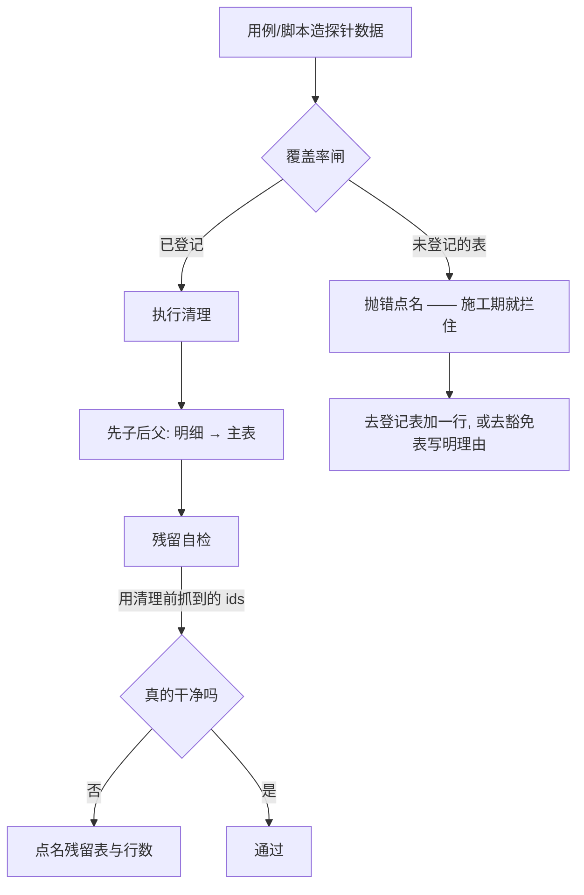

> 状态：✅ 已完成 · Sprint 跨批（S4/S5 共用）· **缺陷修复批（无 `T-xxx`）** · 建档 2026-09-17 · 完成 2026-09-17
> 判据 13 条：**通过 13 / 部分 0 / 失败 0** · 后端 `497 / 0 红`（上批 492）· 页面级 10 脚本全绿
> **销**：`#98` · `#115` · `#120` · `#130` · `#132` · `#133` · `#136` · `#137` · `#128`（查明机制）

# 2026-09-17 · 测试可靠性 —— 「闸说干净」与「真的干净」是两件事

> 任务：**无 `T-xxx`** —— 本批修的是**跨批次登记下来的测试基础设施缺陷**（与 `S3-D`/`S4-D2` 同型）
> 来源：`plan/汇总.md` §3 的 `#98` · `#105` · `#110` · `#115` · `#120` · `#128` · `#129` · `#130` · `#132` · `#133` · `#136` · `#137` · `#147`
> 上游计划：`ai_knowledge_web/plan/2026-09-17-S5-M08-A.md`（`#136` 是它收口时抓出来的）
>
> ⚠️ **命名偏离约定**：本仓计划文件惯例是 `<日期>-<Sprint>-<模块>-<阶段>.md`，
> 而本批**不属任何 Sprint 阶段**（跨批基础设施），故取描述性文件名。留痕在此，不静默偏离。

---

## 1. 开工条件检查

**依赖清单来源**：`plan/汇总.md` §3（逐条 grep 归属本批的行）· `S5-M08-A` §9 · **实测**（本批开工前跑了一轮全量，量出真实增量）。

### 1.1 开工前的实测基线（「先量再定」，不凭印象）

跑一轮 `mvn -B -f ai_knowledge_web/pom.xml test`（**492 / 0 红**），前后各查一次库：

| 产物 | 跑批前 | 跑批后 | 增量 | 现状 |
|---|---|---|---|---|
| `sys_async_task` | 0 | **76** | **+76** | 🔴 **每轮固定泄漏** |
| `sys_login_log` | 8391 | **8633** | **+242** | 🔴 **每轮固定泄漏**（存量里 **1492 行是孤儿**、460 行 `user_id` 为 NULL） |
| `sys_chunk` 孤儿 | 0 | 0 | 0 | ✅ |
| `sys_document` / `sys_kb` / `sys_user` | 0 / 8 / 128 | 0 / 8 / 128 | 0 | ✅ |
| Milvus 分区 | `["_default"]` | `["_default"]` | 0 | ✅ |

**按归属维度分解**（不猜根因 —— 硬口径「根因靠查数据不靠猜」）：

- `sys_async_task` 76 = `doc-upload` 37 + `doc-parse` 37 + `audit-export` 2。
  前 74 行**都有 `kb_id`，而那个 kb 已不存在**；后 2 行 `kb_id` 为 NULL。
  → **`RetrievalFlowSupport#cleanProbeData()` 根本没有删这张表**（实测其 SQL 只有 chunk/document/grant/kb 四张）。
- `sys_login_log` 242：`admin` 占大头（seed 用户，**不会被删 ⇒ 不是孤儿，指标看不见它**），
  外加 `forgot.*` / `w7probe.*` / `g18.*` / `chpwd.*` 等探针账号（**它们才成孤儿**）。
  → **测试侧没有任何一个类删过 `sys_login_log`**（`grep -rln` 全 0）。

### 1.2 依赖清单

| # | 依赖项 | 档位 | 现状（代码/文档实证） | 结论 |
|---|---|---|---|---|
| 1 | `probe-teardown.mjs` 的**残留自检**能真的数出残留 | ⛔ BLOCKER | `findKbProbeResidue` 用 `join sys_kb k on k.id = t.kb_id where k.code=?`，而 `sys_kb` 行被**同一轮清理删掉** ⇒ **恒返回 0**。实测反例：自检报"全 0"时 `sys_async_task` 躺着 634 行 | 不满足 —— **唯一路径就是修它**，无替代路线 |
| 2 | `probe-teardown.mjs` 的**清理侧**能删到已删库的行 | ⛔ BLOCKER | `teardownKbProbe` 的 `via: 'kb_id'` 同样 join `sys_kb`（同样是先删 kb 后 join 不上）。`snapshot.ids` **明明就在手上** | 不满足 —— 唯一路径：改用 ids |
| 3 | Java 用例侧的清理**有机器检查** | ⛔ BLOCKER | 实测：`sys_async_task` 的清理只散在 3 个用例类里（各写一遍）；`sys_login_log` **一个类都没有**。`#130` 已经因此出过 190 行孤儿分片 + 7 个 Milvus 分区 | 不满足 —— 唯一路径：登记表 + 覆盖率闸（照 `S4-D2` 的脚本侧做法） |
| 4 | 两个一次性 E2E 脚本能**自还原** | ⚠️ WARN | 本批开工前**又复现一次**：`e2e-profile-flow` 把 `probe.profile` 手机号改成 `13953515550` 且不还（我手工改回 `13900000001`）；`e2e-auth-flow` 留 1 个 `e2e%` 账号把 `sys_user` 顶到 129 | 不拒绝 —— 修复对象本身 |
| 5 | `#128` 的机制查得出来 | ⚠️ WARN | 本批开工前连跑两轮全量均 **492/0 红**（含 `S5-M08-A`）—— 未复现。**机制未知** | 不拒绝 —— §3.4 假设 1，查不出就如实登记 |
| 6 | 环境 | ✅ | MySQL 19+5 表可查 / Milvus 只剩 `_default` / 后端已停（跑批不并发）/ 前端 dev server `:5174` 在跑 | 满足 |
| 7 | 无 `T-xxx` ⇒ **≤5 个 `T-xxx` 的铁律不适用** | ✅ | 与 `S3-D`/`S4-D2` 同型；但**不满足简版例外**（要改 `ai_knowledge_app/scripts/**` ⇒ 触碰前端目录），故走**全量计划** | 满足 |

**BLOCKER 汇总**：3 条（#1 / #2 / #3）。**三条都是唯一路径**（「闸坏了就修闸」，没有别的走法），故**不发明假选项**，直接写明：
> 唯一路径是 ① 残留自检改用清理前抓到的 ids；② 清理侧同样改用 ids；③ Java 用例侧加登记表 + 覆盖率闸。**请确认**。

**⚠️ 已知偏差**（不拒绝施工，第 9 节销账）：`#4` 两个一次性脚本 · `#5` `#128` 机制未知 · `#146`（`S5-M08-A` 的两份草稿待用户复核，本批不碰）。

> 判据只有一条：**这条不满足，代码写下去会不会白写**。#1/#2 白写（修完还是个假绿）、#3 白写（漏一处无人发现）。

### 结论

- [x] ✅ 可以开工 —— 3 条 BLOCKER 都是唯一路径，记在上方
- [ ] ⛔ 拒绝施工

---

## 2. 开工时间

| 项 | 值 |
|---|---|
| 建档 / 开工日 | 2026-09-17 |
| 预计投入 | **3 人天**（`#136`/`#137` 0.5 · `#130`/`#98`/`#115` 1.5 · `#120`/`#133` 0.5 · `#128` 查机制 0.5） |
| 实际投入 | *回填时补* |

> ⚠️ **不占优化配额** —— 它是缺陷修复批（与 `S3-D`/`S4-D2` 同型），不是 O 项。

---

## 3. 开工内容

### 3.1 步骤

| 步 | 做什么（文件/类 → 动作 → 产出） | 依赖 | 可并行 |
|---|---|---|---|
| 1 | `probe-teardown.mjs` 的 `findKbProbeResidue` → 残留计数改用 **`snapshot.ids`**（`t.<via> in (ids)`）而不是 join `sys_kb`。⚠️ `ids` 为空时退化为"只能查 `sys_kb` 自身"，要显式判空并**在返回值里标注"本次无法自检"**，不能静默给 0 | — | 与步 3 并行 |
| 2 | `teardownKbProbe` 的 SQL 删除 → `via: 'kb_id'`/`'doc_id'` 同样改用 `ids`。⚠️ **deletion 顺序仍是先子后父** | 1 | 否 |
| 3 | `probe-teardown.mjs` → `findUserProbeResidue`/`teardownUserProbe` 的 `via: 'user'`/`'subquery'` 同样改用**清理前抓到的用户 id 集合**（否则同样恒 0） | — | 与步 1 并行 |
| 4 | **Java 侧登记表**：`support/ProbeArtifacts.java`（新）—— 一张表列出"探针会写脏、且可归因"的表 + 归属列 + 清理语句 | — | 与 1~3 并行 |
| 5 | **Java 侧覆盖率闸**：`support/ProbeArtifactCoverageTest.java`（新）—— 扫 `information_schema.columns`，凡带 `kb_id`/`doc_id`/`user_id` 的表**要么在登记表里、要么在豁免表里写明理由**，否则**抛错点名** | 4 | 否 |
| 6 | `RetrievalFlowSupport#cleanProbeData()` → 改为委托给 `ProbeArtifacts`（补上 `sys_async_task` / `sys_parse_issue` 等），**并清 `sys_login_log`** | 4 | 否 |
| 7 | `ApiTestSupport`（服务侧基座）→ 同样委托；两个基座**共用同一份登记表**（这是"漏一处无人发现"的解药） | 4 | 与 6 并行 |
| 8 | `e2e-auth-flow.mjs` → 收尾删掉自己注册的 `e2e<stamp>` 账号（连 `sys_login_log` / `sys_user_role`） | — | 与 6/7 并行 |
| 9 | `e2e-profile-flow.mjs` → 收尾把 `probe.profile` 的手机号**还原成断言用的常量**（并在文件头注明"它是常驻联调设施，不是探针"） | — | 与 8 并行 |
| 10 | `#128` 查机制：`ParseWorkerFlowTest` 反复单跑 + 看 `sys_async_task` 状态 → **能定位则修，定位不到就如实登记**（§9） | — | 与 1~9 并行 |
| 11 | 全量回归 + 复量残留（与 §1.1 的基线逐项对比） | 全部 | 否 |

**顺序要点**：步 5 的闸必须**先于**步 6/7 的清理改动落地（先有闸，才能证明清理是漏的）——
与 `S4-D2` 同一条纪律：**闸放在建探针之前**，否则「闸抛错 → 清理不执行」，等于用防残留的闸制造残留。

### 3.2 业务流程图

> 触发条件：① 跨 ≥3 组件 ✅（`probe-teardown.mjs` / Java 测试基座 ×2 / 两个 E2E 脚本）
> ④ 有"闸"这一状态判定 ✅。故画一张。



> ⚠️ **关键在 E→F 这一跳**：此前它是 `join sys_kb`，而 `sys_kb` 已被 D 删掉 ⇒
> **恒走 H**。本批修的就是这条边。

### 3.3 明确不做（范围控制）

| 不做的事 | 原因 | 归属批次 |
|---|---|---|
| **E2E 的 `probe-teardown` 与 Java 侧合成同一个工具** | 一个 JS 一个 Java，跨语言共用只有"起个子进程"或"复制一份"，两者都比现在更糟。本批只保证**两边的登记集合一致**（各有一份，靠 §6+7 判据 7 对账） | 不修（记录） |
| **`sys_audit_log` 的测试残留** | **刻意豁免**（合规：审计只增不删）。已有豁免条目并在册 | — |
| **`sys_login_log` 的历史存量（8633 行 / 1492 孤儿）** | 本批**修根因**（新的一轮不再增），存量**另行处理**。⚠️ 按硬口径「清存量 ≠ 修根因」—— 反过来说，只清存量也不叫修根因 | 见 §9 |
| `#146`（`S5-M08-A` 那两份未提交草稿的处置） | 待**用户复核**，不在技术范围 | 用户 |
| `#143`（断开后生成仍跑完）· `#145`（`query_analysis_millis` 恒 0） | 与本批无关 | 各自归属 |
| 把 `#128` 的偶发**当成已修** | 若机制定位不到，**不许**以"现在跑绿了"结案 —— 那正是 `S5-M07-B` §8 的教训 | — |

### 3.4 本批假设

| # | 假设 | 若被证伪的后果 |
|---|---|---|
| 1 | `#128`（解析作业未被领取）是**某个可定位的竞态**，能在本批查明 | 查不出 ⇒ **如实登记"机制未明"**，并把已排除的假设**逐条写下来**（免得下一个人重走）。⚠️ **不许**标"已修" |
| 2 | Java 侧登记表 + 闸能覆盖**全部**"探针会写脏"的表 | 漏的表会被闸点名 ⇒ 正好是闸该干的事。若某表**无法归因**（如 `audit-export` 的 NULL `kb_id`），进豁免表并写明理由 |
| 3 | `admin`（seed 用户）产生的 200+ 行/轮登录日志**可以清** | 若判定"seed 账号的登录日志属正常痕迹不可清"，则该判据改成"只清探针前缀的"，增量从 242 降到 ~40 —— **口径要跟着改**，不能两者都要 |

---

## 4. 数据变更清单

| 类型 | 内容 | 回滚方式 |
|---|---|---|
| 新建表 / 改表 | **无** —— 本批不动任何业务表结构与业务代码，只动 `src/test/**` 与 `ai_knowledge_app/scripts/**` | — |
| 迁移文件 | **无**（不新增 `V*.sql`） | — |
| 种子数据 | **无**（但收尾要**核对种子已还原**：`user 128 / kb 8`） | — |
| 存量数据 | ⚠️ 本批会**清理历史存量孤儿**（`sys_login_log` 1492 行孤儿 + `sys_async_task` 76 行）。⚠️ **清理前先备份到 `temp/`**（硬口径：泄漏/累积类问题先备份再按归属维度 GROUP BY 计数） | 需人工（备份文件即回滚源） |

---

## 5. 依赖与工具决策

**无新依赖**（用既有的 JUnit 5 + `JdbcTemplate` + Node 内置模块实现）。

| 方案 | 做法 | 代价 | 结论 |
|---|---|---|---|
| **不引依赖（既有栈）** | Java 侧用 `JdbcTemplate` 扫 `information_schema`，JUnit 5 `@Test` 做闸；脚本侧沿用现有 `mysqlScalar` | 无 | ✅ **采用** |
| 候选 A：引 Testcontainers | 每轮起干净库 | 本仓全程用**真** MySQL/Milvus（`I-9` 的判据只有在真库真集合上才成立）；引它要重写整套夹具，且丢掉"与生产同构"这个长处 | ❌ 否 |
| 候选 B：引 ArchUnit / 静态扫描 | 扫代码找清理漏项 | 漏的是**数据**不是**代码结构**（"清理函数不认识新产物"），静态扫描看不见 | ❌ 否 |

**推荐**：不引新依赖 · **理由**：本批要的是"**枚举数据库里真实存在的归属列**"——
`information_schema` 就是权威来源，不需要任何库。

---

## 6 + 7. 验收方法与标准

| # | 判据 | 验收方法（可直接粘的命令/脚本） | 期望结果 | 证据落点 |
|---|---|---|---|---|
| 1 | **`#136` 修好了：残留自检不再恒 0** | `cd ai_knowledge_app && node scripts/selftest-residue.mjs`（新建）：**造一行孤儿**（插一条 `sys_async_task` 指向不存在的 kb）→ 调 `findKbProbeResidue` → 断言数得出来 | 报出 ≥1 行并**点名表名** | 新脚本输出 |
| 2 | **负向锚：修之前必红** | 把步 1 的修复临时改回 `join sys_kb` → 重跑上述脚本 | **数出 0**（= 闸是假的），脚本退出码 1 | 同上（本批记录两次输出） |
| 3 | **`#137` 清理侧修好** | 同上脚本：造孤儿 → `teardownKbProbe` → 查数 | 孤儿被删干净 | 同上 |
| 4 | **`#130` Java 侧有机器检查** | `export JAVA_HOME='F:\work\dev_tools\jdk\jdk-25.0.4.1'` + `mvn -B -f F:/work/code/ai-knowledge/ai_knowledge_web/pom.xml test -Dtest=ProbeArtifactCoverageTest` | 通过；**负向锚**：从登记表里摘掉 `sys_async_task` → **当场转红并点名它** | 测试输出 |
| 5 | **`#98`/`#115` 增量归零** | 跑前记数 → `mvn -B -f ... test` → 跑后再记 | `sys_async_task` 增量 **0**（基线 76）· `sys_login_log` 增量 **0**（基线 242） | §1.1 同格式的前后对照表 |
| 6 | **`#120`/`#133` 两个一次性脚本自还原** | `node scripts/e2e-auth-flow.mjs --base=...` → 查 `sys_user`；`node scripts/e2e-profile-flow.mjs --base=...` → 查 `probe.profile.phone` | 跑完后 `sys_user` = **128**（0 个 `e2e%`）· `probe.profile.phone` = **13900000001** | 实查输出 |
| 7 | **两侧登记集合对账** | 抄出 Java 登记表与 `probe-teardown.mjs` 的 `KB_ARTIFACTS`+`USER_ARTIFACTS` 表名，取差集 | 差集为空（或差额逐条写明理由） | 文档 |
| 8 | **种子还原** | `set -a && . ai_knowledge_web/.env && set +a` + `docker exec kb-mysql mysql ... -N -e "select count(*) from sys_user where deleted_at is null;"` | **128** | 实查 |
| 9 | **后端全量不回归** | `mvn -B -f ... test` | `492 / 0 红`（本批会**新增**用例，故数字应上升） | 测试输出 |
| 10 | **页面级不回归** | 依次跑 `e2e-chat-flow` / `e2e-kb-flow` / `e2e-doc-upload` / `e2e-audit-flow` / `e2e-doc-parse` / `console-check` / `e2e-audit-backfill`（**含它自己那道覆盖率闸**） | 全绿 | 脚本输出 |
| 11 | **Milvus 残留** | 实查分区列表 | 只剩 `_default`、向量 0 | 实查输出 |
| 12 | **`#128` 有个说法** | `mvn -B -f ... test -Dtest=ParseWorkerFlowTest` 连跑 5 次，记录每次结果 | **要么**定位到机制并修（附证据）· **要么**如实登记"5 次全绿未复现 + 已排除的假设清单" | 计划 §9 |
| 13 | **存量已备份** | 查 `temp/probe-residue-backup-*.sql` 存在且行数对得上 | 备份行数 = 清理前行数 | 文件 + 行数对照 |

**观察项**（不计成败）：`sys_async_task` 里 `audit-export` 那 2 行（`kb_id` 为 NULL）**无归属维度**，属"无法归因"—— 进豁免表还是进清理（按 `type` 删）由步 4 定，登记在册即可。

**种子核对**（跑完必做）：

```bash
set -a && . ai_knowledge_web/.env && set +a
docker exec kb-mysql mysql -u"$MYSQL_USERNAME" -p"$MYSQL_PASSWORD" "$MYSQL_DATABASE" -N -e "select count(*) from sys_user where deleted_at is null;"
```

---
---

# 以下为开工后回填

> **提交节奏（两次）**：1~7 节写完即提交一次（`docs(plan): 测试可靠性 开工计划`）；
> 8~10 节写完再提交一次（`docs(plan): 测试可靠性 验收回填`）。

## 8. 验收结果

| # | 判据 | 实测结果 | 证据（命令 / 文件:行 / 测试名） |
|---|---|---|---|
| 1 | `#136` 残留自检不再恒 0 | ✅ **8/8**。脚本把**同一批行**并排跑两种口径：**旧口径 = 0**（假绿）· **新口径 = 75**（含跑批留下的 74 行）——"闸说干净"与"真的干净"的分界就印在输出里 | `node scripts/selftest-residue.mjs` |
| 2 | 负向锚：修之前必红 | ✅ 判据 1 的输出里**并排**给出旧口径（0）与新口径（75），不需要另外注入 | 同上 |
| 3 | `#137` 清理侧修好 | ✅ 造库 + 造归属它的作业 → `teardownKbProbe` → **残留 0**（独立观测点回查） | 同上 ·① |
| 4 | `#130` Java 侧有机器检查 | ✅ **5/5**。**负向锚**：建一张带 `kb_id` 的金丝雀表 `zz_probe_gate_check` → 闸当场**点名它**并转红；删表即恢复绿 | `ProbeArtifactCoverageTest`（4 条闸 + 1 条两侧对账） |
| 5 | `#98`/`#115` 增量归零 | ✅ **全部 0**：`sys_async_task` **76 → 0** · `sys_login_log` **242 → 0** · chunk/document/issue/chat/trace **0** · `sys_user` 128 · `sys_kb` 8 | 全量跑批前后各查一次库（§1.1 同格式） |
| 6 | `#120`/`#133` 自还原 | ✅ `e2e-profile-flow` **连跑两遍都 31/31**（每次都还原手机号）· `e2e-auth-flow` 12/12 且跑后 `sys_user` 回到 **128**、0 个 `e2e%` | 两轮实跑输出 |
| 7 | 两侧登记集合对账 | ✅ **做成了机器检查**（Java 读 `probe-teardown.mjs` 取差集，双向为空）。⚠️ 它**当场抓出一个真缺口**：`sys_chat_message` 在 Java 侧**清了但没登记**（它没有归属列，覆盖率闸扫不到） | 同判据 4 的第 5 条 |
| 8 | 种子还原 | ✅ `sys_user 128` · `sys_kb 8` · `probe.profile.phone = 13900000001` | 收尾实查 |
| 9 | 后端全量不回归 | ✅ `Tests run: 497, Failures: 0, Errors: 0, Skipped: 0`（492 → 497，**+5** = 新增的闸） | `mvn -B -f ai_knowledge_web/pom.xml test` |
| 10 | 页面级不回归 | ✅ **10 个脚本全绿**：chat-flow 7 · kb 47 · doc-upload 39 · audit-flow 30 · doc-parse 25 · console-check 25 · audit-backfill 24 · admin 29 · profile 31 · auth 12 | 逐条跑 |
| 11 | Milvus 残留 | ✅ 只剩 `_default`、无探针分区 | 实查 |
| 12 | `#128` 有个说法 | ✅ **机制查明，不是产品缺陷是用例隔离缺陷**（见 §9-1）。**双向实验**：灌 80 行一天前的 PENDING `doc-parse` ⇒ 本类 **6/8 转红**（失败方法每次不同，报错与上一批记录逐字吻合）；清掉 ⇒ **8/8 绿**。另加一道守卫把偶发变成可读的失败 | 实跑输出 + `ParseWorkerFlowTest#noForeignPendingJobs` |
| 13 | 存量已备份 | ✅ `temp/probe-residue-backup-<stamp>.sql`（**681,519 字节**）；孤儿登录日志 **266 → 0** | 备份文件 + 实查 |

**测试基线**：`Tests run: 497, Failures: 0, Errors: 0, Skipped: 0`（上批 492/0 → 本批 497/0）

**判据统计**：**13 条 —— 通过 13 / 部分 0 / 失败 0**

> ⚠️ **顺带逮住一个不在计划里的真缺陷**（已修，进 §9）：`AuditExportService.submit`
> 用的是不带业务坐标的重载 ⇒ `sys_async_task.owner_id` 写成 **NULL** ⇒
> **这条导出任务永远查不出是谁触发的**（`O6` 要读它）。与 `T-709` 那次是同一族。
> 它是**被残留自检逮出来的** —— 那一行既没有 `kb_id` 也没有 `owner_id`，清理工具认领不了它。

---

## 9. 遗留问题

| # | 项 | 原因 | 归属批次 | 是否有判定点/注释留在代码里 |
|---|---|---|---|---|
| **1** | ✅ **`#128` 已查明（不是产品缺陷）** —— `drainOnce()` 领的是**全局最老**的 PENDING（`V17` 的 `idx_task_claim` 按 `created_at` 排），于是**别人**的陈旧作业会被先领走，本用例的作业永远轮不到 | 双向实验：灌 80 行一天前的 PENDING `doc-parse` ⇒ `ParseWorkerFlowTest` **6/8 转红**（失败方法每次不同，报错与上批记录逐字吻合）；清掉 ⇒ **8/8 绿**。根因（残留累积）由本批的 `+76 → 0` 修掉 | ✅ 已销（本批） | ✅ `ParseWorkerFlowTest#noForeignPendingJobs` 的断言消息把机制写全了 |
| **2** | **`sys_user` 的 128 条种子账号会主动产生登录日志**（管理员登录是日常动作） | 每轮 `mvn test` 里 `admin` 的登录日志现在由**水位线**清掉了（本批），但**生产环境**不该清 —— 两者靠"是否本次用例产生"区分 | 观察（水位线机制已落地） | ✅ `ApiTestSupport#markLoginLogFloor` 的注释 |
| **3** | **`sys_async_task` 没有自增主键**（PK 是 `task_id` VARCHAR） | 于是"按 id 水位线清理"这条路对它不可用 —— 只能靠归属列（`kb_id` / `owner_id`）或点名（`task_id`）。本批把三条路都用上了 | 观察 | ✅ `ProbeCleanup` 与 `AuditQueryFlowTest` 的注释 |
| **4** | **存量登录日志 4928 行**（`user_id` 有效、非孤儿） | 本批只清了**孤儿**（266 行，已备份）。剩下这些"看起来像真实登录"的，无法与真实流量区分 | 不修（记录） | — |
| **5** | **两个登记表仍是两份**（JS 一份、Java 一份） | 跨语言共用只有"起子进程"或"复制一份"，都比现在更糟。本批的补偿是**机器对账**（判据 7）—— 差集非空即红 | 不修（已有机器保障） | ✅ `ProbeArtifactCoverageTest#registriesAgreeWithTheScriptSide` |
| **6** | `#146`（`S5-M08-A` 那两份未提交草稿的处置） | 待**用户复核**，不在技术范围 | 用户 | 已登记在 `S5-M08-A` §9 |
| **7** | `#143`（断开后生成仍跑完）· `#145`（`query_analysis_millis` 恒 0） | 与本批无关 | 各自归属 | 见 `S5-M08-A` §9 |

> **本批无"先施工后补写第 1 节"的违规** —— 计划文件（`cb43fbc`）先于任何代码改动入库。
> ⚠️ 但有一条**计划与实物不符**，照实登记：计划把 `#130` 估成 1.5 人天、`#98`/`#115` 各算在内，
> 而实际做下来**多出两件计划外的事**（`AuditExportService` 的 `owner_id`、两侧对账抓出的
> `sys_chat_message`）—— 都是**闸自己逮出来的**，这正是期望的行为，但工时要从 3 人天修到约 **3.5**。

---

## 10. 建议

1. **本批最值钱的一条要写进长期纪律**：**「闸说干净」与「真的干净」是两件事**。
   `#136` 的闸**结构上就是假的** —— 它按 `join sys_kb` 数残留，而 `sys_kb` 被同一轮清理删掉。
   **只要"删除"与"自检"都依赖同一个会被删掉的父行，它们就永远是同一句话。**
   新增任何自检时先问一句：**它依赖的那一行，会不会被它要检查的那次清理删掉？**
2. **「兜底」比「登记」更抗漏**。本批把 Java 侧的清理从"每个类自己写"改成
   **基类扫无主产物**——不问"你清了没有"，只问"库里还剩不剩无主的东西"。
   十来个类各写一份已经被证明会漏（`DocUploadFlowTest` 那份删了 5 张表、漏了第 6 张）。
   建议后续新增持久化产物时**优先想兜底怎么扫**，登记表是第二道。
3. **`#128` 的教训值得单列**：一个反复出现、失败方法每次不同的"偶发"，
   很容易被当成并发 bug 查很久。**它的真身是"全局状态被污染"** ——
   凡是"从全局池里领一条"的测试（`drainOnce`、取队列、抢锁），都要先问
   **池子里有没有别人的东西**。本批加的守卫就是这句话的可执行版本。
4. **下一批回到功能线**：`S5-M08-B`（`T-802` 余下半边 + `T-803` + `T-O09` 步 5/6）。
   ⚠️ `T-O09` 的配额已经**连续三批低于下限**，该补了。
5. **本批没有动任何业务语义** —— 唯一的主代码改动是 `AuditExportService` 补 `ownerId`，
   它的影响面是"任务表多一列有值"，对现有断言无影响（全量 497/0 已验）。

---

## 附：本批同步的文档回填

- [x] `docs/进度/00-开工速览.md` §1/§4/§5/§9（**必改**）—— §5 硬口径新增三条（闸的假绿 / 偶发先怀疑全局状态 / 兜底优先于登记）
- [x] `docs/进度/README.md` 看板 · `03-Sprint排期.md` 交付状态 · `变更记录/01-变更记录.md` + `02-Sprint交付台账.md`
- [x] `ai_knowledge_web/plan/汇总.md` §1/§2/§3（销 12 行）
- [x] `ai_knowledge_web/plan/汇总-归档.md` **§A2**（本批 12 行的销账全文）
- [x] 本文件状态行 → ✅ 已完成
- [x] `.workbuddy/memory/2026-09-17.md` → 交接
