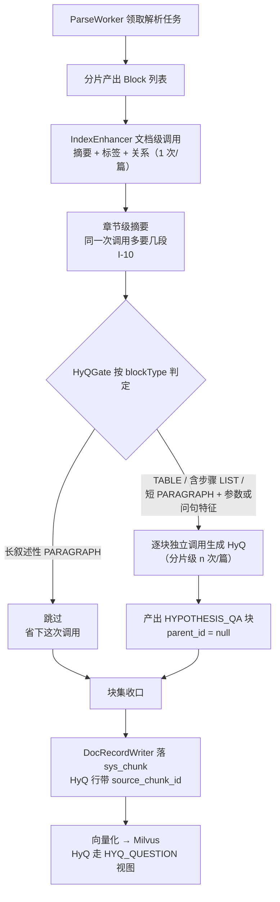
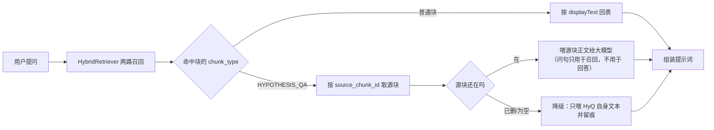

> 状态：🟡 进行中 · Sprint S5 · 阶段 B（M08 问答主体 + 索引增强收口）· 建档 2026-09-18

# 2026-09-18 · S5 · M08 · 阶段 B —— 会话管理余下半边 + HyQ 生成与门控 + 章节级摘要

> 任务：`T-802`（余下半边）· `T-507`（HyQ 半边）· `T-O09`（步 5/6）· `T-803`（本批结项，不施工）
> 来源：`docs/进度/03-Sprint排期.md` §Sprint 5 · `docs/进度/00-开工速览.md` §1/§2/§9
> 上游计划：`ai_knowledge_web/plan/2026-09-17-S5-M08-A.md`（本批要销的账见第 1 节）

---

## 1. 开工条件检查

**依赖清单来源**（逐条注明出处，不许凭印象）：

| # | 依赖项 | 档位 | 现状（代码/文档实证） | 结论 |
|---|---|---|---|---|
| 1 | `T-802` 依赖 `T-800`（`02-任务清单:356`） | ✅ | `ChatController` + `ChatStreamService` 已交付（`S5-M08-A`）；`sys_chat_session` / `sys_chat_message` 由 `V23__s5_chat_session_message.sql` 建好，实测两表均 **0 行**（干净） | 满足 |
| 2 | `T-803` 依赖 `T-802`（`02-任务清单:357`） | ⛔ **判据已满足，余量被 S6 封死** | `ChatSessionService#resolve` 已实现「`modelId` 与会话不一致 → 开新会话且原会话保留」，`G5-10` 已 ✅。余下的 `#139`（`modelId` 要**驱动模型选择**）需 `sys_model_config` 有行 —— **实测 0 行**（`#15`，归 S6 `T-900`~`T-908`） | **本批不施工**：标 ✅ 结项，`#139` 改挂 S6（用户 2026-09-18 裁定） |
| 3 | `T-507` 的 HyQ 半边（`02-任务清单:297` ⏸️ 挂 S5） | ✅ **已解锁** | 挂起理由原文是「命中后拿什么给大模型**只能在有检索实现时回答**」—— `HybridRetriever` 已交付（`S5-M07-A`）。且 `ChunkView` 类注释**早已预留该扩展点**：「同一形状的需求有四个：…、**HyQ（无 / 假设问句）**」+「有了视图，新增块类型 = 声明视图，**不改管线**」；`BlockType.HYPOTHESIS_QA` 已存在且 `countsInChunkTotal()` 已返回 `false` | 满足（本批补） |
| 4 | `T-O09` 步 5（HyQ 门控） | ⛔ **它要门控的功能不存在** | `IndexEnhancer#enhance` 只产出**文档级**一条 `SUMMARY` 块；全仓 `HYPOTHESIS_QA` **仅作为枚举常量与注释出现，没有任何生成代码**（`grep -rn HYPOTHESIS_QA src/main/java` 只有 `BlockType`/`ParsedDocument` 两处）。故步 5 的判据「开/关门控各建一次索引 → LLM 调用量显著下降」**无对象可测** | **同批内解锁**：先补 `T-507` 的 HyQ 半边（#3），门控才有对象（用户 2026-09-18 裁定） |
| 5 | `T-O09` 步 6（章节级摘要） | ✅ | 章节层级已在产物里：`ParsedDocument.headings`（层级 + 页码，`S4-B` 交付）；文档级增强已有一次调用（`IndexEnhancer`），`I-10` 要求的正是「同一次调用里多要几段」 | 满足 |
| 6 | 导出接口的**高危**义务（`需求/01:487`、`需求/07:395`：导出会话记录 ∈ 数据导出） | ✅ | 硬口径「新增审计点必须同步三处」的三处都在：`AuditModule` 含「问答」· `AuditRiskPolicy.IMPLEMENTED` · `AuditCoverageFlowTest#expectedActions()`（冻结 25 条） | 满足 |
| 7 | 环境（docker 6 服务 / 端口 / 种子） | ✅ | 6 容器全 healthy；后端 `:8080`（PID 87708）· 前端 `:5174`（PID 78788，`VITE_USE_MOCK=false`）均在跑 | 满足 |

**BLOCKER 汇总**：**两条，均已在开工前由用户裁定走法**（见 #2、#4）。
按 skill 铁律 2，两条都**不是唯一路径**，故用 `AskUserQuestion` 给了选项；用户裁定：
① `T-803` → **标 ✅ 结项**，`#139` 改挂 S6；② `T-O09` 步 5 → **本批先补 `T-507` 的 HyQ 半边**再门控。

**⚠️ 已知偏差**（不拒绝施工，第 9 节销账）：

| # | 偏差 | 影响 |
|---|---|---|
| W1 | `chatApi.messages` 在前端**已定义但从未被调用**（`src/api/index.ts:307`，全仓零调用点）；`DELETE /chat/sessions/{id}` 与导出**前端完全未接入**（`10-接口约定汇总.md:366-368`） | 四接口里**只有会话列表有活的页面消费方**（`ChatView.vue:320`）。故 3 个接口的页面级证据只能到「不影响既有页面」为止，主证据在 HTTP 层。**这不是本批能改的** —— 补前端 UI 属 `T-805`/S6 的原型接入范围 |
| W2 | 导出格式 `format=md` 只有 `需求/01:539`「会话导出格式 = Markdown」一行，**没有字段级契约**（标题怎么写、引用角标保不保留、附件怎么表示） | 本批自拟最小 Markdown 结构并**登记进 `13-接口变更记录.md`**；将来有原型时以原型为准 |
| W3 | `T-O09` 的「步 5 省成本」判据要**真调模型**才能量出 LLM 调用次数 | 按 `S5-M07-B` 定的口径用 `@Tag("eval")` 隔离 + **替身模型计数**（不真调）—— 调用次数是纯计数，替身足够；召回质量对比才需要真模型，那部分**挂起** |

> 判据只有一条：**这条不满足，代码写下去会不会白写**。
> 本批两条 BLOCKER 都不是「代码会白写」，而是「**照原样写会做出一件没有对象的事**」（门控一个不存在的功能 / 施工一个已被 S6 封死的任务）。

### 结论

- [x] ✅ 可以开工（两条 BLOCKER 已由用户裁定走法）
- [ ] ⛔ 拒绝施工

---

## 2. 开工时间

| 项 | 值 |
|---|---|
| 建档 / 开工日 | 2026-09-18 |
| 预计投入 | **6.5 人天**（`T-802` 余下半边 2.5 · `T-507` HyQ 半边 2 · `T-O09` 步 5/6 2）· 其中 **O 项 2 人天** |
| 实际投入 | *回填时补* |

> ⚠️ 本批**优化配额 2 人天，仍低于下限 4** —— 若再发生，将是**连续第四批**。
> 客观约束：`T-507` 的 HyQ 半边是 `T-O09` 步 5 的**前置对象**，它本身是 P0 索引增强任务、不属 O 项；
> 6.5 人天里功能侧已占 4.5。**已在此显式登记，第 9 节销账**（不当作"配额达标"）。

---

## 3. 开工内容

### 3.1 步骤

| 步 | 做什么（文件/类 → 动作 → 产出） | 依赖 | 可并行 |
|---|---|---|---|
| **1** | `SysChatSessionRepository` / `SysChatMessageRepository` → 加「按 user + 未删 + 标题模糊」分页查询、按 `session_id` 升序取消息 | — | 与 6 并行 |
| **2** | `ChatDtos` → 加 `ChatSessionItem` · `SessionPage` · `ChatMessageItem` · `Citation` · `MessagePage`（**字段形状以 mock 为准，见下方「⚠️ 修订 2」**） | 1 | 与 6 并行 |
| **2b** | `ChatSessionService#messages` 顺带重建**历史引用** `citations[]`：`sys_chat_message.trace_id` → `sys_retrieval_trace_chunk` 按 `rank_no` 取分片 + `sys_document` 批量补标题 | 2 | 与 6 并行 |
| **3** | `ChatSessionService` → 加 `list` / `messages` / `softDelete` / `exportMarkdown`（**全部以 `userId` 为条件**，别人的会话一律「查不到」而非「无权限」） | 1,2 | 与 6 并行 |
| **4** | `ChatController` → 加 4 个映射，**各自挂既有权限码**（见下方「⚠️ 施工首日修订」）：`GET /chat/sessions` → `qa:history:view`（带 `keyword` 时另要 `qa:history:search`）· `GET /chat/sessions/{id}/messages` → `qa:history:view` · `DELETE /chat/sessions/{id}` → `qa:history:delete` · `GET /chat/sessions/{id}/export` → `qa:session:export`（导出为 `text/markdown`，`Content-Disposition` 带文件名） | 3 | 与 6 并行 |
| **5** | 🔴 **导出的高危三处同步**：① `ChatSessionService#exportMarkdown` 加 `@AuditLog(module=问答, action=导出会话, risk=HIGH)`；② `AuditRiskPolicy.IMPLEMENTED` 逐条 `register(...)` **带理由**；③ `AuditCoverageFlowTest#expectedActions()` 冻结清单 **25 → 26** | 4 | — |
| **6** | `IndexEnhancer` → 加**分片级 HyQ 生成**：逐块一次独立调用（`D-5` 契约 ③「分片级 n 次/篇」），产出 `BlockType.HYPOTHESIS_QA` 块 | — | 与 1~5 并行 |
| **7** | `ChunkView` → 加 `HYQ_QUESTION` 视图并声明其 `vectorized`；`ChunkViews.project` 补分支；`BlockType` 声明 HyQ 可用视图 | 6 | — |
| **8** | 🔴 **`汇总.md` §4-271 的判定落地**：命中一个 HyQ 块之后**拿什么给大模型**。方案：`sys_chunk` 加 `source_chunk_id`（`V24`），HyQ 块回落时按它取源块正文 | 6,7 | — |
| **9** | `HyQGate`（新类）→ 按 `blockType` 决定是否生成：`TABLE` / 含步骤的 `LIST` / 短 `PARAGRAPH` 且含参数或问句特征 → 生成；长叙述性 `PARAGRAPH` → 跳过。**门控开/关各留一次调用计数** | 6 | — |
| **10** | `EnhancePrompts` → 章节级摘要：在**同一次**文档级调用里多要几段（`I-10` 口径，**不另开调用**）；`IndexEnhancer` 按 `ParsedDocument.headings` 落每章一条 `SUMMARY` 块（`parentId = null`） | 5(6) | 与 9 并行 |
| **11** | 检索侧：`PromptBuilder` / 引用组装 → HyQ 块命中时按 `source_chunk_id` 解析出**源块正文**，避免把「假设问句」原样喂给大模型 | 8 | — |

> 步骤 1~5（`T-802` 余下）与 6~11（`T-507`/`O9`）**无耦合**，可并行 —— 前者在 `service/`+`controller/`+`repository/`，后者在 `pipeline/enhance/`+`pipeline/`。
> 唯一交汇点是步骤 11：它要读 `sys_chunk.source_chunk_id`，而那列由步骤 8 落。

#### ⚠️ 施工首日修订：步骤 4 补上权限码（立据时漏查）

立据时把 4 个接口写成「只要求登录」（照抄 `S5-M08-A` 的 `POST /chat/completions` 口径），**这是错的**。
开工第一步查 `PermissionCode` 发现：**四个权限码早已存在、`V2` 已种子、且已按角色差异化授权**，
只是此前没有端点去用它们 ——

| 权限码 | `SUPER_ADMIN` | `KB_ADMIN` | `USER` | `AUDITOR` | `GUEST` |
|---|---|---|---|---|---|
| `qa:history:view` / `qa:history:search` | ✅ | ✅ | ✅ | ✅ | ❌ |
| `qa:history:delete` | ✅ | ✅ | **❌** | **❌** | ❌ |
| `qa:session:export` | ✅ | ✅ | **❌** | **❌** | ❌ |

⇒ **不挂权限 = 把一条已裁定的权限边界作废**：`USER`/`AUDITOR` 本不该能删会话、导会话，
不挂 `@RequiresPerm` 就变成谁都能删能导。这不是"补一个锦上添花的校验"，是**把 `V2` 里
已经写死的差异化授权真正生效**。故步骤 4 改为挂码，并新增判据 22/23。

> ⚠️ 这条按 skill 铁律 8 **在 §9 登记**（立据时漏查 `PermissionCode`，施工首日修订）。
> 修订发生在**写业务代码之前**，未产生返工 —— 但"漏查"这件事本身要留痕。

#### ⚠️ 修订 2：步骤 2 的 DTO 形状以 **mock** 为准（立据时按 §14 的散文描述猜的）

立据把 `ChatSessionItem` 写成 `id/title/modelId/modelName/updatedAt`。查 `types/index.ts:191`
发现前端**已经定死**了另一套形状，且 `mock/index.ts:71` 明确写着
「后端就绪后设置 `VITE_USE_MOCK=false` 即切真实接口，**前端零改动**」：

| 字段 | mock 实际值 | 立据时我的写法 | 后果（若照立据写） |
|---|---|---|---|
| `id` | **字符串**（`'s1'`） | 数字 | 类型不符 |
| `time` | **已格式化**（`'10:24'` / `'昨天'` / `'周二'`） | `updatedAt` | 页面上那一行**空着** |
| `count` | **消息条数**（`8`） | 无 | 页面「N 条」**空着** |
| `modelName` | 模型展示名 | 同 | — |

⇒ 三处都会让侧栏直接显示不全（`ChatView.vue:341-346` 逐字段渲染 `s.time` / `s.count` / `s.modelName`）。
**`time` 由后端格式化**是因为前端 `{{ s.time }}` 原样渲染、不做格式化 —— 这是本批新增的
**展示口径**，已登记进 `13-接口变更记录.md`。

**`citations` 为什么补进步骤 2b**（立据时没有这一条）：`sys_chat_message.trace_id`
是 `S5-M08-A` **特意**落的一列，其 javadoc 写的就是「"这轮答案是哪些分片支撑的"从它跳过去」。
若消息列表不重建引用，这一列**永远只有写入没有读取**。数据源现成：
`sys_retrieval_trace_chunk`（`rank_no/chunk_id/doc_id/score/source`）+ `sys_document` 补标题
—— 与实时事件的 `refs()` **同源同口径**（两处都跳过主键非数字的分片）。
⚠️ `cited` 列本批**恒 NULL**（"被答案实际引用"要解析角标，属 `T-804`），
所以 `citations[]` 表达的是**「喂给模型的那一批」**，不是"答案真的用了哪几条"—— 这不是本批的偏差，是 `V22` 的既定口径。

### 3.2 业务流程图

> 触发条件：① 跨 ≥3 个组件 ✅（`IndexEnhancer` → `Block`/`ChunkView` → `DocRecordWriter` → `sys_chunk` → 检索侧）
> ② 涉及异步任务 ✅（跑在 `ParseWorker` 的解析任务里）③ 有状态机 ✗ ④ 有并发 ✅（按 `kbId` 配额的解析池）。
> 满足 ①②④ → **画**。两张图：HyQ 写入链路、HyQ 检索回落链路。





> ⚠️ 第二张图的 `F` 分支是**必须有的兜底**：`source_chunk_id` 是跨行引用，源块被重解析换掉后可能悬空。
> 悬空时**不能抛异常**（会炸掉整个检索请求），也不能静默当普通块 —— 按硬口径「失败必须给现象 + 下一步动作」留痕。

### 3.3 明确不做（范围控制）

| 不做的事 | 原因 | 归属批次 |
|---|---|---|
| `DELETE /chat/sessions/{id}` 与导出的**前端 UI** | 前端未接入（`需求/10:366-368` 标「待开发」）；本批只交后端接口 | `T-805` / S6 原型接入 |
| 会话消息列表的前端点击加载 | `ChatView.vue` 点击只改本地 `activeSession`，不拉消息 | 同上 |
| 图片附件 `POST/GET /chat/attachments` | 依赖 VL 模型与图片处理 | `T-805`（S5-M08-C） |
| 反馈 `POST /chat/feedback` | 独立的反馈闭环 | `T-807` |
| `#139` `modelId` 驱动模型选择 | `sys_model_config` 0 行（`#15`） | **S6**（`T-900`~`T-908`） |
| `O9` 步 3 的**语料级历史回扫** | 要真语料才能量，与「全替身无网络」冲突 | 独立小批（`#144` 系） |
| HyQ **召回质量**的 A/B 量化 | 需真模型；本批只量**调用次数**（替身即可） | 见 W3 / 第 9 节 |
| ops 页「用真实问法重新生成 HyQ」 | 运营侧动作，无后端 | S8（M10） |
| 图谱旁路 `graphUsed` | `T-C00` 未开工 | `T-C00`（S7） |

### 3.4 本批假设

> 信息不足下拍的决策。**假设被证伪 → 进第 9 节遗留**，否则没人知道当初赌了什么。

| # | 假设 | 若被证伪的后果 |
|---|---|---|
| 1 | **HyQ 块用 `source_chunk_id` 回指源块**，而不是把源文塞进 `raw_content` | 若证伪（例如 `G4-6` 的 SQL 断言被解读为"所有非顶层块都要有合法父块"），则要改走 `parent_id` 之外的第三条路，步骤 8/11 返工 |
| 2 | `G4-6` 的 SQL 断言**只约束"有 `parent_id` 的块"**，故 HyQ 块 `parent_id = null` 合法 | 若断言被改成"所有块都必须有父块"，HyQ 无法落库，整个 `T-507` 半边卡住 |
| 3 | 「长叙述性 `PARAGRAPH`」可用**长度 + 特征词**判定，不需要模型判断 | 门控规则需重设计；步 5 的门控表要重做 |
| 4 | 章节级摘要能在**同一次**文档级调用里多要几段（`I-10`）而不超上下文预算 | 超预算则必须另开调用 ⇒ **违反 `I-10`**，需回去改口径 |
| 5 | 会话列表的标题搜索用 `like`，不需要全文索引 | 数据量大时慢；届时另立优化项 |

---

## 4. 数据变更清单

| 类型 | 内容 | 回滚方式 |
|---|---|---|
| **改表** | `sys_chunk` 加列 `source_chunk_id BIGINT NULL` —— HyQ 块回指其源块；普通块该列为 `NULL`。**不加外键约束**（与本仓既有风格一致：`parent_id` 也无 FK），但加 `INDEX idx_chunk_source (source_chunk_id)` | 可逆（`DROP INDEX` + `DROP COLUMN`） |
| **迁移文件** | **`V24__s5_hyq_source_chunk.sql`**（依现有最大编号 `V23` 递增） | — |
| **种子数据** | **不需要**。HyQ 是解析产物，随文档解析自然生成；无演示数据要同步 | — |
| **NULL 分支** | 新列**可空且默认 NULL**，且**既有 14 列行全部为 NULL**（当前 `sys_chunk` 实测 0 行，无历史数据要回填）。读侧口径：`source_chunk_id IS NULL` 一律按「普通块」处理，**不报错**——这正是流程图的兜底分支 `F` | — |
| **不新建表** | 会话两表 `sys_chat_session` / `sys_chat_message` 已由 `V23` 建好，本批**只读不写结构** | — |

> 跑过的迁移**只增不改**（改已执行的 `V*.sql` 会导致校验和不符、启动失败）。
> 本批只**新增** `V24`，不触碰 `V1`~`V23`。

---

## 5. 依赖与工具决策

**默认不引**。先给不引的替代方案：

| 方案 | 做法 | 代价 | 结论 |
|---|---|---|---|
| **不引依赖（既有栈）** | ① HyQ 生成复用既有 `ChatCaller`（增强侧唯一入口，`T-014` 口径）；② 门控是纯函数（`blockType` + 长度 + 特征词），无依赖；③ 章节级摘要走既有 `EnhancePrompts` 改模板；④ 导出 Markdown 手写字符串拼接（本仓先例：CSV 而非 `poi-ooxml`，省 15MB） | 导出要自己处理转义（Markdown 的 `#`/`*` 前缀）；HyQ 逐块调用没有并发加速 | ✅ **采用** |
| 候选 A：`commonmark` / `flexmark` 渲染导出 | 用成熟的 Markdown 生成库 | 为一个「把已存文本按标题拼起来」的场景引一个渲染器；且反向（生成器）能力与正向（解析器）不匹配 | ❌ 不引 |
| 候选 B：HyQ 批量并发调用 | 用虚拟线程并行调 n 次 | 本仓解析侧已有按 `kbId` 配额与 `ParseWorker` 池；在池内再开一层并发会**突破配额语义** | ❌ 不引（且 `O1` 的教训：并发入口要先问 traceId 跟不跟得过去） |

**同类产品对比**：不适用（无候选进入对比）。

**推荐**：**不引任何新依赖**（用既有 `ChatCaller` + 纯函数门控 + 手写 Markdown 拼接）。
**理由**：三处都能用既有栈直接实现，且导出与门控的实现体量都在几十行量级；引库的收益（转义正确性）用一条转义函数就能覆盖。

---

## 6 + 7. 验收方法与标准

| # | 判据（门禁号） | 验收方法（可直接粘的命令/脚本） | 期望结果 | 证据落点 |
|---|---|---|---|---|
| 1 | 会话列表返回**所用模型**（`需求/09:124`、`T-802` 验收要点） | `ChatSessionFlowTest#listCarriesBoundModel` | `modelId`/`modelName` 非空，且与会话绑定的值一致 | `plan` §8 |
| 2 | 会话列表**只含本人**（越权防护） | `ChatSessionFlowTest#listHidesOtherUsersSessions`（造两个用户各一条会话） | 甲的列表里查不到乙的会话；**返回"查不到"而非"无权限"** | 同上 |
| 3 | 标题搜索生效 | `ChatSessionFlowTest#listFiltersByTitle` | 模糊命中 1 条，不命中 0 条 | 同上 |
| 4 | 消息列表含 `modelId`/`modelName`（`需求/10:198`） | `ChatSessionFlowTest#messagesCarryModelAndRole` | user/assistant 两类行齐全，assistant 行带模型 | 同上 |
| 5 | 删除**只软删**、删后列表与消息都取不到 | `ChatSessionFlowTest#deleteIsSoftAndScoped` | `deleted_at` 非空；列表 total 减 1；**消息行仍在库里**（不级联删） | 同上 |
| 6 | 🔴 **导出记高危审计**（`需求/01:487`、`需求/07:395`） | `ChatSessionFlowTest#exportWritesHighRiskAudit`（**走真 HTTP**，不直调 Service） | `sys_audit_log` 新增一行，`module=问答`、`risk=HIGH`、`operator` 取自请求上下文 | 同上 |
| 7 | 🔴 **高危三处同步齐全**（硬口径） | `export JAVA_HOME='F:\work\dev_tools\jdk\jdk-25.0.4.1'` + `mvn -B -f F:\work\code\ai-knowledge\ai_knowledge_web\pom.xml test -Dtest=AuditCoverageFlowTest` | 冻结清单 **25 → 26** 且契约用例绿（漏任一处必红） | 同上 |
| 8 | 导出为合法 Markdown 且**文件名可读** | `curl -sS -D - -o out.md -H "Authorization: Bearer $T" "http://localhost:8080/api/chat/sessions/$SID/export?format=md"` | `Content-Type: text/markdown` · `Content-Disposition` 含 `.md` · `out.md` 首行是 `# <会话标题>` | `plan` §8 + 产物 |
| 9 | 🔴 **`G4-9` 第三条：HyQ 分片已生成**（本批销该门禁的挂起行） | SQL：`select count(*) from sys_chunk where chunk_type='HYPOTHESIS_QA' and parent_id is null;`（真文档解析后） | **> 0**，且 `sys_chunk.source_chunk_id` 对应的源块存在 | `plan` §8 |
| 10 | 🔴 **`G4-6` 未被本批破坏**（HyQ 引入后 `parent_id` 语义仍成立） | `DocParseFlowTest#childChunksAlwaysPointToTableParent`（三条 SQL） | 三条全返回 0 —— ① 指向非 TABLE 父块 ② `parent_id=0` ③ `parent_id<=0` | 同上 |
| 11 | 🔴 **门控真的省了调用**（`O9` 判据 5） | `HyQGateTest#gateSkipsLongNarrativeParagraph` + 替身计数（`RetrievalTestStubs` 同款替身） | 同一篇文档开门控/关门控，**替身被调用次数显著下降**，且被跳过的全是长叙述块 | 同上 |
| 12 | 门控**不误伤**该生成的三类 | `HyQGateTest#gateKeepsTableStepListShortParagraph` | `TABLE` / 含步骤 `LIST` / 短 `PARAGRAPH` 三类**全部生成** | 同上 |
| 13 | 章节级摘要每章一条且**只调一次**（`O9` 判据 6 + `I-10`） | `IndexEnhancerTest#chapterSummariesReuseTheSingleCall` | `SUMMARY` 块数 = 章节数（+1 文档级）；替身调用次数**恰好仍是 1** | 同上 |
| 14 | 🔴 **HyQ 命中后喂的是源块正文**（销 `汇总.md` §4-271） | `HyQRetrievalFlowTest#hyqHitFeedsSourceBlockNotTheQuestion` | 组装的提示词含**源块正文**，不含"假设问句"字样 | 同上 |
| 15 | `source_chunk_id` 悬空时**降级不抛异常** | `HyQRetrievalFlowTest#danglingSourceFallsBackWithNote` | 检索照常返回；日志/ trace 有降级留痕；**不抛 500** | 同上 |
| 16 | 全量回归 | `export JAVA_HOME='F:\work\dev_tools\jdk\jdk-25.0.4.1'` + `mvn -B -f F:\work\code\ai-knowledge\ai_knowledge_web\pom.xml test` | `Failures: 0, Errors: 0`（基线 497 → 待测） | 同上 |
| 17 | 跑批**残留增量为 0**（测试可靠性批的硬口径） | `node ai_knowledge_app/scripts/selftest-residue.mjs`（或按 `probe-teardown.mjs` 口径查） | `sys_async_task` / `sys_login_log` / `sys_chunk` / Milvus 分区**增量全 0** | 同上 |
| 18 | 页面级**无回归**（`ChatView` 会话列表转真数据） | `cd ai_knowledge_app && node scripts/e2e-chat-flow.mjs --base=http://127.0.0.1:5174` | 7/7 通过；侧栏会话列表**由真接口填充**（不再走降级） | `plan` §8 |
| 19 | 其余 9 个页面级脚本无回归 | `node scripts/e2e-*.mjs --base=http://127.0.0.1:5174`（10 个脚本逐个） | 全部通过（上批基线：kb 47 · doc-upload 39 · audit-flow 30 · doc-parse 25 · console-check 25 · audit-backfill 24 · admin 29 · profile 31 · auth 12） | 同上 |
| 20 | 后端路由对账（⑦ 段【S5】4 条清零） | `node ai_knowledge_app/scripts/audit-api.mjs` | ①=0 ②=0 ⑥=0；⑦ 的【S5】由 4 条降到 **0 条** | 同上 |
| 21 | 前端类型检查 + 构建 | `node ai_knowledge_app/scripts/check.mjs` | 通过（本批前端**零改动**，此条防意外） | 同上 |
| 22 | 🔴 **权限边界生效（施工首日修订新增）**：`USER`/`AUDITOR` 能查会话但**不能删、不能导** | `ChatSessionPermFlowTest`：用 `USER` 与 `AUDITOR` 两种角色的真 token 各打一次 `DELETE` 与一次 `export` | 两者均 **403**；同一 token 打 `GET /chat/sessions` 得 **200** | `plan` §8 |
| 23 | 🔴 **反向**：`KB_ADMIN` 四个接口全通 · `GUEST` 连列表都进不去 | 同上，换 `KB_ADMIN` 与 `GUEST` 的 token | `KB_ADMIN` 四个全 200；`GUEST` 打 `GET /chat/sessions` 得 **403** | 同上 |

**观察项**（不计成败，页面写死的展示值登记在此）：

- `ChatView` 侧栏会话项的**展示形态**（标题截断长度、模型标签位置）—— 沿用原型写死值，不判成败。
- 导出的 Markdown 具体排版（标题层级、引用角标是否保留）—— 见 W2，本批自拟，**登记进 `13-接口变更记录.md`**，不计成败。

**种子核对**（跑完必做）：

```bash
set -a && . ai_knowledge_web/.env && set +a
docker exec kb-mysql mysql -u"$MYSQL_USERNAME" -p"$MYSQL_PASSWORD" "$MYSQL_DATABASE" -N -e "select count(*) from sys_user where deleted_at is null;"
# 期望 128 · e2e% 账号 0 · sys_kb 8 · sys_document/sys_chunk/sys_async_task/sys_chat_session 均为 0 · Milvus 只剩 _default
```

---
---

# 以下为开工后回填

> **提交节奏（两次）**：1~7 节写完即提交一次（`docs(plan): <批次> 开工计划`）；
> 8~10 节写完再提交一次（`docs(plan): <批次> 验收回填`）。让 git log 上「计划 → 结果」成对可查。

## 8. 验收结果

| # | 判据 | 实测结果 | 证据（命令 / 文件:行 / 测试名） |
|---|---|---|---|

**测试基线**：`Tests run: N, Failures: 0, Errors: 0, Skipped: 0`（上批 497 → 本批 M）

> 失败就照实写失败，不许改成"部分通过"。
> **取证条件不具备时**，该行实测结果填 `⏸️ 挂起 —— 待 <批次> 取证`，
> 并在那批的 8 节做**合并回填**（两批计划文件同时更新、同时提交）。

---

## 9. 遗留问题

| # | 项 | 原因 | 归属批次 | 是否有判定点/注释留在代码里 |
|---|---|---|---|---|
| 1 | 🔴 **立据时漏查 `PermissionCode`**（§3 步 4 施工首日修订） | 立据把 4 个接口写成「只要求登录」，照抄了 `S5-M08-A` 的 `POST /chat/completions` 口径 —— 而四个 `qa:history:*` / `qa:session:export` 码**早已存在、`V2` 已种子、并已按角色差异化授权**。漏查的后果本会是「把已裁定的权限边界作废」 | 本批（已修） | ✅ 是 —— 修订说明写在 §3 步 4 下方（含角色 × 权限码对照表） |
| 2 | 本批 O 项配额 **2 人天 < 下限 4**（若成立则**连续第四批**） | `T-O09` 步 5 的前置对象（`T-507` HyQ 半边）是 P0 索引增强、不属 O 项；6.5 人天里功能侧已占 4.5 | — | 登记在 §2 |

> 没有遗留写「无」。**本批若"先施工后补写第 1 节"，也必须在此登记一条**（违规留痕）。

---

## 10. 建议

- 对下批的排期 / 口径 / 风险建议。没有写「无」。

---

## 附：本批同步的文档回填

- [ ] **`docs/进度/00-开工速览.md` §1/§2/§3/§4** → 当前定位 / 本批任务行 / 门禁现状 / 缺口账（**必改**，它是下一批的唯一入口）
- [ ] `docs/进度/02-任务清单.md` → `T-802` 置 ✅ · `T-507` 置 ✅ · `T-O09` 置 ✅ · **`T-803` 置 ✅**（用户 2026-09-18 裁定）· §O 优化项 `T-O09` 置 ✅
- [ ] `docs/进度/03-Sprint排期.md` → 「交付状态」段 + **`G4-9` 第三条**门禁行
- [ ] `docs/进度/README.md` → 看板状态 + 完成日期（**备注只写一行短结论 + 指针**；长备注追加到 `docs/进度/变更记录/02-Sprint交付台账.md`）
- [ ] `docs/进度/变更记录/01-变更记录.md` → 追加一行（日期 · Sprint · 变更 · 交付物 · 遗留）
- [ ] `docs/需求文档/10-接口约定汇总.md` → §14 字段 + §14.1 差异；**变更记录加一行到 `docs/需求文档/13-接口变更记录.md`**（导出 Markdown 结构 + HyQ 回落口径）
- [ ] `ai_knowledge_web/plan/汇总.md` → §1 当前定位 · §2 批次总览 · §3 遗留（`#139` 改挂 S6 · `#140`/`#144` 销账）· **§4 销 `HyQ 假设问题` 挂起行**
- [ ] `ai_knowledge_web/plan/优化/README.md` + `O9-dedup-and-cost-control.md` → `T-O09` 状态行
- [ ] 本文件状态行 → ✅ 已完成
- [ ] `.workbuddy/memory/<日期>.md` → 交接