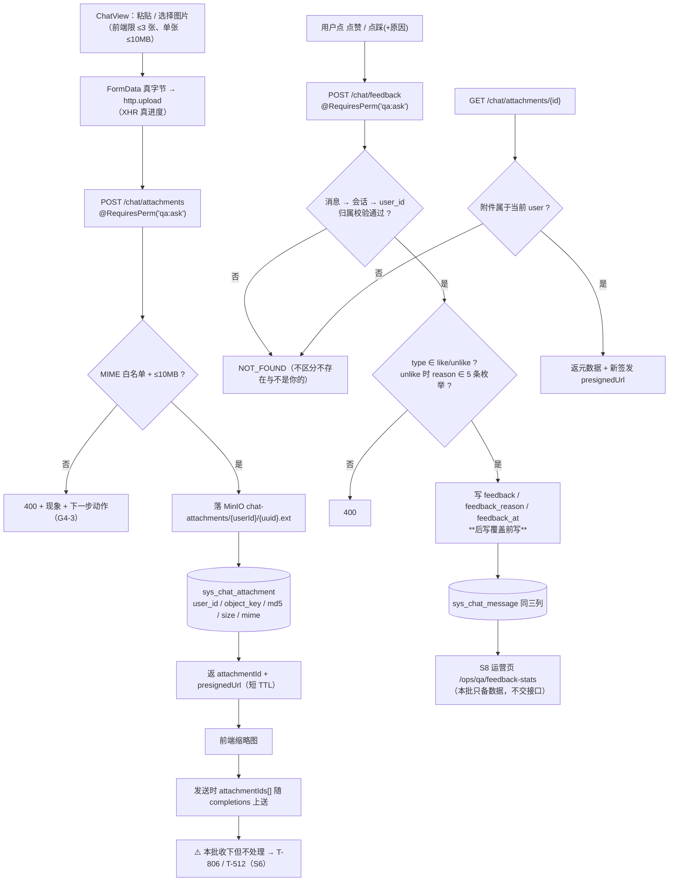

> 状态：🟡 进行中 · Sprint S5 · 阶段 C（M08 问答收口）· 建档 2026-09-18

# 2026-09-18 · S5 · M08 · 阶段 C —— 图片附件 + 反馈落库 + 归因收口

> 任务：`T-805` · `T-807` · `T-808`（3 项）+ O 项 `T-O06` 步 4（可做半边）
> 来源：`docs/进度/00-开工速览.md` §1/§2 · `docs/进度/03-Sprint排期.md` §Sprint 5
> 上游计划：`ai_knowledge_web/plan/2026-09-18-S5-M08-B.md`（本批要销的账见第 1 节）

---

## 1. 开工条件检查

**依赖清单来源**：`00-开工速览.md` §1/§2/§3 · `02-任务清单.md` 的 `T-805`/`T-807`/`T-808` 依赖列 ·
`03-Sprint排期.md` 的 `G5-14` · `汇总.md` §3/§4 归属本批的行 · `S5-M08-B` §9（编号 151~157）。

| # | 依赖项 | 档位 | 现状（代码/文档实证） | 结论 |
|---|---|---|---|---|
| 1 | `T-805` 依赖 `T-907`（上传基础） | ✅ | `core/storage/DocStorage.java:64` 类已在，`MinioBucketInitializer.java:31` bucket `rag-documents` 启动期幂等创建；`AvatarStorage#presignedUrl:102` 给了预签名范式 | 满足 |
| 2 | `T-805` 的**请求形状** | ⚠️ **WARN（文档 vs 代码冲突）** | 需求 `09:659` 与 `10:195` 都写 `multipart/form-data`；而 `ChatView.vue:143` 走 `chatApi.uploadAttachment({name,size,md5,mime})` → `api/index.ts:303` 的 `http.post`，**文件字节从头到尾没上传过**（既有的 `http.upload` 只在 `uploadDoc`/`avatar` 用） | **用户 2026-09-18 裁定：后端 multipart，前端改 `http.upload`** |
| 3 | `T-805`「回看需校验**会话**归属」 | ⚠️ WARN | 预上传发生在**会话存在之前**（会话是 `completions` 时才 `resolve` 的），且本批 `completions` 不消费 `attachmentIds`（`ChatDtos.java:34` 注明「`T-512` 之前收下但不处理」）⇒ 本批归属只能校验到 **`user_id`** | 按 `user_id` 实现，会话归属待 `T-806`/`T-512`（§9 登记） |
| 4 | `T-807` 依赖 `T-801` | ✅ | `service/ChatStreamService.java:80` · `service/ChatSessionService.java:93` 已交付（`S5-M08-A`） | 满足 |
| 5 | `T-807` 备注写「**前端 UI 已有**、未接后端」 | 🔴 **WARN（文档失真，与 #151 同形的第二次）** | 实测 `ChatView.vue` **无任何 点赞/点踩/reason 元素**（消息页脚 `msg-foot` 只有模型名 + 已读原图 + 直接读原图）；原型 `10-知识问答.html` 也没有；`api/index.ts:300` 的 `chatApi` **没有 feedback 方法** | **用户 2026-09-18 裁定：本批补前端 UI** |
| 6 | `T-807` 挂哪个权限码 | ⚠️ WARN | `qa:feedback` 的语义是**「处理问答反馈」**（运营侧），且 `V2__seed_reference_data.sql:144` 实测 **`USER` 角色没有它** ⇒ 挂上去普通用户点不了赞（`G5-14` 的 E2E 也过不去） | 改用 **`qa:ask`** + 归属校验；`qa:feedback` 留给 S8 运营侧（§3.4 假设 1） |
| 7 | `T-808` 依赖 `T-801` | ✅ **无可施工内容** | `V23__s5_chat_session_message.sql` 已建 `model_id`（注释直写「`T-808` 的 used_model_id」）· `ChatSessionService#appendAssistant:153` 已写 · `ChatStreamFlowTest.java:138` 已断言「`T-808` 的 used_model_id 落点」 | 与 `S5-M08-B` 的 `T-803` **同型**：判据已由前批满足 ⇒ 只做取证后结项 |
| 8 | `T-808` 的**运行时取值** | ⚠️ **WARN（新发现）** | `RegistryStreamingChatCaller.java:109` 的 `numericId` 在 spec id 非数字时返回 **`null`**，而该方法自己的 javadoc 写「**这正是当前的常态**：引导配置的 id 是 `bootstrap-chat`」；`sys_model_config` 实测 **0 行**（`汇总.md` §3 `#15`）⇒ **真实运行时 `used_model_id` 落 NULL**，用例里的非空断言是**替身给的** | 挂 `S6 T-900`（承 `#139`/`#15`），本批只做运行时取证（判据 8） |
| 9 | 新表要过**产物覆盖率闸** | ⚠️ WARN | `sys_chat_attachment` 带 `user_id` ⇒ `ProbeArtifactCoverageTest` 与 `probe-teardown.mjs:347` 的闸**会点名**；两侧登记表（`ProbeArtifacts.java:44` · `probe-teardown.mjs:66`）都要加行 | 本批同步（§3.1 步 6） |
| 10 | O 项 `T-O06` 步 4「预签名 TTL 收窄」 | ⚠️ **WARN（对象半边不存在）** | 全仓只有**两处**预签名：`AvatarStorage.java:52`（7 天）· `AuditExportService.java:59`（24 小时）。**文档下载/预览的预签名后端不存在** —— `DocController` 只有 5 个端点，无 download/preview | 只做可做半边（附件从出生即短 TTL + 三处口径集中）；**文档半边挂 `T-614`**，与 `O6` 文档自己写的挂起一致 |
| 11 | 环境（6 服务 / 端口 / 种子） | ✅ | 用户已启动前后端；`sys_kb`=8 基线待跑批前核对（`#108`） | 满足 |

**BLOCKER 汇总**：**无**。两条「照原样写会做出一件没有对象的事」的候选（`T-808` 实体已落、`T-O06` 步 4 文档半边无端点）都**不阻塞**本批 —— 它们各自的可做半边要么是取证、要么是新增面，都不会白写。

**⚠️ 已知偏差**（不拒绝施工，第 9 节销账）：见上表第 2、3、5、6、8、10 条。

> 判据只有一条：**这条不满足，代码写下去会不会白写**。

### 结论

- [x] ✅ **可以开工**
- [ ] ⛔ 拒绝施工

---

## 2. 开工时间

| 项 | 值 |
|---|---|
| 建档 / 开工日 | 2026-09-18 |
| 预计投入 | 功能 3.5 人天（`T-805` 1.5 · `T-807` 1.5 · `T-808` 0.5 取证）+ O 项 0.5 人天 ≈ **4 人天** |
| 实际投入 | *回填时补* |

> Sprint 容量 ≈ 10 人天。⚠️ **O 配额仍低于下限 4**（本批 0.5）—— 见 §9 配额行。

---

## 3. 开工内容

### 3.1 步骤

| 步 | 做什么（文件/类 → 动作 → 产出） | 依赖 | 可并行 |
|---|---|---|---|
| 1 | `db/migration/V25__s5_chat_attachment_and_feedback.sql` → 建 `sys_chat_attachment`；`sys_chat_message` 加 `feedback`/`feedback_reason`/`feedback_at` 三列 | — | |
| 2 | `entity/SysChatAttachment.java` + `repository/SysChatAttachmentRepository.java` | 步 1 | |
| 3 | `service/ChatAttachmentService.java` → `upload(userId, MultipartFile)`：MIME 白名单 + 单张 ≤10MB → 落 MinIO `chat-attachments/{userId}/{uuid}.{ext}` → 落库 → 返 `{attachmentId, presignedUrl, md5, size, mime}`；`get(userId, id)`：不存在/不是本人的**一律 NOT_FOUND**（不区分） | 步 2 | ∥ 步 7 |
| 4 | `controller/ChatController.java` → `POST /chat/attachments`（`multipart/form-data`，`@RequiresPerm("qa:ask")`）+ `GET /chat/attachments/{id}` | 步 3 | |
| 5 | `entity/SysChatMessage.java` → 加三个反馈字段；`repository/` 加按 reason 聚合的查询（留给 S8 消费，本批只备） | 步 1 | |
| 6 | 登记新表：`src/test/.../support/ProbeArtifacts.java` + `ai_knowledge_app/scripts/lib/probe-teardown.mjs` 各加一行 `sys_chat_attachment`（`via: 'user'`） | 步 1 | |
| 7 | `service/ChatFeedbackService.java` → `submit(userId, messageId, type, reason)`：消息→会话→`user_id` 归属校验；`type ∈ {like, unlike}`；`unlike` 才带 `reason` 且必须 ∈ 5 条枚举；**后写覆盖前写** | 步 5 | ∥ 步 3 |
| 8 | `controller/ChatController.java` → `POST /chat/feedback`（`@RequiresPerm("qa:ask")`） | 步 7 | |
| 9 | 前端 `api/index.ts` → `chatApi.uploadAttachment(form, onProgress)` 改走 `http.upload`；新增 `chatApi.feedback(body)` | — | |
| 10 | 前端 `views/chat/ChatView.vue` → `uploadOne` 组 `FormData`（真文件 + **真进度**，删掉现有那个假进度定时器）+ 消息页脚加 **复制 / 点赞 / 点踩(+原因弹层)** | 步 9 | |
| 11 | 前端 `mock/index.ts` → 两处 handler 对齐新形状（附件收 FormData；新增 `/api/chat/feedback`） | 步 9 | |
| 12 | 后端用例：`ChatAttachmentFlowTest` + `ChatFeedbackFlowTest` | 步 4/8 | |
| 13 | `T-808` 运行时取证：起真后端问一次 → 查 `sys_chat_message` 的 `model_id`/`model_name` | — | |
| 14 | O 项 `T-O06` 步 4 可做半边：附件预签名短 TTL + 三处 TTL 口径集中登记（`AvatarStorage` 7 天 / `AuditExportService` 24h / 附件新增） | 步 3 | |

> **Lombok / 构造点**：`SysChatMessage` 加字段是纯增量（`@Data`），无构造点要改；与本批无关的编译面为零。

### 3.2 业务流程图

> 触发条件：① 跨 ≥3 个组件（浏览器 → MinIO → MySQL → 预签名回填）✅
> ② 涉及异步/事务边界 —— 上传是**同步**的，无异步；③ 有状态机 —— 附件有 `UPLOADING→已上传`；
> ④ 有并发/幂等 —— 反馈**可改**（后写覆盖前写），归属校验是并发下的正确性来源 ✅



### 3.3 明确不做（范围控制）

| 不做的事 | 原因 | 归属批次 |
|---|---|---|
| **VL 描述生成**（`attachment{DESCRIBING}`/`DONE` 事件、prompt、`md5:vlModelId:PROMPT_VERSION` 缓存、描述压缩、并行多图） | `T-805` 的任务行括注就是「**只落 MinIO + 落库，不调 VL**」 | `T-806` / `T-512`（S6） |
| `completions` 消费 `attachmentIds`（query 合成 `问题 + searchSummary`、描述进上下文） | 同上；`ChatDtos.java:34` 已注明「`T-512` 之前收下但不处理」 | `T-512`（S6） |
| `useVision` ↔ `usedVision` 配对、「直接读原图」 | 任务行 `T-806`，**不在本批三个 `T-xxx` 内** | `T-806`（S6） |
| 附件与**会话**的绑定、会话级归属校验 | 预上传发生在会话之前（§1 第 3 条） | `T-806` / `T-512` |
| 单次 ≤3 张的**服务端**硬限 | 前端已有；服务端只有在「一轮问答绑多张」时才有校验对象 | `T-806` |
| 运营页 `/ops/qa/feedback-stats` 真接口 | M10 运营分析 | `S8`（`T-A00` 族） |
| 反馈变更**历史**（谁在何时从 like 改成 unlike） | 本批取「后写覆盖」，代价是丢历史（§3.4 假设 3） | 有明确合规要求时另立 |
| `qa:feedback` 权限码的使用 | 它是运营侧「处理反馈」的语义，本批无运营端点 | `S8` |

### 3.4 本批假设

| # | 假设 | 若被证伪的后果 |
|---|---|---|
| 1 | 用户侧点赞/点踩挂 **`qa:ask`** 而非 `qa:feedback` | 若需求方认定应挂 `qa:feedback`，则 `V2` 的 `USER` 角色授权要补一条，否则普通用户点不了赞 |
| 2 | 附件归属**只到 `user_id`**（会话归属待 S6） | 若 S6 做会话级校验时需要历史数据回填，只能靠 `created_at` 推断 |
| 3 | 反馈**后写覆盖前写**，不建独立表 | 若日后要「反馈变更历史」，现有三列只有终态，历史补不回来 |
| 4 | 前端改 multipart **不破坏 mock 通路** | `probe-teardown` 之外的 dev 体验受损；mock 的 handler 只 drain body（`mock/index.ts:662`），预期不受影响 |
| 5 | 附件 `presignedUrl` 短 TTL 不影响缩略图显示 | 图片已加载后 URL 过期不影响渲染；但**重新挂载**会 403 —— E2E 若跨过 TTL 边界会假失败 |

---

## 4. 数据变更清单

| 类型 | 内容 | 回滚方式 |
|---|---|---|
| **新建表** | `sys_chat_attachment`：`id BIGINT AI PK` · `user_id BIGINT NOT NULL` · `object_key VARCHAR(512) NOT NULL` · `name VARCHAR(255) NOT NULL` · `size BIGINT NOT NULL` · `mime VARCHAR(128) NULL` · `md5 CHAR(32) NOT NULL` · `created_at DATETIME NOT NULL`；索引 `idx_ca_user (user_id, id)`；**不设软删**（附件是预上传的临时件，会话绑定后才谈生命周期 → `T-806`） | `DROP TABLE`（有真实附件后不可逆） |
| **改表** | `sys_chat_message` 加三列，**全部可空**：`feedback VARCHAR(16) NULL`（`like`/`unlike`）· `feedback_reason VARCHAR(64) NULL` · `feedback_at DATETIME NULL` | `ALTER TABLE ... DROP COLUMN`（有真实反馈后不可逆） |
| **迁移文件** | `V25__s5_chat_attachment_and_feedback.sql`（现最大 `V24`，**递增**） | — |
| **种子数据** | 无（不造演示附件 / 演示反馈 —— 那会让 `G5-14` 的取证分不清真实与种子） | — |
| **NULL 分支** | `feedback` 为 **NULL = 「从未反馈」**，与 `unlike` 是两件事。⚠️ 运营统计**必须** `where feedback = 'unlike'`，**不能**写 `where feedback <> 'like'` —— MySQL 下 `NULL <> 'like'` 求值为 `NULL`（非 true），会把「从未反馈」错算进负反馈 | — |

> 跑过的迁移**只增不改**（改已执行的 `V*.sql` 会导致校验和不符、启动失败）。
> ⚠️ 承 `S5-M07-B` 的硬口径：**迁移失败会在 `flyway_schema_history` 留 `success=0` 的行，必须先清掉才能重跑**。

---

## 5. 依赖与工具决策

**结论：无新依赖**（用既有栈实现）。

| 方案 | 做法 | 代价 | 结论 |
|---|---|---|---|
| **不引依赖（既有栈）** | ① 存储复用 `MinioClient` + `minio.bucket`（`DocStorage`/`AvatarStorage` 已跑通的同一条路）；② multipart 复用 Spring 既有 `MultipartFile`（`DocService#upload` 已跑通，含 `spillToTemp` 的请求作用域纪律）；③ 前端复用既有 `http.upload`（`request.ts:146`，XHR 真进度，`uploadDoc`/`avatar` 在用）；④ 预签名复用 `GetPresignedObjectUrlArgs`（两处已有范式） | 无 | ✅ **采用** |
| 候选 A：图像元数据库（如 `metadata-extractor`） | 读 EXIF 尺寸/方向 | 本批不处理方向、不压缩（那是 `T-512` 的 VL 前处理） | ❌ |
| 候选 B：引入独立对象存储 SDK / 分片上传 | — | 与 `minio.bucket` 既有桶、生命周期规则表（`T-O07`）冲突 | ❌ |

**推荐**：不引依赖 · **理由**：本批要做的四件事（multipart 收字节、落 MinIO、落 MySQL、签发预签名 URL）**在仓里各有现成范式**，且 `DocStorage.java:24` 已与 `AvatarStorage` 刻意同构 —— 第三条存储通路照同一形状写即可，不需要新库。

---

## 6 + 7. 验收方法与标准

| # | 判据（对齐门禁号） | 验收方法（可直接粘的命令/脚本） | 期望结果 | 证据落点 |
|---|---|---|---|---|
| 1 | `T-805` 上传**真字节**落 MinIO + 落库 | `mvn -B -f F:/work/code/ai-knowledge/ai_knowledge_web/pom.xml test -Dtest=ChatAttachmentFlowTest` | 200；`sys_chat_attachment` 有行；MinIO `chat-attachments/` 下对象**字节数与上传一致** | `ChatAttachmentFlowTest` |
| 2 | `T-805` 回看**归属校验** | 同上（用例内两条：本人的 200 / 他人与不存在的**同码 NOT_FOUND**） | 均 `NOT_FOUND`，**不区分**「不存在」与「不是你的」 | 同上 |
| 3 | `T-805` 超限与非法类型**给现象 + 下一步**（`G4-3`） | 同上（>10MB、非图片 MIME） | 400，文案含「发生了什么」+「能做什么」 | 同上 |
| 4 | **`G5-14`** `like`/`unlike` + `reason` **真实入库** | `mvn ... -Dtest=ChatFeedbackFlowTest` | `sys_chat_message.feedback='unlike'`、`feedback_reason` 为枚举值之一、`feedback_at` 非空 | `ChatFeedbackFlowTest` |
| 5 | **`G5-14`** 非法 `type` / 非法 `reason` 被拒 | 同上 | 400；`like` 带 `reason` 也拒（原因只属点踩） | 同上 |
| 6 | **`G5-14`** 反馈**可改**（后写覆盖前写） | 同上 | 先 `like` 后 `unlike` ⇒ 库里只有 `unlike`，且 `feedback_at` 更新 | 同上 |
| 7 | **`G5-14`** 反馈归属：给**别人的**消息反馈 | 同上 | `NOT_FOUND`（与「消息不存在」同码） | 同上 |
| 8 | `T-808` 归因**运行时**取证 | 起真后端 → 带 token 发一次 `/chat/completions` → 查 `sys_chat_message` | `model_name` **有值**；`model_id` 预期为 **NULL** ⇒ 如实登记为 `S6 T-900` 遗留 | 本节回填 + §9 |
| 9 | **页面级 E2E**：提问 → 点赞 → 库里可见 | `cd ai_knowledge_app && node scripts/e2e-chat-flow.mjs --base=http://127.0.0.1:5174` | 脚本扩展后仍全绿，且**新增断言**：点「点赞」后 `sys_chat_message.feedback='like'` | `e2e-chat-flow` 输出 |
| 10 | 前端类型检查 + 生产构建 | `node ai_knowledge_app/scripts/check.mjs` | 通过 | 命令输出 |
| 11 | 四方对账（新接口不漏账） | `node ai_knowledge_app/scripts/audit-api.mjs` | ① ② ⑥ 恒 0；⑦【S5】由 4 条**减 2**（两个 `/chat/attachments` 落位） | 脚本输出 |
| 12 | O 项：三处预签名 TTL 口径集中 + 附件短 TTL | `grep -rn 'URL_TTL\|presign' ai_knowledge_web/src/main/java` | 三处取值集中在**一处常量/配置**，每处写清**为什么是那个值**；判据 5 的**文档半边挂 `T-614`** | `AvatarStorage` / `AuditExportService` / `ChatAttachmentService` |
| 13 | **后端全量基线** | 🔴 **先停后端**（`#151`）→ `mvn -B -f .../ai_knowledge_web/pom.xml test` | `Tests run: N, Failures: 0, Errors: 0`（上批 526 → 本批 N） | 回填 §8 |
| 14 | 残留增量 | 跑批前后各查一次：`sys_chat_attachment` · `sys_chat_message` · `sys_chat_session` | 归零（`sys_chat_attachment` 是**新增的第五类产物**，必须实测） | 回填 §8 |

**观察项**（不计成败）：页面写死的展示值 —— 消息页脚的「由 {modelName} 生成」在真后端下 `modelName` 有值、`modelId` 为 `null`（判据 8 已覆盖其因）。

**种子核对**（跑完必做）：

```bash
set -a && . ai_knowledge_web/.env && set +a
docker exec kb-mysql mysql -u"$MYSQL_USERNAME" -p"$MYSQL_PASSWORD" "$MYSQL_DATABASE" -N -e "select count(*) from sys_user where deleted_at is null;"
```

---
---

# 以下为开工后回填

> **提交节奏（两次）**：1~7 节写完即提交一次（`docs(plan): <批次> 开工计划`）；
> 8~10 节写完再提交一次（`docs(plan): <批次> 验收回填`）。让 git log 上「计划 → 结果」成对可查。

## 8. 验收结果

| # | 判据 | 实测结果 | 证据（命令 / 文件:行 / 测试名） |
|---|---|---|---|

**测试基线**：`Tests run: N, Failures: 0, Errors: 0, Skipped: 0`（上批 526 → 本批 M）

---

## 9. 遗留问题

| # | 项 | 原因 | 归属批次 | 是否有判定点/注释留在代码里 |
|---|---|---|---|---|

---

## 10. 建议

---

## 附：本批同步的文档回填

- [ ] **`docs/进度/00-开工速览.md` §1/§2/§3/§4** → 当前定位 / 本批任务行 / 门禁现状 / 缺口账（**必改**）
- [ ] `docs/进度/02-任务清单.md` → `T-805`/`T-807`/`T-808` 置 ✅；§O 的 `T-O06` 步 4 状态
- [ ] `docs/进度/03-Sprint排期.md` → 「交付状态」段 + `G5-14` 判词
- [ ] `docs/进度/README.md` → 看板状态 + 完成日期（长备注追加到 `变更记录/02-Sprint交付台账.md`）
- [ ] `docs/进度/变更记录/01-变更记录.md` → 追加一行
- [ ] `docs/需求文档/10-接口约定汇总.md` → §14 三个接口（`/chat/attachments` ×2、`/chat/feedback`）+ §14.1 差异；`13-接口变更记录.md` 加一行
- [ ] `ai_knowledge_web/plan/汇总.md` → §1 定位 / §2 加行 / §3 遗留逐条并入 / §4 挂起判据
- [ ] `ai_knowledge_web/plan/优化/README.md` → `T-O06` 行的状态与落哪批
- [ ] 本文件状态行 → ✅ 已完成
- [ ] `.workbuddy/memory/2026-09-18.md` → 交接
