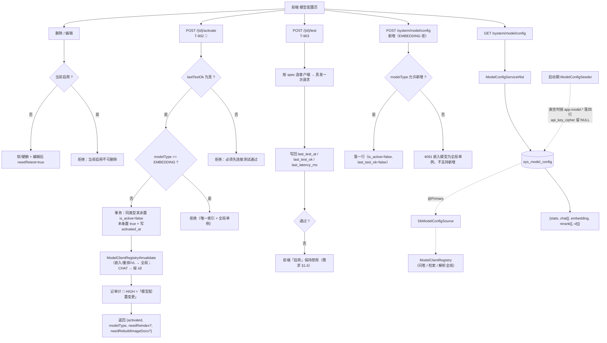

> 状态：🟡 进行中 · Sprint S6 · 阶段 A（M09 模型配置地基）· 建档 2026-09-18

# 2026-09-18 · S6 · M09 · 阶段 A —— 模型配置列表 + CRUD + 启用切换 + 连接测试

> 任务：`T-900` · `T-901` · `T-902` · `T-903`（4 项）
> 来源：`docs/进度/03-Sprint排期.md` §Sprint 6（门禁 `G6-1`~`G6-5`）· `docs/需求文档/09-需求-系统配置与通用.md` §FR-SYS-01
> 上游计划：`ai_knowledge_web/plan/2026-09-18-S5-M08-C.md`（本批的由来见 §1 开头）

---

## 0. 为什么是这一批（不是 `S5-M08-D`）

用户 2026-09-18 原本裁定下批做 `S5-M08-D`（`T-804` + `T-806`）。**开工条件检查推翻了那个判断**：

| 候选 | 实测的硬依赖缺口 |
|---|---|
| `T-804` 第二半「点击引用来源卡片 → 打开预览页并**定位到该分片**」（需求 `07:400`） | 预览页**没有任何后端** —— 它要的 `GET /doc/{id}/chunks`·`/meta`·`/toc`·`/chunks/{parentId}` 是 **`T-600`/`T-602`/`T-603`/`T-604`（M06 · S7）**，全部 ⬜；`DocController` 实际只有 5 个端点 |
| `T-806`「仅当该轮对话模型 `vision=true` 时可用」（需求 `07:363`） | `grep capabilities\|vision` 在 `ai_knowledge_web/src/main/java` 下**零命中**；唯一来源 `GET /system/model/options` = **`T-904`（本 Sprint）**；`sys_model_config` 实测 **0 行** |

⇒ 硬做 S5-M08-D 只能交出**范围被砍掉一半**的批次，而缺的那两半**恰好都指向 M09**。
故改走 `S6-A`：它正是解开 `T-806`（capabilities）、`#161`（`used_model_id` 恒非空）、
`T-907`/`T-908`/`T-906`、`T-512` 的那把钥匙。

---

## 1. 开工条件检查

**依赖清单来源**：`00-开工速览.md` §1/§2 · `02-任务清单.md` 的 M09 段 · `03-Sprint排期.md` §Sprint 6 的门禁表 ·
**`plan/汇总-归档.md` §C（S6 模型配置摸底，专为 S6 开工写的）** · `需求文档/09` FR-SYS-01 · `需求文档/12` §4。

| # | 依赖项 | 档位 | 现状（代码/文档实证） | 结论 |
|---|---|---|---|---|
| 1 | `T-900` 依赖 `T-011`（S0 的模型客户端） | ✅ | `core/ai/` 8 个类齐备；`ModelClientRegistry.java:124` `activeSpec` 已是唯一构造点 | 满足 |
| 2 | 表 `sys_model_config` 已建 | ✅ | `V1__init_skeleton_schema.sql:182`；`ddl-auto: validate` 会在启动时核结构 | 满足（但**字段集要改**，见下） |
| 3 | 🔴 **表字段集 vs 前端契约** | ⚠️ **WARN（本批第一步就得改表）** | 前端 `types/index.ts:326-370` 的 `ModelConfigItem` 与 `需求 12` §4 要 `protocol` / `apiKeyMasked` / `dimension` / `params` / `capabilities` / `sortOrder` / `lastTestAt` / `lastTestOk` / `lastLatencyMs` / **三列计费**（`inputPrice`/`outputPrice`/`perCallPrice` + `currency`）/ `isActive`；V1 只有 `name`/`provider`/`temperature`/`max_tokens`/`billing_price`/`enabled`/`is_default`/`remark`。⚠️ **摸底文档 §C 说该表「字段齐全」是过时的判断** | **本批迁移（`V26`）**，见 §4 |
| 4 | 🔴 **DB 成为真相源后的兜底** | ⚠️ **WARN（本批头号风险）** | `ModelConfigSource` 的 javadoc 写明「DB 实现一旦存在，`BootstrapModelConfigSource` 自动让位」；而表实测 **0 行** ⇒ `listEnabled` 返回空 ⇒ `ModelClientRegistry#activeSpec` 对 CHAT/EMBEDDING **抛 `MODEL_NOT_CONFIGURED`** ⇒ **问答 / 检索 / 解析全线不可用** | **必须做启动期幂等种子**（见 §3.1 步 3），否则本批一合入就把系统打挂 |
| 5 | 切换实现方式：`@Primary` vs `@ConditionalOnMissingBean` | ⚠️ WARN（**两份 javadoc 打架**） | `ModelConfigSource.java:16` 写「用 `@ConditionalOnMissingBean` 排序」；而 `BootstrapModelConfigSource.java:18-21` 明确**不要用** —— 它放在被组件扫描的 `@Component` 上**会被提前求值而把 Bean 整个跳过**（**本项目已实测**：启动报 `No qualifying bean of type 'ModelConfigSource'`） | **以实测为准：DB 实现标 `@Primary`**，并顺手订正 `ModelConfigSource` 那句 javadoc（它就是这次的坑源） |
| 6 | 审计三处同步（硬口径） | ✅ 落点**已经预告好了** | `AuditRiskPolicy.java:47` 已有 `Category.MODEL_CONFIG_CHANGE("模型配置变更")`，其 javadoc（`:20`）写「四类模型的**新增、编辑、删除、启用或切换**」；`:245`/`:247` 已有两条 `PLANNED`（`启用模型配置` · `切换重排模型`，均 HIGH） | 本批把它们落到 `IMPLEMENTED` 并补全动作名 + 改冻结清单（**31 → N**），三处同步 |
| 7 | `T-903` 连接测试要**真实发一次请求** | ✅ | `ModelClientRegistry` 已能按 spec 造客户端（`chatClient(spec.id())` / `embeddingModel()` / `rerankClient()`）；`ModelClientFactory` 按 spec 装配 | 满足 |
| 8 | 🔴 **`api_key_cipher` 没有实现路径** | ⚠️ **WARN（用户 2026-09-18 裁定）** | 仓里**没有任何通用加解密工具**（`javax.crypto` 只出现在 `JwtService` 签 JWT）；V1 的列注释已写「`NULL` = 用环境变量同名配置」 | **本批不落 Key**：`api_key_cipher` 恒 `NULL`，页面 Key 只读掩码；见 §3.3 |
| 9 | 🔴 **`RERANK` / `VL` 能否多条：两份文档矛盾** | ⚠️ **WARN（用户 2026-09-18 裁定：以需求为准）** | 需求 `09` §1.2 定位表（`:30-35`）与 `12` §1 都说重排 ✅ / VL ✅ **可配多条**、只排除嵌入；而 `plan/汇总-归档.md` §C「接口裁剪」说「三类都不可新增」；`ModelType.java` 又**两边都不对** —— `allowsMultiple()` = `CHAT\|\|VL`（漏了 RERANK）、`isSingleton()` = `EMBEDDING\|\|RERANK`（把「只有一条」与「唯一启用」压成了一对互补值） | 按需求：**CHAT/RERANK/VL 可多条，EMBEDDING 单例**；顺手修 `ModelType` 的两个方法（见 §3.1 步 2） |
| 10 | 环境（6 服务 / 端口 / 种子） | ✅ | 后端 8080（本会话新代码，`/api/chat/attachments/1` 返 **401** 而非 404 已核）· 前端 5174 · 种子 `sys_user`=128 / `sys_kb`=8 | 满足 |

**BLOCKER 汇总**：**无**。第 4 条是本批**最大的风险**但不是 BLOCKER —— 它是"照原样写会把系统打挂"，而修法（种子）明确且必须做，不构成"依赖没就绪"。

**⚠️ 已知偏差**（不拒绝施工，第 9 节销账）：见上表第 3、5、8、9 条。

> 判据只有一条：**这条不满足，代码写下去会不会白写**。

### 结论

- [x] ✅ **可以开工**
- [ ] ⛔ 拒绝施工

---

## 2. 开工时间

| 项 | 值 |
|---|---|
| 建档 / 开工日 | 2026-09-18 |
| 预计投入 | **≈7 人天**（`T-900` 1.5 · `T-901` 2 · `T-902` 1 · `T-903` 1.5 · 迁移 + DB 来源 + 种子 1） |
| 实际投入 | *回填时补* |

> Sprint 容量 ≈ 10 人天。⚠️ **O 配额本批不认领**（用户 2026-09-18 裁定）—— **连续第六批低于下限 4**，见 §9。

---

## 3. 开工内容

### 3.1 步骤

| 步 | 做什么（文件/类 → 动作 → 产出） | 依赖 | 可并行 |
|---|---|---|---|
| 1 | `db/migration/V26__s6_model_config_alignment.sql` → 按 §4 对齐字段集 + **唯一索引**（用生成列，见 §4 的坑） | — | |
| 2 | `core/enums/ModelType.java` → 修 `allowsMultiple()`（补 `RERANK`）· 把 `isSingleton()` 拆成**语义正确的两个方法**（`isSingleton` = 只允许一条行；`isUniqueActive` = 可多条但只许一条启用） | — | ∥ 步 1 |
| 3 | `core/ai/ModelConfigSeeder.java`（`ApplicationRunner`）→ **幂等**：表空时按 `app.model.*` 落四行，`api_key_cipher` 留 `NULL`（= 借 `.env`） | 步 1 | |
| 4 | `core/ai/DbModelConfigSource.java` → `ModelConfigSource` 的 DB 实现，标 **`@Primary`**；`version` 取**真实的 `updated_at`/`activated_at` 派生值**（热更新命门，不能恒 `v1`） | 步 1 | |
| 5 | 顺手订正 `ModelConfigSource.java:16` 那句被证伪的 javadoc（「用 `@ConditionalOnMissingBean`」→ `@Primary`，并写上为什么） | — | ∥ 步 4 |
| 6 | `entity/SysModelConfig.java` + `repository/SysModelConfigRepository.java` | 步 1 | ∥ 步 2 |
| 7 | `dto/model/ModelConfigDtos.java` → `ModelConfigItem` / `ModelStats` / `ModelConfigResponse` / `ActivateResult` / `TestResult`，**字段与 `types/index.ts:286-421` 逐字一致** | 步 6 | |
| 8 | `service/ModelConfigService.java` → `list()`（`T-900`）· `create/update/delete()`（`T-901`）· `activate()`（`T-902`）· `test()`（`T-903`） | 步 7 | |
| 9 | `controller/ModelConfigController.java` → 五个端点（`GET/POST /system/model/config` · `PUT/DELETE /system/model/config/{id}` · `POST /{id}/activate` · `POST /{id}/test`） | 步 8 | |
| 10 | 审计三处同步：`@AuditLog(module=SYSTEM, action=..., risk=HIGH)` × 4（新增/编辑/删除/启用）· `AuditRiskPolicy.IMPLEMENTED` 逐条 `register` **带理由** · `AuditCoverageFlowTest#expectedActions()` 冻结清单 **31 → 35** | 步 9 | |
| 11 | 后端用例：`ModelConfigFlowTest`（列表/CRUD/启用/测试 + 权限 + 审计）· `ModelConfigSourceSwitchTest`（DB 来源与引导来源的切换与兜底） | 步 9 | |
| 12 | 前端：`ModelConfigView.vue` 接真接口（原本 11 处 `sysApi.*` 全打 mock）；Key 输入框改**只读掩码** + 文案指向 `.env`（§3.3） | 步 9 | ∥ 步 11 |
| 13 | `mock/index.ts` 对齐（`apiKeyMasked` 已一致；`activate` 响应补 `modelType` 等字段） | 步 9 | |

> ⚠️ **步 3 与步 4 必须同批合入**：只加 DB 来源不加种子 = 系统起不来；只加种子不加来源 = 种子是死数据。
> 这一条要在 `DbModelConfigSource` 的类注释里写明。

### 3.2 业务流程图

> 触发条件：① 跨 ≥3 个组件（前端 → Controller → Service → DB + `ModelClientRegistry` 缓存失效 → 各调用方）✅
> ② 涉及事务边界 ✅（启用切换要"改一行 + 失效缓存 + 否则会双启用"）
> ③ 有状态机 —— 模型的 `lastTestOk` → 可否启用 ✅ ④ 有并发/幂等 —— **同类型唯一启用** ✅



### 3.3 明确不做（范围控制）

| 不做的事 | 原因 | 归属批次 |
|---|---|---|
| **API Key 落库（加密）** | 仓里**没有任何通用加解密工具**；且与「嵌入模型只允许运维改 SQL」同一条产品口径。用户 2026-09-18 裁定：本批只做「哪些模型、用哪条、参数、能力」，**密钥始终来自 `.env`** | 有明确需求时另立（§9 登记） |
| `T-904` `/system/model/options` | 它属于「问答页切换器」，依赖本批的 `capabilities` 落地 → 是**本批的直接下游** | `S6-B` |
| `T-905` 用量统计 / `T-906` 换嵌入 / `T-907` VL 描述链路 / `T-908` 换 VL | M09 的余下四项 | `S6-B`/`S6-C` |
| **「库内向量维度」持久化列**（摸底文档点名的 **S6 头号交付物**） | 它服务的是「换嵌入模型」的 banner 与影响量，属 `T-906`；`G6-1`~`G6-5` 都不依赖它 | `S6-C`（**`T-906` 立据时必须抄进 §6+7**） |
| `M11` 通知中心（`T-B00`~`T-B03`） | 与本批无依赖关系 | `S6-B`/`S6-C` |

### 3.4 本批假设

| # | 假设 | 若被证伪的后果 |
|---|---|---|
| 1 | 启动期种子用 `app.model.*` 落四行、`api_key_cipher` 留 `NULL` | 若改成"DB 空则回退 bootstrap"，会出现**配置页列出的是 DB、实际生效的是 yml** 的双真相源 —— 用户改不动正在用的东西 |
| 2 | `@Primary` 切换（不用 `@ConditionalOnMissingBean`） | 已被本项目实测证伪过一次（启动报 `No qualifying bean`），此处只是**依赖既有实测结论** |
| 3 | 启用动作统一用一个 action 名（`启用模型配置`），切换重排/VL 不走单独动作 | `AuditRiskPolicy` 的 `PLANNED` 里有 `切换重排模型` 一行，届时会**变成永远不兑现的预告** ⇒ 要么删它要么改它，本批必须处理（§9 登记） |
| 4 | 「保存前连通性校验」（`09` §1.15）不做，改为**启用前必须测试通过** | 需求两处口径冲突（§1.6 的「保存并启用」按钮 vs 前端拆成两个动作）；本批按 **§1.6 表格 + 前端既有交互** 实现，§1.15 那句登记为偏差 |
| 5 | `provider` 列删除、`temperature`/`max_tokens` 并入 `params` JSON | 表**实测 0 行**，删列无数据风险；若将来要按供应商筛选，得重新加列 |

---

## 4. 数据变更清单

**全部集中在一个迁移：`V26__s6_model_config_alignment.sql`**（现最大 `V25`，递增）。

| 类型 | 内容 | 回滚方式 |
|---|---|---|
| 改表（改名） | `name` → `display_name` · `is_default` → `is_active` · `remark` → `note` | 可逆（表实测 0 行） |
| 改表（删除） | `provider`（前端不消费）· `enabled`（与 `is_active` 重复）· `temperature`/`max_tokens`（并入 `params`）· `billing_price`（拆成三列） | 可逆（0 行） |
| 改表（新增，可空） | `protocol` · `dimension` · `norm` · `batch_size` · `metric` · `params JSON` · `capabilities JSON` · `input_price` · `output_price` · `per_call_price` · `currency` · `sort_order` · `last_test_at` · `last_test_ok` · `last_latency_ms` · `activated_at` · `created_by` | 可逆 |
| **唯一索引（难点）** | 需求要 `(model_type, is_active=true)` 唯一。⚠️ **直接建 `unique(model_type, is_active)` 是错的** —— 同一类型下**多条 `is_active=0`** 会相撞。正解是**生成列**：`active_key = IF(is_active, model_type, NULL)` + `UNIQUE(active_key)`（MySQL 唯一索引不限制多个 `NULL`） | 可逆 |
| 迁移文件 | `V26__s6_model_config_alignment.sql` | — |
| 种子数据 | ⚠️ **不在迁移里做**（SQL 读不到 `.env`）→ 由 `ModelConfigSeeder` 在启动期幂等落四行，`api_key_cipher = NULL` | 删行即可 |
| NULL 分支 | `api_key_cipher` 恒 `NULL` ⇒ 取 `.env` 同名配置（V1 列注释已定义的语义）· `input_price`/`output_price`/`per_call_price` 为 `NULL` = **未配置单价（费用未知）**，与 `0`/`NONE`（已知不计费）**语义不同**，UI 必须区分（`G6-6`） | — |

> 跑过的迁移**只增不改**。⚠️ 迁移失败会在 `flyway_schema_history` 留 `success=0` 的行，必须先清掉才能重跑。
> 🔴 **`sys_model_config` 是新的一类持久化产物**（非探针、非用户/库归属）→ 覆盖率闸（扫 `kb_id`/`doc_id`/`user_id`）**扫不到它**；在两侧登记表里**显式豁免**并写理由。

---

## 5. 依赖与工具决策

**结论：无新依赖**（用既有栈实现）。

| 方案 | 做法 | 代价 | 结论 |
|---|---|---|---|
| **不引依赖（既有栈）** | ① 加密不引库（本批**根本不落 Key**）；② 连接测试复用 `ModelClientRegistry` + `ModelClientFactory`（已有按 spec 造客户端的能力）；③ `params`/`capabilities` 用 MySQL `JSON` 列 + Jackson 读写（`V22` 的 `sys_retrieval_trace` 已有同型列）；④ 唯一索引用**生成列**（纯 DDL） | 无 | ✅ **采用** |
| 候选 A：引 `jasypt` / `spring-cloud-config-encrypt` 做 Key 加密 | — | 引入密钥管理问题（轮换/丢失/历史密文），而本批**不落 Key** ⇒ 无对象可加密 | ❌ |
| 候选 B：`params`/`capabilities` 拆成独立列 | — | 需求与前端契约**都是 JSON 对象**（`types/index.ts:294-306`），拆列会让前端要改 | ❌ |

**推荐**：不引依赖 · **理由**：本批四件事（列 CRUD、启用切换、真发一次请求测试、JSON 字段存取）**在仓里各有现成范式**（`sys_retrieval_trace` 的 JSON 列、`ModelClientRegistry` 的 spec→client、`AuditRiskPolicy` 的三处同步），不需要新库。

---

## 6 + 7. 验收方法与标准

| # | 判据（对齐门禁号） | 验收方法（可直接粘的命令/脚本） | 期望结果 | 证据落点 |
|---|---|---|---|---|
| 1 | **`G6-1`** 四类模型各自独立列表 | `mvn -B -f F:/work/code/ai-knowledge/ai_knowledge_web/pom.xml test -Dtest=ModelConfigFlowTest` | `{stats, chat[], embedding(单条), rerank[], vl[]}`，字段与 `types/index.ts:326-370` **逐字一致** | `ModelConfigFlowTest` |
| 2 | **`G6-2`** 嵌入全局单例 | 同上 | `POST` 带 `modelType=EMBEDDING` → 拒绝（哨兵错误码）；`embedding` 字段是**单条对象**不是数组 | 同上 |
| 3 | **`G6-3`** 启用门槛 | 同上 | 未测试通过（`last_test_ok=false`）时 `activate` **被拒**并给可执行文案 | 同上 |
| 4 | **`G6-4`** 启用唯一性 | 同上 | 同类型第二条 `activate` ⇒ 第一条自动 `is_active=false`；**并发**下也只有一个为真（唯一索引兜底） | 同上 + DDL |
| 5 | **`G6-5`** 密钥不外泄 | 同上 | `GET /system/model/config` 响应里**任何地方都不出现 Key 明文**，只有掩码 | 同上 |
| 6 | `T-901` 当前启用不可删 | 同上 | 删启用中的那条 → 拒绝；删未启用的 → 成功且 `{id, deleted}` | 同上 |
| 7 | `T-901` 编辑后需重测 | 同上 | 改 `baseUrl`/`modelName` 后 `last_test_ok` 归 false（`{needRetest: true}`） | 同上 |
| 8 | `T-903` 连接测试**真发请求** | 同上（**替身**层面） | 四条路径（chat/embedding/rerank/vl）各造一次客户端并调用；返回 `{id, ok, latencyMs, message}` | 同上 |
| 9 | 🔴 **`T-900`~`T-903` 的核心风险**：DB 来源上线后系统仍可用 | 同上 + **真后端冒烟**：起后端 → `curl /api/health/config` | 四类模型的 `resolved` **全部有值**（不是「不可用：…未配置」）；`source` 显示 DB 来源 | 回填 §8 + `health/config` 输出 |
| 10 | 审计三处同步 | 同上 | 四种写动作各留一条 `module=系统 risk=HIGH` 审计；`AuditCoverageFlowTest` 冻结清单 **31 → 35** | `AuditCoverageFlowTest` |
| 11 | 前端类型检查 + 构建 | `node ai_knowledge_app/scripts/check.mjs` | 通过 | 命令输出 |
| 12 | 四方对账（新接口不漏账） | `node ai_knowledge_app/scripts/audit-api.mjs` | ① ② ⑥ 恒 0；⑦ 的【S6】**由 19 条减少 5 条**（`/system/model/config` 一族） | 脚本输出 |
| 13 | 页面级 E2E | `cd ai_knowledge_app && node scripts/e2e-admin-flow.mjs --base=http://127.0.0.1:5174` | 模型配置页能列出真数据（不再回滚）；⚠️ **新增一步**：新增一条 CHAT 模型 → 测试连接 → 启用 → 列表里「当前默认」跟着变 | 脚本输出 |
| 14 | **后端全量基线** | 🔴 **先停后端**（`#151`）→ `mvn -B -f .../ai_knowledge_web/pom.xml test` | `Tests run: N, Failures: 0, Errors: 0`（上批 **542** → 本批 N） | 回填 §8 |
| 15 | 残留 | 跑批前后各查一次 | `sys_model_config` **恰好 4 行**（种子），且**不随跑批增减**；`sys_user`=128 / `sys_kb`=8 未动 | 回填 §8 |

**观察项**（不计成败）：模型配置页写死的展示值（费用 tooltip、评测对比提示）。

**种子核对**（跑完必做）：

```bash
set -a && . ai_knowledge_web/.env && set +a
docker exec kb-mysql mysql -u"$MYSQL_USERNAME" -p"$MYSQL_PASSWORD" "$MYSQL_DATABASE" -N -e "select count(*) from sys_user where deleted_at is null; select model_type, is_active, last_test_ok from sys_model_config;"
```

---
---

# 以下为开工后回填

> **提交节奏（两次）**：1~7 节写完即提交一次（`docs(plan): <批次> 开工计划`）；
> 8~10 节写完再提交一次（`docs(plan): <批次> 验收回填`）。让 git log 上「计划 → 结果」成对可查。

## 8. 验收结果

| # | 判据 | 实测结果 | 证据（命令 / 文件:行 / 测试名） |
|---|---|---|---|

**测试基线**：`Tests run: N, Failures: 0, Errors: 0, Skipped: 0`（上批 542 → 本批 M）

---

## 9. 遗留问题

| # | 项 | 原因 | 归属批次 | 是否有判定点/注释留在代码里 |
|---|---|---|---|---|

---

## 10. 建议

---

## 附：本批同步的文档回填

- [ ] **`docs/进度/00-开工速览.md` §1/§2/§3/§4** → 当前定位 / 本批任务行 / 门禁现状 / 缺口账（**必改**）
- [ ] `docs/进度/02-任务清单.md` → `T-900`~`T-903` 置 ✅
- [ ] `docs/进度/03-Sprint排期.md` → S6 的「交付状态」段 + `G6-1`~`G6-5` 判词
- [ ] `docs/进度/README.md` → 看板状态（S6 首次点亮）+ 完成日期
- [ ] `docs/进度/变更记录/01-变更记录.md` + `02-Sprint交付台账.md`
- [ ] `docs/需求文档/10-接口约定汇总.md` → §14 五个接口的字段契约 + §14.1 差异；`13-接口变更记录.md` 加一行
- [ ] `ai_knowledge_web/plan/汇总.md` → §1/§2/§3/§4
- [ ] **`ai_knowledge_web/plan/汇总-归档.md` §C** → 摸底文档要**订正两处**（「字段齐全」过时、「三类都不可新增」与需求矛盾）
- [ ] `ai_knowledge_web/plan/优化/README.md` → O 配额行
- [ ] 本文件状态行 → ✅ 已完成
- [ ] `.workbuddy/memory/<日期>.md` → 交接
