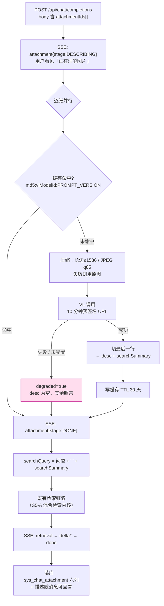
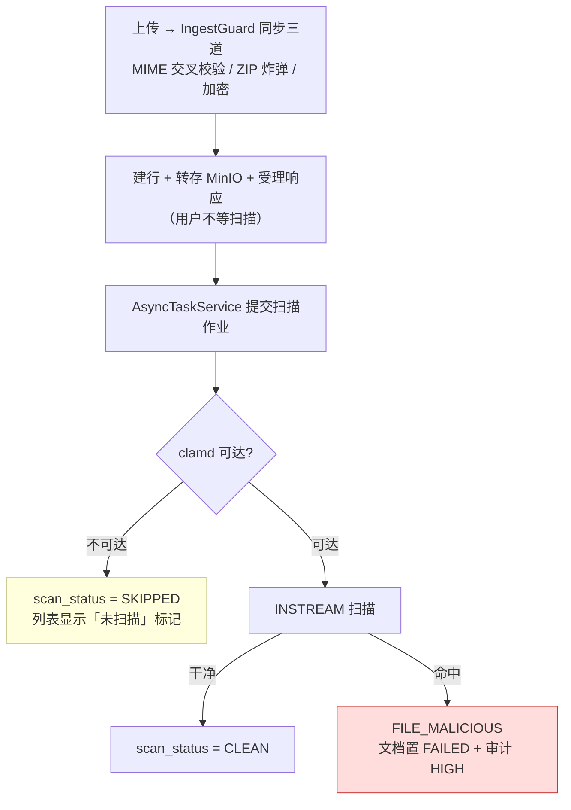

> 状态：🟡 进行中 · Sprint S6 · 阶段 B（M09 模型配置消费侧 + VL 描述链路）· 建档 2026-09-18

# 2026-09-18 · S6 · M09 · 阶段 B —— VL 描述链路 + 模型选项 + 用量统计（含 `T-O04` 恶意扫描）

> 任务：`T-907` · `T-904` · `T-905`（3 项）+ `T-O04` 余下（1 项 · 独立提交）
> 来源：`docs/进度/03-Sprint排期.md` §Sprint 6 · `docs/进度/02-任务清单.md:375-378`
> 上游计划：`ai_knowledge_web/plan/2026-09-18-S6-M09-A.md`（本批要销的账见第 1 节）

---

## 1. 开工条件检查

**依赖清单来源**：`docs/进度/00-开工速览.md` §1/§3/§4 · `02-任务清单.md:375-378` · `plan/汇总.md` §3（归属 S6 的 OPEN 行）· `S6-M09-A.md` §9 · 代码/库实测。

### 1.1 逐条判定

| # | 依赖项 | 档位 | 现状（代码/库实证） | 结论 |
|---|---|---|---|---|
| 1 | `T-907` 依赖 `T-902`（模型配置可切换） | ✅ | `S6-M09-A` 已交付：`DbModelConfigSource`（`@Primary`）+ `ModelConfigSeeder`，库实测 `sys_model_config` **4 行**、VL 一行在 | 满足 |
| 2 | `T-907` 要真的能发多模态请求 | ⚠️ WARN | `org.springframework.ai.content.Media` **在** `spring-ai-commons-2.0.1.jar` 里（实测 `unzip -l` 命中）。但 `ModelClientRegistry` **没有 VL 客户端出口** —— 现有出口是 `chatClient()` / `chatClient(id)` / `embeddingModel()` / `rerankClient()`，`case CHAT, VL` 只在 `probeConnection` 里合并处理（`ModelClientRegistry.java:161`） | 满足（需新增一个出口，见 3.1 步 1） |
| 3 | `T-907` 的问答期输入（附件 + md5 + 预签名 URL） | ✅ | `ChatAttachmentService` 已交付（`S5-M08-C`）：`md5` **由服务端按字节算**（伪 md5 会撞缓存 key）、`PresignTtl.CHAT_ATTACHMENT_SECONDS = 600`（== 需求 §4.3 的「10 分钟」）。`sys_chat_attachment` 实测含 `id/user_id/object_key/name/size/mime/md5/created_at` | 满足 |
| 4 | `T-907` 的缓存设施 | ✅ | Redis 已接入（`StringRedisTemplate` 在 `CaptchaStore`/`RefreshTokenStore`/`TokenBlacklist` 等 9 处），有现成写法可照 | 满足 |
| 5 | 🔴 **`T-907` 的「解析期」半边** | ⚠️ WARN | **解析期没有任何图片字节**：`TikaDocumentParser` 的 `img` 分支只 `imageCount++` + 写 `[图片]` 占位符（`TikaDocumentParser.java:244-248`）；`ParsedDocument.DocElement.image(pageNo)` **不带字节也不带 objectKey**（`ParsedDocument.java:324`）。`ChunkView.IMAGE_DESC` 的 javadoc 自陈「**预留**：`T-512` 落地时只加实现，不改管线」 | **不满足** → 本批**明确不做**，归 `T-512`（见 3.3） |
| 6 | 🔴 **`T-904` 的权限码** | ⛔ **BLOCKER（已解，见下）** | 现有 6 个 `/system/model/*` 端点全挂 `@RequiresPerm("system:model")`（`ModelConfigController.java:63,76,91,105,118,132`），而库实测**只有 `SUPER_ADMIN` 拿到它**（`sys_role_permission` 逐行查）。`/system/model/options` 的消费方是**问答页切换器**（`ChatView.vue:29` 已在调）——**普通 `USER` 打不开** | 解：新端点挂 **`qa:ask`**（实测 `USER`/`AUDITOR`/`KB_ADMIN`/`SUPER_ADMIN` 都有），见 3.4 假设 1 |
| 7 | `T-904` 的契约（`id` 是 `number`） | ✅ | mock 返回 `{id: m.id, ...}` 且前端类型 `ModelOption.id: number`（`types/index.ts:394`）。DB 主键是 `bigint` ⇒ 转得出来 | 满足 |
| 8 | `T-905` 的**计价列** | ✅ | `sys_model_config` 实测**已有** `billing_unit` / `input_price` / `output_price` / `per_call_price` / `currency`（`V26` 加的） | 满足 |
| 9 | `T-905` 的**对话用量落点** | ✅ | `sys_chat_message` 实测已有 `token_prompt` / `token_completion` / `model_id` / `model_name` | 满足 |
| 10 | 🔴 **`T-905` 的嵌入/重排/摘要/HyQ 用量落点** | ⚠️ WARN | **没有**。`sys_model_usage` 表不存在（`show tables` 实测 23 张表里无它）。四处调用点（`ChunkVectorizer#vectorize` 的 `embeddingClient.embed`、`ModelClientRegistry#rerankClient` 的消费方、`IndexEnhancer.java:183` 摘要、`:290` HyQ）**都不记录用量** | 满足（需新建表 + 四个采集点，见 3.1 步 10~13） |
| 11 | `T-905` 的 `embedding-impact` 契约 | ⚠️ WARN | `ModelConfigView.vue:383` 已在 `Promise.all([sysApi.modelUsage(), sysApi.embeddingImpact()])` 里同时调两个。**本批只认领 `usage`**，`embedding-impact` 属 `T-906` | 满足（本批不做 impact） |
| 12 | 🔴 **`T-908`（换 VL）** | ⛔ **BLOCKER** | 它要 `POST /rebuild-image-docs` 重建「**仅含图文档**」的图片理解，而**要重建的对象不存在** —— IMAGE 分片没有（见 #5）、`sys_chunk` 实测 **0 行**、`sys_document` 实测 **0 行**。全仓没有一条图片描述可重算 | **不满足** → 本批**不碰**，用户 2026-09-18 裁定（见 1.2） |
| 13 | `T-906`（换嵌入） | ✅ | 依赖 `T-902`，已满足。**但它是 🚩 高危全库重建**，且 `#171`（库内向量维度持久化列）是它的主要交付物 | 满足，但**本批不认领**（用户裁定只做 3 项） |
| 14 | `T-O04` 余下的错误码 | ✅ | `10075` 注释里**已预留**给 `FILE_MALICIOUS`（`ErrorCode.java:169`），当前最大码 `10080` | 满足 |
| 15 | `T-O04` 的 ClamAV 容器 | ⚠️ WARN | `docker-compose.yml` 现 6 服务，需加 `clamav`。`O4` §6 自陈风险：常驻内存约 1GB | 满足（降级路径必须先写，见 3.1 步 20） |
| 16 | 环境（基线残留） | ✅ | 实测：`sys_kb` 8 · `sys_document`/`sys_chunk`/`sys_async_task`/`sys_chat_attachment` 全 **0** · `sys_model_config` 4 | 满足 |
| 17 | 后端在跑 | ✅ | 8080 在听（PID 74076），`/api/health/config` 200。🔴 **跑 `mvn test` 前必须先停它**（`#151` 跨进程版 `#128`） | 满足，跑批前停 |

### 1.2 BLOCKER 汇总与处置

| BLOCKER | 处置（用户 2026-09-18 裁定） |
|---|---|
| `T-908` 的对象不存在 | **本批不碰**，在 §9 登记为「⛔ 阻塞于 `T-512`」，并把「`T-908` 立据时必须抄进 §6+7」写进 §9 与本文件 §10 |
| `T-904` 的权限码会把普通用户挡在门外 | **不走拒绝流程**（唯一路径清晰）：新端点挂 `qa:ask`，与 `S5-M08-C` 的 `qa:feedback` 教训同族 —— 见 3.4 假设 1 |

### 1.3 ⚠️ 已知偏差（不拒绝施工，§9 销账）

| # | 偏差 | 处置 |
|---|---|---|
| 1 | **`00-开工速览.md` §1 把 `S6-B` 定义成 9 个 `T-xxx`**（`T-904`~`T-908` + `T-B00`~`T-B03`） | 超过本仓「每批 ≤5」的粒度规矩。本批按用户裁定切出 3 项，**回填时把速览/汇总的「下一批」改成三段切法**（§9-1） |
| 2 | `stats.monthTokensWan` 只覆盖对话链路（`#169`） | 本批 `T-905` 销掉它（用量统计完整口径） |
| 3 | `capabilities` 只存不用（`#170`） | `T-904` 是它的第一个消费方（回显给切换器），**但上下文校验仍不做**（见 3.3） |
| 4 | `api_key_cipher` 恒 NULL（`#173`） | 不影响本批：`options` 不含密钥；`T-905` 不读它 |

### 结论

- [x] ✅ **可以开工**（`T-907` + `T-904` + `T-905` + `T-O04`）
- [x] ⛔ `T-908` 拒绝施工（BLOCKER 见 1.2），其余 5 项照旧

---

## 2. 开工时间

| 项 | 值 |
|---|---|
| 建档 / 开工日 | 2026-09-18 |
| 预计投入 | 功能 3 项 ≈ **7.5 人天**（`T-907` 4 · `T-904` 1 · `T-905` 2.5）；`T-O04` 余下 ≈ **3 人天**（独立提交，不占门禁验收窗） |
| 实际投入 | *回填时补* |

---

## 3. 开工内容

### 3.1 步骤

**A. `T-907` · VL 描述链路（能力层 + 问答期接入）**

| 步 | 做什么（文件/类 → 动作 → 产出） | 依赖 | 可并行 |
|---|---|---|---|
| 1 | `core/ai/ModelClientRegistry` → 新增 `Optional<ChatClient> visionClient()`：取 `activeSpec(VL)` 的客户端。**未配置 / 取不到时返回 `Optional.empty()`，不抛** —— 与 `rerankClient()` 的降级同形（`ModelClientRegistry.java:109`），VL 不可用不该把整条问答打断 | #2 | 与步 2~4 并行 |
| 2 | 新建 `pipeline/vision/ImageCompressor` → JDK `javax.imageio` 压到**长边 ≤1536 / JPEG q85**。⚠️ 压缩失败**用原图**（不阻断），只记 warn —— 需求 §4.3 说这一步「省 30~50% 耗时，且对描述质量几乎无损」，它不是正确性前提 | — | ✅ |
| 3 | 新建 `pipeline/vision/VisionPrompt` → §4.3 的模板逐字 + **`PROMPT_VERSION` 常量**（缓存 key 的第三段）。javadoc 写清「漏掉它 → 优化了 prompt 但缓存仍是旧描述，改完毫无效果且很难发现」（需求 §4.8 原话） | — | ✅ |
| 4 | 新建 `pipeline/vision/VisionDescriber` → 调 VL → **切最后一行**得 `searchSummary`、其余为 `desc`（需求 §4.4 的算法逐行）。⚠️ **刻意不用 JSON** —— 很多 VL 会包 markdown 代码块或前后解释文字。**解析不出关键词行 → `searchSummary = desc` 整体，不失败**（§4.10 降级矩阵第 4 行） | 步 1~3 | — |
| 5 | 新建 `pipeline/vision/VisionDescriptionCache`（Redis）→ key = `md5 : vlModelId : PROMPT_VERSION`，TTL 30 天（§4.8） | #4 | ✅ |
| 6 | 新建 `pipeline/vision/VisionResult`（record）→ `{desc, searchSummary, vlModelId, vlModelName, degraded, promptVersion}` —— **字段名与 §4.6 的落库 JSON 逐字对齐** | — | ✅ |
| 7 | `service/ChatAttachmentService` → 新增 `describe(attachmentIds)`：逐张**并行**调用（§4.3「多图逐张并行」），串起 缓存 → 压缩 → 描述 → 回填。任一张失败 → 该张 `degraded=true` + 空 desc，**不打断其余** | 步 2~6 | — |
| 8 | `pipeline/chat/ChatSink` → 新增 `attachment(AttachmentEvent event)`；`ChatStreamService` 的 SSE 实现补上。事件形状照 §4.9：`{stage: DESCRIBING\|DONE, attachmentId, desc, searchSummary, vlModel, degraded}` | — | ✅ |
| 9 | `service/ChatStreamService#chat` → 接 `attachmentIds`：**先**发 `attachment{DESCRIBING}` → 描述 → `attachment{DONE}` → `searchQuery = question + " " + searchSummary`（§4.5 v1 拼接）→ 再走既有检索。`done` 事件补 `usedVision`（恒 `false`，`T-806` 才接「直接读原图」） | 步 7,8 | — |
| 10 | `V27` 迁移 → `sys_chat_attachment` 加 6 列：`desc` / `search_summary` / `vl_model_id` / `vl_model_name` / `degraded` / `prompt_version`（全可空）。⚠️ `degraded` 是 **`Boolean` 而非 `boolean`**：`null` = 还没有描述、`false` = 有描述且没降级（与 `S5-M08-C` 的 `AttachmentView.degraded` 同一条口径） | — | — |

**B. `T-904` · 问答页模型选项**

| 步 | 做什么 | 依赖 | 可并行 |
|---|---|---|---|
| 11 | `ModelConfigService#options(ModelType)` → 只回 **`last_test_ok = 1`** 的行；`id` 转 `Long`（DB 主键是 `bigint`，引导期那串 `bootstrap-chat` 不会出现，因为 `DbModelConfigSource` 是 `@Primary`）；**响应里绝无密钥字段** | — | ✅ |
| 12 | `ModelConfigController` → `@GetMapping("/options")` + `@RequiresPerm("qa:ask")`（**不是 `system:model`** —— 见 1.1 #6） | 步 11 | — |

**C. `T-905` · 用量统计**

| 步 | 做什么 | 依赖 | 可并行 |
|---|---|---|---|
| 13 | `V27` 迁移 → 新建 `sys_model_usage`：`id` / `occurred_at`(DATE) / `model_type` / `model_id` / `model_name` / `purpose` / `calls` / `tokens` / `latency_ms` / `trace_id`，索引 `(occurred_at, model_type)` | — | ✅ |
| 14 | 新建 `service/ModelUsageRecorder` → 唯一的写入口（需求 §2.9「通知生成点统一」的同一条纪律：**不在业务代码散写**）。失败只 warn 不抛 —— 用量是**观测数据**，一次写库失败不该把一篇能解析的文档判失败（与 `TaskContext#persistProgress` 同一条取舍） | 步 13 | — |
| 15 | 四个采集点接上：① `ChunkVectorizer`（`PURPOSE.EMBEDDING`）② Rerank 调用点（`RERANK`）③ `IndexEnhancer:183` 摘要（`SUMMARY`）④ `IndexEnhancer:290` HyQ（`HYQ`）；⑤ 问答生成（`CHAT`，与 `sys_chat_message` 双写，口径以本表为准） | 步 14 | — |
| 16 | `ModelUsageService#month()` → 聚合出 mock 的 `{calls, tokens, cost, currency, unpricedCount, avgLatencySec, byPurpose[], byModel[]}`。🔴 **cost 三态**：已配单价 = `number`；`billingUnit='NONE'`（本地部署）= `0`；未配单价 = `null`，且 **`cost=null` 的行不进合计**、计入 `unpricedCount`（mock 的 `mockUsageByModel` 注释逐字钉着这条）。⚠️ 措辞用「**费用估算**」 | 步 13 | — |
| 17 | `ModelConfigController` → `@GetMapping("/usage")` + `@RequiresPerm("system:model")`（这页确实是模型配置页，超管专属正确） | 步 16 | — |

**D. `T-O04` 余下 · 恶意扫描（独立提交）**

| 步 | 做什么 | 依赖 | 可并行 |
|---|---|---|---|
| 18 | `ErrorCode` → 补 `FILE_MALICIOUS(10075, …)`（**注释里已预留**，直接落位） | — | ✅ |
| 19 | 新建 `core/storage/ClamAvScanner` → TCP 走 `clamd` 的 `INSTREAM` 协议；**未部署 / 连不上 → 返回 `SKIPPED`**，不抛、不阻断 | #15 | ✅ |
| 20 | `V27` 迁移 → `sys_document` 加 `scan_status`（`CLEAN`/`INFECTED`/`SKIPPED`，可空）+ `has_macro`（可空）。⚠️ **可空**：历史行是"未扫描过"，与 `SKIPPED`（扫了但没扫成）语义不同 | — | ✅ |
| 21 | 扫描放**异步**（`AsyncTaskService`）—— `O4` §6 明确「恶意扫描不应阻塞上传响应」。命中 ⇒ `FILE_MALICIOUS` + 文档置 `FAILED` + 审计 `HIGH` | 步 19 | — |
| 22 | `IngestGuard` → 补宏检测（Tika 直接给 `hasMacro`）：**放行 + 标记**，不是拒收（`O4` §3 流程图 `K -- 含宏 --> L`） | — | ✅ |
| 23 | 文档列表 DTO 回带 `scanStatus`，前端显示「未扫描」标记（**不是**静默当作已扫描） | 步 20 | — |
| 24 | `docker-compose.yml` 加 `clamav` 服务 + `.env` 加开关（默认走"未部署降级"） | — | ✅ |

### 3.2 业务流程图

**① VL 描述链路（跨 5 个组件 + 状态机 + 并发 + 幂等缓存）**



**② 恶意扫描（异步 + 状态机 + 降级）**



> 两图都满足触发条件：① 跨 ≥3 组件 ② 涉及异步/事务边界 ③ 有状态机 ④ 有并发/幂等缓存。

### 3.3 明确不做（范围控制）

| 不做的事 | 原因 | 归属批次 |
|---|---|---|
| **解析期图片抽取 + `IMAGE` 分片** | 解析产物里**没有图片字节**（`TikaDocumentParser` 只数数），`ChunkView.IMAGE_DESC` 的 javadoc 自陈「预留：`T-512` 落地时只加实现」 | **`T-512`** |
| **`GET /system/model/vl-impact` + `POST /rebuild-image-docs`** | ⛔ 对象不存在（无 IMAGE 分片、无图片描述可重算） | **`T-908`**（阻塞于 `T-512`） |
| **换嵌入（`embedding-impact` / `change-embedding` / `#171` 维度列）** | 🚩 高危全库重建，与「加一条能力」不是同一类改动；且 `#171` 是它的主要交付物 | **`T-906`**（`S6-C`） |
| **「直接读原图」（`useVision` 生效）** | 需求 §4.7 要求前置是「当前对话模型 `capabilities.vision = true`」；本批 `done.usedVision` **如实回 `false`**，不假装 | **`T-806`** |
| **`capabilities.contextWindow` 的上下文校验** | `#170` 的消费方之一。本批只把 `capabilities` 回显给切换器（它已存），不做过长拒绝那套逻辑 | **`T-806`/后续** |
| **`byPurpose` 的两路 trace 对照**（§4.5「检索 trace 里同时记录仅文字 query 与合成 query 两路」） | 见 3.4 假设 3 | **v2**（登记 §9） |
| **通知中心 `T-B00`~`T-B03`** | 属 M11，与 M09 不是同一主题；一批塞 9 个 `T-xxx` 会超过粒度规矩 | **`S6-D`** |
| **不做以图搜图 / 多模态 embedding** | 需求 §4.13 边界 | 不做 |
| **不做 DLP 内容级敏感检测 / 沙箱解析** | `O4` §6 明确不做 | 不做 |

### 3.4 本批假设

| # | 假设 | 若被证伪的后果 |
|---|---|---|
| 1 | **`/system/model/options` 挂 `qa:ask`**（不是 `system:model`）—— 依据：实测 `system:model` 只有 `SUPER_ADMIN` 有，而消费方是问答页切换器，`USER` 必须能用。与 `S5-M08-C` 的 `qa:feedback` 教训同族（**权限码名字像、语义不同，挂错的表现是普通用户用不了**） | 普通用户打不开切换器；且这个失效**只在真页面上看得见**，用例层不会红 ⇒ 必须有一条真 HTTP 的用例覆盖 `USER` 角色 |
| 2 | **VL 未配置时的兜底路径本批只做「degraded 标记 + 提示」，不做「借用多模态对话模型」** | 需求 §4.2 的兜底原文是「VL 未配置时**可**借用多模态对话模型生成，但必须标 `degraded = true`」。若被判定必须做，则增 ≈0.5 人天并需 `capabilities.vision` 判定（而种子的 `vision=false` 是**保守初值**，不是实测值 —— `#170`） |
| 3 | **§4.5 的「两路 trace 对照」本批只落「合成 query」一路** | 理由：做第二趟完整检索会让每次带图提问的检索耗时翻倍，而 `G5-12`（检索耗时分解）刚在 `S5-M08-A` 收口，翻倍会让那套打点失真 —— 用失真换一个「为 v2 留依据」的字段不划算。**若被判定必须两路**，代价是每次带图提问多一趟检索 |
| 4 | **`sys_model_usage` 与 `sys_chat_message` 对问答用量双写**，口径以新表为准 | 双写有一致性风险；但 `sys_chat_message` 的 token 列是既有事实源、不能停写。回填时核对两者同期差值 |
| 5 | **ClamAV 走异步、且默认走「未部署降级」** | 若判定必须同步拦（"不扫完不受理"），则上传响应时长会从 ~200ms 变成"扫完为止"，与 `O4` §6「不应阻塞上传响应」直接冲突 |

---

## 4. 数据变更清单

| 类型 | 内容 | 回滚方式 |
|---|---|---|
| 改表 | `sys_chat_attachment` **加 6 列**：`desc` TEXT / `search_summary` TEXT / `vl_model_id` VARCHAR(64) / `vl_model_name` VARCHAR(128) / `degraded` TINYINT(1) / `prompt_version` VARCHAR(16) —— **全可空、无默认值** | 可逆（DROP COLUMN） |
| 新建表 | `sys_model_usage`：`id` BIGINT PK AUTO_INCREMENT / `occurred_at` DATE NOT NULL / `model_type` VARCHAR(16) NOT NULL / `model_id` BIGINT NULL / `model_name` VARCHAR(128) NOT NULL / `purpose` VARCHAR(24) NOT NULL / `calls` INT NOT NULL DEFAULT 0 / `tokens` BIGINT NOT NULL DEFAULT 0 / `latency_ms` INT NULL / `trace_id` VARCHAR(64) NULL；索引 `idx_usage_date_type(occurred_at, model_type)` | 可逆（DROP TABLE） |
| 改表 | `sys_document` **加 2 列**：`scan_status` VARCHAR(16) **NULL** / `has_macro` TINYINT(1) **NULL** | 可逆（DROP COLUMN） |
| **迁移文件** | **`V27__s6_vision_usage_and_av.sql`**（现有最大 `V26`，递增） | — |
| 种子数据 | **不新增**。`sys_model_config` 保持 4 行不变；`sys_model_usage` 空表起（无演示数据 ⇒ `GET /system/model/usage` 在真实调用发生前返回**全 0 + `cost: null`**，这是**正确的空态**而不是"未实现"） | — |
| ⚠️ NULL 分支 | ① `sys_chat_attachment.degraded`：`NULL` = **还没有描述**（不是"没降级"）—— 前端必须区分这个与 `false`；② `sys_document.scan_status`：`NULL` = **历史行，从未扫描过**，与 `SKIPPED`（扫了但没扫成）**语义不同**，列表标记文案要分开；③ `sys_model_usage.model_id`：`NULL` = 记录时该模型已被删（用量是事实，不随配置删除而消失） | — |

> 跑过的迁移**只增不改**。`V27` 一次性承载三处改动（附件 6 列 + 新表 + 文档 2 列）—— ⚠️ **按 `S5-M08-C` 的纪律，`ProbeArtifacts`（Java 侧）+ `probe-teardown.mjs`（脚本侧）+ O7 规则表三处都要同步**（新表 `sys_model_usage` 是**无归属**的，与 `sys_async_task` 同类，登记时要写清它的归属维度是什么）。

---

## 5. 依赖与工具决策

| 方案 | 做法 | 代价 | 结论 |
|---|---|---|---|
| **不引依赖（既有栈）· 图片压缩** | JDK `java.desktop` 模块自带的 `javax.imageio` + `ImageWriteParam`（JPEG q85）。**JDK 25 已含 `java.desktop`**，零新增 jar | 只支持 JDK 原生能解的格式（PNG/JPEG/GIF/BMP）；WebP 会落到 ImageIO 抛 `IIOException` ⇒ **降级用原图**（本就是要写的分支） | ✅ **采用** |
| 候选：`thumbnailator` / `imgscalr` | 更省几行代码，质量算法略好 | 多一个依赖，而需求要的只是「长边 ≤1536 + JPEG q85」这一条固定规则 | ❌ 不引 |
| **不引依赖（既有栈）· 多模态调用** | Spring AI 2.0.1 的 `org.springframework.ai.content.Media`（**实测在 `spring-ai-commons-2.0.1.jar` 里**）+ `UserMessage` 的 media 参数 —— 与既有 `OpenAiChatModel` 同一个通道，**不新增任何东西** | 无 | ✅ **采用** |
| **不引依赖（既有栈）· ClamAV 客户端** | clamd 的 `INSTREAM` 协议是**纯文本 + 4 字节小端长度前缀**，用 `Socket` 手写即可（≈80 行）。**不引 `clamav-client` 之类的第三方包** | 要自己写协议解析；但协议极简且稳定（20 年未变） | ✅ **采用** |
| 候选：`docker-java` / `clamav-client` (com.github.rholder) | 封装了协议 | 后者最后发版 2016、前者为大件；本仓先例是「CSV 而非 poi-ooxml（省 15MB）」「手写 4 字段 JSON 而非注入 ObjectMapper」 | ❌ 不引 |
| ⚠️ **容器**：`clamav/clamav` 镜像 | `docker-compose.yml` 加一个服务 | **常驻内存约 1GB**（`O4` §6 自陈风险），且拉镜像要几百 MB。**故默认走"未部署降级"路径**，只有显式起容器才走真扫描 | ✅ 采用（默认不启用） |

**推荐**：**四项全部用既有栈实现，零新增 Java 依赖**；唯一新增的"依赖"是 `docker-compose.yml` 里一个**默认不启动**的 `clamav` 服务。

**理由**：本批四个新能力（多模态调用、图片压缩、Redis 缓存、TCP 病毒扫描）分别落在 **Spring AI 既有通道 / JDK 自带模块 / 既有 Redis / 一个 80 行的 TCP 协议** 上。为它们各引一个库，半年后会变成四份"不知道谁在用"的依赖 —— 与本仓既有取舍（CSV 而非 poi-ooxml）一致。

---

## 6 + 7. 验收方法与标准

| # | 判据（对齐需求门禁号） | 验收方法（可直接粘的命令/脚本） | 期望结果 | 证据落点 |
|---|---|---|---|---|
| 1 | **`G6-6`** VL 描述**一次调用两产出**（需求 §4.4/§4.12） | `mvn -B -f F:/work/code/ai-knowledge/ai_knowledge_web/pom.xml test -Dtest=VisionDescriberTest` | 替身 VL 返回「正文 + 换行 + `关键词：A, B, C`」⇒ `desc` 不含关键词行、`searchSummary == "A, B, C"`；**两次产出只调一次模型**（替身计数断言） | `VisionDescriberTest` |
| 2 | **`G6-6`** 不用 JSON + 解析不出关键词行**不失败**（§4.10 第 4 行） | 同上 | 替身返回**没有关键词行**的纯文本 ⇒ `searchSummary == desc` 整体，**不抛**；返回包在 ``` 代码块里的"JSON" ⇒ 原样进 `desc`（不做 JSON 解析） | `VisionDescriberTest` |
| 3 | **`G6-7`** 缓存 key 含 `PROMPT_VERSION`，改版本**自动失效**（§4.8/§4.12） | 同上 | 同 md5 + 同 vlModelId 第二次调用**命中缓存**（替身调用次数不增）；**改 `PROMPT_VERSION` 后同一张图重新调用** | `VisionDescriptionCacheTest` |
| 4 | **`G6-7`** 缓存 key 含 `vlModelId`（换 VL 模型 → 重算） | 同上 | 同 md5、**不同 vlModelId** ⇒ 不命中 | `VisionDescriptionCacheTest` |
| 5 | **`G6-8`** **降级矩阵完整**（§4.10 五行逐条） | `mvn -B … test -Dtest=VisionDegradeTest` | ① 格式/大小不合规 ⇒ 业务错误码、**不进链路**；② MinIO 上传失败 ⇒ 明确报错、**不静默跳过图片**；③ **VL 未配置 / 调用失败 / 返回空 ⇒ `degraded=true` + 照常回答，不打断**（负向锚：断言后续检索与生成**仍然发生**）；④ 解析不出关键词行 ⇒ 不失败；⑤ 检索无结果 ⇒ 走既有未命中沉淀 | `VisionDegradeTest` |
| 6 | **`G6-9`** 描述由**独立 VL 模型**生成，与当前对话模型无关（§4.2/§4.12） | `mvn -B … test -Dtest=VisionModelIndependenceTest` | 把**当前对话模型**换成另一个（替身）⇒ 描述仍来自 **VL 那一行**；替身里对话模型的调用次数**为 0**（负向锚） | 同上 |
| 7 | **`G6-10`**「直接读原图」**仅在 `capabilities.vision = true` 时可用**，且只对该轮生效 | `grep -rn "usedVision" ai_knowledge_web/src/main/java/` + 本批用例 | 本批 `done.usedVision` **如实回 `false`**（`T-806` 才接）；**禁止**出现"读原图但没记 `usedVision`"的分支 | 用例 + `#162` 同族登记 |
| 8 | **`G6-11`** SSE 先发 `attachment{DESCRIBING}`，用户能看到「正在理解图片」（§4.9/§4.12） | `cd ai_knowledge_app && node scripts/e2e-chat-flow.mjs --base=http://127.0.0.1:5174` | 带图提问时 **`names[0] === 'attachment'`**（在 `retrieval` **之前**）；页面出现「正在理解图片」文案；随后 `retrieval` 的 query **含 searchSummary** | `e2e-chat-flow.mjs`（扩步） |
| 9 | **`G6-12`** 消息可回看「当时图片被理解成什么」（§4.12） | `GET /api/chat/attachments/{id}` | 六个新字段回带真值（`desc` / `searchSummary` / `vlModelName` / `degraded` / `promptVersion`）；**未描述过的附件仍返回 `null` 而不是空串** | 用例 + `e2e-chat-flow` |
| 10 | **`G6-13`** 同图同 VL 模型**命中缓存，不重复调用**（§4.12） | 判据 3 的负向锚 + Redis 实查 | Redis 里存在 `md5:vlModelId:PROMPT_VERSION` 形态的 key；同图二次提问替身调用次数不增 | 同上 |
| 11 | **`T-904`** 模型选项：**不含密钥** + 仅已启用且测试通过 | `mvn -B … test -Dtest=ModelOptionFlowTest` | 库里造 3 条 CHAT（1 启用已测 / 1 未测 / 1 未启用）⇒ 只回 1 条；响应体里**逐字搜 `.env` 的真实 Key，必须不出现**（沿用 `G6-5` 的取证方式） | `ModelOptionFlowTest` |
| 12 | 🔴 **`T-904` 权限**：**`USER` 角色能调通**（假设 1 的判据） | 同上（走真 HTTP + `USER` 的 token） | **HTTP 200 + code=0**；负向锚：同一 token 调 `/system/model/config` 仍 **403**（证明权限确实收窄了，不是"没挂权限"） | 同上 |
| 13 | **`T-905`** 用量三态 `cost`（`number` \| `0` \| `null`）+ `unpricedCount` | `mvn -B … test -Dtest=ModelUsageFlowTest` | 造三条模型：已配单价 / `billingUnit=NONE` / 未配单价 ⇒ `byModel` 三条分别为 `number` / `0` / `null`；`cost` **合计只累加已计价项**；`unpricedCount == 1` | `ModelUsageFlowTest` |
| 14 | **`T-905`** `byPurpose` 四桶合计 **== `tokens` 合计** | 同上 | 断言 `sum(byPurpose.tokens) == tokens`（mock 注释逐字要求「合计必须等于 byModel 的 tokens 合计」）；空表时**全 0 且 `cost == null`** | 同上 |
| 15 | **`T-905`** 采集点真的落库（不是"表建好了没人写"） | `set -a && . ai_knowledge_web/.env && set +a && docker exec kb-mysql mysql -u"$MYSQL_USERNAME" -p"$MYSQL_PASSWORD" "$MYSQL_DATABASE" -e "select purpose, count(*), sum(tokens) from sys_model_usage group by purpose;"` | 跑一遍解析 + 一次带图问答后，**至少 3 个不同的 `purpose` 有行**（嵌入 / 摘要 / HyQ / CHAT / VL_DESC 中的 ≥3 个） | 实测输出 |
| 16 | 🔴 **`T-O04` 判据 4**：恶意样本被拦 | EICAR 测试串（44 字节标准串）做成 `.txt` 上传 | `FILE_MALICIOUS` + 审计 `HIGH` + `scan_status = INFECTED` | 用例 + `e2e` |
| 17 | 🔴 **`T-O04` 判据 6**：未部署 ClamAV 时行为明确 | `docker compose stop clamav` 后上传 | **上传成功** + 列表显示「未扫描」标记 + `scan_status = SKIPPED`（**不是**静默当作已扫描） | 用例 + 页面截图 |
| 18 | `T-O04` 判据 5：加密 PDF 的提示**不同于**扫描件 | 加密 PDF 上传 | 提到「加密/密码」，**不是**「未提取到可复制文本」 | 用例（既有 `FILE_ENCRYPTED` 回归） |
| 19 | `T-O04` 宏检测：**放行 + 标记**，不是拒收 | 含宏 `.docm`/`.xlsm` 上传 | 上传成功 + `has_macro = 1`；**不返回错误码** | 用例 |
| 20 | 全量回归 + 基线 | `mvn -B -f F:/work/code/ai-knowledge/ai_knowledge_web/pom.xml test` | `Tests run: N, Failures: 0, Errors: 0, Skipped: 0`（上批 **553**） | 输出 |
| 21 | 四方对账（① ② ⑥ 恒 0；真后端路由 / ⑦【S6】下降） | `node ai_knowledge_app/scripts/audit-api.mjs` | ①=0 ②=0 ⑥=0；真后端路由 **82 → 84**（+2 = `/system/model/options` + `/system/model/usage`；⚠️ **`/notices/*` 七条属 `S6-D`，不在本批**）；**⑦【S6】13 → 11** | 输出 |
| 22 | 前端零改动（除 O4 的「未扫描」标记） | `node ai_knowledge_app/scripts/check.mjs` | 类型检查 + 生产构建通过 | 输出 |

**观察项**（不计成败，页面写死的展示值登记在此）：

- 问答页切换器下拉里显示的模型描述文案（`displayName`）—— 来自 DB 的 `display_name`，不是 mock 写死的「DeepSeek-V3（硅基流动）」。
- `GET /system/model/usage` 在**空表**时的展示：全 0 + `cost: null` ⇒ 页面显示「暂无法估算」。这是**正确的空态**，不是缺陷。

**种子核对**（跑完必做）：

```bash
set -a && . ai_knowledge_web/.env && set +a
docker exec kb-mysql mysql -u"$MYSQL_USERNAME" -p"$MYSQL_PASSWORD" "$MYSQL_DATABASE" -N -e "
select 'sys_user' t, count(*) from sys_user where deleted_at is null
union all select 'sys_kb', count(*) from sys_kb where deleted_at is null
union all select 'sys_document', count(*) from sys_document
union all select 'sys_chunk', count(*) from sys_chunk
union all select 'sys_async_task', count(*) from sys_async_task
union all select 'sys_model_config', count(*) from sys_model_config
union all select 'sys_model_usage', count(*) from sys_model_usage
union all select 'sys_chat_attachment', count(*) from sys_chat_attachment
union all select 'vl_active', count(*) from sys_model_config where model_type='VL' and is_active=1;"
```

**基线期望**：`sys_user` 128 · `sys_kb` 8 · 其余 0 · `sys_model_config` 4 · **`vl_active` 1**（本批新依赖，与 `#166` 的 `is_active` 同一条纪律）。

---

# 以下为开工后回填

> **提交节奏（两次）**：1~7 节写完即提交一次（`docs(plan): S6-M09-B 开工计划`）；
> 8~10 节写完再提交一次（`docs(plan): S6-M09-B 验收回填`）。`T-O04` 独立提交。

## 8. 验收结果

| # | 判据 | 实测结果 | 证据（命令 / 文件:行 / 测试名） |
|---|---|---|---|

**测试基线**：`Tests run: N, Failures: 0, Errors: 0, Skipped: 0`（上批 553 → 本批 M）

---

## 9. 遗留问题

| # | 项 | 原因 | 归属批次 | 是否有判定点/注释留在代码里 |
|---|---|---|---|---|
| — | *回填时补* | | | |

---

## 10. 建议

- *回填时补*

---

## 附：本批同步的文档回填

- [ ] **`docs/进度/00-开工速览.md` §1/§2/§3/§4** → 当前定位 / 本批任务行 / 门禁现状 / 缺口账（**必改**）
- [ ] `docs/进度/02-任务清单.md` → `T-907`/`T-904`/`T-905` 置 ✅（`T-906`/`T-908` 不动）+ `T-O04` 状态
- [ ] `docs/进度/03-Sprint排期.md` → 「交付状态」段
- [ ] `docs/进度/README.md` → 看板状态 + 完成日期（长备注 → `变更记录/02-Sprint交付台账.md`）
- [ ] `docs/进度/变更记录/01-变更记录.md` → 追加一行
- [ ] `docs/需求文档/10-接口约定汇总.md` → §14 字段 + §14.1 差异；**`13-接口变更记录.md` 加一行**
- [ ] `ai_knowledge_web/plan/汇总.md` → §1/§2/§3/§4
- [ ] `ai_knowledge_web/plan/优化/README.md` → `T-O04` 那行的状态列
- [ ] `.workbuddy/memory/2026-09-18.md` → 交接
- [ ] 本文件状态行 → ✅ 已完成
