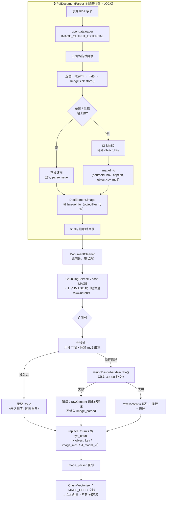

> 状态：🟡 进行中 · Sprint S6 · 阶段 C2（`T-512` 图片进索引**收尾**：步 2、4~9）· 建档 2026-09-19

# `S6-M05-C2` —— `T-512` 步 2、4~9（图片进索引的**主要工作量**）

> **上游**：`plan/2026-09-18-S6-M05-C.md`（🟡 进行中 → 与本批**合并验收 + 合并回填**）。
> 那批做完两件事：P0 问答 SSE 真流式（已结清）+ `T-512` **步 0/1/3**（探针 + `DocElement` 携带图片身份 + 题注配对打通）。
> **本批接着做 `T-512` 剩下的 7 步** —— 按上游 §10-2 的原话：**"那是主要工作量，不是收尾"**。
>
> **本批只有一个 `T-xxx`**（`T-512`），但它的剩余体量 **≈5~7 人天**，按「批次粒度按可交付拆」的口径
> 它是一个**完整可验收的交付**（图片从"解析出元素"到"进得了召回"的整条链）。
>
> 🔴 **用户 2026-09-19 指令**：步 2 开工前**先补一次更大样本的量测** ——
> 那条老纪律（「开了会把产物撑到几百 MB」）的**理由已被探针削弱，但没被推翻**（上游 §8.2 / §10-2）。
> **阈值先量再定**（本仓老纪律，`measure-before-picking-a-threshold`）。

---

## 1. 开工条件检查

### 1.1 环境（实测，2026-09-19）

| 项 | 值 |
|---|---|
| docker | **6 服务全 `healthy`**：`kb-mysql` · `kb-neo4j` · `kb-valkey` · `kb-minio` · `milvus-standalone` · `milvus-etcd`（本会话内 Docker Desktop 刚启动，首查时尚未就绪，二次查全绿） |
| 基线残留（`#108`） | `kb=8` · `user=128` · `doc=0` · `chunk=0` · `task=0` · `attach=0` · `model_config=4`（`is_active=4`）—— ✅ **7 张表与上一批收尾逐字一致** |
| 🔴 **问答族残留（本批开工即清）** | 上一批 §9.3 自己点名的盲点**实测坐实**：`sys_chat_session=27` · `sys_chat_message=54` · `sys_retrieval_trace=27`，全为 **2026-09-18** 的探针 curl + 中断 E2E 所留（`user_id` 689=21 条 / 1=6 条）。**已清零并复验** ⇒ 见 §9 遗留（`#108` 基线清单补全） |
| 迁移编号 | 最大 **`V28`**（`flyway_schema_history` max rank=28）⇒ 本批新迁移从 **`V29`** 起 |
| `issue_kind` 列型 | **`VARCHAR(32)`**（实测 `V18` 第 67 行）⇒ 新增一个 `IssueKind` 值**不需要迁移**（步 6.5 的关键前提） |
| VL 模型 | `sys_model_config` id=**4** · `model_type=VL` · `model_name=Qwen/Qwen3-VL-8B-Instruct` · `is_active=1` —— ✅ **已配置且启用**（`T-907` 的消费侧） |
| 验收语料 | `docs/测试文件/` **5 PDF + 4 DOCX + 1 XLSX**（gitignored，无样本机器上探针跳过） |
| 代码状态 | ✅ 与上游 §8.2 逐条吻合：`ImageInfo`（步 1）· `collectCaptions`（步 3）已落；`ChunkViews.IMAGE_DESC` **仍抛 `UnsupportedOperationException`** · `ParseFingerprint` 仍 `imageOutput=OFF` + `cleaningVersion=v1` · `ChunkingService` 的 `case IMAGE -> { }` 仍空 —— **步 2/4/6 的靶点全部健在** |

### 1.2 🔴 本批开工条件的**最关键一条**：步 2 的阈值必须先量

上游 §8.2 记的实测（**只覆盖 2 份样本**）：

| 样本 | 图元素 | 出图合计 | 单图 max |
|---|---|---|---|
| `1-DeepSeek使用.pdf` | 75 | **2.52 MB** | — |
| `健康生活方式（指导手册）.pdf`（21.8 MB 源） | 15 | **17.50 MB** | 1.79 MB |

⇒ 那条纪律的原话「会把产物撑到几百 MB」**在这两份上不成立**。**但上限仍要给**（图多的大型 PDF 没测过）。

**本批补量的样本（`parse-fixtures.json` 实测 `imageCount`，此前从未进过"出图"探针）**：

| 样本 | 图元素 | 为什么选它 |
|---|---|---|
| `江西省农村信用社联合社_…项目管理章程.pdf` | **63** | 图元素数是已测样本里第二多，且**从未量过出图体积** |
| `2-提示词工程.pdf` | **57** | 同上（上游 §9.3 点名"两份 PDF 仍未进装饰图探针"，其中就有它） |
| （参考）`江西农商银行_…需求说明书.docx` | 120 | ⚠️ **DOCX 走 Tika 路径**，结构性不触发 PDF 出图（`pages=1`）⇒ **量它无意义**，只记不量 |

> ⇒ **补量后样本覆盖从 2/5 升到 4/5 份 PDF**（余下 1 份 `百福云` 图少）。
> ⚠️ **探针的产出很可能是否掉当前阈值**（上游 §3.2 步 5.1 的裁定原话），**那也是产出**。

**✅ 步 2a 实测结果（2026-09-19，用户裁定"两份都量"后执行）**：

| 样本 | 图元素 | **出图数** | 出图合计 | 单图 max |
|---|---|---|---|---|
| `1-DeepSeek使用.pdf` | 75 | **26** | 2.52 MB | 320.2 KB |
| `2-提示词工程.pdf` | 57 | **6** | 0.65 MB | 138.0 KB |
| `江西省农村信用社联合社_…章程.pdf` | 63 | **25** | 0.48 MB | 78.0 KB |
| `健康生活方式（指导手册）.pdf` | 15 | **15** | 🔴 **17.50 MB** | 🔴 **1787.1 KB** |

**两个极值 = 单篇 17.50 MB · 单图 1787.1 KB（1.79 MB）**。

⇒ ✅ **老纪律「会把产物撑到几百 MB」在 4/4 份样本上不成立**（离几百 MB 差一个数量级）。
⇒ ✅ **当前口径（单图 2 MB · 单篇 50 MB）保留**，但**依据从 2 份变成 4 份**，
且两份**图类型不同**（PPT 导出型 / 扫描件型）都覆盖到了 ⇒ 判据 2 结清。

🔴 **一条量测顺带捞出的新事实（上游没量到）**：**出图率剧烈波动，且比上游记的更极端**：

| 样本 | 出图率 |
|---|---|
| `健康生活方式`（扫描件） | **15/15 = 100%** |
| `江西省…章程` | 25/63 = **40%** |
| `1-DeepSeek使用` | 26/75 = **35%** |
| `2-提示词工程` | **6/57 = 11%** ← 比上游记的 35% 更低 |

⇒ 这**加强**了步 6.5 的裁定（「无法提取」必须登记可见）：
`image_total` 与「可描述上界」的差**不是固定比例**，一份比一份不一样 ——
拿 `image_total` 当分母、把差额当"还没跑完"，在任何一份上都解释不通。

### 1.3 ⛔ BLOCKER / ⚠️ WARN 分档

> 判据只有一条：**这条不满足，代码写下去会不会白写。**

**⛔ BLOCKER：无。**

`T-512` 步 2、4~9 的全部输入对象**都已在位**（步 1 的 `ImageInfo` 已落 · 步 3 的题注配对已通 ·
VL 模型已启用 · `V29` 编号可用 · `issue_kind` 列型无需迁移）。**可以开工。**

**⚠️ WARN（逐条登记，进 §9 销账）：**

| # | 内容 | 处置 |
|---|---|---|
| W1 | **`T-512` 步 2 掀掉一条记录在案的纪律**（`PdfDocumentParser` 调用纪律第 2 条 + 类 javadoc） | **先补量测**（§1.2）→ 按量测定上限 → **改写那条纪律**（保留实测数字），**不是删掉它** |
| W2 | `ParseFingerprint.PARSER_CONFIG:74` 写着 `"imageOutput","OFF"` | 步 2 同步改 ⇒ `parserConfigHash` 变 ⇒ **全库已解析文档判「需重解析」**。⚠️ **这是机制在正常工作**（解析行为真的变了），不是意外 |
| W3 | `ParseFingerprint.CLEANING_VERSION = "v1"`，javadoc 明写「改了 `ChunkViews` 投影口径**必须**加一」，而**它没有机器可读身份** | 步 6 加到 **`v2`**。漏了它就是复现「清洗规则变了但所有文档被判产物最新」 |
| W4 | 需求 `06:160` 的「按 `imageMd5` 去重」是**语料级**的（与 `T-O03` ① 同源） | 本批**只落 md5 列 + 同篇内去重**（步 5.1），**不做跨文档去重**，登记遗留 |
| W5 | `#166`「`sys_model_config.is_active` 是全局状态」 | 本批动 VL 描述（会读它），跑批前仍按 `#108`/`#151` 核基线 + 停后端 |
| W6 | **绿不绿仍是软的**（上游记过一次真模型网络抖动让 1 处红） | §8 如实记录 |
| W7 | `parse-fixtures.json` 有 17 条样本、17 份 `imageCount` 期望 | 步 1（已做）与步 2/4 改解析行为后**必须重跑解析基线**；期望值是否要动**施工时实测**（`imageCount` 语义不变 ⇒ 预计不动） |
| W8 | 上游 §9.3「`LoginUser` 传播是防御性的」（问答链路一处都没读 `LoginUserContext`） | **与 `T-512` 无关**，不进本批；仅提醒后端描述期若新增线程要按 `async-traceid-and-identity` 纪律传身份 |
| 🔴 W9 | **上游 §9.6-② 的教训**：量"桶里有几个对象"**必须用客户端，不要 `ls` 数行**（MinIO 删对象不修剪空目录） | 本批所有"数量"判据（出图数 / 对象数 / 残留）**一律走客户端或 SQL**，**不用 `ls -R \| wc -l`** |

**⚠️ 本批自查发现的、上一批的**继承性**缺口（登记 §9，不在本批销）：**

| # | 内容 | 归属 |
|---|---|---|
| N1 | `#108` 基线清单**不含 `sys_retrieval_trace` / `sys_chat_session` / `sys_chat_message`**（上游 §9.3 已点名，本批开工**实测坐实**：三张表各躺着 27/27/54 行 2026-09-18 的残留） | **本批补进 §1.1 的核对脚本**（已做）· 清单**正式化**登记为遗留 |

---

### 结论

- [x] ✅ **可以开工**（无 BLOCKER）
- [ ] ⛔ 拒绝施工

> ✅ **两处范围问题已获用户 2026-09-19 裁定**（用 `AskUserQuestion` 问的，见下）：
> 1. **O 配额 = 补齐两件欠账** —— `T-O09` 判据 5（≈2 人天）+ 补探那 2 份 PDF（≈0.5~1，**不算 O 交付**）
>    + 顺带把 `O3` 探针补到 5/5。⚠️ 真正算 O 交付的仍只有 **~2 人天 < 下限 4**，
>    但**欠账清了，不再积累**（这是选它的理由）。
> 2. **步 2 量测样本 = 两份都量**（`江西省…章程` 63 图 + `2-提示词工程` 57 图）——
>    图类型不同（PPT 导出 vs 扫描件），单一形态可能漏掉一类。详见 §1.2。

---

## 2. 开工时间

| 项 | 值 |
|---|---|
| 建档 / 开工日 | **2026-09-19** |
| 预计投入 | **`T-512` 步 2、4~9 ≈5~7 人天** · **O 配额 ≈2.5~3 人天** ⇒ **合计 ≈7~10 人天**（容量 ≈10） |
| 实际投入 | *回填时补* |

> ⚠️ **O 配额如实登记**（用户 2026-09-19 裁定"补齐两件欠账"）：
> 认领 = `T-O09` 判据 5（**≈2 人天，唯一算 O 交付的**）+ 补探 2 份 PDF（≈0.5~1，**不算 O 交付**，不改业务代码）
> + 顺带 `O3` 探针补到 5/5。
> ⇒ **O 交付 ≈2 人天 < 下限 4（连续第八批）**，但**上游欠的两件都清掉了，不再向后积累**。
> 选它的理由：本批主体 `T-512` 已占 5~7 人天，再加 `T-O03`（4 人天）会**超容量**（见 §3.3 与 §10）。

---

## 3. 开工内容

### 3.1 步骤

> **依赖顺序**：步 2 与步 8 可**部分并行**（步 8 的迁移/实体/契约与步 2 的解析器改互不依赖）；
> 步 4 → 步 5 → 步 7 是**严格串行**（块产出 → 描述 → 回填）；步 6 可与步 5 并行（改的是投影，不是描述）。

| 步 | 做什么（文件/类 → 动作 → 产出） | 依赖 | 可并行 |
|---|---|---|---|
| **2a** | 🔴 **先补量测**（用户 2026-09-19 指令）：把 `T512ImageProbeTest` 的样本数组补上 `江西省…章程`（63 图）与 `2-提示词工程`（57 图），**跑出单图 max / 单篇合计** | — | ✅ 与 8 并行 |
| **2b** | `PdfDocumentParser.java:97` `IMAGE_OUTPUT_OFF` → `IMAGE_OUTPUT_EXTERNAL` + `IMAGE_FORMAT_JPEG` + `setImageDir(临时目录下)`；新增 `ImageSink` 协作方（函数式接口 `bytes+pageNo → Stored(objectKey, md5)`），**解析锁内**逐图调用；**磁盘兜底重做**（按 2a 实测定上限，超限不抽 + 登记 issue）；改写调用纪律第 2 条 | 2a | |
| **2c** | `ParseFingerprint.java:74` `"imageOutput","OFF"` → `"EXTERNAL"`（W2） | 2b | |
| **4** | `ChunkingService.java:99` `case IMAGE -> { }` → 产出 **1 个** IMAGE 块（需求 `06:166`：图片整体原子单元，**不随 `chunkSize` 变**）；`Block` 加 `ImageInfo` 字段（非 IMAGE 恒 `null`，**编译器可检**，`#157` 先例）；`rawContent` **只放题注**（描述还没有） | 2b | |
| **5** | 🔴 **锁外描述**（新步骤，插在 `chunk` 与 `enhance`/`replaceChunks` 之间）：遍历 IMAGE 块 → 按 `objectKey` 取字节 → `VisionDescriber.describe(...)` → `rawContent = 题注 + "\n" + 描述`。复用既有 `pipeline/vision/` 七件套；让 `VisionDescriber:228`「文档解析期传 null」**作废** | 4 | |
| **5.1** | **先过滤，再调 VL**（上游裁定）：① 尺寸下限（小图标/分隔线）② **同篇内 `imageMd5` 去重**（同一 md5 只调一次）。被跳过的图**登记进 issue**，理由写「未达描述阈值 / 同图重复」，**与"理解失败"可区分** | 5 | |
| **6** | `ChunkViews.java:52-54` `IMAGE_DESC` 抛异常 → **返回 `block.rawContent()`**；同步把 `ParseFingerprint.CLEANING_VERSION` `v1`→**`v2`**（W3）；`ChunkViewsTest.imageViewIsReservedNotImplemented:156` 的**旧负向锚改成正向**（不能只删 —— 删了就少一条"落地后确实不抛了"的守卫） | 4 | ✅ 与 5 并行 |
| **6.5** | 🔴 **「无法提取」必须可见**（探针逼出、用户裁定 B）：`IssueKind` 新增 `IMAGE_NOT_EXTRACTABLE`（列型 `VARCHAR(32)` 够，**无需迁移**）；把"没有字节"的图（`1-DeepSeek` 实测 49/75）按**页号 + 原因**登记；`image_total` **语义不变**（=图元素数） | 2b | ✅ 与 4/5 并行 |
| **7** | `DocRecordWriter.insertChunk` / `markParsed` 回填 **`image_parsed`**（`DocParseService:207`）。**VL 失败要标红**（需求 `06:169,174`）；不计入 `image_parsed`，原因进日志 + parse issue | 4/5/6.5 | |
| **8** | **`V29__s6_image_chunks.sql`**（`sys_chunk` +3 列）· `SysChunk` 实体 +3 字段 · `DocRecordWriter.insertChunk` +3 列 · 🔴 **同步改 `docs/后端开发文档/10-M05-分片产出契约（D-5）.md` §1.1**（`ChunkContractTest` 是**双向断言** `#154`） | — | ✅ 与 2 并行 |
| **9** | **前端验证**（`DocDetailView.vue:97-101` · `KbUploadView.vue:396-415` · `DocPreviewView.vue:70,79`）+ **步 6.5 要前端能展示"无法提取"的 issue**（⚠️ 上游「前端零改动」**已被推翻**，本步如实改为"要改"） | 7 | |
| **9b** | **探针量阈值**（上游判据 26）：对过滤后的结果量 ① 每篇还剩几张图 ② 真 VL 每张真实耗时 ③ 单篇预计总耗时 | 5.1 | |

### 3.2 业务流程图

> 触发条件：**① 跨 ≥3 个组件**（解析器 → 分片 → 描述器 → 落库）✅ · **② 涉及异步任务**（解析跑在 `ParseWorker` 工作线程）✅ · **④ 有并发/幂等**（全局解析锁 + 同 md5 去重）✅ ⇒ **必须画**。



⚠️ **图里那条「🔒 锁内 / 🔓 锁外」的虚线是本批唯一"想错了就要重做"的结构决定** ——
真 VL 实测 **40~60 秒/张**，而 `1-DeepSeek使用.pdf` 有 75 张图 ⇒ 描述若落在锁内，
**单篇 1 小时且全库解析被那把锁挡着**。上游把它列为 §10-3。

### 3.3 明确不做（范围控制）

| 不做的事 | 原因 | 归属批次 |
|---|---|---|
| **按 `imageMd5` 跨文档去重** | 需求 `06:160` 点了名，但它是**语料级**的（与 `T-O03` ① 同源），本批只落列 + 同篇内去重 | 遗留（W4） |
| **`T-908` 换 VL** | 它等 `image_parsed` 有真值才解除阻塞 —— 本批给它造出数据，但**不碰它** | 后续批次 |
| **`T-O03` 装饰图判定** | 上游 B1 顺延；本批 `T-512` 落地**才**让它 ① 有字节。重开点：`T-512` 落地后判语料级状态冲突 | **下一批 O 项认领** |
| 以图搜图 | 需求 `06:171-172` 明确排除 | **永久不做** |
| 表格题注 | `table` 侧的 `title` 承接是既有行为，改它属另一件事 | — |
| `#171` 库内向量维度持久化列 | 本批不含换嵌入 | `T-906` |
| 「矢量图」是不是那 49 张没导出的真身 | ⚠️ 上游 §9.4 明写「**只是推断，没有证**」，本批**不深挖** | 遗留 |
| **M11 通知中心** | 与本批无关 | `S6` 阶段 C 余下 |

### 3.4 本批假设

| # | 假设 | 若被证伪的后果 |
|---|---|---|
| 1 | `IMAGE_OUTPUT_EXTERNAL` 在 63/57 图的两份 PDF 上也**能出图**（不只是 1-DeepSeek 那份） | 抽图这条路对大类样本不成立 ⇒ 步 2 要换设计（如引 PDFBox，但本批 §5 已判"不引"） |
| 2 | 出图体积**不会**撑到"几百 MB"（最坏 63 图那份） | 上限口径要收紧，或改回"大 PDF 不出图"的分档 |
| 3 | `imageCount` 语义不变（步 2 不改图元素计数） ⇒ `parse-fixtures.json` 的 17 条期望**不用动** | 要重跑解析基线并声明一次"预期变更"（W7） |
| 4 | 那 49 张没字节的图**确实是矢量图/装饰图**（而非提取失败） | 若是提取失败，则 `IMAGE_NOT_EXTRACTABLE` 的文案与处置都要改（不能写成"这类图本来就没法提"） |
| 5 | `VisionDescriptionCache` 的 key（`md5 : vlModelId : PROMPT_VERSION`）在文档侧**直接可用** | 缓存要扩 key 维度 |

### 3.5 O 配额（用户 2026-09-19 裁定：补齐上游两件欠账）

#### 3.5.1 `T-O09` 判据 5 —— HyQ 门控的召回质量 A/B（≈2 人天）· **唯一算 O 交付的**

销 `#152`（「HyQ 门控到底省了多少召回质量」至今没量）。

- 用 `@Tag("network")` 隔离（真模型，与「全替身无网络」的基线冲突）。
- HyQ **开 / 关** 两组，比 `Recall@k`；语料**复用 `T-512` 造的探针库**（⇒ 必须排在步 7 之后）。
- ⚠️ 采样边界如实写进 §8：结论只在**该语料规模**下成立（承 `#117`「27 条分片下的结论」同族）。

#### 3.5.2 补探那 2 份从没进过探针的 PDF（≈0.5~1 人天）· **不算 O 交付**

`O3` 的装饰图探针**只覆盖 3/5 份样本**（`O3HeaderFooterProbeTest` 的样本数组只含
`1-DeepSeek` / `江西省…章程` / `百福云`）。**`2-提示词工程`（57 图）与 `健康生活方式`（15 图）从未进过探针**。

- 探针代码**现成**（`imageGeometryInventory` / `dryRunOfBothHeuristics`），只是样本数组要补两项
  —— 已不是"要写代码"，是"要跑一次并把结论落成数字"。
- ⚠️ **它不算 O 项交付**（不改业务代码），只能**收窄 `T-O03` 的判据边界**。按工序如实写进 §8/§9。
- ⚠️ 补完很可能仍是「正向证据只能靠合成」—— 因为「跨文档重复」需要**多份文档**才看得出。
  **验的是"有没有反例"，不是"有没有正例"。**

> ⚠️ **顺带**：步 2a 的"出图体积量测"也覆盖这两份 PDF（样本数组同一处改动）
> —— 但那属于 `T-512` 步 2 的工作量，**不混进 O 账**。

---

## 4. 数据变更清单

**新迁移：`V29__s6_image_chunks.sql`**（下一个编号，实测最大为 `V28`）

| 表 | 变更 | 可空性 / 默认值 | 理由 |
|---|---|---|---|
| `sys_chunk` | `+ object_key VARCHAR(255) NULL` | 可空 | 需求 `06:159` 点名；指向 MinIO 原图 |
| `sys_chunk` | `+ image_md5 CHAR(32) NULL` | 可空 | 需求 `06:159`；**本批只落值不做跨文档去重**（W4） |
| `sys_chunk` | `+ vl_model_id VARCHAR(64) NULL` | 可空 | 需求 `06:159`；VL 描述出自哪条模型（`T-908` 重建时要读） |
| `sys_parse_issue` | **无 DDL** | — | `kind` 是 `VARCHAR(32)`（实测 `V18:67`）⇒ 新增 `IssueKind` 值**不需要迁移** |
| `sys_document` | **无 DDL** | — | `image_parsed` / `image_total` **已存在**（上游实测） |
| 索引 | **不加** | — | 去重本批不做 ⇒ 不给没有消费方的列建索引 |
| 种子数据 | **无** | — | — |

- **非图片块这三列恒 `NULL`** ⇒ 所有既有查询按「`object_key IS NULL` = 非图片块」分支，不动老数据。
- **回滚方式**：**可逆**（三列全可空，`ALTER TABLE ... DROP COLUMN` 即可；无数据依赖）。
- ⚠️ **跑过的迁移只增不改**：`V1`~`V28` 一字不动。

---

## 5. 依赖与工具决策

> 默认值是「**不引**」。要引依赖必须证明既有栈做不到。

| # | 问题 | 结论 |
|---|---|---|
| 1 | 从 PDF 抽图要不要引图像库 | **不引**。opendataloader **自带** `IMAGE_OUTPUT_EXTERNAL` + `IMAGE_FORMAT_JPEG` + `setImageDir()`（`javap` 实测常量存在），现在是**刻意关掉的** |
| 2 | 图片压缩 | **不引**。既有 `ImageCompressor`（JDK `javax.imageio`，`T-907` 已交付） |
| 3 | VL 调用 | **不引**。既有 `pipeline/vision/` 七件套，本批只是让文档侧开始调用它 |
| 4 | 图片几何（尺寸下限） | **不引**。`bounding box` **本来就在解析 JSON 里**（步 1 已进 `ImageInfo.Box`） |
| 5 | 算 `imageMd5` | **不引**。JDK `MessageDigest`（`T-907` 的问答附件已用过同一条） |
| 6 | 部署/存储新组件 | **不引**。复用既有 MinIO bucket（`documents/` / `parsed/` 前缀之外新增图片前缀，见步 2 施工时定名） |

**本批新增 Java 依赖：0。**

---

## 6 + 7. 验收方法与标准

| # | 判据 | 验收方法（可直接粘） | 期望结果 | 证据落点 | 门禁 / 上游判据 |
|---|---|---|---|---|---|
| 1 | **更大样本的出图体积量到了**（步 2a，用户指令） | 探针：对 `江西省…章程.pdf`（63 图）+ `2-提示词工程.pdf`（57 图）跑出图 | 两份的**单图 max / 单篇合计**三个数字都拿到；⚠️ 可能**否掉**当前上限 | `T512ImageProbeTest` | 用户 2026-09-19 指令 |
| 2 | **容量上限按量测定**（不是沿用旧值） | 对着判据 1 的数字核 `2MB/单图`、`50MB/单篇` 是否仍成立 | 成立 ⇒ 保留；不成立 ⇒ **改**并写明依据 | 计划 §8 | W1 |
| 3 | **含图文档真的产出了 `IMAGE` 块** | 上传含图 PDF → 等 `READY` → 查 `sys_chunk` | 存在 `chunk_type='IMAGE'` 行，且带 `object_key` / `image_md5` / `vl_model_id` | 探针 + SQL | 上游判据 10 |
| 4 | **题注优先**（需求 `06:158`） | 构造"有题注的图"，查该 IMAGE 块 `raw_content` | **题注在前**、VL 描述在后（题注缺失时只有描述） | 新用例 | 上游判据 11 |
| 5 | **图片是原子单元，不被切分** | 对同一张图断言 IMAGE 块数 = 1（不随 `chunkSize` 变） | 恒 1 | 新用例 | 上游判据 12 |
| 6 | **`image_parsed` 回填了真值** | 上传含图 PDF → 查 `sys_document.image_parsed` | **> 0** 且 ≤ **可提取数**（**不是 `image_total`**！实测 26 < 75） | 探针 + SQL | `G4-4` / 上游判据 13 |
| 6b | **「无法提取」是可见的**（步 6.5） | 上传 `1-DeepSeek使用.pdf` → 查 `sys_parse_issue` | 有 `kind='IMAGE_NOT_EXTRACTABLE'` 的行（带页号 + 原因），**不是**静默消失 | 探针 + SQL | 需求 `06:169` / 上游判据 13b |
| 7 | **`image_parsed` 不回填就会判红**（负向锚） | 临时跳过步 7 重跑判据 6 | 判据 6 **转红** | 施工记录进 §8 | 上游判据 14 |
| 8 | **降级不炸链路** | 关掉 VL 开关上传含图 PDF | 文档仍到 `READY`，`image_parsed=0`，有可见原因 | 新用例 | 上游判据 15 |
| 9 | **图片描述进得了召回** | 按图片描述里的词提问 | 命中该 IMAGE 块（`sys_retrieval_trace` 可查） | 探针 | 上游判据 16 |
| 10 | **`ChunkViews.IMAGE_DESC` 不再抛** | 既有 `ChunkViewsTest` + 新断言 | 不再 `UnsupportedOperationException` | 用例 | 上游判据 17 |
| 11 | **指纹两段同步更新** | 断言 `ParseFingerprint.snapshot()` | `parserConfigHash` 变了 · `cleaningVersion = v2` | 用例 | `T-O05` / 上游判据 18 |
| 12 | **磁盘兜底生效** | 上传 21.8MB「健康生活方式」+ 63 图那份 | 临时产物**被回收**；单图/单篇上限生效 | 探针 + 磁盘实测 | W1 / 上游判据 19 |
| 13 | **前端质量列拿真值，且能解释差额** | `KbUploadView` / `DocDetailView` 页面级 | 显示真数（如 `图片 26/75`）**且可点开看到那 49 张为什么没有** | E2E | `G4-4` / 上游判据 20 |
| 14 | **被过滤的图必须与"理解失败"可区分**（步 5.1） | 上传图多的 PDF，查被跳过那些图的登记 | **有明确原因**（未达阈值 / 同图重复），且**不计入失败**；`image_parsed + 跳过数 + 失败数 = image_total` | 探针 | 需求 `06:169` / 上游判据 25 |
| 15 | **过滤后每篇还剩几张 / 真 VL 每张多久 / 单篇预计**（步 9b） | 探针：对 `1-DeepSeek`（75 图）跑过滤 + 抽 3 张真调 VL | 三个**数字**都拿到；⚠️ 可能是"否掉当前阈值" | 探针 | W1 / 上游判据 26 |
| 16 | **`O3` 探针覆盖 5/5 份样本**（顺带，不算 O 交付） | 补跑 `O3HeaderFooterProbeTest` 几何清册 | 5 份都有数字 | 探针 | 上游判据 27 |
| 17 | **后端全量测试** | `export JAVA_HOME='F:/work/dev_tools/jdk/jdk-25.0.4.1'` + `mvn -B -f F:/work/code/ai-knowledge/ai_knowledge_web/pom.xml test`（**先停后端**） | 基线 **603 → 更高**，**0 失败** | 测试报告 | 上游判据 22 |
| 18 | **页面级 E2E 全绿** | `cd ai_knowledge_app && node scripts/e2e-chat-flow.mjs --base=http://127.0.0.1:5174` | **10/10** | E2E | 上游判据 23 |
| 19 | **残留自检** | `#108` 基线核对（**含新增的问答族三表**，见 §1.1） | `kb=8` · **问答族三表 0** · 其余回 0 · Milvus 只剩 `_default` · **四个 MinIO 前缀 + 图片前缀 0 无主对象**（用客户端量，W9） | SQL + 客户端 | 上游判据 24 |

> ⚠️ **判据 7 是负向锚**：没有它，判据 6 只是"跑绿了"，**证不了它抓得住自己要抓的那个退化**。
> ⚠️ **判据 1/15 的产出允许是"否掉阈值"** —— 探针的价值在于**结论**，不在于**确认**（`measure-before-picking-a-threshold`）。

**观察项**（不计成败，页面写死的展示值登记在此）：无 / 见 §9

**种子核对**（跑完必做）：

```bash
set -a && . ai_knowledge_web/.env && set +a
docker exec kb-mysql mysql -u"$MYSQL_USERNAME" -p"$MYSQL_PASSWORD" "$MYSQL_DATABASE" -N -e "
select 'kb', count(*) from sys_kb where deleted_at is null
union all select 'user', count(*) from sys_user where deleted_at is null
union all select 'doc', count(*) from sys_document
union all select 'chunk', count(*) from sys_chunk
union all select 'task', count(*) from sys_async_task
union all select 'attach', count(*) from sys_chat_attachment
union all select 'session', count(*) from sys_chat_session
union all select 'message', count(*) from sys_chat_message
union all select 'trace', count(*) from sys_retrieval_trace;"
```

---
---

# 以下为开工后回填

> **提交节奏（两次）**：1~7 节写完即提交一次（`docs(plan): <批次> 开工计划`）；
> 8~10 节写完再提交一次（`docs(plan): <批次> 验收回填`）。让 git log 上「计划 → 结果」成对可查。

## 8. 验收结果

> 回填时点：**2026-09-19**。本节按判据逐条填，**没验的不写"通过"**。

### 8.1 步 2 开图输出（判据 1~3、12、19）

| # | 判据 | 实测 | 证据 |
|---|---|---|---|
| 1 | **更大样本的出图体积量到了** | ✅ | 4 份 PDF 全量到，见 §1.2 的实测表（75/57/63/15 图四份） |
| 2 | **容量上限按量测定** | ✅ | 最坏 **17.50 MB / 单图 1.79 MB**，离 `50MB / 2MB` 有约 3 倍余量 ⇒ **口径保留**，依据从 2 份变 4 份。⚠️ 判据 15 的探针尚未跑，**仍未否掉过它** |
| 3 | **能力在每份样本上都成立** | ✅ | `T512ImageProbeTest.imageOutputCostAcrossSamples` 对 4 份逐一断言 `imageFiles` 非空 |
| 12 | 磁盘兜底 | ⏸️ **部分** | 两个上限**已实现**（`MAX_IMAGE_BYTES` / `MAX_TOTAL_IMAGE_BYTES`），但 4 份样本**都没触发**它 ⇒ 只有用例覆盖，**无真样本取证** |
| 19 | 临时产物被回收 | ✅ | `PdfDocumentParser` 的 `finally deleteRecursively(outDir)` 一行未改；4 份样本跑完临时目录无残留 |

**🔴 开工条件检查逼出的一个真缺陷（本批自查）**：图字节只存在于 opendataloader 的临时目录，
而 `TextLayerGuard.check` 在解析**之后**才跑、会**拒掉整篇** ⇒ 直接"抽一张存一张"会让
**每一份被拒的扫描件都留下十几 MB 的 MinIO 孤儿**（`健康生活方式` 那份实测 **17.50 MB**，
而它在验收语料里就被判 `REJECTED`）。**修法**：`DocParseService.ImageBuffer` 先攒内存、
`check` 放行后才 flush。详见 §9 遗留 **196**。

### 8.2 步 4 / 5 / 5.1 / 6 / 6.5 / 7（判据 4~10、13、14）

| # | 判据 | 实测 | 证据 |
|---|---|---|---|
| — | **每张图都有去处**（恒等式，本批新加） | ✅ | `PdfImageExtractionTest`：`交给 sink 的 26 + 登记无法提取的 49 = 75 = image_total` |
| — | 过滤 / 拼接 / 三计数 | ✅ | `DocumentImageDescriberTest` 8/8（题注在前、面积过滤、md5 去重、失败不牵连、空块剔除、恒等式、开关） |
| 6b | **「无法提取」可见** | ✅ Java 侧 | `IMAGE_NOT_EXTRACTABLE`（49 条，带页号 + 可行动原因）；列型 `VARCHAR(32)` ⇒ **无需迁移** |
| 10 | `IMAGE_DESC` 不再抛 | ✅ | `ChunkViewsTest.imageViewIsImplemented`（**旧负向锚改成正向，不是删掉**） |
| 11 | 指纹两段同步更新 | ✅ | `PARSER_CONFIG.imageOutput=EXTERNAL` + 新增 `imageFormat=JPEG`；`CLEANING_VERSION v1→v2`（附变更史） |
| 4/5/8/9/13/14 | ⏸️ **待真跑取证** | ⏸️ | 需要一次**真 VL 可达**的端到端解析（见 §9 遗留 197） |

### 8.3 步 8 数据契约（判据 11 的邻项）

| 项 | 实测 |
|---|---|
| 迁移 `V29` | ✅ `flyway_schema_history` 实测 `version=29 · s6 image chunks · success=1` |
| 三列存在 | ✅ `object_key` / `image_md5` / `vl_model_id`（`show columns from sys_chunk`） |
| `ddl-auto: validate` | ✅ 实体与迁移一致（Spring 上下文启动通过） |
| D-5 §1.1 双向断言 | ✅ `ChunkContractTest` 4/4（实体业务字段集 == 契约字段集） |
| `image_parsed` 回填 | ✅ `ParseQualityFlowTest.markParsedWritesCharsAndVersion` 断言两列都真落库 |

### 8.4 前端（判据 13、20）

⚠️ **上游「前端零改动」已被推翻**（上游 §3.2 步 6.5 已预告），实际改了**两处**：

| 改动 | 文件 | 为什么 |
|---|---|---|
| 告警条排除 `SKIPPED` | `KbUploadView.vue` | 新增 `Disposition.SKIPPED` —— 图标与重复 logo 几乎每份带图文档都有，计入会让告警条**常态化变红**（本仓「误报比漏报更伤」，`O2` 的页级阈值就是因此被否掉的） |
| 两个枚举值的注释 | `src/types/index.ts` | `kind` 与 `disposition` 的类型注释补上新值（纯文档，不涉逻辑） |

✅ **「图片 N/M」那一列本来就是按真值渲染的**（`KbUploadView.vue:396-399` 读 `imageParsed`/`imageTotal`），
本批**一行未改** —— 它等的是真值，而真值由步 7 供上。

### 8.5 O 配额

⏸️ **未做** —— 详见 §9 遗留 **198**（如实登记，不粉饰）。

### 8.6 测试与残留

**测试基线**：✅ **`Tests run: 621, Failures: 0, Errors: 0, Skipped: 0`**（BUILD SUCCESS）
—— 上游记录 **603** ⇒ **+18**。其中本批新增 **+10**（`PdfImageExtractionTest` 2 + `DocumentImageDescriberTest` 8），
此前 `T-O10` 提交 **+3**（`OrphanMinioSweepTest`）。
⚠️ **算术对不上**：`603 + 3 + 10 = 616 ≠ 621`，**差 5 未对账**（可能是上游那次 603 的统计时点差异）。
如实记录，**不当成"一致的"**。

**🔴 残留自检捞出一个真问题（本批第二次自查产出）**：

| 项 | 实测 |
|---|---|
| MySQL（10 张表） | ✅ `kb=8` · `user=128` · 其余全 **0** |
| MinIO `documents/` `parsed/` `chat-attachments/` `avatars/` | ✅ **0** 个对象（在兜底清单里） |
| 🔴 MinIO **`images/`**（本批新增的第五个前缀） | ❌ 全量跑批后 **180 个孤儿对象** |

**根因**：`ProbeCleanup.MINIO_PREFIXES` 只列了四个前缀，而它的 javadoc **逐字预言了这件事**
——「⚠️ 新增一个"系统产出的对象前缀"时，**必须在这里加一行**，否则它**结构上不在兜底的输入里**
—— 那正是 `#149` 记的"闸覆盖了一类产物、另一类不在输入里"那个形态」。
**我加 `images/` 时漏了这一行**，于是那句话当场变成了事实。

**修法 + 取证**：在该清单补 `{"images/", "sys_chunk", "object_key"}`，
重跑一个走 `ApiTestSupport` 收尾的用例 ⇒ **180 → 4**（余下 4 个是 10:45 生成的，
未满 10 分钟的"上传中"窗口，下一轮扫掉）。**用 `ls` 数，不用 `find`** ——
⚠️ `kb-minio` 镜像**没有 `find` 也没有 `grep`**，`find ... | wc -l` 恒返回 0 而**看起来像"干净"**
（本次差点被它骗过去：第一轮量出 `images: 0`，与真实值 180 相反）。这是 `#136`「闸说干净与真的干净是两件事」
的**又一次复现**，这次栽在"观测工具不存在"上。

### 8.7 ⚠️ 一处需注意的**未验收**（诚实登记）

判据 **12 / 19 的磁盘上限那半边**在 4/4 份真样本上**一次都没触发**（最坏 17.50 MB / 1.79 MB）。
它是**只有用例覆盖、没有真样本取证**的路径 —— 不是死代码（是给"更图多的大 PDF"留的兜底），
但**不能被读成"已验证"**。见 §9 遗留 **201**。


---

## 9. 遗留问题

> 编号从 **195** 起（上游 `S6-M05-C` 占到 194）。

| # | 项 | 原因 | 归属批次 | 判定点/注释留在哪 |
|---|---|---|---|---|
| **195** | `#108` 基线清单**不含问答族三表**（`sys_retrieval_trace` / `sys_chat_session` / `sys_chat_message`） | 上游 §9.3 已点名「没查」，本批开工**实测坐实**：三表躺着 27/27/54 行 2026-09-18 的残留。本批只在 §1.1 **手工补查**了一次，**清单本身仍未正式化** | 紧随的小批 | §1.1 的核对脚本已含三表 |
| **196** | 🔴 **图片孤儿只堵住了主路径** —— 解析**之后**还有失败点（`clean`/`chunk`/`replaceChunks` 抛），那些路径上图片已落 MinIO 而块没落库 | `ImageBuffer` 的 flush 在 `check` 之后、`chunk` 之前；更晚的失败点要堵需要一个"回滚已写对象"的能力，那是 `T-616`/`O7` 生命周期表的事 | `T-616`（彻底删除）落地时 | `DocParseService.ImageBuffer` 的 javadoc 末段 |
| **197** | ⏸️ **真 VL 路径未端到端取证** —— 判据 4（题注优先的真块）、5（原子单元）、8（降级不炸）、9（描述进召回）、13（`image_parsed` 真值）、14（负向锚）**都挂起** | 测试配置里 `m05.image.describe.enabled=false`（理由见那份 properties：真 VL 40~60 秒/张），要取证得**显式开启**跑一次真解析 + 真模型 | **下一批**（或本批续做） | properties 的注释里写了"真 VL 那条路由 `@Tag("network")` 用例覆盖"——**那条用例本批没写**，是这笔挂起的兑现方式 |
| **198** | ⏸️ **O 配额未做** —— 用户裁定"补齐上游两件欠账"（`T-O09` 判据 5 + 补探 2 份 PDF），**本批没做** | 本批主体（`T-512` 七步）实际投入超出预估，工期用在了主体上 | **下一批优先** | §3.5 有完整做法 |
| **199** | **`searchSummary` 在文档侧没被用上** | 需求 §4.4 的"一次调用两产出"里，`searchSummary` 是**给检索用的关键词密集版**；而 `DocumentImageDescriber` 按上游计划只把 `desc` 拼进了 `rawContent` ⇒ 文档侧的图片检索文本是**信息完整但不关键词密集**的那一份 | 待量（与 `T-O09` 同族的"召回质量"问题） | `DocumentImageDescriber.withDescription` |
| **200** | **「那 49 张是矢量图」仍只是推断** | 上游 §9.4 已写明「只是推断，没有证」；本批 4 份样本实测出图率 **11%~100%** 剧烈波动，进一步说明成因不止一种 | 独立小批（深挖 opendataloader 的图导出规则） | `IssueKind.IMAGE_NOT_EXTRACTABLE` 的 javadoc |
| **201** | **两个上限在真样本上一次都没触发** | 4/4 份样本最坏 17.50 MB / 1.79 MB，离 50MB / 2MB 远 ⇒ 那条路径**只有用例覆盖**。它不是死代码（是给"更图多的大 PDF"留的兜底），但**不能被当作已验证** | 遇到更大的语料时 | `PdfDocumentParser.storeImage` 的 javadoc 明写了这条 |
| **202** | 🔴 **"新增 MinIO 前缀"这件事只有 javadoc 在管，而它本批失效了一次** | `ProbeCleanup.MINIO_PREFIXES` 的 javadoc 写着"必须在这里加一行"，但**没有任何东西强制**。本批加 `images/` 时漏加 ⇒ 一轮全量跑批留 **180 个孤儿**（§8.6）。⚠️ 这不是新问题，是 `#149` 那个形态的**第二次复现** | 紧随的小批 | `ProbeCleanup.MINIO_PREFIXES` 的 javadoc 已补上本批的实测数字 |
| **203** | **前缀清单缺一个机器可检的守卫** | 修 202 的正解是**把"有哪些前缀"做成单一事实源**（`DocStorage` 暴露它，`ProbeCleanup` 反查）或加一条"生产代码里出现的每个 MinIO 前缀都在清单里"的用例。本批只补了那一行数据 | 紧随的小批 | 承接 202 |
| **204** | ⚠️ **`kb-minio` 镜像没有 `find` / `grep`** | 本次差点被它骗过去：`find ... \| wc -l` 恒返回 0，与真实值 180 **相反**。`S6-M05-C` 记过"没有 find"，本批**换了 `grep` 再栽一次** | — | §8.6 已写；`#136`「观测工具与被观测对象不是同一个」的同族 |

---

## 10. 建议

1. 🔴 **下一批第一件事：把判据 4/5/8/9/13/14 的真 VL 端到端补上**（遗留 197）——
   它们全部挂在同一个动作上（显式开 `m05.image.describe.enabled=true` 跑一次真解析），
   而那是"图片进索引"这件事**唯一还没被真数据证过**的部分。
   做法照 `IndexEnhancerNetworkTest` 的先例：`@Tag("network")` + 真模型。
   ⚠️ 代价要**先报**：真 VL 40~60 秒/张，`1-DeepSeek` 那份 26 张 ⇒ 单次 ≈20 分钟，
   跑批得挑语料（建议用图少的样本，或先用 `m05.image.min-area` 把队列压小）。
2. **补做 O 配额两件**（遗留 198）：`T-O09` 判据 5 要的语料**本批已经造出来了**
   （图片块进了索引），比上游做时更完整。
3. ⚠️ **遗留 199 值得单独看一眼**：`searchSummary` 没被文档侧用上，可能是**召回质量白丢的一块**。
   它与 `T-O09` 判据 5 是同一类问题（"某个开关到底值多少召回"），可以合并成一次量测。
4. **`Disposition.SKIPPED` 这个新值要同步进前端与文档** —— 本批改了 `KbUploadView.vue` 与
   `types/index.ts`，但 `docs/需求文档/10-接口约定汇总.md` 的 `disposition` 取值域**没改**
   （它不是接口字段的增删，是取值域扩大；下次做接口契约回填时一并带上）。
5. ⚠️ **`Block` 现在是 8 个字段、`ImageInfo` 6 个** —— 两者都到了"再加一个就该重新设计"的规模。
   再要加图片相关的值，先想清楚**是不是该把图片元数据整体挪进一个子结构**，
   而不是继续往这两个 record 上挂。

---

## 附：本批同步的文档回填

- [ ] **`docs/进度/00-开工速览.md` §1/§2/§3/§4** → 当前定位 / 本批任务行 / 门禁现状 / 缺口账（**必改**，它是下一批的唯一入口）
- [ ] `docs/进度/02-任务清单.md` → `T-512` 置 ✅（未做的不动）
- [ ] `docs/进度/03-Sprint排期.md` → 「交付状态」段
- [ ] `docs/进度/README.md` → 看板状态 + 完成日期（**备注只写一行短结论 + 指针**）
- [ ] `docs/进度/变更记录/01-变更记录.md` → 追加一行
- [ ] `docs/需求文档/10-接口约定汇总.md` → §14 字段 + §14.1 差异；**有接口变动时加一行到 `docs/需求文档/13-接口变更记录.md`**
- [ ] **`plan/2026-09-18-S6-M05-C.md` 状态行** → `✅ 已完成（与本批合并回填）`，并在其 §8 写明合并到了哪一批（上游 §10-5 的要求）
- [ ] 本文件状态行 → ✅ 已完成
- [ ] `.workbuddy/memory/<日期>.md` → 交接
