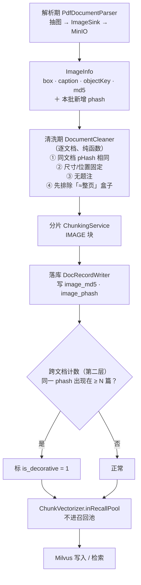

> 状态：🟡 进行中 · Sprint S6 · 阶段 D（M05 图片链路收尾 + `O3` 噪音清洗层 + `O9` 门控量测）· 建档 2026-09-19

# 2026-09-19 · S6 · M05 · 阶段 D —— 图片描述重试 + HyQ 门控 A/B + 装饰图判定

> 任务：`T-512`（余下：描述重试）· `T-O09`（判据 5：门控 A/B）· `T-O03`（`O3` §4 步 3：装饰图）
> 来源：`ai_knowledge_web/plan/2026-09-19-S6-M05-C2.md` §9 遗留 **209/199** · **198** · **205**
> 上游计划：`2026-09-19-S6-M05-C2.md`（本批要销的账见第 1 节）

---

## 1. 开工条件检查

**依赖清单来源**：`docs/进度/00-开工速览.md` §1/§4（**先读它**）· `C2` 计划 §9 遗留表 ·
`02-任务清单.md` §O 优化项（445~476 行）· `plan/优化/O3-noise-cleaning.md` · 代码实证。

| # | 依赖项 | 档位 | 现状（代码/文档实证） | 结论 |
|---|---|---|---|---|
| 1 | `#209` 的重试挂点 | ✅ | `DocumentImageDescriber.java:207-213` —— 失败分支**已经带可读原因**（`attempt.failure()`），加一层重试是就地扩展，不动结构 | 满足 |
| 2 | `#199` 的落点 | ✅ | `ChunkViews.java:58` `IMAGE_DESC → block.rawContent()` 已实装；`DocumentImageDescriber.withDescription` 只拼了 `desc` | 满足 |
| 3 | `T-O09` A/B 的**量测夹具** | ✅ | `RetrievalEvalTest`（`@Tag("eval")`，**默认被 surefire 排除**）：24 条题集 `queries.json` + 金标分片 + `Recall@5` + 三种题型分列 + 负向锚。`#117` 的两条采样边界写在类注释里 | 满足 |
| 4 | `T-O09` A/B 的**语料来源** | ⛔ **BLOCKER（做法层面）** | 见下方 ① —— 原做法是"复用 `T-512` 造的探针库"，**那个库已被 C2 收尾删掉**；且即便还在，`RetrievalEvalTest#ingestCorpus`（`:288-330`）是**从 `corpus.json` 直接插库 + 只做嵌入**，**完全不走解析/增强管线** ⇒ **HyQ 块一块都不会生成**，A/B 会量到空 | **已改判**（见下） |
| 5 | `T-O09` A/B 的**开关** | ⚠️ WARN | `HyqGate` 是纯函数（`HyqGate.java:87`），**没有任何绕过的配置** —— "门控后"与"全量生成"两组跑不出来。要新增一个配置项（属本批工作量，不是依赖） | 本批补 |
| 6 | `T-O03` 的**几何与字节** | ✅ | `ImageInfo` 携带 `box`（`PdfDocumentParser.java:428` `boxOf(...)`）+ `caption`；图片字节在 MinIO（`sys_chunk.object_key`）。**当年卡它的头两条没了** | 满足 |
| 7 | `T-O03` 的**硬窗** | ✅ | 图片**已经进索引**（C2 交付）⇒ 「建向量前必须做」这条硬窗成立 —— 当年正是这条缺失才挂起 | 满足 |
| 8 | `T-O03` 的**跨文档落点** | ⛔ **BLOCKER（做法层面）** | 见下方 ② —— `DocumentCleaner` 的类 javadoc 写明它是「对 `ParsedDocument` 的**纯函数变换**…刻意**无状态**」，而三条件之一是**跨文档** pHash 重复 ⇒ 单个 cleaner 看不到别的文档 | **已改判**（见下） |
| 9 | `pHash` 的依赖 | ✅ | JDK 自带 `ImageIO` 可解 JPEG/PNG ⇒ dHash 手写 ≈40 行，**不引依赖**（见 §5） | 满足 |
| 10 | `#205` 的硬约束已登记 | ✅ | `C2` §9-205：条件②在**全扫描件**上恒成立而命中的是**整页** ⇒ 必须先排除「≈整页」的盒子 | 满足（本批照做） |
| 11 | 环境 | ✅ | docker **6/6 healthy**（本批开工前实测）；**后端未起**（`8080` 无监听 —— 跑批前提，`#151`） | 满足 |
| 12 | 基线残留 | ✅ | MySQL 十张表全 0（`kb=8` · `user=128`）；MinIO 四个前缀**真对象 0**（⚠️ 用"目录里有没有 `xl.meta`"量的，`#204`/§8.12） | 满足 |
| 13 | `is_active` 模型开关 | ⚠️ WARN | `#166` 要求跑批前核 `sys_model_config.is_active` —— 本批开工前核过：CHAT/EMBEDDING/RERANK/VL **各一条启用** | 满足 |

### ⛔ 两条 BLOCKER —— 都**不是"拒绝施工"**，而是"按原做法写下去会白写"

**① `T-O09` A/B 的语料（原做法不成立）**

C2 计划 §3.5.1 写的是「语料**复用 `T-512` 造的探针库**」——那个库是**探针库**，
按本仓规矩**收尾必删**（C2 的 `cleanProbeData` 就是干这个的），所以它现在不存在；
而且就算它还在，**它是走真管线建的**、能生成 HyQ 块，但 `RetrievalEvalTest` 的
`corpus.json` 语料**不是** —— 两条语料是两回事，混起来结论也不可比。

⇒ **改判做法**：不借探针库，而是**把 HyQ 生成这段真管线接进 `RetrievalEvalTest`**
（该类的语料与题集是现成的、有金标、有负向锚），让 A/B 在同一份语料上跑两遍：
**门控开** vs **门控关（全量生成）**。真模型调用用 `@Tag("eval")` 隔离（它默认被排除）。

> ⚠️ 这条正是本仓第 4 次踩到「**它要处理的东西真的存在吗**」—— 前三次：
> `T-803` 无可施工内容 · `T-O09` 步 5 要门控的功能不存在 · `S5-M08-B` 的两次。
> **判据是查代码/查数据，不是读文档。**

**② `T-O03` 的跨文档落点（原做法不成立）**

`O3` §4 步 3 的三条件是「**跨文档** pHash 重复 + 尺寸/位置固定 + 无题注」，
而 `DocumentCleaner` 是**逐文档**的纯函数（无 IO、无状态）——
"跨文档"这一条**在它的能力范围之外**，而它恰好是 `O3` 自己点名**最强**的那条判据。

⇒ **改判做法（我选的，理由在下，用户可在审计划时推翻）：分两层落**

- **第一层（解析期 + 清洗期，逐文档）**：`pHash` 在**解析期**算 —— 那一跳字节就在手上
  （`PdfDocumentParser.storeImage`），不必让 cleaner 去读 MinIO（**保住它的纯函数性**）；
  「同文档内 pHash 相同 + 尺寸/位置固定 + 无题注」在 cleaner 里判。
- **第二层（落库后，跨文档）**：**照 `T-O09` 步 3/4 已有的那套做** ——
  `DocRecordWriter` 落库后按指纹统计**跨文档出现次数**，够阈值就标记。
  🔑 **这一层不是新发明**：`V29` 加 `image_md5` 时**刻意**把消费方留给了"跨文档去重"
  （那行注释原话：❌ **不加索引**：`image_md5` 的消费方（跨文档去重）本批**不做**），
  而 `sys_chunk.is_boilerplate` 就是同一套机制在**文本**上的版本。

**BLOCKER 汇总**：两条，均已在本节改判并写明替代路径（**不拒绝施工**）。
**⚠️ 已知偏差**：见上表 #5/#13；另见 §3.4 的三条假设。

> 判据只有一条：**这条不满足，代码写下去会不会白写**。

### 结论

- [x] ✅ **可以开工** —— 两条 BLOCKER 都已改判出可行路径，且改判**没有扩大依赖面**
- [ ] ⛔ 拒绝施工

---

## 2. 开工时间

| 项 | 值 |
|---|---|
| 建档 / 开工日 | 2026-09-19 |
| 预计投入 | **≈6.5 人天**（`#209` 1 · `#199` 0.5 · `T-O09` A/B 2 · `T-O03` 2.5 · 收尾 0.5）· Sprint 容量 ≈ 10 人天 |
| **O 项小计** | **≈4.5 人天** —— 🔴 **本批应当终结「连续八批低于下限 4」**（承 C2 §9-198） |
| 实际投入 | *回填时补* |

> ⚠️ **工期风险如实写**：`T-O03` 要跨两层（解析期 + 落库后）+ 一个新迁移，
> 是本批最可能超的一项。**若超支，第一个该砍的是它的第一层**（逐文档那两条），
> 保留跨文档那条 —— 因为后者才是 `O3` 点名最强的那条。

---

## 3. 开工内容

### 3.1 步骤

| 步 | 做什么（文件/类 → 动作 → 产出） | 依赖 | 可并行 |
|---|---|---|---|
| **0** | **补做 `C2` 的收尾回填**（上一批「七处回填」没走完，速览 §1/§2/§4 还写着"进行中/621"）→ 改 `00-开工速览.md` §1/§2/§4 · `plan/汇总.md` §1/§2/§3 · `02-任务清单.md` · `README.md` · `变更记录/01-变更记录.md` · `C2` 计划状态行 | — | 先做（本批 §1 依赖速览正确） |
| 1 | **`#209` 描述重试** —— `DocumentImageDescriber`：失败的候选**再派发一轮**（只重试失败的；成功的走缓存、一行不动）；新增 `m05.image.describe.retry`（**默认值先量后定**）；`IMAGE_DESC_FAILED` 的 issue 文案区分「重试后仍失败」与「一次失败」 | 0 | 与 3/4 并行 |
| 2 | **`#199` 先量后改** —— 用 `#199` 那条描述（`desc` vs `searchSummary`）在**步 3 的评测夹具**上做一个小 A/B：**只量，先不改 `withDescription`**。若差得不明显 ⇒ 本条按「不值得改」结案 | 3 | 与 3 同批跑 |
| 3 | **`T-O09` 判据 5：HyQ 门控 A/B** —— ① `IndexEnhancer`/`HyqGate` 加"绕开门控"配置；② `RetrievalEvalTest` 接上**真 HyQ 生成**（真模型）；③ 门控开/关各跑一遍 24 条题集，比 `Recall@5`；④ 记调用次数（成本那半边已有） | — | 独立 |
| 4 | **`T-O03` 装饰图（两层）** —— ① 解析期：`ImageInfo` 补 `phash`（`PdfDocumentParser.storeImage` 就地算，**不引依赖**）；② 清洗期：`DocumentCleaner` 判「同文档 pHash 相同 + 尺寸/位置固定 + 无题注」，**并先排除「≈整页」的盒子**（`#205`）；③ 落库后：`DocRecordWriter` 按 `image_phash` 跨文档计数打标（照 `markBoilerplate` 同形）；④ `ChunkVectorizer.inRecallPool` 加 `!isDecorative`；⑤ `V30` 两列 | 0 | 与 1/3 并行 |
| 5 | **门禁与收尾** —— 全量 `mvn test` + 残留自检 + 七处回填 | 全部 | — |

### 3.2 业务流程图

> 触发条件：① 跨 ≥3 个组件 ✅（解析器 / 清洗器 / 落库 / 向量化）② 有异步边界 ✅（解析作业）
> ⇒ **必须画**。



### 3.3 明确不做（范围控制）

| 不做的事 | 原因 | 归属批次 |
|---|---|---|
| `#199` 的**改代码**（把 `searchSummary` 拼进 `rawContent`） | 先量后改（步 2）。**量不出差异就不改** —— 改它要动 `withDescription` 的拼接口径，而那是 `06:158`「题注在前」契约的一部分 | 量测结果出来再定 |
| 装饰图判定的**前端呈现** | 本批只做判定与"不进召回池"；页面上"这张图被判成装饰图"的展示没有需求点 | 有原型的那批 |
| `T-O09` 的**阈值调整**（200 字 / 3 条） | `#152` 原话：「阈值在**拿到数据前不要动**」。本批拿到数据后，**调整本身**也是一件事 | 下一批（拿本批数字说话） |
| `image_md5` 的**跨文档去重**（丢弃重复图、只留一份） | 与装饰图是**两件事**：装饰图是"判定它是噪音"，去重是"同一张图只存一份"。后者要动存储生命周期（`T-616`/`O7`） | `T-616` |
| 描述失败后的**人工补录入口** | `#209` 修的是"自动重试"，用户手动挑图重跑是另一套（需前端） | 有原型的批次 |

### 3.4 本批假设

| # | 假设 | 若被证伪的后果 |
|---|---|---|
| 1 | 重试**一次**就能救回大部分偶发失败（C2 §8.12 的那 4 张是第三次调用才成的） | 默认值要改；重试次数**必须量**，不能拍（承 `measure-before-picking-a-threshold`） |
| 2 | `ImageInfo` 加第 **7** 个字段（`phash`）是可接受的 | C2 §10-5 写「两者都到了『再加一个就该重新设计』的规模」。**我的判断**：那个"子结构"就是 `ImageInfo` 本身（它已经独立成一个 record）；真正的重构信号是再加**一类**信息，不是再加一个同类字段。**若被证伪** ⇒ `T-O03` 的第一层要先重构 `ImageInfo` |
| 3 | 「跨文档 pHash 重复」的阈值可以照 `is_boilerplate` 的形态定（≥ N 篇） | 图片的分布与文本不同（一篇文档里 logo 可能只在 1~2 页），**N 必须量**，不能照抄 20 |

---

## 4. 数据变更清单

| 类型 | 内容 | 回滚方式 |
|---|---|---|
| 改表 | `sys_chunk` 加两列：<br>`image_phash CHAR(16) NULL`（dHash 64 位的十六进制表示）<br>`is_decorative TINYINT NOT NULL DEFAULT 0`<br>+ `KEY idx_chunk_iphash (image_phash)` | 可逆（`DROP COLUMN` 即可，无业务数据依赖） |
| 迁移文件 | **`V30__s6_image_phash_and_decorative.sql`**（现有最大编号 **`V29`**） | — |
| 实体 | `SysChunk` 补两个字段 | — |
| **契约** | 🔴 **`docs/后端开发文档/10-M05-分片产出契约（D-5）.md` 必须同步** —— 承 `#154`：加列只改表不动契约，`ChunkContractTest` 照样绿（它是**双向**断言，两边不动等于少一个字段） | — |
| 种子数据 | 无变更 | — |
| NULL 分支 | `image_phash` 可空：**旧数据（`V30` 前入库的）恒为 `NULL`**。判定侧必须**两侧都非空才比较**（照 `ContentFingerprint.same` 的口径）—— 把一批 `NULL` 当成"互相相同"会让所有旧图互相命中 | — |

> 跑过的迁移**只增不改**（改已执行的 `V*.sql` 会导致校验和不符、启动失败）。

---

## 5. 依赖与工具决策

**默认不引**。本批要新增的能力只有一个：**感知哈希（pHash）**。

| 方案 | 做法 | 代价 | 结论 |
|---|---|---|---|
| **不引依赖（既有栈）** | JDK 自带 `ImageIO` 解码 + 缩放到 9×8 灰度 + 逐行比较相邻像素得 64 bit（**dHash**） | ≈40 行；`ImageIO` 不支持 WebP / TIFF 多页（本仓抽出的图是 **JPEG**，`V29` 起 `IMAGE_FORMAT_JPEG` 写死） | ✅ **推荐** |
| 候选：`imgscalr` / `Thumbnailator` | 现成的缩放 + 部分感知哈希 | 各 ≈100KB~300KB；只为一次缩放引一个库；且它们**不直接提供 pHash**，真正的哈希仍要自己写 | ✗ |
| 候选：OpenCV（`org.openpnp:opencv`） | 工业级 `img_hash` 模块 | ≈100MB 原生库，本仓是桌面开发 + Docker 中间件，**为一次 64 位哈希引原生依赖不成比例** | ✗ |

**推荐**：**不引依赖，手写 dHash**。

**理由**（按本仓「要引依赖必须证明既有栈做不到」的口径）：
① **既有栈做得到** —— `ImageIO` 解 JPEG 是 JDK 标准能力，dHash 只是"缩到 9×8 → 比相邻像素"，
没有算法难点；② **它是判定链的一环，不是产品能力** —— 判错的后果是"把某张图当装饰图"，
而这条链**已经被两道保守默认值守着**（阈值可配 + 只减不增）；
③ **`T-O03` 的正向证据本来就只能靠合成**（C2 §8.5 补探实测：三份真样本没有一份含跨页同位置的图）
⇒ 引一个 100MB 的原生库换不来更强的证据。

> ⚠️ **算法选 dHash 而不是 aHash/pHash 的理由**：dHash 对**亮度/缩放**敏感而对**压缩噪声**不敏感，
> 正合"同一张 logo 在文档里被重编码过"这个场景；且它**不需要 DCT**（pHash 要），40 行就能写完。
> ⚠️ **本批不承诺"dHash 是正解"** —— 它是**可替换的一环**（纯函数、单独可测），
> 若量出来不够用，换 pHash 只动那个函数。

---

## 6 + 7. 验收方法与标准

| # | 判据 | 验收方法（可直接粘） | 期望结果 | 证据落点 | 门禁/上游 |
|---|---|---|---|---|---|
| 1 | **失败后被重试** | `DocumentImageDescriberTest` 新用例：假 `VisionDescriber` 前 N 次失败、之后成功 | 最终 `described=1`、`failed=0`，且**总调用次数 = 重试次数 + 1** | 用例 | `#209` |
| 2 | **重试不改变成功路径的调用次数**（负向锚） | 同上，替身**从不失败** | 调用次数 **恒 1**（不得因为加了重试就每次都调两遍） | 用例 | `#209` |
| 3 | 🔴 **重试次数按量测定，不是拍出来的** | 探针：对真 VL 端点连打 N 次，记录失败与"再试一次"的成功率 | 拿到一个**数字**；默认值由它定 | 计划 §8 | `measure-before-picking-a-threshold` |
| 4 | **真 VL 下重试确实救回** | `mvn -B -f .../pom.xml test -Dtest=ImageDescribeNetworkTest -Dvision.probe.run=true` | `失败` 计数 ≤ 上一批的 4（理想 0），且 IMAGE 块数 = 成功数 | 探针输出 | `#209` |
| 5 | **HyQ 门控 A/B 拿到数字** | `mvn -B -f .../pom.xml test -Dtest=RetrievalEvalTest -Dgroups=eval`（真模型） | 门控开/关两组各一份 `Recall@5`（总体 + 三种题型分列）+ **调用次数**对照 | 计划 §8 | `T-O09` 判据 5 / `#152` |
| 6 | 🔴 **A/B 的两组语料必须是同一份** | 同一次运行内先建语料再跑两组（不是两次独立建库） | 分片总数两组相同，差的只有 HyQ 块 | 探针输出 | `#117` 采样边界 |
| 7 | **装饰图判定：正向** | 合成用例：同文档 3 张尺寸/位置完全相同、无题注、pHash 相同的图 | 判为装饰图、`is_decorative=1`、**不进召回池** | 用例 | `O3` 判据 3 |
| 8 | 🔴 **`#205` 的硬约束：整页盒子不被判成装饰图**（负向锚） | 合成全扫描件：每页都是**同一尺寸、同一位置**的**整页**图 | **不得**判为装饰图（必须先排除「≈整页」） | 用例 | `#205` |
| 9 | **带题注的图不被误判**（负向锚） | 合成：尺寸/位置固定但**有题注**的图 | 不判为装饰图 | 用例 | `O3` 三条件 |
| 10 | **旧数据的 NULL 不当成"相同"**（负向锚） | 两张 `image_phash` 皆 `NULL` 的图 | **不**互相命中（照 `ContentFingerprint.same` 口径） | 用例 | §4 NULL 分支 |
| 11 | **`V30` 迁移与契约同步** | 起后端（`ddl-auto: validate`）+ `ChunkContractTest` | 启动通过；契约用例绿 | 启动日志 | `#154` |
| 12 | **后端全量** | `export JAVA_HOME='F:/work/dev_tools/jdk/jdk-25.0.4.1'` + `mvn -B -f F:/work/code/ai-knowledge/ai_knowledge_web/pom.xml test`（**先停后端**） | 基线 **628** → 更高，**0 失败** | 测试报告 | — |
| 13 | **残留自检** | `.env` + 十张表 + MinIO **四前缀用 `xl.meta` 数真对象**（`#204`） | `kb=8` · 十表回基线 · 真对象 0 | SQL + 客户端 | — |

**观察项**（不计成败）：`T-O03` 的阈值 N（跨文档篇数）本批**只记录实测分布，不承诺取值** ——
它与 `min-area` 一样是"可配、待量"的那一类。

**种子核对**（跑完必做）：

```bash
set -a && . ai_knowledge_web/.env && set +a
docker exec kb-mysql mysql -u"$MYSQL_USERNAME" -p"$MYSQL_PASSWORD" "$MYSQL_DATABASE" -N -e "
select 'kb', count(*) from sys_kb where deleted_at is null
union all select 'user', count(*) from sys_user where deleted_at is null
union all select 'doc', count(*) from sys_document
union all select 'chunk', count(*) from sys_chunk
union all select 'task', count(*) from sys_async_task
union all select 'session', count(*) from sys_chat_session
union all select 'trace', count(*) from sys_retrieval_trace
union all select 'trace_chunk', count(*) from sys_retrieval_trace_chunk;"
```

---
---

# 以下为开工后回填

> **提交节奏（两次）**：1~7 节写完即提交一次（`docs(plan): S6-M05-D 开工计划`）；
> 8~10 节写完再提交一次（`docs(plan): S6-M05-D 验收回填`）。

## 8. 验收结果

*回填时补*

---

## 9. 遗留问题

*回填时补*

---

## 10. 建议

*回填时补*

---

## 附：本批同步的文档回填

- [ ] **`docs/进度/00-开工速览.md` §1/§2/§3/§4** → 当前定位 / 本批任务行 / 门禁现状 / 缺口账（**必改**）
- [ ] `docs/进度/02-任务清单.md` → `T-512` · `T-O09` · `T-O03` 置 ✅（未做的不动）
- [ ] `docs/进度/03-Sprint排期.md` → 「交付状态」段
- [ ] `docs/进度/README.md` → 看板状态 + 完成日期
- [ ] `docs/进度/变更记录/01-变更记录.md` → 追加一行
- [ ] `docs/后端开发文档/10-M05-分片产出契约（D-5）.md` → `V30` 两列（🔴 `#154` 的教训）
- [ ] `ai_knowledge_web/plan/优化/README.md` + `00-开工速览.md` §9 → O 项状态（`T-O03` / `T-O09`）
- [ ] 本文件状态行 → ✅ 已完成
- [ ] `.workbuddy/memory/<日期>.md` → 交接
