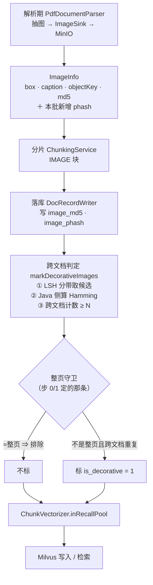

> 状态：🟡 进行中 · Sprint S6 · 阶段 E（`T-O03` 装饰图判定 —— 先补两条能力缺口）· 建档 2026-09-19

# 2026-09-19 · S6 · M05 · 阶段 E —— 装饰图判定：探针先行 + pHash + 跨文档模糊匹配

> 任务：`T-O03`（`O3` §4 步 3，**挂起半边的落地**）· 来源：`plan/2026-09-19-S6-M05-D.md` §9-**212**（两条能力缺口）
> 上游计划：`ai_knowledge_web/plan/2026-09-19-S6-M05-D.md`（**本批要销的账与完整设计都在它 §9-212 的专段里**）

---

## 1. 开工条件检查

**依赖清单来源**：`docs/进度/00-开工速览.md` §1/§2/§4（**先读它**）· `D` 计划 §9-212 的专段 ·
`02-任务清单.md` 的 `T-O03` 行 · 代码实证 + 探针产物实证。

| # | 依赖项 | 档位 | 现状（代码/数据实证） | 结论 |
|---|---|---|---|---|
| 1 | **4 份真样本可解析** | ✅ | `docs/测试文件/` 有 5 份 PDF（`O3` 探针只覆盖 5 份，`D` 批补探已到 5/5） | 满足 |
| 2 | **几何信息在产物里** | ✅ | `PdfDocumentParser.java:428` `boxOf(el.get("bounding box"))` ⇒ `ImageInfo.Box{x0,y0,x1,y1}`，有 `width/height/area` | 满足 |
| 3 | 🔴 **「≈整页」守卫怎么判** | ⚠️ **已改判（见下）** | **产物里没有页面尺寸**：解析器只读 root 的 `number of pages`（`:220`），不读任何页宽/页高；`O3HeaderFooterProbeTest` 也只读 `bounding box`；而 `DocElement` **只有图片带几何**（文字元素没有 box）⇒ **"用页面上所有元素反推页框"这条路不存在**。<br>🔑 **改判**：改用**绝对面积上界**（整页扫描件的盒子面积与 logo 差着一个量级），**不依赖页尺寸** —— 那第三条"能力缺口"因此**多半不必补** | 步 0 量出交界（§3.4 假设 1/2） |
| 4 | **LSH 分带不需要新依赖** | ✅ | `image_phash` 是定长十六进制 ⇒ 按 4 字符一段 `in (...)` 取候选即可，SQL 层就能做 | 满足 |
| 5 | **`V30` 要重写** | ⚠️ WARN | `D` 批把它撤回了（`D` §9-216）。**设计完整可用** —— 列类型、索引、NULL 口径、落点全在 `D` §9-212 的专段里 | 本批补，不重设计 |
| 6 | **`#216` 的教训要带上** | ⚠️ WARN | 上一批踩到「删源文件不够，`target/classes/` 那份仍会被 Flyway 扫到」。本批**新建**迁移不受影响；**但若中途要撤**，四件事（删源 + 删 `target/classes` 副本 + 清 `flyway_schema_history` + 删列）一件不能少 | 已知偏差，§9 销账 |
| 7 | **环境** | ✅ | docker **6/6 healthy**；`8080` **空闲**（跑批前提，`#151`）；基线 `sys_kb=8` · `sys_document`/`sys_chunk` **全 0** | 满足 |
| 8 | **迁移编号** | ✅ | 现有最大 **`V29`**（`ls` 按字典序会把 `V7` 排在后面，**别被骗**）⇒ 本批用 `V30` | 满足 |

### 结论

- [x] ✅ **可以开工** —— **没有 BLOCKER**。但有一条**条件性风险**（下），它不拒绝施工，
      而是**决定了本批的规模**：
      🔴 **步 0 探针若同时否掉"整页守卫"的两条候选路径** ⇒ 本批**缩为只做「pHash 计算 + 落列」**
      （能力缺口 B 仍成立且独立有价值），`T-O03` 的判定推迟，并**如实登记 O 配额第十批低于下限**。
      ⚠️ **这正是上一批的教训**：`D` 批是"动手之后才发现前提塌了"，本批把那个发现**前置成步 0**。

> 判据只有一条：**这条不满足，代码写下去会不会白写**。
> 步 0 存在的全部理由，就是**在写生产代码之前**回答"会不会白写"。

---

## 2. 开工时间

| 项 | 值 |
|---|---|
| 建档 / 开工日 | 2026-09-19 |
| 预计投入 | **≈4.5 人天**（步 0 探针 0.5 · 整页守卫 0.5 · pHash 1 · 跨文档判定 1.5 · 门禁收尾 1） |
| **O 项小计** | **≈4.5 人天** —— 🔴 **本批应当终结「连续九批低于下限 4」**（承 `D` §9-214） |
| 实际投入 | *回填时补* |

> ⚠️ **工期风险的处置已写进 §1 结论**：若步 0 否掉，本批缩到 ≈1.5 人天，
> **配额会连续第十批不达标** —— 那不是一个"找个东西凑数"的理由，
> **据实登记**比凑数重要（见 §10-2）。

---

## 3. 开工内容

### 3.1 步骤

| 步 | 做什么（文件/类 → 动作 → 产出） | 依赖 | 可并行 |
|---|---|---|---|
| **0** | 🔴 **探针：拿 5 份样本的 `ImageInfo.Box` 量「整页盒子」与「真装饰图」在几何上分不分得开** —— 新增 `ImagePageGeometryProbeTest`（**无网络、无 MinIO、无 DB**，`ImageSink.NOOP`）。每份样本产出：图盒子数 · **每个去重尺寸的出现页数** · **最大盒子的 w/h/面积** · 面积分布（分位数）· 「有没有盒子的面积接近 A4/Letter 的页面积」。<br>**产出是一组数字 + 那条交界在不在**，不是"哪个判据对" | — | **先做，且阻塞后面** |
| 1 | **整页守卫落地** —— 按步 0 量出来的交界，做成**绝对面积上界**（可配，与 `m05.image.min-area` 同一个家族：那是下界、这是上界） | 0 | 与 2 并行 |
| 2 | **pHash 计算** —— 新增 `pipeline/vision/ImageHash`（dHash，JDK `ImageIO`，**不引依赖**）+ `ImageInfo` 第 7 个字段 `phash` + `PdfDocumentParser.storeImage` 就地算 | 0 | 与 1 并行 |
| 3 | **落列** —— `V30` 两列（`image_phash CHAR(16) NULL` + `is_decorative TINYINT(1) NOT NULL DEFAULT 0` + 索引）+ `SysChunk` + **D-5 §1.1 契约同步**（🔴 `#154`：不同步 `ChunkContractTest` 会红） | 2 | — |
| 4 | **跨文档判定（LSH 分带）** —— `DocRecordWriter#markDecorativeImages`（**照 `markBoilerplate` 同形**）：把本文档的 phash 按 4×16 位分带，四条 `in (...)` 取候选 → Java 侧算 Hamming ≤ 阈值 → 跨文档计数 ≥ N ⇒ 标 `is_decorative=1`；`ChunkVectorizer.inRecallPool` 加 `!isDecorative` | 1,3 | — |
| 5 | **门禁与收尾** —— 全量 `mvn test` + 残留自检 + **schema 自检**（`#216` 的教训）+ 七处回填 | 全部 | — |

### 3.2 业务流程图

> 触发条件：① 跨 ≥3 个组件 ✅（解析器 / 落库 / 向量化）② 有异步边界 ✅（解析作业）
> ⇒ **必须画**。



### 3.3 明确不做（范围控制）

| 不做的事 | 原因 | 归属批次 |
|---|---|---|
| **单文档层的装饰图判定** | `#205` 的假阳性（全扫描件上「同尺寸同位置」恒成立）**正是单文档层产生的**；跨文档规则**天然不会**命中它（一份文档永远到不了 ≥N 篇）。`D` §9-212 已把原计划的"分两层"收窄成**只做跨文档那一层** | 不做（有意） |
| `image_md5` 的**跨文档去重**（丢弃重复图、只留一份） | 与装饰图是**两件事**：这个是"判定它是噪音"，那个是"同一张图只存一份"，要动存储生命周期 | `T-616` |
| 装饰图判定的**前端呈现** | 没有需求点 | 有原型的那批 |
| **阈值 N（跨文档篇数）的取值** | 与 `min-area` 同类，**先量再定**；本批只记录实测分布 | 拿到分布后 |
| `#211` 重试次数 · `#199` searchSummary · `#210` 孤儿根因 | 与本批不同主题 | 各自批次 |

### 3.4 本批假设

> 信息不足下拍的决策。**假设被证伪 → 进第 9 节遗留**。

| # | 假设 | 若被证伪的后果 |
|---|---|---|
| 1 | 🔴 **「整页盒子」与「真装饰图」能用一条绝对面积上界分开** | 本批缩为「pHash + 落列」，`T-O03` 判定推迟。**步 0 就是为了在写生产代码前回答它** |
| 2 | **不需要靠「页面积占比」来做这个守卫** | 若绝对面积分不开、必须用占比 ⇒ 才需要把页尺寸加进产物。⚠️ **本批不为此引 PDF 解析库** —— 若页尺寸在 opendataloader 的 JSON 里拿得到就做，拿不到就据实登记"这条守卫做不到" |
| 3 | **dHash 对"同一张 logo 被重编码"有效** | 换 pHash（要 DCT）；`ImageHash` 是**纯函数、单独可测**，换它只动那一个函数 |
| 4 | **LSH 分带的假阴性可接受**（Hamming ≤ 阈值但四个带都不相同的对子会被漏） | 调带数（4→8）或提高阈值；**这个权衡要量，不能拍** —— 本批只落机制 + 记实测 |

---

## 4. 数据变更清单

| 类型 | 内容 | 回滚方式 |
|---|---|---|
| 改表 | `sys_chunk` 加两列：<br>`image_phash CHAR(16) NULL`（dHash 64 位的十六进制表示）<br>`is_decorative TINYINT(1) NOT NULL DEFAULT 0`<br>+ `KEY idx_chunk_iphash (image_phash)` | 可逆（`DROP INDEX` + `DROP COLUMN`，无业务数据依赖） |
| 迁移文件 | **`V30__s6_image_phash_and_decorative.sql`**（现有最大编号 **`V29`**；⚠️ `ls` 按字典序会把 `V7` 排在后面，别被骗） | — |
| 实体 | `SysChunk` +2 字段（🔴 列类型**必须 `TINYINT(1)`** —— 裸 `TINYINT` 会被 Hibernate 映射成 `byte`，`ddl-auto: validate` 当场拒启，`D` 批实测踩过） | — |
| **契约** | 🔴 **D-5 §1.1 必须同步两行** —— 承 `#154`：`ChunkContractTest` 是**双向**断言，只加实体不改契约必红 | — |
| 种子数据 | 无变更 | — |
| NULL 分支 | `image_phash` 可空：**旧数据与所有非图片块恒 `NULL`**。判定侧必须**两侧都非空才比较**（照 `ContentFingerprint.same` 的口径）—— 把一批 `NULL` 当成"互相相同"会让所有旧图互相命中 | — |

> 跑过的迁移**只增不改**（改已执行的 `V*.sql` 会导致校验和不符、启动失败）。
> 🔴 **撤回时的完整动作**（`#216`）：删源 + 删 `target/classes` 副本 + 清 `flyway_schema_history` 那行 + 删列。

---

## 5. 依赖与工具决策

**默认不引**。本批要的两件能力，结论都是**不引**：

| 方案 | 做法 | 代价 | 结论 |
|---|---|---|---|
| **不引依赖（既有栈）** | pHash = JDK `ImageIO` 解码 + 缩到 9×8 灰度 + 逐行比相邻像素（**dHash**，≈40 行）；LSH = 把 16 位十六进制按 4 字符分 4 段，SQL `or` 四条 `in` 取候选，再在 Java 侧算 Hamming | 无新依赖 | ✅ **推荐** |
| 候选：`imgscalr` / `Thumbnailator` | 现成的缩放 | 各 ≈100~300KB，且**不直接提供 pHash**，真正的哈希仍要自己写 | ✗ |
| 候选：OpenCV（`org.openpnp:opencv`） | 工业级 `img_hash` | ≈100MB 原生库，为一次 64 位哈希不值 | ✗ |

**推荐**：**不引依赖**。理由与 `D` 批同：① **既有栈做得到**（`ImageIO` 是 JDK 标准能力，dHash 没有算法难点）；
② 它是判定链的一环，**可替换**（纯函数、单独可测）；③ 正向证据本就只能靠合成
（`C2` §8.5 补探实测：**三份真样本没有一份含跨页同位置的图**），引一个 100MB 原生库换不来更强的证据。

**新增能力 A（页面尺寸）的决策 —— 本批倾向"不做"**：改判成**绝对面积上界**之后，这条能力**多半不需要**（见 §1 第 3 行）。
⚠️ **若步 0 量出"绝对面积分不开"**，也**不为了它去引 PDF 解析库**：先看 opendataloader 的 JSON 里有没有页尺寸
（拿得到就做，一个 `ParsedDocument` 字段的事），拿不到就**据实登记"这条守卫做不到"** ——
而不是为一条守卫往依赖树里加一个库。

> ⚠️ **算法选 dHash 而不是 aHash/pHash 的理由**：dHash 对**亮度/缩放**敏感而对**压缩噪声**不敏感，
> 正合"同一张 logo 在文档里被重编码过"这个场景；且它**不需要 DCT**（pHash 要）。
> ⚠️ **本批不承诺"dHash 是正解"** —— 它是可替换的一环。

---

## 6 + 7. 验收方法与标准

| # | 判据 | 验收方法（可直接粘） | 期望结果 | 证据落点 |
|---|---|---|---|---|
| 1 | 🔴 **步 0 探针拿到数字** | `export JAVA_HOME='F:/work/dev_tools/jdk/jdk-25.0.4.1'` + `mvn -B -f F:/work/code/ai-knowledge/ai_knowledge_web/pom.xml test -Dtest=ImagePageGeometryProbeTest` | 5 份样本各有：图盒子数 · 去重尺寸及其出现页数 · 最大盒子的 w/h/面积 · 面积分位数 · **有没有盒子的面积接近 A4/Letter 页面积** | `target/o3-decoy-guard-probe.txt` |
| 2 | 🔴 **探针的产出是"交界在不在"，不是"哪个判据对"** | 同上 | 若"整页"与"logo"的面积**有量级差** ⇒ 结论是"一条上界够用"；若**交叠** ⇒ 结论是"不够，要另找判据"。⚠️ 两种都是**有价值的结论**（与 `T-O02` 那条"探针推翻了建议阈值"同族） | 同上 |
| 3 | **`#205` 的负向锚：整页盒子不被判成装饰图** | 合成用例：全扫描件、每页同尺寸同位置的**整页**图 | **不得**判为装饰图 | 用例 |
| 4 | **dHash 是纯函数且可测** | 单测：同一张图两次编码 ⇒ 同哈希；缩放 50% ⇒ 同哈希（dHash 的性质）；**不同图 ⇒ 不同哈希**（负向锚） | 三条都过 | `ImageHashTest` |
| 5 | **pHash 落进了产物与库** | 上传含图 PDF → 查 `sys_chunk.image_phash` | 有值且为 16 位十六进制；**非图片块为 `NULL`** | SQL |
| 6 | **跨文档判定真的跨文档** | 造 2~N 篇含**同一张 logo** 的文档 → `markDecorativeImages` | 达到阈值后 `is_decorative=1`；**只出现在 1 篇里的图不标**（负向锚） | 用例 |
| 7 | **LSH 候选不漏**（机制层） | 构造一对 Hamming 距离 = 阈值的 phash | 至少有一条带相同 ⇒ 落进候选 | 用例 |
| 8 | **装饰图不进召回池** | `ChunkVectorizer` 对该块返回"不进池" | 与 `is_boilerplate` 同一条处置 | 用例 |
| 9 | **旧数据 NULL 不当成"相同"**（负向锚） | 两个 `image_phash` 皆 `NULL` 的块 | **不**互相命中 | 用例 |
| 10 | **`V30` 与契约同步** | 起后端（`ddl-auto: validate`）+ `ChunkContractTest` | 启动通过；契约用例绿 | 启动日志 / 用例 |
| 11 | **后端全量** | `mvn -B -f F:/work/code/ai-knowledge/ai_knowledge_web/pom.xml test`（**先停后端**） | 基线 **633** → 更高，**0 失败** | 测试报告 |
| 12 | **残留自检** | `.env` + 十张表 + MinIO **四前缀用 `xl.meta` 数真对象**（`#204`） | `kb=8` · 十表回基线 · 真对象 0 | SQL + 客户端 |
| 13 | 🔴 **schema 自检**（`#216` 的教训） | `information_schema.columns` 查那两列 + `flyway_schema_history` 查 V30 | 与迁移文件**一致**；"文件删了"**不是**判据 | SQL |

**观察项**（不计成败）：跨文档阈值 **N** 的实测分布 —— 本批只记录，**不承诺取值**。
跨文档 pHash 重复在**真语料**上是否出现（`C2` §8.5 已记：三份样本没有一份含跨页同位置的图
⇒ **正例可能只能靠合成**）。这条要如实写进 §8，不能读成"机制已验证"。

**种子核对**（跑完必做）：

```bash
set -a && . ai_knowledge_web/.env && set +a
docker exec kb-mysql mysql -u"$MYSQL_USERNAME" -p"$MYSQL_PASSWORD" "$MYSQL_DATABASE" -N -e "
select 'kb', count(*) from sys_kb where deleted_at is null
union all select 'doc', count(*) from sys_document
union all select 'chunk', count(*) from sys_chunk
union all select 'trace_chunk', count(*) from sys_retrieval_trace_chunk;"
```

---
---

# 以下为开工后回填

> **提交节奏（两次）**：1~7 节写完即提交一次（`docs(plan): S6-M05-E 开工计划`）；
> 8~10 节写完再提交一次（`docs(plan): S6-M05-E 验收回填`）。

## 8. 验收结果

> ⏳ 进行中 —— 步 0 已出结论，步 1~5 待做。

| # | 判据 | 实测结果 | 证据 |
|---|---|---|---|
| 1 | 🔴 **步 0 探针拿到数字** | ✅ 5/5 份样本各有：带盒图元素数 · 面积分位 · 尺寸去重与出现页数 · 根字段名 | `target/o3-probe-decoy-guard.txt` · `O3HeaderFooterProbeTest#decoyGuardGeometry` |
| 2 | 🔴 **产出是"交界在不在"** | ✅ **有清晰空档**：内容图/logo ≤ **180,829**，「≈整页」≥ **499,877**，中间隔 **2.8×**。⇒ 一条绝对面积上界（≈25~30 万）**够用** | 同上 |

### 步 0 的两个结论（一个把「能力缺口 A」判死）

**① 🔴 页面尺寸：不是"产物里没透出"，是原料里就没有。**

5 份样本的 opendataloader JSON **根字段一字不差**全是
`[file name, number of pages, author, title, creation date, modification date, kids]` ——
**没有任何页宽/页高/MediaBox**。⇒ 「盒子面积 ÷ 页面面积」这条路**连原料都不存在**，
**不是"补一条能力就能做"**。
⇒ ✅ **原计划里的「能力缺口 A（页面尺寸进产物）」判死**：它要补的不是我们的产物，
是**上游库的产出**。改判的「绝对面积上界」是本批唯一可行且**不需要任何新能力**的路径。

**② 交界在**：

| 样本 | 最大盒子面积 | 尺寸去重 | 最多出现的尺寸 |
|---|---|---|---|
| **健康生活方式（全扫描件）** | **499,877**（595×841 ≈ A4） | **1 种** | 15/15 页（**全是整页**） |
| 江西章程 | **518,400**（960×540，16:9 整页） | 32 种 | 103×25 / 223×37 / 722×540 各 4 页 |
| 1-DeepSeek | 275,837 | 43 种 | 最多 2 页 |
| 2-提示词工程 | 180,829 | 25 种 | 最多 2 页 |
| 百福云 | 169,941 | 22 种 | 最多 2 页 |

⚠️ **采样边界（如实写，别读成"已验证"）**：
- **只有 2 个"整页"实例**，且它们来自**两份**样本（健康生活方式的 15 个盒子 + 江西的 1 个）；
- `健康生活方式` 那份 **15 个盒子全是整页、一枚 logo 都没有** —— 它正是 `#205` 点名的那个形态，
  **但这也意味着这份样本对"整页与 logo 的区分"只贡献了一侧的样本**；
- ⚠️ **正向样本（真的跨页重复的装饰图）在这 5 份里仍然是零** —— 与 `C2` §8.5 的结论一致，
  **本探针验的是"有没有反例"，不是"有没有正例"**。判据 3 的负向锚因此仍需**合成**。

---

## 9. 遗留问题

*回填时补*

---

## 10. 建议

*回填时补*

---

## 附：本批同步的文档回填

- [ ] **`docs/进度/00-开工速览.md` §1/§2/§3/§4**（**必改**，它是下一批的唯一入口）
- [ ] `docs/进度/02-任务清单.md` → `T-O03` 置 ✅（未做的不动）
- [ ] `docs/进度/03-Sprint排期.md` → 「交付状态」段
- [ ] `docs/进度/README.md` → 看板状态 + 完成日期
- [ ] `docs/进度/变更记录/01-变更记录.md` → 追加一行
- [ ] 🔴 `docs/后端开发文档/10-M05-分片产出契约（D-5）.md` → `V30` 两列（`#154`）
- [ ] `ai_knowledge_web/plan/优化/README.md` + `00-开工速览.md` §9 → O 项状态
- [ ] 本文件状态行 → ✅ 已完成
- [ ] `.workbuddy/memory/<日期>.md` → 交接
