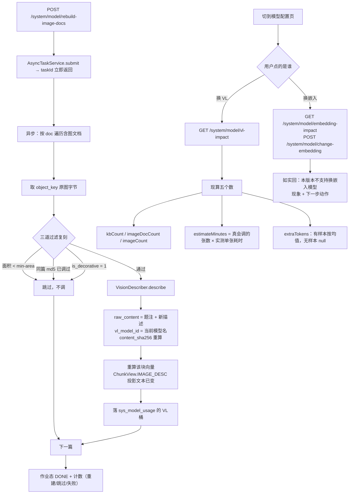

> 状态：🟡 进行中 · Sprint S6 · 阶段 C（M09 模型配置 · 换模型线）· 建档 2026-09-19

# 2026-09-19 · S6 · M09 · 阶段 C —— 换 VL 模型落地；换嵌入模型按「本版本不支持」如实回

> 任务：`T-908`（真交付）· `T-906`（**降级为如实回「不支持」**）· 来源：`docs/进度/03-Sprint排期.md` §Sprint 6
> 上游计划：`ai_knowledge_web/plan/2026-09-19-S6-M05-E.md`（§9 的 `#217`~`#222` 本批不销，见 §3.3）

---

## 1. 开工条件检查

**依赖清单来源**：`docs/进度/00-开工速览.md` §1/§2/§4（**先读它**）· `02-任务清单.md` 的 `T-906`/`T-908` 行 ·
需求 `09` §1.10/§1.12 + §接口表 · `10-接口约定汇总.md` §11/§14 · `13-接口变更记录.md` ·
`plan/优化/README.md` 追踪表（O 配额）· 代码实证 + 数据实证。

| # | 依赖项 | 档位 | 现状（代码/数据实证） | 结论 |
|---|---|---|---|---|
| 1 | **用户裁定「本版本不做换嵌入模型」** | ✅ | 2026-09-19 本批开工时用户裁定：**「现版本暂时按不支持换嵌入模型来做，因为风险太大」** | 满足 |
| 2 | **重建所需的列已在库里** | ✅ | `V29__s6_image_chunks.sql:52/56` 加 `object_key VARCHAR(255) NULL`、`vl_model_id VARCHAR(64) NULL`；`V30` 另加 `image_phash` / `is_decorative`。重建要的四件（原图定位 / 旧模型归属 / 感知哈希 / 装饰判定）**一列不缺** | 满足 |
| 3 | **重建不需要重新解析** | ✅ | `object_key` 直接指向 MinIO 原图（`DocStorage#open`）；`VisionDescriber.describe(VisionInput(md5, bytes, presignedUrl, mime, question))` **只要字节**（`VisionDescriber.java:73`）⇒ 不必回炉 `parseDocument`。⚠️ 这是本任务成本低的关键，也是「只影响含图文档」这句话的落地方式 | 满足 |
| 4 | **「当前启用的 VL 模型」可定位** | ✅ | `ModelClientRegistry#visionSpec()` → `RegistryVisionCaller#modelRef()` 返回 `VisionModelRef(spec.id(), spec.model())`（`RegistryVisionCaller.java:81-85`）；真相源是 `DbModelConfigSource`（`@Primary`，`S6-M09-A` 起 DB 是口径源） | 满足 |
| 5 | 🔴 **`vl_model_id` 存的是「模型名」还是「配置 id」** | ⚠️ **WARN —— 口径必须写死** | 落库走 `DocRecordWriter#vlModelIdOf` ← `ImageInfo.vlModelId()` ← `VisionDescriber` 的 `modelRef.**name()**` = `spec.model()`；而**描述缓存 key** 用的是 `modelRef.**id()**` = `spec.id()`（`VisionDescriber.java:81/104`）。**同名不同义，两处各用一个**。<br>🔑 **重建判「这条描述是不是当前模型产的」只能比模型名，而这是对的** —— 两条配置指向同一个模型名时，描述质量不变，**不该重建**（比配置 id 会白花钱）。⇒ 选模型名**不是将就，是正确语义**，必须写明理由，否则下一个人会把它「修」成比 id | 写进 §3.1 步 2 + §6+7 判据 3 |
| 6 | **三道过滤必须在重建路径上复刻** | ⚠️ **WARN —— 现成代码全在解析路径上，重建路径要重写一遍** | 解析路径的三道：① 面积下限（`DocumentImageDescriber` 阶段 1 过滤①，默认 `m05.image.min-area=12000`）② **同篇 md5 只调一次**（过滤②，需求 `06:160` 点名的「公司 logo」）③ 装饰图不进召回池（`DocRecordWriter#markDecorativeImages`，落库后）。三条**分散在三处**，重建若不逐条复刻，结果会与「重新上传同一篇」不一致 | 设计要点，写进 §3.1 步 2 + §6+7 判据 6 |
| 7 | **`estimateMinutes` 的数量级** | ⚠️ **WARN —— 承 `#179`** | 真 VL 实测 **40~60 秒/张**（`S6-B` 记 56.6 / 43.5 / 37），而需求 `09` §4.9 写「1~3s」，**差一个数量级**。估算必须按实测，且**只能算「真会调的」那些张**（见 6）—— 按全部图元素算会系统性偏高 | 写进 §6+7 判据 9 |
| 8 | **`extraTokens` 拿不拿得到** | ⚠️ **WARN** | 单次**能**拿到：`RegistryVisionCaller` 刻意用 `.chatResponse()` 而非 `.content()`，把 `promptTokens`/`completionTokens` 带进 `VisionRaw`（见该类 `toRaw` 的注释）。⚠️ 但**预估**要靠历史样本，而 `sys_model_usage` 的 VL 桶在真环境样本极少（与 `#180` 同族）⇒ 无样本时**如实回 `null`**，不填 0（0 会被读成「不花钱」） | 写进 §4 + §6+7 判据 10 |
| 9 | **`is_decorative` 在重建路径上可用** | ✅ | `V30` 的 `is_decorative TINYINT(1) NOT NULL DEFAULT 0`；`VectorChunk#inRecallPool` 已在用 | 满足 |
| 10 | **异步作业骨架** | ✅ | `sys_async_task`（`V17`）+ `AsyncTaskService#submit/stage/percent/complete`（`core/async/`）；`ReindexService` 是同类作业的现成范例 | 满足 |
| 11 | **审计** | ✅ | `@AuditLog` 存在（`core/audit/AuditLog.java:30`）；需求 `11:227` 把「**切换重排模型或 VL 模型**」与「换嵌入模型」**同列高危五类** ⇒ 两个写端点必须标高危 | 写进 §6+7 判据 14 |
| 12 | **权限码** | ⚠️ WARN | 同族端点用 `system:model`（`ModelConfigView` 的消费方），而 `V2` 里**只有超管有它**（`#168`）⇒ 本批**沿用**，S8 引入 ops 权限码时重判 | 已知偏差，§9 销账 |
| 13 | 🔴 **真数据规模** | ⚠️ **WARN —— 取证方法必须写死** | 当前 `sys_document`/`sys_chunk` **全 0**、Milvus 向量数 **0** ⇒ **影响评估的五个数在空库上全是 0**，而「0」与「没算」在页面上长得一样。⇒ 判据必须**自造 N 篇含图文档**，并断言五个数**跟着数据变**（负向锚：硬编码则不变） | 写进 §6+7 判据 2/4 |
| 14 | **迁移编号** | ✅ | 现有最大 **`V30`**（`ls` 按字典序会把 `V7` 排在后面，**别被骗**）⇒ 本批若加列用 `V31` | 满足 |
| 15 | **环境** | ✅/待核 | 全量基线 **648 / 0 红 / 2 跳过**；跑批前四问：① 后端**停了吗**（`#151`）② 探针库清了吗 ③ `sys_model_config.is_active` 对不对（`#166`）④ 🔴 MinIO **五个前缀的真对象**都数了吗（`kb-minio` 没有 `find`/`grep`，`#204`；**判据是「目录里有没有 `xl.meta`」**） | 满足 |
| 16 | 🔴 **O 配额** | 🔴 **本批无 O 项可认领** | 逐条核过 `plan/优化/README.md` 追踪表：`T-O01`~`T-O10` **十项全部结项**，或余下部分**卡在外部条件**（`T-O03` 三个阈值要正样本语料 · `T-O04` 判据 4 要 ClamAV 镜像 · `T-O06` 步 4/判据 3·5 要 `T-614` · `T-O09` 步 3 要真实语料）。⇒ 本批 **0 人天**，🔴 **连续第十一批低于下限 4** | 见 §9/§10 |

**BLOCKER 汇总**：**无。**

> 🔴 **差点是一条 BLOCKER，被用户裁定改判成范围**：`T-906`「换嵌入模型」的需求主场景
> （`09` §1.10 **以 1024 维 → 3072 维为示范**）**在当前实现下走不通** ——
> `MilvusChunkWriter.java:72` 把维度写成了**编译期常量**（`private static final int DIMENSION = MilvusConstants.DIMENSION`），
> 跨维度换模型时 `toJsonArray`（`:194`）会直接抛「向量维度不符」；
> 而维度漂移的处置在 `MilvusCollectionInitializer#verifyDimension`（`:405-412`）里写死为
> **人工** `DROP COLLECTION` + 重启 + 全量重建。要把跨维度做通，就得连带做
> `#171`（库内向量维度持久化列，摸底文档点名的「S6 头号交付物」）+ 把维度从常量改成运行期取值 + collection 整体重建
> ＋ **全站检索中断**（需求自己写的「旧数据不会保留」「中断要重新开始」）。
> **用户 2026-09-19 裁定：现版本不做，风险太大。** ⇒ 本批按「**如实回不支持**」落地，见 §3.1 步 3。

**⚠️ 已知偏差**（不拒绝施工，§9 销账）：

1. `system:model` 在 `V2` 里只有超管（`#168`）—— 沿用，S8 重判。
2. `#179` 的耗时数量级：估算按实测 40~60s/张，**不是**需求写的 1~3s。两者差一个数量级这件事已登记，本批**不改需求文档**，只让实现与实测同源。
3. `#211`（重试次数标定）本批不解 —— 要真 VL 偶发样本，且与「换模型」不是同一件事。

> 判据只有一条：**这条不满足，代码写下去会不会白写**。

### 结论

- [x] ✅ **可以开工** —— 无 BLOCKER。
      ⚠️ 但有一条**决定了本批规模**的裁定：**换嵌入模型不做** ⇒ `T-906` 从「一个全库重建功能」
      缩成「如实回不支持」，本批实际重心全在 `T-908`（换 VL）。
- [ ] ⛔ 拒绝施工

---

## 2. 开工时间

| 项 | 值 |
|---|---|
| 建档 / 开工日 | 2026-09-19 |
| 预计投入 | **≈4 人天**（`T-908` ≈3 · `T-906` 如实落地 ≈0.5 · 步 0 探针 ≈0.5）· Sprint 容量 ≈ 10 人天 |
| 实际投入 | *回填时补* |

> ⚠️ **本批 O 项 0 人天**（条件见 §1-16），⇒ 若计 O 配额，🔴 **连续第十一批低于下限 4**。
> 但本批的成因与前几批**都不同**：不是「没做完」、不是「前提塌了」、不是「该做的比估的少」，
> 而是 **O 目录里已经没有「现在能做且值得做」的项了**。见 §10-1。

---

## 3. 开工内容

### 3.1 步骤

| 步 | 做什么（文件/类 → 动作 → 产出） | 依赖 | 可并行 |
|---|---|---|---|
| **0** | **探针：把「重建」这件事在真数据上先量一遍**（新增常驻用例 `VlRebuildProbeTest`，`@Tag("network")`）。四问：① `images/` 前缀里**真对象还在吗**（`xl.meta` 判据）② `object_key` 能否**只凭它**拿回字节 ③ `vl_model_id` 落库的**实际值**是什么（模型名？含版本号？）④ 单张真 VL 耗时**复核 `#179`**（40~60s 是否仍成立）。产出：一份实测数 + 四条口径 | — | 否 |
| **1** | **`GET /system/model/vl-impact`** —— 新建 `ModelSwitchService`（或并入既有 `ModelConfigService`，见 §3.4 假设 1）。五个数**全部现算**：`kbCount`（含图文档所属库去重）· `imageDocCount`（`count(distinct doc_id)`）· `imageCount`（**需重新理解的**：`object_key is not null and (vl_model_id is null or vl_model_id <> 当前启用VL模型名)`）· `estimateMinutes`（**真会调的张数 × 实测单张耗时**）· `extraTokens`（有历史样本按均值，无样本 `null`） | 步 0 | 与步 2 并行 |
| **2** | **`POST /system/model/rebuild-image-docs`** —— 提交异步作业（`AsyncTaskService`），逐文档：取 `object_key` 原图 → **复刻三道过滤**（面积下限 / 同篇 md5 只调一次 / `is_decorative=1` 不调）→ `VisionDescriber.describe` → 更新 `raw_content`（题注 + 新描述，**与解析期同一拼法** `withDescription`）、`vl_model_id`、`content_sha256` → **重算该块向量**（描述变了 ⇒ `ChunkView.IMAGE_DESC` 的投影文本变了 ⇒ 向量必须重算，不是可选优化）→ 落 `sys_model_usage` 的 VL 桶 | 步 1 | 与步 1 并行 |
| **3** | **`T-906` 按「本版本不支持」如实落地** —— `GET /system/model/embedding-impact` 与 `POST /system/model/change-embedding` 双端点**如实回「本版本不支持换嵌入模型」**（错误码 + **现象 + 下一步动作**，本仓硬口径）。🔴 **`embedding-impact` 不返回假数字** —— 真实的影响量会让「不支持」看起来像「能换」 | — | 与步 1/2 并行 |
| **4** | **前端联通** —— `views/system/ModelConfigView.vue`：换 VL 的两处（`:301` 起的影响卡 + `:321` 的「重建」、`:913-917` 的五行展示）真联通；换嵌入的两处（`:346` 的 `changeEmbedding`、`:383` 的 `Promise.all([modelUsage, embeddingImpact])`）**置灰 + 说明文案**，不再打成 404。⚠️ `extraTokens` 为 `null` 时页面必须显示「—（暂无样本）」而不是 `NaN`（`:917` 现在写的是 `(vlImpact.extraTokens / 10000).toFixed(1)`，喂 `null` 会渲染成 `NaN`） | 步 1~3 | 否 |
| **5** | **验收 + 残留自检** —— 全量 `mvn test`；MySQL 十表回基线；**MinIO 五个前缀的真对象**（含新涉及的 `images/`）；`audit-api.mjs` ①②⑥=0 | 步 1~4 | 否 |

### 3.2 业务流程图

> 触发条件：**② 涉及异步任务** + **③ 有状态机**（作业态 PENDING → RUNNING → DONE）⇒ 必须画。



### 3.3 明确不做（范围控制）

| 不做的事 | 原因 | 归属批次 |
|---|---|---|
| **换嵌入模型本身**（跨维度 collection 整体重建） | **用户 2026-09-19 裁定：风险太大，本版本不做**。要做通需连带：维度去常量 + `#171` 持久化列 + collection drop/recreate + 全库重嵌 + 全站检索中断 | **有明确风险处置方案时再议** |
| `retrieval.degrade-during-reindex` 的消费方（需求 `09:167-169` 的单选） | 那个单选**只在换嵌入的弹窗里**（「重建期间的服务状态：降级为关键词检索 / 暂停问答服务」）⇒ 换嵌入不做，它**没有消费方** | 随换嵌入 |
| `#171` 库内向量维度持久化列 | 它的**原有消费方就是换嵌入链路**（启动时检测配置与库内索引不一致的 banner）；换嵌入不做 ⇒ 边际价值大幅下降。⚠️ 但它另有一处**真缺口**，见 §9-`#223` | 见 §9 |
| `#217`/`#218`/`#221`（装饰图三个阈值标定） | **无正样本语料** —— 本仓 5 份 PDF 互不相关（`docs/测试文件/`），造不出「同一份手册的几个版本」 | 拿到多篇同源语料时 |
| `#211` 重试次数标定 | 要真 VL **偶发失败**样本，不可复现；与「换模型」不是同一件事 | 有真 VL 偶发样本时 |
| `PROMPT_VERSION` 变更触发的全量重描述 | 与「换模型」是**同一形状、不同触发源**；而本仓**没有改 `PROMPT_VERSION` 的入口**（它是常量）⇒ 现在没有对象 | 出现该入口时 |
| `T-513` 批量导入 · `T-710` 表格独立召回通道 | 跨 Sprint 的 P0，与本批主题无关 | 各自批次 |

### 3.4 本批假设

| # | 假设 | 若被证伪的后果 |
|---|---|---|
| 1 | `vl-impact` / `rebuild-image-docs` 并进**既有** `ModelConfigService` 即可，不另建 `ModelSwitchService` | 类会偏大；但有 `ModelConfigView` 单一消费方，拆服务的收益要到第二处消费方才出现 |
| 2 | 「重建」是**就地更新**（同一代、同一分区），**不推新代、不切代** | 需求 §1.12 只写「已入库文档的图片描述不会自动更新」→ 需提供重建入口，**没说旧数据不保留**（与换嵌入那一句形成对照）⇒ 就地更新是对的。证伪则要接 `ReindexService` 的世代机制 |
| 3 | 重建**不需要重新解析**（只重描述 + 重向量化） | 已由 `object_key` + `VisionDescriber.describe` 的入参形状证实（§1-3）；若某类图的字节已按 O7 留存规则过期，则该图**降级为跳过并登记**，不让整篇失败 |
| 4 | `vl_model_id` 与「当前启用 VL 模型名」**直接可比** | 若探针（步 0）发现落库值带版本后缀 / 是 id，则判据 3 要改成归一化比较；**证伪 → 进 §9** |
| 5 | 重建的描述调用**会命中缓存则直接复用**（key = `md5:vlModelId:PROMPT_VERSION`） | 换模型后 cache miss 是**预期**（key 第二段变了）；若发现仍命中，说明模型名没进 key ⇒ 是缺陷 |

---

## 4. 数据变更清单

| 类型 | 内容 | 回滚方式 |
|---|---|---|
| 新建表 / 改表 | **预计无** —— 重建所需的 `object_key` / `vl_model_id` / `image_phash` / `is_decorative` 全部已在（`V29`/`V30`）。⚠️ **若步 0 探针证伪假设 4**（落库值不可直接比），可能要给 `sys_chunk` 加一列归一化后的模型标识 | 可逆（删列） |
| 迁移文件 | **预计无**；若需要则 `V31__*.sql`（依现有最大 `V30` 递增） | — |
| 种子数据 | **无** —— 演示数据不含图片块（当前 `sys_chunk` 全 0） | — |
| NULL 分支 | ① `extraTokens` 允许为 `null`（无历史样本）⇒ 前端显示「—」；② `vl_model_id IS NULL`（图片**从未被成功描述过**，`DocRecordWriter#vlModelIdOf` 的注释写明这是**常态不是缺陷**）⇒ 归入「需重新理解」；③ `object_key IS NULL` ⇒ 非图片块，不进重建 | — |

> 跑过的迁移**只增不改**（改已执行的 `V*.sql` 会导致校验和不符、启动失败）。
> ⚠️ 承 `#216`：**撤迁移要走全四步**（删源 + 删 `target/classes` 副本 + 清 `flyway_schema_history` + 删列），少一步就会「看着撤了、其实还在跑」。

---

## 5. 依赖与工具决策

**无新依赖（用既有栈实现）。**

| 方案 | 做法 | 代价 | 结论 |
|---|---|---|---|
| **不引依赖（既有栈）** | 复用 `VisionDescriber`（描述 + 缓存 + 用量）· `DocStorage#open`（取原图）· `AsyncTaskService`（作业）· `ChunkVectorizer`（重算向量）· `DocRecordWriter`（写块）· 现有三道过滤的常量与判定 | 需要把「解析路径的三道过滤」在重建路径上**重写一遍**（口径同源、代码两处） | ✅ **推荐** |
| 候选 A：把过滤抽成共享组件 | 抽一个 `ImageIntakeFilter`，解析与重建共用 | 改动面伸进解析主路径（`DocumentImageDescriber` 阶段 1），**回归风险 > 收益** | ❌ 不做 |

**推荐**：不引依赖，重建路径**自己复刻三道过滤**，并在两处各写明「另一处在哪里」。
**理由**：① 解析路径那三道是**串行分诊**里实现的（`DocumentImageDescriber` 阶段 1，且注释写明「去重必须在这里做完，绝不能挪到派发之后」），抽出来会动到刚修好的并发正确性；② 两处的**输入形状不同**（解析期拿的是 `List<Block>` 的内存对象，重建期拿的是 DB 行）⇒ 硬抽会让接口迁就一端。

---

## 6 + 7. 验收方法与标准

| # | 判据 | 验收方法（可直接粘的命令/脚本） | 期望结果 | 证据落点 |
|---|---|---|---|---|
| 1 | `GET /system/model/vl-impact` 契约逐字对齐 `10` §11 | `curl -s -H "Authorization: Bearer $TOKEN" http://127.0.0.1:8080/api/system/model/vl-impact` | `{kbCount, imageDocCount, imageCount, estimateMinutes, extraTokens}` **五键齐、无多余键** | `VlImpactViewTest` |
| 2 | 🔴 五个数是**预计算值**（需求 `09:298` 逐字要求） | 自造 N 篇含图文档 → 查 impact → 再灌 M 篇 → 再查 | 🔴 **五个数跟着数据变**；**负向锚**：写成硬编码则第二个断言必红 | `VlImpactViewTest#countsFollowRealData` |
| 3 | `imageCount` 口径 = **需重新理解的**张数，判据是**比模型名** | 把某篇的 `vl_model_id` 改成**当前启用 VL 模型名** | 该篇的图 **不进** `imageCount`；`vl_model_id IS NULL` 的**进** | `VlImpactViewTest#alreadyCurrentModelExcluded` |
| 4 | `imageDocCount` = 含图**文档**数（`count(distinct doc_id)`） | 造 1 篇含 5 图的文档 | `imageDocCount = 1`（**不是 5**） | `VlImpactViewTest#docCountIsDistinctDoc` |
| 5 | 重建**不重新解析** | 跑一次重建 → 查 `sys_async_task` 的作业类型 + `sys_document` | **没有 PARSE 类作业**；`parse_version` **不变** | `VlRebuildFlowTest#doesNotReparse` |
| 6 | 🔴 **三道过滤复刻** | 造三类反例各 ≥1 个（面积过小图 / 同篇 md5 重复图 / `is_decorative=1` 的图）→ 跑重建 → 数 VL 调用次数 | 三类**都不调**；**每条一个负向锚**（去掉过滤 ⇒ 调用次数 +1 转红） | `VlRebuildFlowTest#filterParityWithParsePath` |
| 7 | 描述真更新（三列同时动） | 重建后查该块 | `raw_content` = **题注 + 新描述**（拼法与解析期一致）· `vl_model_id` = **新模型名** · `content_sha256` **变了**（不是旧值） | `VlRebuildFlowTest#contentRebuilt` |
| 8 | 向量**跟着更新** | 重建前后各查一次该块在 Milvus 的向量 | **不相等**（描述变了 ⇒ `ChunkView.IMAGE_DESC` 投影文本变了 ⇒ 向量必须重算） | `VlRebuildFlowTest#vectorRecalculated` |
| 9 | `estimateMinutes` 按**真会调的张数 × 实测单张耗时** | 造「10 张会调 + 10 张被过滤」的夹具 → 查 impact | 约等于 `10 × 实测单张秒数 / 60`，**不是** `20 × ...`；且与步 0 复核的 `#179` 同数量级 | `VlImpactViewTest#estimateMatchesCallableCount` |
| 10 | `extraTokens` 无历史样本时**如实回 `null`** | 清空 `sys_model_usage` 的 VL 桶后查 impact | `extraTokens = null`（**不是 0**）；前端渲染「—（暂无样本）」而**不是 `NaN`** | `VlImpactViewTest#extraTokensHonestWhenNoSample` + `render-check.mjs` |
| 11 | 🔴 `POST /system/model/change-embedding` **如实回不支持** | `curl -X POST .../change-embedding -d '{"model":"x","dimension":3072,"rebuildMode":"KEYWORD"}'` | **不是 404、不是 500、不返回假 `taskId`**；响应含**现象 + 下一步动作** | `EmbeddingUnsupportedTest` |
| 12 | 🔴 `GET /system/model/embedding-impact` **不返回假数字** | 同上 | 与判据 11 同一口径的「不支持」；**不返回 `{kbCount:8, docCount:1246, ...}` 那类看着能换的数** | `EmbeddingUnsupportedTest` |
| 13 | 两个写端点的权限 | 普通 `USER` token 打 `rebuild-image-docs` / `change-embedding` | **403**（负向锚：不发 token 401 · 超管 200） | `ModelPermTest` |
| 14 | 两个写端点**标高危审计**（需求 `11:227`） | 跑一次 → 查 `sys_audit_log` | 有行，`risk_level` = **HIGH**，`module` = 系统 | `VlRebuildFlowTest#auditHighRisk` |
| 15 | 重建调用落 `sys_model_usage` 的 VL 桶 | 重建后查 | VL 桶的 `calls` **> 0**，且**只统计真调的那些张** | `VlRebuildFlowTest#usageRecorded` |
| 16 | 前端四处入口行为正确 | `cd ai_knowledge_app && node scripts/render-check.mjs` + `node scripts/check.mjs` | 换 VL 两处**真联通**；换嵌入两处**置灰 + 说明**，**点不出 404** | `render-check.mjs` 25 路由 |
| 17 | 回归 + 残留 | `export JAVA_HOME='F:/work/dev_tools/jdk/jdk-25.0.4.1'` + `mvn -B -f F:/work/code/ai-knowledge/ai_knowledge_web/pom.xml test`；MySQL 十表；MinIO **五前缀真对象** | **0 红**（基线 648）；十表回基线（`kb=8`/`user=128` 除外）；**五前缀真对象 0**（含 `images/`，判据是 **`xl.meta`**） | 见 §8 |

**观察项**（不计成败，页面写死的展示值登记在此）：

- `ModelConfigView.vue:917` 的 `extraTokens / 10000` 格式化 —— 改 `null` 处理后显示文案属展示值，不计成败。

**种子核对**（跑完必做）：

```bash
set -a && . ai_knowledge_web/.env && set +a
docker exec kb-mysql mysql -u"$MYSQL_USERNAME" -p"$MYSQL_PASSWORD" "$MYSQL_DATABASE" -N -e "select count(*) from sys_user where deleted_at is null;"
```

---

---

# 以下为开工后回填

> **提交节奏（两次）**：1~7 节写完即提交一次（`docs(plan): <批次> 开工计划`）；
> 8~10 节写完再提交一次（`docs(plan): <批次> 验收回填`）。让 git log 上「计划 → 结果」成对可查。

## 8. 验收结果

| # | 判据 | 实测结果 | 证据（命令 / 文件:行 / 测试名） |
|---|---|---|---|

**测试基线**：`Tests run: N, Failures: 0, Errors: 0, Skipped: 0`（上批 648 → 本批 M）

> 失败就照实写失败，不许改成"部分通过"。
> **取证条件不具备时**，该行实测结果填 `⏸️ 挂起 —— 待 <批次> 取证`，并在那批的 8 节做**合并回填**。

---

## 9. 遗留问题

| # | 项 | 原因 | 归属批次 | 是否有判定点/注释留在代码里 |
|---|---|---|---|---|

> 没有遗留写「无」。**本批若"先施工后补写第 1 节"，也必须在此登记一条**（违规留痕）。

---

## 10. 建议

- 对下批的排期 / 口径 / 风险建议。没有写「无」。

---

## 附：本批同步的文档回填

- [ ] **`docs/进度/00-开工速览.md` §1/§2/§3/§4** → 当前定位 / 本批任务行 / 门禁现状 / 缺口账（**必改**，它是下一批的唯一入口）
- [ ] `docs/进度/02-任务清单.md` → `T-906`（**如实回不支持，不是 ✅ 交付**）/ `T-908` 置状态
- [ ] `docs/进度/03-Sprint排期.md` → 「交付状态」段
- [ ] `docs/进度/README.md` → 看板状态 + 完成日期（**备注只写一行短结论 + 指针**）
- [ ] `docs/进度/变更记录/01-变更记录.md` → 追加一行
- [ ] 🔴 **`docs/需求文档/09-需求-系统配置与通用.md` §1.10** → 注明「**本版本不支持换嵌入模型**」（**这是有意的产品决定，不是漏做** —— 不写明，下一个人会当成缺口）
- [ ] `docs/需求文档/10-接口约定汇总.md` §14 + `13-接口变更记录.md` 一行
- [ ] 本文件状态行 → ✅ 已完成
- [ ] `.workbuddy/memory/<日期>.md` → 交接
