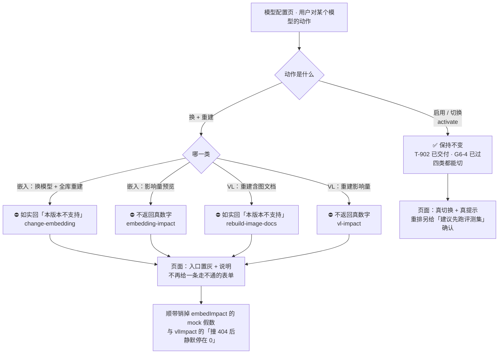

> 状态：🟡 进行中 · Sprint S6 · 阶段 C（M09 模型配置 · 换模型线）· 建档 2026-09-19
>
> ⚠️ **本计划同日被用户两次裁定收窄**（修订留痕见 §9-`#224`）：
> **初版**（`e55215a`）＝ `T-908` 换 VL 重建**真交付** + `T-906` 如实回不支持；
> **现版** ＝ 「换模型」这条线**只保留「启用切换」**，四个「换 + 重建」端点**全部如实回「不支持」**。
> ⇒ 本批**没有功能交付**，交付物是**把一条走不通的链路收敛成说得清楚的拒绝** + **把需求里那句
> 「本页最重要的交互」回填成本版本的真实口径**。

# 2026-09-19 · S6 · M09 · 阶段 C —— 「换模型」收敛：只保留切换，四个「换+重建」端点如实回不支持

> 任务：`T-906` · `T-908`（**两者均降级为「如实回不支持」，无功能交付**）
> 来源：`docs/进度/03-Sprint排期.md` §Sprint 6 · `02-任务清单.md` 的 `T-906`/`T-908` 行
> 上游计划：`ai_knowledge_web/plan/2026-09-19-S6-M05-E.md`（§9 的 `#217`~`#222` 本批**不销**，见 §3.3）

---

## 1. 开工条件检查

**依赖清单来源**：`docs/进度/00-开工速览.md` §1/§2/§4（**先读它**）· `02-任务清单.md` 的 `T-906`/`T-908` 行 ·
需求 `09` §1.10/§1.11/§1.12 + §接口表 · `10-接口约定汇总.md` §11/§14 · `13-接口变更记录.md` ·
`plan/优化/README.md` 追踪表（O 配额）· 代码实证 + 前端实证。

| # | 依赖项 | 档位 | 现状（代码/文档实证） | 结论 |
|---|---|---|---|---|
| 1 | **用户对本版本的裁定** | ✅ | 2026-09-19 两次裁定：①「现版本暂时按不支持换嵌入模型来做，因为风险太大」②「现版本，先按**只支持换 chat 模型**来做，其他模型暂时不支持换」。**经追问定界：只收「换+重建」那条链路，「启用切换」保留**（因为切换不改已入库数据） | 满足 |
| 2 | **「启用切换」不属于本批改动面** | ✅ | `T-902` 已交付（`POST /system/model/config/{id}/activate`）· `G6-4` 已通过（同类型第二条启用 ⇒ 第一条自动停用；库层生成列唯一索引兜底）⇒ **本批一行都不动它**，见 §3.4 假设 1 | 满足 |
| 3 | **四个端点的契约有据** | ✅ | `10-接口约定汇总.md:438-439` 给出两个 impact 的形状；`09:276-279` 给出四条接口与 `change-embedding` 的 body；mock 有逐字实现（`ai_knowledge_app/src/mock/index.ts:1428-1446`） | 满足 |
| 4 | **前端消费方单一** | ✅ | 四处调用全在 `views/system/ModelConfigView.vue`（`:306` vl-impact · `:321` rebuild-image-docs · `:346` change-embedding · `:383` embedding-impact）⇒ 收敛面是一个文件 | 满足 |
| 5 | 🔴 **「换嵌入」为什么走不通**（本批拒绝的**依据**，不是猜测） | ✅ | `MilvusChunkWriter.java:72` 把维度写成**编译期常量**（`private static final int DIMENSION = MilvusConstants.DIMENSION`），`:194` 拿它校验 ⇒ **跨维度换模型写进去就抛**；而维度漂移的处置在 `MilvusCollectionInitializer#verifyDimension:405-412` 里写死为**人工** `DROP COLLECTION` + 重启。做通要连带 维度去常量 + `#171` 持久化列 + collection 整体重建 + **全站检索中断**（需求自己写的「旧数据不会保留」「中断要重新开始」） | 拒绝依据成立 |
| 6 | 🔴 **需求 `09` §1.10 与实现不符，必须回填** | 🔴 **BLOCKER（文档侧，不拒绝施工）** | 需求把「更换嵌入模型的确认弹窗」标成**「本页最重要的交互」**，示范是 1024 → 3072 维。本版本不做 ⇒ **不回填的话，下一个人会把这当成漏做的缺口**（本仓已有先例：`#85` 那个「没人用所以漂移看不见」的死常量） | 见 §3.1 步 3 |
| 7 | 🔴 **页面上现在会显示 mock 假数** | ⚠️ **WARN —— 本批顺带销** | `ModelConfigView.vue:331` `const embedImpact = reactive({ kbCount: 8, docCount: 1246, chunkCount: 38502, estimateMinutes: 42, extraTokens: 11800000 })` —— 这五个数是 **mock 里的数**（`mock/index.ts:1429`），而它在**真后端**下也会渲染出来。同族：`#85`（死常量）、`#161`（`bootstrap-chat` 解析不出数字）。⚠️ 且 `vlImpact`（`:301`）初始化为全 0，`loadVlImpact` 撞 404 后**静默停在 0** ⇒ 页面显示「0 个 / 0 篇 / 0 张 / 约 0 分钟」，**与"真的没有"长得一样** | 见 §3.1 步 2 + §6+7 判据 7 |
| 8 | **页面级取证能力** | ⚠️ WARN | 现有 `e2e-admin-flow.mjs` 覆盖 `/system/user`、`/system/role`、`/system/grant`，**不含 `/system/model`**；但它的 harness（登录 / `clickByText` / 请求 ledger / console 收集）**现成可用** ⇒ 本批给它**加一段 `/system/model`** 作为页面级取证 | 见 §6+7 判据 6 |
| 9 | **权限码** | ⚠️ WARN | 四个端点沿用 `system:model`（同族端点一致），而 `V2` 里**只有超管有它**（`#168`）⇒ S8 引入 ops 权限码时重判 | 已知偏差，§9 销账 |
| 10 | **数据变更** | ✅ | **无** —— 本批不加表、不加列、不加迁移（现有最大 `V30`，本批用不到 `V31`） | 满足 |
| 11 | **环境** | ✅/待核 | 全量基线 **648 / 0 红 / 2 跳过**；跑批前四问：① 后端**停了吗**（`#151`）② 探针库清了吗 ③ `sys_model_config.is_active` 对不对（`#166`）④ 🔴 MinIO **五个前缀的真对象**都数了吗（`kb-minio` 没有 `find`/`grep`，`#204`；**判据是「目录里有没有 `xl.meta`」**） | 满足 |
| 12 | 🔴 **O 配额** | 🔴 **本批无 O 项可认领** | 逐条核过 `plan/优化/README.md` 追踪表：`T-O01`~`T-O10` **十项全部结项**，或余下部分**卡在外部条件**（`T-O03` 三个阈值要正样本语料 · `T-O04` 判据 4 要 ClamAV 镜像 · `T-O06` 步 4/判据 3·5 要 `T-614` · `T-O09` 步 3 要真实语料）。⇒ 本批 **0 人天**，🔴 **连续第十一批低于下限 4** | 见 §9/§10 |

**BLOCKER 汇总**：**无**（`#6` 是文档侧必须回填，不拒绝施工）。

> 🔴 **本批「不做」不是偷懒，是有三条可指认的依据**（写在这里，免得下一个人重新挖一遍）：
> **① 换嵌入跨维度在代码层面走不通** —— 依据见上表 `#5`，是**查代码查出来的**。
> **② 换 VL 重建的成本结构不对** —— 重建一次含图文档要**真花 VL 的钱**（40~60 秒/张，`#179`），
>    而本仓**没有真实多篇含图文档的语料**（`docs/测试文件/` 的 5 份 PDF 互不相关）
>    ⇒ 交付了也验不出「重建后确实更好」，只会交付一个**没人能证伪**的功能。
> **③ 需求 `09` §1.12 把「换 VL」的价值定在「已入库文档的图片描述不会自动更新」**
>    —— 而当前**库里就没有已入库的图片描述**（`sys_chunk` 全 0、Milvus 向量数 0）
>    ⇒ **这个入口现在没有要处理的对象**。这是本仓第 6 次踩到同一形态
>    （前 5 次：`T-803`/`T-O09` 步 5/`T-O03` 的页尺寸/`T-O06` 步 4 的文档半边/装饰图正样本语料）。

**⚠️ 已知偏差**（不拒绝施工，§9 销账）：

1. `system:model` 只有超管有（`#168`）—— 沿用，S8 重判。
2. `e2e-admin-flow.mjs` 不覆盖 `/system/model` —— 本批加一段，加完**逐字记进 §8**。

> 判据只有一条：**这条不满足，代码写下去会不会白写**。

### 结论

- [x] ✅ **可以开工** —— 无 BLOCKER。
      ⚠️ **规模：≈1.5 人天**（本批没有功能交付，交付物是「收敛 + 留痕 + 顺带销一处 mock 假数据」）。
- [ ] ⛔ 拒绝施工

---

## 2. 开工时间

| 项 | 值 |
|---|---|
| 建档 / 开工日 | 2026-09-19 |
| 预计投入 | **≈1.5 人天**（后端四端点 ≈0.5 · 前端收敛 ≈0.5 · 文档回填 ≈0.25 · 验收 ≈0.25）· Sprint 容量 ≈ 10 人天 |
| 实际投入 | *回填时补* |

> ⚠️ **本批 O 项 0 人天**（条件见 §1-12）⇒ 若计 O 配额，🔴 **连续第十一批低于下限 4**。
> 本批的成因是**用户裁定收窄**，与前十批（没做完 / 前提塌了 / 该做的比估的少 / 账上真的空了）
> **又不同**。但这**不代表**配额口径失效 —— 见 §10-1。

---

## 3. 开工内容

### 3.1 步骤

| 步 | 做什么（文件/类 → 动作 → 产出） | 依赖 | 可并行 |
|---|---|---|---|
| **1** | **后端：四个端点如实回「不支持」** —— `GET /system/model/embedding-impact` · `POST /system/model/change-embedding` · `GET /system/model/vl-impact` · `POST /system/model/rebuild-image-docs`。统一走**一个** `ErrorCode`，消息含**现象 + 下一步动作**（本仓硬口径），例如「本版本不支持更换嵌入模型（跨维度需重建整个向量集合，风险未评估）；如确需更换，请联系管理员按《存储生命周期规则》走人工流程」。🔴 **两个 GET 也回不支持，不返回真数字** —— 它们只在这两个「换+重建」对话框里被调用，**返回真数字会让「不支持」看起来像「能换」**，用户会一路填到确认才发现走不通 | — | 否 |
| **2** | **前端：收敛两处入口 + 销一处 mock 假数据** —— `views/system/ModelConfigView.vue`：<br>① `confirmVlSwitch(rebuild)`（`:316-328`）：**保留**「仅切换（不重建）」（它只走 `doActivate`），**去掉**「切换并重建含图文档」按钮（`:928`）；VL 对话框（`:902`）不再承载重建语义<br>② 嵌入对话框（`:933`，`changeDialog` + `confirmChange:341`）：整块入口**置灰 + 说明**，不再给一条走不通的表单<br>③ 🔴 **顺带销 `:331` 的 mock 假数** —— `embedImpact` 那五个数（8 库 / 1246 篇 / 38502 片 / 42 分钟 / 1180 万 tokens）是 `mock/index.ts:1429` 的数，**在真后端下也会渲染**；④ `vlImpact`（`:301`）+ `loadVlImpact`（`:303`）：不再调一个注定失败的接口，改为不展示或展示「本版本不支持重建」 | 步 1 | 与步 1 并行 |
| **3** | 🔴 **文档回填：把「本版本不支持」写成明文** —— ① 需求 `09` §1.10 那条「**本页最重要的交互**」⇒ 注明**本版本不支持换嵌入模型**及其理由，并指向 §1.12；② 需求 `09` §1.12 的「需提供『重建含图片 / 扫描件的文档』入口」⇒ 注明**本版本不提供**；③ `10-接口约定汇总.md` §11 的四条接口标注状态；④ `13-接口变更记录.md` 追加一行 | 步 1 | 否 |
| **4** | **验收 + 残留自检** —— 全量 `mvn test`；`console-check.mjs` + `render-check.mjs` + `e2e-admin-flow.mjs`（新加 `/system/model` 段）；`audit-api.mjs` ①②⑥=0 且 **⑦【S6】应当减少**；MySQL 十表回基线；MinIO 五前缀真对象 | 步 1~3 | 否 |

> ⚠️ **步 1 的一个设计取舍**：**不新造错误码**。复用既有的「不支持的参数 / 操作」类错误码
> （`ErrorCode` 里已有的那个，施工时确认编号）—— 新造一个码要连带后端码表、前端文案表、
> 需求 §错误码表三处，而这条拒绝**是临时的**（本版本不支持，以后可能支持）。

### 3.2 业务流程图

> 触发条件：**① 跨 ≥3 个组件**（controller → service → 前端视图）⇒ 画。
> 不满足②异步 ③状态机 ④并发 —— 本批把一个功能**变成拒绝**，没有这些。
> 图的作用是**把收敛边界钉住**：哪条路留着、哪条路关掉。



### 3.3 明确不做（范围控制）

> 🔴 **本批整批都是「不做」，所以这张表是本批最重要的交付物之一** ——
> 没有它，下一个人会把这里的每一条都重新挖一遍（本仓已发生过 5 次）。

| 不做的事 | 原因 | 归属批次 |
|---|---|---|
| **换嵌入模型**（含跨维度 collection 整体重建） | **用户 2026-09-19 裁定**：风险太大。依据见 §1-5（维度是编译期常量 · 漂移处置是人工 DROP COLLECTION） | 有风险处置方案时再议 |
| **换 VL 模型 + 重建含图文档** | **用户 2026-09-19 裁定**：本版本只支持换 chat 模型。⚠️ 且**这个入口现在没有要处理的对象**（库里没有已入库的图片描述） | 有真实多篇含图文档语料时 |
| **收紧 VL / RERANK / EMBEDDING 的「启用切换」** | **用户 2026-09-19 裁定：只收「换+重建」，切换保留** —— 切换本身不改已入库数据；需求 `09` §1.11 明确写重排「**不需要重建索引**」；且它是 `T-902`/`G6-4` 已交付的能力，收紧等于**回退一个已过门禁的功能** | — |
| `#171` 库内向量维度持久化列 | 它的**原有消费方就是换嵌入链路**；换嵌入不做 ⇒ 边际价值大幅下降。⚠️ 但它另有一处**真缺口**，见 §9-`#225` | 见 §9 |
| `retrieval.degrade-during-reindex` 的消费方（需求 `09:167-169`） | 那个单选**只在换嵌入的弹窗里**（「重建期间的服务状态」）⇒ 换嵌入不做，它**没有消费方** | 随换嵌入 |
| `#217`/`#218`/`#221`（装饰图三个阈值标定） | **无正样本语料** —— `docs/测试文件/` 的 5 份 PDF **互不相关**（DeepSeek 指南 / 提示词工程 / 健康手册 / 江西农信章程 / 百福云部署），造不出「同一份手册的几个版本」 | 拿到多篇同源语料时 |
| `#211` 重试次数标定 | 要真 VL **偶发失败**样本，不可复现 | 有真 VL 偶发样本时 |
| `PROMPT_VERSION` 变更触发的全量重描述 | 与「换模型」同形状、不同触发源；而本仓**没有改 `PROMPT_VERSION` 的入口**（它是常量）⇒ 现在没有对象 | 出现该入口时 |
| `#210` 孤儿 `trace_chunk` 根因 | **不依赖任何外部条件**，是独立小批（根因未定，已排除两种，剩一条**未证的假设**）；但它与本批主题无关 | **建议下一批**，见 §10-2 |
| `T-513` 批量导入 · `T-710` 表格独立召回通道 | 跨 Sprint 的 P0，与本批主题无关 | 各自批次 |

### 3.4 本批假设

| # | 假设 | 若被证伪的后果 |
|---|---|---|
| 1 | 「启用切换」**不需要**跟着收窄（用户已裁定「切换保留」） ⇒ 四个端点的拒绝**不影响** `activate` 的任何路径 | 若施工中发现 `confirmVlSwitch(false)`「仅切换」也走不到 `activate`，则 VL 的「切换」实际是坏的 ⇒ 那是**既有缺陷**，登记 §9 而不是本批顺手修 |
| 2 | 「如实回不支持」用**既有**错误码即可，不新造 | 若既有码的语义对不上（例如它是「参数非法」），则要么借一个更中性的码、要么在消息里补足 —— **仍不新造**，除非找不到任何贴切的 |
| 3 | 两个 GET 回「不支持」**不会**打断页面渲染（前端同步改为不调） | 若某处仍在调，页面会走到 catch 分支 —— 本批要保证**页面不因为这次收敛而报错**（`console-check.mjs` 兜底） |
| 4 | 本批**无数据变更**（不加列、不加迁移） | 若步 2 发现必须给 `sys_model_config` 加一列标记「本版本不可换」，则改用 `V31` —— ⚠️ **但那说明设计错了**，优先改设计 |

---

## 4. 数据变更清单

| 类型 | 内容 | 回滚方式 |
|---|---|---|
| 新建表 / 改表 | **无** | — |
| 迁移文件 | **无**（现有最大 `V30`；本批用不到 `V31`） | — |
| 种子数据 | **无** | — |
| NULL 分支 | **无新列** ⇒ 不适用 | — |

> 跑过的迁移**只增不改**（改已执行的 `V*.sql` 会导致校验和不符、启动失败）。
> ⚠️ 承 `#216`：**撤迁移要走全四步**（删源 + 删 `target/classes` 副本 + 清 `flyway_schema_history` + 删列）。

---

## 5. 依赖与工具决策

**无新依赖（用既有栈实现）。**

| 方案 | 做法 | 代价 | 结论 |
|---|---|---|---|
| **不引依赖（既有栈）** | 复用既有 `ErrorCode` + `BizException`（四端点各抛一次）+ 前端既有 `ElMessage`/置灰样式 | 无 | ✅ **推荐** |
| 候选 A：新造一个 `FEATURE_NOT_SUPPORTED` 错误码 | 语义最清楚 | 要连带后端码表 + 前端文案表 + 需求 §错误码表**三处**，而这条拒绝**是临时的** | ❌ 不做 |

**推荐**：不引依赖，**不新造错误码**。
**理由**：本仓的硬口径是「失败必须给『现象 + 下一步动作』」—— 那句话放在**消息**里，
比放在**错误码**里更直接；而错误码每多一个就要三处同步（本仓已因「新增 X 要同步改 N 处」吃过多次亏）。

---

## 6 + 7. 验收方法与标准

| # | 判据 | 验收方法（可直接粘的命令/脚本） | 期望结果 | 证据落点 |
|---|---|---|---|---|
| 1 | 四个端点**都不再 404**，且都回「不支持」 | `curl -s -o /dev/null -w '%{http_code}\n'` 打四条（两条 GET 直打，两条 POST 带 body）；再取响应体 | HTTP **200/400 按本仓统一错误响应形状**；**不是 404**；消息含**现象 + 下一步动作** | `ModelSwitchUnsupportedTest` |
| 2 | 🔴 `POST /change-embedding` 带 `{"model":"text-embedding-3-large","dimension":3072,"rebuildMode":"DEGRADED"}` **不返回假 `taskId`** | 同上 | **无 `taskId`**；**不落 `sys_async_task` 行**（负向锚：若落了行 = 假启动） | `ModelSwitchUnsupportedTest#noFakeTaskSubmitted` |
| 3 | 🔴 两个 GET **不返回 mock 里那五个数** | 打 `embedding-impact` / `vl-impact` | 响应里**没有** `kbCount:8` / `docCount:1246` / `chunkCount:38502` / `estimateMinutes:42` / `extraTokens:11800000` 这一组；**负向锚**：照抄 mock 的值必红 | `ModelSwitchUnsupportedTest#noMockNumbers` |
| 4 | 🔴 **`activate` 四类仍然可用**（守住 `T-902`/`G6-4`） | 跑既有 `ModelConfigFlowTest`；另加一条：普通地启用一条 VL，断言 `is_active` 真的换了 | **不因本批变红**；同类型第二条启用 ⇒ 第一条自动停用仍成立 | `ModelConfigFlowTest`（既有）+ 本批新增一条 |
| 5 | 🔴 **「换+重建」这条链路上一次模型调用都没有**（负向锚：真调 = 真花钱） | 清 `sys_model_usage` → 打四条端点 → 查 | `sys_model_usage` **一行不增**（尤其 **VL 桶与嵌入桶**） | `ModelSwitchUnsupportedTest#noModelCall` |
| 6 | **页面级：换 VL 只剩「仅切换」且它真能用；嵌入入口点不出 404** | 给 `ai_knowledge_app/scripts/e2e-admin-flow.mjs` **加一段 `/system/model`**，跑 `node ai_knowledge_app/scripts/e2e-admin-flow.mjs --base=http://127.0.0.1:5174` | ① VL 对话框**有「仅切换」、没有「切换并重建含图文档」**；② 点「仅切换」→ ledger 里有 `activate` 请求且 **200**；③ 嵌入入口**存在但不可点/不可确认**；④ 全程 **无 404** | `e2e-admin-flow.mjs` 新增段 |
| 7 | 🔴 页面上**不再出现 mock 假数** | 同上脚本 + `console-check.mjs` | 页面文本里**没有** `38,502` / `1,246` / `1180.0 万`；`vlImpact` 不再显示「约 0 分钟」这种**与"真的没有"同形**的值 | 同上 + `console-check.mjs` |
| 8 | 页面不因本次收敛而报错 | `cd ai_knowledge_app && node scripts/console-check.mjs` | `/system/model` **控制台无 error** | `console-check.mjs` |
| 9 | 前端类型与构建 | `cd ai_knowledge_app && node scripts/check.mjs` + `node scripts/render-check.mjs` | 类型检查通过 · 生产构建成功 · 25 路由渲染自检通过（含 `/system/model`） | `check.mjs` / `render-check.mjs` |
| 10 | 🔴 **需求侧留痕**（本批最重要的一条交付） | 人工核对：`docs/需求文档/09-需求-系统配置与通用.md` §1.10 与 §1.12 | 两处都**明文写着「本版本不支持」+ 理由**；§1.10 那句「本页最重要的交互」**不再是一句无对应实现的承诺** | 需求 `09` 的 diff |
| 11 | 权限：四端点仍 `system:model`（超管） | 普通 `USER` token 打四条 | **403**（负向锚：不发 token 401 · 超管 200） | `ModelSwitchUnsupportedTest` |
| 12 | 看板对账 | `node ai_knowledge_app/scripts/audit-api.mjs` | ①=0 ②=0 ⑥=0；**⑦【S6】从 11 降到 9**（四条里有两条的 404 消失；⚠️ **其余不变**，`/notices/*` 七条仍属 `M11`） | `audit-api.mjs` |
| 13 | 回归 + 残留 | `export JAVA_HOME='F:/work/dev_tools/jdk/jdk-25.0.4.1'` + `mvn -B -f F:/work/code/ai-knowledge/ai_knowledge_web/pom.xml test`；MySQL 十表；MinIO **五前缀真对象** | **0 红**（基线 648）；十表回基线（`kb=8`/`user=128` 除外）；**五前缀真对象 0**（含 `images/`，判据是 **`xl.meta`**） | 见 §8 |

**观察项**（不计成败，页面写死的展示值登记在此）：

- `ModelConfigView.vue` 里嵌入模型卡的静态展示文案（`:558` 附近「更换嵌入模型的影响（全库）」）——收敛后**保留一句说明**即为达标，具体措辞不计成败。

**种子核对**（跑完必做）：

```bash
set -a && . ai_knowledge_web/.env && set +a
docker exec kb-mysql mysql -u"$MYSQL_USERNAME" -p"$MYSQL_PASSWORD" "$MYSQL_DATABASE" -N -e "select count(*) from sys_user where deleted_at is null;"
```

---

---

# 以下为开工后回填

> **提交节奏（两次）**：1~7 节写完即提交一次（`docs(plan): <批次> 开工计划`）；
> 8~10 节写完再提交一次（`docs(plan): <批次> 验收回填`）。让 git log 上「计划 → 结果」成对可查。
> ⚠️ **本批额外多一次**：`e55215a` 是最初的立据，同日被用户裁定收窄后**原地重写**（见 §9-`#224`）。

## 8. 验收结果

| # | 判据 | 实测结果 | 证据（命令 / 文件:行 / 测试名） |
|---|---|---|---|

**测试基线**：`Tests run: N, Failures: 0, Errors: 0, Skipped: 0`（上批 648 → 本批 M）

> 失败就照实写失败，不许改成"部分通过"。
> **取证条件不具备时**，该行实测结果填 `⏸️ 挂起 —— 待 <批次> 取证`，并在那批的 8 节做**合并回填**。

---

## 9. 遗留问题

> 编号从 **223** 起（上游 `S6-M05-E` 占到 222）。

| # | 项 | 原因 | 归属批次 | 是否有判定点/注释留在代码里 |
|---|---|---|---|---|

> 没有遗留写「无」。**本批若"先施工后补写第 1 节"，也必须在此登记一条**（违规留痕）。

---

## 10. 建议

- 对下批的排期 / 口径 / 风险建议。没有写「无」。

---

## 附：本批同步的文档回填

- [ ] **`docs/进度/00-开工速览.md` §1/§2/§3/§4** → 当前定位 / 本批任务行 / 门禁现状 / 缺口账（**必改**，它是下一批的唯一入口）
- [ ] `docs/进度/02-任务清单.md` → `T-906`/`T-908` 标**「本版本不支持换」**（**不是 ✅ 交付**，也**不是 ⬜ 未做** —— 这两种写法都会让下一个人重新挖一遍）
- [ ] `docs/进度/03-Sprint排期.md` → 「交付状态」段
- [ ] `docs/进度/README.md` → 看板状态 + 完成日期（**备注只写一行短结论 + 指针**）
- [ ] `docs/进度/变更记录/01-变更记录.md` → 追加一行
- [ ] 🔴 **`docs/需求文档/09-需求-系统配置与通用.md` §1.10 / §1.12** → 注明「**本版本不支持**」+ 理由（**这是有意的产品决定，不是漏做**）
- [ ] `docs/需求文档/10-接口约定汇总.md` §11 + `13-接口变更记录.md` 一行
- [ ] 本文件状态行 → ✅ 已完成
- [ ] `.workbuddy/memory/<日期>.md` → 交接
