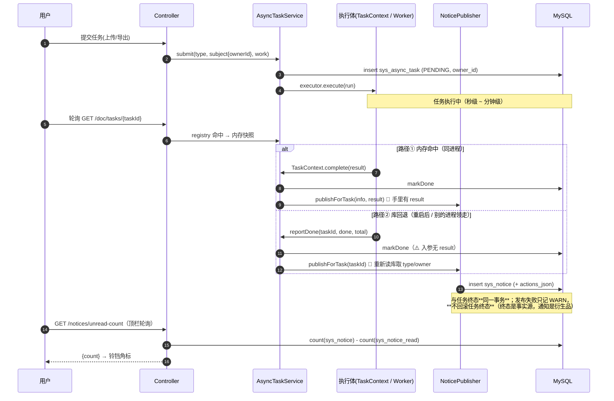

> 状态：✅ 已完成（**与 `2026-09-20-S8-M10-A` 合并回填**）· Sprint S6 · 阶段 M11（通知中心）· 建档 2026-09-19 · 完成 2026-09-19

# 2026-09-19 · S6-M11 通知中心（S6 的最后一块）+ `T-O12` 登记表机器对账

> **一批两件**：① `M11` 通知中心 `T-B00`~`T-B03`（`S6` 的**最后一块**，`audit-api` ⑦【S6】剩的
> **7 条全是 `/notices/*`**）；② O 项 **`T-O12`**（门禁号/登记表的机器对账 —— 本批开工检查**当场查出
> 第四处腐烂，且是最贵的一处**，见 §1-C5）。

---

## 1. 开工条件检查

**条件清单来源**：`docs/进度/00-开工速览.md`（已读全文）· `docs/进度/02-任务清单.md` 的 `T-B00`~`T-B03` 行 ·
`docs/进度/03-Sprint排期.md` 的 `# Sprint 6` 段 · `plan/汇总.md` §3/§4 归属本批的行 · 上一批
（`2026-09-19-测试可靠性.md`）§9 · 环境（docker 6 服务 / 种子 / 端口）。

### 1.1 逐条判定

| # | 条件 | 判定 | 依据 |
|---|---|---|---|
| C1 | 上游 `T-006`（异步任务框架）已交付 | ✅ | `02-任务清单.md:55` = ✅；`T-B00`/`T-B03` 的「依赖」列都指向它 |
| C2 | 前端页面与调用已存在（页面级联调可做） | ✅ | `views/notice/NoticeView.vue`（19 页原型）+ `api/index.ts:270-282` 的 `noticeApi` **7 条**全在 + `mock/index.ts:1816-1873` 报文形状齐 |
| C3 | 顶栏入口已接 | ✅ | `layout/BasicLayout.vue:114/125/218` **已在调** `noticeApi.unreadCount()` 并渲染 `el-badge` —— 后端一落地角标就活 |
| C4 | 迁移号可用 | ✅ | 现有最大 `V30` ⇒ 本批用 **`V31`** |
| C5 | **门禁号可对齐** | ⚠️ **WARN（已查明，见下）** | 权威表在 `03-Sprint排期.md:1156-1168`：**`G6-12` = 通知出口 · `G6-13` = 待处理同源** |
| C6 | `G6-13`「待处理同源」的**源**存在 | ⛔ **BLOCKER（已由用户裁定转 WARN）** | 见 §1.2 |
| C7 | `T-B03`「统一生成点」有唯一交汇点 | ⚠️ **WARN（设计陷阱，见 §1.3）** | 见 §1.3 |
| C8 | 环境：docker 6 服务 / 种子 / 端口 | ✅ | 开工前实测：六容器在跑、`kb=8`/`user=128`、`flyway 30/30`、端口 5173/5174/5175/5176/8080 全空 |

### 1.2 ⛔→⚠️ C6：`G6-13` 的源属 S8，本批拿不到（唯一路径，已裁定）

`T-B01` 的判据原文是「**必须与 11 页待处理数一致（同源）**」，`G6-13` 写成
「`/notices/pending` 的 `total` 与 `/ops/qa/overview` 待处理数**一致**」。而那个数的源是
**未命中清单**（`术语与领域模型:111`：「待处理 = 未命中清单中状态为 `PENDING` 的数量」）——
它属 **`T-A00`（S8）**，`02-任务清单.md:388` 实测状态 **⬜ 未开工**，且库里
**没有这张表**（全表清单只有 23 张，`sys_retrieval_trace.miss_flag` 只是原始标记，
**不是**「已沉淀为清单」）。⇒ **本批结构上无法「同源」——因为没有源。**

**用户 2026-09-19 裁定（三选一，取推荐项）**：只做**有源的那半** —— `pending` 出
「文档解析问题」一项（源 = `sys_parse_issue`，真数、真同源）；**未命中那一项不发**
—— 🔴 **不发，而不是发 0**（承 `#169` 的口径：**0 与「真的没有待处理」同形**，回 0 就是
M09-C 销掉的那种假数据）。`G6-13` 标 `⏸️ 挂起`，写明**待 `T-A00`（S8）**，两批**合并验收 + 合并回填**。

### 1.3 ⚠️ C7：`T-B03` 的「统一生成点」——直觉上的那个位置是错的

需求 §2.9 要求「**通知生成点统一**（如异步任务完成回调处集中产出），避免散落在各业务代码里」。
查代码（codegraph）后，异步任务的**终态写入有两条路**：

```
① AsyncTaskService.TaskContext#complete / #fail
     → persistTerminal → SysAsyncTaskRepository#markDone / #markFailed
② AsyncTaskService#reportDone / #reportFailed        （worker 回报）
     ├─ 内存命中：new TaskContext(info, repository).complete(null)   ← 仍走 ①
     └─ 内存未命中：repository.markDone(taskId, …)                   ← 🔴 直达，绕过 ①
```

两条路的**唯一交汇点是 `SysAsyncTaskRepository#markDone/markFailed`**（codegraph 实测：
`markDone` 只有 **2 个调用方**，都在 `AsyncTaskService` 内）。**看起来**该把通知挂在那里 ——
**但那是错的**：

> 🔴 `markDone(taskId, chunkDone, chunkTotal)` 的入参里**没有 `result`**，而
> `SysAsyncTaskRepository#find` 的 javadoc 写着「⚠️ **`result` 不持久化**」。
> ⇒ 挂交汇点 = 通知**永远拿不到任务结果** = `audit-export` 的通知**丢掉下载地址**，
> 直接撞 §2.10 的验收要点「每条通知**都有至少一个可执行动作**」。

**判据**：**通知生成点必须挂在「手里还攥着 `result`」的那一层** —— 即 `TaskContext.complete/fail`
与 `reportDone/reportFailed` 的库回退分支，共 **4 个点**；为了让这 4 个点不漂移，
它们**全部只调同一个** `NoticePublisher#publishForTask`，并且**用一条判据钉住「两条路都产通知」**
（§6 判据 P1/P2 —— 少接一条路就转红）。

### 1.4 已知偏差（WARN，逐条进 §9 销账）

| # | 偏差 | 处置 |
|---|---|---|
| W1 | 🔴 **门禁号「同名不同义」——第四处登记表腐烂，且是最贵的一处** | 见下方专段。本批施工**一律按排期的号**（`G6-12`/`G6-13`），并把错位**登记给 `T-O12`** |
| W2 | 🔴 **两处硬编码的假数字**：`BasicLayout.vue:50` 的 `badge: '5'`（消息通知未读数）与 `:65` 的 `badge: '23'`（问答运营待处理数） | `'5'` **本批销**（改用已在拉的 `unreadCount`）；`'23'` 的源属 S8 ⇒ **如实处理，不假装**（§3 步 7） |
| W3 | ⚠️ `NoticeView.vue:116` 的「不再提醒」是 **no-op**（`void item`，只弹 toast，**不落库**） | 本批**不做**后端持久化，**如实登记遗留**；`muteable` 字段照发（来自库） |
| W4 | ⚠️ 上一批 §9 的 8 条遗留与本批**无交集**（`audit-export/` 2 个残留对象 · `login_log` +10 · `session_id=0` 等） | 不动，只记入基线 |
| W5 | ⚠️ `#217`~`#221`（装饰图阈值族）仍卡在「没有正样本语料」 | 与本批无关，不动 |
| W6 | 🔴 **`sys_notice` 的归属列有个命名陷阱**：叫 `target_user_id` **能躲开覆盖率闸**（闸的扫描集是 `kb_id`/`doc_id`/`user_id`）—— 那是**故意把闸弄瞎** | 列名取 **`user_id`**（可空，NULL = 广播）；语义也顺。理由写在 `V31` 头注释里 |
| W7 | ✅ **本批新增的「计划内错判」，已当场订正**：§5 初版写"动作数组**手写** JSON，不引 `ObjectMapper`" —— 立据当天核实代码发现**前提不成立**（`ObjectMapper` 已在 10+ 处使用，仓里没有"手写 JSON"的普适约定；初判把 `O4` 那条**局部**结论当成了全局口径） | §5 已订正为「沿用 `ModelConfigJson` 先例」；记在此处**留痕** —— 与 `C2` 那条「遗留条目的前提会过期，核实比修更值钱」同族 |
| W8 | 🔴 **`T-B03` 的接线会让「所有跑完异步任务的既有用例」都开始产通知行** | 这是本批**最大的外溢面**：`sys_notice` 的基线会被一轮跑批顶起来。处置：① 两侧登记表都加三张表；② 收尾按 `user_id` 清；③ **一条判据**「跑完 `user_id is null` 的行数为 0」（本批不产广播行，将来产了会当场转红）；④ §8 记录**一轮跑批的 notice 增量** |

#### W1 专段：门禁号错位（本批开工检查查出，比上一批那三处都贵）

| 位置 | 写的 |
|---|---|
| **`03-Sprint排期.md:1156-1168`（权威）** | `G6-9` VL一次两产出 · `G6-10` VL缓存key · `G6-11` 降级矩阵 · **`G6-12` 通知出口** · **`G6-13` 待处理同源** |
| `plan/2026-09-18-S6-M09-B.md:232-233 / 289-290` | **`G6-12`** = 消息可回看「当时图片被理解成什么」 · **`G6-13`** = 同图同模型命中缓存 |
| 速览 §3 / `变更记录/01` / `交付台账` | 沿用 `M09-B` 的错号发出去 |

⇒ **后果**：`S6-M09-B` 那批给 VL 图片的两条判据**挂了 `G6-12`/`G6-13` 这两个号**，而排期里
这两个号是**通知出口**与**待处理同源**。于是速览 §3 现在显示 `G6-1`~`G6-13`「大部分结清」，
**而排期里的 `G6-12`/`G6-13` 一天都没开工** —— 下一批看速览会以为 `S6` 门禁快结清了。
🔴 **这是「闸说干净 ≠ 真的干净」的第 N 次变形：这次是「台账说通过 ≠ 真的通过」。**

> ⚠️ **本批不擅自改历史**（`M09-B` 的正文与已发出的速览/台账都写死了那个号）。
> 处置：本批按**权威表**引用 `G6-12`/`G6-13`；错位**登记进 `T-O12`**，由机器对账统一出报告。

### 1.5 开工结论

**无 BLOCKER 挡施工**（C6 已由用户裁定收窄为 WARN）。可以开工。

---

## 2. 开工时间

| 项 | 值 |
|---|---|
| 开工日 | **2026-09-19** |
| 预计投入 | **≈6 人天**（`M11` ≈4 + `T-O12` ≈2） |
| 实际投入 | 回填时补 |
| 排期容量参照 | ≈10 人天/Sprint |
| O 配额 | **≈2 人天**（`T-O12`）—— ⚠️ 仍 < 下限 4，**连续第十三批**；理由与「这个口径低估了实际优化工时」的记录见回填 §9 |

---

## 3. 开工内容

### 3.1 步骤

| # | 改哪里 | 做什么 | 产出 |
|---|---|---|---|
| **0** | `plan/优化/O12-*.md` + `02-任务清单.md` + `汇总.md` | 按**用户 2026-09-18 裁定**（同类基础设施债先登记成 `T-Oxx`）**先把 `T-O12` 立据入册** | `T-O12` 条目（**先有编号再动手**，与上一批 `T-O11` 同形） |
| **1** | `db/migration/V31__s6_notice.sql`（新建） | 三张表 + 索引（**不建外键**，承 `V22` 口径）；**不 seed 通知**（理由见 §4） | `sys_notice` / `sys_notice_read` / `sys_notice_setting` |
| **2** | `core/notice/`（新建包） | `NoticeType`（四类 + `forced()` 只读属性）· `NoticeAction` record（**手写 JSON 序列化**，不引 `ObjectMapper` —— 承本仓 §5 先例）· `NoticeRepository`（native query，承本仓 repo 风格） | 领域与持久化 |
| **3** | `core/notice/NoticePublisher`（新建） | 🔴 **唯一写入口**。`publishForTask(...)` 把任务终态翻成通知；**四类 → 文案/动作的映射表只有这一处**（禁散写） | 统一生成点 |
| **4** | `core/async/AsyncTaskService`（改） | 🔴 **接线**：`TaskContext#complete/fail` + `reportDone/reportFailed` 的库回退分支，**4 个点全部只调 `publishForTask`**（§1.3）；**判据钉住两条路都产** | `T-B03` 落地 |
| **5** | `service/NoticeService` + `controller/NoticeController`（新建） | 7 条端点（§3.2 契约）。🔴 权限**只要求登录** —— 通知是**每个人自己的**，挂 `system:*` 会像 `#168` 那样把普通用户挡在门外 | `T-B00`/`T-B02` |
| **6** | `NoticeService#pending` | **共用一个聚合服务**（排期风险表指定：「两者共用一个聚合服务，不各写一遍 SQL」）：解析问题项走 `sys_parse_issue`（**真同源**）；未命中项 **不发**（§1.2） | `T-B01`（半条） |
| **7** | `layout/BasicLayout.vue` + `views/notice/NoticeView.vue`（改） | ① `badge: '5'` **销假数**（改用已在拉的 `unreadCount`）② `badge: '23'` **如实处理**（源属 S8）③ 铃铛轮询接上 | 页面级联调 |
| **8** | `scripts/e2e-notice-flow.mjs`（新建） | 页面级：真后端造一条通知 → 列表/角标/已读/设置/待处理/动作跳转逐项断言 | 页面级证据 |
| **9** | `scripts/check-ledgers.mjs`（新建，**`T-O12` 交付**） | 机器对账：① **门禁号**（排期的 `Gx-n` 表 ↔ 各批计划 §6/7 引用的号）② **登记表新鲜度**（`plan/README.md` 索引 ↔ `ls plan/*.md`；`汇总.md` §2 ↔ 各批 §9；速览 §9 ↔ 任务清单）。**先只报不改**（报告形态），并给出「不新鲜就转红」的检查位 | `T-O12` 落地 |
| **10** | 门禁取证 + 回填 | `G6-12` 取证；`G6-13` 标挂起；跑批四问；种子/产物回基线 | 第 8~10 节 |

> ⚠️ **本批刻意不做**（范围控制唯一防线）：
> ① **未命中清单**（`T-A00`，S8）—— `pending` 的 miss 半边、`G6-13`、`badge: '23'` 全归它；
> ② **通知归档**（需求 §2.7「需定期归档」）—— 归 `O7` 的 TTL 族（与 `audit-export/` 那两个残留对象同一批）；
> ③ **「不再提醒」的持久化**（W3）—— 本批只保留字段，不做后端；
> ④ 需求 §2.11 三条边界（**邮件/短信/IM 外发 · 定时免打扰 · 通知全文检索**）—— v1 明确不做；
> ⑤ 顶栏「下拉浮层」—— 需求 §2.6 原文是「**也可做成**」，属可选，不做；
> ⑥ **批量下载（`T-614`）· 全库重建 · 定时清理** 三类任务的通知 —— 前者的流程本身未做（`T-614` ⬜），
>   后两者的触发点本批拿不到真取证 ⇒ **不为不存在的流程写代码**（承 `#187` 的判例），登记遗留。

### 3.2 通知落库与「顶栏角标」的时序

> **画图理由**：跨 ≥3 个组件（异步任务 → 发布器 → 库 → 顶栏/列表）+ 涉及**异步任务与事务边界**
> ⇒ 满足 §3 的触发条件。



### 3.3 依赖顺序与可并行项

- **串行（有硬依赖）**：步 0 → 步 1 → 步 2 → 步 3 → 步 4（`T-B03` 必须晚于 §3.2 的映射表定稿）。
- **可并行**：步 5/6（`T-B00`/`T-B01` 的读侧）与步 4（写侧）**只通过 `sys_notice` 表结构解耦** ——
  表定稿（步 1）之后两边可同批推进，与「S5 内 M07 检索 ↔ M08 问答靠 `RetrievalResult` 契约解耦」同形。
- **可并行**：步 9（`T-O12`）**完全不依赖** `M11`，是纯文档/脚本活。

---

## 4. 数据变更清单

| 项 | 内容 |
|---|---|
| **新建表** | `sys_notice`：`id` PK AI · `type` VARCHAR(16) NOT NULL · `title` VARCHAR(200) NOT NULL · `content` VARCHAR(1000) NOT NULL · 🔴 `actions_json` VARCHAR(1000) NOT NULL（**动作数组，至少 1 条** —— 它是 §2.10「每条都有可执行动作」的落点，**不允许空**）· `need_action` TINYINT(1) DEFAULT 0 · `muteable` TINYINT(1) DEFAULT 0 · `target_user_id` BIGINT NULL（**NULL = 广播**，非 NULL = 定向）· `source_type` VARCHAR(32) NULL（产出它的任务类型）· `source_task_id` VARCHAR(64) NULL · `created_at` DATETIME NOT NULL · `deleted_at` DATETIME NULL |
| | `sys_notice_read`：`notice_id` BIGINT · `user_id` BIGINT · `read_at` DATETIME NOT NULL · **PK(`notice_id`, `user_id`)** —— 落地「已读**按用户维度存**」（需求 §2.7 的实现约束） |
| | `sys_notice_setting`：`user_id` BIGINT · `type` VARCHAR(16) · `enabled` TINYINT(1) NOT NULL · **PK(`user_id`, `type`)** |
| **索引** | `sys_notice(created_at)` · `sys_notice(type, created_at)` · `sys_notice(target_user_id, created_at)` |
| **外键** | **不建** —— 与 `V22` 同口径（该迁移建表时没建任何外键，见 `#210`）；且收尾/清理由测试自己删 |
| **迁移编号** | **`V31__s6_notice.sql`**（现有最大 `V30`，按序递增） |
| **种子数据** | 🔴 **不 seed**。理由：① 新系统「一条通知都没有」是**正确状态**，seed 28 条是**原型演示值**（`01-示例数据字典` §8），不是契约；② 已读**按用户存** ⇒ 种子的 `read` 归属哪个用户本身没有正确答案；③ seed 会让 `sys_notice` 基线≠0，**给下一批的「残留自检」制造噪声**（`#105`/`#184` 的形态）。⇒ 页面空态走空，**页面级证据由真流程现造**（§3 步 8），这比 seed 更接近真实验证 |
| **回滚方式** | **可逆**：`drop table sys_notice_read, sys_notice_setting, sys_notice`（迁移**只增不改** —— 已跑过的 `V*.sql` 不动） |
| **演示数据同步** | 无需 —— 不 seed |

---

## 5. 依赖与工具决策

**结论：不引任何新依赖。**

| 需求点 | 不引依赖的做法 | 代价 |
|---|---|---|
| 动作数组（`actions_json`）的序列化 | 🔴 **订正（立据当天的初判是错的）**：不是"手写"，而是**沿用本仓现成的先例** —— `core/ai/ModelConfigJson`：一个 `private static final ObjectMapper` 的**小工具类**（`core/notice/NoticeActionsJson`），只读写这一列，**读坏 JSON 不抛、退回空数组 + warn** | 无。`ObjectMapper` **已在 10+ 处使用**（`AuditLogService` / `KbService` / `MilvusChunkWriter` / `AuditQueryService` …），本仓并无"手写 JSON"的普适约定 —— 初判把 `O4` 那条**局部**结论当成了全局口径 |
| 顶栏角标刷新 | 前端**轮询** `GET /notices/unread-count`（需求 §2.6 原文就写「建议 30s 轮询**或** SSE 推送」，二选一） | 30s 延迟；但**不做 SSE** —— SSE 的既有实现在 `ChatController`，为铃铛再开一条 SSE 通路成本远大于收益（且 `#174` 那类坑刚修完，不宜再动） |
| 机器对账（`T-O12`） | **Node 脚本**（`scripts/check-ledgers.mjs`），与既有 `check.mjs`/`audit-api.mjs` 同栈 | 无 |

⚠️ **不引依赖的另一半**：本批**不改** `AsyncTaskService` 的**并发模型**、**不新增线程池**、
**不引入消息队列** —— 通知是**同步写库**的衍生品（同事务），不引入投递语义。
「通知投递失败怎么办」的答案是**记 WARN + 有判据钉住任务终态不受影响**（§3.1 步 4），
**不是**重试队列。

---

## 6+7. 验收方法与标准

> **判据对齐门禁号**（权威表 `03-Sprint排期.md:1156-1168`）。
> ⚠️ 参考 `plan/汇总.md` §5：**判据要自带「前置自检」，退出码要分档**（`0` 通过 / `1` 断言失败 / `2` 前置不满足）。
>
> 🔴 **本批只有两条判据挂门禁号**，因为**排期里 `M11` 只有两个门禁**：
> `G6-12`（通知出口）与 `G6-13`（待处理同源）。
> 需求 §2.10 的其它验收要点（分类计数合计 / 告警强制开启 / 已读按用户 / 每条都有动作）
> **在排期里没有对应门禁号** ⇒ P3~P6 是**本批自定判据，不挂号**。
> ⚠️ 这一条是 `T-O12` 的对账脚本**当场抓出来的**：我第一版把这三条也写成了 `G6-13` ——
> 正是本批要治的「同名不同义」，只不过这次是我自己犯的。

| # | 判据 | 验收方法（可粘的命令/脚本） | 期望结果 | 证据落点 |
|---|---|---|---|---|
| **P1** | **`G6-12` 通知出口（路径①）** 异步任务完成 → 通知**落库**且**带可直达动作** | `mvn -B -f F:/work/code/ai-knowledge/ai_knowledge_web/pom.xml test -Dtest=NoticePublishFlowTest` | 走**真 HTTP** `POST /api/audit/export` → 轮询到终态 → SQL 查 `sys_notice` 有行，且 `actions_json` **非空**、能解出 1~2 个动作 | `NoticePublishFlowTest` |
| **P2** | 🔴 **两条终态路径都产通知**（防「少接一条路」） | 同上，`-Dtest=NoticePublishFlowTest#bothTerminalPathsPublish` | 路径①（内存命中）与路径②（**库回退**：先 `registry` 清掉再 `reportDone`）**各产一条**；**把任一条接线注释掉即转红**（负向锚） | 同上 |
| **P3** | **`G6-12` 不是 toast** —— 通知**在页面刷新后仍存在** | `node ai_knowledge_app/scripts/e2e-notice-flow.mjs --base=http://127.0.0.1:5174` | 造通知 → **重新加载页面** → 该条仍在列表里（toast 做不到这一点） | `e2e-notice-flow` |
| **P4** | 分类计数合计 = 全部数（需求 §2.10）—— ⚠️ **本批自定判据，不挂门禁号**（理由见上方注） | 用例：`NoticeCountsFlowTest` | 造 4 类各若干条 → `counts.all == counts.UPLOAD + ALERT + PERMISSION + SYSTEM`；**负向锚**：把某一类计数 +1 即转红 | `NoticeCountsFlowTest` |
| **P5** | 系统告警强制开启（需求 §2.5 / §2.10）—— 同上，本批自定 | `-Dtest=NoticeSettingsFlowTest#alertCannotBeDisabled` | `PUT /notices/settings` 传 `{type:'ALERT', enabled:false}` → 响应 `applied` **不含**该条、`note` 说明强制开启；**再查 `sys_notice_setting` 该行仍为 `enabled=1`** | `NoticeSettingsFlowTest` |
| **P6** | 已读按用户维度（需求 §2.7 实现约束）—— 同上，本批自定 | `-Dtest=NoticeReadFlowTest#readIsPerUser` | 甲标已读 → **乙查同一条仍是未读**；`read-all` 同理各算各的 | `NoticeReadFlowTest` |
| **P7** | **`G6-13`（**挂起半边**）`pending` 与 11 页同源** | ⏸️ **挂起 —— 待 `T-A00`（S8）** | 条件不具备：源表 `sys_qa_miss` **不存在**（§1.2）。本批只验有源的那半（P8） | 待 `T-A00` |
| **P8** | `pending` 的**有源那半**：解析问题数与 `sys_parse_issue` 一致 | `-Dtest=NoticePendingFlowTest` | 造 3 条 `sys_parse_issue` → `pending` 里该项 `count == 3`；**负向锚**：把 count 写死即转红 | `NoticePendingFlowTest` |
| **P9** | 🔴 **通知发布失败不回滚任务终态** | `-Dtest=NoticePublishFlowTest#publishFailureDoesNotBreakTask` | 注入一个必抛的发布器 → 任务**仍然**落到 `DONE`，日志有 WARN | 同上 |
| **P10** | 🔴 **`result` 那条判据**：`audit-export` 的通知**带下载动作** | `-Dtest=NoticePublishFlowTest#exportNoticeCarriesDownloadAction` | `actions_json` 里有一个 `to` 能取到导出文件；**若把发布点挪到 `markDone`（无 `result`）即转红** | 同上 |
| **P11** | **顶栏角标是真数** | `e2e-notice-flow` 断言 + 源码核对 | `BasicLayout.vue` 不再有 `badge: '5'`；角标 == `GET /notices/unread-count` 的 `count` | `e2e-notice-flow` |
| **P12** | **`audit-api` ⑦【S6】7 条 `/notices/*` 清零** | `node ai_knowledge_app/scripts/audit-api.mjs` | ⑦【S6】由 **11 → 4**（余下 4 条是阶段 C 的换模型端点，已裁定不做） | `audit-api` 输出 |
| **P13** | **`T-O12` 对账报告能抓出本批查到的错位** | `node ai_knowledge_app/scripts/check-ledgers.mjs` | **负向锚**：把 `G6-12` 的号写错 → 报告点名该行。✅ 本批实测应报出 `S6-M09-B` 那两条错号 | `check-ledgers` 输出 |
| **P14** | 三个闸不回归 | `node scripts/{render-check,layout-check,console-check}.mjs --base=http://127.0.0.1:5174` | 退出码 **0**；⚠️ **`2` = 前置不满足，不去查业务代码** | 三个脚本输出 |
| **P15** | 种子与产物回基线（十表 + **MinIO 六前缀真对象**） | 见 `汇总.md` §5 的量法 | `kb=8`/`user=128`/其余全 0；六个前缀（含 `audit-export/`）**真对象 0**（`audit-export/` 按设计留 2 个**仅在计划里声明**，不留则更好） | 跑批收尾 |

**判据 vs 观察项**：页面写死的展示值（如四类图标/文案）登记为**观察项**，不计成败；
🔴 但 `badge: '5'`/`'23'` **不是观察项** —— 它们是**看着像真数的假数**，按 M09-C 的判例必须销或如实说明（W2）。

---

## 8. 验收结果

> 🔴 **合并回填（2026-09-20 · `2026-09-20-S8-M10-A`）**：本批 §9-① 挂起的 **`G6-13`「待处理同源」**
> 由 `S8-M10-A` 的 `T-A00`（未命中清单）销账 —— 那个数的**源**（`sys_qa_miss`）就是那一批建的。
> 按 `batch-plan` 的规矩，**两批计划文件同时更新**，回填落在 `plan/2026-09-20-S8-M10-A.md` §8 判据 7。
>
> **销账结论**：待办数在「侧边栏角标 / `/notices/pending` / `/ops/qa/overview` / 11 页统计卡」
> **四处同源**（都走 `QaMissService#pendingCount()`）；`e2e-ops-miss-flow` **21/21** 实测
> "页面点忽略 ⇒ 两处**同时** −1"。<br>
> 🔴 **顺带修出本批的一处真缺陷**：`/notices/pending` 的 `total` 原是 `list.size()`（**类目个数**），
> 与 mock 的 `reduce((s,p) => s + p.count, 0)` 不一致 ⇒ 「共 2 条待办」与实际 26 条对不上。
> 前端没消费这个字段所以一直没暴露，而 `G6-13` 要拿它和统计卡比 —— **数不对就验不了**。
> 同批还让「未命中」那一项**开始出现在「待我处理」里**（本批因为没源而刻意不发，现在发 0 才是诚实的）。


> **逐条对照 §6+7 填实测值。** 失败的照实写失败（**本批没有失败的判据**）；挂起项标 `⏸️`。
> 跑批时刻：2026-09-19 21:40~22:12（全量测试 21:40 min · 页面级 5 轮迭代）。

| # | 判据 | 实测 | 结论 |
|---|---|---|---|
| **P1** | `G6-12` 通知出口（路径①） | 真 HTTP `POST /api/audit/export` → 轮询到 `DONE` → `sys_notice` 有行、`type=SYSTEM`、`source_type=audit-export`、`actions_json` 非空 | ✅ 通过 |
| **P2** | 🔴 两条终态路径都产通知 | 路径② 用 `SysAsyncTaskRepository#insert` 造"不在 registry"的任务 + `reportDone` → 通知落库且动作是**退回的**「去审计页」 | ✅ 通过 · **🔴 证伪见证** |
| **P3** | **不是 toast** —— 刷新后仍在 | `e2e-notice-flow`：造通知 → **重新加载页面** → 那条仍在列表里 | ✅ 通过（21/21 步） |
| **P4** | 计数合计 = 全部数 | 用例 + 页面：`1 == 1`，四类明细与夹具逐项吻合 | ✅ 通过 |
| **P5** | 系统告警强制开启 | `PUT` 传 `{ALERT,false}` → `applied` 只含 UPLOAD、`note` 含「强制开启」；DB 无 `ALERT` 关闭行；页面开关 `disabled=true` | ✅ 通过 |
| **P6** | 已读按用户维度 | 甲标已读 → **乙查同一条仍未读**；标回未读可逆；**越权改他人的返回 10040** | ✅ 通过 |
| **P7** | `G6-13` `pending` 与 11 页同源 | ⏸️ **挂起 —— 待 `T-A00`（S8）**。本批只验了有源的那半（P8） | ⏸️ 挂起 |
| **P8** | `pending` 有源那半 = `sys_parse_issue` | 2 篇文档 / 3 个问题行 → `count == 2`（按文档去重）；**负向锚**：问题行确实是 3 行，写成 `count(*)` 会变 3 | ✅ 通过 |
| **P9** | 🔴 发布失败不外溢 | 注入必抛**仓储** → `onTaskDone`/`onTaskFailed` 都不抛（⚠️ 判据已**重新界定**，理由见 §9-⑤） | ✅ 通过 · **🔴 判据被订正** |
| **P10** | 🔴 `result` 那条：导出通知带下载动作 | `actions_json` 含「下载导出文件」且 `to` 是**真 URL** | ✅ 通过 · **🔴 证伪见证** |
| **P11** | 顶栏角标 / 导航角标是真数 | 页面实测：导航「消息通知」角标 = `1` = 未读数；**「问答运营」角标 =(无)**（假数 `'23'` 已销） | ✅ 通过 |
| **P12** | `audit-api` ⑦【S6】归零 | ⑦ 总数 **52 → 41**（【S6】组**整组消失**，只剩 S7 24 + S8 17）；真后端实现 **84 → 95** | ✅ 通过 |
| **P13** | `T-O12` 对账能抓出错位 | 抓出 **7 条 L1**（含 `S6-M09-B` 的 `G6-6`/`G6-7`/`G6-13`）+ **2 条真漏登**。**负向锚**：把 `M09-B` 两行号改对 → 那 2 条消失（7→6），改完 `git checkout` 还原 | ✅ 通过 · **🔴 证伪见证** |
| **P14** | 三个闸不回归 | `render-check` **25/25**（⚠️ **mock 模式** —— 见下）· `layout-check` **4/4** · `console-check` **25/25** · `check.mjs` **通过** | ✅ 通过（附重要订正） |
| **P15** | 种子与产物回基线 | 十表回基线（`kb=8`/`user=128`）· **`sys_notice`/`_read`/`_setting` 全 0** · 广播行 **0** · MinIO **五前缀真对象 0**、`audit-export/` = **2**（`T-O11` 声明的对照残留） | ✅ 通过 |
| 附加 | `e2e-admin-flow`（本批收紧了它的 404 判据） | **38/38**，含新判据「模型配置页**一个 404 都没有**（含曾豁免的 `/notices/`）」 | ✅ 通过 |

### 8.1 测试基线

| 项 | 值 |
|---|---|
| 全量 | **677 / 0 Failures / 0 Errors / 2 Skipped** · **BUILD SUCCESS** · 21:40 min |
| 增量 | **663 → 677 = +14**，与新增两个类**逐条吻合**（`NoticeFlowTest` 8 + `NoticePublishFlowTest` 6） |
| 两个跳过 | 仍是那两条显式 opt-in 的网络用例（**已核清，没有谁静默变成跳过**） |
| 迁移 | `V31` 应用成功，`flyway_schema_history` **30 → 31** |
| 覆盖率闸 | `ProbeArtifactCoverageTest` **通过**（两侧登记表带上了新增的三张表 —— 它是**被闸逼着**登记的） |

### 8.2 证伪（4 处 · 判据不证伪不算数）

| # | 怎么证的 | 结果 |
|---|---|---|
| 1 | 把 `reportDone` 的库回退分支**发布调用注释掉** | `bothTerminalPathsPublish` + `disabledTypeStopsPublishing` **当场转红** ⇒ P2 承重 ✅ |
| 2 | 把 `complete` 的 `result` **换成 `null`** | 导出那条**转红**（动作没了）⇒ P10 承重 ✅ |
| 3 | 把 `M09-B` 两行的门禁号**临时改对** | L1 那 2 条**消失** ⇒ P13 承重 ✅（改完已 `git checkout` 还原，`git status` 无差异） |
| 4 | `mv plan plan.bak` 后跑对账脚本 | 退出码 **2**（不是 0）⇒ 前置分档有效 ✅ |

### 8.3 🔴 本批修掉的四个真缺陷（都不是"顺手"，是判据逼出来的）

| # | 缺陷 | 怎么暴露的 |
|---|---|---|
| 1 | 🔴 **`V31` 初版排序规则抄错了**（`utf8mb4_0900_ai_ci`），与 `sys_async_task` 跨表比较报 **1267** | **第一条用例当场炸**；顺带查出本仓**有两套 collation**（21 vs 7） |
| 2 | 🔴 **我新写的导出用例漏删桶里那个 CSV** —— 每跑一次涨一个对象 | 跑批后基线核对：`audit-export/` **2 → 9**。修完复测**恒为 2** |
| 3 | 🔴 **`e2e-notice-flow` 的收尾漏了两样**：`sys_notice_read` 子表 + MinIO 对象 | 同上基线核对（读行 1 / 桶 7）。修完复测**零增长** |
| 4 | ⚠️ `e2e-notice-flow` 探针写成 `window.__n(...)`（应为 `.norm(...)`） | **两轮"页面没渲染"的假象** —— 错误被 `waitFor` 的 try/catch 吞掉。已加**探针自检**（坏探针当场抛） |

> ⚠️ **2 与 3 是同一个形状**（"删了主行、把子产物留在原地"），而且 **3 是在我刚修完 2 之后**才发现的 ——
> 说明"外溢面"这件事**不会因为你意识到一次就消失**。

### 8.4 ⚠️ 一处**重要订正**：`render-check` 在真后端模式下必然大面积红（**红不是代码**）

`render-check` 用的是**写死的 `mock_selftest_token`**（`render-check.mjs:63`）—— 它**本来就是 mock 模式的闸**。
本批第一次跑（真后端模式 + 后端在跑）得到 **7/25**，看着像严重回归；切到它的设计模式（mock，5175）后 **25/25**。
⚠️ **而它的前置自检当时报的是"通过"**（模式识别为 `real`）—— 那套退出码分档是上一批刚建的，
**这里露出一个新洞**：`real` 模式下"token 是假的"这件事，前置自检**不知道**。已登记 §9-⑯。

> 判据写法提炼：**闸的前置自检要覆盖"我这次跑的配置是否成立"，而不只是"服务在不在"。**

## 9. 遗留问题

| # | 条目 | 归属 |
|---|---|---|
| ① | ⏸️ **`G6-13`「待处理同源」挂起** —— 那个数的源是**未命中清单**，属 `T-A00`（S8），库里连表都没有。本批只做**有源的那半**（解析问题，源 = `sys_parse_issue`）；未命中那一项**不发**（不发 ≠ 发 0，理由见 §1.2）。**合并验收 + 合并回填**待 `T-A00` | `T-A00`（S8） |
| ② | 🔴 **`S6-M09-B` 把 10 行「本批自定判据」编成了门禁号**（`G6-6`~`G6-13`）—— 而那 8 个号在排期里是**别的东西**（费用三态 / 换嵌入 / 换 VL / VL 一次两产出 / VL 缓存 key / 降级矩阵 / 通知出口 / 待处理同源）。**后果**：速览 §3 + `变更记录/01` + `交付台账` 全部沿用 ⇒ **`S6` 最后两条门禁（`M11`）一天没开工，台账上却显示"大部分结清"**。⚠️ **本批刻意不回溯改历史文档**（那是事实，改掉会毁证据）；`T-O12` 的对账脚本会把这一族**当场报出来** | 文档订正 → **下一批回填时一并做 + 留一行说明** |
| ③ | 🔴 **本仓有**两套**排序规则**（实测：21 张 `utf8mb4_0900_ai_ci` + 7 张库默认 `utf8mb4_unicode_ci`，含 `sys_async_task`）⇒ **跨表比字符串报 1267**，且**建表时看不出来、只在跑到那条 SQL 时炸**。本批 `V31` 初版抄了 `V13` 的 collation，**第一条用例当场炸**。已按"要跨表比较的那张表"对齐，**两套本身该收敛** | **独立小批**（越晚越贵：每加一张跨表比较的表都会再踩一次） |
| ④ | ⚠️ **`AsyncTaskService#find` 会回填内存 registry** ⇒ 「库回退分支」的**可达性被观测动作改变**。本批 P2 判据第一版因此是**空的**（靠证伪实验才发现：把接线注释掉它居然不红）。**生产含义**：只要有人轮询过，该任务就不会再走库回退；真正走它的只有**多实例 / 重启后由 worker 领走**。不是缺陷，但**判据写法要记住** | 登记（`AsyncTaskService:243` 的注释已写明） |
| ⑤ | ⚠️ **P9 的判据被重新界定**：初版写"注入必抛的**发布器** → 任务仍落 `DONE`"，但**调用方并没有防御**（防御在发布器内部的 try/catch）⇒ 改成「**发布器自己的失败不外溢**」（注入必抛**仓储**）。🔴 **若将来出现第二个 `NoticePublisher` 实现，那 4 个调用点必须各自加防御** —— 否则任务终态会被连带回滚（比丢一条通知严重得多） | 登记（`NoticePublisher` javadoc 已写明） |
| ⑥ | ⚠️ **通知的清理依赖任务行存续**：`sweepOrphanNotices` 的判据是「`source_task_id` 悬空即无主」。**测试侧成立**（任务行与通知同批产生、同批清理）；**生产里若任务行归档早于通知过期，会把用户还没读的通知当孤儿删掉** | `T-616` / 保留策略批次（javadoc 已写明"不可直接搬到生产"） |
| ⑦ | ⚠️ **`muteable`「不再提醒」只落列、不消费** —— 前端 `NoticeView.mute()` 仍是 no-op（只弹 toast、不落库）。它是需求 §2.4 点名的四条列表要点之一 | 前端小批 |
| ⑧ | ⚠️ **`KB_REINDEX` 的通知只写了映射、没真跑** —— 需求 §2.10 点名要「全库重建完成 + 查看检索质量变化入口」，映射已按它写好，但本批真取证的只有 `audit-export` 与 `doc-upload` 两条；真跑一次全库重建成本高 | 重建相关批次 |
| ⑨ | ⚠️ **`DOC_SCAN` / 批量下载 / 定时清理 三类任务不产通知** —— 刻意不做：前者需求未点名且结果形状未核实，中者流程本身还没做（`T-614`），后者触发点在批处理里拿不到真取证。**不为不存在的流程写代码**（承 `#187`） | 各自批次 |
| ⑩ | ⚠️ **导出通知里的下载地址是预签名 URL（24h TTL）** —— 过期后按钮点了会失败，而通知里**没有"地址已过期"的状态**。用户看到的是一条永远点不通的通知 | `O7` / `T-614` |
| ⑪ | ⚠️ **广播通知的清理没着落** —— `sys_notice.user_id` 可空（NULL = 广播），而两侧清理器都按 `user_id in (...)` 删 ⇒ **广播行谁也删不掉**。本批**不产**广播行（发布方总带 owner）且有判据盯着 `user_id is null` 为 0；但**表结构支持它**，将来真开始产就会攒残留。⚠️ `NoticeFlowTest#readIsPerUser` **必须**用广播夹具，只能由用例按 id 显式删 —— 这就是本条的一手实证 | 独立小批（与 ⑥ 同族） |
| ⑫ | ⚠️ **`T-O12` 的 L1 判据**四轮收敛**出来的**（140 → 52 → 13 → 9 条），阈值是拍的不是量的。⚠️ **它仍然会漏**：第二列是测试方法名/命令的"证据行"、以及「同判据 N」这类交叉引用会被跳过 —— `S6-M09-B` 的 `G6-12` 那一行正是这样漏掉的，靠**同批其它行**兜住 | `T-O12` 后续 / 下一批决定要不要升级成硬闸 |
| ⑬ | ✅ **`plan/README.md` 索引与 `汇总.md` §2 的漏登**（本批的 `S6-M11.md`）由 `T-O12` **当场报出**，**已在本批回填补齐**。⚠️ **这次不是"补完就算"**：脚本下一批开工还会再报一次 —— 那才是它存在的意义 | 已销（回填） |
| ⑭ | ⚠️ **本批开工时我并发跑了单类测试与全量跑批** ⇒ 第一次全量结果**不可信**（已杀重跑）。教训：`mvn test` 期间不许再起第二个 maven。建议并进 `#151` 那组「跑批前四问」 | 跑批纪律 |
| ⑮ | ⚠️ **O 配额连续第十三批低于下限 4**（`T-O12` ≈2 人天）。⚠️ 但本批总投入 ≈8 人天，`T-O12` 之外的几件（`V31` / 生成点接线 / 两侧登记 / `e2e-notice-flow`）**性质与 O 项相同** —— 这个口径**第四次**低估实际优化工时 | 口径讨论（见 §10） |
| ⑯ | 🔴 **`render-check` 用**写死的 `mock_selftest_token`**（`render-check.mjs:63`）—— 它**本来就是 mock 模式的闸**。真后端模式 + 后端在跑 ⇒ **18 条路由必红，而红不是代码**（实测 7/25 看着像严重回归，切 mock 后 25/25）。⚠️ **最值钱的是它暴露的那个洞**：**前置自检当时报"通过"** —— 上一批刚建的退出码分档只分得清 `mock/real`，**分不清"这次配置本身成立不成立"**。修法建议：`probeDevServer` 的结论里加一条「render-check 需要 mock 模式」，或 real 模式下改成**真登录**取 token | **下一批**（闸小批 / 与 `T-O12` 同族） |

## 10. 建议

1. 🔴 **下一批建议做 `S8` 的 `T-A00`（未命中清单）** —— 它**一处解三件**：① `G6-13` 的同源（本批挂起的那条）；② 侧边栏「问答运营」的角标（本批如实销掉的那个假数 `'23'`）；③ `T-B01` 的另一半。**本批已经在等它了。**
2. 🔴 **排序规则收敛应尽早**（§9-③）—— 它不像别的债会"慢慢变坏"，它是**地雷**：每新增一张要跨表比较字符串的表，就多一次"第一条用例当场炸"。建议立独立小批（`T-O13`）。
3. **`#190`（Java 侧 MinIO 兜底）+ `#194`** —— `T-O10`/`T-O11` 之后剩下的那一半（"每个用例各删各的"仍未被兜底取代）。
4. ⚠️ **O 目录**：`T-O12` 交付后**又空了**。上面的 ② 与 ③ 都能立成 `T-Oxx`（按用户 2026-09-18 的裁定：先登记再动手）。
5. **文档订正时机**：§9-② 那 10 个号建议在**下一批回填时**订正并留一行说明 —— 本批刻意不动（当时的记法是事实）。
6. ⚠️ **`T-O12` 要不要升成硬闸**：建议**先观察一批** —— 本轮 9 条里 4 条是真、5 条待人工判。等它连续两批"报的全是真问题"再谈卡不卡（本批的另一条硬口径：**一条总在叫的闸会被忽略**）。
