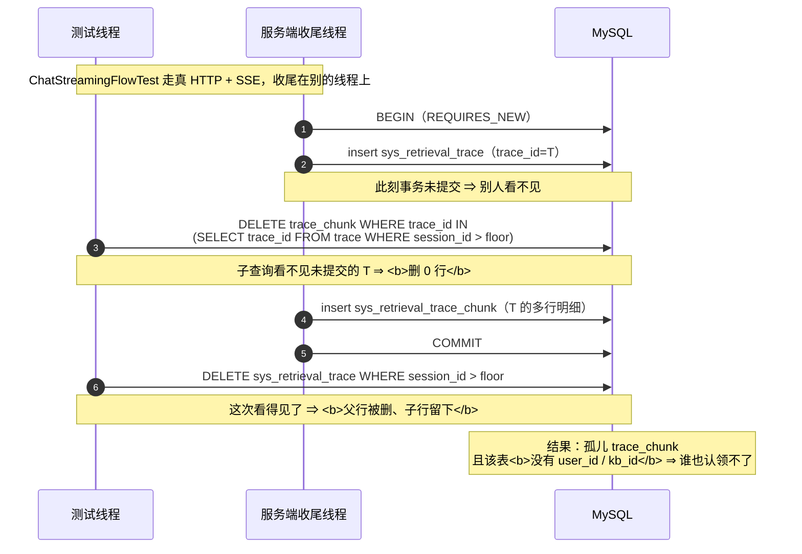

> 状态：🟡 进行中 · Sprint 跨批（S6 并行）· **测试/清理/闸基础设施批** · 建档 2026-09-19

# 2026-09-19 · 测试可靠性 —— 「闸的红绿灯取决于没说出口的前置」

> 任务：**`T-O11`（新登记）+ 无编号三项** —— `#226` · `#227` · `#210`
> 来源：`ai_knowledge_web/plan/2026-09-19-S6-M09-C.md` §9（`#226`/`#227`/`#228`）· `plan/汇总.md` §3（`#210`）
> 上游计划：`plan/2026-09-19-S6-M09-C.md` —— 那批的 §10-1/§10-3 就是本批的来源
>
> ⚠️ **命名偏离约定**：本仓计划文件惯例是 `<日期>-<Sprint>-<模块>-<阶段>.md`，而本批**不属任何 Sprint 阶段**
> （跨批基础设施），故取描述性文件名 —— 与 `2026-09-17-测试可靠性.md` 同一处理，留痕在此，不静默偏离。
> ⚠️ **它是 `2026-09-17-测试可靠性` 的续篇**：那批的结论是「**闸说干净 ≠ 真的干净**」，
> 本批逮到的是它的**下一代形态** —— 「**闸的红绿灯取决于一批没写下来的环境前置**」。
>
> 🔴 **用户 2026-09-19 裁定**：按「`#228` 登记成 `T-O11` → 修 `#226`/`#227` 两个闸 → `#210`」这个顺序办（本批范围来源）。
> ⚠️ 用户当日另有一条裁定（2026-09-18）适用本批：**「同类基础设施债，先登记成 `T-Oxx` 再动手」**
> —— 故 `#228` 不直接施工作业，**先立 `T-O11` 与方案文档**（步 1）。

---

## 1. 开工条件检查

**依赖清单来源**：`docs/进度/00-开工速览.md` §1/§2/§4 · `plan/汇总.md` §3/§5 ·
`plan/2026-09-19-S6-M09-C.md` §9 · **本批现场实测**（下面的"实证"列多数是本次开工前现跑的）。

| # | 依赖项 | 档位 | 现状（代码/文档实证） | 结论 |
|---|---|---|---|---|
| 1 | `#228` 的对象是否真的存在（`audit-export/` 里到底有没有东西） | ✅ | **实测：137 个真对象**（`xl.meta` 计数，Sep 15~19 每天都有）。⚠️ 用 `MSYS_NO_PATHCONV=1` + 容器内 `ls -R` 数的，桶名是 `rag-documents`（`.env` 的 `MINIO_BUCKET`），**不是 `kb-minio`** | 满足 |
| 2 | `#228` 的对象**有没有归属信息**（决定能不能判"无主"） | ✅ | 🔴 **本批查出来了，且推翻了两条旧认知**：<br>① `AuditExportService#store`（`AuditExportService.java:144`）：`objectKey = PREFIX + userId + "/" + 时间戳 + "-audit.csv"` ⇒ **对象名第 2 段就是 `userId`**；<br>② `SysAsyncTaskRepository#find`（`SysAsyncTaskRepository.java:254`）注释明写：「⚠️ `result` **不持久化**」⇒ **`objectKey` 落不进库**（`#78` 说的"无归属列"是对的，但原因不是"没设计"，是"**存不下**"） | 满足（**判据是「路径即归属」**） |
| 3 | `T-O11` 的**根因入口**（测试侧谁在造这些对象、谁该清） | ✅ | `AuditQueryFlowTest#cleanExportTasks`（`AuditQueryFlowTest.java:91-97`）**只删 `sys_async_task` 行，不删对象** ⇒ 一轮跑批在桶里留一批对象，而任务行回 0 ⇒ **`sys_async_task` 基线永远是 0，桶一直在涨** | 满足 |
| 4 | `#226` 的真身（"`render-check` 7/25 恒红"还成立吗） | 🔴 **被实测推翻** | **实测三次，全部 25/25 全绿**：mock 热（25/25）· **mock 冷**（清 `node_modules/.vite` 后立即跑，25/25）· 真后端模式且后端**没起**（22/25）。<br>🔴 `layout-check` 同样实测 **4/4 全绿**。<br>**已证伪三个假设**：① 真后端模式（只红 3 条，且红的是**数据依赖**的标题断言）② 冷启动/依赖预打包（清缓存后仍全绿）③ token 被守卫拒（`router/index.ts:73` 的判据是 `!meta.public && !auth.isLoggedIn`，而 `stores/auth.ts:31` 是 `isLoggedIn: (s) => !!s.token` —— **纯 localStorage，不校验、无 API 调用**） | 满足（**真问题被重新定性**，见 §3.4 假设 1） |
| 5 | `#229` 说的"O 目录已空"是否属实（`T-O11` 有没有可能被并进已有的 O 项） | ✅ | 逐条核过 `plan/优化/README.md` §0：`T-O01`~`T-O10` 十项**全部结项**，余下部分全卡外部条件（正样本语料 / ClamAV 镜像 / `T-614`）⇒ **必须新登记**，无现存项可并 | 满足 |
| 6 | `#210` 的对象是否还在（孤儿行还在吗） | ✅ 在，但**复现不了** | 基线：`sys_retrieval_trace` = **0** · `sys_retrieval_trace_chunk` = **0**（AUTO_INCREMENT **757**）。<br>🔴 **证伪实验：单独反复跑 `ChatStreamingFlowTest` 3 轮 → 每轮后孤儿都是 0**（3 轮各 `Tests run: 3, Failures: 0`，23.8s/18.1s/16.6s）。⇒ **隔离运行不复现** | 满足（**做兜底，不做根因证明**，见 §3.4 假设 2） |
| 7 | `#210` 的根因是否有**代码证据**（不是猜的） | ✅ | **有，且是结构性的**：`RetrievalTraceWriter#write`（`RetrievalTraceWriter.java:148-150`）在**同一个 `REQUIRES_NEW` 事务**里先 insert trace、后 insert chunks；而测试收尾的两条 DELETE **跨在提交窗口两侧** ⇒ 见 §3.2 的时序图。**四处同一个写法**：`ChatStreamFlowTest:55` · `ChatStreamingFlowTest:114` · `ImageDescribeNetworkTest:180` · `probe-teardown.mjs:137` | 满足 |
| 8 | 跑批前置：后端停了 / 端口 / 库基线 / `is_active` | ✅ | 5173/5174/8080 **无 LISTENING**；`kb=8` · `user=128` · 其余**全 0**；`is_active` CHAT/EMBEDDING/RERANK/VL **各 1** ⇒ 四条全过（`#151`/`#108`/`#166`） | 满足 |
| 9 | 前端验证的**工具链前置**（无 `npm`/`npx`） | ⚠️ WARN | `vite` 入口在 `node_modules/**`，**被 shell 路径守卫拦**。本批用 `temp/start-vite.mjs`（gitignored 的临时启动器，等价 `node node_modules/vite/bin/vite.js`）绕过，**不入库** | 不阻断 |
| 10 | MinIO 计数口径（`#204` 那个坑） | ⚠️ WARN | **`kb-minio` 镜像没有 `find` 也没有 `grep`**，且删对象后**不修剪空目录** ⇒ `ls` 数出来是空壳。本批判据一律**用客户端 `listObjects` 数**，`ls` 只用于定性 | 不阻断 |

**BLOCKER 汇总**：**无** —— 十条全满足或有明确绕法，没有一条"写下去会白写"。

**⚠️ 已知偏差**（不拒绝施工，第 9 节销账）：

| # | 偏差 | 销账去向 |
|---|---|---|
| W1 | `#204` 的 MinIO 计数坑**第三次现身**（本批又差点用 `ls` 数）⇒ 光靠 javadoc 提醒**已经被证明拦不住** | §9 登记，候选做成"计数口径的唯一入口" |
| W2 | 现有 **137 个存量 `audit-export/` 对象本批清不掉** —— 它们的归属（`admin`）**真的存在** ⇒ 兜底判它们"有主"，不会删。要清只有两条路：手工清，或 O7 的 TTL 规则 | §9 登记 |
| W3 | 🔴 **`plan/README.md` 的批次索引烂了第二次** —— 表停在 `2026-09-17-S5-M07-B.md`，其后 **11 份计划文件一份没登记**（含 `2026-09-17-测试可靠性` 本身）。而该文件自己写着「新增批次计划后**同步加一行**（该动作此前漏做）」 | 步 12 补 11 行；**机制** → §9 |

> 判据只有一条：**这条不满足，代码写下去会不会白写**。

### 结论

- [x] ✅ **可以开工**
- [ ] ⛔ 拒绝施工

---

## 2. 开工时间

| 项 | 值 |
|---|---|
| 建档 / 开工日 | 2026-09-19 |
| 预计投入 | **≈4.5 人天**（`T-O11` ≈2 · 两个闸 ≈1.5 · `#210` ≈1） |
| 🔴 O 配额 | **`T-O11` ≈2 人天 < 下限 4** ⇒ **连续第十二批低于下限**。⚠️ 成因与 `#229` 记的**同一条**：O 目录是空的，本批只**新登记进一项**，不是"有项没做完" |
| 实际投入 | *回填时补* |

---

## 3. 开工内容

### 3.1 步骤

| 步 | 做什么（文件/类 → 动作 → 产出） | 依赖 | 可并行 |
|---|---|---|---|
| **1** | 🔴 **先立 `T-O11` 与方案**（用户 2026-09-18 裁定：**先有编号再动手**）：新建 `plan/优化/O11-audit-export-fallback.md`（为什么能判无主 = **路径即归属**；为什么 `#78` 的"没有归属列"对但不完整；代价与边界）+ `优化/README.md` §0 加一行 + `docs/进度/02-任务清单.md` §O 优化项加一行 + `docs/进度/00-开工速览.md` §9 加一行 | — | 否（**它是本批第 1 步**） |
| **2** | `ProbeCleanup` → 新增"**路径即归属**"扫描类（第三类前缀）：归属不进 SQL、而是从**对象名的路径段**取（`audit-export/{userId}/…`），判据是 `sys_user.id` 是否存在。`MINIO_PREFIXES` 扩成"三类前缀"结构；`ProbeArtifacts` 台账同步补一行 | 步 1 | 与步 5/6 并行 |
| **3** | `AuditQueryFlowTest#cleanExportTasks` → **连带删对象**（必走路径：删任务行的同一条路上删 `audit-export/{userId}/` 下本轮产生的对象）。⚠️ 对象名**不在行里**（`result` 不持久化），故只能按 **前缀 + 时间下限** 收 | 步 2 | 否 |
| **4** | `OrphanMinioSweepTest` → 补**两条锚**：① **正向**：造一个 `audit-export/{不存在的userId}/x.csv` ⇒ 兜底**必须删**；② 🔴 **负向**：造一个 `audit-export/{真实userId}/x.csv` ⇒ 兜底**必须留**（证它**不会误删真实用户的导出**） | 步 2 | 否 |
| **5** | 新建 `ai_knowledge_app/scripts/lib/routes.mjs` —— **路由清单的单一事实源**（`path`/`label`/`public`/`expect`）。`render-check.mjs` 与 `console-check.mjs` **都改成从它 import**。🔴 现状是**两份拷贝**（`render-check` 有 `expect`、`console-check` 没有），而 `console-check:33` 的注释写着"与 `render-check.mjs` 同一份路由清单" —— **那句话是靠注释维持的**，与 `#149` 同一形态 | — | 与步 2/3 并行 |
| **6** | `render-check.mjs` / `layout-check.mjs` / `console-check.mjs` → 三件一起改：① 支持 `--base`（`layout-check`/`render-check` 现**硬编码 `localhost:5173`**，`console-check` 已有 `--base`）② **前置自检**：dev server 可达性 + **模式**（mock / 真后端）+ **端口归属**（防"5173 被孤儿进程占着、新 server 落到 5174 而脚本还在打 5173"）③ 前置不满足时**指名前置**地失败，**不产生 18 条不明所以的红**。<br>`console-check.mjs` 另修两处：④ `waitFor(...)` 的**返回值被丢弃**（`:182`）⇒ 页面没挂载也照样绿（与 `#187`「信息在传递路上被扔掉」同一形状）⑤ 加**每路由内容断言**（现在只看"控制台有没有 error"，**页面整页挂掉 = 没有 error**） | 步 5 | 否 |
| **7** | 🔴 **给新闸证伪**（`汇总.md` §5「判据写完必须证伪一次」）：① `--base=http://127.0.0.1:5199`（没人监听）② 真后端模式的 dev server 且后端没起 —— 两次都必须**在路由循环之前**给出"哪一条前置不满足" | 步 6 | 否 |
| **8** | `ProbeCleanup` → 新增 `sweepOrphanTraceChunks`（**无主打点明细兜底**）：`delete from sys_retrieval_trace_chunk where trace_id not in (select trace_id from sys_retrieval_trace)`，接进 `ApiTestSupport` 收尾（与 `sweepOrphanKbArtifacts` 同一处）。⚠️ **必须与 `write()` 的提交顺序对齐**：`write()` 是"先 trace 后 chunks、同一事务"（`RetrievalTraceWriter.java:148-150`）⇒ 不存在"chunk 先于 trace 可见"的窗口，故兜底**不会误删在途数据**（**这条要写进 javadoc**，否则下一个人会怀疑它） | — | 与步 5/6 并行 |
| **9** | 三处测试收尾 → 把**子查询改成"先冻结 trace_id 集合"**：`ChatStreamFlowTest:55` · `ChatStreamingFlowTest:114` · `ImageDescribeNetworkTest:180`。对齐 `ProbeCleanup` 早已立下的两条硬规矩（**归属 id 必须在删行之前抓**、**一律不 join**）—— 现状是这三处**还在用 live 子查询**，而 `ProbeCleanup` 的 javadoc 正好把这条写成了规矩 | 步 8 | 否 |
| **10** | `OrphanTraceChunkSweepTest` → 正/负向锚：① 手插一行孤儿 chunk（父 `trace_id` 不存在）⇒ 兜底删掉；② 手插一对**完整**的 trace + chunk ⇒ 兜底**必须留**。⚠️ 顺手确认 `ChatSessionApiFlowTest` 那两处**手写** `insertTrace`/`insertTraceChunk` 的行**确实被 `cleanUsers` 收走**（`ProbeCleanup.java:109-111` 是按 `user_id` 先删子后删父，顺序对） | 步 8 | 否 |
| **11** | **验收 + 残留核对 + 七处回填**（详见 §6+7 与附） | 步 1~10 | 否 |
| **12** | 🔴 **顺手补 `plan/README.md` 的索引**（**故意的范围扩张，先写下来再动手**）：索引表**停在 `2026-09-17-S5-M07-B.md`**，其后 **11 份计划文件全没登记**（`S5-M08-A` 起，含 `2026-09-17-测试可靠性` · `S6-M05-C` · `S6-M09-A/B/C` · `S6-M05-C2/D/E`）。<br>⚠️ **它与本批主题同形**：`README.md` 自己写着「新增批次计划后**同步加一行**（该动作此前漏做）」—— **一个靠约定维持的登记表，烂了第二次**。补 11 行 ≈10 分钟；**机制问题**记 §9 | — | 否 |

### 3.2 业务流程图

> 触发条件 ④（**有并发/幂等**）满足 —— `#210` 的真身是"清理与后台执行的窗口重叠"，必须画。
> 直接写 mermaid 围栏，**不生成 SVG、不插 marker、不嵌图**。



> 🔴 **窗口只有"两条 DELETE 之间"这一段** —— 这正是 3 轮单跑不复现的原因（窗口窄且要恰好命中），
> 也是**必须做兜底而不是继续追**的原因：本仓对同族的既有结论是「**不问"你清了没有"，只问"库里还剩不剩无主的东西"**」。

### 3.3 明确不做（范围控制）

| 不做的事 | 原因 | 归属批次 |
|---|---|---|
| 给 `audit-export/` **加 DB 归属列** | `SysAsyncTaskRepository#find` 明写 `result` **不持久化**（无法通用序列化）⇒ 要落 `objectKey` 就得**新列/新表 + 迁移**，那是另一个设计决定（目录名/生命周期/密钥），不是"顺手加一列" | 口径批（O7 续）或 `T-616` |
| **手工清掉现存 137 个** `audit-export/` 对象 | 它们的归属（`admin`）**真的存在** ⇒ 兜底判它们"有主"是对的、**不该删**。真要清只有 O7 的 TTL 规则或人工（§9-W2 已登记，**不静默**） | O7 口径批 |
| 让 `render-check`/`console-check` **能跑真后端** | 本批只要求闸**说清自己在哪个模式**。让它真跑真后端 = 要真 token + 种子数据 + 后端常驻，是另一件事（`console-check` 已有真后端模式，本批不动它的能力面） | 不排（按需再立） |
| 把 `#210` 的竞态**复现**出来 | 3 轮单跑 0 孤儿已证伪"隔离可复现"。继续调条件成本未知，而**兜底与根因修复都不依赖复现**（窗口已由代码结构定位） | 不排 |
| 修 `layout-check` 的高度链判据本身 | 本批只加**前置自检**与 `--base`；高度链口径（`TAGS_H=36` 等）不动 | 不排 |

### 3.4 本批假设

| # | 假设 | 若被证伪的后果 |
|---|---|---|
| 1 | 🔴 **`#226` 的真身是"闸的输入不受控"，不是"代码坏了"** —— 依据：当前 25/25 绿（三次实测）+ 三个假设已证伪。**真问题是 `render-check` 有至少三个未校验的前置**（dev server 可达 / 必须 mock 模式 / 必须是**这一个** server），任一不满足都会产生"看着像代码坏了"的假红 | 若真身其实是某个**特定代码状态**才触发的缺陷，那本批加的"前置自检"只会让**下次的红变得可读**，**不会让它变绿** ⇒ 那正是我们要的：**红要能解释**。届时应把新出现的可读红**另立一项**（不静默） |
| 2 | **`#210` 的窗口就是"两条 DELETE 之间"**（由 `RetrievalTraceWriter` 的事务边界 + 四处 live 子查询推出），而 3 轮单跑不复现是因为窗口窄 | 若是**别的入口**在造（如 `ChatSessionApiFlowTest` 手写的行没被收走、或 E2E 脚本侧），**兜底照样能抓到**（它就是"与归属无关的观测点"）；但**根因修复**（步 9）会打在错的地方 ⇒ 步 9 的判据必须包含"**改完仍能扫到 0 行**"这条观测 |
| 3 | **`sys_user.id` 存在性能代表 `audit-export/{userId}/` 的对象"有主"** | 若删用户是**软删**（保留行）⇒ 判据要改成"`deleted_at is null`"。⚠️ 本仓先例：`#187` 的追根发现生产删库是**软删** ⇒ **动手前先查 `sys_user` 的删除语义**（`ProbeCleanup#cleanUsers` 用的是硬删 `delete from sys_user`，但那是测试侧） |

---

## 4. 数据变更清单

| 类型 | 内容 | 回滚方式 |
|---|---|---|
| 新建表 / 改表 | **无** —— 本批**不动 schema**。`T-O11` 的归属来自**对象名路径段**而非新列（步 2/3）；`#210` 只加兜底 DELETE | — |
| 迁移文件 | **无**（现有最大 `V30`，本批不占用编号） | — |
| 种子数据 | **无** | — |
| NULL 分支 | **不适用**（无新列） | — |
| ⚠️ 数据面副作用 | 步 3/8 会**主动删**两类产物：桶里的 `audit-export/` 对象（仅**无主**的）与库里的**孤儿** `sys_retrieval_trace_chunk`。两者都只发生在**测试侧**（`src/test`） | 不可逆（但删的都是测试残留） |

> 跑过的迁移**只增不改**（改已执行的 `V*.sql` 会导致校验和不符、启动失败）。

---

## 5. 依赖与工具决策

**默认不引**。本批三件都不引新依赖：

| 方案 | 做法 | 代价 | 结论 |
|---|---|---|---|
| **不引依赖（既有栈）** | ① MinIO 列举用既有 `minioClient.listObjects`（`ProbeCleanup` 已在用，`T-O10` 交付）；② 闸的前置自检用既有 `fetch` + 既有 Edge `--dump-dom`；③ `#210` 的兜底是纯 SQL | 0 新增依赖；`listObjects` 每次收尾多一次往返（**仅测试侧**） | ✅ **采用** |
| 候选 A：引 `mysql2` / 别的 JS MySQL 客户端（脚本侧） | 脚本侧已一律走 `docker exec kb-mysql`（`probe-teardown.mjs#mysqlScalar`） | 新增依赖 + 连接凭据多一处落点 | ❌ 否（与既有约定冲突） |
| 候选 B：引 Playwright / Puppeteer（页面级） | 现有脚本用 Node 直驱 `msedge.exe` + CDP | ≈200MB + 与"零新增依赖"的既有取舍冲突 | ❌ 否 |

**推荐**：**不引**（三件都用既有栈实现）· **理由**：本批要修的是**判据的可解释性**，引入运行时依赖只会再添一个"前置"。

> 无新依赖写「无（用既有 `MinioClient` + `node:child_process` + 既有 SQL 实现）」，不留空。

---

## 6 + 7. 验收方法与标准

> ⚠️ 本批三项**都是基础设施**，**没有对应的需求门禁号**（`G?-?` 是需求侧门禁）——
> 门禁号列一律记 `—`，并在"判据"列写清它守的是**哪一条既有纪律**。

| # | 判据 | 验收方法（可直接粘的命令/脚本） | 期望结果 | 证据落点 |
|---|---|---|---|---|
| 1 | **`T-O11` 登记完成**（先有编号再动手） | `grep -n 'T-O11' F:/work/code/ai-knowledge/ai_knowledge_web/plan/优化/README.md F:/work/code/ai-knowledge/docs/进度/02-任务清单.md F:/work/code/ai-knowledge/docs/进度/00-开工速览.md` | 三份文件**各至少一行**命中，且 `O11-*.md` 存在 | 三份文件的命中行 |
| 2 | **兜底只删无主的** `audit-export/` 对象（**负向锚是重点**） | `export JAVA_HOME='F:/work/dev_tools/jdk/jdk-25.0.4.1'` + `mvn -B -f F:/work/code/ai-knowledge/ai_knowledge_web/pom.xml test -Dtest=OrphanMinioSweepTest` | `Tests run: 5, Failures: 0`（原 3 条 + 新 2 条）；**负向锚**证明真实用户的导出对象**不被删** | `OrphanMinioSweepTest` |
| 3 | **测试侧不再往桶里留** `audit-export/` 对象 | 跑前后各用**客户端**数一次：<br>`mvn ... test -Dtest=AuditQueryFlowTest` 然后数 `audit-export/` 对象数 | **跑前 == 跑后**（增量 0）。⚠️ 允许**存量 137** 不动（它们有主，见 §3.3） | 两次 `listObjects` 计数 |
| 4 | **孤儿打点明细兜底生效** | `mvn ... test -Dtest=OrphanTraceChunkSweepTest` | `Failures: 0`；正向锚删掉、负向锚留下 | `OrphanTraceChunkSweepTest` |
| 5 | **`#210` 的根因修复不退化为"改了个没用的地方"** | 全量跑批**前后**各数一次：<br>`select count(*) from sys_retrieval_trace_chunk where trace_id not in (select trace_id from sys_retrieval_trace)` | 跑后 **= 0**（兜底把它扫干净了）。⚠️ **不允许**用"这次没复现"当通过 —— 要**同时**给出"兜底被调用过"的证据（日志行数） | 全量 `mvn test` + 该 SQL |
| 6 | **闸能说清自己的前置**（`#226`/`#227` 的核心） | `cd F:/work/code/ai-knowledge/ai_knowledge_app && node scripts/render-check.mjs --base=http://127.0.0.1:5199` | **在路由循环之前**退出，输出**指名前置**（"dev server 不可达"），**不是** 25 条红 | 命令 stdout |
| 7 | **模式不匹配也要指名** | 先起真后端模式的 dev（后端**不**起）：`VITE_USE_MOCK=false node temp/start-vite.mjs --host 127.0.0.1 --port 5173`，再 `node scripts/render-check.mjs` | 输出指出"**这不是 mock 模式的 dev server**"（或等价的指名信息），**且明确指出可能产生数据依赖的假红** | 命令 stdout |
| 8 | **两个闸共用一份路由清单**（消灭"同一份"的注释谎言） | `grep -c "path: '/" F:/work/code/ai-knowledge/ai_knowledge_app/scripts/lib/routes.mjs` 且两个脚本里**不再有** `ROUTES = [` 字面量 | 清单只在 `lib/routes.mjs` 一处；`render-check`/`console-check` 都 import 它 | 三份文件 |
| 9 | **`console-check` 的页面级断言不再空转** | ① 正常路径：真后端 + 真前端 → 仍全绿；② **证伪**：把 `--base` 指向一个**能返回 HTML 但没有 `#app` 挂载**的地址（或临时把 dev server 停掉） | ① 全绿 ② **转红并指出"哪条路由没挂载"**（修前它照样绿） | 命令 stdout（两次） |
| 10 | **前端类型与构建** | `cd F:/work/code/ai-knowledge/ai_knowledge_app && node scripts/check.mjs` | 类型检查通过 · 生产构建成功 | `check.mjs` stdout |
| 11 | **全量回归无退化** | `export JAVA_HOME='F:/work/dev_tools/jdk/jdk-25.0.4.1'` + `mvn -B -f F:/work/code/ai-knowledge/ai_knowledge_web/pom.xml test` | `Failures: 0, Errors: 0`；`Tests run` = 上批 **657** + 本批新增（新增数要**逐条对得上**） | 全量输出 |
| 12 | **种子与残留回基线** | 见下"种子核对"块 + `node ai_knowledge_app/scripts/audit-api.mjs` | `kb=8` · `user=128` · 其余表 **0** · 孤儿明细 **0** · `audit-api` ①=②=⑥=0 | 命令输出 |
| 13 | **MinIO 六前缀计数用客户端**（`#204` 第三次） | 用 `listObjects` 数全部六个前缀（含 `audit-export/`） | 五个有归属前缀 **真对象 0**；`audit-export/` 报**实际值**并说明存量归属 | 命令输出 |

**观察项**（不计成败）：`render-check`/`layout-check`/`console-check` 的**耗时**（加了前置自检后不应显著变慢）·
`audit-export/` 存量的绝对数（本批不动它）。

**种子核对**（跑完必做）：

```bash
set -a && . ai_knowledge_web/.env && set +a
docker exec kb-mysql mysql -u"$MYSQL_USERNAME" -p"$MYSQL_PASSWORD" "$MYSQL_DATABASE" -N -e "
select 'kb', count(*) from sys_kb
union all select 'user', count(*) from sys_user where deleted_at is null
union all select 'doc', count(*) from sys_document
union all select 'chunk', count(*) from sys_chunk
union all select 'async_task', count(*) from sys_async_task
union all select 'trace', count(*) from sys_retrieval_trace
union all select 'trace_chunk', count(*) from sys_retrieval_trace_chunk
union all select 'orphan_trace_chunk', count(*) from sys_retrieval_trace_chunk
  where trace_id not in (select trace_id from sys_retrieval_trace);
select 'is_active', model_type from sys_model_config where is_active = 1;"
```

---
---

# 以下为开工后回填

> **提交节奏（两次）**：1~7 节写完即提交一次（`docs(plan): <批次> 开工计划`）；
> 8~10 节写完再提交一次（`docs(plan): <批次> 验收回填`）。

## 8. 验收结果

| # | 判据 | 实测结果 | 证据（命令 / 文件:行 / 测试名） |
|---|---|---|---|

**测试基线**：`Tests run: N, Failures: 0, Errors: 0, Skipped: 0`（上批 N → 本批 M）

---

## 9. 遗留问题

| # | 项 | 原因 | 归属批次 | 是否有判定点/注释留在代码里 |
|---|---|---|---|---|

---

## 10. 建议

- 对下批的排期 / 口径 / 风险建议。没有写「无」。

---

## 附：本批同步的文档回填

- [ ] **`docs/进度/00-开工速览.md` §1/§2/§3/§4 + §9** → 当前定位 / 本批任务行 / 门禁现状 / 缺口账 / **O 配额表加 `T-O11` 行**
- [ ] `docs/进度/02-任务清单.md` → `T-O11` 加行并置状态；其余 `T-xxx` 未做的不动
- [ ] `docs/进度/03-Sprint排期.md` → 「交付状态」段
- [ ] `docs/进度/README.md` → 看板状态 + 完成日期（**备注只写一行短结论 + 指针**）
- [ ] `docs/进度/变更记录/01-变更记录.md` → 追加一行
- [ ] `docs/需求文档/13-接口变更记录.md` → **本批无接口变动**（如仍为空则写明"无"）
- [ ] `ai_knowledge_web/plan/优化/README.md` §0 → `T-O11` 行的 `状态`/`落哪批` 两列
- [ ] `ai_knowledge_web/plan/汇总.md` → §1 当前定位 · §2 批次总览加行 · §3 逐条并入 · §5 若新增硬口径
- [ ] 本文件状态行 → ✅ 已完成
- [ ] `.workbuddy/memory/2026-09-19.md` → 交接（gitignored）
