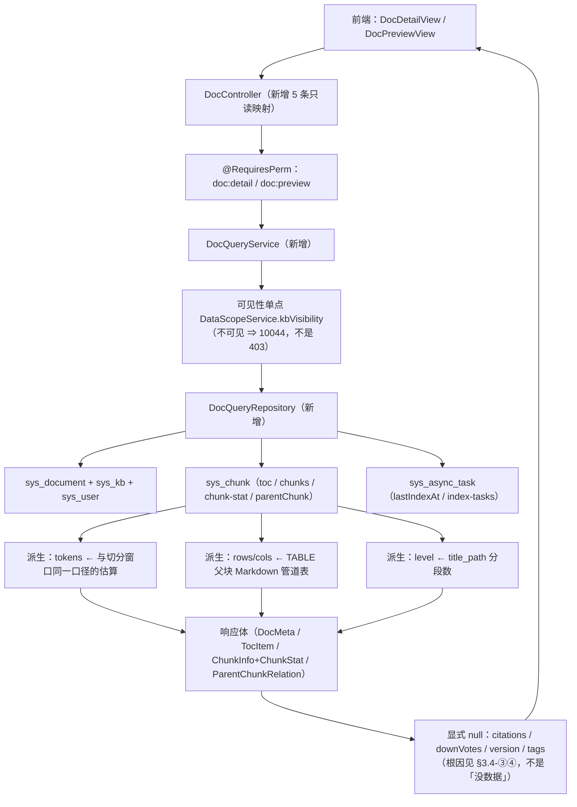

> 状态：🟡 进行中 · Sprint S7 · 阶段 A（M06 文档域首片：文档详情 / 预览页的只读后端）· 建档 2026-09-20

# 2026-09-20 · S7 · M06 · 阶段 A —— 文档详情页 + 预览页的只读后端（5 项）

> 任务：`T-600` / `T-602` / `T-603` / `T-604` / `T-605`（5 项）+ O 轨 `T-O21`
> 来源：`docs\进度\03-Sprint排期.md` § 排期总表（S7 · W17–W18 · 文档域补全 · 10 人天）
> 认领门禁：**`G7-1`（父子块可视化支撑）** · **`G7-2`（分片统计各项合计 = 总数）**
> 上游计划：`ai_knowledge_web\plan\2026-09-20-S8-M10-E.md`（S8 收口批；本批要销的账见第 1 节）

---

## 1. 开工条件检查

**依赖清单来源**（逐条注明出处，不许凭印象）：
`docs\进度\00-开工速览.md` §1（本批任务行）· `docs\进度\02-任务清单.md:307-330`（M06 段 17 行的「依赖」列）·
`ai_knowledge_web\plan\汇总.md` §3/§4（跨批遗留与挂起判据）· 上一批 `2026-09-20-S8-M10-E.md` §9（12 条遗留）·
环境实测（2026-09-20，docker / 端口 / 库计数）。

| # | 依赖项 | 档位 | 现状（代码/文档实证） | 结论 |
|---|---|---|---|---|
| 1 | `T-600` ← `T-510` 文档列表 | ✅ | `02-任务清单.md:300` 标 ✅（S4-M05-A）；`DocService#page` 已有 `KbDocRow` 投影，本批是它的超集 | 满足 |
| 2 | `T-602`/`T-603` ← `T-600` | ✅ | 同批内**顺序依赖**：先落读侧仓储，三个端点共用同一份 `sys_chunk` 投影 | 满足 |
| 3 | `T-604` ← `T-603` | ✅ | 同批内顺序；`parent_id` 已在 `sys_chunk`（`V14`）并由 `DocRecordWriter#insertChunk:392-402` 真实写入（顶层 `null`、子块指父） | 满足 |
| 4 | `T-605` ← `T-509` 索引任务状态 | ✅ | `02-任务清单.md:299` 标 ✅；底表 `sys_async_task`（`V17`）在，`DocService#taskView` 已读它 | 满足 |
| 5 | 底表与实体 | ✅ | `sys_document`（`V12` + 8 次加列）· `sys_chunk`（`V14`/`V19`/`V24`/`V29`/`V30`）· 实体 `SysDocument`/`SysChunk` 在，且 `ddl-auto: validate` 在启动期核结构 | 满足 |
| 6 | 前端页面与调用侧 | ✅ | 两个页面在：`views/doc/DocDetailView.vue`（788 行）· `DocPreviewView.vue`（959 行）；`api/index.ts:143-158` 的 `docApi` 已在调这 5 条；路由 `router/index.ts:43-44` | 满足 |
| 7 | 数据范围单点 | ✅ | `DataScopeService#kbVisibility`（`:108`，头注 `:83-88` 写明是 **I-7 的落点**）；便捷封装 `KbGrantService#visibleKbIds:223` | 满足 |
| 8 | 权限码 | ✅ | `PermissionCode.java:55-63` 已有 `doc:detail` / `doc:preview`（种子 `V2__seed_reference_data.sql:69-77`）⇒ **本批不需要新增权限码** | 满足 |
| 9 | 审计点 | ✅ | 本批 **5 条全只读** ⇒ **无新审计点，冻结清单仍 37**（权威在 `AuditCoverageFlowTest#expectedActions()`，不在 md 里） | 满足 |
| 10 | 🔴 `T-601` 属性修改 | ⛔ **BLOCKER → 已裁定移出本批** | 两半都不成立：① 「移动知识库触发重建」需要 `POST /doc/{id}/reindex` = **`T-610`（⬜，本批不在）**，全仓只有库级 `ReindexService#submit(kbId)`/`clearIndex(kbId)`，而移动库要换 Milvus 分区（分区名按 `kb{kbId}_g{代}`、标量 `kb_id` 烧在向量里）；② `I-6`「密级只能提高」是**文档级**不变量（`03-术语与领域模型.md:268`、`06:186`），而密级过滤是**库级**的（`RetrievalScope.java:46-50` 明文「密级是知识库的属性……检索时不重复过滤」，实际条件 `k.secret_level in (...)` 在 `:120-124`）⇒ 加列不接过滤 = **提高密级在检索上无效 = 越权可见**。**用户 2026-09-20 裁定：移出本批**（与 `T-610` + 密级贯通合成 `S7-M06-B`） | 已消解 |
| 11 | 🔴 `sys_chunk` **没有 `tokens` 列** | ⚠️ WARN（有现成口径） | `SysChunk` 全字段无 token 计数；但切分窗口本来就是按 token 量的：`ChunkingOptions#estimateTokens:62` → `IdentifierTokenizer#windowTokens`（`T-506` 交付，**同一口径**） | 派生，不加列 |
| 12 | 🔴 `citations` / `downVotes` **有列但恒 null** | ⚠️ WARN | `sys_retrieval_trace_chunk.cited`（`V22:150`）的写入方**写死 `null`**（`RetrievalTraceWriter.java:89-94`）—— 根因是引用角标 = `T-804`（未做） | 返回 `null`（见 §3.4-③） |
| 13 | 🔴 `version` / `tags` **连归属都没有** | ⚠️ WARN | 无 `sys_doc_version` 表、`sys_document` 无 `version` 列；文档级内容标签无表 —— `IndexEnhancer` 类 javadoc 自己写着「**标签至今没有归属表**」（`I-10` 三样里只有摘要落在 `SUMMARY` 块） | 本批**不加列**（见 §3.4-④） |
| 14 | 🔴 `ParentChunkRelation.parent.rows/cols` 无列 | ⚠️ WARN | 只能从 TABLE 父块的 `raw_content`（Markdown 管道表）解析；需求 §4.5 明写父块要显示「N 行 × M 列**全部返回**」并「超限时显示**实际返回行数**」（`06:544-546`） | 派生解析（见 §3.4-⑤） |
| 15 | 🔴 `ParentChunkRelation` **缺「全部子块」** | ⛔→⚠️ | **`G7-1` 原文要求「返回父块完整内容 + 全部子块」**（`03-Sprint排期.md:1202`），而现行契约 `{child, parent}`（`10:429`、`types/index.ts:756-759`）**表达不了"全部"** ⇒ 契约必须扩 | 本批扩契约（见 §3.1 步 5） |
| 16 | 🔴 预览页 `parentChunk(docId, 0)` 写死 `0` | ⚠️ WARN | `DocPreviewView.vue:113` 硬传 `parentId = 0`，而契约与实体都禁止 `0` 当哨兵（`SysChunk#parentId` javadoc「**禁用 `0` 当哨兵**」）⇒ **本批落地当天它就 404**。属"看着人畜无害，只因为它打的是 mock" | 本批必修 |
| 17 | 🔴 两个页面的 `onMounted` **都没有 `catch`** | ⚠️ WARN | `DocDetailView.vue:42-60` / `DocPreviewView.vue:99-117` 都是 `try { …并发请求… } finally { loading=false }`；且详情页是 `Promise.all([meta, versionList, indexTasks, chunkStat, kbList])` ⇒ **五个里任何一个失败 = 整页什么都不渲染**（`T-606` 版本列表未做，正是这一个） | 本批必修 |
| 18 | `lib/routes.mjs:45-46` 的 `/doc/1`、`/doc/1/preview` 标着 `mockData: true` | ⚠️ WARN | 那两条 `expect` 只在 mock 数据里成立，故 `console-check` 真后端模式**跳过 `expect` 但照样断言"挂载"**（`console-check.mjs:206-218`，且 `:216` 在数未捕获异常）。**本批落地后这两条会开始真调接口**（库里有 0 篇文档 ⇒ `10044`）⇒ 顺着第 17 条会**转红**。**转红是要的**，届时改成「不存在的 id ⇒ 页面给出可行动空态」 | 判据 §6+7-18 |
| 19 | 审计侧「7 条 planned 未落」 | ✅ 已核对 | `汇总.md:217` 那「7 条」是 S3-M03-A 时代旧数，此后 4 条已移入 `IMPLEMENTED`（`AuditRiskPolicy.java:133-143`/`:303-306` 有注明）⇒ **现在 `PLANNED` 只剩 3 条**（`:297-301`：下载文档/批量下载/删除文档），**且「文档属性修改」从来不在其中** | 不阻塞本批 |
| 20 | 门禁号存在性 | ✅ | `G7-1`~`G7-9` 已定义（`03-Sprint排期.md:1202-1210`）。本批认领 `G7-1`/`G7-2`；`G7-3`（I-6）/`G7-4`（移动库）随 `T-601` 移出；`G7-5`~`G7-9`（版本/下载）属 S7 后片 | 满足 |
| 21 | 环境 | ✅ | docker 六服务全 healthy · **8080 / 5174 / 5175 全空**（无孤儿 vite，`#226` 未再现）· 基线残留全 0（`sys_document` **0** / `sys_chunk` **0** / 会话族 0 / 两张汇总表 0 / `sys_qa_miss` 0）· 种子 `sys_user` **128** / `sys_kb` **8** 未动 | 满足 |
| 22 | 🔴 **库里 0 篇文档、0 个分片** | ⚠️ WARN | `sys_document`/`sys_chunk` 均为 0 ⇒ **本批所有判据都必须自造数据**（走「建库 → 上传 → 等 READY」），不能指望种子 | 见 §6+7 |

**BLOCKER 汇总**：**无**（唯一一条 `T-601` 的 BLOCKER 已由用户 2026-09-20 裁定「移出本批」消解，见 #10）。

**⚠️ 已知偏差**（不拒绝施工，第 9 节销账）：#11~#18、#22 共 9 条 —— 其中 #11~#14 是"字段没有出处"（本批用派生或诚实 `null` 处置），#15~#17 是**必须在本批修掉的契约/页面缺陷**，#18 是一条**已知会转红的闸**。

> 判据只有一条：**这条不满足，代码写下去会不会白写**。#10 满足它（移动库那半没有实现路径），故拒绝施工那一条任务、不拒绝整批。

### 结论

- [x] ✅ 可以开工（范围 = `T-600` / `T-602` / `T-603` / `T-604` / `T-605`，**5 项全只读**）
- [x] ⛔ 拒绝施工 `T-601` —— 原因与影响范围见 #10，处置 = **移交 `S7-M06-B`**（与 `T-610` 单篇重建 + 密级贯通同批）

---

## 2. 开工时间

| 项 | 值 |
|---|---|
| 建档 / 开工日 | 2026-09-20 |
| 预计投入 | **功能 4.8 人天**（Sprint 容量 ≈ 10 人天）+ **O 轨 1~1.5 人天** |
| 实际投入 | *回填时补* |

> ⚠️ **O 轨仍低于下限 4 人天（连续第十九批）**。本批 O 项 = `T-O21`（三个 E2E 脚本的「清理执行了没有」从日志改成断言）+ `e2e-chat-flow` 真 VL 超时 bisect（目前**唯一长期红的闸**）。两条同源，都是测试可靠性。
> ⚠️ 与前几批同一条口径问题：真正花在"基础设施性质"的工作（本批的契约扩充、`parentChunk` 语义、mock 与需求对齐）**不在 O 目录里，进不了这个账** ⇒ 这个口径第 **7** 次低估实际优化工时。

---

## 3. 开工内容

### 3.1 步骤

| 步 | 做什么（文件/类 → 动作 → 产出） | 依赖 | 可并行 |
|---|---|---|---|
| 1 | **读侧仓储** `core/doc/DocQueryRepository.java`（新建）→ 五条端点共用一份 `sys_document` + `sys_kb` + `sys_user` 投影；文档可见性**复用 `DataScopeService#kbVisibility` / `KbGrantService#visibleKbIds`**（不另写 SQL）；文档不存在 → `DOC_NOT_FOUND(10044)`（`ErrorCode.java:115`） | — | — |
| 2 | **`T-600`** `GET /api/doc/{id}` → `DocDtos.DocMetaView`：`DocInfo` 那 13 个字段 + `fileDesc`（按 `type` + `pages_with_text` 派生）/`department`/`md5`/`storagePath`/`tableTotal`/`tableParsed`/`imageTotal`/`imageParsed`/`lastIndexAt`（`sys_async_task` 按 `doc_id` 取 `max(finished_at)`）/`kbSecurityLevel`；`citations`/`downVotes`/`version`/`tags` 按 §3.4 给 `null` | 步 1 | 与步 6 并行 |
| 3 | **`T-602`** `GET /api/doc/{id}/toc` → `sys_chunk where chunk_type='HEADING' order by order_no`；`id = String(chunk.id)`、`label = raw_content`、`level = title_path 按 " > " 分段数`（**复用 `ChunkingService.TITLE_PATH_SEPARATOR`**，不另写字面量） | 步 1 | — |
| 4 | **`T-603`** `GET /api/doc/{id}/chunks` + `/chunk-stat`：`type ∈ {all, text, table, image, summary}` 闭集；`total` = **顶层块数**（`parent_id is null`，与 `sys_document.chunk_count` 同源）；四桶互斥且完备 ⇒ **`G7-2` 由构造保证**；`tokens = ChunkingOptions#estimateTokens(raw_content)`；`avgTokens` / `titlePathCoverage` 分母**与 `total` 同源**（§3.4-②） | 步 1 | 独立 |
| 5 | **`T-604`** `GET /api/doc/{id}/chunks/{parentId}` → **扩契约**为 `{ parent, children[], child, total }`（`G7-1` 要求"全部子块"）；`parent.rows/cols` 从 Markdown 管道表解析、`returnedRows` = 本次**实际返回行数**；`parentId` 指向非 `TABLE` 块 / 不存在 / **`= 0`** 一律明确错（**不返回空对象**） | 步 4 | — |
| 6 | **`T-605`** `GET /api/doc/{id}/index-tasks` → `sys_async_task where doc_id=? and type='doc-parse' order by created_at desc`；`durationSec` 由 `finished_at - locked_at` 派生；**无 `version` 字段的来源**（同 §3.4-④） | 步 1 | 与步 2 并行 |
| 7 | **前端修复（必修，非可选）**：① `DocPreviewView.vue:113` 的 `parentChunk(docId, 0)` 改成"按选中的 TABLE 块取其真实 `parentId`"，`parentId` 为 `null` 时不发请求；② 两个页面的 `onMounted` 加 `catch` + **按端点降级**（不存在的文档 / 未实现端点 ⇒ 可行动空态，不让整页陪葬）；③ `ParentChunkRelation` 类型按步 5 扩；④ `DocMeta` 的 4 个可空字段类型放宽（`\| null`）并在页面上渲染成「—」/说明 | 步 2~6 | — |
| 8 | **mock 对齐需求**：`mock/index.ts:1559-1563` 的 `blockGroup()` **缺 `image` 分支**（IMAGE 现落进 `text`），而需求 chips 有「图片」档（`06:515`）⇒ 补分支（页面侧的 `BLOCK_META` 本来就是对的，是 mock 落后了） | — | 独立 |
| 9 | **新页面级 E2E** `ai_knowledge_app/scripts/e2e-doc-detail.mjs`：建探针库 → 上传含**表格 + 图片 + 摘要**的真文件 → 等 READY → 五端点逐条对账 → 两个页面逐块对账 → **不存在的 id 走空态** → 自清残留 0 行 | 步 2~8 | — |
| 10 | **探针产物登记**：本批不新增产物种类（探针库/文档/分片/Milvus 分区与向量/MinIO 对象都在 `probe-teardown.mjs` 的既有登记里）⇒ **覆盖率闸应当保持绿**；若红则说明第 9 步漏了登记 | 步 9 | — |
| 11 | **O 轨 A**：`T-O21` 立号 + 三个 E2E 脚本（`e2e-ops-miss-flow`/`e2e-ops-qa-stats`/`e2e-ops-replay-flow`）的**清理守卫结果从"打印"改成"断言"**（照 `e2e-ops-usage-flow` 的做法：按精确 id 数残留并断言为 0） | — | 全程并行 |
| 12 | **O 轨 B**：`e2e-chat-flow` 的真 VL `InterruptedIOException: timeout` **bisect**（唯一长期红的闸）——先定位是模型侧超时还是本仓超时配置，再决定"修"或"登记为环境约束" | — | 全程并行 |

### 3.2 业务流程图

> 触发条件核对：① 跨 ≥3 个组件（Controller → Service → 两个数据源 + 派生）✅ ② 异步/事务边界 ✗（本批全只读）
> ③ 状态机 ✗ ④ 并发/幂等 ✗。**①满足故画**；其余三条在图上体现为"没有分支"。



### 3.3 明确不做（范围控制）

| 不做的事 | 原因 | 归属批次 |
|---|---|---|
| `T-601` 属性修改（密级 / 移动知识库 / 标签写入） | 两半都缺前置：移动库要单篇重建、密级要改检索过滤（假安全更糟）—— 见 §1 #10 | **`S7-M06-B`**（与 `T-610` + 密级贯通同批） |
| `T-606` 版本列表 / `T-607` 版本对比 / `T-608` 版本回滚 | 版本机制**整块不存在**（无表、无列、上传不归档）⇒ 不是本批能"顺手"的 | S7 后片 |
| `T-609` `GET /doc/{id}/tags` | 文档级内容标签**没有归属表**（`IndexEnhancer` javadoc 已留痕）⇒ 先裁定表结构 | 与「标签归属」裁定同批 |
| `T-610` 单篇重建 / `T-611` 删除 / `T-612` 跨库列表 / `T-613` 预览地址 / `T-614`+`T-615` 下载 / `T-616` 回收站 | 各自带高危 / 异步 / 定时器 | S7 后片 |
| `T-804` 引用溯源到分片 | **依赖正好落在本批**（`T-603`/`T-604`）⇒ **下一批**做，本批不动它 | `S7-M06-B` |
| `T-806` `useVision` ↔ `usedVision` 配对 | 与 M06 无关（问答侧）；堵点 `T-904` 已在 `S6-B` 交付，已解封 | 下一批（与 `T-804` 同批） |
| 预览页中栏**硬编码的"原文"段落**（`DocPreviewView.vue:49-61`，`v-for="p in paragraphs"`） | 它的正主是**预览地址 / PDF 渲染**（`T-613` + 需求 §4.8 的 `pdfjs-dist`）⇒ 本批只把它**如实标注为演示区**，不假装它来自后端 | `T-613` 那批 |
| 检索侧密级过滤改造（`RetrievalScope` 库级 → 文档级取上界） | 跨 M06/M07；改它会牵动 Milvus 标量语义与既有分区 | `S7-M06-B` |

### 3.4 本批假设

> 信息不足下拍的决策。**假设被证伪 → 进第 9 节遗留**，否则没人知道当初赌了什么。

| # | 假设 | 若被证伪的后果 |
|---|---|---|
| ① | **`tokens` 的口径 = `ChunkingOptions#estimateTokens(raw_content)`**（`IdentifierTokenizer#windowTokens`，与切分窗口**同一口径**），**不加列** | 若日后要求"与嵌入模型 tokenizer 逐位一致" ⇒ 本字段口径要换（但那个口径本仓**无从复现**，`ChunkingOptions` javadoc 已写明），届时是**全站分片窗口**一起换，不是本字段单独换 |
| ② | **`titlePathCoverage` 与 `avgTokens` 的分母都与 `total` 同源（顶层块）**：覆盖率 = `title_path` 非空的顶层块 ÷ 顶层块总数；`avgTokens` = Σ顶层块 tokens ÷ 顶层块数。理由：表格子块**继承父块的 `title_path`**（`ChunkingService#appendTable` 父子传同一个 `titlePath`）⇒ 把它算进去会让一篇 1 个表格的文档"覆盖率虚高"，而分母与 `total` 不同源会让两个数说的不是一批行 | 需求方若另有定义 ⇒ 改分母即可（口径落在一个方法里） |
| ③ | **`citations` 与 `downVotes` 都返回 `null`（= 未采集），不返回 `0`**。根因单一：`sys_retrieval_trace_chunk.cited` **恒写 `null`**（`RetrievalTraceWriter.java:89-94`），而"哪些块真被答案引用了"正是 `T-804` 要采的东西。**返回 `0` 会说"这篇从没被引用过"—— 而真相是"从没采过"**（`D-2`：打点后补 = 数据永久缺失） | 若要求先给个数 ⇒ 只能退化成"被召回次数"这种**换口径**，那要显式改名（不能叫"被引用"） |
| ④ | **`version` 与 `tags` 返回 `null`（= 未落库），且本批不加列**。理由：两者都是"**加了列却没人写**"的形态（本仓已有 `cited` 恒 null、`has_macro` 没消费方两条前例），而它们的正确形状都还没定：版本大概率是一张**版本表**（`T-608` 回滚要对历史版本重新向量化，一列 `version` 表达不了），标签的归属表连需求都只给了「MySQL 关联表」的泛化约束（`I-9`，`03:271`） | 若判定"先加列后补" ⇒ 那两列会进入"有列无写者"名单，需要在 §9 显式登记 |
| ⑤ | **`ParentChunkRelation.parent.returnedRows` = 本次实际返回行数**，`rows` = 表总行数；**详情页/预览页按 `KB.tablePolicy.rowLimit` 截断**，截断时 `returnedRows < rows` 如实体现（需求 §4.5 `06:544-546`：「超限时返回的是命中行 ± 窗口，此处应显示**实际返回行数**而非全表」） | 若判定详情页应**全量**不受 `rowLimit` 约束 ⇒ 改成 `returnedRows == rows` 恒等，但那样这一列就没信息了（而需求专门要求它） |
| ⑥ | **`toc.id` = `String(sys_chunk.id)`**（真 id），**不是** mock 那种层级引用串（`'h3'`/`'h2-1'`）。理由：`TocItem.id` 的类型是 `string`（`types/index.ts:763`）；而前端的 `selectToc` 必须能**滚到那个标题块**（`DocPreviewView.vue:129-132` 现在拿 `item.id === 'h3'` 这种魔法值硬判，本批要改成按真 id 定位） | 若要求保留层级引用串 ⇒ 前端仍无法定位到具体块，`toc` 与"联动交互"（需求 §4.6）就永远是两套 id |
| ⑦ | **`type` 的闭集 = `{all, text, table, image, summary}`**（对齐需求 chips `06:515`）；`HYPOTHESIS_QA` 归「正文」组（8 种 blockType → 4 展示分组，`06:508-513` 的原文只列了 PARAGRAPH/HEADING/CODE/LIST 归正文，HyQ 是第 8 种、需求没单独给组）⇒ 归 text | 若 HyQ 要单独一档 ⇒ 增一个 chip + 一个 `ChunkStat` 字段（`G7-2` 的合计式要同步改） |
| ⑧ | **`IndexTask.date` / `IndexTask.version`**：`date` ← `created_at`；`version` **无来源**（只有 `sys_document.parse_version`，那是**解析器指纹**、`V20` 的注释明说"≠文档版本"）⇒ 给 `null` | 若要求"索引时的解析器版本" ⇒ 那是 `parse_version` 的语义，要改名（叫 `parseVersion`）而不是复用 `version` |

---

## 4. 数据变更清单

| 类型 | 内容 | 回滚方式 |
|---|---|---|
| 新建表 / 改表 | **无** —— 本批不加列、不改表、不动索引 | — |
| 迁移文件 | **无**（`V36` 仍是最大编号；本批不产生 `V37`） | — |
| 种子数据 | **无**（`sys_user` 128 / `sys_kb` 8 不动） | — |
| NULL 分支 | **本条是本批的重点**：新增的 4 个显式 `null`（`citations`/`downVotes`/`version`/`tags`）**不是"演示数据为空"**，而是"该维度**从未被采集/落库**"—— 与 `KbDocRow` 的 `scan_status = null`（早于能力上线）同一族。它们**不随数据补齐而自动填上**，只能等 `T-804`（采集）与"版本/标签归属"（落库）落地 | — |

> 跑过的迁移**只增不改**。本批**没有**迁移，故不存在这条风险 —— 这也是选择"只读片"的直接收益。
>
> ⚠️ **接口契约差异（本批新增，回填时进 `docs\需求文档\13-接口变更记录.md`）**：
> 1. `DocMeta.citations` / `downVotes` / `version` → 允许 `null`（原为必填数字/字符串）；
> 2. `DocMeta.tags` → 允许 `null`（`null` = 未落库，**不是**"没有标签"）；
> 3. `ChunkStat.avgTokens` → 空文档时 `null`（原为 `number`）；
> 4. `ParentChunkRelation` → **扩为** `{ parent, children[], child, total }`（`G7-1` 要求"全部子块"，原契约只有一个 `child`）；
> 5. `TocItem.id` → 语义明确为**分片 id 的字符串形式**（原 mock 是层级引用串）。

---

## 5. 依赖与工具决策

**默认不引**。

| 方案 | 做法 | 代价 | 结论 |
|---|---|---|---|
| **不引依赖（既有栈）** | ① Markdown 管道表解析**手写**（`\|` 分列 + 跳过分隔行 + 处理转义）：需要的信息只有**行数/列数**，不需要通用 Markdown AST；② token 估算走**已有的** `ChunkingOptions#estimateTokens`；③ SQL 走既有 `EntityManager` 原生查询（与 `DocService#page` 同一形态） | 手写解析对**异常表**（单元格里有 `\|`、缺失的列）要显式处理 —— 但这类输入本来就该**如实反映**（行×列对不上时宁可少报一行也不猜） | ✅ **采用** |
| 候选 A：引入 Markdown 解析库（`commonmark-java`） | 用 AST 数表格行列 | 多一个依赖 + 一次全量解析；而本仓对"表格"的事实源是**已落库的 `raw_content`**，不是 Markdown 语义 | ❌ 不引 |
| 候选 B：给 `sys_chunk` 加 `rows/cols/tokens` 列 | 写入时算好存起来 | 加列会进入"有列无写者"风险（本批是**只读批**，不该由读侧去改写入侧）；且 `tokens` 是 `raw_content` 的**纯函数**，存下来会多一份可能与内容不一致的副本 | ❌ 不引 |

**推荐**：**不引依赖**。· **理由**：本批要的三样派生量（token 数、表格行列、标题层级）**都已有单一事实源**（`ChunkingOptions`、`raw_content`、`title_path`），任何新依赖或新列都会**在事实之外再造一份视图** —— 而本仓已为此吃过两次（`is_boilerplate` 与 `is_decorative` 宁可分两列也不合并，正因为它俩的判据不同）。

> 无新依赖。

---

## 6 + 7. 验收方法与标准

| # | 判据（对齐门禁号） | 验收方法（可直接粘的命令/脚本） | 期望结果 | 证据落点 |
|---|---|---|---|---|
| 1 | **`G7-2`** 分片统计各项合计 = 总数 | `node ai_knowledge_app/scripts/e2e-doc-detail.mjs --base=http://127.0.0.1:5174` | `text + table + image + summary == total`；且 `total == sys_document.chunk_count == count(sys_chunk where parent_id is null)` | 脚本断言 + `sys_chunk` 直查 |
| 2 | `total` **不含表格子块**；`tableSubBlocks` 单列且 = `count(parent_id is not null)` | 同上（同一份探针文档含 1 张多行表） | 子块**不进任何桶**、也不进 `total` | 脚本断言 |
| 3 | `type` 五档**互斥且完备** | 同上 | 五档 `list` 两两无交集；五档并集逐条等于 `/chunks`（不带 type）；每档的 `blockType` 全属该组 | 脚本断言 |
| 4 | **`G7-1`** 父块完整内容 + **全部子块** | 同上 | `children.length == childrenCount == count(sys_chunk where parent_id = 该父块)`；每条 `children[i].content` 与 DB `raw_content` 逐字相等 | 脚本断言 + DB 对账 |
| 5 | `parent.rows/cols` 与 `returnedRows` | 同上 | `rows/cols` 与 Markdown 管道表**逐格可复算**；`returnedRows` = 本次实际返回行数 | 脚本断言 |
| 6 | 非法 `parentId`（非 TABLE / 不存在） | 同上（直连后端打三条） | 明确业务错（**不是**空对象、不是 500） | 脚本断言 |
| 7 | **`parentId = 0` 必须被拒** | 同上 | 明确业务错 —— 「**禁用 `0` 当哨兵**」的口径**在接口层也成立** | 脚本断言 |
| 8 | `titlePathCoverage` 的分母 = 顶层块 | 同上（探针文档含"封面段无标题"） | 覆盖率 < 100%，且等于**手算值**（非空 `title_path` 的顶层块 ÷ 顶层块数） | 脚本断言 |
| 9 | `avgTokens` 分母与 `total` 同源；**空文档 ⇒ `null`** | 同上 + 后端用例（0 分片文档） | `avgTokens` 与 `total` 分母一致；0 块时是 `null`（**不是 0**） | 后端用例 |
| 10 | `tokens` 与切分窗口**同一口径** | 后端用例：对一段已知文本比对 `ChunkingOptions#estimateTokens` | 逐位相等；注释里写明**不是**嵌入模型 tokenizer | 后端用例 |
| 11 | `toc`：条数 = HEADING 块数；`level` = `title_path` 分段数；`id` = `String(chunk.id)`；`label` = 标题文本 | 同上 | 逐条与 `sys_chunk where chunk_type='HEADING' order by order_no` 相等 | 脚本断言 |
| 12 | `DocMeta` 逐字段与三张表对账 | 同上 | `kbName`/`department`/`owner`/`md5`/`storagePath`/`tableTotal`/`tableParsed`/`imageTotal`/`imageParsed`/`pageCount`/`chunkCount` **逐个等于 DB 值** | 脚本断言 |
| 13 | **`citations`/`downVotes`/`version`/`tags` 恒 `null` 且根因可证** | 同上（含直查 `select count(*) from sys_retrieval_trace_chunk where cited is not null`） | 四个字段全 `null`；**且** `cited` 非空行数 = **0**（证明根因是"未采集"而非"真没被引用"） | 脚本断言 + DB |
| 14 | 不可见库的文档 → `10044` | 后端用例：构造一个无该库授权的 `LoginUser` | 返回 `10044`（**不是** 403、更不是返回数据）；可证伪：改成只按 id 查 ⇒ 当场返回别人的文档 | 后端用例 |
| 15 | 权限码分别守位 | 后端用例（同一 token 组合打五条） | `doc:detail` 守 `/doc/{id}` 与 `/doc/{id}/index-tasks`；`doc:preview` 守 `/toc`/`/chunks`/`/chunk-stat`/`/chunks/{parentId}`；缺码时 403 且**不泄露字段** | 后端用例 |
| 16 | **读路径不写库** | 后端用例：跑五条前后比 `sys_document.updated_at` 与 `sys_chunk` 行数 | 前后**逐位不变**（只读语义；可证伪：任何写操作都会改 `updated_at`） | 后端用例 |
| 17 | 页面级：两页数据**全部来自真接口** | `node ai_knowledge_app/scripts/e2e-doc-detail.mjs --base=http://127.0.0.1:5174` | 抓 `Network.responseReceived`：五条 `/api/doc/*` 均为 200 且带 `x-trace-id`（证明真后端）；页面上分片卡片数/目录条数/统计数与接口逐位相等 | 新 E2E（**自清残留 0 行**） |
| 18 | 🔴 **不存在的文档 id ⇒ 可行动空态** | 同上（第 9 步走 `/doc/999999`） | 页面给出**可行动空态**（点明"文档不存在"），**无未捕获异常** —— 这一条正是 `console-check` 真后端模式那两条**会转红**的地方（`lib/routes.mjs:45-46` 的 `mockData` 标记 + `console-check.mjs:206-218`） | 新 E2E + `console-check`（真后端模式） |
| 19 | **审计冻结清单仍 37** | `mvn -B -f F:/work/code/ai-knowledge/ai_knowledge_web/pom.xml test -Dtest=AuditCoverageFlowTest` | 全绿（本批 5 条全只读 ⇒ 无新审计点） | 该用例 |
| 20 | 后端测试基线 | `export JAVA_HOME='F:/work/dev_tools/jdk/jdk-25.0.4.1'` + `mvn -B -f F:/work/code/ai-knowledge/ai_knowledge_web/pom.xml test` | 上批 **757 / 0 红 / 2 跳过** → 本批 **757 + M / 0 红 / 2 跳过**（M = 新增用例数） | 全量跑批日志 |
| 21 | 覆盖率闸 + 残留自检 | `node ai_knowledge_app/scripts/selftest-residue.mjs` | 全绿；本批**不新增产物种类** ⇒ 覆盖率闸应保持绿 | 该脚本 |
| 22 | O 轨 A：清理守卫**从日志变断言** | 跑三个改过的 E2E，并**故意把守卫换回旧写法**看它是否转红 | 旧写法下**必须红**（可证伪）；新写法下按精确 id 数残留并断言 0 | 三个 E2E |
| 23 | O 轨 B：`e2e-chat-flow` 超时定位 | `node ai_knowledge_app/scripts/e2e-chat-flow.mjs` + 后端日志 | 给出结论：模型侧超时 or 本仓超时配置；**要么修好要么登记为环境约束**（不许"还在超时"含糊过去） | 该脚本 + 日志 |

**观察项**（不计成败，页面写死的展示值登记在此）：
- `DocPreviewView.vue` 中栏的"原文"段落流（`:49-61` 的 `paragraphs`/`paragraphText`）—— **本批只把它标注为演示区**，它不来自后端（正主是 `T-613` 预览地址）。⚠️ 标注必须让用户**看得见**，不能只是注释。
- `DocPreviewView.vue` 的 `pageCount`/`currentPage`（页码翻页）依赖 `T-613` 的 PDF 渲染。

**种子核对**（跑完必做）：

```bash
set -a && . ai_knowledge_web/.env && set +a
docker exec kb-mysql mysql -u"$MYSQL_USERNAME" -p"$MYSQL_PASSWORD" "$MYSQL_DATABASE" -N -e "select count(*) from sys_user where deleted_at is null;"
```

> 另需核**第二族**（会话/打点/消息）与**第三族**（`sys_ops_retrieval_daily` / `sys_ops_usage_daily`）—— 本批不写它们，但**基线残留必须是 0**（开工实测：全 0 ✅）。
> `sys_qa_miss` 是唯一一张"非探针产物"的表，**不能要求它为 0**。

---
---

# 以下为开工后回填

> **提交节奏（两次）**：1~7 节写完即提交一次（`docs(plan): <批次> 开工计划`）；
> 8~10 节写完再提交一次（`docs(plan): <批次> 验收回填`）。让 git log 上「计划 → 结果」成对可查。

## 8. 验收结果

| # | 判据 | 实测结果 | 证据（命令 / 文件:行 / 测试名） |
|---|---|---|---|

**测试基线**：`Tests run: N, Failures: 0, Errors: 0, Skipped: 0`（上批 757 → 本批 M）

> 失败就照实写失败，不许改成"部分通过"。

---

## 9. 遗留问题

| # | 项 | 原因 | 归属批次 | 是否有判定点/注释留在代码里 |
|---|---|---|---|---|

---

## 10. 建议

- 对下批的排期 / 口径 / 风险建议。没有写「无」。

---

## 附：本批同步的文档回填

- [ ] **`docs/进度/00-开工速览.md` §1/§2/§3/§4** → 当前定位 / 本批任务行 / 门禁现状 / 缺口账（**必改**，它是下一批的唯一入口）
- [ ] `docs/进度/02-任务清单.md` → `T-600`/`T-602`/`T-603`/`T-604`/`T-605` 置 ✅（**`T-601` 不动** —— 它没做）
- [ ] `docs/进度/03-Sprint排期.md` → 「交付状态」段 + `G7-1`/`G7-2` 标已取证、`G7-3`~`G7-9` 标挂起
- [ ] `docs/进度/README.md` → 看板状态 + 完成日期（**备注只写一行短结论 + 指针**；长备注追加到 `docs/进度/变更记录/02-Sprint交付台账.md`）
- [ ] `docs/进度/变更记录/01-变更记录.md` → 追加一行（日期 · Sprint · 变更 · 交付物 · 遗留）
- [ ] `docs/需求文档/13-接口变更记录.md` → **本批有 5 条契约差异**（§4 那五条）必须逐条登记
- [ ] `docs/需求文档/10-接口约定汇总.md` → §14 的 `DocMeta`/`ChunkStat`/`TocItem`/`ParentChunkRelation` 四行按差异更新
- [ ] `ai_knowledge_web/plan/优化/README.md` → `T-O21` 状态行 + 配额账
- [ ] `.workbuddy/memory/2026-09-20.md` → 交接
