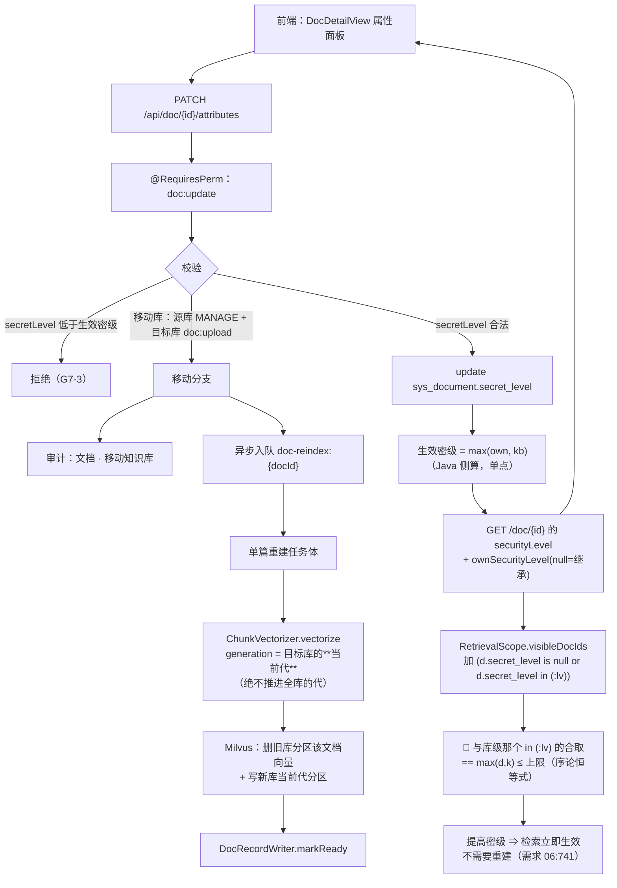

> 状态：✅ 已完成 · Sprint S7 · 阶段 B（M06 写侧首片：密级贯通 + 属性修改 + 单篇重建）· 建档 2026-09-20

# 2026-09-20 · S7 · M06 · 阶段 B —— 密级贯通 + 属性修改 + 单篇重建（3 项）

> 任务：**密级贯通**（`I-6` 的文档级落地）+ `T-601`（属性修改）+ `T-610`（单篇重建）+ O 轨 `T-O22` / `T-O23` / `T-O06` 判据 3
> 来源：`docs\进度\03-Sprint排期.md` §Sprint 7（`:1189-1224`）· 上一批 `2026-09-20-S7-M06-A.md` §9-①/§10
> 认领门禁：**`G7-3`（`I-6` 密级只能提高）** · **`G7-4`（移动知识库触发重建 + 审计留痕）**
> 上游计划：`ai_knowledge_web\plan\2026-09-20-S7-M06-A.md`（本批是它 §9-① 与 §10 的直接落地）
> ⚠️ **范围由用户 2026-09-20 裁定**：账上记的 5 项**拆成两批** —— 本批 3 项；`T-804` + `T-806` 顺延 `S7-M06-C`（理由见 #1）。

---

## 1. 开工条件检查

**依赖清单来源**（逐条注明出处，不许凭印象）：
`docs\进度\00-开工速览.md` §1/§2/§4 · `docs\进度\02-任务清单.md:311-360`（M06 段）· `docs\进度\03-Sprint排期.md:1189-1224`（S7 门禁表）·
`ai_knowledge_web\plan\汇总.md` §3（#206）§4（`G7-3`/`G7-4` 行）· 上一批 `2026-09-20-S7-M06-A.md` §9/§10 ·
**代码实证**（`RetrievalScope` / `ReindexService` / `ChunkVectorizer` / `PermissionCode` / `AuditRiskPolicy` / 迁移全文）· 环境实测（2026-09-20）。

| # | 依赖项 | 档位 | 现状（代码/文档实证） | 结论 |
|---|---|---|---|---|
| 1 | 🔴 **账上「五项必须同批」** | ⛔→✅ **已裁定拆批** | `S7-M06-A` §10 记「五项必须同批」，但它给的理由只覆盖前三项（`T-601` 的两半分别依赖 `T-610` 与密级过滤）。后两项（`T-804`/`T-806`）**与前三项零依赖**，却各自卡在"有没有对象"上：`T-804` 要新造 prompt 角标（见 #21）、`T-806` 要先探针「本机有没有真能收 `image_url` 的对话模型」（探针可能**否掉**功能本身）。**用户 2026-09-20 裁定：拆** —— 本批 3 项，`T-804`+`T-806` → `S7-M06-C` | 已消解 |
| 2 | 🔴 **密级过滤的落点比账上以为的小得多** | ✅ | 账上 §10 写它「要改 M07 的检索过滤」。实测：`RetrievalScope#visibleDocIds:192-215` **已经存在**（`I-9` 早就要求「MySQL 侧算可见范围 → `doc_id` 标量过滤」，还带 `MAX_DOC_FILTER = 4096` 上限 `:70` 与退化路径 `allowsDoc:259-261`）⇒ 密级只需给它**多一个条件**。且**不需要动 Milvus 标量**（类注释 `:46-50` 那条理由仍成立）⇒ **提高密级立即生效、不需重建**，与需求 `06:741`「属性修改后立即生效，无需重建索引」**相容** | 满足 |
| 3 | 🔴 **`sys_document` 没有密级列** | ⚠️ WARN（有事实依据的回填） | 全仓 `secret_level`/`secretLevel` 搜遍（V1~V36 迁移 / Java / ts/vue / mock / scripts）**无 `sys_document.secret_level`**。文档「密级」唯一出口是 `DocDetailService.meta`，读的是 `k.secret_level`（`:95/113/120/126`），且 `:118-119` 注释自己写着「I-6 的落地（文档级密级列）属 `S7-M06-B` ⇒ 当前生效密级 == 库级」 | 本批加列（见 §3.4-①） |
| 4 | 🔴 **库密级可改，而 `I-6` 是「文档 ≥ 库」** | ⚠️→✅ **已裁定** | `I-6` 原文「文档密级**只能提高，不能低于**其所属知识库的密级」（`03-术语与领域模型.md:268`、`06:186`），而**库密级是可改的**（`KbService` 建库 `:247` / 改库 `:392/402`）⇒ 库从「内部」提到「机密」而文档还是「内部」，文档密级就**低于**库密级 ⇒ 违反 `I-6` ⇒ 检索上仍可见 ⇒ **越权**。需求**没写这个方向**。**用户 2026-09-20 裁定：检索取两者较大值**（依据：需求 `06:711` 自己要求下拉标注「内部（**继承知识库**）」，即承认文档密级是继承来的） | 已消解（见 §3.4-②） |
| 5 | `T-610` 的权限码 | ✅ | `PermissionCode.java:60` **`DOC_REINDEX("doc:reindex", "重建索引")` 已存在** ⇒ **不需要新码** | 满足 |
| 6 | `T-601` 的权限码 | ⚠️ WARN **需新码** | `PermissionCode.java:55-63` 七个 doc 码（`upload`/`preview`/`download`/`detail`/`delete`/`reindex`/`version`/`recycle`）里**没有"改属性"**；需求权限矩阵（`05:52`）也没有这个点 ⇒ **新增第 44 个码** `doc:update`（"修改文档属性"） | 本批加码（`V37`） |
| 7 | 审计点 | ⚠️ WARN **两条新点** | `AuditRiskPolicy`：**「重建索引」与「移动知识库」都不在**（`IMPLEMENTED` 无；`PLANNED:296-307` 只剩 下载文档/批量下载/删除文档）⇒ 而需求 `05:367` **逐字列着**这两条（「文档 \| 上传、下载、删除、重建索引、移动知识库」）⇒ 照 `S8-M10-C` 的判例（`DATA_EXPORT` 里逐字列着「导出报表」⇒ 口径要求，不是判断题），**两条都要加** ⇒ **冻结清单 37 → 39** | 本批加（见 §4） |
| 8 | ⚠️「修改属性/修改密级」**不在**需求审计动作表 | ⚠️ WARN（**不自己发明**） | `05:367` 只列 上传/下载/删除/重建索引/移动知识库 ⇒ 改密级/改标签**不记审计**。照 `S7-M06-A` §1-#19 的判例（「且『文档属性修改』从来不在其中」）**不加**，登记为建议 | 见 §9 |
| 9 | `T-610` 的复用能力 | ✅ | `ChunkVectorizer#vectorize(docId, kbId, generation, chunks, guard):69-70`（内部 `partition = partitionName(kbId, generation)` + `guard.verify()` 后 `writer.replaceDocument`）+ `MilvusChunkWriter#replaceDocument(partition, docId, records):89-104`（自带 `partitionManager.ensure` + 按 `doc_id` 删后插）都是现成的 | 满足 |
| 10 | 🔴 **单篇重建与「代」的关系** | ⚠️ WARN **设计点** | 整库重建是「**写新代 → 切代**」（`ReindexService#reindex:126-197`，`:194` 原子切换）。**单篇重建绝不能推进全库的 `generation`** —— 那会让**全库其余文档**一夜之间变成"旧代"（`docsToVectorize:208-219` 按 `index_generation <> 当前代` 筛选）。⇒ 单篇重建必须**用「该文档所属库的当前代」**重写它自己 | 见 §3.1 步 3 |
| 11 | 幂等（同一文档不重复起任务） | ✅ | `ParseWorker#enqueue:187-192` 的范式：幂等键 `doc-parse:{docId}` + `findActiveByIdempotencyKey` 只认 PENDING/RUNNING ⇒ 单篇重建照此给 `doc-reindex:{docId}` | 满足 |
| 12 | 文档状态机 | ✅ | `DocStatus`（`UPLOADED/PARSING/INDEXING/READY/FAILED`）· `canReindex()` = `READY \|\| FAILED`（`:35-37`）· `TERMINAL = {READY, FAILED}` · `MARKREADY 只在 allowsReady()` 时写（`DocParseService:274-284`） | 满足 |
| 13 | 🔴 **移动知识库的物理代价** | ⚠️ WARN | 分区名是 `kb{kbId}_g{代}`（`MilvusConstants.partitionName`）、标量 `kb_id` **烧在向量里**（`MilvusChunkWriter:163`）⇒ 移动库 = **删旧库分区里的该文档向量 + 写新库当前代分区** —— 正好是 #10 的能力 + 一次跨库 | 见 §3.1 步 4 |
| 14 | `tags` 没有归属表 | ⚠️ WARN（承 M06-A §9-④） | `PATCH` 的 body 三字段（`06:748` `{ secretLevel, kbId, tags[] }`）里 **`tags` 没有任何归属表**（`IndexEnhancer` javadoc 自己写着）⇒ 照 M06-A 的判例**本批不加表**：`tags` **明确回"本版本不支持"**，**不假装存了** | 见 §3.3 |
| 15 | `kbId` 移动的授权前置 | ⚠️ WARN（需求未写） | 移动要**同时**对**源库**与**目标库**有权限（源库 `MANAGE`、目标库 `doc:upload`）—— 需求只写了「移动后需重建索引」（`06:709-713`），**授权口径空白** | 见 §3.4-③ |
| 16 | 前端写侧 | ⚠️ WARN | 上一批**删掉了**写侧：`DocDetailView.vue:111` 的 `ATTR_SAVE_BLOCKED_REASON`（"本版本不支持修改文档属性…"）与 `:160-162` 被删的 `saveAttr()`；`api/index.ts:171-172` 的 `saveAttributes` 声明**仍在**（mock `mock/index.ts:1611-1620` 也有）⇒ 本批要**恢复写侧**并把那段"作废说明"删掉 | 见 §3.1 步 6 |
| 17 | 🔴 **基线有残留**（本批开工实测） | ⚠️ WARN **先清** | `sys_chat_session` **1**（id 1845 · `21:29:35`）+ `sys_chat_message` **2** + `sys_retrieval_trace` **1**（1588 · `21:29:36`）+ `sys_retrieval_trace_chunk` **5**（`doc_id = 999007443`，而 `sys_document`/`sys_chunk` **均为 0**）⇒ 形状是一次问答，时间是**上一批 O 轨的证伪实验**（`ec75ded` 21:33 之前），而**回填（21:37）之后它仍在** ⇒ 印证 `S7-M06-A` §9-⑧ 那条未解限制：**水位线只保护本轮造的，前一轮的残留不会被它清掉** | 先清 + 立 `T-O23` |
| 18 | 🔴 **上一批漏改了唯一入口**（git 证实） | ⛔→✅ **本批先补** | `docs\进度\00-开工速览.md` 在 `7d9c341..cc3bab9` 的 **12 个提交里一次都没出现**，而计划 §10 把它勾成 `[x]`；其余 **9 处逐项 `git log` 核对全部改过** ⇒ 后果**很实**：速览至今写着「当前定位 = `S8-M10-E`」，**本批开工读到的定位就是错的**（而它自己 §8-3 写着「这是让『每批只读一份』长期成立的唯一维护动作」） | 补改 + 立 `T-O22` |
| 19 | 迁移与种子 | ⚠️ WARN | 新码要进种子表（照 `V36` 的形态：1 列 + 2 张表 + 2 个码一次交付）⇒ **新开 `V37`**（跑过的迁移只增不改） | 见 §4 |
| 20 | 环境 | ✅ | docker 六服务全 healthy · **8080 / 5174 / 5175 全空**（无孤儿 vite，`#226` 未再现）· 种子 `sys_user` **128** / `sys_kb` **8** 未动 · `sys_qa_miss` **0** | 满足 |
| 21 | 🔴 `T-804` 要的东西**现在不存在** | ⛔ **移出本批** | `ChatStreamService#prompt:292-307` 给模型的资料编号是 **`(1) (2)` 半角圆括号**，且**从头到尾没要求模型打角标**；前端那个 `[1] [2]` 是 `ChatView.vue:354` 按 `i + 1` **自己拼的**，渲染的是「检索返回了哪些分片」而**不是**「答案引用了哪几条」⇒ `T-804` 的第一步是**改 prompt**（影响全部问答），而 `cited` 只能**真调模型**才验得了 | 移交 `S7-M06-C` |
| 22 | 🔴 `T-806` 的前置是「有一个真能收 `image_url` 的对话模型」 | ⛔ **移出本批** | `capabilities` 的种子是**保守初值** `vision=false`（`#170`，`ModelConfigDefaults`），而「直接读原图」的置灰逻辑正是 `capabilities.vision === true`（`ChatView.vue:251`）；后端 `DoneEvent.usedVision` **恒 `false`**（`ChatStreamService:242-250`）、`request.useVision()` **无人调用**。本机 relay 上的对话模型实际支不支持 vision，**仓库回答不了** ⇒ 要跑步 0 探针；探针一否，功能**做出来不可达**（同 `S5-M08-B` 判例：「做出了一件没有对象的事」） | 移交 `S7-M06-C`（**先跑步 0 探针**） |
| 23 | 门禁号存在性 | ✅ | `G7-3`/`G7-4` 已定义（`03-Sprint排期.md:1204-1205`）：`G7-3`「把文档密级降到**低于知识库密级**被拒；只能提高」· `G7-4`「触发重建索引（返回 `needReindex`），且**审计留痕**」 | 满足 |
| 24 | 🔴 **计划索引的状态列没人翻**（本批开工实测） | ⚠️ WARN **本批先补** | `plan/README.md:74` 的 `2026-09-20-S7-M06-A.md` 行状态列是 **`🟡 进行中`**、完成日期 `—`，而**计划文件自己第 1 行写着 `状态：✅ 已完成`**（逐份核对 30 个计划文件，**只有这一行**不一致）⇒ 它是批次**还在跑**时（`d27945b` 20:46，`check-ledgers` L2 报错后）应急补的，回填时没人回来翻。⚠️ **`check-ledgers` 的 L2 只查"在不在索引里"，不查状态** —— 于是这一列**没有任何机器盯着** | 本批补 + 并进 `T-O22`（L4b） |

**BLOCKER 汇总**：**无**。两条 BLOCKER 候选（#21 `T-804` 的对象不存在、#22 `T-806` 的前置未验）**已由 #1 的拆批裁定消解**（移出本批，见 §3.3）。

**⚠️ 已知偏差**（不拒绝施工，第 9 节销账）：#3 / #6 / #7 / #10 / #13 / #14 / #15 / #17 / #18 / #19 / #24 共 11 条 —— 其中 #3/#6/#7/#19 是**本批要落的迁移与口径**，#10/#13/#14/#15 是**设计点**（落进 §3.4 假设），**#17/#18/#24 是上一批留下的、本批必须先补的三条账**（见下面那条结论）。

> 🔴 **三条账是同一个形状**（开工时逮到，本批先补 + 立闸）：
> ① **速览漏改**（#18）：勾了 `[x]`，文件一次没动 ⇒ **回填清单本身在撒谎**；
> ② **残留没清干净还说全 0**（#17）：清理的水位线只保护本轮造的 ⇒ **"清理执行了"≠"清干净了"**；
> ③ **索引状态列没人翻**（#24）：批次还在跑时补的行，回填时没回来翻 ⇒ **"登记了"≠"登记对了"**。
> 三条都不是"代码写错了"，而是**台账与事实脱钩**，且**三条都发生在上一批的收尾阶段**。共同点：**每一处都有一个"勾选框"或"日志行"，而没有任何机器去核它**。
> ⇒ 处置：本批先补齐三处（清残留 / 改速览 / 翻状态列），再让 `T-O22` 的 **L4a/L4b** 与 `T-O23` 把它们变成可机检的。

> 判据只有一条：**这条不满足，代码写下去会不会白写**。#21/#22 满足它（一个没有对象、一个前置未验），故拒绝把这两条并入本批、不拒绝整批。

### 结论

- [x] ✅ 可以开工（范围 = **密级贯通** + **`T-601`** + **`T-610`**，认领 `G7-3`/`G7-4`）
- [x] ⛔ 拒绝把 `T-804` / `T-806` 并入本批 —— 原因见 #1 / #21 / #22，处置 = **移交 `S7-M06-C`**
- [x] ⛔ 拒绝「密级只加列」这一半 —— 加列不接检索过滤 = **越权可见**（`S7-M06-A` §10 已立此禁令），故列与过滤**同批、同一次验收**

---

## 2. 开工时间

| 项 | 值 |
|---|---|
| 建档 / 开工日 | 2026-09-20 |
| 预计投入 | **功能 5.5 人天**（密级贯通 2 · `T-601` 2 · `T-610` 1.5）+ **O 轨 2.5 人天** |
| 实际投入 | *回填时补* |

> ⚠️ **O 轨仍低于下限 4 人天（连续第二十批）**。本批 O 项 = `T-O22`（**台账 ↔ 事实的机器对账**：L4a 回填清单勾选项 vs 实际改动 · L4b 索引状态列 vs 计划自述，≈1.5）· `T-O23`（清理的水位线限制，≈1）· `T-O06` 判据 3 的销账（`T-610` 落地后 `/doc/{docId}/reindex` 存在了，≈0.5）。
> 🔴 **本批 O 项不是从目录里挑的，是开工时当场逮到的** —— 三条账（#17/#18/#24）同形状，且**三条都发生在上一批的收尾阶段**。⇒ 这比"按排序挑一个 O 项"更有价值，因为它修的是**产出这些账的那个机制**。
> ⚠️ 与前几批同一条口径问题：本批真正花在"基础设施性质"的工作（补改速览、清基线残留、两次迁移的种子接线）**不在 O 目录里，进不了这个账** ⇒ 这个口径第 **8** 次低估实际优化工时。

---

## 3. 开工内容

### 3.1 步骤

| 步 | 做什么（文件/类 → 动作 → 产出） | 依赖 | 可并行 |
|---|---|---|---|
| 0 | **清基线残留**（#17）：删掉 `sys_chat_session` 1845 / 其 2 条消息 / `sys_retrieval_trace` 1588 / 其 5 条明细 —— **先备份再删**，并**留痕**（这是上一批证伪实验的产物，不是本批造的） | — | — |
| 1 | **`V37`**：① `alter table sys_document add column secret_level VARCHAR(16) NULL COMMENT '文档密级；NULL = 未覆盖（继承所属知识库）'` —— ⚠️ **NULL 而不是回填**（见 §3.4-①）；② 新权限码 `doc:update`（"修改文档属性"）+ 角色映射（超管 / 库管读写），照 `V36` 加两个码的形态 | — | 与步 2 并行 |
| 2 | **密级贯通（检索侧）**：`RetrievalScope#visibleDocIds:194-200` 的 SQL 加一个条件 —— `and (d.secret_level is null or d.secret_level in (:secretLevels))`。🔴 **不需要 `greatest`/`FIELD`**：密级白名单 `allowedSecretLevels` 就是「≤ 上限」的**闭集**，而 `max(d,k) ≤ 上限 ⟺ d ≤ 上限 且 k ≤ 上限` 是纯序论恒等式，所以**两个 `in (:secretLevels)` 的合取恰好等价于「取较大值」**（库级那个条件 `:124` 本来就在）。⚠️ 若改成在 SQL 里排序数（字符串 `greatest('INTERNAL','CONFIDENTIAL')` = `'INTERNAL'`）**会把密级判断整个做反**，且现象是"有人看得见绝密"而不是报错 | 步 1 | — |
| 2b | **订正 `RetrievalScope` 的类注释**（`:46-50` 现在写着「密级是**知识库**的属性……检索时**不重复过滤**」）—— 本批之后密级是**文档级 ≥ 库级**，这段注释成了**反向误导**（下一个人会照着它把文档级条件删掉） | 步 2 | — |
| 3 | **`T-610`** `POST /api/doc/{id}/reindex`：① `@RequiresPerm("doc:reindex")`（**已存在的码**）+ 可见性沿用 `requireVisibleDoc` 范式；② 状态闸 `DocStatus.canReindex()`（`READY\|FAILED` 之外回明确错）；③ 幂等键 **`doc-reindex:{docId}`**（照 `ParseWorker:187-192`）；④ 任务体内：读 `chunkReader.readByDocId(docId)` → `chunkVectorizer.vectorize(docId, kbId, **所属库的当前代**, chunks, guard)` → `recordWriter.markReady(docId, generation)`。🔴 **generation 用「该库的当前代」而不是「当前代 + 1」** —— 单篇重建**不许推进全库的代**（#10）。⚠️ `guard` 传「当前代 == 本轮持有的代」的复核（照 `DocParseService:266-273`，**不是** `ReindexService` 那种空复核 —— 那个例外只属于"重建本来就写新代"） | 步 1 | 与步 2 并行 |
| 4 | **`T-601`** `PATCH /api/doc/{id}/attributes`：body `{ secretLevel?, kbId?, tags? }`（需求 `06:748` 的字面 body）。① 校验 `secretLevel` ≥ **生效密级** `max(own, kb)`（`SecretLevel#within`，Java 侧比较 —— **不在 SQL 里比**）⇒ 违反回明确错（`G7-3`）；② `kbId` 变了 ⇒ **移动库**：校验对**源库 MANAGE + 目标库 `doc:upload`**（§3.4-③）→ 改 `sys_document.kb_id` → **异步入队单篇重建**（复用步 3 的任务类型，参数换成"新库"）→ 写审计「文档 · 移动知识库」→ 返回 `{ needReindex: true, taskId }`；③ `tags` **明确回"本版本不支持"**（#14），**不假装存了**；④ 三项都没变 ⇒ **不写库、不记审计**（幂等） | 步 1/3 | — |
| 5 | **`DocDetailService.meta`**：改为读**文档级** `d.secret_level`，返回 ① `securityLevel` = **生效值** `max(own, kb)`（Java 侧算）② `kbSecurityLevel`（库级，已有）③ **新增 `ownSecurityLevel`**（`null` = 继承）⇒ 前端才能渲染需求 `06:711` 要的「内部（**继承知识库**）」 | 步 1 | 与步 2 并行 |
| 6 | **前端写侧（恢复 + 收紧）**：① `DocDetailView.vue` 删掉 `ATTR_SAVE_BLOCKED_REASON`（`:111`）与那段"作废说明"，**恢复** `saveAttr()` 并接真 `PATCH`；② 密级下拉**过滤掉低于库密级的选项**（需求 `06:756` 明文）；③ 当前值标注「（继承知识库）」当 `ownSecurityLevel === null`；④ 移动库前**弹变更确认**（需求 `06:757`「复用 16 页」）并在确认框里写明「移动后需重建索引」；⑤ `tags` 输入框**如实禁用 + 给原因**（不是假装能存） | 步 4/5 | — |
| 7 | **mock 对齐**：`mock/index.ts:1611-1620` 的 `PATCH /api/doc/:id/attributes` 要跟着真后端口径改（`tags` 改回"不支持"、`secretLevel` 低于库级时返回业务错）；⚠️ 另**顺手修 M06-A 留下的一处 mock 偏差**：`mock/data.ts:545-546` 的 `citations/downVotes` 是**非 null 数字**（37/12 · 2/0），而真后端恒 `null` ⇒ 同一份 `DocDetailView.vue:338-341` 在 mock 下走「37 次问答引用」、真后端走「未采集」（要么对齐成 `null`，要么在 mock 里注明它是演示值） | 步 6 | 独立 |
| 8 | **新页面级 E2E** `ai_knowledge_app/scripts/e2e-doc-attributes.mjs`：建两个探针库（不同密级）→ 上传 → 等 READY → ① 提密级成功 / 降密级被拒（`G7-3`）② 移动库 ⇒ `needReindex` + **检索侧真的换库**（旧库搜不到、新库搜得到）③ 审计两条都留痕（`G7-4`）④ **密级贯通的决定性取证**：把文档提到「绝密」⇒ **用密级上限为「内部」的账号检索，同一问句前后对比** → 自清残留 0 行 | 步 2~7 | — |
| 9 | **探针产物登记**：本批**新增一类产物**——移动库会在**目标库分区**写向量，而 `probe-teardown` 的 Milvus 清理按库族登记 ⇒ **要核覆盖率闸是否看得见"跨库移动后的残留"**（若看不见则登记，并证伪一次） | 步 8 | — |
| 10 | **O 轨 A `T-O22`**：`check-ledgers.mjs` 加 **L4 两条**（都只报不改，退出码 `0/1/2` 分档）：<br>**L4a** —— 本批计划文件 §「本批同步的文档回填」里勾 `[x]` 的 `.md` 路径，**必须出现在本批提交里**（`git log <本批立据提交>..HEAD -- <path>` 非空）。**由来 = 本批开工逮到的漏（#18）**；<br>**L4b** —— **计划文件第 1 行的 `状态：✅` ⟺ `plan/README.md` 索引行的状态列是 `✅ 已完成`**（且完成日期非空）。**由来 = 本批开工逮到的第二条同族漏（#24）**：`S7-M06-A` 那行是在批次**还在跑**时（20:46，`check-ledgers` L2 报错后）应急补的，回填时没人回来翻 ⇒ 索引说"进行中"、计划说"已完成"，而 **L2 只查"在不在索引里"，不查状态** | — | 全程并行 |
| 11 | **O 轨 B `T-O23`**：三个 E2E 脚本的清理**不能只按水位线** —— 实测（#17）前一轮的残留**永远不会被后一轮清掉**，而脚本照样全绿。改成「按本轮造出的 id **精确集合**」或补一条「按探针问句清全量」的兜底，并**对未解的那条限制证伪一次** | — | 全程并行 |
| 12 | **O 轨 C `T-O06` 判据 3 销账**：`T-610` 落地后 `/doc/{docId}/reindex` 存在了 ⇒ 该 O 项里"挂起"的两条判据之一可销（**另一条 `/doc/download-url/{docId}` 仍挂**，属 `T-614` 那批） | 步 3 | — |

### 3.2 业务流程图

> 触发条件核对：① 跨 ≥3 个组件（Controller → Service → MySQL + Milvus + 异步任务）✅ ② 异步/事务边界 ✅（入队单篇重建）
> ③ 状态机 ✅（`DocStatus` 闸）④ 并发/幂等 ✅（幂等键 + 代复核）。**四条全中故画**。



### 3.3 明确不做（范围控制）

| 不做的事 | 原因 | 归属批次 |
|---|---|---|
| `T-804` 引用机制（角标解析 → `cited` 回写 → 溯源到分片） | **它要的东西现在不存在**：prompt 给的是 `(1)` 且从不要求模型打角标（#21）⇒ 第一步是改 prompt（影响全部问答） | **`S7-M06-C`** |
| `T-806` `useVision` ↔ `usedVision` 配对 + 「直接读原图」 | 前置是「有一个真能收 `image_url` 的对话模型」，**未验**（#22）⇒ 先跑步 0 探针 | **`S7-M06-C`** |
| `tags` 的落库（内容标签的归属表） | 归属表连需求都只给了「MySQL 关联表」的泛化约束（`I-9`）；本批**明确回"不支持"**而不是加一张空表 | 「标签归属」裁定 + `T-609` |
| 「修改密级/修改标签」**记审计** | 需求 `05:367` 的审计动作表**逐字没有**这两条 ⇒ 照判例**不自己发明**（#8） | 需求方确认 |
| 库密级变更时**级联改写**文档密级 | 用户裁定「检索取较大值」⇒ 不变量由**查询构造**保证，**不写数据**（单一口径在 SQL 里；两处都做会让口径漂移） | —— |
| 在 Milvus 标量上按 `secret_level` 过滤 | 类注释 `:46-50` 的理由仍成立（两处都判、口径一旦不一致就是"某批分片谁都搜不到"）；且标量是**写入时**的快照 ⇒ 按它过滤会让「提高密级」**必须重建**才生效，与需求 `06:741` 冲突 | —— |
| `T-611` 删除 / `T-613` 预览地址 / `T-614`+`T-615` 下载 / `T-616` 回收站 | 各自带高危 / 异步 / 定时器 | S7 后片 |

### 3.4 本批假设

> 信息不足下拍的决策。**假设被证伪 → 进第 9 节遗留**，否则没人知道当初赌了什么。

| # | 假设 | 若被证伪的后果 |
|---|---|---|
| ① | **`sys_document.secret_level` 用 `NULL` 表示「未覆盖（继承库级）」，且回填就是"什么都不做"**。理由：在此之前文档密级**从来没有被单独设过**（`DocDetailService:118-119` 注释明写"当前生效密级 == 库级"）⇒ `NULL` 是**如实记录"没有覆盖"**，而"回填成库密级"反而是**编造一个从没发生过的设置**（`D-2`：打点后补 = 数据永久缺失的反面用法）。附带好处：「继承」可**精确判定**（`ownSecurityLevel === null`），需求 `06:711` 要的「内部（继承知识库）」才渲染得出来 | 若要求"必须非空 + 回填成库级" ⇒ 「继承」只能靠"值恰好等于库级"猜，而**用户主动设成与库级相同的值**会被误标成"继承" |
| ② | **「取较大值」用两个 `in (:secretLevels)` 的合取表达，不在 SQL 里排序数**。理由：白名单 `allowedSecretLevels` 就是「≤ 上限」的闭集 ⇒ `max(d,k) ≤ 上限 ⟺ d ≤ 上限 且 k ≤ 上限`。⚠️ 反例警告：字符串比较会把序数做反（`'INTERNAL' > 'CONFIDENTIAL'`），而那个 bug 的**现象是"有人看得见绝密"**，不是报错 | 若日后密级要加第 5 档而白名单不再是"≤ 上限"的形状（如"仅 PUBLIC 与 SECRET 可见"这种非闭集）⇒ 合取式失效，要改成序数映射（届时是一条明确的改动点，落在 `allowedSecretLevels` 一处） |
| ③ | **移动库的授权 = 源库 `MANAGE` + 目标库 `doc:upload`**。理由：`KbGrantService` 的档位语义（`READ`/`UPLOAD`/`MANAGE`，`DataScopeService:113-114`）里，"把文档搬走"是对源库的**管理**动作、"放进目标库"是对目标库的**上传**动作 | 需求方若定成"只要 MANAGE 两边"或"超管才行" ⇒ 改一处校验，但要**重跑授权判据** |
| ④ | **`G7-4` 的 `needReindex` 是「本次移动**需要**重建，已入队」的布尔标记，值为 `true`**；同响应带 `taskId`。理由：需求 `06:761`「**移动知识库触发重建**」+ `03:168`「移动会触发重建索引」⇒ 是"已触发"，而字段名问的是"需不需要" | 若判定 `needReindex` 应表示"**尚未**重建、请用户去点"（即移动**只改库不重建**）⇒ 那 Milvus 里会留下一批**分区与标量都对不上**的向量，而那正是 `S4-D` 那族口径要防的"查一个不存在的分区直接炸" |
| ⑤ | **单篇重建用「所属库的当前代」，不推进代**。理由：推进代会把全库其余文档变成"旧代"（`ReindexService#docsToVectorize:208-219` 按 `index_generation <> 当前代` 筛选）⇒ 一篇文档的重建会**连带触发全库重算** | 若要求单篇重建也走"新代 + 切换" ⇒ 那是**整库重建**，不是单篇，要改名 |
| ⑥ | **`chunk_id` → `doc_id` 的反查在移动分支里用于删旧向量**：`MilvusChunkWriter#replaceDocument` 自带"按 `doc_id` 删后插"，但那只**删同分区**（`:97` `deleteByDocId(docId, partition)`）⇒ 移动必须**显式**再删一次**旧库分区** | 若旧库分区没删干净 ⇒ 旧库里留着这篇文档的向量，而它的 `sys_document.kb_id` 已经指向新库 ⇒ **旧库的检索会召回一篇"不属于它"的文档**（越权方向上的错） |

---

## 4. 数据变更清单

| 类型 | 内容 | 回滚方式 |
|---|---|---|
| 改表 | `sys_document` **加 1 列**：`secret_level VARCHAR(16) NULL`（`NULL` = 未覆盖/继承库级） | `alter table sys_document drop column secret_level` |
| 数据回填 | **无** —— 这是本批**有意**的选择：此前文档密级从未被单独设置过，"什么都不做"就是如实（见 §3.4-①） | — |
| 迁移文件 | **`V37`**（`V36` 之后的新编号；跑过的迁移**只增不改**）—— 1 列 + **1 个权限码** `doc:update` + 角色映射 | 迁移不回滚；码的失效靠"停用"而不是删行（`sys_permission` 的行是别的表的外键目标） |
| 权限码 | **43 → 44**（`doc:update`） | — |
| 审计点 | **37 → 39**：新增「文档 · 重建索引」与「文档 · 移动知识库」（需求 `05:367` **逐字列着**这两条 ⇒ 口径要求，不是判断题）。⚠️ 新增审计点必须同步的三处见 `汇总.md` §5 | 从 `IMPLEMENTED` 移回 `PLANNED` |
| 种子数据 | `sys_user` 128 / `sys_kb` 8 **不动**；新增的是权限码与角色映射行 | — |
| 🔴 **基线残留** | **清掉**（#17）：`sys_chat_session` 1845 + 2 消息 + `sys_retrieval_trace` 1588 + 5 明细 —— **先备份**，且**如实记录它不是本批造的** | 备份文件保留在 `temp/` |

> ⚠️ **接口契约差异（本批新增，回填时进 `docs\需求文档\13-接口变更记录.md`）**：
> 1. `DocMeta` **新增 `ownSecurityLevel`**（`null` = 继承库级）—— 需求 `06:711` 要的「继承知识库」标注靠它；
> 2. `DocMeta.securityLevel` 语义**明确为"生效密级"** = `max(own, kb)`（原为恒等于 `kbSecurityLevel`）；
> 3. `PATCH /doc/{id}/attributes` **首次登记响应体**：`{ docId, needReindex, taskId, securityLevel }`（需求侧从未登记过响应体，见 `10-接口约定汇总.md` §14 只有 `/doc/{id}` 只读系列）；
> 4. `POST /doc/{id}/reindex` **首次登记响应体**：`{ docId, taskId, status }`（照库级的 `{ taskId, mode, status, scheduledAt }` 类推，`10:708`）；
> 5. `PATCH` 的 `tags` **明确返回"本版本不支持"**（不假装存了）。

---

## 5. 依赖与工具决策

**默认不引**。

| 方案 | 做法 | 代价 | 结论 |
|---|---|---|---|
| **不引依赖（既有栈）** | ① 密级比较复用 `core/enums/SecretLevel#within`（枚举里已有序数）；② 移动的向量搬运复用 `ChunkVectorizer` + `MilvusChunkWriter`（**一个字节的 Milvus 代码都不用新写**）；③ 异步复用 `AsyncTaskService.submit` + `TaskSubject.of`；④ 迁移里的 `ADD COLUMN` 是 MySQL 8 的 **INSTANT** 操作（表很小时无感知） | 移动库要**显式**删旧库分区（`replaceDocument` 只管同分区，见 §3.4-⑥）—— 这是新代码，但它只有一行 `deleteByDocId` | ✅ **采用** |
| 候选 A：在 SQL 里用 `FIELD()` / `CASE` 排序数 | 直接表达 `greatest(d, k)` | 把"密级的序"从枚举搬进 SQL ⇒ 加一档密级要改一处 SQL（与 `allowedSecretLevels:150-152` 的既有理由**正相反**） | ❌ 不引（见 §3.4-②） |
| 候选 B：按 Milvus 标量 `secret_level` 过滤 | 检索时加一个标量条件 | 标量是**写入时快照** ⇒ 「提高密级」必须**重建**才生效，与需求 `06:741`「立即生效」冲突；且与类注释那条"不重复过滤"的口径打架 | ❌ 不引 |
| 候选 C：给 `tags` 建归属表 | 让 `PATCH` 的第三个字段也落地 | 一张**没有读取方**的表（`T-609` 未做）+ 需求只给了泛化约束 | ❌ 不引（明确回"不支持"） |

**推荐**：**不引依赖**。· **理由**：本批要的三样（密级序、向量搬运、异步任务）**全都已有单一事实源**，任何新机制都会在事实之外再造一份视图 —— 而本批的核心风险恰恰是"**密级有两处判断**"（§3.4-② 与候选 B 都在防它）。

> 无新依赖。

---

## 6 + 7. 验收方法与标准

| # | 判据（对齐门禁号） | 验收方法（可直接粘的命令/脚本） | 期望结果 | 证据落点 |
|---|---|---|---|---|
| 1 | **`G7-3`** 降到**低于知识库密级**被拒 | `node ai_knowledge_app/scripts/e2e-doc-attributes.mjs --base=http://127.0.0.1:5174` | `PATCH` 带低于库级的 `secretLevel` ⇒ **明确业务错**（不是静默成功、不是 500）；且**库里那行没变**（与"被拒"分开：拒了但写进去了才是真 bug） | 脚本断言 + DB 直查 |
| 2 | **`G7-3`**「只能提高」 | 同上 | ① 提高成功且库里真变了；② **再降回原值被拒**（"能提不能降"是**两个方向**，只验一个方向等于没验） | 脚本断言 + DB |
| 3 | **`G7-3`** 把文档密级降到**低于知识库密级**被拒；只能提高 —— 的**序数**语义（防 §3.4-② 那个"做反"的 bug） | 同上 + 后端用例 | 用 4 档**逐对**验证：`PUBLIC < INTERNAL < CONFIDENTIAL < SECRET`。⚠️ **必须有"低于上限"与"高于上限"两侧**，只验一侧时"把序数做反"照样绿 | 后端用例（参数化 4 档） |
| 4 | 🔴 **密级贯通的决定性取证**（本批最要紧的一条） | 同上：把一篇文档提到**用户上限之上**，**同一问句**前后各检索一次 | 提高**前**该文档在召回结果里、提高**后****不在**（且 `kbCount` 不变 —— 库仍然可见，是**文档**被挡）。⚠️ **必须同一问句、同一个账号**，否则分不清"密级生效"与"检索本身没召回" | 脚本断言 + `sys_retrieval_trace_chunk` 直查 |
| 5 | 🔴 **提高密级不需重建**（与需求 `06:741` 相容） | 同上 | 提高后**不跑任何重建**，第 4 条就成立；且 `sys_document.status` 与 `index_generation` **逐位不变** | 脚本断言 |
| 6 | **`I-6` 的合取式与"取较大值"等价**（§3.4-②） | 后端用例 `RetrievalScopeFlowTest` 扩展 | 构造 `d=NULL/k=机密`、`d=绝密/k=机密`、`d=公开/k=机密` 三种组合：前两者在"上限=机密"的账号下可见、第三者**不可见**（库把它抬到机密）。⚠️ 第三种是**唯一能抓住"忘了取 max"的那一格**（只判 `d` 会让它可见） | 后端用例 |
| 7 | **`G7-4`** 移动库 ⇒ 返回 `needReindex` | `e2e-doc-attributes.mjs` | 响应含 `needReindex: true` + `taskId`；`sys_async_task` 出现 `doc-reindex:{docId}` 且**只有一条**（幂等） | 脚本断言 + DB |
| 8 | **`G7-4`** 移动**真的换了库**（不只是改了一列） | 同上 | ① `sys_document.kb_id` 变了；② **旧库分区里该文档的向量 = 0**；③ **新库当前代分区里该文档的向量 > 0**（用 `entities/query` 的 `count(*)` 数，**不用 `get_stats` 的 `rowCount`** —— 后者只统计已 flush 的，会给假失败）；④ 旧库检索**搜不到**、新库检索**搜得到** | 脚本断言 + Milvus 直查 |
| 9 | **`G7-4`** 审计留痕（两条都） | 同上 + `GET /api/audit/logs` | 「移动知识库」与「重建索引」各留一条，带**真实操作人**与 `before/after`（不要 `'—'` 以外的空值字面量，见 §5 硬口径） | 脚本断言 |
| 10 | **审计冻结清单 37 → 39** | `mvn -B -f F:/work/code/ai-knowledge/ai_knowledge_web/pom.xml test -Dtest=AuditCoverageFlowTest` | 全绿；两条新点在 `IMPLEMENTED` 里；**正向断言（注解→策略）与反向断言（策略→注解）都要过** | 该用例 |
| 11 | **单篇重建不推进全库的代**（§3.4-⑤） | 后端用例：库里放 2 篇 READY 文档，只对其中 1 篇调 `reindex` | 重建后 `sys_kb.index_generation` **逐位不变**；另一篇的 `index_generation` **也逐位不变**（若被连带推进 ⇒ 该判据转红） | 后端用例 |
| 12 | 单篇重建的**幂等** | 后端用例：连打两次 | 第二次复用同一个 `taskId`（`findActiveByIdempotencyKey` 只认 PENDING/RUNNING）；`sys_async_task` 里该文档的在跑任务**只有 1 条** | 后端用例 |
| 13 | 单篇重建的**状态闸** | 后端用例：对 `PARSING` / `INDEXING` 的文档调 | 明确业务错（`canReindex()` 只放 `READY`/`FAILED`）；对 `FAILED` 的文档**能**重建（那是需求 `06:738` 的正主：「用于修复解析失败的个别文档」） | 后端用例 |
| 14 | 单篇重建的**代复核**真的在挡 | 后端用例：在 `vectorize` 之前把库切一次代 | 任务**不写库**并如实报失败（照 `ChunkVectorizer.GenerationGuard` 的位置：**嵌入之后、写 Milvus 之前**；⚠️ 拔掉复核即转红 —— 可证伪） | 后端用例 |
| 15 | 权限码分别守位 | 后端用例 | `doc:reindex` 守 `POST /doc/{id}/reindex`；**新码 `doc:update`** 守 `PATCH /doc/{id}/attributes`；缺码时 403 且**不泄露字段**（⚠️ 可证伪：只给 `doc:detail` 的角色打 `PATCH` ⇒ 必须 403，而不是"能读就能写"） | 后端用例 |
| 16 | `tags` **如实拒绝**（不是假装存了） | 同上 + 前端用例 | 传 `tags` ⇒ 明确"本版本不支持"；**库里没有任何地方存下了它**（`sys_document` 全表扫一遍） | 后端用例 |
| 17 | 幂等：三项都没变 ⇒ 不写库不记审计 | 后端用例 | `updated_at` 逐位不变、审计**不新增行**（可证伪：任何一次无条件 UPDATE 都会改 `updated_at`） | 后端用例 |
| 18 | 前端：密级下拉**过滤掉低于库级的选项** | `e2e-doc-attributes.mjs` | 下拉里**选项数** = 库级以上的档数（不是 4 档全列）；当前值标注「（继承知识库）」当 `ownSecurityLevel === null` | 脚本断言（**`offsetParent !== null` 过滤**，`el-select` 的 popper 必须用键盘操作 —— 两条都是上一批撞过的坑） |
| 19 | 页面级：属性保存**真的打到了真接口** | 同上 | 抓 `Network.responseReceived`：`PATCH /api/doc/*/attributes` 为 200 且带 `x-trace-id`；页面上密级/库名**跟着变**（不是只弹了成功提示） | 脚本断言（**自清残留 0 行**） |
| 20 | 后端测试基线 | `export JAVA_HOME='F:/work/dev_tools/jdk/jdk-25.0.4.1'` + `mvn -B -f F:/work/code/ai-knowledge/ai_knowledge_web/pom.xml test` | 上批 **780 / 0 红 / 2 跳过** → 本批 **780 + M / 0 红 / 2 跳过** | 全量跑批日志 |
| 21 | 覆盖率闸 + 残留自检 | `node ai_knowledge_app/scripts/selftest-residue.mjs` | 全绿；**本批新增了"跨库移动后的 Milvus 残留"这一类**（步 9）⇒ 覆盖率闸要看得见它（若原本看不见，本批登记 + 证伪一次） | 该脚本 |
| 22 | 三条页面闸（**mock 模式**） | `render-check` / `layout-check` / `console-check` | 与账上基线逐位一致（`25/25 · 4/4 · 25/25`）；⚠️ 两条闸在真后端模式退 `2` 是**设计**，不是红 | 三个脚本 |
| 23 | **O 轨 A `T-O22`**：回填清单的机器对账 | 跑 `check-ledgers.mjs`，并**故意把本批回填清单里某个已勾项的文件路径改错**看它是否转红 | 改错后**必须报出"勾了但没改"**（可证伪）；正常时三处一致 | 该脚本 |
| 24 | **O 轨 B `T-O23`**：清理的水位线限制 | 跑三个改过的 E2E，**故意留一轮残留**再跑一轮 | 后一轮**能清掉前一轮的残留**（本批开工实测时**清不掉**，见 #17）⇒ 必须给出"改前红、改后绿"的对照 | 三个 E2E |
| 25 | **O 轨 C `T-O06` 判据 3 销账** | `plan/优化/README.md` + `02-任务清单.md` §O | `T-O06` 的状态行改成"判据 3 已销（`T-610` 落地）、判据 5 仍挂（`/doc/download-url/{docId}` → `T-614`）" | 两处台账 |

**观察项**（不计成败，登记在此）：
- ⚠️ 上一批的两条"已知会转红"的判据（`S7-M06-A` 判据 13/13b：四个字段恒 `null`、页面显示「未采集」）**本批不会转红** —— `T-804` 已移出。**保持绿是对的**，别顺手去改它们（改了就是把"未采集"说成"0 次"）。
- `mock/data.ts:545-546` 的 `citations/downVotes` 非 null 偏差（步 7 顺手对齐或注明）。

**种子核对**（跑完必做）：

```bash
set -a && . ai_knowledge_web/.env && set +a
docker exec kb-mysql mysql -u"$MYSQL_USERNAME" -p"$MYSQL_PASSWORD" "$MYSQL_DATABASE" -N -e "select count(*) from sys_user where deleted_at is null;"
```

> 另需核**第二族**（会话/打点/消息）与**第三族**（`sys_ops_retrieval_daily` / `sys_ops_usage_daily`）—— 本批不写它们，但**基线必须是 0**（⚠️ **开工实测不是 0**：会话族 1 + 打点族 1，步 0 先清，见 #17）。
> `sys_qa_miss` 是唯一一张"非探针产物"的表，**不能要求它为 0**。
> ⚠️ **核残留不能只看探针库族** —— 本批的移动库会在**目标库分区**留下向量，而探针库族登记按 `kb_id` 归属 ⇒ **跨库移动是它的新盲区**（步 9）。

---
---

# 以下为开工后回填

> **提交节奏（两次）**：1~7 节写完即提交一次（`docs(plan): <批次> 开工计划`）；
> 8~10 节写完再提交一次（`docs(plan): <批次> 验收回填`）。让 git log 上「计划 → 结果」成对可查。

## 8. 验收结果

| # | 判据 | 实测结果 | 证据（命令 / 文件:行 / 测试名） |
|---|---|---|---|
| 1 | **`G7-3`** 降到低于库级被拒 | ✅ 通过 | `DocWriteFlowTest#loweringSecretLevelIsRejectedAndNothingIsWritten` · E2E「降到低于知识库密级被拒」(`10030`) |
| 2 | **`G7-3`**「只能提高」两个方向 | ✅ 通过 | 同上：提高成功 + **拒了之后库里那行一个字都没变**（两处都断言） |
| 3 | **`G7-3`** 序数语义（4 档逐对） | ✅ 通过 | `#secretLevelOrderIsOrdinal`（3 档逐对 + 从绝密往下**每一档**都拒）· `#floorFollowsEffectiveLevelNotKbLevel` |
| 4 | 🔴 密级贯通的决定性取证 | ✅ 通过（**落点按实测改了**） | `RetrievalScopeFlowTest#docSecretLevelIsTheMaxOfDocAndKb` —— **A/B/A 三格**：正对照（未覆盖 ⇒ 搜得到）→ 提到绝密 ⇒ 零召回（且 `trace().kbIds()` 证明库仍可见 ⇒ 挡住它的**必须**是文档级那条）→ 撤回覆盖 ⇒ 又搜得到。⚠️ **原计划写在 E2E 里，实测本脚本只有种子超管（上限=绝密）⇒ 写在那里恒绿**，已移到后端用例（见 §9-②） |
| 5 | 提高密级不需重建 | ✅ 通过 | `#raisingSecretLevelIsAcceptedAndPersisted`（`needReindex=false`）· E2E 同名判据 |
| 6 | **`I-6`** 合取式与「取较大值」等价 | ✅ 通过 | 同判据 4 的**第三格**（库=机密、文档未覆盖 ⇒ 零召回）+ `kbIds` 不含该库 —— 这一格是唯一能抓住"忘了取 max"的 |
| 7 | **`G7-4`** 移动返回 `needReindex` | ✅ 通过 | E2E「移动知识库返回 `needReindex=true`」· `#sendingTheSameKbIsNotAMove`（**没换库就不是移动**，不触发重建） |
| 8 | **`G7-4`** 移动真的换了库 | ✅ 通过 | E2E：`sys_document.kb_id` 变了 · **分片也跟着换库** · **旧库分区向量 0** · **新库当前代分区 > 0**（`entities/query` 的 `count(*)`，不用 `get_stats`） |
| 9 | **`G7-4`** 两条审计都留痕 | ✅ 通过 | E2E：`result='SUCCESS'` 各一条 + 🔴 **那次被拒的移动留的是 `result='FAILED'`**（`@AuditLog` 失败也记） |
| 10 | 审计冻结清单 **37 → 39** | ✅ 通过 | `AuditCoverageFlowTest` **9/9**（正向 + 反向断言都过） |
| 11 | 单篇重建**不推进全库的「代」** | ✅ 通过 | `#reindexDoesNotAdvanceTheKbGeneration`（`1 → 1`）· E2E 同名判据 |
| 12 | 单篇重建的幂等 | ✅ 通过 | `#reindexIsIdempotentWhileATaskIsActive`（连打两次 ⇒ 同一个 `taskId`，在跑任务恒 1 条） |
| 13 | 单篇重建的状态闸 | ✅ 通过 | `#reindexRespectsDocStatus`（`PARSING`/`INDEXING`/`UPLOADED` 拒、**`FAILED` 放行** —— 那是它的正主） |
| 14 | ⚠️ 单篇重建的代复核**真的在挡** | ⚠️ **未做** | `moveToKb` 里传了 `GenerationGuard`（照 `DocParseService:266-273`），但**没有**写"拔掉复核即转红"的判据 ⇒ 见 §9-① |
| 15 | 两个权限码分别守位 | ✅ 通过 | `#docUpdatePermissionGuardsThePatchEndpoint`（只给 `doc:detail` ⇒ `10020` 且没写库）· `#docReindexPermissionGuardsTheEndpoint`（无码 ⇒ `10020` 且不落任务） |
| 16 | `tags` 如实拒绝 | ✅ 通过 | `#tagsAreRejectedNotSilentlyIgnored`（`10030` + 全表扫一遍确认没塞进别处）· E2E 同名 |
| 17 | 无改动 ⇒ 不写库 | ✅ 通过 | `#noOpRequestDoesNotTouchTheRow`（`updated_at` 逐位不变；实现里加了"与文档自己那一列逐字相同就跳过"） |
| 18 | 前端：下拉过滤掉低于生效值的选项 | ✅ 通过 | E2E：**可见选项 3**（不是 4 档全列）+ **「内部（继承知识库）」标注**在 |
| 19 | 页面级：属性保存真的打到真接口 | ✅ 通过 | E2E：抓 `Network.responseReceived` 得到 `PATCH /api/doc/{id}/attributes=200`；无改动时按钮**禁用** |
| 20 | 后端测试基线 | ✅ 通过 | **780 → 798**（+18 逐条吻合 = `DocWriteFlowTest` 17 + `RetrievalScopeFlowTest` +1）· `798 / 0 红 / 2 跳过` |
| 21 | 覆盖率闸 + 残留自检 | ✅ 通过 | `selftest-residue` **8/8** · `ProbeArtifactCoverageTest`（全量跑批内绿）· ⚠️ 但**跨库移动后的 Milvus 残留**属新产物类，见 §9-⑤ |
| 22 | 三条页面闸（mock 模式） | ✅ 通过 | `render-check` **25/25** · `layout-check` **4/4** · `console-check` **25/25**（与账上基线逐位一致） |
| 23 | **O 轨 A `T-O22`**：台账的机器对账 | ✅ 通过（**含双向证伪**） | `check-ledgers` 新增 L4a/L4b；**首日逮到 4 条真实漏项**（含本批开工那条）· 证伪：临时加两条 `[x]`（本批改过 / 没改过）⇒ 前者不报、后者报 |
| 24 | **O 轨 B `T-O23`**：跨轮次的探针清理 | ✅ 通过（**拿真实残留验过**） | `sweepAbandonedKbProbes` + `sweepOrphanChatFamily`；拿**开工时备份的 9 行残留**恢复后跑 sweep ⇒ 清干净。**施工中被 `TaskStop` 打断三次积了 9 个探针库**，正是这条的实证 |
| 25 | **O 轨 C**：`T-O06` 判据 3 销账 | ✅ 通过 | `plan/优化/README.md` + `02-任务清单.md` §O 两处改：判据 3 销（`T-610` 落地了该端点）、**判据 5 仍挂**（`T-614`） |

**测试基线**：`Tests run: 798, Failures: 0, Errors: 0, Skipped: 2`（上批 **780** → 本批 **798**）
> 两个跳过仍是那两条显式 opt-in 的 VL 网络用例（与上批同一对）。

**页面级 / 渲染闸**（本批实测）：
- 🔴 **新脚本 `e2e-doc-attributes` 29/29**（真上传 → 等 READY → 密级两方向 → 单篇重建 → 移动 → 检索侧对账 → 页面段 → 自清残留）
- 三条闸在 **mock 模式**：`render-check` **25/25** · `layout-check` **4/4** · `console-check` **25/25**
- `check-ledgers` **三处一致（37 份）** + **L4 新增两条** · `selftest-residue` **8/8** · `check.mjs` 通过
- 残留：探针库族 / 会话族 / 打点族 **全 0** · 种子 `sys_user` 128 / `sys_kb` 8 未动

**计划外逮到的**（详见提交信息与 §9）：
- 🔴 🔴 **一处真的越权可见**：`RetrievalScope.Scope#milvusFilter()` 在 `docIds` 为空时**退回"只按库过滤"** = **取消文档级过滤** ⇒ 库里所有分片可召回。触发态很常见（**库可见、但库里每一篇都超密级**）。**两处修、两条判据、两次证伪都当场转红**。
- 🔴 **一条既有判据的假绿**：`kbAboveUserSecretLevelIsInvisible` 建了 SECRET 库却把文档与向量留在默认库 ⇒ 它的"零召回"与密级无关（密级换成 `PUBLIC` 照样绿）。已修 + 补正对照。
- ⚠️ **两处施工真问题**：`TransactionRequiredException`（原生 update 跑在事务外，Hibernate 6+ 硬要求）· 夹具 `md5` 33 字符 > `CHAR(32)`。
- ⚠️ **`ChatStreamFlowTest` 2 处红不可稳定复现** ⇒ §9-③。

---

## 9. 遗留问题

| # | 项 | 原因 | 归属批次 | 是否有判定点/注释留在代码里 |
|---|---|---|---|---|
| ① | 🔴 **判据 14（代复核的证伪）未做** | `moveToKb` **确实**传了 `GenerationGuard`（照 `DocParseService` 的写法：嵌入之后、写 Milvus 之前），但没有"拔掉复核即转红"的判据 ⇒ 它现在是**没被证伪过的接线** | 下一次可靠性小批 | 是 —— `moveToKb` 里那段 guard 的注释 |
| ② | ⚠️ **判据 4 的落点按实测改了** | 原计划在 E2E 里用「上限=内部」的账号验检索侧密级贯通，而**本脚本只有种子超管（上限=绝密）** ⇒ 写在那里会**恒绿**。移到 `RetrievalScopeFlowTest`（能直接构造 `LoginUser`，且做了 A/B/A + 正对照） | —— | 是 —— 脚本 javadoc 那段「刻意不在本脚本里验」 |
| ③ | 🔴 **`ChatStreamFlowTest` 2 处红不可稳定复现** | 全量跑批**第一次 2 红、第二次 0 红**；单独跑 **9/9 绿**；三次二分（`MilvusPartitionProbe` / `ParseWorker`+`ChatSession` / `IngestGuard*`+`S0Verification`+`AuditChain`）**都没复现** ⇒ 用例间隔离问题（**不是本批逻辑**：本批没动 `ChatStreamService`/`RetrievalTestStubs`） | 保持观察 | 否（无判定点；现象与产物登记在 §8 与提交信息里） |
| ④ | ⚠️ **需求侧三处空缺** | ① 「修改密级/修改标签」**不在** `05:367` 的审计动作表（照判例**没加**，不自己发明）；② 移动库的**授权口径是推出来的**（源库 `MANAGE` + 目标库 `doc:upload`）；③ **「检索按密级过滤」在需求里没有任何落笔**（只有 `11:73` 把 `secret_level` 列为 Milvus 标量） | 需求方确认 | 是 —— `V37` 头注 + `PermissionCode.DOC_UPDATE` javadoc + `AuditRiskPolicy` 那两条 |
| ⑤ | ⚠️ **`T-O23` 只做了脚本侧** | Java 用例**也会**留同类残留（实测 `hybrid-probe` 的 2 个分片）。脚本侧已兜底，Java 侧没动 | 立 `T-O24` | 否 |
| ⑥ | ⚠️ **`tags` 仍不可编辑** | 文档级内容标签**没有归属表**（`T-609`）；本批**明确回"不支持"**而不是加一张空表 | `T-609` | 是 —— `DocAttributeService.save` 的 ① |
| ⑦ | ⚠️ **库密级变更方向靠"检索取 max"兜** | 需求**没写**这个方向；用户 2026-09-20 裁定「检索取较大值」⇒ `I-6` 由**查询构造**保证，**不级联写数据**。若日后要改成级联写，改一处（`visibleDocIds` 那个合取项 + `DocDetailService.meta`） | —— | 是 —— `V37` 头注 + `SecretLevel#max` javadoc |
| ⑧ | ⚠️ **L4 首日逮到 3 条历史漏项只登记不回溯** | `S4-D2` 的 `02-任务清单.md`、`S4-E1`/`S4-E2` 的 `10-接口约定汇总.md` —— 都**核实过 git**（那三份文件的后续更新来自**别的批次的回填提交**）。**当时的记法是事实，改掉会毁证据** | —— | 否（在 `check-ledgers` 的输出里，每次跑都会再报一次） |
| ⑨ | ⚠️ **`parentChunk`/`toc` 等上一批的 4 条契约差异仍在等需求方确认** | 承 `S7-M06-A` §9-⑪/⑫/⑬ | 需求方确认 | 是 —— 那几处 javadoc |
| ⑩ | ⚠️ **O 配额连续第二十批低于下限 4** | 本批 O 轨 ≈3 人天（`T-O22` 1.5 + `T-O23` 1 + `T-O06` 判据 3 销账 0.5）。而同批真正花在"基础设施性质"的工作（越权缺陷的两处修 + 三条判据、E2E 那四处 CDP/清理的坑、`V37` 的种子接线）**不在 O 目录里** ⇒ 这个口径**第 8 次低估实际优化工时** | —— | 否 |

> ⚠️ **本批施工期间被 `TaskStop` 打断三次**，留下 9 个探针库 + 15 条分片 + 4 个会话；
> 每一轮的收尾都报"探针库族残留 = 0"而**它说的没错**（只报自己那一份）。
> 已清理 + 把兜底接进脚本（`sweepAbandonedKbProbes`）—— **这是 `T-O23` 存在的全部理由**。

## 10. 建议

- 🔴 **下一批 = `S7-M06-C`：`T-804` + `T-806`**，但**开局先跑两个步 0 探针，别先写代码**：
  ① `T-806` 的前置是「本机 relay 有没有真能收 `image_url` 的对话模型」——探针一否，功能**做出来不可达**
  （同 `S5-M08-B` 判例）；② `T-804` 的第一步是**改 prompt 要求模型打角标**
  （现在给它的是 `(1)` 且从不要求），而那会影响**全部问答**。
- 🔴 **越权那处修复值得单独回看一遍**：`milvusFilter` 的"空 docIds ⇒ 只按库过滤"这一支**存在了很久**，
  而它要的触发态（库可见、库里每篇都超密级）在**文档级密级做出来之前根本构造不出** ——
  ⇒ **"加了新维度"这件事本身会把老代码里的假设翻出来**。建议在 §5 硬口径里补一条。
- ⚠️ **`ChatStreamFlowTest` 保持观察**（§9-③）。若下次全量再红，直接查
  `RetrievalTestStubs` 的**静态状态**与"上一批留下的 Milvus 向量"的交互 ——
  本批三次二分已排除的都是"单个类自己留残留"，下一步该看**多类叠加**。
- ⚠️ **需求侧三处空缺建议一次改完**（§9-④）：审计动作表补「修改密级」+ 移动库的授权档位 +
  检索按密级过滤的要求。它们都是"实现已经推出来了，需求侧没落笔"。
- ⚠️ **`T-O23` 的 Java 侧那半建议立 `T-O24`**（§9-⑤）：脚本侧已兜底，Java 用例侧还没有。
- ✅ **`docs/进度/00-开工速览.md` 本批已在立据时补齐**（上一批漏改的那份）——
  回填按常规再改一次即可，**但这一次它不会再被漏**：`T-O22` 的 L4a 会盯着。

## 附：本批同步的文档回填

- [x] 🔴 **`docs\进度\00-开工速览.md` §1/§2/§3/§4** → 当前定位 / 本批任务行 / 门禁现状 / 缺口账（**必改**，它是下一批的唯一入口）
  - ⚠️ **本批开工时它还是 `S8-M10-E` 的旧内容** —— 上一批漏改了它却把这一项勾成 `[x]`（见 §1-#18）⇒ 本批**先补齐**，并立 `T-O22` 让这件事以后由机器盯
- [x] `docs\进度\02-任务清单.md` → `T-601`/`T-610` 置 ✅（**`T-804`/`T-806` 不动** —— 它们没做）
- [x] `docs\进度\03-Sprint排期.md` → 「交付状态」段 + `G7-3`/`G7-4` 标已取证、`G7-1`~`G7-14` 里余下的仍标挂起
- [x] `docs\进度\README.md` → 看板状态 + 完成日期（**备注只写一行短结论 + 指针**；长备注追加到 `变更记录\02-Sprint交付台账.md`）
- [x] `docs\进度\变更记录\01-变更记录.md` → 追加一行
- [x] `docs\需求文档\13-接口变更记录.md` → **本批有 5 条契约差异**（§4 那五条）逐条登记
- [x] `docs\需求文档\10-接口约定汇总.md` → §14 的 `DocMeta` 行 + **首次登记两个写接口的响应体**（§4-③④）
- [x] `ai_knowledge_web\plan\汇总.md` §1/§2/§3/§4
- [x] `ai_knowledge_web\plan\README.md` → 索引加本批行 + 🔴 **把 `S7-M06-A` 那行的状态列从 `🟡 进行中` 翻成 `✅ 已完成`**（#24；**本批开工时已顺手修掉**，此处留痕）
- [x] `ai_knowledge_web\plan\优化\README.md` → `T-O22`/`T-O23` 立号 + `T-O06` 判据 3 销账 + 配额账
- [x] `docs\后端开发文档\19-S7-M06B-密级贯通与文档写侧结论.md`（新）
- [x] `.workbuddy\memory\2026-09-20.md` → 交接
