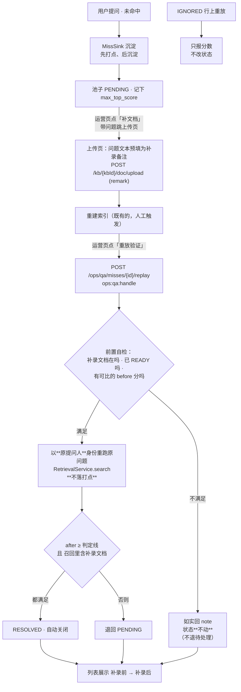
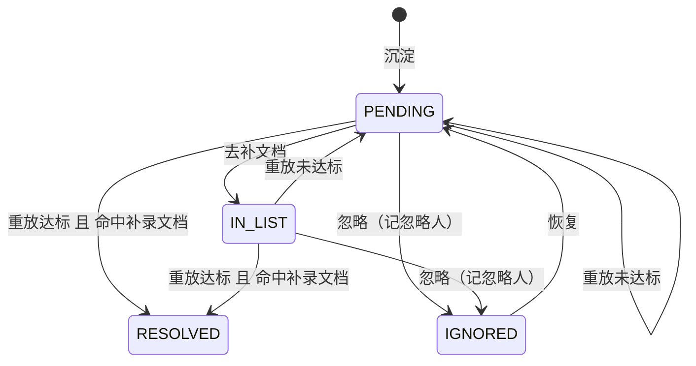

> 状态：🟡 进行中 · Sprint S8 · 阶段 B（M10 运营分析 —— 重放验证）· 建档 2026-09-20

# 2026-09-20 · S8 · M10 · 阶段 B —— 重放验证：把闭环的命门接上

> 任务：`T-A01`（重放验证）+ `T-O16`/`T-O17`/`T-O18`（O 项三件）
> 来源：`docs/进度/03-Sprint排期.md` §Sprint 8（`T-A01` 行 + `G8-5`）
> 上游计划：`ai_knowledge_web/plan/2026-09-20-S8-M10-A.md`（本批要销它的 §9-① 建议项）

---

## 1. 开工条件检查

**依赖清单来源**：`docs/进度/00-开工速览.md` §1/§2/§3/§4 · `docs/进度/02-任务清单.md:389`（`T-A01` 行）·
上一批计划 `2026-09-20-S8-M10-A.md` §9 · `docs/需求文档/08-需求-运营分析.md` §1.4 · 环境实测。

| # | 依赖项 | 档位 | 现状（代码/文档实证） | 结论 |
|---|---|---|---|---|
| 1 | `T-A01` 的依赖列「`T-A00`」（未命中清单） | ✅ | `02-任务清单.md:388` 记 ✅ 已交付；`V32` 已入库、`QaMissService`/`OpsQaController` 在位、`sys_qa_miss` 表存在 | 满足 |
| 2 | `T-A01` 行点名的**幂等**要求 | ⚠️ | `02-任务清单.md:389` 只写「同时校验…；**幂等**」，**没说幂等的判据是什么** | 见下假设 6（本批自定：重放不落打点 ⇒ 天然幂等，并写成判据） |
| 3 | 需求 §1.4 步 2「问题文本作为补录备注带入」的**落点** | ⛔→✅ | 🔴 **全仓没有"补录备注"这个东西**：`sys_document`（`V12`）没有 remark 列，`DocController#upload` 只收 `file`，`docs/需求文档/06` 里"备注"零命中。**需求只说"带入"，没说落到哪** | 见下：**唯一路径是先补这条链路**，已由用户 2026-09-20 裁定（`AskUserQuestion` 选「照需求写：加 `remark` 补录备注列」） |
| 4 | 前端契约（字段名的单一事实源） | ✅ | `types/index.ts:848` 的 `ReplayResult` 五字段**已写好**；`api/index.ts:246` 的 `replayMiss`、`OpsQaView.vue:119-142` 的 `replay()`/`supplement()` **已按契约写死**；`mock/index.ts:1715` 有 mock 实现 | 满足 —— **本批是"把后端补上"，不是"从零设计契约" |
| 5 | 「达标」的判定线来源 | ✅ | `SystemSettings.RETRIEVAL_MISS_THRESHOLD` + `QaOverview.missThreshold`（上一批已把它如实地回给前端） | 满足 |
| 6 | 重跑一次检索的能力 | ✅ | `RetrievalService#search(LoginUser, query, kbIds)` 是**纯计算**（`RetrievalService.java:91`）—— 落打点在 `ChatStreamService#finish` 那一侧，不在它里面 | 满足（这正是"重放不污染统计"能成立的结构性理由） |
| 7 | 召回分的**同一算法** | ✅ | `RetrievalTraceWriter.top1()`（包内可见，`RetrievalTraceWriter.java:214`）+ `joinIds()`；`MissSink` 已经在复用 | 满足 |
| 8 | 找"补录文档"要用的归一化 | ✅ | `MissKeyNormalizer`（上一批交付，单点、零阈值、有配对用例） | 满足 |
| 9 | 权限码 | ✅ | `ops:qa:view` / `ops:qa:handle`（`V32`）+ `doc:upload` 均已存在 ⇒ **本批不新增权限点**（总数保持 40） | 满足 |
| 10 | 环境 | ✅ | 6 服务 healthy（`kb-mysql`/`kb-minio`/`milvus-*`/`kb-neo4j`/`kb-valkey`）；8080/5173-5176 端口**全空**；上一批收尾基线干净 | 满足 |
| 11 | 真 rerank 通路 | ✅ | 上一批步 0 探针实测：不相关 `0.000016` · 判定线 `0.35` · 相关 `0.964318`（`MissProbeNetworkTest`） | 满足 |
| 12 | `G6-6`（费用三态）按号取证的落点 | ⚠️ | 速览 §3 记它「**从未按号取证**」（原批次把这个号写成了「VL 一次两产出」） | 见下 `T-O17` |

**BLOCKER 汇总**：**无**。
> 第 3 条原先是一个 BLOCKER（"补录备注"在代码里不存在），但它**只有唯一路径** ——
> 需求已经把机制写明了（问题文本作为补录备注带入），缺的只是"这个备注落在哪一列、怎么被重放用上"。
> 已按 skill 的要求用 `AskUserQuestion` 给选项并由用户裁定，不发明假选项。
> ② 重放**不自动触发重建**（见 §3.3）：那不是缺条件，是有意的边界。

**⚠️ 已知偏差**（不拒绝施工，第 9 节销账）：

1. 前端 `OpsQaView.replay()` 现在用 `res.improved` 决定状态（`OpsQaView.vue:121`），
   而需求 §1.4 步 5 说的是「**分数达标**自动关闭」—— 用户 2026-09-20 裁定按需求办（判据 = 达标 且 命中补录文档）。
   ⇒ 本批要改前端那一行，并把 `status` 加进回话（前端不再自己推断状态）。
2. `T-A01` 行写的「幂等」没有判据原文 ⇒ 本批自定并写成用例（假设 6）。
3. `#225`（`KbService.EmbeddingInfo.dimension` 取编译期常量 + `KbDetailView.vue` 硬编码一份）
   与 `#85` 同族，**上一批已确认它是"下一批最该看的功能候选"** ⇒ 本批认领为 `T-O16`。

### 结论

- [x] ✅ **可以开工**

---

## 2. 开工时间

| 项 | 值 |
|---|---|
| 建档 / 开工日 | 2026-09-20 |
| 预计投入 | **≈8.7 人天**（Sprint 容量 ≈ 10 人天） `T-A01` 后端 ≈3.5（含步 0 探针 0.2）· 前端两页 ≈1 · 真链路 E2E ≈1 · `T-O16` ≈1.5 · `T-O17` ≈1 · `T-O18` ≈0.5 · 文档回填 ≈0.2 |
| 实际投入 | *回填时补* |

> **O 配额**：`T-O16`+`T-O17`+`T-O18` ≈ **3 人天**。
> ⚠️ 又是低于下限 4 的一批（若延续就是**连续第十五批**）—— 如实记录，不当延后理由（见 §9）。

---

## 3. 开工内容

### 3.1 步骤

| 步 | 做什么（文件/类 → 动作 → 产出） | 依赖 | 可并行 |
|---|---|---|---|
| **0** | 🔴 **先量再写**：`ReplayProbeNetworkTest`（opt-in 网络用例）—— 真 rerank 对三组「问句 × 片段」打分： ① 未命中问句 × 库里无关片段（预期 ≈0.0000x，复现"入池"） ② **同一问句 × 一段"真答得上它"的文本**（🔴 本批唯一可能被否掉的前提：预期 ≥0.35） ③ 只提到关键词但答不上来的片段（中间态） **产出**：② 的量级 ⇒ 决定 E2E 能不能稳定造出「补录 → 达标」 | — | — |
| 1 | `V34__s8_qa_replay.sql` —— `sys_document` 加 `remark VARCHAR(500) NULL`（**唯一的数据变更**） | 0 | 与 2 并行 |
| 2 | `DocDtos` / `DocController#upload` / `DocService#upload` —— 上传多收一个 `remark`（可选，**缺省写 NULL 不是空串**） | 1 | 与 1 并行 |
| 3 | `SysDocument` 实体加 `remark` 字段（列名与口径注释） | 1 | 与 2 并行 |
| 4 | `ReplayService`（新，`service/`）—— 重放主体：载入 miss → **前置自检** → 找补录文档 → 以原提问人身份 `RetrievalService#search` → 算 `after`/`hit`/`达标` → 决定状态 → 回 `ReplayResult` | 2,3 | — |
| 5 | `OpsQaController` 加 `POST /ops/qa/misses/{id}/replay`（`@RequiresPerm("ops:qa:handle")`）；`OpsDtos` 加 `ReplayResult` | 4 | — |
| 6 | `QaMissRepository` 加重放要用的读写（按 remark 键找补录文档 · 写 `score_after`/`status`/`resolved_at`） | 4 | — |
| 7 | 后端用例：`QaMissReplayFlowTest`（真 HTTP，替身重排）—— 达标/未达标/② 的负向锚/幂等/**不落打点**/前置未就绪/IGNORED 只读/权限四档 | 5,6 | — |
| 8 | 前端 `KbUploadView.vue` —— 读 `route.query.note` 预填「补录备注」输入框；提交时随 `FormData` 带 `remark` | 2 | 与 7 并行 |
| 9 | 前端 `OpsQaView.vue` + `types/index.ts` + `api/index.ts` + `mock/index.ts` —— `replay()` 改用后端回的 `status`（不再自己推断）；回话对象加 `status`；mock 同步 | 5 | 与 8 并行 |
| 10 | `e2e-ops-replay-flow.mjs`（新）—— **整条真链路**：造未命中 → 页面点「补文档」→ 上传带备注 → 重建索引 → 点「重放验证」→ 断言 `补录前 → 补录后`、状态、角标 | 7,8,9 | — |
| 11 | `T-O16`（`#225`）—— `EmbeddingInfo.dimension` 收敛成**单一事实源** | — | 与 4~10 并行 |
| 12 | `T-O17`（`G6-6`）—— 费用三态按号取证 | — | 与 4~10 并行 |
| 13 | `T-O18` —— `check-ledgers` 剩的 3 条 `S3-D` 同名不同义逐条判定 | — | 与 4~10 并行 |
| 14 | 文档回填（`10-接口约定汇总.md` §14 + `13-接口变更记录.md` + 七处） | 全部 | — |

### 3.2 业务流程图

> 触发条件：② 涉及事务边界 ③ 有状态机 ④ 幂等 —— 三条都满足，必须画。

**状态机（需求 §1.3，本批把它补全）**：

### 3.3 明确不做（范围控制）

| 不做的事 | 原因 | 归属批次 |
|---|---|---|
| **重放自动触发重建索引** | 重建是分钟级异步任务，塞进一个同步请求里会让"点了没反应"变成新常态；而且重建是**人要选库**的动作（需求 §1.4 步 3「只重建受影响的知识库」）。改为**前置自检**：补录文档没 READY 就如实回"还不能判定"，**且不把状态判成未达标** | `T-A02` 或不做 |
| **重建完成后自动批量重放** | 需求 §1.4 步 4 的「自动」本批读作"**系统给出客观结论并自动改状态**"（而不是人嘴说一句"我补过了"），触发仍是人点一次。真正的"任务完成即回扫全库重放"要挂在 `AsyncTaskService` 的终态上，成本与风险都另算 | 登记 §9 |
| 高频问题榜 / 点踩归因 / 导出（`T-A02` 余下三件） | 与重放无耦合 | `T-A02` |
| `G8-2` 的**语义**合并（`R-6`） | 阈值无语料可校准，用户 2026-09-20 已裁定挂起 | 待真实问法语料 |
| `G8-10` 离线预计算 | 池子与时间窗都很小 | `T-A04` |
| `hasImageDesc` | 打点里没有这一列，后端如实不发 | 见上一批 §9-⑤ |
| 生产侧"按最近提问人清池子" | 那是测试纪律，不是产品行为（上一批 §9 已登记） | — |

### 3.4 本批假设

| # | 假设 | 若被证伪的后果 |
|---|---|---|
| 1 | **补录备注就是关联键**：`remark` 归一化后 == 池子 `question` 归一化后 ⇒ 找到"刚补录那篇"。`miss_key` 唯一 ⇒ 备注与未命中**一一对应** | 备注被人工改写即断链（**这是有意的**：需求把备注定成人工字段）。断链的现象是 `hitSupplementedDoc=false`，不是静默错配 |
| 2 | `before` 取池子里的 `max_top_score`（**记录值**），不是"现在再跑一次旧状态" | 后者根本做不到：补录文档已经进索引了。⚠️ 因此 `before` 与 `after` 的**采样时刻不同**，但**算法同一个**（`RetrievalTraceWriter.top1`） |
| 3 | 重放用**原提问人**的身份（可见范围与原提问一致） | 换成操作人（如 super_admin 可见全部库）会**同时改两个变量**，分差里混着"可见范围变宽了"。提问人已注销 ⇒ 退回操作人身份并在 `note` 里**写明这次不是同一视角** |
| 4 | 「达标」的线 = **当前** `sys_setting` 的 `retrieval.miss-threshold`（与页面卡片显示同一个数） | 改过线的库里，旧行是按旧线判的未命中 —— 这是 `V22` 每行存 `miss_threshold` 的既有口径，本批**按当前线**判（并在 note 里带出线值），不按行取历史线 |
| 5 | 🔴 **重放不落打点、不计入统计** | 落打点会污染 7 天口径：`overview.totalQuestions`/`missed`/`avgTopScore`、活跃用户数、`G5-13` 的"每次提问都落"全部会把重放算成"有人提问"。⚠️ 结构上成立：落打点在 `ChatStreamService#finish`，而重放直接调 `RetrievalService#search` |
| 6 | 幂等 = 连点两次：`score_after`/`status`/`ask_count`/打点行数**全部不变** | 若变成"重放一次 `ask_count`+1"，`sum(ask_count) == count(miss_flag=1)` 这条对账判据会当场失效（上一批的承重判据） |
| 7 | 探针（步 0）假设：补录一篇**真答得上**的文档后，rerank 分会跨过 `0.35` | 若 ② 也贴在 0.35 以下 ⇒ E2E 的语料要改成"直接抄了答案"的那种，或判据退成"分数提升 + 命中补录文档"（不含达标）。**看步 0 的实测数再定** |

---

## 4. 数据变更清单

| 项 | 内容 |
|---|---|
| 改表 | `sys_document` 加一列：`remark VARCHAR(500) NULL COMMENT '补录备注（需求 08 §1.4 步 2）：从运营页跳上传页时把问题文本带入。⚠️ 它同时是重放验证的**关联键**（归一化后与池子 question 比对）—— 人工改写它会断链，这是有意的'` |
| 索引 | **不加**。找补录文档的扫描面是"`remark is not null` 的文档"，只有补录产出的那几行；加索引是为一个几十行的集合付写入代价 |
| 迁移编号 | **`V34`**（现最大 `V33`） |
| 种子数据 | **无**。`remark` 全部为 NULL 是**真值**（种子文档不是补录进来的） |
| `sys_qa_miss` | **不加列**：`score_after` / `resolved_at` / `updated_at` 三个列上一批已经建好了（`V32`），本批只是**第一次真的写它们** |
| 回滚方式 | **可逆**：`ALTER TABLE sys_document DROP COLUMN remark`。⚠️ 回滚后已发生的重放关联全部失效（但那是"重放结论"不是"业务数据"，不构成不可逆损失） |
| 演示数据 | 无（`08` 里那些数仍是原型值，不入库） |

---

## 5. 依赖与工具决策

**结论：不引任何新依赖。**

1. **不引依赖的替代方案**：重放要的三件事——"重跑一次检索"、"算同一口径的 Top1"、"找补录文档"——**全部已有**：
   `RetrievalService#search`（纯计算，不落打点）· `RetrievalTraceWriter.top1`（包内可见，`MissSink` 已在复用）·
   `MissKeyNormalizer`（上一批交付的单点归一化）。
2. **候选与对比**（若真要引）：
   - **不引**：复用上面三处，代价 = 0（且**共享**"同一算法"这条不变量）；
   - 用 `EmbeddingClient` 直接比向量余弦判"是不是补录那篇"：**必须引**一个阈值（相似度多少算"那篇"），
     而本仓已在"没有语料就定阈值"上反复吃亏（`T-O03` 的三个阈值至今卡着）⇒ **否决**；
   - 引一个文本相似度库做语义匹配：同上，且比"按备注精确匹配"多一层不确定性。
3. **推荐**：不引。理由：**备注是精确键，不需要任何阈值** —— 而这一批恰恰最不该引入阈值。

> ⚠️ 一处**看似要引、其实不用**的：重放要"以原提问人身份"构造 `LoginUser`。
> `LoginUserContext` 是从 JWT 解的，重放请求里没有那个人的 JWT ⇒ 需要**从库里重建 `LoginUser`**。
> 做法：复用既有的用户/角色/授权的加载路径（与登录时同一套），**不引依赖也不手搓权限**。

---

## 6+7. 验收方法与标准

> 判据 vs 观察项分开：页面写死的展示值登记为观察项，不计成败。门禁号按 `G8-n` 对齐（硬口径）。

| # | 门禁号 | 判据 | 验收方法（可粘的命令） | 期望结果 | 证据落点 |
|---|---|---|---|---|---|
| 1 | `G8-5`① | **真链路**：造未命中 ⇒ 补录 ⇒ 重建 ⇒ 重放 ⇒ **召回分提升** | `node scripts/e2e-ops-replay-flow.mjs --base=http://127.0.0.1:5174` | `after > before` 且 `after ≥ 判定线` | 脚本输出 + `sys_qa_miss.score_after` |
| 2 | `G8-5`② | **新召回的确实是刚补录那篇** | 同上 | `hitSupplementedDoc = true`，且命中的 `doc_id` = 本次上传的文档 | 脚本输出（回查 `sys_document.id`） |
| 3 | `G8-5` | **负向锚**：补录一篇**与该问题无关**的文档 ⇒ 不达标 ⇒ **退回待处理** | `QaMissReplayFlowTest#unrelatedSupplementKeepsPending` | `status=PENDING`、`hitSupplementedDoc=false` | 用例断言 |
| 4 | `G8-5` | **② 的负向锚**：分数上去了但召回的**是别的文档** ⇒ **不置 RESOLVED** | `QaMissReplayFlowTest#scoreUpButOtherDocIsNotResolution`（替身重排把别的文档打高分） | `improved=true` 而 `hitSupplementedDoc=false` ⇒ `status=PENDING` | 用例断言 + `note` 里点明 |
| 5 | `G8-5` | **幂等**：连点两次 ⇒ `score_after`/`status`/`ask_count`/打点行数全不变 | `QaMissReplayFlowTest#replayIsIdempotent` | 五个值逐一相等 | 用例断言 |
| 6 | — | 🔴 **重放不落打点、不计入统计** | `QaMissReplayFlowTest#replayWritesNoTrace` | `sys_retrieval_trace` 与 `trace_chunk` 行数**不变**；`overview.totalQuestions`/`missed` 不变 | 用例断言（重放前后各查一次） |
| 7 | — | **前置未就绪 ⇒ 不判未达标、不改状态** | `QaMissReplayFlowTest#notReadySupplementBlocksVerdict` | `status` 原样 + `note` 说明还差什么 | 用例断言 |
| 8 | `G8-3` | **IGNORED 行上重放只报分数、不改状态** | `QaMissReplayFlowTest#replayOnIgnoredDoesNotResurrect` | `status` 仍是 `IGNORED` | 用例断言 |
| 9 | `G8-9` | **权限四档**：`USER`/`GUEST` 403 · `AUDITOR` 能 GET 不能 POST（403）· `KB_ADMIN` 通 | `QaMissReplayFlowTest#replayPermissionBoundary` | 4 个 token 各自的码 | 用例断言（真 HTTP） |
| 10 | — | **补录备注落库**：带 `remark` 的上传写了一行；不带时是 **NULL 不是空串** | `DocUploadFlowTest` 补两条 | `remark = '原问题文本'` / `remark IS NULL` | 用例断言 |
| 11 | — | **备注能被重放用上**（键是 `MissKeyNormalizer`，与池子同一处） | `QaMissReplayFlowTest#remarkIsMatchedByTheSameNormalizer` | 标点不同 / 全半角不同的备注**仍能匹配**（同一归一化） | 用例断言 |
| 12 | — | **页面级**：点「补文档」⇒ 跳上传页且备注**已带入** ⇒ 上传 ⇒ 回运营页 ⇒ 点「重放验证」⇒ 状态与 `补录前 → 补录后` 都变 | E2E 脚本第 5~21 步 | 页面文本断言（不是只看接口） | `e2e-ops-replay-flow.mjs` |
| 13 | — | **前端不再用 `improved` 决定状态** | `grep -n "res.improved" OpsQaView.vue` | 只用 `res.status` | 代码 + E2E |
| 14 | `G8-4`/`G6-13` | **回归**：重放把状态改成 RESOLVED ⇒ 侧边栏角标与 `/notices/pending` **同时** −1 | E2E 脚本第 22~23 步；`node scripts/e2e-ops-miss-flow.mjs` | 两处同一个数；旧脚本仍 **21/21** | 两个脚本输出 |
| 15 | — | 全量基线 | `mvn -B -f .../pom.xml test` | **695 + 本批新增 / 0 红 / 2 跳过** | 跑批日志 |
| 16 | — | 种子与残留 | 上一批的六问 + `sys_qa_miss` 看"悬空 `last_user_id`" | 全回基线 | SQL 输出 |
| 17 | `T-O16` | `#225`：`EmbeddingInfo.dimension` **单一事实源** | 改一处（常量）⇒ 后端与 `KbDetailView` 两个消费点同步变 | 无第二份硬编码 | `grep` + 用例（负向锚：改回硬编码即转红） |
| 18 | `G6-6` | `T-O17`：费用三态（`cost = null` / `NONE` / `¥xx`）逐态取证 + `unpricedCount` 准确 | 用例三条（每态一条）+ 与明细行数对账 | 三态各一条；`unpricedCount` = 明细里缺单价的**行数** | 用例断言 |
| 19 | — | `T-O18`：`check-ledgers` 剩的 3 条 `S3-D` 逐条判定 | `node scripts/check-ledgers.mjs` | 每条**要么订正要么接受**，都有留痕；条数下降 | 脚本输出 + 计划文件 |
| 20 | — | `V34` 已应用 | `select column_name from information_schema.columns where table_name='sys_document' and column_name='remark'` | 1 行 | SQL 输出 |

---

## 8~10. 验收结果 / 遗留 / 建议

*回填时写。*
