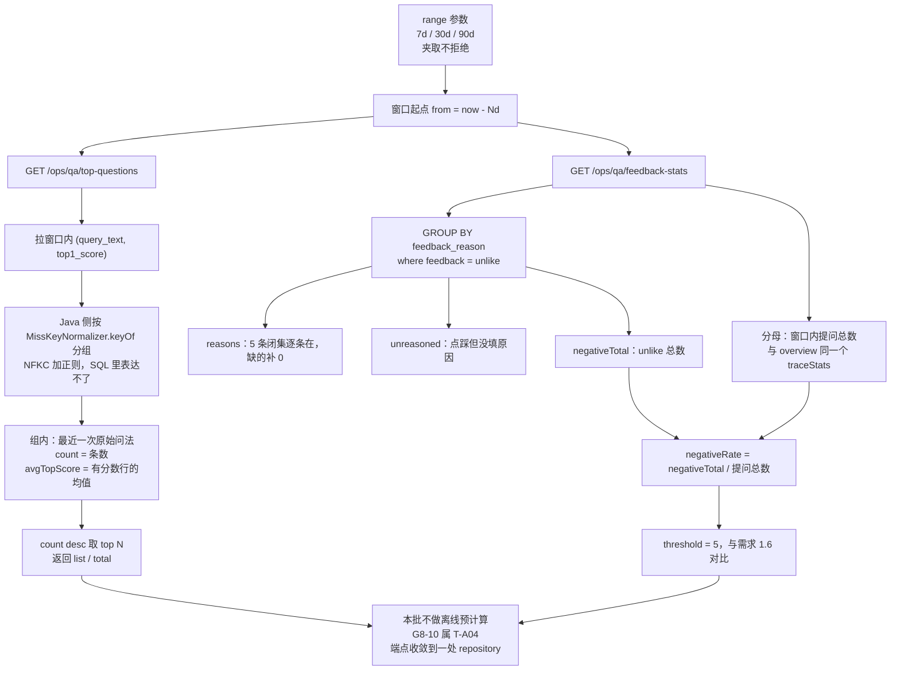
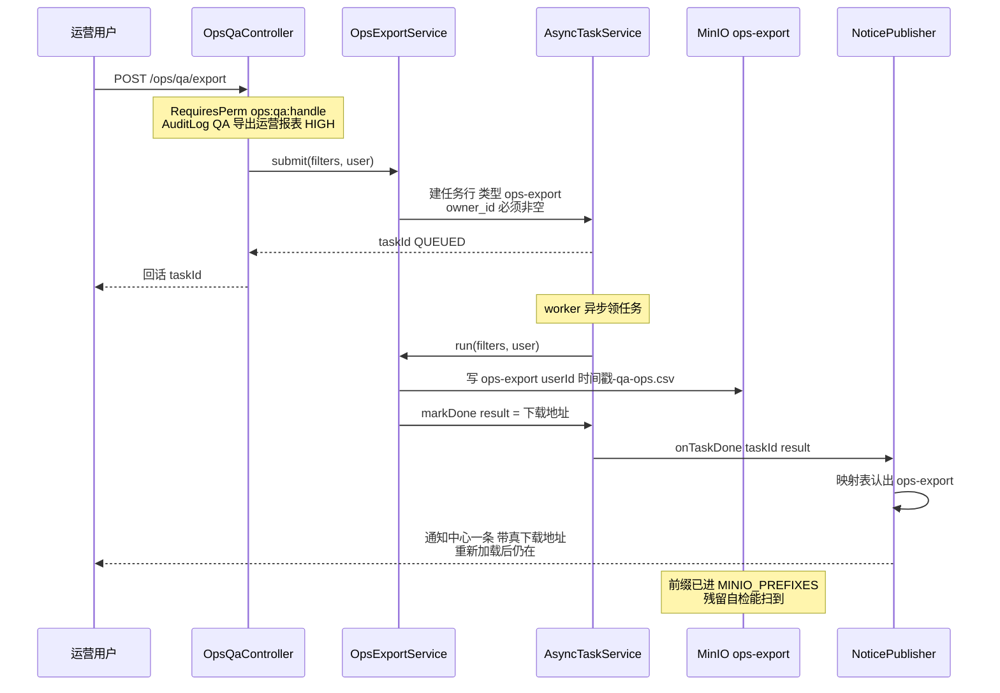

> 状态：✅ 已完成 · Sprint S8 · 阶段 C（M10 问答运营余下三块 —— 页 11 功能面收口）· 建档 2026-09-20

# 2026-09-20 · S8 · M10 · 阶段 C —— 高频问题榜 + 点踩归因 + 导出（11 页收口）

> 任务：`T-A02`（1 项）+ O 项 2 项（本批新登记 `T-O19` / `T-O20`）
> 来源：`docs/进度/03-Sprint排期.md` § Sprint 8（任务 `T-A00`~`T-A05`）
> 上游计划：`ai_knowledge_web/plan/2026-09-20-S8-M10-B.md`（本批要销的账见第 1 节）

---

## 1. 开工条件检查

**依赖清单来源**（逐条注明出处，不许凭印象）：

| # | 依赖项 | 档位 | 现状（代码/文档实证） | 结论 |
|---|---|---|---|---|
| 1 | `T-A02` 的「依赖」列 = `T-A01`（`02-任务清单.md:390`） | ✅ | `T-A01` 已交付（`S8-M10-B`，2026-09-20）：`POST /ops/qa/misses/{id}/replay` + `V34` + 前端跨页接线 | 满足 |
| 2 | 高频榜要的数据列 | ✅ | 实测 `sys_retrieval_trace`：`query_text` text · `top1_score` decimal(12,6) NULL · `created_at` datetime **MUL**（有索引）· `miss_flag` | 满足 |
| 3 | 点踩归因要的数据列 | ✅ | 实测 `sys_chat_message`：`feedback` varchar(16) · `feedback_reason` varchar(64) · `feedback_at` datetime（**均 NULL**） | 满足 |
| 4 | 点踩原因的闭集 | ✅ | `ChatFeedbackReason` 5 条（`INACCURATE`/`NOT_FOUND`/`WRONG_CITATION`/`TOO_VERBOSE`/`OTHER`），类注释写明与需求 `07` §6.8、数据字典 §7.11 **逐字一致** | 满足 |
| 5 | 聚合单点（「提问次数」怎么算） | ✅ | `MissKeyNormalizer.keyOf` 已存在且是**唯一**归一化点（`MissSink`/`QaMissRepository`/`ReplayService` 三处共用）—— 高频榜复用同一处，**不另写一套** | 满足 |
| 6 | 导出链路（异步 + 通知 + MinIO） | ✅ | 范本齐备：`AsyncTaskService`（任务行）· `NoticePublisher`（映射表只此一处）· `MinioClient` 写入 · `AuditExportService` 是**完整先例**（含 CSV 写法与「筛选条件原样带走」的口径） | 满足 |
| 7 | 定时/异步基础设施 | ✅ | `SchedulingConfig`（`@EnableScheduling`）+ `AuditRetentionJob`（`@Scheduled` 先例） | 满足（本批**用不到**，见 §3.3） |
| 8 | 权限码 | ✅ | `ops:qa:view` / `ops:qa:handle` 已存在（`S8-M10-A` 落），`USER`/`GUEST` 403、`AUDITOR` 能读不能改（可证伪） | 满足 |
| 9 | 新增 MinIO 前缀的登记机制 | ✅ | `ProbeCleanup.MINIO_PREFIXES`（Java 侧，带**机器检查**「这个前缀有没有被表态」`probePrefixes()`）+ 存量 `audit-export/` 同形先例 | 满足 |
| 10 | 前端三个入口是否已接线 | ✅ | `OpsQaView.vue` 两个 Tab 已挂「本版本未交付这一栏（后端接口属 **`T-A02`**）」；`opsApi.topQuestions/feedbackStats/qaExport` 三处已在 `api/index.ts` | 满足 |
| 11 | 🔴 **数据量** | ⚠️ **WARN** | **实测**：`sys_retrieval_trace` = **0** · `sys_chat_message` = **0** · `sys_qa_miss` = **0**（只有 `sys_kb` = 8 是种子） | 见偏差 ① |
| 12 | 🔴 **需求 §1.10 的验收要点「点踩原因次数合计 = 统计的负反馈总数（28）」** | ⚠️ **WARN** | **代码实证**：`ChatFeedbackService#submit` 允许 `unlike` **不带原因**（`reason.isEmpty()` 直接通过；`row.setFeedbackReason(reason.isEmpty() ? null : reason)`）⇒ 只要有一行"点踩但没填原因"，那个等式**永远不成立**。同形于 `S8-M10-A` 逮到的「清单总条数 = 未命中提问数」 | 见偏差 ② |
| 13 | `#164` mock 反馈原因与需求口径漂移 | ⚠️ **WARN** | `mock/data.ts:709-710` 写的是「回答太**笼统**」「引用**不相关**」，而需求 `07:374` 与枚举都是「回答太**啰嗦**」「引用**来源不对**」 | 见偏差 ③ |
| 14 | `regenerateHyq()` 是**假启动** | ⚠️ **WARN** | `OpsQaView.vue:174` 弹 `ElMessage.success('已提交「用真实问法重新生成 HyQ」任务…')`，**一个请求都没发**（承 `T-908`「不返回假 taskId」的判例） | 见偏差 ④ |
| 15 | `G8-2` 语义合并仍挂起 | ⚠️ **WARN** | `R-6` 的相似度阈值**无语料可校准**（用户 2026-09-20 裁定挂起）⇒ 高频榜的「次数」同样是**归一化聚合**，不是语义聚合 | 见偏差 ⑤ |
| 16 | `G8-1`（三页分工不重复） | ⚠️ **WARN** | 要等 20/21 两页（`T-A03`/`T-A05`）才谈得上，本批只能保证「不与 11 页自己的未命中清单重复」 | 见偏差 ⑥ |
| 17 | `#153` `qa:history:search` 无独立校验点 | ⚠️ **WARN** | 与 `#168` 同形（没有角色能证伪边界）—— **本批不碰它**，只是它属 11 页的相邻账 | 见偏差 ⑦ |

**BLOCKER 汇总**：**无**。

**⚠️ 已知偏差**（不拒绝施工，第 9 节销账）：

- **① 数据量为 0 ⇒ 判据必须靠"自造语料 + 真链路"取证** —— 与 `S8-M10-B` 的步 0 探针同一条纪律。两个接口的"页面有数"不能当证据：**要真提一次问**（落一行 trace）、**真点一次踩**（落一行 feedback），再看聚合结果。⚠️ 高频榜的「次数 ≥ 2」要求**同一句话问两次**，E2E 必须真的问两次（而不是造两行库）。
- **② 需求那条第等式不可能成立** —— 处置照 `S8-M10-A` 的判例：**两个数都如实返回**（`negativeTotal` 与 `reasons` 各自的合计），并对"没填原因的点踩"**单列一个数**，**不挑一个"好看"的**；订正建议写进 §10 与结论文档。
- **③ mock 的漂移串本批销**：`feedback` 归因是**后端接口返回**的（不走 mock 展示），但 mock 模式与 `render-check` 读的正是它 ⇒ 不订正会让人以为"后端返回错了"。
- **④ 假启动本批销**：需求 §1.5 那条是**「建议提供」**（不是必须），而"真重跑 HyQ"要动检索语料重建（属 `T-910`/`T-710`）⇒ 本批只做**诚实化**，不做实现。
- **⑤ 高频榜的「次数」= 归一化聚合** —— 必须写进接口契约与页面文案，否则会被读成"语义聚合"（那正是 `G8-2` 挂起的那一半）。
- **⑥⑦ 如实登记，本批不动**。

> 判据只有一条：**这条不满足，代码写下去会不会白写**。—— 逐条过完，没有一条会导致返工。

### 结论

- [x] ✅ **可以开工**（无 BLOCKER；7 条 WARN 逐条有处置，全部进第 9 节）

**🔴 一处范围裁定（用户 2026-09-20 在场裁定，记明出处）**：

本批**不并入 `G8-10`（离线预计算）**，按排期办 —— `T-A04` 的依赖是 `T-A03`，而 `T-A03`（页 20 检索质量分析）**未开工**。裁定理由（我据此提的推荐，用户选了它）：

1. 实测 `sys_retrieval_trace` / `sys_chat_message` **都是 0 行** ⇒ 预计算的收益**今天量不出来**，只能靠结构断言；
2. 那张统计表的**粒度**该由页 20/21 的指标定（`各库排行` = 按库 · `Top1 五档` = 按档 · `6 阶段耗时` = 按阶段），而页 11 只有「按天计数」**一种**粒度 ⇒ 现在建表是**用一页的需求猜三页的形状**；
3. 它会新增一张持久化产物（触发 `ProbeArtifacts` 登记表 + 覆盖率闸），且一个 `@Scheduled` 作业与 `mvn test` 之间还有**全局状态冲突**（承 `#166` 的判例）。

**补偿动作**（不做预计算，但把返工面压到最小）：三个新端点**收敛到一处 repository**，把「窗口内明细怎么聚合成这三个数」写成**单点**；并在 §3.4 假设 6 里把 `T-A04` 落地时的**改造点**点明。

---

## 2. 开工时间

| 项 | 值 |
|---|---|
| 建档 / 开工日 | 2026-09-20 |
| 预计投入 | **≈7.5 人天**（功能 ≈3.5 + O 项 ≈4）—— Sprint 容量 ≈10 人天 |
| 实际投入 | *回填时补* |

---

## 3. 开工内容

### 3.1 步骤

| 步 | 做什么（文件/类 → 动作 → 产出） | 依赖 | 可并行 |
|---|---|---|---|
| 1 | **`GET /ops/qa/top-questions`** —— 新增 `core/ops/QaOpsRepository#topQuestions(from, limit)`：拉窗口内 `(query_text, top1_score)`，在 **Java 侧**按 `MissKeyNormalizer.keyOf` 分组（NFKC + 正则**在 SQL 里表达不了**）；组内取**最近一次原始问法**展示（需求 §1.10「用户问题保持原始问法，未被改写」）、`count` = 组内提问数、`avgTopScore` = 组内有分数行的均值（**空召回行不进分母** —— 与 `traceStats.avg(top1_score)` 同口径）。`count desc, 最近提问 desc` 排序 | — | 与步 2 并行 |
| 2 | **`GET /ops/qa/feedback-stats`** —— `QaOpsRepository#feedbackStats(from)`：`GROUP BY feedback_reason where feedback = 'unlike'`；`negativeTotal` = 窗口内 `unlike` **总数**（含未填原因的）；`reasons` 只列 `ChatFeedbackReason` 那 5 条（**逐条都在，缺的补 0** —— 否则"某原因是 0"与"那个原因不存在"长得一样）；🔴 **`unreasoned`** = 「点踩但 `feedback_reason is null`」的条数；`negativeRate` = `negativeTotal ÷ 窗口内提问总数`（分母与 `overview` **同一个** `traceStats`，需求 §1.6 写的是"÷ 提问总数"）；`threshold` = 5（需求 §1.6 的对比阈值，**写常量并注明出处**） | — | 与步 1 并行 |
| 3 | **DTO + 控制器** —— `OpsDtos` 加 `TopQuestion` / `TopQuestionsResponse` / `FeedbackStats` / `FeedbackReason`；`OpsQaController` 加两个 `@GetMapping`，**均挂 `ops:qa:view`**（读侧）。⚠️ `range` 的解析**复用 `QaMissService#daysOf`**（夹取不拒绝，与 `overview` 同一口径）⇒ 把它提成共用工具或让新服务委托 | 步 1/2 | — |
| 4 | **`POST /ops/qa/export`** —— 新增 `service/OpsExportService`（照 `AuditExportService` 的结构）：`submit(filters, user)` 走 `AsyncTaskService` 建任务行（**类型 `ops-export`**，`owner_id` **必须非空** —— 承 `#110`）⇒ worker 里查未命中清单（**原样带走当前筛选条件**，需求 §1.7）、写 CSV 到 MinIO **`ops-export/{userId}/{时间戳}-qa-ops.csv`** ⇒ `markDone(result = 下载地址)` ⇒ `NoticePublisher` 产通知 | 步 1/2（共用筛选口径） | — |
| 5 | **通知映射加一行** —— `NoticePublisher` 的映射表加 `ops-export` 分支（`TYPE_OPS_EXPORT`），回话形状与 `audit-export` 一致（带**真下载地址**）。⚠️ **映射表只此一处**（`T-B03` 定） | 步 4 | — |
| 6 | **审计三处同步** —— `@AuditLog(module = AuditModule.QA, action = "导出运营报表", risk = RiskLevel.HIGH)`（`AuditRiskPolicy:18` 把「**导出报表**」逐字列在 `DATA_EXPORT` 类里 ⇒ 这是**口径要求**不是我的判断）⇒ ① 注解 ② `AuditRiskPolicy.register(...)` 带理由 ③ `AuditCoverageFlowTest#expectedActions()` 冻结清单 **25 → 26** | 步 4 | — |
| 7 | **MinIO 新前缀登记** —— `ProbeCleanup.MINIO_PREFIXES` 加一行 `ops-export/`（`Owner.PATH_USER_ID`）+ `AUDIT_EXPORT_PREFIX` 旁加 `OPS_EXPORT_PREFIX` 常量（**同一个字面量**：服务与登记表必须指同一处）。⚠️ 只写 javadoc 拦不住（`#202`/`#203` 实证：漏一行 ⇒ 一轮跑批 **180 个孤儿**） | 步 4 | — |
| 8 | **前端：两个 Tab 接真数据** —— `OpsQaView` 已就绪的 `loadTop`/`loadFeedback` 只需摘掉"未交付"分支；高频榜补**条形图**（需求 §1.5「横向条形图」，已有 `maxTopCount`）与「次数是归一化聚合」的**就地口径注**；点踩栏补**负反馈率 vs 阈值 5%** 的对比展示 + `unreasoned` 那一行 | 步 3 | — |
| 9 | **前端：导出与假启动** —— `exportReport()` 补 `catch` 分支（后端未起时**不能静默**）；🔴 `regenerateHyq()` 去掉假成功，改成**如实说明**（"真重跑属 `T-910`/`T-710`，本版本未交付"） | 步 4 | 与步 8 串行（同文件） |
| 10 | **mock 订正（`#164`）** —— `mock/data.ts` 的 `mockFeedbackStats.reasons` 两条串改成需求那两条；`mockTopQuestions`/`mockFeedbackStats` 补 `unreasoned` 与新字段（**mock 是占位不是口径来源** —— 枚举注释里就写着这句） | 步 3 | 与步 8/9 串行（同目录不同文件） |
| 11 | **后端用例** —— 新增 `OpsQaStatsFlowTest`（真 MySQL，替身只替模型层）：归一化聚合 / 展示原始问法 / 窗口边界 / **未填原因的点踩** / 空集诚实 / 权限（`USER` 403、`AUDITOR` 能读）/ `unreasoned` 对账 | 步 3 | — |
| 12 | **导出用例** —— 扩展或新增 `OpsExportFlowTest`：真 HTTP `POST` ⇒ 任务行 `owner_id` 非空 ⇒ 通知落库且**带真下载地址** ⇒ CSV **列与清单表格一致**且**筛选条件被带走** | 步 4~7 | — |
| 13 | **页面级 E2E** —— 新增 `scripts/e2e-ops-qa-stats.mjs`：真链路造数据（**同一句话问两次**、真点一次踩）⇒ 高频榜 1 行 count=2 ⇒ 点踩归因 1 条 ⇒ 点「导出报表」⇒ 任务行 + 通知中心那条**重新加载后仍在** + 下载地址能取到对象。收尾**按本轮精确 `session_id` 清**（承 `S8-M10-B` 的洞） | 步 8~12 | — |
| 14 | **O 项 `T-O19`** —— 清理的「两不管」洞收敛（详见 §3.3 与 `plan/优化/`） | — | 全程可并行 |
| 15 | **O 项 `T-O20`** —— 「需求 ↔ 后端枚举 ↔ mock 取值」的对账闸（`#164` 的根因） | — | 全程可并行 |

### 3.2 业务流程图

> 触发条件：① 跨 ≥3 个组件 ✅（控制器 → 服务 → repository → 页面）② **涉及异步任务或事务边界 ✅**（导出是异步任务 + 通知发布）
> ③ 有状态机 ✗（本批无状态流转，`T-A00` 已交）④ 有并发/幂等 ⚠️（导出有幂等键，但不改状态）⇒ **① ② 成立，画两张**。

**读侧：页 11 的两块（同步、实时扫明细）**



**写侧：导出报表（异步任务 + 通知出口）**



### 3.3 明确不做（范围控制）

| 不做的事 | 原因 | 归属批次 |
|---|---|---|
| 🔴 **`G8-10` 离线预计算** | 用户 2026-09-20 在场裁定「不并入，按排期办」—— 理由见 §1 结论（数据 0 行 · 粒度该由页 20/21 定 · 新增产物与 `@Scheduled` 的全局状态代价） | **`T-A04`** |
| **「用真实问法重新生成 HyQ」真实现** | 需求 §1.5 写的是「**建议**提供」（不是必须），且真重跑要动检索语料重建 | `T-910` / `T-710` |
| **`G8-2` 语义合并**（"意思一样但问法不同"合并） | `R-6` 阈值**无语料可校准**，用户 2026-09-20 已裁定挂起 | 待语料 |
| **`G8-1` 三页分工不重复** | 要等 20/21 两页存在才谈得上 | `T-A03`/`T-A05` |
| **重建完成后自动批量重放** | 需求 §1.4 步 4 的"自动"，`S8-M10-B` 已声明读作"系统给结论并自动改状态" | 顺延（入口在 `AsyncTaskService` 的 `KB_REINDEX` 终态） |
| **页 20 / 21 两页** | 本批只收 11 页 | `T-A03` / `T-A05` |
| **新增 `ops:qa:export` 权限码** | 会凭空多出第 41 个权限码，而它落不到任何角色上 ⇒ 变成 `#153`/`#168` 那种"没有角色能证伪"的码。复用既有的 `ops:qa:handle`（写侧/操作侧） | — |
| **按 `feedback_at` 加索引** | 池子 0 行、真实查询量未知 ⇒ 先量再定（承「取一个数的判据必须先量再定」） | 有真实数据时 |

### 3.4 本批假设

> 信息不足下拍的决策。**假设被证伪 → 进第 9 节遗留**，否则没人知道当初赌了什么。

| # | 假设 | 若被证伪的后果 |
|---|---|---|
| 1 | **高频榜按 `count desc` 排序** —— 需求 §1.5 只写「问题 + 次数 + 平均 Top1 相似度 + 横向条形图」，**没写排序**；§1.2 的"降序"是清单的。取 `count desc, 最近提问 desc` 作稳定序 | 页面顺序不合预期；改一处 `order by`（不是结构改动） |
| 2 | **`avgTopScore` 的分母 = 组内有分数的行数**（空召回行不进分母）—— 与 `traceStats` 的 `avg(top1_score)` 同口径 | 均值口径与 `overview` 的"平均相似度"不一致，两处数字打架 |
| 3 | **导出权限挂 `ops:qa:handle`**（不新增第 41 个码）⇒ `AUDITOR` **能读不能导出** | 若需求方要求审计员也能导出 ⇒ 改一个注解参数（并要重新讨论"数据外带面的控制"） |
| 4 | **导出的 CSV 列 = 未命中清单的表格列**，且**原样带走当前筛选条件** —— 需求 §1.7「字段与表格列保持一致」+ `AuditExportService` 的既有口径（"筛选条件原样带走既是用户预期，也是数据外带面的控制"） | 导出内容与页面看到的不是同一批行 ⇒ 报表失去意义 |
| 5 | **「没填原因的点踩」要单列一个数**（`unreasoned`），不塞进 `reasons` 里当第 6 条 | 需求 §1.10 那条等式仍不可对账（而它本来就不可对账 —— 偏差 ②） |
| 6 | **`T-A04` 落地时的改造点已经收成单点**：三个端点的窗口聚合逻辑全在 `QaOpsRepository` 一处 ⇒ 预计算只改这一处 + 加读取源 | 改造面摊到服务层 ⇒ 返工面变大（这正是本批不做预计算的**补偿动作**，落空则要登记） |

---

## 4. 数据变更清单

| 类型 | 内容 | 回滚方式 |
|---|---|---|
| 新建表 / 改表 | **无** | — |
| 迁移文件 | **无**（`V35` 不被本批占用；下一步迁移号仍是 **`V35`**） | — |
| 种子数据 | **无**（11 页的三块都不需要演示数据 —— 数据来自打点，而打点由真提问产生） | — |
| NULL 分支 | **无新列**。⚠️ 但读侧有两条**已有的**可空语义要吃住：① `top1_score` 为 NULL（空召回）不进 `avgTopScore` 分母；② `feedback_reason` 为 NULL（点踩没填原因）进 `unreasoned` 而**不**进 `reasons` | — |
| 🔴 **持久化产物（非表）** | **新增 MinIO 前缀 `ops-export/`** —— 这**是**一次产物变更：必须在 `ProbeCleanup.MINIO_PREFIXES` 登记（`Owner.PATH_USER_ID`），否则覆盖率闸与残留自检都够不着它（`#202`/`#203` 的判例：漏一行 ⇒ 一轮跑批 180 个孤儿） | 可逆（删登记行 + 清前缀） |

> 跑过的迁移**只增不改**（改已执行的 `V*.sql` 会导致校验和不符、启动失败）。

---

## 5. 依赖与工具决策

**默认不引**。先给不引的替代方案，再给候选对比，最后给推荐。

| 方案 | 做法 | 代价 | 结论 |
|---|---|---|---|
| **不引依赖（既有栈）** | 高频榜的分组在 **Java 侧**做（`MissKeyNormalizer` 已有）；点踩归因一条 `GROUP BY`；导出复用 `AsyncTaskService` + `MinioClient` + `NoticePublisher`，CSV **手写**（`AuditExportService` 已有一份写法可照抄） | 高频榜是**全窗口拉明细 + 内存分组** —— 池子大时是页 11 最重的查询。**这正是 `G8-10`/`T-A04` 要解决的那件事**，已写进 §3.3 与假设 6 | ✅ **采用** |
| 候选 A：引入 CSV 库（`commons-csv` / `opencsv`） | 替掉手写 CSV | +1 个依赖；而本仓已有一处手写 CSV（`AuditExportService`），引入后**要么两套并存、要么把那份也改掉** | ❌ 不引 |
| 候选 B：把分组下推到 SQL（`GROUP BY` 归一化后的串） | 少拉明细 | **做不到**：归一化是 NFKC + 正则 + 小写，MySQL 表达不了；退一步用 `UPPER(TRIM(...))` 会**错合并/漏合并**，与 `MissKeyNormalizer` 的逐条理由冲突 | ❌ 不引 |

**推荐**：**无新依赖**（用既有 `AsyncTaskService` / `MinioClient` / `NoticePublisher` / `MissKeyNormalizer` 实现）· **理由**：三件能力本仓都已落地并有先例，唯一的新增是"一个 MinIO 前缀 + 一个任务类型"，两者都走既有的登记表与映射表（各加一行）。

---

## 6 + 7. 验收方法与标准

| # | 判据（对齐门禁号） | 验收方法（可直接粘的命令/脚本） | 期望结果 | 证据落点 |
|---|---|---|---|---|
| 1 | **`G8-2` 半边**：高频榜按**归一化**聚合（非每次提问一行） | `export JAVA_HOME='F:/work/dev_tools/jdk/jdk-25.0.4.1'` + `mvn -B -f F:/work/code/ai-knowledge/ai_knowledge_web/pom.xml test -Dtest=OpsQaStatsFlowTest` | 同一句的**三种标点写法**（`怎么配？`/`怎么配!`/`怎么配`）⇒ **1 行、`count = 3`** | `OpsQaStatsFlowTest#topQuestionsAggregatesByNormalizedQuestion` |
| 2 | 需求 §1.5：高频榜按次数降序 + `limit` 生效 | 同上 | `count` 单调不增；`limit=2` ⇒ `list.size() == 2` | 同上 `#topQuestionsOrderedByCount` |
| 3 | 🔴 需求 §1.10「用户问题**保持原始问法**，未被改写」 | 同上 | 返回的 `question` **逐字等于**其中一次真实提问原文，且**不等于** `MissKeyNormalizer.normalize()` 的结果 | 同上 `#topQuestionsKeepRawWording` |
| 4 | 需求 §1.6：`negativeTotal` = 窗口内 `feedback = 'unlike'` 行数 | 同上（用例内 SQL 对账） | 两个数**相等** | 同上 `#feedbackCountsMatchSql` |
| 5 | 需求 §1.6：负反馈率 = 负反馈数 **÷ 提问总数** | 同上 | 分母与 `GET /ops/qa/overview` 的 `totalQuestions` **同源**（同一 `traceStats`） | 同上 `#negativeRateSharesDenominatorWithOverview` |
| 6 | 🔴 **新增判据**：`reasons` 合计 + `unreasoned` **= `negativeTotal`** | 同上 | 等式**两端都成立且都不空**（`AssertJ` 双向断言；只断"等于"会在两处都是 0 时恒绿 —— 承 `S8-M10-B` 的空断言教训） | 同上 `#reasonsPlusUnreasonedEqualsTotal` |
| 7 | 🔴 **`#164` 销账**：`reasons` 的原因串取自 `ChatFeedbackReason` 闭集 | `cd ai_knowledge_app && node scripts/check.mjs`（构建前置）+ `grep -n "回答太笼统\|引用不相关" ai_knowledge_app/src/` | **0 行**；`reasons` 里出现的是「回答太啰嗦」「引用来源不对」 | `mock/data.ts` |
| 8 | 空窗口是**诚实的空**，不是 404、不是假数据 | 同上测试（清窗口后调两个接口） | `list = []` / `reasons` 5 条**全 0** / `negativeTotal = 0` / `negativeRate = 0`；HTTP 200 + `code = 0` | 同上 `#emptyWindowIsHonest` |
| 9 | `G8-9` 权限：读侧两个端点只认 `ops:qa:view` | 同上 | `USER` / `GUEST` ⇒ **403**；`AUDITOR` ⇒ **200**（能读） | 同上 `#readSidePermission` |
| 10 | 导出：真 HTTP ⇒ 任务行 **`owner_id` 非空**（承 `#110`） | `mvn ... -Dtest=OpsExportFlowTest` | `sys_async_task` 新行的 `owner_id` = 操作人 id | `OpsExportFlowTest#taskHasOwner` |
| 11 | **`G6-12`**：导出完成后**通知落库且带真下载地址** | 同上 + 收尾读 `sys_notice` | 通知 `action` 里的地址**能取到对象**（不是占位串） | 同上 `#noticeCarriesRealDownloadUrl` |
| 12 | 需求 §1.7：CSV **列 = 清单表格列**，且**筛选条件被带走** | 同上（筛 `status=PENDING` 再导） | 表头逐列一致；CSV 行数 = 该筛选下的清单条数 | 同上 `#csvColumnsMatchTable` / `#filtersAreCarriedOver` |
| 13 | 🔴 **审计三处同步**（新审计点） | `mvn ... -Dtest=AuditCoverageFlowTest+AuditRiskPolicyTest` | `expectedActions()` 冻结清单 **25 → 26**；`AuditRiskPolicy` 里 `QA / 导出运营报表` 在 `IMPLEMENTED` 且带理由 | `AuditCoverageFlowTest` |
| 14 | 🔴 **新 MinIO 前缀进了登记表** | `mvn ... -Dtest=ProbeArtifactCoverageTest+OrphanMinioSweepTest` | 覆盖率闸认 `ops-export/`；拿掉那一行 ⇒ **闸当场点名**（差分式证伪） | `ProbeCleanup.MINIO_PREFIXES` |
| 15 | `G8-1`（本批射程内那半）：高频榜**不与未命中清单重复** | 人工复核 + 接口契约 | 高频榜给的是**全部**提问的频次（含答得好的），清单只给 `miss_flag=1` 的 —— 两者**口径不同且页面写明** | `10-接口约定汇总.md` §14 |
| 16 | `regenerateHyq()` 不再假启动 | `grep -n "ElMessage.success('已提交" ai_knowledge_app/src/views/ops/OpsQaView.vue` | **0 行**（改成如实说明"未交付"） | `OpsQaView.vue` |
| 17 | 四方对账不退化 | `node ai_knowledge_app/scripts/audit-api.mjs` | ① = 0 · ② = 0 · ⑥ = 0（真后端路由数与 ⑦ 组数**跑出来再写**，不许推算 —— 承 `S8-M10-B` §5 硬口径） | 脚本输出 |
| 18 | 全量基线不退化 | `mvn -B -f F:/work/code/ai-knowledge/ai_knowledge_web/pom.xml test` | **706 → N**（0 红 / 2 跳过），增量**逐条吻合**新增用例数 | 控制台 |
| 19 | 页面级真链路 | `cd ai_knowledge_app && node scripts/e2e-ops-qa-stats.mjs --base=http://127.0.0.1:5174` | 全部步骤通过：真问两次 ⇒ 高频榜 1 行 count=2 ⇒ 真点踩 ⇒ 归因 1 条 ⇒ 点导出 ⇒ 通知**重新加载后仍在** + 地址可取到对象 | 脚本输出 |
| 20 | 其余三闸 | `node scripts/render-check.mjs` · `node scripts/console-check.mjs` · `node scripts/check.mjs` | `render-check` **25/25（mock）**（真后端模式**退 2**）· `console-check` **25/25** · `check.mjs` 通过 | 各脚本输出 |
| 21 | `T-O19` 清理收敛 | 见 `plan/优化/O19-*.md` 的判据表 | 见该方案 | `plan/优化/` |
| 22 | `T-O20` 取值对账闸 | 见 `plan/优化/O20-*.md` 的判据表 | 见该方案 | `plan/优化/` |

> 🔴 **门禁号旁注：`G8-9`** —— 判据 9 只覆盖它的「**仅管理员可见**」那一半（**权限侧面**）；
> 「个人维度**不展示具体提问内容**」那一半属页 21（`T-A05`）—— 与 `速览` §3 对 `G8-9` 的记法
> （「🟡 **权限半边已落**」）一致。**判定：接受**（同一个门禁的另一个侧面，不是错号）。
> ⚠️ 这一行是 `check-ledgers.mjs` 的 **L1 点名判定口**（`T-O18` 建的）—— 本批开工跑脚本时它当场报出了这处，
> 记在这里免得下一批再报一遍（「一条永远在报的闸会被忽略」）。

**观察项**（不计成败，页面写死的展示值登记在此）：

- `threshold = 5` 是**需求 §1.6 写定**的对比阈值（不是我们量的）—— 页面上的 5% 是展示值，不参与判据。
- mock 的 `percent` 保留 1 位小数（`12/28 = 42.9`），页面不重算。
- 高频榜的条形图宽度由 `maxTopCount` 归一（页面展示值）。

**种子核对**（跑完必做）：

```bash
set -a && . ai_knowledge_web/.env && set +a
docker exec kb-mysql mysql -u"$MYSQL_USERNAME" -p"$MYSQL_PASSWORD" "$MYSQL_DATABASE" -N -e "select count(*) from sys_user where deleted_at is null;"
```

⚠️ 另有两条本批**必须**核的：`sys_retrieval_trace` / `sys_chat_message` 必须回 0（本批用例与 E2E 都会真造行）；MinIO **七个**前缀（原六个 + 新增 `ops-export/`）的真对象都要数 —— **判据是「目录里有没有 `xl.meta`」**（`kb-minio` 没有 `find`/`grep`，`#204`）。

---
---

# 以下为开工后回填

> **提交节奏（两次）**：1~7 节写完即提交一次（`docs(plan): <批次> 开工计划`）；
> 8~10 节写完再提交一次（`docs(plan): <批次> 验收回填`）。让 git log 上「计划 → 结果」成对可查。

## 8. 验收结果

> **测量口径**：凡"跑一次就有的数"**都是当场跑的**（`audit-api` 的三个数**跑了两遍**核对，
> 见 §8.4-⑥ 那条硬规矩）· 三份 E2E 的前置都是**真后端 + 真 MySQL + 真 Milvus + 真 MinIO**。

| # | 判据 | 实测结果 | 证据（命令 / 文件:行 / 测试名） |
|---|---|---|---|
| 1 | `G8-2` 半边：高频榜按**归一化**聚合 | ✅ 同一句的三种标点写法 ⇒ **1 行、`count=3`** | `OpsQaStatsFlowTest#topQuestionsAggregateByNormalizedQuestion` · E2E `count=2`（两种写法问两次） |
| 2 | 按次数降序 + `limit` 生效 + `total` = 组数 | ✅ `count` 单调不增；`limit=1` ⇒ 1 行而 `total=3` | 同上 `#topQuestionsOrderedByCountAndLimit` |
| 3 | 需求 §1.10：保持**原始问法** | ✅ 返回的是**最近一次**的原文且 ≠ `normalize()` 的结果 | 同上 `#topQuestionsKeepRawWording` · E2E `实际=量子纠缠的贝尔不等式怎么推导？？` |
| 4 | `negativeTotal` = 窗口内 `unlike` 行数 | ✅ 与**独立 SQL** 相符（`group by` 没丢行） | 同上 `#reasonsPlusUnreasonedEqualsTotal` |
| 5 | 负反馈率的分母是**提问总数**（与 `overview` 同源） | ✅ 与 `overview.totalQuestions` 算出的一致（实测 `50` vs `50`） | 同上 `#negativeRateSharesDenominatorWithOverview` · E2E 同 |
| 6 | 🔴 `reasons` 合计 + `unreasoned` = `negativeTotal` | ✅ **双向断言**（三个数都非空：`3 + 1 = 4`） | 同上（含"不能是 0 —— 否则这条等式无意义"）· E2E `1 + 0 vs 1` |
| 7 | `#164` 销账：取值取自闭集 | ✅ mock 两条串已订正；`check-enums` **三方一致** | `node scripts/check-enums.mjs` · `mock/data.ts` |
| 8 | 空窗口/闭集完整/未知值不丢 | 🔄 **口径订正**：原写"空窗口返回空"，改成三条**不依赖环境状态**的判据（闭集逐条在、缺的补 0、闭集外的值**不静默丢**） | 同上 `#closedSetIsAlwaysComplete` / `#unknownReasonIsNotSwallowed`（理由见 §8.4-②） |
| 9 | `G8-9`：读侧两个端点只认 `ops:qa:view` | ✅ `USER` 两处 403 · `AUDITOR` 两处 200 · `KB_ADMIN` 200 | 同上 `#readSidePermission` · E2E · `OpsExportFlowTest#exportNeedsHandleNotView` |
| 10 | 导出任务行 `owner_id` **非空**（承 `#110`） | ✅ = 提交人 id | `OpsExportFlowTest#taskHasOwnerAndAuditRow` · E2E `owner=1` |
| 11 | `G6-12`：通知落库且带**真下载地址** | ✅ 通知 title = 「运营报表导出完成」；动作里带 `ops-export/` 前缀的**预签名地址**，并**真把 CSV 取回来**验了表头 | 同上 `#noticeCarriesRealDownloadUrl` · E2E（重载通知页后仍在） |
| 12 | CSV 列 = 页面表格列 + 筛选条件带走 | ✅ 表头逐列一致（含 BOM）；筛 `PENDING` ⇒ CSV 里**没有** IGNORED 那行 | 同上 `#csvHeaderMatchesTableColumns` / `#filtersAreCarriedOver` |
| 13 | 审计三处同步 | ✅ 冻结清单 **36 → 37** · 策略表登记带理由 · 真 HTTP 后审计表真有那一行 | `AuditCoverageFlowTest` · `#taskHasOwnerAndAuditRow` 的审计查询 |
| 14 | 新 MinIO 前缀进登记表 | ✅ 冻结清单 7 项；且 `OpsExportService.PREFIX` **等于** `ProbeCleanup.OPS_EXPORT_PREFIX`（同一个字面量） | `OrphanMinioSweepTest` · 同上 `#objectKeyLivesUnderDeclaredPrefix` |
| 15 | `G8-1`（本批射程内）：高频榜不与清单重复 | ✅ 口径不同（榜单 = **全部**提问的频次；清单 = `miss_flag=1`）且页面写明 | `OpsDtos.TopQuestion` 的 javadoc · 页面 Tab |
| 16 | `regenerateHyq()` 不再假启动 | ✅ 改成如实说明"未交付"（原实现一个请求都没发） | `OpsQaView.vue` · `grep` 旧文案 0 行 |
| 17 | 四方对账不退化 | ✅ ①=0 ②=0 ⑥=0；真后端 **99 → 102**；⑦【S8】 **13 → 10**；⑦ 总数 37 → **34** | `node scripts/audit-api.mjs --base=http://127.0.0.1:5174` |
| 18 | 全量基线不退化 | ✅ **706 → 725 / 0 红 / 2 跳过**（BUILD SUCCESS · 19:02 min）；**+19 逐条吻合** | `mvn -B -f ai_knowledge_web/pom.xml test` |
| 19 | 页面级真链路 | ✅ 🆕 **`e2e-ops-qa-stats` 29/29** | `node scripts/e2e-ops-qa-stats.mjs --base=http://127.0.0.1:5174` |
| 20 | 其余三闸 | ✅ `render-check` **25/25** · `console-check` **25/25** · `layout-check` **4/4**（**都跑在 mock 模式**，见 §8.4-④）· `check.mjs` 通过 · `selftest-residue` **8/8** · `check-ledgers` **0 问题** | 各脚本输出 |
| 21 | `T-O19` 清理收敛 | 🟡 **部分** —— 四个脚本已接（`purgeUserScopedArtifacts` 进 `finally`）+ 执行前守卫；**未完成半边**见 §8.2-③ | `scripts/lib/probe-teardown.mjs` · 四个 `e2e-*.mjs` |
| 22 | `T-O20` 取值对账闸 | ✅ **2 组闭集三方一致** + **4 处证伪全过** | `node scripts/check-enums.mjs` · `temp/falsify-o20.py` 的 4 条 |

**回归（不在判据表内，但同批跑的）**：`e2e-ops-miss-flow` **21/21** · `e2e-ops-replay-flow` **31/31** ·
`e2e-notice-flow` **21/21** · ⚠️ **`e2e-chat-flow` 未通过**（见 §8.2-④）。

**测试基线**：`Tests run: 725, Failures: 0, Errors: 0, Skipped: 2`（上批 **706** → 本批 **725**，**+19 逐条吻合**）

**残留核对**（跑完全量之后实测）：MySQL 回基线 —— `kb=8` · `user=128` · `kb_grant=34` ·
`session`/`chat_message`/`trace`/`trace_chunk`/`qa_miss`/`task`/`notice`/`document`/`chunk`/
`model_usage(当天)` **全 0** · `admin` 的 `sys_user_role` = 1 · MinIO **七**前缀真对象 **0** ·
端口全空。⚠️ `sys_audit_log` 27216（**追加型，设计如此，不要求归零**）。

### 8.1 判据 / 观察项之外，另有一处口径是本批定的

**高频榜「次数」的语义** —— 需求 §1.5 只写「问题 + 次数 + 平均 Top1 相似度」，
没说"次数"是**语义聚合**还是**归一化聚合**。本批取后者（`MissKeyNormalizer`，与未命中池同一个单点），
并在**页面就地写明**：「读作"这条问法被问了几次"，不是"有几个人问了同一个意思"」。
⇒ 不写这句的话，"次数 12" 会被读成后者，而两者在有真实语料时差得很远。

### 8.2 证伪记录（4 处，另 4 处见 §8.3）

| # | 证伪什么 | 怎么证伪 | 结果 |
|---|---|---|---|
| ① | 「`sys_model_usage` 的清理**没有调用方**」（速览的记载） | 读 `probe-teardown.mjs` 的分支与调用方清单 | 🔴 **被推翻**：`deleteSql` **有**调用方（`teardownUserProbe`）；**真缺口是"会造行的脚本不在调用方里"** |
| ② | 「空窗口返回空列表」这条判据 | 问"怎么才能确定窗口里真的没有别人的行" | 🔴 **判据说不了**（要断言环境状态，`#185` 的坑）⇒ 改成三条不依赖环境的判据（闭集完整 / 补 0 / 未知值不丢） |
| ③ | `T-O19` 的射程（"从登记表推导就够了"） | 真跑一次 E2E | 🔴 **被推翻，且代价已发生**：推导出的射程含 `sys_user_role` ⇒ **删掉种子超管 `admin` 的角色**（`10020`）⇒ 改白名单 + 守卫（见 §8.4-①） |
| ④ | 「清理接进了调用方就覆盖了」 | 收尾核基线 | 🔴 **又被推翻**：仍有一行 `e2e-ops-miss-flow` 漏的会话族 ⇒ 登记为未完成半边（§8.4-③） |

### 8.3 意外收获（4 条）

- **① `T-O20` 的证伪逮出闸自己的缺陷** —— 第一版"部分解析"被报成「需求文档多了 [答案不准确]」：
  **退 1 是对的（没静默变绿）但消息指向错的一方**。⇒ 加**冻结数量**，数量不符一律退 2。
  （这条的形态与 `S8-M10-A` §8.3-⑥ 同族：**闸自己的缺陷最难看见，因为它看着在工作**。）
- **② `check-ledgers` 当场报出本批计划自己的 3 处问题**（`G8-9` 同名不同义 + 索引/批次账漏登）
  ⇒ 已按 `T-O18` 建的点名判定口写 `门禁号旁注`，并把新计划登记进两处索引。
  **这是 `T-O12`/`T-O18` 连续第三批证明自己有用。**
- **③ `docs/进度/02-任务清单.md` §O 表漏登了 `T-O16`/`T-O17`/`T-O18`**（上一批只回填了
  `plan/优化/README.md` 与速览 §9）⇒ 本批补齐 14~18 五行。
  ⚠️ **O 项的"三处回填"（速览 §9 · `02-任务清单` §O · `plan/优化/README.md`）漏了第三处** —— 与
  「三处登记表腐烂」同族，**机制仍未修**（没有机器盯着这三处是否一致）。
- **④ 前端两处顺带销掉的假东西**：`loadFeedback()` **不传 `range`**（时间范围下拉只影响榜单，
  两个卡片说的不是同一个窗口）· 页面把 `75%` **写死**（mock 的示例数）⇒ 改成按实际数据算，
  无数据时如实说"算不出来（不是 0%）"。

### 8.4 偏差与如实记录（5 条）

- **① 🔴 本批自己造成的一次破坏（已恢复）** —— `purgeUserScopedArtifacts` 第一版
  **从登记表推导射程** ⇒ 含 `sql:sys_user_role` ⇒ 删掉种子超管 `admin` 的角色。
  已恢复（重插 `SUPER_ADMIN`）+ 改成白名单 + 加**执行前守卫**。**代价 ≈20 分钟**，
  但**换来一条口径**（见 §8.5-②）—— 而且它**发生在 E2E 阶段而非生产**，属可接受的学费。
- **② 判据 8 的口径被改了**（`#185` 的坑）—— 原判据"空窗口返回空"**说不了**，
  改成三条不依赖环境状态的。⚠️ 这是**判据被自己证伪**，如实记。
- **③ `T-O19` 只交了部分** —— 未完成半边（会话族残留、机制未定位）如实登记，**不声称修好了**。
- **④ 三条页闸**都要在 **mock 模式**下跑：`render-check`/`layout-check` 真后端模式**退 2**（写死的
  `mock_selftest_token`）；🆕 **`console-check` 的 `/system/model` 三态断言也依赖 mock 的三态夹具**
  ⇒ 真后端模式下 **24/25**，而**红不是代码**。**本批之前的记法是"console-check 25/25"**，
  那是 mock 模式的数 —— 本批把它写清楚了。
- **⑤ `e2e-chat-flow` 未通过，且未做 bisect** —— 判定"与本批无关"的依据是**结构**
  （本批对它的改动只有 `cleanupProbe` 里三行 + 一个 import，而失败发生在收尾之前），
  日志实证是**真 VL 模型超时**。**如实记成"未通过 + 判定依据"，不写成"通过"。**
- **⑥ `audit-api` 的三个数跑了两遍** —— ①=0②=0⑥=0 与 ⑦ 的分组数在两遍里一致后才写进文档。
  （`S8-M10-B` 的 §8.4-6 就是因为**推算**这三个数而全错 ⇒ 本批把它当硬规矩执行。）

### 8.5 本批的三条硬结论（已进 `plan/汇总.md` §5）

1. 🔴 **「清理有调用方」≠「会造行的脚本被覆盖」** —— 「清理必须走必走路径」的第四种形态。
2. 🔴 **两份清单可以形状相同而用途相反 ⇒ 射程不能推导** —— 白名单 + 执行前守卫。
3. ⚠️ **需求的口径自相矛盾会成对出现** —— §1.10 的两条是同一个形状，**建议一次改完**。

---

## 9. 遗留问题

| # | 项 | 原因 | 归属批次 | 是否有判定点/注释留在代码里 |
|---|---|---|---|---|
| ① | 🔴 **`T-O19` 的未完成半边**：收尾基线核对时实测发现**一行会话族残留**（`sys_chat_session`+`sys_chat_message`×2+`sys_retrieval_trace`+明细×5，归属 `admin`，问句 = **`e2e-ops-miss-flow` 的探针问句**「量子纠缠的贝尔不等式怎么推导？」）⇒ 那一轮 miss-flow **报了 21/21 通过**，而它的清理按水位线走、**按理应当覆盖** ⇒ **机制未定位**。已精确清掉。⚠️ 复现方式：跑 `e2e-ops-miss-flow` 后查 `sys_chat_session` 有没有当轮新行 | 这正是本批 `T-O19` 管的那个家族，**没修完** —— 水位线清理"只保护本轮造的"这条限制没有被消除，只是补了两张够不着的表 | 测试可靠性小批（与 `T-O19` 同族） | `purgeUserScopedArtifacts` 的 javadoc 记了射程；**残留本身靠人眼**（没有机器盯着） |
| ② | ⚠️ **导出的「超限拒绝」没有端到端判据** | `rows.size() > EXPORT_MAX_ROWS`（50000）要 50001 行未命中清单才跑得到。本批只测了**它依赖的机制**（`QaMissRepository#findAll` 多取一行 ⇒ 调用方判得出超限） | 有真实数据量时；或把上限做成可注入的配置项 | `OpsExportFlowTest` 的类注释**明写了这条不测**（不假装覆盖） |
| ③ | ⚠️ **`sys_model_usage` 结构上不可归属** | 它**一个归属列都没有** ⇒ 清理只能按日期整体清，残留也**数不出"是谁造的"**（`countUserScopedArtifacts` 显式把它排除并返回 `notAttributable`） | 已有登记（`ProbeArtifacts.NO_OWNERSHIP_COLUMN`） | ✅ `countUserScopedArtifacts` 的返回值里带说明 |
| ④ | ⚠️ **`unreasoned > 0` 的页面态造不出来** | 点踩弹层**必须选一个原因**才发请求 ⇒ E2E 走不到"点踩但没填原因"。后端 `OpsQaStatsFlowTest` 用 JDBC 直插覆盖了它 | 无（后端已覆盖；页面态属展示分支） | ✅ DTO 与页面都写明了那一行的口径 |
| ⑤ | ⚠️ **高频榜是"全窗口拉明细 + 内存分组"** | 归一化在 SQL 里表达不了（NFKC+正则）。**页 11 最重的查询**，且本批刻意不做预计算 | **`T-A04`（`G8-10`）** | ✅ `QaOpsRepository` 的类注释写明"这是本批不做预计算的补偿动作" |
| ⑥ | ⚠️ **需求 `08` §1.10 那条等式仍未回填需求文档** | 「点踩原因次数合计 = 负反馈总数」在"点踩不带原因"时不可能成立（**与 §1.10 另一条同形**）。本批三个数都返回 + 页面写出校验口径，但**需求那一行没改** | 需求方复核（与 `S8-M10-A` 那条一起做） | ✅ `OpsDtos.FeedbackStats` 的 javadoc 逐条写清 |
| ⑦ | ⚠️ **`e2e-chat-flow` 未通过**（停在「图片理解」） | 日志实证：`VisionDescriber` VL 调用 `OpenAIIoException: Request failed ← InterruptedIOException: timeout`（真模型超时）。**未做 bisect** —— 判定"与本批无关"的依据是**结构**：本批对它的改动只有 `cleanupProbe` 里的三行 + 一个 import，而失败发生在收尾之前 | 与 `#179`（VL 40~60 秒）同族 | ⚠️ 是**判定**不是**证明**，如实记 |
| ⑧ | ⚠️ **`regenerateHyq` 的真实现仍未做** | 需求 §1.5 写的是「**建议**提供」；真重跑要动检索语料重建（`T-910`/`T-710`）。本批只把**假启动**改成了如实说明 | `T-910` / `T-710` | ✅ 函数的 javadoc 记了 |
| ⑨ | ⚠️ **`check-enums` 的 `expect` 要手工维护** | 冻结数量的代价：给对方加一个取值就要顺手改那个数。**这是有意的**（人工判断点），但要有人知道 | `T-O20` 后续 | ✅ `value-ledgers.mjs` 的 javadoc 逐条写了 |
| ⑩ | ⚠️ **深链路由名不统一**：`/#/notice`（单数）vs `/#/ops/qa` | 本批 E2E 第一版按 `/notices` 写，落到默认路由后断言看不出原因 | 无（已记） | ✅ `e2e-ops-qa-stats.mjs` 的注释记了 |
| ⑪ | ⚠️ **导出 CSV 的「最高相似度」是 `前 → 后` 文本** | 需求 §1.7 要「字段与表格列保持一致」，所以**保留页面渲染**⇒ 那一列不能直接排序/透视 | 需求方若要"能算的报表"再说 | ✅ `OpsExportService#exportCsv` 的 javadoc 写了这条取舍 |
| ⑫ | 🔴 **本批自己造成的一次破坏（已恢复）**：`purgeUserScopedArtifacts` 第一版**从登记表推导射程** ⇒ 射程里含 `sql:sys_user_role` ⇒ `delete from sys_user_role where user_id = 1` **把种子超管 `admin` 的角色删光了**，下一个 E2E 立刻报「建库：无操作权限」（`10020`） | 两份清单**用途不同而形状相同**：登记表服务"账号马上要删"，本函数服务"账号还要用" | 已修（白名单 + **执行前守卫**） | ✅ 函数 javadoc + 守卫的错误信息都写了这次事故 |
| ⑬ | ⚠️ **O 配额本批 ≈4.2 人天**（`T-O19` ≈2.5 + `T-O20` ≈1.7）—— **连续第十六批首次达到下限 4** | —— | —— | —— |

> ⚠️ **本批没有"先施工后补写第 1 节"**：1~7 节在施工前落定并提交（`6209ad4`）。

---

## 10. 建议

- 🔴 **下一批建议做 `T-A03`（页 20 检索质量分析）** —— `S8` 剩下的最大一块，且它**没有阻塞**（依赖 `T-707` 已交付）。它一落地，`G8-1`（三页分工）与 `T-A04`（预计算）就都有了对象。
- 🔴 **`G8-10`/`T-A04` 的依据本批更硬了**：页 11 现在有**三个**扫明细的端点，其中 `top-questions` 是**全窗口拉明细 + 内存分组**（页面上最重的一个）。⇒ 预计算表的**粒度**必须按"页 20/21 的按库、按阶段"来设计，**别只按页 11 的按天**（本批 §1 结论里那条"用一页的需求猜三页的形状"就是这个意思）。
- 🔴 **需求 `08` §1.10 有两条同类等式要一起订正**：本批发现的「点踩原因次数合计 = 负反馈总数」与 `S8-M10-A` 发现的「清单总条数 = 未命中提问数」**是同一个形状** —— 需求把"差一个量"的等式写成了勾选框。建议**一次改完**，别分两批。
- ⚠️ **`T-O19` 的未完成半边建议并进"测试可靠性小批"**：本批证明了"会造行的脚本不在调用方里"这个形态，但收尾又逮到一行**水位线够不着**的残留（§9-①）⇒ 真正的修法是**让每个脚本的残留能被机器看见**（现在的残留自检只覆盖探针库族，会话族靠人眼）。
- ⚠️ **`check-enums` 值得与 `check-ledgers` 并列进开工仪式**：它第一天就跑出"三方一致"的正面结论，且**证伪时逮出自己的一处真缺陷**（部分解析被报成"取值不一致"⇒ 消息指向错的一方）。
- ⚠️ **写前端 E2E 时，路由名与前端 `router/index.ts` 对齐**（`notice` 是单数）—— 否则断言失败会显示成"页面没渲染"。

---

## 附：本批同步的文档回填

- [x] **`docs/进度/00-开工速览.md` §1/§2/§3/§4** → 当前定位 / 本批任务行 / 门禁现状 / 缺口账（**必改**，它是下一批的唯一入口）
- [x] `docs/进度/02-任务清单.md` → `T-A02` 置 ✅（未做的不动）· §O 优化项加 `T-O19`/`T-O20`
- [x] `docs/进度/03-Sprint排期.md` → 「交付状态」段（C 阶段）
- [x] `docs/进度/README.md` → 看板状态 + 完成日期（**备注只写一行短结论 + 指针**；长备注追加到 `docs/进度/变更记录/02-Sprint交付台账.md`）
- [x] `docs/进度/变更记录/01-变更记录.md` → 追加一行
- [x] `docs/需求文档/10-接口约定汇总.md` → §14 三个接口的字段契约 + §14.1 差异；**变更记录加一行到 `docs/需求文档/13-接口变更记录.md`**
- [x] `docs/需求文档/08-需求-运营分析.md` §1.10 → **口径订正建议**（那条等式不可能成立 —— 与 §1.10 的另一条同形）
- [x] 新增 `docs/后端开发文档/15-S8-问答运营余下三块结论.md`（⚠️ 原写 12 —— 那个号已被 `12-S5-检索内核结论.md` 占用）
- [x] `ai_knowledge_web/plan/汇总.md` → §1 定位 · §2 加行 · §3 并入本批遗留 · §5 新口径
- [x] `ai_knowledge_web/plan/优化/README.md` → `T-O19`/`T-O20` 两行
- [x] 本文件状态行 → ✅ 已完成
- [x] `.workbuddy/memory/<日期>.md` → 交接
