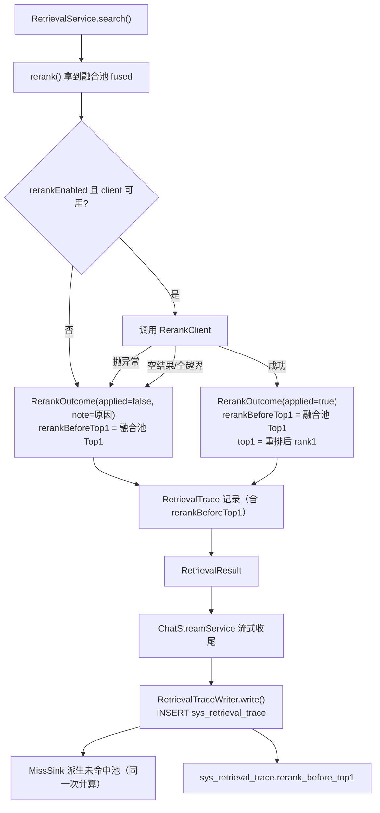
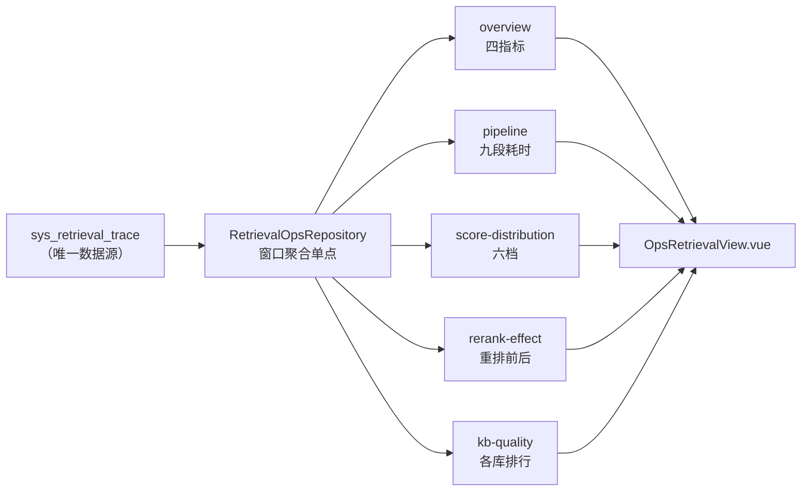

> 状态：✅ 已完成 · Sprint S8 · 阶段 D（M10 检索质量分析 · 页 20）· 建档 2026-09-20 · 回填 2026-09-20（判据 25 条：23 通过 / 0 失败 / 2 挂起）

# `2026-09-20-S8-M10-D` —— 页 20 检索质量分析（`T-A03`）+ `T-706` 权限口径复核

**批次粒度依据**：`T-A03` 是 S8 剩下的最大一块（页 20 = 需求 `08` `FR-OPS-02` 全节：四指标 +
六阶段耗时 + 五档分布 + Rerank 效果 + 各库排行 = **5 个端点 + 1 个页面**）。`T-A04`（离线预计算）
依赖它、`T-A05`（页 21）依赖它 —— 但**都不并入**（`T-A04` 的粒度要按页 20/21 定，见 §3 明确不做）。
O 项按用户 2026-09-20 裁定并入 **`T-706` 权限口径复核**（一条挂起账，成本近零）。

---

## 1. 开工条件检查

**条件清单来源**：`docs/进度/00-开工速览.md` §1/§2/§3/§4（唯一入口）· `02-任务清单.md:391`（`T-A03` 行）·
`plan/汇总.md` §3/§5 · 上一批 `2026-09-20-S8-M10-C.md` §9（13 条遗留）· 实测环境。

### 1.1 依赖（逐条判定）

| # | 条件 | 判定 | 依据 |
|---|---|---|---|
| 1 | `T-707` 检索打点**已在采集**（`T-A03` 声明的唯一依赖） | ✅ **已交付** | `S5-M08-A` 落 `V22`（`sys_retrieval_trace` + `_chunk`）· 速览 §3 记 `G5-12`/`G5-13` 已通过 |
| 2 | 打点表**列够不够**算本页五个端点 | 🔴 **不够 —— 但已裁定** | 见 §1.2-B1（`rerank_before_top1` 缺列） |
| 3 | 打点表**有没有归属列**做「各库排行」 | ⚠️ **只有 `kb_ids` 逗号串** | `V22:82` 的 DDL 注释**明写**「只展示与粗筛，**不做关联**」⇒ 见 §1.2-W1 |
| 4 | 前端页 20 存不存在 | ✅ **已存在（mock 版）** | `ai_knowledge_app/src/views/ops/OpsRetrievalView.vue`（17KB，9-12 建）· 路由 `router/index.ts:48` · 闸路由清单 `scripts/lib/routes.mjs:50` |
| 5 | 五个端点的前端调用与类型 | ✅ **已声明** | `api/index.ts:204-209` 五个方法齐全 · `types/index.ts:910-949` 五个 interface 齐全 |
| 6 | 接口契约文档 | ✅ 已在 `10-接口约定汇总.md:284-288`（路径）+ `:452-453`（响应体） |
| 7 | 权限码 | ⚠️ **不存在 `ops:retrieval:*`** | `sys_permission` 实测 **40** 个（`ops:qa:view`=63 / `ops:qa:handle`=64）⇒ 见 §1.2-W2 |
| 8 | 环境 | ✅ | docker **6 服务全在**（`milvus-standalone`/`kb-neo4j`/`milvus-etcd`/`kb-minio`/`kb-mysql`/`kb-valkey`） |
| 9 | 种子基线 | ✅ 干净 | `kb=8` · `user=128`（未删）· `role=5` · `perm=40` · **`trace=0` · `trace_chunk=0` · `chat_msg=0`** |
| 10 | 迁移编号 | ✅ | 现有最大 `V34` ⇒ 本批用 **`V35`**（批次计划 C 的「`V35` 仍空位」正好由本批占用） |

### 🔴 1.2 ⛔ BLOCKER：无（两条疑似 BLOCKER 均已由用户裁定化解）

**B1（原判 BLOCKER）·「Rerank 净提升」没有数据源。**
需求 `08` §2.4 整节的核心结论是「288ms 换来 **+18 个百分点**的 Top1 命中提升（63% → 81%）」，
而 `sys_retrieval_trace` **没有任何"重排前"分数**：主表无此列，子表 `sys_retrieval_trace_chunk.score`
按 DDL 注释（`V22:147`）是**最终分**（重排过 = 重排分，未重排 = 融合分）。⇒ `beforeTop1HitRate`
**算不出来** ⇒ `gainPercent` 也算不出来。

⚠️ **不能靠子表补**：`toChunks` 把**融合池全部候选**按重排分重排后**才**截 Top-K
（`RetrievalService:302`），而子表**只存截取后的 K 条** ⇒ 融合池的 rank-1 可能不在这 K 条里
⇒ 「已存子行的最大融合分」**不等于**重排前的 Top1。（我核过代码，不是推测。）

✅ **用户 2026-09-20 裁定：加列打点**（选项原文：「加列打点（推荐）」，理由 = 本仓既有硬约束
**`D-2`「打点后补 = 数据永久缺失」**——不加，这一栏**永远**算不出来）。
代价已量：`RetrievalTrace` 是 `T-704` 的**冻结对外契约**，但全仓只有 **5 处** `new RetrievalTrace(`
（主 2 + `withChunks` 1 + 测试 2）⇒ 加一个字段的改动面可控。
⚠️ **历史数据不可回填** ⇒ 页面在攒够数据前显示**「数据不足（打点自 V35 起）」**，不许填 0。

**B2（原判 BLOCKER，降级为 W1）·「各库排行」没有归属列。** 见下。

### ⚠️ 1.3 WARN（软缺 / 已知偏差，逐条进 §9）

| # | WARN | 影响 | 处置 |
|---|---|---|---|
| **W1** | **`kb-quality` 无归属列** | 需求 §2.5 的「各知识库提问数」只能靠 `FIND_IN_SET(kb_ids)` ⇒ 一次提问命中多库会**重复计入**，而需求 §2.8 第 4 条要求**「各库合计 ≤ 提问总数（未列出的归入"其他"）」** ⇒ 用 `FIND_IN_SET` 会**违反需求量化的那条 `≤`** | **口径**：只把 **`kb_count = 1`** 的行归给对应库，多库行归入「其他」桶 ⇒ `≤` 结构性成立。页面注明口径（与 `S8-M10-A` §9-⑤「`kb_ids` 按库筛是近似」同源） |
| **W2** | **无 `ops:retrieval:view` 权限码** | 页 20 五个端点都是只读，需要一个码 | ✅ **用户裁定：新增第 41 个码，只给 `ADMIN`**（AUDITOR 在页 20 收 403、页 11 收 200 ⇒ **边界可证伪**，合本仓判例 `#153`/`#168`） |
| **W3** | **① 查询理解恒 0**（`query_analysis_millis` = 0，`#145`） | 需求 §2.2 以为查询期有 HyQ 改写；后端 HyQ 是**索引期**生成分片 ⇒ 查询期无此步 | **如实显示 0ms** + 就地注明「后端无此步」；**不拿「可见范围耗时」冒充**（`V22:96` 的列注释已写明这条口径） |
| **W4** | **`avgCitedChunks` 是「喂给模型的分片数」不是「被引用的」** | `sys_retrieval_trace_chunk.cited` **恒 NULL**（`V22:150`：要解析答案角标，属 `T-804`） | 用 `avg(chunk_count)`，标签下的口径注写明是**喂给模型的**那批 |
| **W5** | **需求 §2.2 的「关注指标」列 6 个示例值里 4 个无打点** | 「改写成功率 / Top20 内命中率 / 精确匹配命中率 / 首字延迟·引用采纳率」**都没有采集点** | **能给数的给数**（「去重后候选数」= `avg(fused_count)`、「重排前后命中率差」= 新增列），**给不了的返回 `null` + 页面显示 `—`**，不许留 mock 的 `96.4%`/`88.2%` |
| **W6** | **`/system/thresholds` 的「两个消费方」都不存在** | `SystemController:26-28` 类注释写「消费方横跨两个页面：KB 设置页 + 运营分析页」；实测**前端零调用点**（`api/index.ts:278` 声明了没人用；KB 页编辑的是**库级** `retrievalConfig`，见 `KbDetailView.vue:487`） | 本批 `T-706` 复核的产出：**不收窄** + **订正类注释** + 登记。⚠️ 与 `#85`「那'两个页面'不存在」**同族第 2 次** |
| **W7** | **三条页闸要在 mock 模式下跑** | `render-check`/`layout-check` 用写死的 `mock_selftest_token`；`console-check` 的 `/system/model` 三态断言依赖 mock 夹具 | 照上一批口径执行并写进证据 |

> **分档判据**（skill 原文）：**这条不满足，代码写下去会不会白写**。B1 曾判 BLOCKER（会白写），
> 裁定「加列」后**依赖成立** ⇒ 转 WARN 无需；B2 经需求自留的 `≤` 化解 ⇒ 一直是 WARN。

---

## 2. 开工时间

| 项 | 值 |
|---|---|
| 开工日 | **2026-09-20** |
| 预计投入 | **≈ 7.5 人天**（`T-A03` ≈ 7.0：后端 2.5 / 用例 1.5 / 前端 1.5 / E2E 1.0 / 回填 0.5；`T-706` ≈ 0.5） |
| 实际投入 | 回填时补 |
| 排期容量 | ≈ 10 人天/Sprint（上一批 C 阶段 ≈ 7.5） |

---

## 3. 开工内容

### 3.1 步骤（按依赖顺序；标注可并行项）

| # | 改哪个 | 做什么 | 产出 |
|---|---|---|---|
| **1** | `db/migration/V35__s8_rerank_before_top1.sql` | `ALTER TABLE sys_retrieval_trace ADD COLUMN rerank_before_top1 DECIMAL(12,6) NULL`，列注释写清「**可空**：未重排 / 融合池为空时为 NULL；`0` = 分数真的是 0」 | 迁移（**只增不改**，`V1`~`V34` 一行不动） |
| **2** | `pipeline/retrieve/RetrievalTrace.java` | 加一个字段 `rerankBeforeTop1`（`Double`，可空）。⚠️ 它是 `T-704` **冻结契约** ⇒ javadoc 里写明**为什么必须现在加**（`D-2`）+ 为什么可空 | 记录 + 1 处 `withChunks` |
| **3** | `pipeline/retrieve/RetrievalService.java` | 在**重排前**取融合池 Top1（`rerankScores == null` 时 = 融合分最高的那条；重排失败/未启用 ⇒ 记**融合分**）。⚠️ 与 `top1()` **共用同一个选择器**（不许各写一遍"取分最高的"） | 2 处构造点填值 |
| **4** | `pipeline/retrieve/RetrievalTraceWriter.java` | `INSERT_TRACE` 加列 + `setParameter`；取值走**与 `top1()` 同族**的静态方法（量纲随 `rerank_applied` 变的注释要扩到这一列） | 写入侧 |
| **5** | `dto/ops/OpsRetrievalDtos.java`（新） | 五个端点的 DTO + **逐字段 javadoc 写口径**（仿 `OpsDtos` 的做法） | DTO |
| **6** | `core/ops/RetrievalOpsRepository.java`（新） | 窗口聚合**收敛在一处**（承上批 `QaOpsRepository` 的形态 —— `T-A04` 落地时只改这一处）。复用 `TimeWindow` | 数据访问单点 |
| **7** | `service/OpsRetrievalService.java`（新） | 五个方法 + 口径计算（见 §3.3） | 服务 |
| **8** | `controller/OpsRetrievalController.java`（新） | 五个 `@GetMapping`，全部 `@RequiresPerm("ops:retrieval:view")`。⚠️ **只读、不挂 `@AuditLog`**（无写动作 ⇒ 不新增审计点 ⇒ 冻结清单**仍 37**） | 控制器 |
| **9** | `V35` 的**第二段**（或独立迁移段） | 插 `sys_permission` 第 **41** 行：`('ops:retrieval:view', '查看检索质量分析', '系统管理', 65)` + **只赋给 `ADMIN` 角色** | 权限种子 |
| **10** | `ai_knowledge_app/src/views/ops/OpsRetrievalView.vue` | 接真（五个 `opsApi` 已是真路径，改的是**渲染口径**）：① 顶部时间范围下拉**真实驱动**五个端点（现在 `range` 是死值 `7d` 且下拉无 handler）；② **空态诚实**（`trace=0` ⇒ 显示「数据不足」而不是 0/空白 —— 需求 §2.8 最后一条）；③ `pipeline` 的 `slice(0,5)`/`pipeline[5]` 改成**按段名取**（见 §3.3-A2，行数不再写死）；④ `metricValue` 为 `null` 时显示 `—`；⑤ `rerankGain`/`beforeTop1HitRate` 为 `null` 时显示「数据不足」 | 页面 |
| **11** | `ai_knowledge_app/src/types/index.ts` | `RetrievalOverview.rerankGain` / `RerankEffect.beforeTop1HitRate` 改 `number \| null`；`PipelineStage.metricValue` 改 `string \| null`；`ScoreBucket` 加「无召回」档 | 类型 |
| **12** | `system/SystemController.java` + `service/SystemThresholdService.java` | `T-706` 复核产出：**订正类注释**（「消费方横跨两个页面」→ 实情「当前无消费方；KB 设置页编辑的是库级值；页 20 展示的是端点自己回的阈值」）+ 写明「**若将来收窄，先确认消费方**」 | 注释（**不改权限**） |
| **13** | `src/test/.../OpsRetrievalStatsFlowTest.java`（新） | 读侧用例，**每条自造行**（`trace=0` ⇒ 不造行只会验到"空的时候不报错"） | 用例 |
| **14** | `src/test/.../RetrievalTraceBeforeTop1FlowTest.java`（新） | **写入侧**用例：走真链路（只替模型层，仿 `QaMissReplayFlowTest`）⇒ `rerank_before_top1` 真落库且 ≈ 融合池 Top1 | 用例 |
| **15** | `src/test/.../OpsRetrievalPermFlowTest.java`（新） | 权限边界：`ADMIN` 200 · **`AUDITOR` 403**（**可证伪**）· 无 token 401 | 用例 |
| **16** | `ai_knowledge_app/scripts/e2e-ops-retrieval-flow.mjs`（新） | 页面级真链路（CDP 直驱 Edge） | E2E |
| **17** | 文档七处 + 结论 | 回填段 | 见 §3.5 |

**可并行**：步 5~8（后端读侧）与步 10~11（前端）在**步 9 的权限码落地后**可并行；
步 13 与步 14 可并行；步 16 必须等步 8 + 步 10。

### 3.2 业务流程图

**① 写入侧：新增一列如何穿过检索链路**（触发条件：跨 ≥3 组件 + 有并发/事务边界）

**② 读取侧：五个端点如何从一张表算出五张图**（触发条件：跨 ≥3 组件）

### 🔴 3.3 本批必须写死的口径（**需求文档没写、由本批定**）

**A1 ·「命中」的定义。** `top1_score >= miss_threshold`（用**行内存的** `miss_threshold`，
不是当前全局值 —— 与打点"冗余记一份阈值"的理由同源，见 `RetrievalTrace` javadoc）。
⚠️ **分母 = `rerank_applied = 1` 且 `top1_score` 非空的行**：未重排行的分是**融合分**，
与 `miss_threshold` **不同量纲**（`V22:123` 的列注释已写明）⇒ 混进来算命中率是把两种分当一种。
未重排行数**单独返回**（`unscoredRerank`），不许静默丢。
⚠️ 沿用 `G8-5` 的语义：这里的「命中」是「**库里有了相关内容**」，**不是**「问题被回答了」。

**A2 · 检索侧总耗时的口径（需求 `08` §2.2 vs `01` §7.2 有出入）。** 需求 §2.8 第 1 条要
「各阶段合计 = 声明的检索侧总耗时」，而需求列的 **5 项之和（428ms）里不含「可见范围」与「表格回表」**
—— 而这两段是**真花的**（`scope_millis` / `table_millis`，`V22:105/108`）。
⇒ 响应多给一个 **`otherMs`**，页面 sum 行写成 **`检索侧 A + 生成 B + 其他 C = 全链路 D`**（三段相加 == D）。
判据：`A + B + C == D`（可证伪）；`otherMs = 0` 时页面与需求长得**一模一样**。

**A3 · 检索侧的行怎么排。** `pipeline` **复用 `ChatWireMapper.stages()` 的 9 段段名与顺序**
（可见范围 / 查询解析 / Embedding / 向量召回 / BM25 召回 / RRF 融合 / Rerank / 表格回表 / LLM 生成）——
那是**已有的单一事实源**，且页面 mock 的前 6 个段名与之逐字一致。
⇒ 需求 §2.2 的 6 项**逐项在内**（① 查询理解 ↔ 查询解析、⑥ 生成答案 ↔ LLM 生成），
② 向量召回 = **Embedding + 向量召回**（需求把向量那一路算一段）。**页面的 `slice(0,5)` 必须改掉。**

**A4 · 五档 + 一个「无召回」档。** 🔴 需求 §2.8 第 2 条「五档合计 = 提问总数」**在有空召回行时不可能成立**：
`top1_score` 为空的行（`G5-13` 明确：空召回**仍有一行**且为 `NULL` 不是 0）**落不进任何一档**
⇒ 必须补第 6 档「**无召回（无 Top1）**」，并**返回 `unscored` 数**。
⚠️ 这与上一批点踩归因的 `unreasoned` 是**同一种处置**（差一个量的那一份要显式给出）。

**A5 · §2.8 第 3 条「未命中档次数 = 11 页清单条数」不可能成立。** 🔴 **与需求 §1.10 的两条是同一个形状**
（第 **三** 次现身）：`< 0.35` 数的是**提问次数**，而 11 页清单是**归一化聚合后的行数**
（`G8-2` 只到归一化聚合）⇒ 只要有重复提问，两个数就必然不等。
⇒ **两个数都返回**（本页的 `missBucketCount` + 口径注指向 11 页的「提问次数合计」），
**订正建议与 §1.10 的两条一次改完**（共 **三** 条）。

### 3.4 明确不做

| 不做 | 归属 |
|---|---|
| 页 21 使用统计（`G8-8`·`G8-9` 的个人维度半边） | `T-A05` |
| **离线预计算**（`G8-10`） | `T-A04`。⚠️ **本批更不该做**：页 20 的聚合粒度（按库/按阶段）正是 `T-A04` 要的输入，本批先把**查询形状**定下来 |
| 实时链路追踪可视化（需求 §2.9 明列不做） | 不做 |
| 单次请求的 trace 回放界面（需求 §2.9） | 不做（traceId 可在日志系统查） |
| 自动调参（需求 §2.9） | 不做 |
| `R-6` 语义聚合 | 挂起（无语料校准） |
| `T-O19` 剩半（会话族残留机制）· `#225`（维度硬编码，**休眠陷阱**） | 用户裁定**不并入**本批 ⇒ 留在 §9 |
| `check-ledgers` 剩余 3 条 `S3-D` 待判 | 留 |
| 换嵌入模型 / 换 VL 模型 | 本版本明确不做（用户裁定） |
| 「关注指标」列的 4 个无打点指标**去补采集点** | 不做 —— **先如实显示 `—`**，补采集点要单独一批（登记 §9） |
| 导出报表按钮的真异步导出 | 需求 `FR-OPS-02` §2.6 **没有导出端点**（那是页 11 的 §1.7）⇒ 页 20 的「导出报表」按钮**归 `T-A03` 之外** ⇒ 登记（见 §9） |

### 3.5 文档回填（回填段执行）

`plan/汇总.md`（§1/§2/§3/§5）· `docs/进度/00-开工速览.md` §1~§4 · `02-任务清单.md`（`T-A03` 置 ✅ ·
`T-A04`/`T-A05` 依赖行更新）· `03-Sprint排期.md`（S8 交付状态段）· `docs/进度/README.md` 看板 ·
`变更记录/01` + `02` · `docs/需求文档/10-接口约定汇总.md` §14（五个端点的字段契约 + 两处口径订正）·
`13-接口变更记录.md` · 🔴 `docs/需求文档/08-需求-运营分析.md` §2.8（**三条不可能成立的验收要点**，
口径订正建议，**原条目一字不改**）· 新增 `docs/后端开发文档/16-S8-检索质量分析结论.md` ·
`.workbuddy/memory/2026-09-20.md`（追加）。

---

## 4. 数据变更清单

| 项 | 内容 |
|---|---|
| **改表** | `sys_retrieval_trace` **加 1 列**：`rerank_before_top1 DECIMAL(12,6) NULL`。**可空**（未重排 / 融合池为空 ⇒ NULL，**不是 0**）；无索引（不参与过滤） |
| **新建表** | 无 |
| **迁移编号** | **`V35`**（现有最大 `V34`）· 只增不改 |
| **权限种子** | `sys_permission` **加 1 行**（第 **41** 个码）：`ops:retrieval:view` / 查看检索质量分析 / 系统管理 / sort **65** + `sys_role_permission` **只给 `ADMIN`**（AUDITOR 拿不到 ⇒ 边界可证伪） |
| **演示数据** | **无**（`sys_retrieval_trace` 实测 **0 行** ⇒ 页面的空态**必须诚实**，这是需求 §2.8 最后一条点名要的） |
| **回滚方式** | **可逆**：`DROP COLUMN` + `DELETE FROM sys_permission WHERE code='ops:retrieval:view'`。⚠️ 回滚代码后列会残留（无害，写入侧不再填 ⇒ 全 NULL） |
| **NULL 分支写清** | ① `rerank_before_top1` 为 NULL ⇒ `beforeTop1HitRate` 的**分母不含该行**，且**单独返回 `unscoredRerank` 计数**；② `llm_generation_millis` 为 NULL（空召回不调模型）⇒ 生成段**不参与均值**（不是"耗时 0ms"）；③ `top1_score` 为 NULL ⇒ 落第 6 档「无召回」 |

---

## 5. 依赖与工具决策

**无（用既有栈实现）。** 逐条说明：

- 聚合用**原生 SQL + `EntityManager`**（与 `QaOpsRepository`/`RetrievalTraceWriter` 同一手法 ——
  本仓既有先例，不引 JPA 实体做聚合视图）。
- 时间窗复用既有 **`core/ops/TimeWindow`**（`DEFAULT_DAYS=7` / `MAX_DAYS=365`，**夹取不拒绝**）。
- 分档/百分比在 **Java 侧**算（SQL 表达 `CASE WHEN` 分档也可以，但 6 档 + 中文标签与
  `ScoreBucket` 的字段一一对应 ⇒ 放 Java 侧**与页面 DTO 同处**，且阈值是**需求写死的常量**不是配置）。
- CSV/导出：**本批不需要**（见 §3.4 最后一行）。
- **不引**：不引图表库（页面用既有 CSS 条状图，mock 版已实现）· 不引 SQL 构建器 · 不引缓存。

---

## 6+7. 验收方法与标准

> **判据 vs 观察项分开**：页面写死的展示值（如「Rerank 占检索侧 67%」的文案）登记为观察项，不计成败。
> **挂起项标 `⏸️`**。**门禁号对齐** `G8-1`/`G8-6`/`G8-7`。

| # | 判据 | 验收方法（可粘命令） | 期望结果 | 证据落点 |
|---|---|---|---|---|
| 1 | **`rerank_before_top1` 真落库**（`D-2` 的落点） | `mvn -B -f F:/work/code/ai-knowledge/ai_knowledge_web/pom.xml test -Dtest=RetrievalTraceBeforeTop1FlowTest` | `rerank_applied=1` 的行该列**非空**且 ≈ 融合池 Top1；未重排行**记融合分**且 `top1` 也 = 融合分 | 用例输出 |
| 2 | **写入侧改动不碰 SSE 线格式**（`T-704` 冻结契约的回归） | `mvn ... test -Dtest=ChatWireMapperTest,RetrievalResultContractTest` | 全绿；`done`/`trace` 字段**逐字未变**（新字段**不上线**） | 用例输出 |
| 3 | **五档 + 无召回合计 = 提问总数**（`G8-7` 的订正版） | `mvn ... test -Dtest=OpsRetrievalStatsFlowTest` | `优秀+良好+一般+边缘+未命中 + 无召回 == 总行数`（**双向断言**，防退化成空断言） | 用例输出 |
| 4 | 🔴 **判据 3 的证伪** | 把某档边界挪 0.01 或漏掉「无召回」档 | 转红 | 用例输出 |
| 5 | **九段之和 == 检索侧 + 生成 + 其他 == 全链路**（`G8-6`） | 同上 | `A+B+C == D`，且 `A+B+C` 精确等于各段实测之和 | 用例输出 |
| 6 | 🔴 **判据 5 的证伪** | 把 `otherMs` 去掉（即 `A+B == D`） | 转红（真的有空召回/可见范围耗时时必红） | 用例输出 |
| 7 | **「命中」的分母口径** | 同上 | 只含 `rerank_applied=1` 且 `top1_score` 非空的行；`unscoredRerank` 数 == 被排除的行数 | 用例输出 |
| 8 | 🔴 **判据 7 的证伪** | 把未重排行混进分母 | 转红 | 用例输出 |
| 9 | **Rerank 净提升可算**（`beforeTop1HitRate` 非 null） | 同上 | 有一列数据时 `gainPercent = after − before`；**一行都没有时返回 `null` 而不是 0** | 用例输出 |
| 10 | 🔴 **判据 9 的证伪（空态）** | 清空窗口 | 四个指标中 `rerankGain`/`beforeTop1HitRate` = `null`（**不是 0**） | 用例输出 |
| 11 | **各库排行合计 ≤ 提问总数**（需求 §2.8 第 4 条） | 同上 | `单库行数 + 其他 == 总行数`（**精确相等**，比需求的 `≤` 更强） | 用例输出 |
| 12 | 🔴 **判据 11 的证伪** | 把多库行重复计入两个库 | 转红 | 用例输出 |
| 13 | **权限边界**（可证伪） | `mvn ... test -Dtest=OpsRetrievalPermFlowTest` | `ADMIN` 全 200 · **`AUDITOR` 五个端点全 403** · 无 token 401 | 用例输出 |
| 14 | **权限码登记三处一致** | `set -a && . ai_knowledge_web/.env && set +a && docker exec kb-mysql mysql -u"$MYSQL_USERNAME" -p"$MYSQL_PASSWORD" "$MYSQL_DATABASE" -N -e "select count(*) from sys_permission;"` | **41**；且 `select count(*) from sys_role_permission rp join sys_role r on r.id=rp.role_id join sys_permission p on p.id=rp.permission_id where p.code='ops:retrieval:view' and r.code='ADMIN';` = **1**，`... and r.code='AUDITOR';` = **0** | SQL 输出 |
| 15 | **审计冻结清单仍 37**（无新审计点） | `mvn ... test -Dtest=AuditCoverageFlowTest` | 全绿（本批**不新增**审计点） | 用例输出 |
| 16 | **无迁移回归** | `mvn ... test`（全量） | flyway 版本号 **34 → 35**；全量 **725 + N / 0 红 / 2 跳过** | 跑批输出 |
| 17 | **空态诚实**（需求 §2.8 最后一条） | `node scripts/render-check.mjs`（**mock 模式**）+ 真后端下人工看页 20 | `trace=0` 时页面显示**「数据不足」**而不是 0 / 空白 / 假数字 | 闸输出 + 截图 |
| 18 | **页面级真链路** | `node scripts/e2e-ops-retrieval-flow.mjs --base=http://127.0.0.1:5174` | 全通过（造真打点 ⇒ 五块图都出数 ⇒ 收尾自清） | E2E 输出 |
| 19 | **三条页闸（mock 模式）** | `node scripts/render-check.mjs` · `console-check.mjs` · `layout-check.mjs` | **25/25 · 25/25 · 4/4**；⚠️ 页 20 的 `expect` 正则已在 `routes.mjs:50` | 闸输出 |
| 20 | **`G8-1` 三页分工不重叠** | 人工对照 11 页七端点与页 20 五端点的字段 | 无同名字段；页 20 只答「为什么」 | 结论文档 |
| 21 | **`T-706` 复核结论落地** | `grep -rn "systemApi.thresholds\|systemApi\.thresholds()" ai_knowledge_app/src/` | **0 个调用点**（证「两个消费方不存在」）；`SystemController` 类注释已订正 | grep 输出 |
| 22 | **`check-ledgers` / `check-enums` 不回归** | `node scripts/check-ledgers.mjs` · `check-enums.mjs` | 0 问题 · 2 组三方一致 | 闸输出 |
| 23 | **残留归零** | 跑完核对基线 + MinIO **七**前缀真对象 | `kb=8`/`user=128`/`perm=41`/`trace=0`/`trace_chunk=0`；七前缀 0 | SQL + 目录 |
| ⏸️ 24 | **真实语料下的分布形态**（「左移=覆盖不足」那三条读法） | —— | ⏸️ 挂起：`trace=0`，**没有真实语料** | 登记 §9 |
| ⏸️ 25 | **Rerank 净提升的正数结论**（需求 §2.4 的 `+18pp`） | —— | ⏸️ 挂起：新增列**只能在被打点之后**才有数据；本批验的是**能算**，不是**算出多少** | 登记 §9 |

---

## 8. 验收结果

**一句话**：判据 **25 条 → 23 通过 / 0 失败 / 2 挂起**（挂起是"没有对象"：真实语料与"净提升的正数结论"）。
其中 **1 条判据订正**（14）· **1 条部分**（22）· **4 处证伪全过** · **2 处计划外发现**（都在下面单列）。

| # | 判据 | 结果 | 实测 |
|---|---|---|---|
| 1 | `rerank_before_top1` 真落库（`D-2` 落点） | ✅ | `RetrievalTraceBeforeTop1FlowTest` **2/2**：融合池 rank-1 得 0.20 而重排后 Top1 是 0.90 那条 ⇒ 断言 `rerank_before_top1 = 0.20`、`top1_score = 0.90`，**且都从库里查回来** |
| 2 | 写入侧不碰 SSE 线格式 | ✅ | `ChatWireMapperTest` / `RetrievalResultContractTest` 绿（新字段**不上线**） |
| 3 | 五档 + 无法定档 == 提问总数（`G8-7`） | ✅ | 7 行构造数据：五档各 1 + 无法定档 2 = 7 ✅ |
| 4 | 判据 3 的**证伪** | ✅ | 把「无法定档」那档的计数改成 0 ⇒ 两条断言当场转红（`countOf` 2→0、合计少 2） |
| 5 | 九段之和 == 检索侧 + 生成 + 其他 == 全链路（`G8-6`） | ✅ | 单测（构造数据无小数）：145 + 1000 + 25 = **1170** 精确等于；E2E（真实数据带小数）：**容差 2ms**，实测 `3018 + 1486 + 181 = 4685` 与 `total 4685` **恰好相等** |
| 6 | 判据 5 的**证伪** | ✅ | `otherMs` 归零 ⇒ `pipelineThreePartsAddUp` 转红（差 25ms） |
| 7 | 「命中」的分母口径 | ✅ | 未重排的 0.99 融合分**不进**均值/命中率（否则 0.55→0.6967、50%→66.7%） |
| 8 | 判据 7 的**证伪** | ✅ | 把 `rerank_applied = 1` 从两个 CASE 里去掉 ⇒ `overviewExcludesFusionScaleRows` 转红 |
| 9 | Rerank 净提升可算 | ✅ | 覆盖 2 行：前 50.0% / 后 100.0% / 提升 **+50.0**（分母换成可比集会给 33.3）· **E2E 真链路**：`covered=2 comparable=2`、净提升 `0`（重排真的跑了） |
| 10 | 判据 9 的**空态证伪** | ✅ | 一行前值都没有 ⇒ `covered=0` 且三个比率**都是 `null`**（不是 0） |
| 11 | 各库合计 ≤ 提问总数 | ✅ | **精确相等**（`questions + othersQuestions == total`）—— 比需求的 `≤` 更强 |
| 12 | 判据 11 的**证伪** | ✅ | `kb_count = 1` 改成 `>= 1` ⇒ 跨库行被拆进各库、`questions` 3≠2 ⇒ 转红 |
| 13 | 权限边界（可证伪） | ✅ | **同一次运行里**：`AUDITOR` 页 11 是 200、页 20 五个端点**全非 0**；超管全 200；无 token 非 200 |
| 14 | 权限码登记一致 | ⚠️ **判据订正** | 计划写的是 `r.code = 'ADMIN'` **= 1 行** —— 🔴 **实测角色码是 `SUPER_ADMIN`，且它走运行时 `*` 通配**（`PermissionQueryRepository:55`），`sys_role_permission` 里**一行都不插**。⇒ 判据改为「`AUDITOR` / `KB_ADMIN` **各 0 行**」：实测 **41** 个码、该码**无任何 `sys_role_permission` 行**（`V35` 的头注释已写明为什么不该插） |
| 15 | 审计冻结清单仍 37（无新审计点） | ✅ | `AuditCoverageFlowTest` 绿；五个端点**全只读** |
| 16 | 无迁移回归 | ✅ | flyway **34 → 35**；全量 **725 → 740 / 0 红 / 2 跳过**（+15 逐条吻合：读侧 13 + 写入侧 2） |
| 17 | 空态诚实（需求 §2.8 最后一条） | ✅ | 单测：空窗口四个指标全 `null`、六档**仍在**（各 0）；E2E：页面有「数据不足 / 口径」说明 |
| 18 | 页面级真链路 | ✅ | **`e2e-ops-retrieval-flow` 28/28**（建库 → 上传 → 等 READY → 真提问两次 → 五端点对账 → 页面逐档对账 → 自清**残留 0 行**）· 控制台 error **0** 条 |
| 19 | 三条页闸（mock） | ✅ | `render-check` **25/25** · `console-check` **25/25** · `layout-check` **4/4**（`/ops/retrieval` 早就在 `routes.mjs:50`） |
| 20 | `G8-1` 三页分工不重叠 | ✅ | 页 20 只答「为什么」（链路耗时 / 分档 / 重排效果 / 按库），与页 11 的七条端点**无同名字段**；`G8-1` 的另一半（与页 21 比）仍待 `T-A05` |
| 21 | `T-706` 复核结论落地 | ✅ | `grep` 全前端 **0 个** `/system/thresholds` 调用点（`api/index.ts:278` 声明了没人用；KB 设置页编辑的是**库级** `retrievalConfig`）⇒ **不收窄** + 类注释订正 |
| 22 | `check-ledgers` / `check-enums` 不回归 | ⚠️ **部分** | `check-enums` **2 组三方一致** ✅；🔴 **`check-ledgers` 开工时就点名两处漏登**（`plan/README.md` 索引 + `汇总.md` §2 批次账**都没有本批文件**）⇒ 回填时已补，**机制见 §9-③** |
| 23 | 残留归零 | ✅ | `kb=8` / `user=128` / `kb_grant=34` / **`perm=41`** / 其余全 0 · MinIO **七个前缀真对象 0**（`xl.meta` 计数）· `selftest-residue` **8/8** |
| 24 | 真实语料下的分布形态 | ⏸️ **挂起** | `trace=0`（本批只在造数据的瞬间有行）⇒「左移=覆盖不足」那三条读法**没有语料可验**。**待**有真实提问量的批次 |
| 25 | Rerank 净提升的**正数结论**（需求 §2.4 的 `+18pp`） | ⏸️ **挂起** | 新列**只能在被打点之后**才有数据 ⇒ 本批验的是「**能算**」，不是「算出多少」。⚠️ E2E 那一轮净提升是 **0**（真链路上重排前后的命中率恰好相同）—— 那个数**不能**当成"重排没用"的结论（样本 2，且判定线附近的抖动会让结论翻转，承 `S8-M10-B` §9-④） |

### 🔴 8.1 计划外发现之一：权限「冻结清单」漏了一条判据

**现象**：全量跑批 **740 / 1 红** —— 唯一那红是 `UserAdminFlowTest#permissionTree`：
`expected: 40L but was: 41L`。

**性质**：这不是缺陷，是本仓「**冻结清单**」纪律的正常代价 —— 新增权限码要同步**每一处**账。
但 🔴 **我的 §4 只写了"权限种子 +1 行"，§6+7 里没有"同步权限冻结清单"这一条判据**
⇒ 这条红是**被跑批逮到的，不是被计划预见到的**。
处置：总数 **40 → 41** + 「系统管理」叶 **18 → 19**（新码就在那一组），并按惯例在注释里写明
「**新加的那个码授给了谁**」= 只给超管、AUDITOR 刻意不给；改完**单类复验 15/15 绿**。
⚠️ 同类账还有两处（审计冻结清单 **37** 不变、MinIO 前缀 **7** 不变）—— 本批恰好都没动，所以只炸了一处。

### 🔴 8.2 计划外发现之二：`T-O19` 那条「机制未定位」的**半边，现场定位了**

**背景**：上一批（`S8-M10-C`）收尾时逮到一行会话族残留，机制未定位，登记为 `T-O19` 的未完成半边。
本轮**跑批前核基线时又逮到一行**（`session=1` / `chat_msg=2` / `trace=1` / `trace_chunk=5`）。

**查证过程（按"根因靠查数据不靠猜"）**：
1. 那行的 `rerank_before_top1` **有值** ⇒ 它是 **`V35` 之后**写的，即**本轮**造的（不是历史遗留）；
2. 取 `--default-character-set=utf8mb4` 解码问句 ⇒ **`e2e-ops-miss-flow` 的探针问句**
   （我这轮跑过它，报 **21/21**）；
3. 🔴 **直接证据**：那次运行的输出里**没有**「会话四张表收尾」这一行
   ⇒ `if (sessionFloor)` **块整段被跳过**；
4. 水位线取法是 `mysqlCount('select coalesce(max(id), 0) from sys_chat_session;')` ——
   **表为空时它就是 0**；而 `if (sessionFloor)` 把 0 当成"没抓到水位线"。

⇒ **根因**：**表为空 = 本仓基线干净时的常态**（每一批收尾都把会话族清空），
而清理的**守卫条件**恰好把"干净的起点"误判成"没有活要干" ⇒
**这个漏在干净环境里必然发生、在脏环境里反而不发生** —— 所以它偶发得像环境问题。

🔴 这是「**清理必须走必走路径**」的**第五种形态**：前四种是
`#186`（`step()` 一抛就不执行）· `#187`（`await` 返回值被丢）· 验证脚本 `process.exit()` 早退 ·
`S8-M10-C` 的「清理有调用方 ≠ 会造行的脚本被覆盖」。
**这一种是：守卫条件本身把"没活要干"与"活没干"混为一谈。**

⚠️ **同一个模式在三个脚本里**（`e2e-ops-miss-flow` / `e2e-ops-qa-stats` / `e2e-ops-replay-flow`
的 `sessionFloor` 都是 `coalesce(max(id),0)` + `if (sessionFloor)`）。
**一行可修**：守卫不该看**水位线的值**，该看"**本轮提过问没有**"（一个布尔）；
`> floor` 的删除条件本身是对的（floor=0 时删的是"本轮之后新建的"）。
🔴 **按用户 2026-09-20 的裁定（本批只并 `T-706`）未动手** ⇒ 已清掉本轮那一行残留 + 登记进 §9-①。

---

## 9. 遗留问题

| # | 条目 | 归属 |
|---|---|---|
| ① | 🔴 **`T-O19` 剩半已从"机制未定位"变为"一行可修"**（§8.2）：三个 E2E 脚本的会话族清理守卫
`if (sessionFloor)` 在**表为空**时被跳过 ⇒ **基线越干净越必然漏**。修法：守卫换成"本轮提过问吗"的布尔 | **建议下一批（测试可靠性小批）第一个做** —— 它现在有根因、有直接证据、有修法，成本 ≈10 分钟 |
| ② | ⚠️ **需求 §2.8 的订正建议**（四条）已写进 `08`，**原条目一字未改** ⇒ 需需求方确认后一次改完（连同 §1.10 那两条，共**四**条） | 需求方 |
| ③ | ⚠️ **`check-ledgers` 在开工时就报本批计划文件漏登**（`plan/README.md` 索引 + `汇总.md` §2 批次账）—— 回填已补。🔴 **这是"立据时漏登账"的第三次**（`S6-M11` 计过两次）⇒ 建议把「立据时顺手登两处账」写进 `batch-plan` skill 的开工段 | `T-O12` 同族 · 建议进 skill |
| ④ | 🔴 **「关注指标」列有 4 个没有采集点**（改写成功率 / Top20 内命中率 / 精确匹配命中率 / 首字延迟·引用采纳率）⇒ 本批如实显示 `—`。要真出数得**补采集点**（HyQ 门控结果、召回命中、首字时刻），属检索侧打点的扩展 | 新账 · 与 `T-710`/重排专项同族 |
| ⑤ | 🔴 **「各库检索质量排行」缺的是"提问侧的库范围"** —— `ChatRequest` 没有 `kbIds`、提问页没有库选择器、`ChatStreamService#chat` 硬传 `null` ⇒ 所有提问 `kb_count > 1` ⇒ 需求 §2.5 的整张表**当前只有「其他」一行**。聚合侧已经做对了（只归单库行），**缺的是源** | 新账（提问侧的库范围）· ⚠️ **"这个入口没有要处理的对象"的第 N 次** |
| ⑥ | ⚠️ **`rerank_before_top1` 的覆盖率是内生的**：重排服务只回 `top_n` ⇒ "重排前 Top1"只在它进了那 `top_n` 时才有值 ⇒ **覆盖率越低，"重排前命中率"越偏向高分**（已在 DTO/页面写明，但这是**度量本身的偏差**，不是实现的选择） | 长期 · 若要根治得让重排返回全候选分（改变生产链路，风险大，**建议不做**） |
| ⑦ | ⚠️ **「走势」的两半切分用 `now - days/2`**，与 `TimeWindow#from` 各自取一次 `now`（毫秒级偏差，对天级切分无影响，已注明）；**`UNKNOWN` 的阈值 5 次/半区**是**本批定的**，没有语料校准 | `T-A04` 一并复核 |
| ⑧ | ⚠️ 页 20 原型上的「导出报表」按钮**已摘掉**（需求 §2.6 没有该页的导出端点）。若产品要它，接页 11 `POST /ops/qa/export` 的同一套异步链路即可 | 产品裁定 |
| ⑨ | ⚠️ **`e2e-chat-flow` 仍未通过**（真 VL `InterruptedIOException: timeout`，上一批登记）—— 本批**没碰**它，也**没 bisect** | 测试可靠性小批 |
| ⑩ | ⚠️ **跑全量时我在源码里做了一次编辑**（`rerankEffect` 把两次 `window()` 收敛成一次）：那次全量的编译产物是**编辑前**的 ⇒ 已**单类复验** `OpsRetrievalStatsFlowTest` 13/13 绿。**教训**：跑批期间不要动源码（与"跑批期间不要再起第二个 maven"同类） | 纪律 · 建议并入「跑批前七问」 |
| ⑪ | ⚠️ **O 配额**：本批 O 项只有 `T-706`（≈0.3 人天，核实即得结论）⇒ **连续第十七批低于下限 4**。⚠️ 但批内的 `T-O19` 剩半的**根因定位**（§8.2）与两条计划外发现，**性质与 O 项相同** ⇒ 这个口径**第五次低估实际优化工时** | 口径 · 见 §5 |

---

## 10. 建议

1. 🔴 **下一批做 `T-A03` 的姊妹页：`T-A05`（页 21 使用统计）** —— 它一落地 `G8-1`（三页分工）、
   `G8-8`（活跃用户口径）、`G8-9` 的个人维度半边就都有对象了，S8 只剩 `T-A04`。
   ⚠️ 页 21 的「部门维度」要 join 组织架构、「知识库热度」**又是按库** ⇒ **会直接撞上 §9-⑤**
   （提问侧没有库范围）⇒ **建议把 ⑤ 与 `T-A05` 一起做**：要么给 `ChatRequest` 加 `kbIds` +
   提问页加库选择器，要么把「库热度」改成按**召回命中**统计（那是另一条口径，得先定）。
2. 🔴 **`T-A04`（离线预计算）的粒度现在有依据了**：本批的五个查询形状是
   ①按窗口算窗口汇总 ②按窗口算九段均值 ③按窗口算六档 ④按窗口算重排前后 ⑤按库聚合。
   其中 **②③④ 只依赖"该行是否可比"**，与页 21 的「按天/按部门」**不是同一张表的形状**
   ⇒ 预计算表**至少两张**（一张按天×库的宽表 + 一张"不可比行"的计数），**别按页 20 一种粒度建**。
   ⚠️ 页 11 的 `top-questions` 是**全窗口拉明细 + 内存分组**，它才是页面上最重的一个 ——
   `T-A04` 时优先给它做物化。
3. ⚠️ **需求 `08` 的验收要点建议整体过一遍**：同一个"差一个量"的写法已经撞了**四次**
   （§1.10 两条 + §2.8 两条）⇒ 与其逐条改，不如按 §1.10 的订正块**一次改完四条**，
   并在 §2.8 加一句「本页指标只算在可比集上」的总口径。
4. ⚠️ **「清理必须走必走路径」这条硬口径建议补第五种形态**（§8.2）：
   **守卫条件本身把"没活要干"与"活没干"混为一谈** —— 判据是
   「**这段清理什么时候会不执行？那个条件是不是也可能在"有活得干"时成立**」。
5. ⚠️ **`batch-plan` skill 的开工段建议加一步**：落完计划文件**顺手登两处账**
   （`plan/README.md` 索引 + `汇总.md` §2），否则 `check-ledgers` 下次开工必报（§9-③）。

