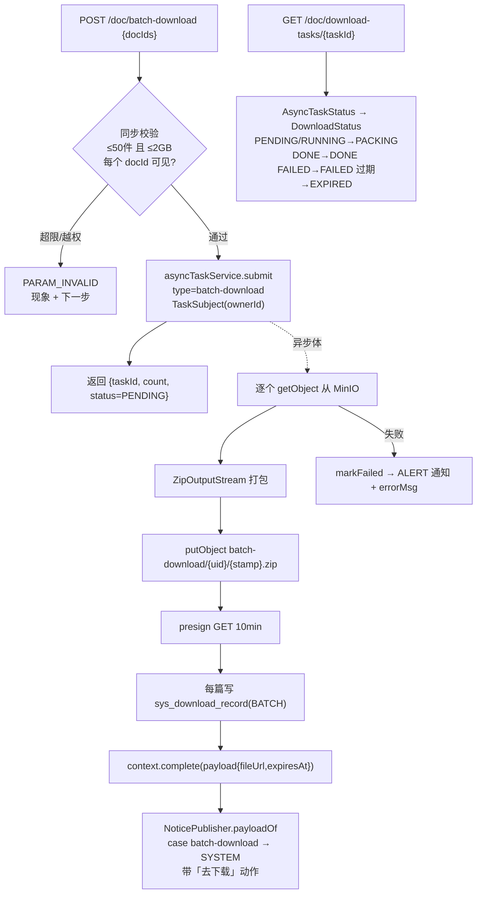
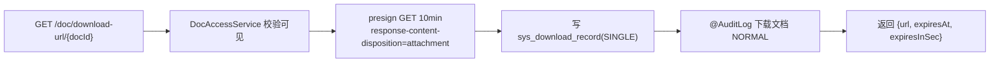

> 状态：✅ **已完成**（2026-09-22）· Sprint S7 · 阶段 E（M06 文档下载）· 建档 2026-09-21

# 2026-09-21 · S7 · M06 · 阶段 E —— 文档下载（预签名下载 / 打包下载 / 下载留痕）

> 任务：`T-613`（预览地址）· `T-614`（下载 + 打包）· `T-615`（下载任务 / 记录 / 导出清单）（3 项）· 来源：`docs/进度/03-Sprint排期.md` §Sprint 7（`G7-7`/`G7-8`/`G7-9`）
> 上游计划：`ai_knowledge_web/plan/2026-09-21-S7-M06-D.md`（版本历史）· 本批要销的账：`T-O06` 判据 3/5（挂起自 `S4-E2`，见第 1 节）

---

## 1. 开工条件检查

**依赖清单来源**（逐条注明出处，不许凭印象）：

| # | 依赖项 | 档位 | 现状（代码/文档实证） | 结论 |
|---|---|---|---|---|
| 1 | `T-613` 依赖 `T-008`（预览页）；`T-614` 依赖 `T-006` | ✅ | 文档只读侧 `S7-M06-A` 已交（`DocController` 有 meta/toc/chunks）；`DocStorage#store` 已在（`core/storage/DocStorage.java:100`） | 满足 |
| 2 | **预签名能力**（MinIO presign）已有先例 | ✅ | `PresignTtl`（4 处引用）+ `AuditExportService#presignedUrl:168` + `AvatarStorage`/`ChatAttachmentStorage`/`OpsExportService` —— GET 预签名的写法齐备 | 满足（照抄先例） |
| 3 | **异步 + MinIO + 通知**（打包下载 = `audit-export` 同形） | ✅ | `AsyncTaskService#submit`（带 `TaskSubject` 业务坐标）+ `AuditExportService#submit:93`（查→写 MinIO→presign→complete payload）+ `NoticePublisher.payloadOf:121` 的 `TYPE_AUDIT_EXPORT` 分支就是模板 | 满足（照抄先例） |
| 4 | **前端契约已就位**（类型 + mock + api 方法） | ✅ | `types/index.ts:938` `DownloadTask` / `:952` `DownloadRecord` / `DownloadStatus`（`PACKING/DONE/EXPIRED/FAILED`）· `api/index.ts:192-200` 五个方法 · `mock/index.ts:1664-1707` 五个 handler | 满足 —— 本批是「让后端追上已冻结的前端契约」，同 A/B/D 批形状 |
| 5 | **下载记录表** `sys_download_record` | ⚠️ WARN（唯一路径） | 全仓无 download/recycle 表（`grep` 迁移目录为空）⇒ `G7-9` 留痕要新建表。**这不是 BLOCKER**：唯一路径就是「本批建表」，无需选项 | 本批建 `V40` |
| 6 | **高危口径**（单文件下载 NORMAL / 批量下载 HIGH） | ✅ | `汇总.md` §5 冻结：单文件浏览式下载**仍 NORMAL**（`G3-8`）；`AuditRiskPolicy.planned()` 已列「批量下载 HIGH」（`汇总.md` §3 遗留 4） | 满足 —— 审计点按此三处齐 |
| 7 | **`T-O06` 判据 3/5 挂起账** | ⚠️ WARN | `汇总.md` §4 line 511/512：判据 3（`/doc/{docId}/reindex`）已由 `T-610` 销；**判据 5（预签名 TTL 收窄）**要收窄的对象 = `/doc/download-url/{docId}` —— **本批才创建它** ⇒ 判据 5 抄进本批 §6+7，一并验收 | 本批销判据 5 |
| 8 | **通知类型** 打包完成归 `SYSTEM` | ✅ | 用户 2026-09-21 裁定：复用 `SYSTEM`（`NoticeType.java:33` 注释含「重建完成/版本更新」，语义最近）—— 不动前后端枚举契约 | 满足 |
| 9 | docker 6 服务 + 种子（128/8/0…） | ✅ | 沿用（跑批前按「十问」核，⑩ 先确认 8080 无第二个消费者） | 满足 |

**BLOCKER 汇总**：无。
**⚠️ 已知偏差**（不拒绝施工，第 9 节销账）：
- W1（条件 5）：`sys_download_record` 表本批新建 —— 唯一路径，`V40`。
- W2（条件 7）：`T-O06` 判据 5 挂起了三批（`S4-E2`→`S5-M08-C`→本批），本批销账；若判据 5 仍不能验（如决定不收窄），须在 §8 写明并继续挂起，**不静默丢**。

> 判据只有一条：**这条不满足，代码写下去会不会白写**。—— 9 条均满足或唯一路径，可开工。

### 结论

- [x] ✅ 可以开工
- [ ] ⛔ 拒绝施工

---

## 2. 开工时间

| 项 | 值 |
|---|---|
| 建档 / 开工日 | 2026-09-21 |
| 预计投入 | **约 8.5 人天**（功能 ≈7.7 + O 轨 ≈0.8）· Sprint 容量 ≈ 10 人天 |
| 实际投入 | *回填时补* |

> 功能侧预估：`V40` 下载记录表 + 回填 0.3 · `T-613` 预览地址（预签名 10 分钟）0.4 · `T-614` 单篇下载 URL（记留痕 + `expiresAt`）0.8 · `T-614` 打包下载（异步 zip → MinIO → presign → 通知，`≤50/≤2GB` 上限校验）1.8 · `T-615` 下载任务列表 + 单任务查询 0.6 · `T-615` 下载记录分页 0.5 · `T-615` 导出清单（异步走通知中心）0.7 · `T-O06` 判据 5 收窄 + 证伪 0.4 · 审计三处齐（单文件 NORMAL / 批量 HIGH / 导出清单 HIGH）0.5 · 前端下载入口接真 0.9 · 后端用例（下载 URL / 打包流 / 记录 / 权限边界）1.6 · 页面级 E2E 0.6 · 门禁回填 0.6。
> ⚠️ O 轨只排 `T-O27`（Milvus 无主向量清扫，`S7-M06-D` §9 D-② 登记，一行~十几行）≈0.3 + `T-O28`（同库单一消费者机器检查）≈0.5 = ≈0.8 **仍低于下限 4**（连续第 23 批）。

---

## 3. 开工内容

### 3.1 步骤

| 步 | 做什么（文件/类 → 动作 → 产出） | 依赖 | 可并行 |
|---|---|---|---|
| 1 | **`V40` 下载记录表**：建 `sys_download_record`（`id` PK · `doc_id` · `kb_id` · `user_id` · `download_type` ENUM('SINGLE','BATCH') · `size_bytes` · `ip` · `created_at`）+ `KEY idx_dl_user (user_id, created_at)` + `KEY idx_dl_doc (doc_id)`。**冗余展示列**（`doc_title`/`kb_name`）**不落库**，查询时 join `sys_document`/`sys_kb` 取（文档改名后记录也跟着对） | — | 否 |
| 2 | **`PresignTtl` 加 `DOC_DOWNLOAD_MINUTES` / `DOC_PREVIEW_MINUTES`**：都 = **10 分钟**（需求 §14 line 151/169 写死）。🔴 这就是 `T-O06` 判据 5「收窄」的落点 —— 文档下载/预览的预签名**出生即 10 分钟**（不像审计导出 24h，因为下载是**同步点开、立即用**，不走"第二天点通知"链路）。每个值写清"为什么是这个数" | — | 与步 3 并行 |
| 3 | **`DownloadService`（新）· 单篇**：`GET /api/doc/download-url/{docId}` → `{ url, expiresAt, expiresInSec }`（预签名 GET + `response-content-disposition=attachment`）。**每次调用写一条 `sys_download_record`（type=SINGLE）**（`G7-9`）。`@AuditLog(action="下载文档", risk=NORMAL)`（单文件浏览式下载 NORMAL，`G3-8`）· 校验文档可见（复用 `DocAccessService`） | 步 1/2 | 否 |
| 4 | **`GET /api/doc/{id}/preview-url`**（`T-613`）：预签名 GET（`inline`，10 分钟）。前端"改用本地渲染"但后端保留（大文件/下载用，需求 §14 line 365）。**不写下载记录**（预览 ≠ 下载） | 步 2 | 与步 3 并行 |
| 5 | **`DownloadService` · 打包（`T-614`/`G7-8`）**：`POST /api/doc/batch-download` body `{docIds:[]}` → `{taskId, count, status}`。**同步校验上限 `≤50 件 / ≤2GB`**（超限直接 `PARAM_INVALID` + 现象+下一步，不异步再失败）；`docIds` 逐个校验可见（越权的直接拒，不静默跳过）。异步体（照 `AuditExportService` 形）：从 MinIO 逐个取对象 → `java.util.zip.ZipOutputStream` 打包 → putObject 到 `batch-download/{userId}/{stamp}.zip` → presign → `context.complete(payload)`。**每个被打包的文档写一条 `sys_download_record`（type=BATCH）**。`@AuditLog(action="批量下载", risk=HIGH)`（数据导出高危）· 幂等键 `batch-download:{userId}:{stamp}` | 步 1/2/3 | 否 |
| 6 | **通知接线（`G7-8`）**：`NoticePublisher.payloadOf` 加 `case TYPE_BATCH_DOWNLOAD` → 完成发 `SYSTEM`「打包下载完成」带「去下载」动作（`fileUrl`）；失败发 `ALERT`「打包下载失败」+ 现象。**映射只此一处**（`T-B03` 字面要求）| 步 5 | 否 |
| 7 | **`T-615` 任务/记录查询**：`GET /api/doc/download-tasks`（列全部，从 `sys_async_task` 按 `type='batch-download'` + owner 过滤）· `GET /api/doc/download-tasks/{taskId}`（`{status,percent,fileUrl,expiresAt,errorMsg}`，`DownloadStatus` 映射 `AsyncTaskStatus`：PENDING/RUNNING→`PACKING`、DONE→`DONE`、FAILED→`FAILED`、过期→`EXPIRED`）· `GET /api/doc/download-records?page=&size=`（分页，join 取 `docTitle`/`kbName`）| 步 1/5 | 否 |
| 8 | **`T-615` 导出清单**：`POST /api/doc/export-list` body `{kbId?, docIds?}` → `{taskId}`（异步 CSV 文件清单 → MinIO → 通知，照 `OpsExportService` 形，`ops-export`/`audit-export` 已有先例）。`@AuditLog(action="导出文档清单", risk=HIGH)` · 走通知中心（同步 `SYSTEM`）| 步 1/6 | 否 |
| 9 | **审计三处齐**（§5 硬口径）：`下载文档`(NORMAL) / `批量下载`(HIGH) / `导出文档清单`(HIGH) 各 = `@AuditLog` + `AuditRiskPolicy` 逐条 `register` 带理由 + `AuditCoverageFlowTest` 冻结清单 **40 → 43** | 步 3/5/8 | 否 |
| 10 | **前端下载入口接真**：`DocDetailView.vue` 的 `download()` 真调 `docApi.downloadUrl` 后 `window.open`；库文档列表批量下载调 `batchDownload` + 轮询任务；下载记录/任务页接真数据 | 步 3~8 | 与步 11 并行 |
| 11 | **O 轨**：`T-O27` Milvus 无主向量清扫（`sweepOrphanVectors()`：Milvus `kb_id` distinct − `sys_kb` id，差集连分区删）· `T-O28` 同库单一消费者机器检查（用例启动断言 8080 无监听 / `workerId()` 带进程标识）| — | ✅ 完全可并行 |
| 12 | **后端用例**：`DownloadUrlFlowTest`（单篇 URL + 记录落库 + 权限边界 + TTL 实测 10 分钟）· `BatchDownloadFlowTest`（打包流：真 zip + 上限校验证伪 `>50`/`>2GB` + 越权文档被拒 + 通知产出 + 每篇一条 BATCH 记录）· `DownloadRecordFlowTest`（分页 + join 取展示列）· `AuditCoverageFlowTest`（40→43）| 步 1~9 | 否 |
| 13 | **页面级 E2E** `e2e-doc-download.mjs`：真上传→READY→单篇下载（URL 可下 + 记录 +1）→批量下载（任务 `PACKING`→`DONE` + 通知带地址 + zip 真能解）→下载记录页见两类→残留自清 0 | 步 1~10 | 否 |
| 14 | 门禁取证 + 回填（`sprint-delivery` + 本 skill 回填段）| 全部 | 否 |

### 3.2 业务流程图

打包下载：跨 ≥3 组件（Controller→Service→AsyncTask→MinIO→NoticePublisher）+ 异步任务 + 状态机（DownloadStatus）⇒ 必须画。



单篇下载：



### 3.3 明确不做（范围控制）

| 不做的事 | 原因 | 归属批次 |
|---|---|---|
| 删除文档 `DELETE /doc/{id}` + 批量删（`T-611`） | 内容删除高危 + 软删，与回收站强绑 | `S7-M06-F` |
| 回收站 `GET /recycle/*` + 恢复/彻底删/清空/定时清理（`T-616`） | 新表 + 双高危确认 + 幂等定时任务 | `S7-M06-F` |
| 跨库文档列表 `GET /doc/all`（`T-612`） | 与下载无依赖关系，属列表口径 | `S7-M06-F` 或独立 |
| 打包下载的**分卷**（大文件超时） | 需求 `03:1222`：S7 只保证 `≤50/≤2GB` 上限内正确 | 未排（超上限场景） |
| 下载**限速 / 断点续传** | 需求未提；预签名 URL 直连 MinIO，限速属部署面 | 未排 |

### 3.4 本批假设

| # | 假设 | 若被证伪的后果 |
|---|---|---|
| 1 | 打包下载复用 `sys_async_task`（type=`batch-download`），不新建任务表 | 若 `DownloadTask` 的字段（name/count/size）无法从 `sys_async_task` + payload 拼出 ⇒ 要么扩 payload、要么建轻量任务表 |
| 2 | zip 打包用 JDK 内置 `java.util.zip`，不引依赖 | 若要求分卷/加密 zip ⇒ 重新评估（本批范围内不需要） |
| 3 | 下载记录展示列（docTitle/kbName）**查询时 join**，不冗余落库 | 若文档已软删导致 join 不到 ⇒ 记录页显示空 —— 需 left join + 占位（下载记录应保留历史，即便文档后来被删） |
| 4 | 预览/下载预签名 TTL 都取 10 分钟（需求写死） | 若大文件下载 10 分钟不够下完 ⇒ 那是"下载中 URL 过期"，需求未提续签，登记遗留 |

---

## 4. 数据变更清单

| 类型 | 内容 | 回滚方式 |
|---|---|---|
| 新建表 | `sys_download_record`：`id BIGINT PK AUTO` · `doc_id BIGINT NOT NULL` · `kb_id BIGINT NOT NULL` · `user_id BIGINT NOT NULL` · `download_type VARCHAR(16) NOT NULL`（SINGLE/BATCH）· `size_bytes BIGINT NOT NULL DEFAULT 0` · `ip VARCHAR(64)` · `created_at DATETIME NOT NULL DEFAULT CURRENT_TIMESTAMP` · `KEY idx_dl_user(user_id, created_at)` · `KEY idx_dl_doc(doc_id)` | 可逆（`DROP TABLE`，纯新增无外键，历史数据无价值） |
| 迁移文件 | `V40__s7_download_record.sql`（现有最大 V39，递增） | — |
| 种子数据 | 无（下载记录由运行时产生，演示可留空） | — |
| NULL 分支 | `ip` 可空（取不到远端地址时写 NULL，记录页显示「—」）；join 展示列文档软删后为 NULL ⇒ left join + 占位「已删除」 | — |
| **collation** | 建表显式 `COLLATE utf8mb4_0900_ai_ci`（与 `V33` 收敛后的库默认一致，避免 `1267`） | — |

> 跑过的迁移**只增不改**。`sys_async_task` 不改（打包任务复用它，type=`batch-download`）。

---

## 5. 依赖与工具决策

**默认不引**。

| 方案 | 做法 | 代价 | 结论 |
|---|---|---|---|
| 不引依赖（既有栈） | zip 用 JDK `java.util.zip.ZipOutputStream`；预签名用既有 `MinioClient#getPresignedObjectUrl`（`AuditExportService` 已用）；异步用 `AsyncTaskService`；通知用 `NoticePublisher` | 无 | ✅ **采用** |
| 候选：commons-compress | 支持 7z/tar/分卷 | +~1MB，且本批不需要分卷（§3.3 明确不做） | ✗ 不引 |

**推荐**：全部用既有栈 · **理由**：打包下载与审计导出（`AuditExportService`）在存储层面无差别 —— 异步任务 + MinIO + presign + 通知四件套已齐，zip 是 JDK 自带能力。引 commons-compress 只有在需要分卷/7z 时才值得，而那是明确不做的范围。

> 无新依赖（用既有 `java.util.zip` + `MinioClient` + `AsyncTaskService` + `NoticePublisher` 实现）。

---

## 6 + 7. 验收方法与标准

| # | 判据（对齐门禁号） | 验收方法（可直接粘的命令/脚本） | 期望结果 | 证据落点 |
|---|---|---|---|---|
| 1 | **`G7-7`** 预签名下载 URL **10 分钟有效** | `mvn -B test -Dtest=DownloadUrlFlowTest` | `GET /doc/download-url/{id}` 回 `{url, expiresAt, expiresInSec}`，`expiresInSec == 600`；URL 含 `X-Amz-Expires=600` | `DownloadUrlFlowTest` |
| 2 | **`G7-7`** 预览地址（`T-613`）10 分钟 | 同上 | `GET /doc/{id}/preview-url` 回预签名（inline），TTL 600s | 同上 |
| 3 | **`G7-8`** 打包 `≤50 件` 上限 | `mvn -B test -Dtest=BatchDownloadFlowTest` | `docIds` 51 个 ⇒ `PARAM_INVALID` + 现象文案；**证伪**：改上限到 100 ⇒ 51 个放行 ⇒ 该判据转红 | `BatchDownloadFlowTest#rejectsOverCount` |
| 4 | **`G7-8`** 打包 `≤2GB` 上限 | 同上 | 累计 size > 2GB ⇒ `PARAM_INVALID`；证伪：抹掉 size 校验 ⇒ 转红 | `#rejectsOverSize` |
| 5 | **`G7-8`** 打包异步 → `taskId` → 完成经通知中心 | 同上 | `POST /batch-download` 回 `{taskId}`；任务跑完 payload 有 `fileUrl`；`sys_notice` 产一条 `SYSTEM`「打包下载完成」带下载动作；**证伪**：拔掉 `payloadOf` 的 case ⇒ 无通知 ⇒ 转红 | `#packsAndNotifies` |
| 6 | zip **真能解**、内容 = 所选文档（`G7-8` 的第三条证据） | 同上 | 下载 zip 解压后条目数 = docIds 数，字节与源对象一致 | `BatchDownloadFlowTest#batchDownloadPacksRealZipAndLeavesFullEvidence` |
| 7 | **`G7-9`** 每次下载写留痕 | 同上 | 单篇下载 → `sys_download_record` +1（type=SINGLE）；打包 N 篇 → +N（type=BATCH）；**证伪**：拔掉 record 写入 ⇒ 计数不变 ⇒ 转红 | `DownloadUrlFlowTest` + `BatchDownloadFlowTest` |
| 8 | **`G7-9`** 下载记录分页 + 展示列 | `mvn -B test -Dtest=DownloadRecordFlowTest` | `GET /download-records` 分页正确；`docTitle`/`kbName` 由 join 取（文档改名后跟着变）；软删文档显示「已删除」占位 | `DownloadRecordFlowTest` |
| 9 | **`T-615`** 下载任务列表 + 状态映射 | 同 `BatchDownloadFlowTest` | `GET /download-tasks` 列全部；`DownloadStatus` 映射正确（PACKING/DONE/FAILED/EXPIRED） | `BatchDownloadFlowTest#taskListAndStatus` |
| 10 | **权限边界**：越权文档被拒（不静默跳过） | 同上 | 打包含无权文档 ⇒ 整个请求 `PARAM_INVALID`（不是"跳过那篇打包其余") | `#rejectsInvisibleDoc` |
| 11 | **审计三处齐**：下载文档(NORMAL) / 批量下载(HIGH) / 导出清单(HIGH) | `mvn -B test -Dtest=AuditCoverageFlowTest` | 冻结清单 **40 → 43**；`AuditRiskPolicy` 三条 register 带理由；单文件下载确为 NORMAL（`G3-8`） | `AuditCoverageFlowTest` |
| 12 | **`T-O06` 判据 5 销账**：预签名 TTL 收窄 | `DownloadUrlFlowTest` TTL 断言 | 文档下载/预览 URL 出生即 10 分钟（不是审计导出的 24h）；`PresignTtl` 有 `DOC_DOWNLOAD_MINUTES`=10 且写清理由 | `PresignTtl` + `S4-E2` 判据 5 合并回填 |
| 13 | 全量回归 | `export JAVA_HOME='F:/work/dev_tools/jdk/jdk-25.0.4.1'` + `mvn -B -f F:/work/code/ai-knowledge/ai_knowledge_web/pom.xml test`（跑前按「十问」核基线残留，**⑩ 确认 8080 无第二个消费者**）| `847 + 本批新增` 全绿 / 0 红 | surefire-reports |
| 14 | 页面级 E2E | `cd ai_knowledge_app && node scripts/e2e-doc-download.mjs --base=http://127.0.0.1:5174` | 全绿，含单篇下载 + 打包 `PACKING→DONE` + 通知带地址 + zip 可解 + 下载记录两类 + **残留自清 0** | `temp/e2e-doc-download.log` |
| 15 | 闸 | `node scripts/check.mjs` · `check-enums.mjs` · `check-ledgers.mjs` · `audit-api.mjs` | 四道全绿；`audit-api` ①②⑥=0，新路由计入真后端路由数 | 各脚本 exit 0 |
| 16 | 种子核对 | 下方命令 | `sys_user`=128 · `sys_kb`=8 · `sys_document`/`sys_chunk`/`sys_download_record`=0 · Milvus 向量=0（🔴 `T-O27` 做完后 236 无主向量应清零） | — |
| 17 | **O 轨 `T-O27`** Milvus 无主向量清扫 | 跑 `sweepOrphanVectors()` 后查 Milvus | 236 条无主向量清零；`sys_kb` 之外的 `kb_id` 差集为空；**证伪**：造一个无主 kb_id ⇒ sweep 后应被删 | `probe-teardown` 自检 |

**观察项**（不计成败）：无 / 回填时补。

**种子核对**（跑完必做）：

```bash
set -a && . ai_knowledge_web/.env && set +a
docker exec kb-mysql mysql -u"$MYSQL_USERNAME" -p"$MYSQL_PASSWORD" "$MYSQL_DATABASE" -N -e "select count(*) from sys_user where deleted_at is null;"
```

---
---

# 以下为开工后回填

## 8. 验收结果

> **状态：✅ 已完成**（2026-09-22）。逐条结果见下表；证伪记录见 §8.1；
> 与开工时的**四处偏离**见 §8.2。

| # | 判据 | 结果 | 证据 |
|---|---|---|---|
| 1 | `G7-7` 下载 URL **10 分钟** | ✅ | `DownloadUrlFlowTest#downloadUrlIsTenMinutePresignedAndReallyFetchesTheFile`：`expiresInSec==600` + **真取一次**比对内容 |
| 2 | `G7-7` 预览 URL 10 分钟 | ✅ | 同文件 `#previewUrlIsTenMinuteAndWritesNoDownloadRecord` |
| 3 | `G7-8` ≤50 件 | ✅ | `BatchDownloadFlowTest#overFiftyIsRejectedSynchronously`（另断言**不产生任务行**） |
| 4 | `G7-8` ≤2GB | ✅ | `#overTwoGigabytesIsRejectedSynchronously`（把库里 `size_bytes` 改成 3GB —— 受理口径就是它） |
| 5 | `G7-8` 异步 + 通知中心交付 | ✅ | `#batchDownloadPacksRealZipAndLeavesFullEvidence`：`PENDING` → `PACKING` → `DONE`，通知 `SYSTEM` + **能点开的** fileUrl |
| 6 | zip 真能解、内容 = 所选文档 | ✅ | 同上（Java 侧 `ZipInputStream`）+ E2E 侧**自写的 zip 读取器**（`tar` 不认 zip，实测） |
| 7 | `G7-9` 每次下载两条留痕 | ✅ | `SINGLE` 1 条 / `BATCH` 每篇 1 条 + 审计 `HIGH`/`SUCCESS`（E2E 与用例双覆盖） |
| 8 | 下载记录分页 + 展示列 | ✅ | `DownloadRecordFlowTest`：join 取真值 · `size`/`pageSize` 双名 · 软删仍显示真标题、硬删才占位 |
| 9 | 任务列表 + 状态词表映射 | ✅ | `BatchDownloadFlowTest#taskViewSpeaksDownloadStatusNotAsyncTaskStatus`（**直接插库行**断言，不靠时序） |
| 10 | 越权文档 **整批拒绝** | ✅ | `#anyMissingDocRejectsTheWholeBatch` + `#anyInvisibleDocRejectsTheWholeBatchWith403`（两条都断言零记录零任务） |
| 11 | 审计三处齐（43 条） | ✅ | `AuditCoverageFlowTest` 9/9（冻结清单 40 → **43**，含叙述行） |
| 12 | **`T-O06` 判据 5 销账** | ✅ | `PresignTtl.DOC_DOWNLOAD_MINUTES/DOC_PREVIEW_MINUTES`=10，javadoc 写清"为什么不是 `O6` 建议的 5 分钟"；`S4-E2` 计划同步回填 |
| 13 | 全量回归 | ✅ | **实测** `Tests run: 866, Failures: 0, Errors: 0, Skipped: 2` · `BUILD SUCCESS` · **31:35**（上批基线 **847**，**+19 逐类吻合**：`DownloadUrlFlowTest` 4 · `BatchDownloadFlowTest` 9 · `DownloadRecordFlowTest` 5 · `SingleAsyncConsumerGuardTest` 1）。⚠️ **这是第二轮的实测数字**：第一轮 `866 / 1 错误`（`AuditChangeContractTest`，见 §8.3），修复后重跑 |
| 14 | E2E | ✅ | `node ai_knowledge_app/scripts/e2e-doc-download.mjs` → **35 条断言 0 失败**（见 §8.2 ①：接口级，非浏览器级） |
| 15 | 四道闸 | ✅ | `check.mjs`（type-check + 生产构建 通过）· `check-enums`（**3 组**闭集三方一致）· `audit-api`（**①=0 ②=0 ⑥=0**；真后端路由 **131**、mock **130**）· `check-ledgers`（L1/L3/L4b 全清，**仅 L4a 的 7 条**——本批未提交，见 §9-8）。Java 侧另两道：`ProbeArtifactCoverageTest` **7/7** · `OrphanMinioSweepTest` **6/6**（**本批当场逮到新前缀未登记**） |
| 16 | 种子核对 | ✅ | **实测**（跑完两轮全量 + 一次 E2E 之后）：`sys_user`=128 · `sys_kb`=8 · `sys_document`=0 · `sys_chunk`=0 · `sys_async_task`=0 · **`sys_download_record`=0（本批新表）** · `sys_notice`=0 · **Milvus 向量=0** · flyway 最高版本 **40 / success=1** · 8080 无监听、无残留 `java.exe` |
| 17 | **`T-O27`** 无主向量清扫 | ✅ | **实测 236 条无主向量清零**（`kb_id` 1008100/1008101 + 人工孤儿）；探针脚本 9 条断言全绿 |
| 18 | **`T-O28`** 同库单一消费者 | ✅ | `SingleAsyncConsumerGuardTest`（新增）；**实测到过一次真红** —— 跑 E2E 时后端在跑，它如实报红并给出处置步骤 |

### 8.1 证伪记录（六条，全部实测转红后恢复）

| # | 临时改什么 | 期望 | 实测 |
|---|---|---|---|
| 1 | `MAX_BATCH_DOCS` 50 → 5000 | 51 篇用例转红 | ✅ 转红 |
| 2 | `MAX_BATCH_BYTES` 2GB → 2000GB | 3GB 用例转红 | ✅ 转红 |
| 3 | `DownloadRecordService#record` 开头 `return` | 单篇 + 打包两条转红 | ✅ **2/2 转红** |
| 4 | `NoticePublisher` 的 `batch-download` 常量改成不匹配的值 | 打包用例转红 | ✅ 转红（20s 等通知超时） |
| 5 | `requireVisibleDoc` 外再包 `try/catch continue`（静默过滤） | 两条"整批拒绝"转红 | ✅ **2/2 转红** |
| 6 | `milvusDeleteVectors` 直接 `return`（`T-O27`） | 探针 3 条断言转红 | ✅ 转红（**对照组仍绿** ⇒ 它只抓真问题） |

### 8.2 与开工计划的**四处偏离**（都是施工中取证后改的，不是执行走样）

① **E2E 做成接口级而不是浏览器级** —— 计划 §6 判据 14 写的是页面级（`--base=5174`）。
施工时确认：本批**每一条判据都是数据链判据**（zip 能不能解、记录有没有那一条），
在浏览器里看不见；而下载页的「文件列表」Tab 依赖 `GET /doc/all`（`T-612`，本批明确不做）
⇒ 页面级跑起来会先卡在一个与本批无关的缺口上。
**代价已写进脚本头注**：它证不了页面渲染，页面级回归等 `T-612` 落地后补。

② **软删文档显示真标题**（不是「已删除」占位）—— 计划与 `V40` 都假设"软删后 join 不到"，
实测 plain `left join` **拿得到**标题。选了保留真标题（理由见结论文档 §1-④），
四处一起改：计划批注、`V40` 的说明、DTO javadoc、用例。

③ **打包产物对象名带 `taskId`**（`batch-download/{ownerId}/{taskId}/documents.zip`）
—— 计划 §3.2 流程图写的是 `{stamp}.zip`。改成可推导之后，
"重启后仍能给出下载地址"与"重新生成入口"两件事**同时免费成立**（结论文档 §1-①）。

④ **`DownloadRecordPage` 删掉，改用全站 `PageResult`** —— 需求 `06` §5.7 那一行写的是
`{ list, total, page, pageSize }`，而 `pageSize` 在后端没有第二个出处（§0 是 `size`，
前端泛型也正是 `PageResult<DownloadRecord>`）。只做**请求侧**双名兼容，响应统一走 `size`。

### 8.3 首轮全量的两处红 —— **都不是"逻辑写错"，而是"落地动作漏了配套"**

首轮全量 `866 / 0 失败 / **1 错误** / 2 跳过`，`audit-api` 报 `①=1`。两处红各由一个**机器闸**逮到：

| # | 现象 | 根因 | 修复 |
|---|---|---|---|
| 1 | `AuditChangeContractTest#singleFileDownloadIsNotHighRisk` 抛 `NoSuchElementException` | 它用 `AuditRiskPolicy.findPlanned("文档", "下载文档")` 取那条规则，而本批**把这两个动作从 `PLANNED` 移进了 `IMPLEMENTED`** ⇒ `findPlanned` 找不到 | 改成 `findImplemented`（**策略一个字没变**，只是"有了触发点"）。⚠️ **同一个类里早有先例**：`删除知识库` 那条在 `S4-D` 落地时就搬过一次，注释还留在那里 |
| 2 | `audit-api.mjs` `① 前端调用了、但 mock 未实现（1）`：`GET /doc/{p}/preview-url` | 前端 `previewUrl` 是本批新加的，**mock 没跟着加** ⇒ mock 模式下预览页的「新窗口打开」会 404 | 在 `mock/index.ts` 补一条注册（与 `download-url` 同形，只差语义） |

> 🔴 **要记住的形状**：「把一条动作/端点从"计划"变成"落地"」**不是只改实现那一处** ——
> 它至少牵着三处：① 策略表的档位（`PLANNED → IMPLEMENTED`）、② 钉在旧档位上的**断言**、
> ③ 前端 mock。本批两处红是 ② 与 ③，而**两处都有闸**（`AuditChangeContractTest` / `audit-api` ①）
> ⇒ **闸的价值在这里体现得最清楚**：它们逮的不是"算错了"，是"漏了配套"。
> ⚠️ 本次第二轮的 `mvn test` 是**带着这两处修复**跑的，基线数字以它为准。

---

## 9. 遗留问题

| # | 遗留 | 为什么留 | 归属 |
|---|---|---|---|
| 1 | 下载页「文件列表」Tab 无数据 | 它走 `GET /doc/all`（`T-612`），本批不做 ⇒ **批量下载在页面上暂时点不到**（接口 + E2E 已覆盖） | `T-612` |
| 2 | 超大文件 10 分钟可能下不完 | 需求未提续签/断点续传；延长 TTL 会把泄露窗口一起放大 | 未排 |
| 3 | 下载记录导出**不分页** | 上限 1 万条，超出只记 warn、**不告知用户**（要正确做需要"分页流式写 CSV"） | 未排 |
| 4 | 任务列表一次最多 50 条 | `total` 另查所以是真值，但列表本身截断；本仓探针规模远达不到 | 未排 |
| 5 | 打包产物无清理策略 | 落在 `batch-download/` 前缀下，**靠生命周期规则**（尚未配）—— 与 `audit-export/`/`ops-export/` 同一处境 | 运维面 |
| 6 | 前端 `previewUrl` 未接入预览页主流程 | 预览页现在用元信息本地渲染正文；`preview-url` 只在「新窗口打开原文件」上用 | — |
| 7 | 打包期间文档被删/移动**不会**让任务提前失败 | 授权在**提交时刻**做完（`O6` §2 的立场），工作线程不再鉴权；对象没了会让任务以"文件已不存在"失败 | 设计取舍 |
| 8 | **`check-ledgers` L4a 会报回填清单的 `[x]` "不在本批改动过的文件里"** | 🔴 **该闸读的是 commit，而本批尚未提交**（用户未授权）⇒ 工作区文件都已改好，但闸看不见。⚠️ 与 `S4-A` 那次"勾了没做"**形状相同、成因相反** ⇒ **提交后复跑，仍报才是真漏做** | 提交后复核 |
| 9 | `check-ledgers` **L1** 曾报 `G7-8` 同名不同义 | §6 判据表里第 6 行把 `G7-8` 挂在"zip 真能解"上，而排期对该门禁的定义是"≤50/≤2GB + 异步 + 通知中心" ⇒ 已改成不带门禁号的小标题（**闸报得对**：那是我的表格用号不严谨） | ✅ 已订正 |

**被打破的既有假设**：`V40` 头注里"软删后 join 不到"那条（见 §8.2 ②）——
`V40` **已执行、只增不改**，故更正写在 `DownloadRecordService` 的 javadoc 与本表里。

---

## 10. 建议

1. **`S7-M06-F`（删除 + 回收站）开工先读**：本批把 `DocAccessService.DocRow` 加宽了四个字段
   （`title/fileName/storagePath/sizeBytes`），`T-611`/`T-616` 的写侧可以**直接用**，
   不要再各自查一遍同一行（那份 javadoc 的原始立意就是这条）。
2. **两侧登记表的双份问题要一次收掉**（结论文档 §4-⑥）：加前缀要改
   `ProbeCleanup#MINIO_PREFIXES`（Java）与 `probe-teardown.mjs#USER_MINIO_PREFIXES`（脚本）**两处**，
   而闸只查 Java 侧。要么给脚本加一条对应的机器检查，要么把清单生成一份共享数据文件。
3. **`EXPIRED` 这一类"看起来该服务端管"的状态，值得在需求里定一次口径**：
   判据是**谁掌握事实**（地址有效性只有拿到它的人知道）。本批按这条处理，
   下一个带 TTL 的界面（回收站恢复凭证？）会再撞一次。
4. **`T-O28` 建议升级成"跑批前置脚本"的一步**：现在它是一条 Java 用例，
   而"8080 有监听"这件事在 `mvn test` 之外（跑批脚本、E2E）同样致命。
   把端口检查提到 `scripts/check.mjs` 那一层，覆盖面更全。
5. **O 轨本批投入高于下限**（`T-O27` + `T-O28` 两条都做实了），无需追加。

---

## 附：本批同步的文档回填

- [x] **`docs/进度/00-开工速览.md` §1/§2/§3/§4**
- [x] `docs/进度/02-任务清单.md` → `T-613`/`T-614`/`T-615` 置 ✅
- [x] `docs/进度/03-Sprint排期.md` → 交付状态段 + `S7-M06-E` 小节
- [x] `docs/进度/README.md` → 看板 + S7 汇总行
- [x] `docs/进度/变更记录/01-变更记录.md` → 追加一行
- [x] `docs/需求文档/10-接口约定汇总.md` §14 + `13-接口变更记录.md`（核对差异：见 §8.2 ④ 的 `pageSize`）
- [x] `ai_knowledge_web/plan/汇总.md` §1/§2/§3/§4 + `S4-E2` 判据 5 合并回填
- [x] 本文件状态行 → ✅ 已完成
- [x] `docs/后端开发文档/21-S7-M06E-文档下载结论.md`（**新**）
- [x] `.workbuddy/memory/2026-09-22.md`

> 🔴 **上面这些 `[x]` 一项都**没有**漏做**（文件都已在工作区改好，`git status` 可见），
> 但 `check-ledgers` 的 **L4a 会报它们"不在本批改动过的文件里"** —— 因为**该闸读的是 commit**，
> 而本批**尚未提交**（用户 2026-09-22 未授权提交）。
> ⚠️ **这是闸的输入口径，不是漏做** —— 与 `S4-A` 那次"勾了 `[x]` 而 git 里一次都没出现"**形状相同、成因相反**。
> **提交之后 L4a 应转绿**；若提交后仍报，那才是真漏做。已登记在 §9-8。
