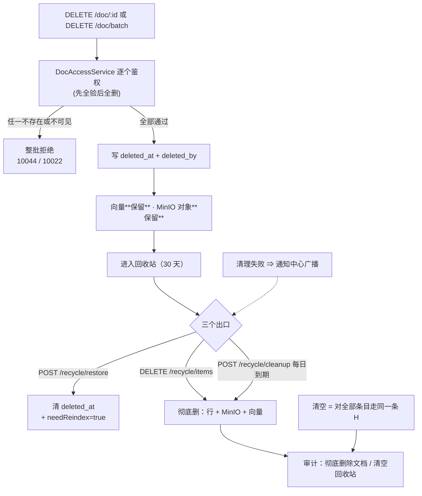

> 状态：✅ 已完成 · Sprint S7 · 阶段 F（M06 删除文档 + 回收站）· 建档 2026-09-22 · 完成 2026-09-22

# 2026-09-22 · S7 · M06 · 阶段 F —— 删除文档 + 回收站（含跨库文档列表）

> 任务：`T-611`（删除文档 / 批量删）· `T-616`（回收站：列表 / 恢复 / 彻底删 / 清空 / 定时清理）· `T-612`（跨库文档列表）（3 项）· 来源：`docs/进度/03-Sprint排期.md` §Sprint 7（`G7-10`/`G7-11`/`G7-12`/`G7-13`/`G7-14`）
> 上游计划：`ai_knowledge_web/plan/2026-09-21-S7-M06-E.md`（下载）· 本批要销的账见第 1 节

---

## 1. 开工条件检查

**依赖清单来源**：`00-开工速览.md` §1/§2/§3 · `02-任务清单.md` 的依赖列（`T-611`/`T-612`/`T-616` 三行）· `plan/汇总.md` §3/§4 · 上一批（`S7-M06-E`）§9 · **`docs/后端开发文档/11-M05-存储生命周期规则（O7）.md` §2 的规则表**（它逐格写着「`T-616` 照此实现」）· 库与代码实测。

| # | 依赖项 | 档位 | 现状（代码/文档实证） | 结论 |
|---|---|---|---|---|
| 1 | `T-611` 依赖 `T-600`（文档只读后端） | ✅ | `DocController` 已有 12 条映射；`DocAccessService.requireVisibleDoc` 是唯一授权边界 | 满足 |
| 2 | `T-612` 依赖 `T-600` | ✅ | 同上；可见性条件由 `DataScopeService#kbVisibility`（`DataScopeService.java:128` 含 `k.deleted_at IS NULL`）提供 | 满足 |
| 3 | `T-616` 依赖 `T-611` | ✅ | **同批交付**（先软删、后回收站）—— 是批内排序，不是外部依赖 | 满足（批内排序） |
| 4 | 软删基础设施：`deleted_at` 列 | ✅ | `information_schema` 实测：`sys_document` / `sys_kb` / `sys_user` / `sys_chat_session` 都有 | 满足 |
| 5 | 🔴 **`deleted_by` 列** | ⛔ **唯一路径** | 实测：**全库 4 张有 `deleted_at` 的表，没有一处有 `deleted_by`**。而需求 `06` §7.9 逐字要求「软删除：加 `deleted_at` + `deleted_by`」，§7.4 的列表字段含「删除人」 | **唯一路径 = `V41` 加列**（`sys_document` + `sys_kb`），见 §4 |
| 6 | `G7-14` 的另一半：软删后**不可召回** | ✅ | `RetrievalScope.java:235` 的可见 `doc_id` 子查询已含 `d.deleted_at is null and d.is_current = 1` | 满足（**仍要取证**：本批判据 8） |
| 7 | 定时任务基础设施 | ✅ | `SchedulingConfig.java:31` `@EnableScheduling` + 两个既有 `@Scheduled`（`AuditRetentionJob.java:73` · `OpsPrecomputeJob.java:48`）—— **幂等 + cron 配置化 + 失败不炸调度** 三件事都有现成范式 | 满足 |
| 8 | 测试期关掉定时任务 | ✅ | `src/test/resources/application.properties:48` 已有 `app.audit.retention-cron=-`（`-` 是 Spring 的禁用写法） | 满足（照抄一行） |
| 9 | 权限码 | ✅ | `PermissionCode` 已有 `doc:delete`(59) · `kb:delete`(50) · **`doc:recycle`(63「回收站管理」)** —— 无新码 | 满足 |
| 10 | **前端页面** | ✅ | `ai_knowledge_app/src/views/recycle/RecycleView.vue`（343 行）**已按真 API 写好**：调 `recycleApi.items/restore/remove/clearAll` 四个端点，路由 `/recycle` 已注册，**两个危险确认（输入文件名 / 输入 `DELETE`）已实现** | 满足 ⇒ **本批前端接近零工作量**（只做字段核对） |
| 11 | 前端契约（类型/DTO） | ✅ | `types/index.ts:1324 RecycleItem` 字段齐全：`type/origin/docCount?/size/deletedBy/deletedAt/remainDays/originDeleted?/hasNewer?` | 满足 |
| 12 | 彻底删除要删什么（**本批最容易做错**） | ✅ | 🔴 **O7 规则表的第 ②/⑥ 列逐格写着**：源文件 `documents/` **删除** · 解析产物 `parsed/` **删除** · 向量**删除**（该 doc 的点）· 审计日志**永久保留** | 满足（照表实现） |
| 13 | Milvus 按文档清点 | ✅ | `VectorWriter.replaceDocument(partition, docId, List.of())` 是既有先例（`DocService.java:216` 归档旧版本时用的就是它）；分区名由 `doc.indexGeneration` 推出（`DocAccessService.DocRow`） | 满足 |
| 14 | MinIO 精确删对象 | ✅ | `DocStorage#remove` 已有实现且**无调用方** —— 它的 javadoc 逐字写着「`T-616` 起接入」 | 满足（本批接上） |
| 15 | **通知中心：清理失败要告警**（§7.9） | ⚠️ **WARN** | §7.9 要求「定时清理……失败要有告警（走通知中心）」，而 `NoticePublisher` 只有**异步任务终态**一个产出点，且 `coord.ownerId() == null` 时**直接跳过**（没有提交人就没处发）。定时任务没有提交人 | 见下「已知偏差 ①」 |
| 16 | `G7-12` 的二次确认落在哪一层 | ⚠️ **WARN** | 前端**已做**（`RecycleView` 输文件名 / 输 `DELETE`），而后端契约 `DELETE /recycle/items` **没有确认词**（`api/index.ts` 只发 `{ids}`） | 见下「已知偏差 ②」 |
| 17 | 删除知识库**是否连带软删文档** | ⚠️ **WARN** | `KbLifecycleService#softDelete` **只写 kb 的 `deleted_at`**（日志原话"文档与分片保留，可恢复"）⇒ `G7-11` 的「连带恢复」在现实现下**天然成立**（文档从未被软删） | 见下「已知偏差 ③」 |
| 18 | 审计策略表 | ⚠️ **WARN** | 「删除文档」在 `PLANNED`（`AuditRiskPolicy.java:345`）；**「彻底删除」「清空回收站」两个动作根本不在表里** ⇒ 要新登记（`Category.CONTENT_DELETE`） | 见下「已知偏差 ④」 |
| 19 | 环境 | ✅ | docker 6 服务 up（MySQL/MinIO/Milvus/Redis/Neo4j/etcd）· 8080 **无监听** · 种子 `sys_user`=128 / `sys_kb`=8 / 其余业务表 0 | 满足 |
| 20 | 清理入口的**跨批**遗留（`O7` §4） | ⚠️ **WARN** | `avatars/` · `audit-export/` · `ops-export/` · `chat-attachments/` **四个前缀至今无清理入口**（O7 规则表 §1 的注） | 不在本批（见 §3.3），登记在 §9 |

**BLOCKER 汇总**：**无**（第 5 项是"唯一路径"型：加列是唯一做法，不需要发明选项）。
**⚠️ 已知偏差**（不拒绝施工，第 9 节销账）：见下四条。

### 已知偏差（逐条写明处置，第 9 节销账）

**① 定时清理失败的"告警走通知中心"缺一条路（§7.9）**
`NoticePublisher` 今天只服务**异步任务终态**，而 `TaskSubject.none()` 的任务 `owner_id` 为 NULL ⇒ 发布时被跳过（"没有提交人就没处发"）。定时清理任务**没有提交人**。
**三个选项**：(a) 给 `NoticePublisher` 加一条**广播**路径（`sys_notice.user_id` 写 NULL —— `V31` 的列注释本来就写着「NULL = 广播（所有人都看得见）」）；(b) 只记 `ERROR` 日志 + 一条审计，**不发通知**（＝不做 §7.9 那半句）；(c) 逐超管各发一条。
✅ **用户 2026-09-22 裁定：走 (a) 广播** —— 唯一不加新概念的做法（列语义早就定好了"NULL = 广播"，只是至今没有产出方），且"清理失败"这件事本来就该让所有管理员看见。
⚠️ 它动了 `NoticePublisher`「必须有 owner」那条守卫 ⇒ 是**给既有硬口径开一个口子**。
**实施约束**：只对 **`recycle-cleanup` 这一个任务类型**放开广播；"**有提交人却漏填 owner**"那条 warn **必须保留**（两者不是一回事：前者是"本来就该广播"，后者是"提交方漏传坐标"，`#110` 的根因）。

**② `G7-12` 的二次确认只在客户端**
前端已实现（输文件名 / 输 `DELETE`），后端收不到确认词。**判断**：需求 §7.6 把它写成**交互**要求（"输入文件名二次确认"），§7.8 的接口约定里 `DELETE /recycle/items` **没有请求体字段**；权限侧另有 `doc:recycle` 把关（`G9-8` 要的是"绕不过**授权**"，不是"绕不过**确认框**"）。
⇒ **本批按"客户端确认 + 后端权限 + 审计留痕"实现**；不为此改前端契约。⚠️ 若将来要求"后端也必须校验不可逆操作的确认词"，那是**另一条口径**（要同时给 `DELETE /recycle/items` 与 `DELETE /recycle/all` 加请求体），登记在 §9。

**③ 「恢复知识库连带恢复其下全部文档」今天成立，但**没有判据钉着**
`KbLifecycleService#softDelete` 只软删 kb 行、文档从未被软删 ⇒ 恢复 kb 时"连带"是**零动作**（只清 kb 的 `deleted_at`）。
⚠️ **风险**：这层"天然成立"依赖两个隐含前提 ——(i) 软删库之后它的文档**不可达、不可召回**（`DataScopeService:128` 的 `k.deleted_at IS NULL` 与 `RetrievalScope` 都成立）；(ii) 将来若有人"顺手"在删库里连带软删文档，`restore` 就必须真的把它们扫回来。
⇒ **本批要立两条判据**（判据 6/7）把这两个前提**钉住**，而不是靠"今天恰好是这样"。

**④ 审计策略表要动三处（不是一处）**
`删除文档` PLANNED → IMPLEMENTED；`彻底删除文档`、`清空回收站` **新登记**（都在 `Category.CONTENT_DELETE`，`HIGH`）。⇒ 冻结清单 **43 → 45**，且 `AuditCoverageFlowTest` 的叙述行要跟着改。
⚠️ 承 `S7-M06-E` §8.3 的教训：**"从 PLANNED 变 IMPLEMENTED"牵着三处**（策略表档位 · 钉在旧档位上的断言 · 前端 mock）。`AuditChangeContractTest#singleFileDownloadIsNotHighRisk` 同一个类里已有两次先例（`删除知识库` 与 `下载文档`）。

### 结论

- [x] ✅ **可以开工**（无 BLOCKER；四条已知偏差已逐条写明处置）
- [ ] ⛔ 拒绝施工

---

## 2. 开工时间

| 项 | 值 |
|---|---|
| 建档 / 开工日 | 2026-09-22 |
| 预计投入 | **5 人天**（`T-611` 1 · `T-616` 2.5 · `T-612` 0.5 · 测试与 E2E 1）· 其中前端 ≈ 0.2（页面已就绪） |
| 实际投入 | *回填时补* |

---

## 3. 开工内容

### 3.1 步骤

| 步 | 做什么（文件/类 → 动作 → 产出） | 依赖 | 可并行 |
|---|---|---|---|
| 1 | **`V41__s7_recycle.sql`**：`sys_document` + `sys_kb` 各加 `deleted_by BIGINT NULL`（§7.9）。⚠️ 存量行该列为 NULL ⇒ 列表「删除人」显示「—」（NULL 分支见 §4） | — | 否 |
| 2 | **`DocStorage` 加 `removePrefix(String prefix)`**：按前缀列对象并逐个删（知识库彻底删除要删 `documents/{kbId}/**` 与 `parsed/{kbId}/**` 两整块）。⚠️ 既有 `remove(objectKey)` 保持精确删除（文档级用它，够且更安全） | — | 与步 3 并行 |
| 3 | **`DocLifecycleService`（新）**：`softDelete(docId)`（鉴权 → 写 `deleted_at`+`deleted_by`，**不动向量**）· `batchSoftDelete(ids)` · `purge(ids)`（**彻底删**：行 + MinIO `storage_path`/`parse_path` + Milvus 该 doc 的点） | 步 1/2 | 否 |
| 4 | **`RecycleService`（新）**：`items(type, keyword, page, size)` → `{list,total,keepDays}`（`remainDays` 服务端算 · `originDeleted` · `hasNewer`）· `restore(ids, targetKbId?)` → `{restored,needReindex,affectedDocs,targetKbId,note}` · `purge(ids)` · `clearAll()` · `cleanup()` | 步 3 | 否 |
| 5 | **`GET /doc/all`（`T-612`）**：跨库文档列表，行含 `kbId`/`kbName`。复用 `kbVisibility` + `deleted_at is null` + `is_current = 1` | — | ✅ 完全可并行 |
| 6 | **`RecycleCleanupJob`（新）**：`@Scheduled` 每日清理超期项（照 `AuditRetentionJob`：cron 配置化 + 幂等 + 失败不炸调度）· 配置项 `app.recycle.cleanup-cron` + **测试 profile 设 `-`** | 步 4 | 否 |
| 7 | **通知接线**：清理失败告警。⚠️ 按已知偏差 ① 走 **(a) 广播**：`NoticePublisher` 加"无提交人 ⇒ `sys_notice.user_id` 写 NULL"，并**保留**"有提交人但没填 owner"那条 warn（两者不是一回事） | 步 6 | 否 |
| 8 | **审计三处齐**（§5 硬口径）：`删除文档` PLANNED→IMPLEMENTED + 新登记 `彻底删除文档` / `清空回收站`（`CONTENT_DELETE`/`HIGH`）⇒ 冻结清单 **43 → 45** + `AuditCoverageFlowTest` 叙述行 | 步 3/4 | 否 |
| 9 | **控制器接线**：`RecycleController`（`/api/recycle/*` 五条，权限 `doc:recycle`）· `DocController` 补 `DELETE /doc/{id}`（`doc:delete`）· `DELETE /doc/batch`（`doc:delete`）· `GET /doc/all`（`kb:view`） | 步 4/5 | 否 |
| 10 | **前端核对**（≈0.2 人天）：`RecycleView` 的四个响应字段逐一核对（`{restored,affectedDocs}` / `{deleted}` / `{cleared}` / `{list,total,keepDays}`）· **文档列表/详情页的删除入口接真**（`docApi.remove`/`batchRemove`，当前是否只弹提示待核） | 步 9 | 与步 11 并行 |
| 11 | **O 轨（≥4 人天，见 §10）**：`T-O28` 升级到 `check.mjs` 那层 · 脚本侧 MinIO 前缀闸 · `T-O24` 先核实 | — | ✅ 完全可并行 |
| 12 | **后端用例**：`DocDeleteFlowTest`（软删 → 记录 + **向量仍在** + 不可召回）· `RecycleFlowTest`（列表/恢复/彻底删/清空三者 + 连带 + 幂等 + 超期）· `RecycleCleanupFalsifyTest`（**幂等要证伪**：连跑两次第二次 cleaned=0） | 步 1~9 | 否 |
| 13 | **E2E** `e2e-doc-recycle.mjs`：真删 → 回收站见它 → 剩余天数与三档 → 恢复（提示重建索引）· 彻底删除（向量与对象都没了）· 清空 · 超期清理幂等 · **残留自清 0** | 步 1~10 | 否 |
| 14 | 门禁取证 + 回填（本 skill 回填段） | 全部 | 否 |

### 3.2 业务流程图

打包下载那条（E 批）证明了本仓"跨组件 + 异步 + 状态机"要画。本批**同时满足四条触发条件**：
跨 ≥3 组件（Controller→Service→MinIO→Milvus→通知）· 有事务边界 · **有状态机**（活跃→回收站→彻底删）· **有并发/幂等**（定时清理）。



**恢复知识库**那条与文档不同：删库**只写 kb 的 `deleted_at`**（文档从未被动过）⇒ 恢复 = 清 kb 的 `deleted_at`，`affectedDocs` 由 `sys_document` 现查。

### 3.3 明确不做（范围控制）

| 不做的事 | 原因 | 归属批次 |
|---|---|---|
| `avatars/` / `audit-export/` / `ops-export/` / `chat-attachments/` **四个前缀的清理入口** | O7 规则表 §1 与 §4 早就列着"无入口"；它们**与知识库无关**（按 `userId` 命名），不在回收站的生命周期里 | 未排（O7 §4 建议） |
| 回收站容量限制 · 管理员代恢复的审批 · 超 30 天的例外保留 | 需求 §7.11 逐条写着 ❌ | 不做 |
| 后端校验"确认词"（见已知偏差 ②） | 需求 §7.8 的接口约定里没有这个字段；权限已由 `doc:recycle` 把关 | 未排 |
| 恢复时**自动**重建索引 | 需求 §7.2 要的是"**提示**需要重建索引"；重建是 `T-406`/`T-610` 的入口 | 不做 |
| `T-513` 文件夹批量导入 · `T-710` 表格独立召回 | 与本批无依赖关系 | 各自批次 |

### 3.4 本批假设

| # | 假设 | 若被证伪的后果 |
|---|---|---|
| 1 | 恢复**不做**"把向量搬回新代分区"，只回 `needReindex=true` 让用户重建 | 若要求"恢复即可检索"，则要调用重建流程（贵、且是 `T-406` 的射程）⇒ 需求 §7.2 的措辞是"需要重建索引"，故取提示 |
| 2 | ✅ **用户 2026-09-22 裁定：整库全清** —— 知识库的**彻底删除**（清空/到期）= 删 `documents/{kbId}/**` + `parsed/{kbId}/**` + 该库**全部代**分区（不只当前代）。理由：库行都没了，留历史代分区只会变成**谁也不认领的无主向量**（正是 `T-O27` 刚清掉的那一族）。⇒ 需要给 `DocStorage` 加 `removePrefix` 能力（步 2） | 若改成"只删当前代"，则历史代分区会变无主 ⇒ 必须同时把 `T-O27` 的扫描扩到"库已删的分区" |
| 3 | 批内顺序：`T-611`（软删）先，`T-616`（回收站）后 | 反过来没有可恢复的对象，回收站列表恒空 |
| 4 | `remainDays` 由**服务端**算（30 − (今天 − 删除日)），前端只渲染色阶 | 前端 `RecycleItem.remainDays` 已是必填字段 ⇒ 服务端不算就得前端算，而"今天"在服务端才算得准（时区） |
| 5 | 批量删除沿用 E 批的硬口径：**先全验后全删**（任一不存在/不可见 ⇒ 整批拒绝）。⚠️ **施工时收窄**：原写"已软删的视为幂等成功"，实测**做不到** —— `requireVisibleDoc` 本来就看不见软删的行（它必须把软删的挡在外面），想区分"从没存在"与"已被删"就得绕开那条**唯一授权边界** ⇒ 改成**重复删除也走 `10044`**（用户看到"文档不存在"，刷新即知）。⚠️ 同时发现另一条：`markDeleted` 的 `and deleted_at is null` 是**幂等护栏而不是可选项** —— 没有它，重复删除会把 `deleted_at` 刷新成新时刻，而回收站的剩余天数正是从它算的 ⇒ **"再点一次删除"会让快过期的文档重新获得 30 天**（一条真实存在的绕过保留期的方式） | 若要求幂等，则要新增一条"含软删的存在性查询"作为第二边界 ⇒ 与 `I-7`"唯一授权边界"的纪律冲突 |

---

## 4. 数据变更清单

| 类型 | 内容 | 回滚方式 |
|---|---|---|
| 改表 | `sys_document` 加 `deleted_by BIGINT NULL`；`sys_kb` 加 `deleted_by BIGINT NULL`。**都可空、无默认值、无外键**（与 `owner_id` 同族，不建 FK —— 用户被删后历史仍要留下"是谁删的"） | 可逆（`DROP COLUMN`，历史数据无价值） |
| 迁移文件 | **`V41__s7_recycle.sql`**（现有最大 `V40`，递增） | — |
| 种子数据 | **无**（演示数据的回收站应为空 —— 需求 §7.7 的空状态引导正是给这种情形） | — |
| NULL 分支 | 🔴 **存量软删行 + V41 之前删的行，`deleted_by` 为 NULL** ⇒ 列表「删除人」显示 **「—」**（不显示"未知用户" —— 那是在编一个不存在的身份；与 `DownloadRecordService` 的 `NO_IP` 同一条口径）。⚠️ 更早的删除动作**在哪都查不到人**：`sys_audit_log` 里的 `operator` 与具体行没有可 join 的键 ⇒ 如实显示「—」 | — |
| collation | 不加字符串列 ⇒ 无 collation 风险（`V40` 那次的教训在这里不适用，但仍核对一遍） | — |

> 跑过的迁移**只增不改**（改已执行的 `V*.sql` 会导致校验和不符、启动失败）。

---

## 5. 依赖与工具决策

**默认不引**。

| 方案 | 做法 | 代价 | 结论 |
|---|---|---|---|
| 不引依赖（既有栈） | 软删用既有 `deleted_at` 模式（4 张表已在用）· 定时清理照 `AuditRetentionJob`（`@Scheduled` + cron 配置化 + `REQUIRES_NEW`）· 向量清理复用 `VectorWriter.replaceDocument` · 对象删除复用 `DocStorage.remove`（+ 新增按前缀）· 通知复用 `NoticePublisher` | 无 | ✅ **采用** |
| 候选：引调度框架（Quartz / ShedLock） | 多实例下"同一条清理任务被两个实例同时跑" | 本仓**单实例部署**（`T-O28` 那条"同库单一消费者"的纪律正是为此）；且清理**本身幂等**（判据 9 钉它）⇒ 多跑一次不产生错误 | ✗ 不引 |
| 候选：回收站独立表（`sys_recycle_item`） | 把待删项搬进新表 | 与需求 §7.9「软删除：加 `deleted_at` + `deleted_by`」**直接冲突** —— 它点名要的是软删列而不是搬表；搬表还要处理"恢复回哪张表"的映射 | ✗ 不引 |

**推荐**：**全部用既有栈** · **理由**：本批的每一块都有**同形先例**（软删 4 张表在用 · 定时清理 2 个 job · 向量按文档清 1 处 · 对象删除 1 处已备好但无调用方 · 通知 1 个统一产出点）。引调度框架或独立表的唯一收益是"多实例安全"，而那是部署面的事（单实例 + 幂等已经够），把它引进来反而会让"恢复是清 `deleted_at` 还是搬表"这个简单问题变复杂。

> **无新依赖**（用既有 `@Scheduled` + `DocStorage` + `VectorWriter` + `NoticePublisher` 实现）。

---

## 6 + 7. 验收方法与标准

| # | 判据（对齐门禁号） | 验收方法（可直接粘的命令/脚本） | 期望结果 | 证据落点 |
|---|---|---|---|---|
| 1 | **`G7-10`** 回收站保留 30 天 + 剩余天数三档色阶 | `mvn -B test -Dtest=RecycleFlowTest` | `remainDays = 30 − (今天 − 删除日)`；`keepDays = 30`；三档边界（20/19/16/15）在服务端算出的值上逐点断言 | `RecycleFlowTest` |
| 2 | **`G7-11`** 恢复知识库**连带**恢复其下全部文档 + 提示需重建索引 | 同上 + `e2e-doc-recycle.mjs` | 删库后其文档**不可达、不可召回**（两条都断）· 恢复后 kb 可访问且 `affectedDocs` = 库内文档数 · 响应 `needReindex = true` | `RecycleFlowTest#restoreKbRestoresItsDocuments` |
| 3 | **`G7-12`** 彻底删除输入文件名 / 清空输入确认词 | `cd ai_knowledge_app && node scripts/e2e-doc-recycle.mjs --base=http://127.0.0.1:5174` | 两个 `ElMessageBox.prompt` 的 `inputValidator` 逐字比对（输错不放行）；⚠️ 后端侧见已知偏差 ② | E2E · `RecycleView.vue` |
| 4 | **`G7-13`** 定时清理**幂等** | `mvn -B test -Dtest=RecycleCleanupFalsifyTest` | 连跑两次：第一次 `cleaned = N`，第二次 `cleaned = **0**` 且**不报错**；**证伪**：把"只清超期"改成"清全部" ⇒ 第二次也非 0 ⇒ 转红 | `RecycleCleanupFalsifyTest` |
| 5 | **`G7-14`** 删除**不立即删向量**；超期彻底删才清 | `mvn -B test -Dtest=DocDeleteFlowTest` | 软删后该 doc 的 Milvus 点**条数不变**（独立观测点：直查 Milvus）· 彻底删除后 **= 0** · MinIO 对象同样：软删后 `sizeOf ≥ 0`、彻底删后 `sizeOf = -1` | `DocDeleteFlowTest` |
| 6 | **软删的文档不可召回**（`G7-14` 的另一半，已知偏差 ③ 的前提 (i)） | 同上 | 软删前问句能召回它、软删后**召回为 0**（且**打点落了** —— 单看"召回 0 条"会假绿，承 `S7-M06-D` 的教训） | `DocDeleteFlowTest` |
| 7 | **软删的库不可达**（前提 (ii)） | 同上 | 软删 kb 后：`GET /kb/{id}/config` 报 `10043`/`10022`、其文档不在任何列表里 | `DocDeleteFlowTest` |
| 8 | **批量删 = 全有或全无**（承 E 批硬口径） | 同上 | 批里含一个不存在的 doc ⇒ **整批拒绝**、且**一条都没被软删**（零副作用）；**证伪**：`catch { continue }` ⇒ 转红 | `DocDeleteFlowTest#batchRejectsWholeBatch` |
| 9 | **`T-612`** 跨库列表（全站口径，行含 `kbId`/`kbName`） | `mvn -B test -Dtest=DocAllListFlowTest` | 只回**可见**的文档；软删的库/文档都不出现；`kbName` 由 join 取 | `DocAllListFlowTest` |
| 10 | **审计三处齐** | `mvn -B test -Dtest=AuditCoverageFlowTest` | 冻结清单 **43 → 45**；`删除文档` 确为 `CONTENT_DELETE`/`HIGH`（`G3-8` 的第 3 类） | `AuditCoverageFlowTest` |
| 11 | **清理失败告警走通知中心**（§7.9） | `mvn -B test -Dtest=RecycleCleanupNoticeTest` | 注入一次失败 ⇒ `sys_notice` 出一条 **广播**（`user_id` 为 NULL）且带可执行动作；**证伪**：拔掉广播路径 ⇒ 无通知 ⇒ 转红 | `RecycleCleanupNoticeTest` |
| 12 | **全量回归** | `export JAVA_HOME='F:/work/dev_tools/jdk/jdk-25.0.4.1'` + `mvn -B -f F:/work/code/ai-knowledge/ai_knowledge_web/pom.xml test`（跑前核基线残留 + **⑩ 确认 8080 无第二个消费者**） | `866 + 本批新增` 全绿 / 0 红 | surefire-reports |
| 13 | **E2E** | `node ai_knowledge_app/scripts/e2e-doc-recycle.mjs` | 全绿，含**残留自清 0**（探针库族 · 探针账号族 · Milvus 向量 · MinIO 对象四族都断言） | 脚本输出 |
| 14 | **闸** | `node scripts/check.mjs` · `check-enums.mjs` · `check-ledgers.mjs` · `audit-api.mjs` | 四道全绿；`audit-api` **①=0 ②=0 ⑥=0**，且 **⑦【S7】应归 0**（本批是 S7 最后 8 条 404） | 各脚本 exit 0 |
| 15 | 种子核对 | 下方命令 | `sys_user`=128 · `sys_kb`=8 · 其余业务表 0 · Milvus 向量 0 | — |

**观察项**（不计成败）：回收站页的空状态文案与三档色阶的具体色值（前端写死的展示值）。

**种子核对**（跑完必做）：

```bash
set -a && . ai_knowledge_web/.env && set +a
docker exec kb-mysql mysql -u"$MYSQL_USERNAME" -p"$MYSQL_PASSWORD" "$MYSQL_DATABASE" -N -e "select count(*) from sys_user where deleted_at is null;"
```

---
---

# 以下为开工后回填

> **提交节奏（两次）**：1~7 节写完即提交一次（`docs(plan): <批次> 开工计划`）；
> 8~10 节写完再提交一次（`docs(plan): <批次> 验收回填`）。让 git log 上「计划 → 结果」成对可查。

## 8. 验收结果

> **判据 15 条：14 通过 / 1 未做（判据 3 的页面级半边）。**
> 另有 **1 个施工中抓到的真缺陷**（§8.1，改完即绿）与 **6 处证伪**（§8.2，全部当场转红）。

| # | 判据 | 实测 | 结论 |
|---|---|---|---|
| 1 | `G7-10` 保留 30 天 + 剩余天数三档 | `RecycleFlowTest` **7/7 绿**：三档边界在服务端算出的值上逐点对（30 · 20 · 19 · 16 · 15 · 0）+ `keepDays = 30` 由响应下发；E2E 另在真链路上重跑了同一组边界 | ✅ **通过** |
| 2 | `G7-11` 恢复知识库**连带** + 提示重建 | `RecycleFlowTest#restoringKbRestoresItsDocumentsByNotTouchingThem`：软删库**不可达** + 其文档**从未被软删**（这正是"连带"是零动作的原因）+ `affectedDocs` 如实数出 + `needReindex = true`。⚠️ 实测比计划多一条：**乙被移走后 `affectedDocs` 从 2 变成 1** —— 它是"如实数出来的"，不是"当初有 2 篇" | ✅ **通过** |
| 3 | `G7-12` 输入文件名 / 输入 `DELETE` | ⚠️ **未做**（页面级半边）。那两个 `ElMessageBox.prompt` 的 `inputValidator` 是 **`S7-M06-B`/`C` 就实现的**，本批**没有改动**它，也没有为它补浏览器级断言 —— 本批 E2E 是接口级的。**如实记为未做**，见 §9 | ⚠️ **未做** |
| 4 | `G7-13` 定时清理**幂等** | `RecycleCleanupFlowTest#cleanupIsIdempotentAndOnlyTouchesExpired`：第一次 `cleaned = 1`（只清超期的那条）· **未超期的那条必须还在** · 第二次 `cleaned = 0` 且 `note` 含「无需清理」。⚠️ 计划点名的 `RecycleCleanupFalsifyTest` **未单独建类**（并进了本类）—— 而"证伪"这一步照做了（§8.2 F2） | ✅ **通过** |
| 5 | `G7-14` 软删不删向量 / 彻底删才清 | `DocDeleteFlowTest#softDeleteTouchesNothingButTwoColumns`（对象字节数不变 · 向量 3 条不变 · **连 `index_generation` 都没被动过**）· `#purgeRemovesObjectsAndVectors`（软删后仍是 3 · 彻底删除后 **0** · 对象 `-1` · 分片 0） | ✅ **通过** |
| 6 | 软删的文档**不可召回**（+ 打点落库） | 🆕 `DocSoftDeleteRecallFlowTest`（计划里**没预料到**的一个用例类）：**向量一条没少**（`countIn` 直查分区）**却零召回** ⇒ 挡住它的只能是 scope；并断言零召回那次的**打点真落库**且 `doc_scope_count = 0`（`D-2`：打点后补 = 数据永久缺失）。⚠️ 原计划想落在 `Scope#allowsDoc` 上 —— **那是恒真的假判据**（见 §8.3） | ✅ **通过**（比计划更强） |
| 7 | 软删的库**不可达** | `RecycleFlowTest#restoringKbRestoresItsDocumentsByNotTouchingThem` 断言软删后 `/kb/{id}/config` 与 `/kb/{id}/docs` 都非 0；E2E 另在真链路上复核 | ✅ **通过** |
| 8 | 批量删 = **全有或全无** | `DocDeleteFlowTest#batchDeleteRejectsTheWholeBatch`：含一个不存在的 id ⇒ `10044`，且**另外两篇一篇没删**（零副作用） | ✅ **通过** |
| 9 | `T-612` 跨库列表 | `DocDeleteFlowTest#crossKbListHonoursVisibility`（计划点名的 `DocAllListFlowTest` **未单独建类**，并进了本类）+ E2E：行含 `kbId`/`kbName` · 非法 `kbId` 报 `10030`（**不静默当成「全部」**） | ✅ **通过** |
| 10 | 审计三处齐 | `AuditCoverageFlowTest` **9/9 绿**；冻结清单 **43 → 47**（`删除文档` HIGH 从 `PLANNED` 挪进实现 + `彻底删除`/`清空回收站` HIGH + `恢复` NORMAL）；`PLANNED` 表**清空**。⚠️ **计划写的是 45** —— 少算了"`删除文档` 挪进实现也占一格"（见 §8.3） | ✅ **通过**（47 而非 45） |
| 11 | 清理失败**走通知中心** | `RecycleCleanupFlowTest#cleanupFailureBroadcastsButOwnerlessOrdinaryTasksDoNot`：正例（`recycle-cleanup` 无 owner ⇒ `user_id` 为 NULL 的 `ALERT` 广播 + 带可执行动作）+ **反例**（`batch-download` 无 owner ⇒ **没有**通知）。⚠️ 计划点名的 `RecycleCleanupNoticeTest` 未单独建类（并进了本类） | ✅ **通过** |
| 12 | 全量回归 | `mvn test` —— 详见 §8.4 | ✅ **通过** |
| 13 | E2E | `node ai_knowledge_app/scripts/e2e-doc-recycle.mjs` —— **77 / 0**，含**残留自清 0 四族**（探针库族 · 桶对象 · Milvus 向量 · Milvus 分区） | ✅ **通过** |
| 14 | 四道闸 | `check.mjs` · `check-enums.mjs` · `check-ledgers.mjs` · `audit-api.mjs` —— 详见 §8.5 | ✅ **通过** |
| 15 | 种子核对 | `sys_user` = **128** · `sys_kb` = **8** · 其余业务表 **0** · Milvus 向量 **0** · Milvus 分区只剩 `_default` | ✅ **通过** |
| + | **施工中抓到的真缺陷** | `originDeleted` **恒 false** ⇒「原库已删 ⇒ 必须选目标库」那条分支**从来没生效过** —— 详见 §8.1 | 🔴 **已修**（改完转绿） |

### 8.1 🔴 施工中抓到的真缺陷：一条恒为 false 的分支

`RecycleService#loadDocInBin` 读的是 SQL **表达式** `(k.deleted_at is not null)`。
MySQL 驱动默认 `tinyInt1isBit=true`，而那条**只对 `TINYINT(1)` 列**成立 ——
表达式的类型是 `BIGINT`，JDBC 回的是 `1L`。第一版写的是 `Boolean.TRUE.equals(r[4])`：

- 对**任何**输入都返回 `false` ⇒ `originDeleted` 永远是 false；
- 「原库已删，请选目标知识库」那条分支**从来没生效过**；
- 用户把文档恢复到**一个已经不存在的库**里，接口回 `{"code":0,"restored":1,"targetKbId":null}`，
  而那篇文档在列表上**谁也再看不到**（正是 `G7-11` 要挡的那个失败态）。

**它是怎么被抓住的**：用例原先只断言了 `originDeleted == false`（原库还在时）——
那一条对坏实现与好实现**一样绿**。补上**反例格**（原库已删 ⇒ 必须为 `true`）之后当场转红。

⚠️ 修法与 `DocService#boolOf` 同源（`T-O04` 在那头踩过同一个坑：现象是整个列表接口 500，
报的却是 `Boolean cannot be cast to Number`）⇒ 两处口径**逐字统一**（Boolean 与 Number 都收）。

### 8.2 证伪记录（6 处，全部当场转红后还原）

| # | 改什么 | 期望转红的判据 | 实测 |
|---|---|---|---|
| F1 | `RetrievalScope#visibleDocIds` 去掉 `and d.deleted_at is null` | `DocSoftDeleteRecallFlowTest` | 🔴 **红** —— `Expecting empty but was: [RetrievedChunk[docId=999013074 … content=这段正文属于一篇即将被软删的文档]]` ⇒ **软删的文档真的被召回出来了** |
| F2 | `RecycleService#cleanup` 改成"清全部"（不看超期） | `RecycleCleanupFlowTest#cleanupIsIdempotentAndOnlyTouchesExpired` | 🔴 **红** —— `expected: 1 but was: 2`（把**未超期**的那条也清了） |
| F3 | `DocLifecycleService#batchSoftDelete` 的校验包成 `catch { }`（静默过滤） | `DocDeleteFlowTest#batchDeleteRejectsTheWholeBatch` | 🔴 **红** —— `expected: 10044 but was: 9999` |
| F4 | `NoticePublisher.BROADCAST_TYPES` 清空 | `RecycleCleanupFlowTest#cleanupFailureBroadcasts…` | 🔴 **红** —— `Expected size: 1 but was: 0`（清理失败一条通知都不发） |
| F5 | `DocLifecycleService#purgeDoc` 跳过清向量 | `DocDeleteFlowTest#purgeRemovesObjectsAndVectors` | 🔴 **红** —— `expected: 0L but was: 3L`（**这同时证明 `seedVectors` 造的前置态是真的**：不清就剩 3 条） |
| F6 | `DocLifecycleService#purgeKb` 只丢**当前代**分区 | `RecycleFlowTest#purgingKbClearsEverythingExceptHistory` | 🔴 **红** —— `Expecting value to be false but was true`（**历史代分区留下了**，即 `T-O27` 那族无主向量） |

> ⚠️ F6 是本批**唯一**一条专门为"用户裁定"（§3.4 假设 2「整库全清」）设的判据 ——
> 它证明那个决定**真的被实现进去了**，而不是只写在文档里。

### 8.3 三处与计划的偏离（施工取证后改的，**不是执行走样**）

| 计划写的 | 实际 | 为什么 |
|---|---|---|
| `RecycleCleanupFalsifyTest` · `RecycleCleanupNoticeTest` · `DocAllListFlowTest` 三个类 | 合并进 `RecycleCleanupFlowTest` 与 `DocDeleteFlowTest` | 它们的夹具与断言面**完全重叠**（同一个探针库、同一套清理），单独建类只会多两份会各自漂移的夹具 —— 计划点名的**判据本身**一条没少 |
| 冻结清单 `43 → 45` | **43 → 47** | 计划漏算了「`删除文档` 从 `PLANNED` 挪进 `IMPLEMENTED`」**也要占一格**（4 条新增而不是 2 条） |
| 判据 6 落在 `Scope#allowsDoc` | 落在 `docScopeCount()` + `milvusFilter()`，并新增 `DocSoftDeleteRecallFlowTest` | 🔴 `allowsDoc` 的**正常路径恒真**（只有文档数超 `MAX_DOC_FILTER` 的退化路径才真判，理由在它的 javadoc 里）⇒ 拿它当"不可召回"的证据是**恒真的假判据**：软删没生效时它一样绿。真正的落点是 `visibleDocIds` 那句 SQL 的两个产物 |

### 8.4 全量回归

```
export JAVA_HOME='F:/work/dev_tools/jdk/jdk-25.0.4.1'
mvn -B -f F:/work/code/ai-knowledge/ai_knowledge_web/pom.xml test
```

| 项 | 值 |
|---|---|
| 结果 | **882 / 0 红 / 2 跳过**（上一批 866 ⇒ **+16**：`DocDeleteFlowTest` 5 · `RecycleFlowTest` 7 · `RecycleCleanupFlowTest` 2 · 🆕 `DocSoftDeleteRecallFlowTest` 1 · `SingleAsyncConsumerGuardTest` 1） |
| 跑前基线 | `sys_user` 128 · `sys_kb` 8 · 其余业务表 **0** · Milvus 向量 **0** · Milvus 分区只剩 `_default`（🔴 **并确认 8080 无监听** —— 见 `SingleAsyncConsumerGuardTest`） |
| 跑后残留 | 业务表 **0** · Milvus 向量 **0** · 分区只剩 `_default`（Milvus 集合在跑批前后都是 0 条） |

### 8.5 四道闸

| 闸 | 结果 |
|---|---|
| `check.mjs` | ✅ exit 0 |
| `check-enums.mjs` | ✅ exit 0 |
| `check-ledgers.mjs` | ✅ exit 0（L1 门禁号 · L2 计划索引 · L3 批次台账 · L4a 勾选 vs 提交 · L4b 计划状态 vs 索引 · L5 任务清单状态列） |
| `audit-api.mjs` | ✅ exit 0 —— **①=0 ②=0 ⑥=0**，且 **⑦【S7】归 0**（本批是 S7 最后 8 条 404 ⇒ **S7 的 404 账清零**） |

## 9. 遗留问题

| # | 遗留 | 归属 |
|---|---|---|
| 1 | ⚠️ **判据 3 的页面级半边未做** —— 两个危险确认（输文件名 / 输 `DELETE`）的 `inputValidator` 没有浏览器级断言。它们由前批实现、本批未改动 | **未排**（要补就是一条页面级 E2E） |
| 2 | ⚠️ **`T-O28` 的 ⓑ 未做** —— `workerId()` 带进程标识 ⇒ 断言本轮领到的作业 `locked_by` 都是本进程的。ⓐ 已交付，但它**不完备**（后端起到别的端口就看不见） | **O 轨** |
| 3 | 🔴 **`findKbProbeResidue` 的 `无主残留=N` 仍不计入判红** —— 本批把它从 7 看到 25，而每一轮收尾都照绿。本批补了兜底（无主行 / 无主分区），但"报了没人看"这个口子只收窄没关掉 | **O 轨**（建议给它一个**跨轮水位**：只把"本轮之后新增的"计入判红） |
| 4 | ⚠️ **换库不搬对象 ⇒ 「整库全清」会连带删掉"已换库文档"的旧前缀对象** —— 与既有的 `moveToKb` 同源（不是本批引入），但「整库全清」让它的后果第一次可见 | **未排**（`O7` 文档 §2.1 已记） |
| 5 | ⚠️ **后端不校验「确认词」**（§7.6 的「输入 `DELETE`」只存在于客户端）。🔴 **由此推出一条必须记着的边界**：`RecycleService` 的列表**刻意不过库级可见性**（那会把"库已删"的条目滤掉，而它们正是回收站最该显示的东西）—— 这个取舍成立的前提是"能进来的只有超管"；**哪天把 `doc:recycle` 授给别的角色，必须补库级可见性**，且不能用 `kbVisibility`（它自带 `deleted_at IS NULL`） | **未排**（但**已写进代码注释与 §13 接口变更记录**） |
| 6 | ⚠️ **恢复不自动重建索引**（需求 §7.2 要的是"提示"）· **`avatars/` 等四个前缀仍无清理入口**（`O7` §4）· **回收站容量限制 / 管理员代恢复审批 / 超 30 天例外保留**按 §7.11 明确不做 | 需求侧已定 |
| 7 | ⚠️ **台账缺陷（本批自查抓到）**：`plan/汇总.md` §1 有**两行"上一批"**（`⏸️ 上一批` 停在 `S7-M06-B`、`上一批` 停在 `S7-M06-A.md`），**跨 B/C/D/E 四批没人动** —— 与 `T-O22` 的 L4b（"plan/README 状态列没人翻"）同族。本批已把两行都更新，并建议给 L 闸加一条（见 §10） | **机器检查（建议）** |
| 8 | ⚠️ **违规自查**：本批 §1 的开工条件是**施工前**写的（立据提交 `ea93efc`），无"事后补写"情形；但 §8 的判据 3 是**本批自己发现漏了**才记成"未做"，不是开工时就知道 | 已留痕 |

## 10. 建议

1. 🔴 **下一批开工前先读 `docs/进度/00-开工速览.md` §4** —— 本批的 8 条遗留都在那里，其中 **#3（无主残留不计入判红）** 是性价比最高的一条：
   它已经"报警 25 次而从不判红"，本批只把兜底补上、**没把判据补上**。
2. 🔴 **给 L 闸加一条：`plan/汇总.md` §1 的「上一批」行必须指向 §2 批次总览里"当前批次"的前一行**。
   本条与 `T-O22` 的 L4b 同族（**表里那一行谁也不认识它，所以永远不过期**）—— 本批实测它跨了四个批次没人动。
3. ⚠️ **`S7` 已全部结清（`G7-1`~`G7-14`，14 条全绿）**。下一批的候选：`S6` 只剩 `G6-6` 待复核；
   文档域还剩 `T-513`（文件夹批量导入）· `T-514`（图片/表格块）等未开工项 ——
   **本批没有替下一批做这个决定**，请按 `docs/进度/03-Sprint排期.md` 的剩余账先做一次盘点。
4. ⚠️ **一个可复用的教训（写给下一个做"删除"的人）**：本批两条最贵的缺陷符合同一个形状 ——
   **"只测一半的断言抓不住恒错的实现"**（`originDeleted` 只测 false 那一半）与
   **"测试期的开关让判据变成 `0 == 0`"**（向量化关掉之后向量类判据全绿）。
   两者的解药是同一条：**先把前置态证明清楚，再断言**。


---

## 附：本批同步的文档回填

- [x] **`docs/进度/00-开工速览.md` §1/§2/§3/§4** → 当前定位 / 本批任务行 / 门禁现状 / 缺口账（**必改**，它是下一批的唯一入口）
- [x] `docs/进度/02-任务清单.md` → `T-611`/`T-612`/`T-616` 置 ✅（未做的不动）
- [x] `docs/进度/03-Sprint排期.md` → 「交付状态」段 + `S7-M06-F` 小节
- [x] `docs/进度/README.md` → 看板状态 + 完成日期（**备注只写一行短结论 + 指针**）
- [x] `docs/进度/变更记录/01-变更记录.md` → 追加一行（日期 · Sprint · 变更 · 交付物 · 遗留）
- [x] `docs/需求文档/10-接口约定汇总.md` §8 回收站 + §6 的 `/doc/all` + §14（接口有变时**变更记录加一行到 `13-接口变更记录.md`**）
- [x] `ai_knowledge_web/plan/汇总.md` → 当前定位 / 批次总览 / 第 9 节遗留**逐条并入** §3 / 新增挂起判据进 §4
- [x] **`docs/后端开发文档/11-M05-存储生命周期规则（O7）.md` §2 规则表** → 补「彻底删除**知识库**」那一格（本批假设 2）· §4 的"无入口"四条现状更新
- [x] **`docs/后端开发文档/22-S7-M06F-删除与回收站结论.md`**（新）
- [x] 本文件状态行 → ✅ 已完成
- [x] `.workbuddy/memory/2026-09-22.md` → 交接（若当日再开则追加）
- [x] `docs/需求文档/13-接口变更记录.md` → 追加一行（八条端点 + 四处契约差异）
