> 状态：🟡 进行中 · Sprint S9 · 阶段 A（M12 图谱旁路地基）· 建档 2026-09-22

# 2026-09-22 · S9 · M12 · 阶段 A —— 实体/关系抽取入库（图谱构建侧）+ O 轨「无主残留跨轮水位」

> 任务：`T-C00`（1 项功能）+ `T-O30`（1 项优化）· 来源：`docs/进度/03-Sprint排期.md` §Sprint 9（`T-C00` 行）
> 上游计划：`ai_knowledge_web/plan/2026-09-22-S7-M06-F.md`（本批要销的账见第 1 节）

**为什么是这一批**：盘点结论 —— `S7`（`G7-1`~`G7-14`）与 `S8`（`G8-1`~`G8-10`）**已全部收口**，
`S6` 只剩 `G6-6`（已由 `S8-M10-B` 按号取证）。⇒ **下一站是 `S9`**，而 `S9` 的任务面里
**只有 `T-C00` 是不依赖部署、不依赖检索侧、且改动面最大的一条**（它一动，`T-C01`~`T-C04` 才有数据可查）。
按 `plan/汇总.md` §5 的排序规则「**硬窗 > 改动面 > 依赖**」，它必须先做。

---

## 1. 开工条件检查

**依赖清单来源**（逐条注明出处，不许凭印象）：

| # | 依赖项 | 档位 | 现状（代码/文档实证） | 结论 |
|---|---|---|---|---|
| 1 | `T-C00` 依赖列 `T-507`（索引增强已在产 `relations`） | ✅ | `T-507` 已结项（`S5-M08-B`，`02-任务清单.md:297`）。`Enhancement.Relation(subject, predicate, object)` 在 `pipeline/enhance/IndexEnhancer.java:161`；`parse()` 逐条收（`:505-515`，上限 `EnhancePrompts.MAX_RELATIONS = 30`）；`enhance()` 的 detail 里已把条数数出来（`:244`）。**数据在产，只是没人接。** | 满足 |
| 2 | 关系数据的**出口**（`IndexEnhancer.Result.enhancement()` 当前被丢弃） | ⚠️ WARN | `service/DocParseService.java:212` 只取了 `enhanced.blocks()`，`Result#enhancement()`（`IndexEnhancer.java:137`）**没有任何调用方**。⇒ 本批要改这一处调用点。**不是缺件，是接线**。 | 满足（本批步 3） |
| 3 | Neo4j 驱动 + 连接配置 | ✅ | `pom.xml:123` `spring-boot-starter-data-neo4j` **早已引入**；`src/main/resources/application.yml:134-141` 的 `spring.neo4j.uri/authentication`（`${NEO4J_URI}` 等）。实测 `kb-neo4j` 容器 `Up 10 hours (healthy)`。`StorageConnectivityService#probeNeo4j`（`core/storage/StorageConnectivityService.java:202`）**已在用 `Driver` 跑真查询** ⇒ 驱动可用性早有实证。 | 满足 |
| 4 | 需求口径（数据模型 / 写入策略 / 降级红线） | ✅ | `docs/需求文档/07-需求-检索与问答.md:440-545`（`FR-GRAPH-01`）给全了：节点/关系表（`:461-470`）、`MERGE` 幂等 + **关系按文档版本删旧建新**（`:482`）、`confidence ≥ 0.6`、`sourceChunkId` 可回源、**Neo4j 写失败不影响文档索引**（`:523`）、`I-16`（`:537`）。另见 `03-术语与领域模型.md:100-102`、`11-非功能需求与技术架构.md:99-107`。 | 满足 |
| 5 | 「按文档版本删旧建新」要的版本列 | ✅ | `V39__s7_doc_version.sql:35-40` 已给 `sys_document` 加 `doc_group_id` / `version_no` / `is_current`（`S7-M06-D` 交付）⇒ **不必再建表**。 | 满足 |
| 6 | `sourceChunkId` 锚点的来源 | ⚠️ WARN | `sys_chunk.id` 是自增主键，**落库那一刻（`DocParseService.java:215` 的 `replaceChunks`）才知道**。而 `Enhancement.Relation` **只有三个字段，不带 chunkId**（`:161`）⇒ 「这条关系出自哪个分片」必须**由我们算出来**。见假设 1。 | 满足（本批步 2b） |
| 7 | `confidence` 的来源 | ⚠️ WARN | 需求 `:467` 明写「关系必须带 `confidence`（LLM 抽取不确定性）」，而**提示词里没有这个字段**（`EnhancePrompts.documentLevel` 的 relations 结构是 `{subject, predicate, object}`，`EnhancePrompts.java:61`）。见假设 2。 | 满足（本批步 1） |
| 8 | 测试期能不能真验 | ⚠️ WARN | `src/test/resources/application.properties:19` `m05.enhance.enabled=false` ⇒ **测试期一条 `relations` 都不产**。若图写入只挂在解析链路上，本批判据会全部变成 `0 == 0`（**`S7-M06-F` §8.2 刚吃过这个亏**）。⇒ `GraphWriter` 必须**能被独立驱动**（直接喂 `Enhancement`）。 | 满足（本批步 2 的接口设计） |
| 9 | 环境 | ✅ | `docker ps`：`kb-mysql` / `kb-valkey` / `kb-minio` / `milvus-standalone` / `kb-neo4j` **6 个全 healthy**（`milvus-etcd` 为 Milvus 依赖）。 | 满足 |

**BLOCKER 汇总**：**无**。

**⚠️ 已知偏差**（不拒绝施工，第 9 节销账）：

1. **测试期的 `m05.enhance.enabled=false` 会让图写入"在解析链路里"永远不被触发**（第 8 条）。
   处置：`GraphWriter` 的公开入口**只吃 `Enhancement` + 锚点表**，不自己调模型 ⇒ 用例可以直接构造输入。
   这与 `IndexEnhancerTest`（假 client 验组装）是同一套做法。
2. **`sys_chunk.id` 在增强之后才知道** ⇒ 「关系 → 分片」的映射只能在 `replaceChunks` **之后**做。
   处置：把图写入排在 `replaceChunks` 之后（`DocParseService.java:215` 的下方），并用"块序 → 落库后回查 id"的方式锚定。
3. **`confidence` 不是模型给的**（第 7 条）。处置见假设 2 —— 本批**改提示词**把它要出来，而不是写一个编造的常量。

> 判据只有一条：**这条不满足，代码写下去会不会白写**。上面 9 条没有一条会让代码白写。

### 结论

- [x] ✅ **可以开工**
- [ ] ⛔ 拒绝施工

---

## 2. 开工时间

| 项 | 值 |
|---|---|
| 建档 / 开工日 | 2026-09-22 |
| 预计投入 | **4.5 人天**（功能 `T-C00` ≈2.5 · O 轨 `T-O30` ≈2.0）· Sprint 容量 ≈10 人天 |
| 实际投入 | *回填时补* |

---

## 3. 开工内容

### 3.1 步骤

| 步 | 做什么（文件/类 → 动作 → 产出） | 依赖 | 可并行 |
|---|---|---|---|
| 1 | `pipeline/enhance/EnhancePrompts.java` → relations 结构加 `"confidence": 0.9`（0~1，模型自评），并要求"抽不到给空数组"的条款一并覆盖它；**bump 两个版本常量**：`EnhancePrompts.VERSION` `doc-enhance-v2` → `doc-enhance-v3`（`:34`）· `CacheConstants.PROMPT_VERSION` `v2` → `v3`（`core/constant/CacheConstants.java:32`）。产出：`Enhancement.Relation` 多一个 `double confidence` 字段（`IndexEnhancer.java:161`），`parse()` 里夹到 `[0,1]`、缺省取 `0.0`（**缺省 0 而不是 0.5**：缺失即"模型没表态"，而 `0.0 < 0.6` ⇒ 不参与跳转，与需求 `:467` 同向） | — | 与步 5/6 并行 |
| 2 | 新建 `pipeline/graph/GraphWriter.java` → `replaceDocument(GraphDoc doc, List<AnchoredRelation> relations)`：① **先删该文档的旧边**（按 `(:Document{docId})` 与 `sourceChunkId` 归属两条线）② `MERGE` 实体 ③ `MERGE` 关系（带 `relation` / `sourceChunkId` / `confidence`）④ `MERGE` `(:Entity)-[:CITES]->(:Chunk)`。**全部走 Cypher 裸查**（与 `StorageConnectivityService#probeNeo4j` 同一条路，不用 Spring Data 的 `@Node` 映射）。**任何异常只记日志、不往上抛**（需求 `:523` 红线）。产出：一个 `@Service` + `Result`（写了几个实体/几条边/跳过几条） | 步 1 | 与步 5/6 并行 |
| 2b | `pipeline/graph/RelationAnchor.java`（纯函数）→ 把 `Enhancement.Relation` 锚到分片：在 `enhanced.blocks()` 的 `rawContent` 里找 `subject`（先）或 `object`（后）**首次出现**的块，取其块序。**找不到 ⇒ 丢弃该关系并留痕**（照 `appendChapterSummaries` 的判例：`IndexEnhancer.java:283` 「硬凑一条比少一条更糟」）。产出：`List<AnchoredRelation>`（含块序） | 步 1 | 与步 5/6 并行 |
| 3 | `service/DocParseService.java:212` 之后接线 → `replaceChunks`（`:215`）**之后**取"块序 → `sys_chunk.id`"回查，调 `graphWriter.replaceDocument(...)`。⚠️ 必须在 `replaceChunks` 之后：锚点是自增主键。产出：解析链路真的写图 | 步 2、2b | — |
| 4 | 新建 `pipeline/graph/GraphSchema.java` → 启动时幂等建约束：`CREATE CONSTRAINT entity_name IF NOT EXISTS FOR (e:Entity) REQUIRE e.name IS UNIQUE`（需求 `:462` 「实体名是联合主键，同一全库实体合一，跨库共享」）+ `(:Chunk{chunkId})` / `(:Document{docId})` 的唯一约束。产出：一个 `@Component`（`ApplicationRunner` 或 `@PostConstruct`，照 `StorageStartupReporter` 的形状） | 步 2 | 与步 3 并行 |
| 5 | **清理面接线** → `DocLifecycleService#purgeDoc`（`:159`）与 `#purgeKb`（`:263`）各加一步 `graphWriter.deleteDocument(docId)` / `deleteKb(kbId)`。🔴 **不接这一步 = 新的泄漏面**：文档行删了，图里的边永远留着，而任何清扫都发现不了（`S7-M06-D` 的 `#130` 族形状第四次） | 步 2 | 与步 3 并行 |
| 6 | 开关 `m05.graph.enabled`（默认 `true`，与需求 `:482` 「解析时默认开启」一致）；`src/test/resources/application.properties` 加 `m05.graph.enabled=false` 并写明理由（照该文件既有的四条注释风格） | — | 与步 3 并行 |
| 7 | **O 轨 `T-O30`** → `ai_knowledge_app/scripts/lib/probe-teardown.mjs` 的 `findKbProbeResidue`：给 `orphanTotal` 加**跨轮水位**（基线文件落在 `scripts/.residue-watermark.json`，`gitignore`），只有**本轮新增**的孤儿才进 `kbResidueClean`；`describeKbResidue` 如实打出"存量 N / 本轮新增 M"两个数 | — | **完全独立**，与步 1~6 无交集 |
| 8 | **O 轨 `T-O30` 的闸** → `scripts/selftest-residue.mjs` 加负向锚：人工造 N 个孤儿 ⇒ 第一轮**必红**；清掉后再造 M 个 ⇒ **只报 M** | 步 7 | — |

**依赖顺序**：步 1 → 2/2b → 3。步 4/5/6 与步 3 可并行。**步 7/8 与本批功能面完全解耦**，可先做（且应当先做 —— 它不依赖任何待定口径）。

### 3.2 业务流程图

> 触发条件：① 跨 ≥3 个组件 ✅（`DocParseService` → `RelationAnchor` → `GraphWriter` → Neo4j；另 `DocLifecycleService` → `GraphWriter`）
> ② 异步任务或事务边界 ✅（解析在 worker 线程跑，而图写入在**事务之外**）
> ⇒ 必须画。

```mermaid
flowchart TB
  subgraph build["构建侧（解析 worker 线程 · DocParseService#parseDocument）"]
    A["清洗后的 ParsedDocument"] --> B["chunkingService.chunk()"]
    B --> C["documentImageDescriber.describe()"]
    C --> D["indexEnhancer.enhance()"]
    D --> E{"m05.enhance.enabled"}
    E -->|false| F["Status.DISABLED<br/>enhancement = null"]
    E -->|true| G["Enhancement<br/>summary / labels / relations / chapters"]
    G --> H["RelationAnchor.anchor()<br/>实体名 → 块序"]
    H --> I{"找得到首次出现的块?"}
    I -->|否| J["丢弃该关系 + 留痕<br/>（照 appendChapterSummaries 判例）"]
    I -->|是| K["AnchoredRelation<br/>(relation, blockOrder, confidence)"]
    F --> L["replaceChunks() 落 sys_chunk<br/>★ 此刻才有自增 chunkId"]
    K --> L
    L --> M{"m05.graph.enabled"}
    M -->|false| N["零调用<br/>（I-16 零残留的前置半边）"]
    M -->|true| O["GraphWriter.replaceDocument()"]
    O --> P{"Neo4j 可达?"}
    P -->|否| Q["只记日志<br/>★ 文档仍正常入库（G9-3 红线）"]
    P -->|是| R["① 删该文档旧边<br/>② MERGE 实体<br/>③ MERGE 关系(带 sourceChunkId/confidence)<br/>④ MERGE CITES"]
  end

  subgraph purge["清理侧（事务内 · DocLifecycleService）"]
    S["purgeDoc / purgeKb"] --> T["graphWriter.deleteDocument / deleteKb"]
    T --> U["图里的边与 CITES 一并消失"]
  end

  subgraph query["检索侧 —— ★ 本批不做（T-C01/C02）"]
    V["实体链接"] -.->|"S9-M12-B/C"| W["1~2 跳邻居 → sourceChunkId 回源"]
  end
```



### 3.3 明确不做（范围控制）

| 不做的事 | 原因 | 归属批次 |
|---|---|---|
| `T-C01` 实体链接（n-gram / BM25） | 检索侧；依赖本批落下的图数据 | `S9-M12-B` |
| `T-C02` 1~2 跳邻居补充召回 + 融合进 Rerank | 同上；且 `R-5`（表格类占比）与评测基线 `T-711` 已就位，但要先有图可查 | `S9-M12-C` |
| `T-C03` 开关端点 `GET/PUT /system/feature/graph` + **`G9-1`/`G9-2` 的完整取证** | 本批只落**配置开关**；「关闭时链路与未开启完全一致」要检索侧能观测才证得了 | `S9-M12-D` |
| `T-C04` 图谱补边（人工加边 `confidence = 1`） | 入口在未命中详情页，要前端 | `S9-M12-D` |
| 文档详情页「展示该文档抽出的实体与关系」（需求 `:544` 标"可选"） | 前端呈现，本批只做后端 | `S9-M13` 前端批 |
| `G9-5` 性能红线（图谱旁路 P95 <100ms） | 属 S9 性能批；本批只**采**耗时进日志，不设红线 | `S9-M13`（`T-D04`） |

### 3.4 本批假设

| # | 假设 | 若被证伪的后果 |
|---|---|---|
| 1 | **「关系 → 分片」用"实体名在块文本里的首次出现"来锚定**（`RelationAnchor`），定位不到就丢边留痕 | 若实测定位率过低（如 <50%），图会稀疏到没有多跳价值 ⇒ `G9-4` 的分题型验收必然不达标。**兜底路径**：退到"该文档的 SUMMARY 块 id"（能溯源到整篇、不能到那段），但那**不满足需求 `:469` 的"可溯源回原文"**，只能作为登记在案的降级 |
| 2 | **`confidence` 由模型自评**（改提示词要出来），而不是写一个编造的常量 | 模型不听话（给不出或给常量 1.0）⇒ 关系全部 ≥0.6，`confidence` 这道闸形同虚设。**判据 6 会逮到**（若模型给的值恒为 1.0，用例当场红） |
| 3 | **图写入在事务之外**（`DocParseService` 的图调用不与 `replaceChunks` 同事务） | 若 Neo4j 慢，解析线程被拖住 ⇒ 单篇索引耗时上升。需求 `:534` 给的是 30~80ms 量级，本批**采日志不设红线**；真超了进第 9 节 |
| 4 | 约束（`Entity.name` 唯一）**由应用启动时建**，不由运维手工建 | 多实例并发启动时两个实例同时建约束 —— `IF NOT EXISTS` 幂等，但**实测要证**（判据 8 连跑两次） |

---

## 4. 数据变更清单

| 类型 | 内容 | 回滚方式 |
|---|---|---|
| **MySQL 新建表 / 改表** | **无**（图数据在 Neo4j，不在 MySQL） | — |
| **MySQL 迁移文件** | **无**。现有最大编号 `V41`（`V41__s7_recycle.sql`），**本批不占用** | — |
| **Neo4j 约束 / 索引** | `GraphSchema` 启动时建三条 `IF NOT EXISTS` 约束：`(:Entity{name})` 唯一 · `(:Chunk{chunkId})` 唯一 · `(:Document{docId})` 唯一。**不建向量索引**（需求 `:464` 「不存全文、不建向量」） | **可逆** —— 删约束即可，图数据本身是派生数据 |
| **Neo4j 数据** | 实体节点 / `REL` 关系边 / `CITES` 边 | **不可逆**（删了就是删了），但**可由重新解析重建** ⇒ 不是不可恢复的损失 |
| **MySQL 种子数据** | **不需要**。`sys_kb` / `sys_document` 一行不动 | — |
| **NULL 分支** | 本批无新可空列。⚠️ 但**图侧有一个等价的"缺失分支"**：`confidence` 缺失时 `Enhancement.Relation` 取 `0.0`（见步 1）⇒ 检索侧 `>= 0.6` 判否 ⇒ **缺失 = 不参与跳转**，与"没抽到"同向，不会把"不知道"读成"确定" | — |
| **配置** | 新增 `m05.graph.enabled`（默认 `true`）；测试期 `false` | 可逆 |

> 跑过的迁移**只增不改** —— 本批**一个新迁移都不加**，所以这条约束天然满足。

---

## 5. 依赖与工具决策

**默认不引**。

| 方案 | 做法 | 代价 | 结论 |
|---|---|---|---|
| **不引依赖（既有栈）** | `spring-boot-starter-data-neo4j`（`pom.xml:123`）**早已在**，`Driver` 已由 `StorageConnectivityService#probeNeo4j`（`:202`）在用。图模型只有 **3 种节点 + 2 种边**，直接写 Cypher 比声明实体映射更短、更少一层抽象，且 `MERGE` 的语义要精确控制（幂等靠它） | 要手写 Cypher 字符串（用 `String` 模板，与 `StorageConnectivityService` 里那条 `CALL dbms.components()` 同风格） | ✅ **采用** |
| 候选 A：Spring Data Neo4j 的 `@Node` / `@Relationship` 映射 | 声明式实体，仓库接口自动生成查询 | ① 本仓 `spring-data-neo4j` 的 OGM 会**按实体全量加载**再写，而我们要的是"只动这篇文档的边"；② 多一层映射 = 多一处"写进去的和想写的不一样"的静默面；③ `MERGE` 的精确语义要绕 | ❌ 不采用 |
| 候选 B：Neo4j Java Driver 的 `AsyncSession` / 响应式 | 与主链路并行 | 本批图写入在**解析线程**里同步做（需求 `:482` 说"构建走后台异步任务，不阻塞上传解析"，而那正是解析 worker 本身），无并发收益 | ❌ 不采用 |

**同类产品对比**：不适用（不引新依赖）。

**推荐**：**裸 `Driver` + Cypher 字符串**。
**理由**：驱动已在依赖里、已在跑真查询；图模型只有 3+2 种形状；`MERGE` 的幂等语义是需求红线（`:482`），手写 Cypher 是控制它最直接的方式。

> **无新依赖**（用既有 `spring-boot-starter-data-neo4j` 实现）。

---

## 6 + 7. 验收方法与标准

| # | 判据（对齐需求门禁号） | 验收方法（可直接粘的命令/脚本） | 期望结果 | 证据落点 |
|---|---|---|---|---|
| 1 | **`G9-3` 图谱构建不影响主流程** —— Neo4j 写失败时文档仍正常入库 | `mvn -B -f F:/work/code/ai-knowledge/ai_knowledge_web/pom.xml test -Dtest=GraphWriteFlowTest` | 用指向**坏端口**的 `Driver`（或用替身抛异常）跑一遍解析 ⇒ 文档 `status` 正常推进（`INDEXING`/`READY`）、`sys_chunk` 行数不变、**日志里有失败记录**、接口**不报错** | `GraphWriteFlowTest#neo4jFailureDoesNotBreakIngest` |
| 2 | **`m05.graph.enabled=false` ⇒ 零调用**（`I-16` 零残留的**构建侧半边**） | 同上 | `GraphWriter` 的调用**一次都没发生**（替身计数 = 0）—— ⚠️ **不是**"调了但没写"。这是 `I-16` 的"零代码路径残留"在构建侧能验的那一半 | `GraphWriteFlowTest#disabledMeansNoCallAtAll` |
| 3 | **`MERGE` 幂等** —— 同一篇写两遍不翻倍 | 同上 | 实体节点数与 `REL` 边数**两次相等**（不是"两倍"） | `GraphWriteFlowTest#writingTwiceDoesNotDuplicate` |
| 4 | **关系按文档版本删旧建新**（需求 `:482`） | 同上 | 先写 v1 的边、再写 v2 的边 ⇒ 图里只剩 v2 的边 | `GraphWriteFlowTest#newVersionReplacesOldRelations` |
| 5 | **`sourceChunkId` 真能回源**（闭环公理，需求 `:469`） | 同上 | 写进去的**每一个** `sourceChunkId` 都能在 `sys_chunk` 里 `select` 到，且该行的 `raw_content` **确实含**这条关系的 `subject` 或 `object` | `GraphWriteFlowTest#everySourceChunkIdTracesBack` |
| 6 | **定位不到的关系不写边且留痕**（负向锚） | 同上 | 喂一条 `subject`/`object` 都不在块文本里的关系 ⇒ **图里没有这条边**，且日志有"已跳过" | `GraphWriteFlowTest#unanchoredRelationIsDroppedNotGuessed` |
| 7 | **`confidence` 是模型给的、不是常量** | 同上 | 喂 `confidence = 0.3` 与 `0.9` 两条 ⇒ 图里两条边分别是 `0.3` / `0.9`；**若实现写死常量，本条当场红** | `GraphWriteFlowTest#confidenceIsCarriedThrough` |
| 8 | **`GraphSchema` 幂等** | 同上 | 连续跑两次 `ensureSchema()` **都不抛**，约束数不翻倍 | `GraphSchemaTest#ensureIsIdempotent` |
| 9 | **彻底删除文档 ⇒ 图里该文档的边与 `CITES` 一并消失** | 同上 | 写边 → `purgeDoc(docId)` → 图里 `(:Document{docId})` 相关的边与 `CITES` **全为 0** | `GraphPurgeFlowTest#purgeRemovesGraphEdges` |
| 10 | **`T-O30` 无主残留水位** —— 存量不计红、本轮新增计红 | `cd ai_knowledge_app && node scripts/selftest-residue.mjs` | 第一轮造 N 个孤儿 ⇒ **必红**；清掉后再造 M 个 ⇒ **只报 M**（存量不再重复计入） | `selftest-residue.mjs` 负向锚 + 退出码 |
| 11 | 回归：既有全量不退化 | `export JAVA_HOME='F:/work/dev_tools/jdk/jdk-25.0.4.1'` + `mvn -B -f F:/work/code/ai-knowledge/ai_knowledge_web/pom.xml test` | **≥ 882 通过 / 0 红 / 2 skipped**（基线 = `S7-M06-F` 收尾时的 882） | 控制台 `Tests run:` 汇总行 |
| 12 | 前端门禁不退化 | `cd ai_knowledge_app && node scripts/check.mjs` | 类型检查 + 构建均通过 | 脚本退出码 0 |

**证伪（本批至少做 3 处，判据先对自己证伪）**：

| # | 怎么破坏 | 哪条判据**必须**转红 |
|---|---|---|
| F1 | 把 `GraphWriter` 的 `MERGE` 改成 `CREATE` | 判据 3（幂等） |
| F2 | 把"定位不到就跳过"改成"落到 SUMMARY 块" | 判据 6（负向锚） |
| F3 | 把 `graphWriter.deleteDocument` 从 `purgeDoc` 里摘掉 | 判据 9（清理面） |
| F4 | 把 `confidence` 写死成 `1.0` | 判据 7 |

**观察项**（不计成败）：
- 图写入耗时（需求 `:534` 给的是 30~80ms 量级）—— 本批**采进日志**，红线属 `G9-5`（`S9-M13`）。
- 关系锚定率（`RelationAnchor` 命中 / 总条数）—— 假设 1 的实测值，进第 8 节。

**种子核对**（跑完必做）：

```bash
set -a && . ai_knowledge_web/.env && set +a
docker exec kb-mysql mysql -u"$MYSQL_USERNAME" -p"$MYSQL_PASSWORD" "$MYSQL_DATABASE" -N -e "select count(*) from sys_user where deleted_at is null;"
```
期望 `128`；另核 `sys_kb` = 8、业务表 0、Milvus 向量 0、分区只剩 `_default`。

**图库核对**（本批新增，跑完必做）：

```bash
docker exec kb-neo4j cypher-shell -u "$NEO4J_USERNAME" -p "$NEO4J_PASSWORD" \
  "MATCH (n) RETURN labels(n) AS l, count(*) AS c ORDER BY c DESC;"
```
期望：**探针库留下的实体/边为 0**（用例造的全部清掉；种子数据本批不造图）。

---
---

# 以下为开工后回填

> **提交节奏（两次）**：1~7 节写完即提交一次（`docs(plan): <批次> 开工计划`）；
> 8~10 节写完再提交一次（`docs(plan): <批次> 验收回填`）。让 git log 上「计划 → 结果」成对可查。

## 8. 验收结果

| # | 判据 | 实测结果 | 证据（命令 / 文件:行 / 测试名） |
|---|---|---|---|

**测试基线**：`Tests run: N, Failures: 0, Errors: 0, Skipped: 0`（上批 882 → 本批 M）

---

## 9. 遗留问题

| # | 项 | 原因 | 归属批次 | 是否有判定点/注释留在代码里 |
|---|---|---|---|---|

> 没有遗留写「无」。**本批若"先施工后补写第 1 节"，也必须在此登记一条**（违规留痕）。

---

## 10. 建议

- 对下批的排期 / 口径 / 风险建议。没有写「无」。

---

## 附：本批同步的文档回填

- [ ] **`docs/进度/00-开工速览.md` §1/§2/§3/§4** → 当前定位 / 本批任务行 / 门禁现状 / 缺口账（**必改**，它是下一批的唯一入口）
- [ ] `docs/进度/02-任务清单.md` → `T-C00` 置 ✅（未做的不动）
- [ ] `docs/进度/03-Sprint排期.md` → 「交付状态」段
- [ ] `docs/进度/README.md` → 看板状态 + 完成日期（**备注只写一行短结论 + 指针**；长备注追加到 `docs/进度/变更记录/02-Sprint交付台账.md`）
- [ ] `docs/进度/变更记录/01-变更记录.md` → 追加一行（日期 · Sprint · 变更 · 交付物 · 遗留）
- [ ] `docs/需求文档/10-接口约定汇总.md` → 本批**无新端点**（配置开关不是端点，`T-C03` 才加）
- [ ] `ai_knowledge_web/plan/汇总.md` → 当前定位 / 批次总览 / 第 9 节遗留**逐条并入** §3
- [ ] `ai_knowledge_web/plan/优化/README.md` → `T-O30` 登记行 + O 配额账
- [ ] `docs/后端开发文档/` 新增一份 `23-S9-M12A-图谱构建侧结论.md`
- [ ] 本文件状态行 → ✅ 已完成
- [ ] `.workbuddy/memory/2026-09-22.md` → 交接
