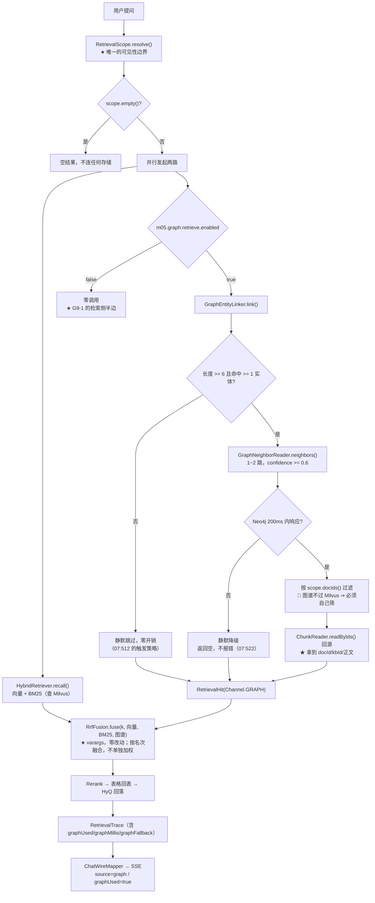

> 状态：🟡 进行中 · Sprint S9 · 阶段 B（M12 图谱旁路检索侧）· 建档 2026-09-23

# 2026-09-23 · S9 · M12 · 阶段 B —— 实体链接 + 1~2 跳邻居补充召回（`T-C01`/`T-C02`）+ O 轨 `T-O28` ⓑ

> 任务：`T-C01` + `T-C02`（2 项功能）+ `T-O28` ⓑ（1 项优化）· 来源：`docs/进度/03-Sprint排期.md` §Sprint 9
> 上游计划：`ai_knowledge_web/plan/2026-09-22-S9-M12-A.md`（本批要销的账见第 1 节）

**为什么是这一批**：`S9-M12-A` 把实体关系**写进了** Neo4j，而**一条都读不出来**（检索侧没接）。
本批接检索侧 —— 这也是 `G9-4`（分题型验收）的前置：图里有数据但没人查，验收无从谈起。
按上一批 §10-1 的建议，**本批第一件事是量「关系锚定率」**（那是 `G9-4` 能不能达标的前提）。

---

## 1. 开工条件检查

**依赖清单来源**（逐条注明出处，不许凭印象）：

| # | 依赖项 | 档位 | 现状（代码/文档实证） | 结论 |
|---|---|---|---|---|
| 1 | `T-C01` 依赖列 `T-C00`（图里要有实体名可链） | ✅ | `T-C00` 已交付（`S9-M12-A`，2026-09-22）。`GraphWriter#replaceDocument`（`pipeline/graph/GraphWriter.java:105`）写 `(:Entity{name})` + `(:Entity)-[r:REL{relation,docId,confidence,sourceChunkId}]->(:Entity)`。**图里当前 0 节点 0 边**（那是正常的：种子数据不造图，要用例自己写） | 满足 |
| 2 | `T-C02` 依赖列 `T-C01` | ✅ | 同一批交付，无外部依赖 | 满足 |
| 3 | `RrfFusion` 能不能吃第三路 | ✅ | `fuse(int k, List<RetrievalHit>... lists)`（`pipeline/retrieve/RrfFusion.java:63`）**是 varargs** ⇒ 加第三路**零改动**。且它按**名次**融合（`1/(k+rank)`）⇒ 天然就是需求 `:508` 要的「**去重合并进 Rerank，不单独加权**」 | 满足（这是本批改动面最小的一处） |
| 4 | `RetrievalSource.GRAPH` 是否已存在 | ✅ | `core/enums/RetrievalSource.java:22` 已有 `GRAPH("graph", "图谱")`；`10-接口约定汇总.md:285` 的 `source` 取值域已含 `graph`；`:514` 的 §14 契约表同。**枚举不用新增** | 满足 |
| 5 | SSE 的 `graphUsed`/`graphCostMs`/`graphFallback` 三个字段 | ✅ | `pipeline/chat/ChatDtos.java:94-96` 已保留；`ChatWireMapper.java:105` 当前**硬编码 `false, null, null`**，注释写着「图谱旁路未实现（`T-C00`）」。⇒ 本批把它填成真值 | 满足（本批步 6） |
| 6 | 长度口径（`07:512` 的「提问长度 ≥ 6」） | ✅ | `core/text/IdentifierTokenizer.count`（`:156`）的 javadoc **已经写着**「用途：`T-C00` 的图谱旁路阈值（提问长度 ≥ 6，`07:499`）」⇒ 口径早备好，直接用 | 满足 |
| 7 | 超时降级要的线程池 | ⚠️ WARN | 本仓有 `RETRIEVAL_EXECUTOR` 限定符（`HybridRetriever.java:90` 在用），但 **`RetrievalService` 没注入它**。见假设 3 | 满足（本批步 4 注入） |
| 8 | 图谱的可见性过滤 | 🔴 **BLOCKER 级关注** | 🔴 **图谱旁路是第三条召回路径，它不经过 Milvus** —— 而 `RetrievalScope.Scope#milvusFilter()`（`RetrievalScope.java:295`）的文档级过滤**正是下推给 Milvus 的**。⇒ 回源时**必须自己按 `scope` 过滤**，否则是一处**越权**（详见 §3.4 假设 1 与判据 5） | 满足（本批**必须**做，见判据 5） |
| 9 | 图里 `(:Chunk)` 节点 | ⚠️ WARN | 🔴 **`GraphWriter` 的 `CITES` 指向 `(:Document)` 而不是 `(:Chunk)`**（`:190-191`），而需求 `07:469` 明写 `(:Entity)-[r:CITES]->(:Chunk)`。`GraphSchema`（`:59`）**已声明 `Chunk.chunkId` 唯一约束** ⇒ 意图在、实现偏了。见假设 2 | 满足（本批步 2 修） |
| 10 | 回源要读 `sys_chunk` 的**行**（不是只 id） | ⚠️ WARN | `ChunkReader#readByDocId`（`service/ChunkReader.java:45`）**按文档读**，且返回的 `VectorChunk` **不带 `docId`/`kbId`** ⇒ 图谱要的是「按 chunkId 批量读 + 带归属」。见本批步 3 | 满足（本批新增一个读法） |
| 11 | 环境 | ✅ | `docker ps`：6 容器全 healthy；Neo4j 3 条约束在（`entity_name_unique` / `document_doc_id_unique` / `chunk_chunk_id_unique`） | 满足 |

**BLOCKER 汇总**：**无**。第 8 条是**设计上的硬要求**（不是缺件），已落成判据 5。

**⚠️ 已知偏差**（不拒绝施工，第 9 节销账）：

1. **relay 的对话模型不可用**（`402: Insufficient Balance`，上一批收尾时实测）⇒ 本批**所有**用例必须走替身，
   **不能**依赖真模型。这与本仓既有纪律一致（`m05.enhance.enabled=false` 那五条），但本批要**额外确认**：
   `T-C01` 的实体链接**不调 LLM**（需求 `:511` 明写「不强制 LLM 抽取提问实体」）⇒ **本批天然不需要模型**。
2. **上一批的锚定率未测**（`S9-M12-A` §9-1）⇒ 本批步 1 用**步 0 探针**量它。⚠️ 但注意：
   评测集 `eval/corpus.json` 是**直接灌进 Milvus 的夹具**，**不走上传解析链路** ⇒
   `RelationAnchor` 在那条路上**根本不跑**。⇒ 锚定率只能拿**真实上传**量（步 0 探针自己造）。

> 判据只有一条：**这条不满足，代码写下去会不会白写**。上面 11 条没有一条会让代码白写。

### 结论

- [x] ✅ **可以开工**
- [ ] ⛔ 拒绝施工

---

## 2. 开工时间

| 项 | 值 |
|---|---|
| 建档 / 开工日 | 2026-09-23 |
| 预计投入 | **6 人天**（`T-C01` ≈2 · `T-C02` ≈3 · `T-O28` ⓑ ≈1）· Sprint 容量 ≈10 人天 |
| 实际投入 | *回填时补* |

---

## 3. 开工内容

### 3.1 步骤

| 步 | 做什么（文件/类 → 动作 → 产出） | 依赖 | 可并行 |
|---|---|---|---|
| 0 | **探针：量关系锚定率**（`S9-M12-A` §9-1 点名要先做的那件事）→ 真上传几篇**带实体名的文档**（`m05.enhance.enabled=true` + 假 `ChatCaller` 返回带 relations 的 JSON）⇒ 数「模型给的关系条数」与「`RelationAnchor` 锚上的条数」。产出：**一个数**（进 §8 观察项）。⚠️ **它是决策点**：锚定率过低 ⇒ `G9-4` 必然不达标，要当场决定是否降级 | — | **先做**（结论影响步 1~4 的取舍） |
| 1 | 新建 `pipeline/graph/GraphEntityLinker.java` → `link(query, scope)`：把提问词映射到图实体名。做法照需求 `:511`：**n-gram 匹配**（不调 LLM）。三条硬要求：① 触发条件 `IdentifierTokenizer.count(query) >= 6` 且**命中 ≥1 实体**（`07:512`），否则**静默跳过、零开销**；② 实体名全集从 Neo4j 取（`MATCH (e:Entity) RETURN e.name`，**限条数上限**）；③ 匹配取**最长优先**（`A-100` 不应被 `A-1` 抢先命中）。产出：命中的实体名列表（**保序**，便于可复现） | 步 0 | 与步 2 并行 |
| 2 | 🔴 **修 `GraphWriter` 的 `CITES` 指向**（`:190-191`）：`(:Entity)-[:CITES]->(:Document)` → `(:Entity)-[:CITES]->(:Chunk {chunkId})`，并在写 `CITES` 前 `MERGE (c:Chunk {chunkId: row.sourceChunkId})`。理由：需求 `:469` 的数据模型 + `GraphSchema` 早已声明的 `chunk_chunk_id_unique` 约束 + `T-C02` 的"反向回源"要靠它。⚠️ **清理面要同步**：`deleteDocument`/`deleteDocuments` 现在删 `(:Document)`，加了 `(:Chunk)` 后要一并删（否则**新开一个泄漏面** —— 与本批同形） | 步 0 | 与步 1 并行 |
| 3 | `service/ChunkReader.java` 加一个读法 → `readByIds(Collection<Long> chunkIds)` 返回 `GraphChunk(chunkId, docId, kbId, blockType, titlePath, content)`。⚠️ **只读、不过滤**（过滤是调用方的事，与 `readByDocId` 同一条纪律：「读取层照实读出来，不是顺手筛掉」） | — | 与步 1/2 并行 |
| 4 | 新建 `pipeline/graph/GraphNeighborReader.java` → `neighbors(List<String> entityNames, int maxHops)`：Cypher 1~2 跳，**`confidence >= 0.6`**（`07:512`），返回 `(sourceChunkId, confidence, hop, path)`。⚠️ 上限：`LIMIT` 硬顶（防一个高频实体拖回上万条）。产出：候选 `sourceChunkId` 集合 + 每条的关系路径（前端要显示「订单系统 → 基于 → 一致性哈希」） | 步 2 | 与步 1 并行 |
| 5 | 新建 `pipeline/graph/GraphRetriever.java` → **编排 + 两条红线**：① `recall(query, scope)`：链接 → 邻居 → **按 `scope` 过滤** → 回源 → `List<RetrievalHit>`（`Channel.GRAPH`）；② **超时 200ms 静默降级**（`07:522`）；③ **永不抛**（`07:523` 的检索侧对应条）。产出：一个 `@Service` + `GraphRecall(hits, millis, fallback, note, entities)` | 步 1/3/4 | — |
| 6 | `pipeline/retrieve/RetrievalHit.java` 加 `Channel.GRAPH("图谱")`；`RetrievedChunk#source()`（`:134`）加 GRAPH 分支（**名次更好者优先，并列取 VECTOR** —— 见那里的既有口径）。⚠️ **`source()` 的判据是"名次更好的那一路"**，GRAPH 也一样参与比较，不特殊对待 | — | 与步 5 并行 |
| 7 | `pipeline/retrieve/RetrievalService.java` 接线（`:129` 附近）：注入 `GraphRetriever` + `RETRIEVAL_EXECUTOR`；**与主链路并行**发起；`RrfFusion.fuse(k, vectorHits, bm25Hits, graphHits)`（**varargs，零改动**）。产出：图谱真的进了融合池 | 步 5/6 | — |
| 8 | `RetrievalTrace` 加三个字段（`graphUsed` / `graphMillis` / `graphFallback` / `graphEntities`）→ **`V42` 迁移**（`sys_retrieval_trace` 加列）；`RetrievalTraceWriter`（`:74` 的 insert）同步。产出：图谱旁路**可观测**（`G9-4` 的取证要它） | 步 7 | 与步 9 并行 |
| 9 | `pipeline/chat/ChatWireMapper.java:105` 把硬编码的 `false, null, null` 换成 trace 的真值。产出：前端能显示「来源：图谱关联」 | 步 8 | — |
| 10 | 开关 `m05.graph.retrieve.enabled`（默认 `true`）+ `m05.graph.retrieve.timeout-ms`（默认 200）；`src/test/resources/application.properties` 加 `false` 并写明理由 | — | 与步 7 并行 |
| 11 | **O 轨 `T-O28` ⓑ** → `ParseWorker#workerId()`（`:351`）加**进程标识**：`parse-worker@pid={pid}/start={epochSecond}/th={thread}`；新增 `ParseWorker#processTag()`。⚠️ 为什么必须有**启动时刻**：同一个 pid 在重启后会复用，只带 pid 分不出「本进程」与「上一轮同 pid 的进程」 | — | **完全独立**，与步 0~10 无交集 |
| 12 | **O 轨 `T-O28` ⓑ 的判据** → `ParseWorkerFlowTest` 加一条：跑一批之后扫 `sys_async_task where locked_by is not null and locked_by not like '%{processTag}%'` ⇒ **必须为 0**（发现别的进程留下的锁 ⇒ 有第二个消费者 ⇒ 红）。⚠️ 它补的正是 ⓐ（探 8080）的**不完备**：后端起到别的端口时 ⓐ 看不见，而这条**看得见** | 步 11 | — |

**依赖顺序**：步 0 → 1/2 → 3/4 → 5 → 6/7 → 8 → 9。步 10 随时。**步 11/12 与本批功能面完全解耦**。

### 3.2 业务流程图

> 触发条件：① 跨 ≥3 个组件 ✅（`RetrievalService` → `GraphRetriever` → `GraphEntityLinker`/`GraphNeighborReader` → `ChunkReader` → Neo4j/MySQL）
> ② 有并发 ✅（与主链路并行）③ 有超时降级 ✅ ④ 有幂等/去重 ✅（融合池去重）
> ⇒ 必须画。



### 3.3 明确不做（范围控制）

| 不做的事 | 原因 | 归属批次 |
|---|---|---|
| `T-C03` 开关端点 `GET/PUT /system/feature/graph` | 本批只做**配置开关**（`m05.graph.retrieve.enabled`）；端点 + 审计 + 前端是独立一块 | `S9-M12-D` |
| `T-C03` 的 `G9-2` 完整取证（超时 >200ms 静默降级**不影响问答**） | 本批**实现了**降级（步 5），但 `G9-2` 要的是**端到端**（问答不受影响、不报错）—— 那要 `ChatStreamService` 侧的观测点 | `S9-M12-D` |
| `T-C04` 图谱补边（人工加边 `confidence = 1`） | 入口在未命中详情页，要前端 | `S9-M12-D` |
| `G9-4` 的**分题型验收**（单跳 ≤1pp / 多跳 +10pp） | 它是**评测**，要真嵌入模型（`EMBEDDED_API_BASE_URL` 实测返 `20015` 参数错）⇒ **当前不可跑**。本批只交**能力 + 可观测性**，不宣称达标 | 真模型可用时 |
| 实体**类型**（`type ∈ 系统/组件/概念/…`，`07:462`） | `T-C00` 没抽 type（提示词没要求），本批也不补 —— 链接只用 `name` | 待定（需求侧先定要不要） |
| 前端「来源：图谱关联」的渲染 | 本批只保证 `source=graph` 真的下发（步 9）；前端渲染属 `M13` | `S9-M13` |

### 3.4 本批假设

| # | 假设 | 若被证伪的后果 |
|---|---|---|
| 1 | 🔴 **`scope.docIds()` 足够做图谱侧的可见性过滤** —— 即「可见文档集」这一个集合对三条路径都成立 | 若不够（例如图谱要额外考虑密级以外的维度）⇒ **就是一处越权**。⚠️ 判据 5 用**负向锚**（造一条指向不可见文档的边 ⇒ 必须召回不到）钉住它。这是本批**最该证伪的一条** |
| 2 | **`CITES` 改指向 `(:Chunk)` 不影响 `T-C02` 的回源** —— 回源靠 `REL.sourceChunkId` 属性，与 `CITES` 的指向无关 | 若 `CITES` 改向引入别的耦合 ⇒ 回源要改走 `CITES`。**代价可控**（两者都在同一批里） |
| 3 | **`RETRIEVAL_EXECUTOR` 可以直接注入 `RetrievalService`**（它现在只被 `HybridRetriever` 用） | 若该池的容量/语义不适合图谱（例如它被设计成"只跑 Milvus 查询"）⇒ 超时降级会与主链路抢线程。兜底：图谱用自己的池。**判据 9 会量耗时**，抢线程会表现为 P95 上升 |
| 4 | **实体名全集可以每次提问都从 Neo4j 取**（带 `LIMIT`） | 若实体规模大（10 万+）⇒ 单次 `MATCH (e:Entity)` 会撞 `07:534` 的 P95 <100ms 红线。兜底：加 Redis 缓存（`CacheConstants` 有现成前缀机制）。**步 0 探针要顺带量实体规模** |

---

## 4. 数据变更清单

| 类型 | 内容 | 回滚方式 |
|---|---|---|
| **MySQL 改表** | `sys_retrieval_trace` 加 **4 列**：`graph_used TINYINT(1) NOT NULL DEFAULT 0` · `graph_millis BIGINT NOT NULL DEFAULT 0` · `graph_fallback TINYINT(1) NOT NULL DEFAULT 0` · `graph_entities VARCHAR(512) NULL`（命中的实体名，逗号分隔；**空集写 NULL 不写空串** —— 照 `S3-M03-A` §4 的既有口径） | **可逆**（drop column） |
| **迁移文件** | **`V42__s9_graph_retrieval.sql`**（现有最大 `V41`） | — |
| **Neo4j 约束** | **无新增**（`chunk_chunk_id_unique` 早已声明）—— 步 2 只是**开始真的写 `(:Chunk)` 节点** | — |
| **种子数据** | **不需要**。演示库不造图（图谱靠真实解析产出） | — |
| **NULL 分支** | `graph_entities` 可空：**没命中实体 ⇒ NULL**（不是空串）。⚠️ 与 `graph_used=false` 是两件事：前者是"没链上"，后者是"旁路没跑"（开关关掉/超时）—— 两者靠 `graph_used` + `graph_fallback` 区分，判据 8 会逐格钉住 | — |
| **配置** | 新增 `m05.graph.retrieve.enabled`（默认 `true`）· `m05.graph.retrieve.timeout-ms`（默认 200）；测试期 `false` | 可逆 |

> 跑过的迁移**只增不改** —— `V42` 是新文件，`V41` 及以前一行不动。

---

## 5. 依赖与工具决策

**默认不引**。

| 方案 | 做法 | 代价 | 结论 |
|---|---|---|---|
| **不引依赖（既有栈）** | `GraphEntityLinker` 的 n-gram 匹配用**纯 Java**（`String.contains` / 滑窗）；分词复用 `IdentifierTokenizer`（`S4-M05-C2` 已交付，**它本来就是为"标识符整体成 token"设计的**）；邻居查询复用 `T-C00` 的裸 `Driver` + Cypher | 手写滑窗（约 30 行） | ✅ **采用** |
| 候选 A：Lucene / `hanlp` 之类做实体链接 | 现成的 n-gram + 词典匹配 | 引一个全文检索全家桶只为匹配几十个实体名 —— 而本仓对 `poi-ooxml`（15MB）都选择了手写 CSV | ❌ 不采用 |
| 候选 B：Neo4j 全文索引（`CREATE FULLTEXT INDEX`） | 让 Neo4j 自己做匹配 | ① 它需要**额外的索引维护**（`T-C00` 没建）；② 匹配口径会从"Java 里可测"变成"图库里不可测"；③ 需求 `:511` 点名的是 **n-gram / BM25**，BM25 那一路本仓已有 `Bm25Text` 口径，但那是 Milvus 侧 | ❌ 不采用（**留作兜底**：若实体规模大到内存匹配撑不住，见假设 4） |
| 候选 C：把图谱召回做成 Milvus 的一路 | 复用现有 `HybridRetriever` 通道 | 图谱的召回**本质是按图关系跳转**，不是向量/稀疏检索 —— 塞进 Milvus 等于放弃"多跳"这个唯一价值 | ❌ 不采用 |

**同类产品对比**：不适用（不引新依赖）。

**推荐**：**纯 Java n-gram 匹配 + 裸 Cypher 邻居查询 + `RrfFusion` varargs 融合**。
**理由**：三处都落在**已有的、有判据的**组件上（`IdentifierTokenizer` 的口径早为这个场景写好、`RrfFusion` 的 varargs 天然吃第三路、`Driver` 已在用）；新增代码只有"匹配 + 编排"两块。

> **无新依赖**（用既有 `IdentifierTokenizer` + Neo4j `Driver` + `RrfFusion` 实现）。

---

## 6 + 7. 验收方法与标准

| # | 判据（对齐需求门禁号） | 验收方法（可直接粘的命令/脚本） | 期望结果 | 证据落点 |
|---|---|---|---|---|
| 1 | **`G9-1` 检索侧半边** —— 关闭时链路与未开启**完全一致** | `mvn -B -f F:/work/code/ai-knowledge/ai_knowledge_web/pom.xml test -Dtest=GraphRetrieveFlowTest` | `m05.graph.retrieve.enabled=false` ⇒ **`driverCalls == 0`**（记数替身）**且** `fuse` 收到的只有两路、`graphUsed=false`、`graphCostMs` 不发 | `GraphRetrieveFlowTest#disabledMeansNoCallAndNoField` |
| 2 | **触发策略**（`07:512`） | 同上 | ① 提问长度 < 6 ⇒ **静默跳过、零开销**（不查 Neo4j）；② 长度 ≥ 6 但**不含任何实体** ⇒ 同样跳过；③ 两者都满足 ⇒ 才发起 | `GraphRetrieveFlowTest#shortQuerySkipsEntirely` · `#noEntitySkipsEntirely` |
| 3 | **实体链接取最长优先** | 同上 | 图里有 `A-1` 与 `A-100`，提问含 `A-100` ⇒ 只命中 `A-100`（**不被 `A-1` 抢先**） | `GraphEntityLinkerTest#longestMatchWins` |
| 4 | **1~2 跳 + `confidence >= 0.6`** | 同上 | 造 `0.9`（1 跳）· `0.55`（1 跳）· `0.7`（2 跳）三条边 ⇒ 只召回前两条的 `sourceChunkId`；**2 跳的能到、3 跳的到不了** | `GraphNeighborReaderTest#confidenceThresholdFilters` · `#twoHopsReachableThreeNot` |
| 5 | 🔴🔴 **可见性过滤（本批最要紧的一条）** | 同上 | 造一条**指向不可见文档**的边（`sourceChunkId` 属于另一个库 / 密级超上限 / 已软删的文档）⇒ **召回不到**。⚠️ **负向锚**：去掉过滤那一步 ⇒ 本条**当场转红** | `GraphRetrieveFlowTest#invisibleDocIsNotRecalled` |
| 6 | **去重合并进融合池，不单独加权**（`07:508`） | 同上 | 同一个 `chunkId` 同时被向量路与图谱路召回 ⇒ 融合池里**只有一条**，且它的 `channelRanks` **有两个条目**；⚠️ 断言**分数 = RRF 公式**（不是"图谱额外加分"） | `GraphRetrieveFlowTest#graphFusesByRankNotWeight` |
| 7 | **超时 200ms 静默降级**（`07:522`） | 同上 | 把 `m05.graph.retrieve.timeout-ms` 设成 `1` ⇒ `graphFallback=true`、**不报错**、主链路结果**一条不少** | `GraphRetrieveFlowTest#timeoutDegradesSilently` |
| 8 | **trace 四列逐格** | 同上 | 四种状态各一条：命中（`graph_used=1` + `graph_entities` 非空）· 没链上（`graph_used=0` + `graph_entities=NULL`）· 开关关（全 0/NULL）· 超时（`graph_fallback=1`） | `GraphRetrieveFlowTest#traceColumnsPerState` |
| 9 | **`source=graph` 真的下发** | 同上 | SSE 的 `retrieval` 事件里，图谱召回的 chunk 其 `source` 字段 = `"graph"`；`graphUsed=true`、`graphCostMs` 非 null | `GraphRetrieveFlowTest#wireCarriesGraphSource` |
| 10 | **图谱构建侧的图清理面同步**（步 2 的连带） | `-Dtest=GraphWriteFlowTest` | 写了 `(:Chunk)` 之后 `deleteDocument` 把 `REL` / `CITES` / `Chunk` / `Document` **全清**；`deleteDocuments` **不误伤**别的文档的 `Chunk` | `GraphWriteFlowTest#deleteRemovesChunkNodesToo` |
| 11 | **`T-O28` ⓑ：`workerId` 带进程标识** | `-Dtest=ParseWorkerFlowTest` | ① `workerId()` 含 `pid=` 与 `start=`；② 跑一批之后 `select count(*) from sys_async_task where locked_by is not null and locked_by not like '%{processTag}%'` ⇒ **0** | `ParseWorkerFlowTest#noForeignLockRemains` |
| 12 | **回归：既有全量不退化** | `export JAVA_HOME='F:/work/dev_tools/jdk/jdk-25.0.4.1'` + `mvn -B -f F:/work/code/ai-knowledge/ai_knowledge_web/pom.xml test` | **≥ 906 通过 / 0 红（relay 那 2 条除外）/ 2 skipped**（基线 = `S9-M12-A` 的 906） | 控制台 `Tests run:` 汇总行 |
| 13 | 前端门禁不退化 | `cd ai_knowledge_app && node scripts/check.mjs` | 类型检查 + 构建均通过 | 脚本退出码 0 |

**证伪（本批至少 4 处，**每条都要当场记录"它红了没有"** —— 上一批两处打偏的教训）**：

| # | 怎么破坏 | 哪条判据**必须**转红 | ⚠️ 先验一遍"判据离破坏点够近吗" |
|---|---|---|---|
| F1 | 去掉回源时的 `scope` 过滤（步 5 的可见性那一步） | 判据 5 | ✅ 近 —— 破坏点就在被判的那一步里 |
| F2 | `confidence >= 0.6` 改成 `>= 0.0` | 判据 4 | ✅ 近 |
| F3 | 把 `RrfFusion.fuse(..., graphHits)` 改成"图谱单独加权" | 判据 6 | ⚠️ **上一批栽在这里的形状**：要断言**分数等于 RRF 公式**，而不是"图谱的条目在结果里"—— 后者对两种实现都绿 |
| F4 | 超时不降级（去掉 `orTimeout`） | 判据 7 | ✅ 近 |
| F5 | 触发条件去掉长度判断 | 判据 2 | ✅ 近 |

**观察项**（不计成败）：
- **关系锚定率**（步 0 探针）—— `S9-M12-A` §9-1 的未测项，本批**必须量出这个数**并进 §8。
- **图谱旁路耗时**（`07:534` 给的是 P95 <100ms）—— 本批**采**，红线属 `G9-5`（`S9-M13`）。
- **实体名全集规模**（假设 4 的实测值）。

**种子核对**（跑完必做）：

```bash
set -a && . ai_knowledge_web/.env && set +a
docker exec kb-mysql mysql -u"$MYSQL_USERNAME" -p"$MYSQL_PASSWORD" "$MYSQL_DATABASE" -N -e "select count(*) from sys_user where deleted_at is null;"
```
期望 `128`；另核 `sys_kb` = 8、业务表 0、Milvus 向量 0、分区只剩 `_default`。

**图库核对**（跑完必做）：

```bash
docker exec -e NEO4J_USERNAME -e NEO4J_PASSWORD kb-neo4j sh -c \
  'export PATH=$PATH:/var/lib/neo4j/bin; \
   cypher-shell -a bolt://localhost:7687 -u "$NEO4J_USERNAME" -p "$NEO4J_PASSWORD" \
     --format plain "MATCH (n) RETURN count(n) AS nodes"'
```
期望 **0**（用例造的实体/文档/分片节点全部清掉；3 条约束仍在，那是 schema 不是数据）。

---
---

# 以下为开工后回填

> **提交节奏（两次）**：1~7 节写完即提交一次（`docs(plan): <批次> 开工计划`）；
> 8~10 节写完再提交一次（`docs(plan): <批次> 验收回填`）。让 git log 上「计划 → 结果」成对可查。

## 8. 验收结果

| # | 判据 | 实测结果 | 证据（命令 / 文件:行 / 测试名） |
|---|---|---|---|

**测试基线**：`Tests run: N, Failures: 0, Errors: 0, Skipped: 0`（上批 906 → 本批 M）

---

## 9. 遗留问题

| # | 项 | 原因 | 归属批次 | 是否有判定点/注释留在代码里 |
|---|---|---|---|---|

> 没有遗留写「无」。**本批若"先施工后补写第 1 节"，也必须在此登记一条**（违规留痕）。

---

## 10. 建议

- 对下批的排期 / 口径 / 风险建议。没有写「无」。

---

## 附：本批同步的文档回填

- [ ] **`docs/进度/00-开工速览.md` §1/§2/§3/§4** → 当前定位 / 本批任务行 / 门禁现状 / 缺口账（**必改**，它是下一批的唯一入口）
- [ ] `docs/进度/02-任务清单.md` → `T-C01`/`T-C02` 置 ✅（未做的不动）
- [ ] `docs/进度/03-Sprint排期.md` → 「交付状态」段
- [ ] `docs/进度/README.md` → 看板状态 + 完成日期（**备注只写一行短结论 + 指针**）
- [ ] `docs/进度/变更记录/01-变更记录.md` → 追加一行（日期 · Sprint · 变更 · 交付物 · 遗留）
- [ ] `docs/需求文档/10-接口约定汇总.md` → `graphUsed`/`graphCostMs`/`graphFallback` 三字段**从"保留"变"已实现"** + `13-接口变更记录.md` 加一行
- [ ] `ai_knowledge_web/plan/汇总.md` → 当前定位 / 批次总览 / 第 9 节遗留**逐条并入** §3
- [ ] `ai_knowledge_web/plan/优化/README.md` → `T-O28` 状态 + O 配额账
- [ ] `docs/后端开发文档/` 新增一份 `24-S9-M12B-图谱检索侧结论.md`
- [ ] 本文件状态行 → ✅ 已完成
- [ ] `.workbuddy/memory/2026-09-23.md` → 交接（**追加**，该文件已有上一批的交接）
