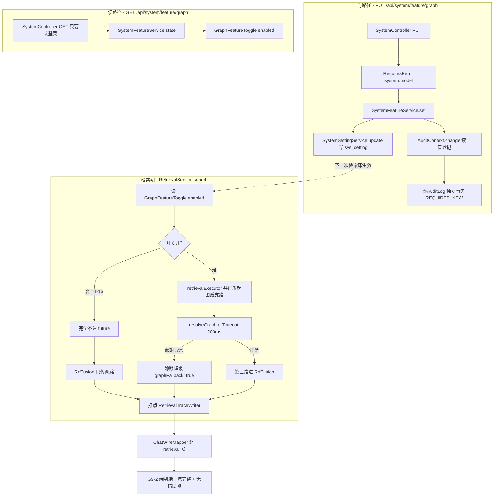

> 状态：✅ 已完成 · Sprint S9 · 阶段 C（M12 图谱旁路 · 开关端点）· 建档 2026-09-23 · 回填 2026-09-23

# 2026-09-23 · S9 · M12 · 阶段 C —— 图谱旁路开关端点（`GET/PUT /system/feature/graph`）+ 审计 + `G9-2` 端到端半边

> 任务：`T-C03`（1 项）+ O 轨 3 项
> 来源：`docs/进度/03-Sprint排期.md` §Sprint 9 · `docs/进度/00-开工速览.md` §2
> 上游计划：`ai_knowledge_web/plan/2026-09-23-S9-M12-B.md`（本批要销的账见第 1 节）

---

## 1. 开工条件检查

### 1.0 本批范围裁定（先写在最前面）

三处文档对「本批做哪些」的表述不一致，**先把裁定与理由写死**，否则后面的条件检查没有对象：

| 来源 | 原文 | 本批裁定 |
|---|---|---|
| `docs/进度/02-任务清单.md:415` | `T-C03` 验收要点 = 「**I-16**：关闭时链路与未开启**完全一致**；>200ms 静默降级」—— **没有端到端条款** | 采纳为**基线**；端到端半边**本批一并做**（见下行） |
| `docs/进度/00-开工速览.md:512` | `G9-2` 「⚠️ **端到端**半边（问答不受影响、不报错）要 `ChatStreamService` 侧观测点 ⇒ **`S9-M12-D`**」 | **提前到本批**。理由：`ChatStreamingFlowTest` 已交付 `RANDOM_PORT` + JDK `HttpClient` 的 SSE 逐帧观测夹具（该类 javadoc 自证 `#174`/`#175`），**夹具已然存在**，端到端半边不再需要「先建观测点」这件前置工作 |
| `ai_knowledge_web/plan/2026-09-23-S9-M12-B.md:123-125,290` | `T-C03` 端点 / `G9-2` 端到端 / `T-C04` 补边 **三项都归 `S9-M12-D`** | `T-C03` + `G9-2` 端到端**取下**；**`T-C04` 留给 `S9-M12-D`**（其验收要点「入口在未命中详情」要前端页面，与开关端点无交集，混批会让验收变成大杂烩 —— `batch-plan` 铁律：「批次边界落在能独立验收的地方」） |
| 用户开工语 | `T-C03：…+ 审计 + G9-2 端到端半边` / `T-C04：人工补边` —— 结尾问句是「要我直接开 S9-M12-C（先立据，**再做 `T-C03`**）吗？」 | 与上一行一致：本批 = `T-C03` |

**结论**：本批 = `T-C03`（开关端点 + 审计 + 运行时动态开关 + `G9-2` 端到端半边）· `T-C04` 归 `S9-M12-D`（进 §9 登记）。

### 1.1 依赖清单

> 判据只有一条：**这条不满足，代码写下去会不会白写**。

| # | 依赖项 | 档位 | 现状（代码/文档实证） | 结论 |
|---|---|---|---|---|
| 1 | `T-C03` 依赖列 = `T-C02`（检索侧 1~2 跳邻居补充召回） | ✅ | `02-任务清单.md:414` `T-C02` = ✅ 已完成（`S9-M12-B`，2026-09-23）：`GraphNeighborReader` + `GraphRetriever` + `RrfFusion` 三路 | 满足 |
| 2 | 端点契约存在且逐字明确 | ✅ | `10-接口约定汇总.md:338` `GET /system/feature/graph｜图谱旁路开关状态（FR-GRAPH-01）`；`:339` `PUT …body { enabled } → 开关图谱旁路 🚩（高危：检索行为变更）`；`:398` 状态 = `⏳ 待开发` | 满足 |
| 3 | 需求侧行为口径（关闭 ⇒ 完全一致 / 超时 ⇒ 静默降级） | ✅ | `07-需求-检索与问答.md` FR-GRAPH-01「降级与可回滚（**P0 式红线**）」+ 不变量 **I-16**；`07:522` 给出 200ms | 满足 |
| 4 | 开关当前**是构造期配置属性**，共 3 处读取 | ⚠️ WARN | `RetrievalService.java:103` · `GraphEntityLinker.java:40` · `GraphNeighborReader.java:48` 均为 `@Value("${m05.graph.retrieve.enabled:true}")` | 满足（**这正是本批要改的东西**，不是阻塞） |
| 5 | `sys_setting` 有 DDL 但**后端无写入者** | ⚠️ WARN | `V1:159` 建表；`SystemSettingService` 只有 `@Transactional(readOnly=true) snapshot()`；`src/main/java` 全量 grep 无第二个写点 | 满足（PUT 将是**第一个写入者**） |
| 6 | 新增 `sys_setting` 键的维护仪式已有成文规定 | ✅ | `V20__s5_degrade_switch_and_parse_version.sql:20-22`：「新增本键**必须同时**改 `SystemSettings`（常量）与 `SystemSettingService.KEYS`（查询范围）。只改一处的话现象是『配置改了但没人读』」 | 满足 |
| 7 | 审计三处同步（注解 / 策略表 / 冻结清单）机制完备 | ✅ | `AuditRiskPolicy.java`（约 40 条 `register`，重复注册抛 `IllegalStateException`）· `AuditCoverageFlowTest#expectedActions()` 冻结 **47** 条（`.hasSize(47)` @ `:367`）· `AuditChangeContractTest` 双向校验 | 满足（本批 47 → 48） |
| 8 | 高危**类别**（`Category`）能否装下「开关图谱旁路」 | ⚠️ WARN | `AuditRiskPolicy.Category` 现 7 值（含 `NOT_HIGH_RISK`）：权限扩大 / 数据导出 / 内容删除 / 模型配置变更 / 账号安全变更 / 安全事件 / 不计入高危。**无一命中** —— 它不是模型配置（`05:415` 的「四类模型」），也不是安全事件（`SECURITY_EVENT` 的定义是「系统自己发现的恶意内容」） | **不满足** → 按既有成文先例**新开第 7 类**（见下条） |
| 9 | 「如何新增一个高危类别」有成文先例 | ✅ | `AuditRiskPolicy.java:50-65`：第 6 类 `SECURITY_EVENT`（2026-09-18 定案）逐条写明「新增高危类**必须在类注释里写明定案日期与理由** —— 否则下一个人会以为 §4.3 本来就有六类」 | 满足（照此办） |
| 10 | 端点**权限码**的需求依据 | ⚠️ WARN | `05-需求-权限与审计` §3.2 的 12 行矩阵与 §4.3 四类高危**都未提及图谱开关**；`05:369` 系统管理行只列「部门增删改 / 模型配置变更 / 回收站清空」；`PermissionCode` 现 **39** 个码（`system:model` @ `:106` 是唯一系统域写码，`V2:93` 已播种，**只有 `SUPER_ADMIN` 持有** —— `ModelConfigService.java:167`） | **不满足** → 取「复用 `system:model`」并登记偏差（见 §3.4 假设 1 · §9） |
| 11 | `GET` 侧权限口径的同类先例 | ✅ | `SystemController.java:20-32`：同类只读字典 `GET /system/thresholds` **刻意不挂** `@RequiresPerm`（「只要求登录，由 `SecurityConfig` 的 `.anyRequest().authenticated()` 兜住」），并给同族的 `GET /kb/presets`、`GET /depts/tree`、`GET /roles` 为证 | 满足 |
| 12 | `G9-2` 端到端半边所需的 SSE 观测夹具 | ✅ | `ChatStreamingFlowTest.java:66` 已用 `@SpringBootTest(RANDOM_PORT)` + `LocalServerPort` + JDK `HttpClient#BodyHandlers.ofInputStream()`（逐帧打时间戳），javadoc 自述为何 `RestClient` 不合适 | 满足（本批复用其姿势） |
| 13 | 中间件可用 | ✅ | `docker ps`：`kb-mysql` / `kb-neo4j` / `kb-minio` / `kb-valkey` / `milvus-standalone` 均 health（另 5 个 `WeKnora-*` 与本仓无关） | 满足 |
| 14 | 迁移编号可用 | ✅ | `db/migration/` 最大 = `V42__s9_graph_retrieval.sql` ⇒ 本批取 **`V43`** | 满足 |
| 15 | 测试基线 | ✅ | 上批 `S9-M12-B` 收口 **922**（0 红 / 2 跳过） | 满足 |
| 16 | O 轨候选「换库不搬对象」（`汇总.md` §3 **#223**）的前提是否还在 | ✅ | **本批逐行核实为真**：`DocReindexService.moveToKb`（codegraph 逐字）只改 `sys_document.kb_id` / `sys_chunk.kb_id` + 删源分区向量，**不搬 MinIO 对象**；`DocLifecycleService.purgeKb` 步骤② `removePrefix(DocStorage.kbDocPrefix(kbId))` **按前缀整块删**（`DocStorage.java:505`）⇒ 已移到 B 库的文档，在 A 库被彻底删除后**对象没了、行还在** | 满足（`#190` 教训：动一条遗留前先核实前提 —— 已核实） |
| 17 | O 轨候选「锚定率：实体名逐字照抄」的量化口径 | ✅ | `RelationAnchorRateProbeTest`（`pipeline/graph/`，`S9-M12-B` 交付）已能实测锚定率；`EnhancePrompts.VERSION` = `doc-enhance-v3`（`T-C00` 回填） | 满足 |

**BLOCKER 汇总**：**无**。

**⚠️ 已知偏差**（不拒绝施工，第 9 节销账）：

1. **端点权限码无需求依据** ⇒ 复用 `system:model`（详见 §3.4 假设 1）。语义错位（权限矩阵里会显示为「模型配置」），第 9 节登记。
2. **`Category` 无对应档位** ⇒ 按 `SECURITY_EVENT` 先例新开第 7 类，第 9 节不登记为遗留（这是**照成文规定办事**，不是偏差），但**要在类注释里写定案日期与理由**。
3. **`retrieval.graph-bypass-min-length`（`V2:192` 种子 = 6）无任何读取者** —— 阈值实际硬编码在 `GraphEntityLinker.java:32` `MIN_QUERY_TOKENS = 6`。**本批不动**（见 §3.3），第 9 节登记为 O 候选。
4. **`PermissionCode` 实测 39 个值而全仓四处文档/注释写「38 个」**（`:11` javadoc · `mock/data.ts:57,177,242` · `PermissionController.java:18,29`），且 `UserAdminFlowTest.java:123` / `UserFlowTest.java:382` **已在断言 39**（即注释早已过期、断言是对的）。本批不动（新增权限码才需碰），第 9 节登记。
5. **`汇总.md` §3 #228 是陈旧条目**：仍写「⏳ 未销」并把归属写成 `S9-M12-C（T-C02）`，而 `S9-M12-B` 已交付检索侧半边。本批回填时一并订正（第 9 节留痕）。

### 结论

- [x] ✅ **可以开工**
- [ ] ⛔ 拒绝施工

> 唯一需要外部裁决的是第 10 条（权限码）。已用 `AskUserQuestion` 给过三个选项（复用 `system:model` / 新增 `system:feature` / 读写分治），**用户未作答** ⇒ 按「最小代价 + 收敛最严」自决为**复用 `system:model`**，并把代价与替代方案完整写进 §3.4 与 §9，便于随时回退改判。

---

## 2. 开工时间

| 项 | 值 |
|---|---|
| 建档 / 开工日 | 2026-09-23 |
| 预计投入 | **8.5 人天**（Sprint 容量 ≈ 10 人天）—— 功能 `T-C03` ≈ 4.5 + O 轨 ≈ 4.0 |
| 实际投入 | **约 8 人天（估算，非计时）** —— `T-C03` + `G9-2` 端到端 ≈ 4.5 · O 轨 ≈ 3.5。⚠️ **估算口径**：本仓不记工时，"实际"是按**改动面 × 返工次数**倒推的（本批返工三次：`purgeKb` 的 javadoc 自纠一次 · 判据 12 的方法错一次 · 判据 13 换证一次），**不是可审计的数**，仅作 σ 校准用 |

> O 轨按 `optimization-runs-in-parallel` 连续第 22 批低于下限 4 的风险在此解除：本批切 **≈4.0 人天**（`#224` 0.5 + `#223` 2.0 + 锚定率提示词 1.5）。

---

## 3. 开工内容

### 3.1 步骤

| 步 | 做什么（文件/类 → 动作 → 产出） | 依赖 | 可并行 |
|---|---|---|---|
| 1 | `SystemSettings` → 加 `RETRIEVAL_GRAPH_ENABLED = "retrieval.graph-bypass-enabled"` + `DEFAULT_GRAPH_ENABLED = true`（**键与默认值单一来源**，`V20:20` 规定的仪式一半） | — | ∥ 步 2 |
| 2 | `db/migration/V43__s9_graph_feature_switch.sql` → 播种该键（`BOOLEAN` · 组 `检索` · `editable=1` · 值 `true`）。⚠️ 不碰 `||`（用整条字面量），理由见 `V20:24-26` 那条已踩过的坑 | — | ∥ 步 1 |
| 3 | `SystemSettingService` → ① `KEYS` 加新键（**仪式另一半**）② 新增**本仓第一个写入者** `boolean update(String key, String value)`：`@Transactional`，拒绝 `KEYS` 之外的键、按 `value_type` 校验取值、写 `updated_at` | 1,2 | |
| 4 | 新建 `pipeline/graph/GraphFeatureToggle` → `boolean enabled()` = `settings.bool(RETRIEVAL_GRAPH_ENABLED, DEFAULT_GRAPH_ENABLED)`。**键→默认值的配对只此一处**（同 `SystemThresholdService` javadoc 立的规矩：否则「库里跑的是 A、页面上显示的是 B」且双方都不报错） | 3 | |
| 5 | 改造 3 处构造期读取：`RetrievalService`（去 `@Value` 的 enabled 字段，注入 toggle，**保留** `timeout-ms`）· `GraphEntityLinker`（同）· `GraphNeighborReader`（同）⇒ 开关自本步起**运行时可翻** | 4 | |
| 6 | `SystemDtos` → 加 `record FeatureSwitch(boolean enabled)`；字段名与 `src/api/index.ts` / `src/types/index.ts` **逐字一致** | — | ∥ 步 3 |
| 7 | `AuditRiskPolicy` → 新开 **第 7 类** `SYSTEM_BEHAVIOR_CHANGE("系统行为变更")`，类注释写明**定案日期（2026-09-23）+ 理由 + 为何不塞进既有六类**；`IMPLEMENTED` 注册 `(SYSTEM, "开关图谱旁路", SYSTEM_BEHAVIOR_CHANGE, HIGH, 理由)` | — | ∥ 步 6 |
| 8 | 新建 `service/SystemFeatureService` → `state()` + `@AuditLog(module=SYSTEM, action="开关图谱旁路", risk=HIGH, target="'图谱旁路'")` 的 `set(boolean)`，**先** `AuditContext.change("图谱旁路", 旧, 新)` **再**写库（`T-3C3` 的「读旧值 → 登记 → 再写」） | 3,7 | |
| 9 | `SystemController` → 加 `@GetMapping("/feature/graph")`（**只要求登录**，照 `:20-32` 的同族先例）+ `@PutMapping("/feature/graph")` + `@RequiresPerm("system:model")`。⚠️ **同文件两处修改必须串行**，改完复核列数 | 8 | |
| 10 | `AuditCoverageFlowTest#expectedActions()` → **47 → 48**（含在末尾追加那一行）；`AuditChangeContractTest` 双侧自洽 | 8 | |
| 11 | 测试：① 开关端点真 HTTP 流（审计打点必须走真 HTTP —— 直调 Service 会测成空值）② **I-16**：关闭 ⇒ 无 future、两路 RRF、`graphMillis==0`、`graphUsed==false`、`graphCostMs==null` ③ `GraphRetrieveDisabledTest` 由「改 yml 属性」改为「改 `sys_setting` 行」（**DB 为事实源、yml 为缺行兜底**，与 `SystemSettingService` 既有 `decimal(key, fallback)` 同一口径），收尾**必须还原为 `true` 并断言** | 5,8,9,10 | |
| 12 | `G9-2` **端到端半边**：新建 `pipeline/chat/ChatGraphDegradeEndToEndTest`（`RANDOM_PORT`，复用 `ChatStreamingFlowTest` 的 `HttpClient` 逐帧姿势）—— 两个场景各断言「流完整结束 + `done` 到达 + **无错误帧** + `retrieval` 帧 `graphUsed=false`/`graphCostMs=null`」：ⓐ 图谱关；ⓑ 图谱开但 `timeout-ms=1`（静默降级） | 5,11 | |
| 13 | **O · `#224`**：`check-ledgers.mjs` 加一条 —— `plan/汇总.md` §1 的 `上一批` 行必须指向 §2「批次总览」里当前批次的前一行 | — | **∥ 全程** |
| 14 | **O · `#223`**：`purgeKb` 的 MinIO 清理由「按前缀整块删」改为「**按待清文档的 `storage_path` 精确删**」，使已迁往他库的文档对象不被误删；补判据（造「移库后清源库」场景，断言目标库文档仍可下载） | — | **∥ 全程** |
| 15 | **O · 锚定率**：`EnhancePrompts` 提示词要求实体名**逐字照抄**原文（禁同义改写/缩写），`VERSION` 递增；用 `RelationAnchorRateProbeTest` 前后各测一次锚定率 | — | **∥ 全程** |
| 16 | 回填 13 处（`00-开工速览` §1/§2/§3/§4 · `02-任务清单` · `03-Sprint排期` · `README` · `变更记录/01` · `13-接口变更记录` · `plan/汇总.md` · 本文件状态行） | 全部 | |

### 3.2 业务流程图

> 触发条件：**① 跨 ≥3 个组件**（Controller → Service → `sys_setting` → 3 个检索期读取方）· **② 涉及事务边界**（审计 `REQUIRES_NEW` 与业务事务分开）· **④ 有并发**（检索在 `retrievalExecutor` 上并行发起图谱支路）。三条都命中 ⇒ 必须画。



### 3.3 明确不做（范围控制）

| 不做的事 | 原因 | 归属批次 |
|---|---|---|
| `T-C04` 图谱补边（人工加边 `confidence = 1`） | 验收要点是「**入口在未命中详情**」，要前端页面；与开关端点无交集，混批会让验收失真 | `S9-M12-D` |
| **前端接入**（`ModelConfigView` 或新系统设置页放开关） | `10-接口约定汇总.md:398` 现状就是「⏳ 待开发 · **前端未接入**」；本批只把后端与服务端契约做齐 | `S9-M12-D` |
| 让 `PUT` 同时改 `m05.graph.enabled`（**构建侧**开关，`GraphWriter` / `GraphSchema` 构造期读取） | FR-GRAPH-01 说的是**旁路**开关：关闭 ⇒ 检索回到现状。**关掉旁路不等于停建图**（建图属 `T-C00` 的写路径，另有 `m05.graph.enabled` 管） | 不做（口径已在 §9 留痕） |
| 把死配置 `retrieval.graph-bypass-min-length` 接进 `GraphEntityLinker.MIN_QUERY_TOKENS` | 会改动**触发条件**本身，需独立验证与判据（`GraphEntityLinkerTest#shortQuerySkipsEntirely` 等） | O 候选，§9 登记 |
| 新增 `system:feature` 权限码 | 代价 ≈1 人天（枚举 + `V43` 播 `sys_permission`/`sys_role_permission` + `mock/data.ts` + `value-ledger` + 两处断言），本批预算已满 | §9 登记为候选 |
| 改造 `GraphRetriever` 内部逻辑 / `RrfFusion` 权重 | `S9-M12-B` 刚交付且已验收（`T-C02` ✅） | 不动 |

### 3.4 本批假设

> 信息不足下拍的决策。**假设被证伪 → 进第 9 节遗留**。

| # | 假设 | 若被证伪的后果 |
|---|---|---|
| 1 | **`PUT` 用 `system:model`、`GET` 只要求登录**。理由：`system:model` 是本仓唯一的系统域**写**码且只有 `SUPER_ADMIN` 持有（对「系统级检索行为开关」而言，只限超管是**合理甚至偏严**的收敛）；`GET` 照 `SystemController:20-32` 同族只读字典的先例不挂码。代价：权限矩阵里该开关会显示为「模型配置」—— **语义错位**，用户可能要求改判为新增 `system:feature` | 改判即需新增权限码（≈1 人天）并改两处断言；审计动作名与端点行为**不受影响**，所以**返工面局限在权限一侧** |
| 2 | **`sys_setting` 为事实源、`m05.graph.retrieve.enabled` 退化为「缺行兜底」**（同 `SystemSettingService.decimal(key, fallback)` 的既有口径）。因 `V43` 会真的播种该行，`GraphRetrieveDisabledTest` 必须由「改属性」改为「改库行」 | 若维持 yml 优先，则 `PUT` 在真实库上**不生效**（`I-16` 判据会红）—— 但这是本批**要修的缺陷本身**，不是假设，故风险低 |
| 3 | 新增**第 7 类**高危类别 `SYSTEM_BEHAVIOR_CHANGE` 是正确处置（而非塞进 `MODEL_CONFIG_CHANGE` 或降 `NORMAL`） | 若要求方认为该归入既有类别，需改 `AuditRiskPolicy` 一处 + 断言；**审计留痕本身不受影响** |
| 4 | `G9-2` 端到端半边**本批可做**（夹具已在 `ChatStreamingFlowTest`） | 若 SSE 夹具在「图谱开 + 超时」场景下无法稳定观测，该判据挂起 ⇒ `S9-M12-D` 合并验收（`batch-plan` 铁律 3 的挂起流程） |
| 5 | O 轨 `#223` 的修法取「**按 `storage_path` 精确删**」而非「移动时搬对象」 | 后者要改 `moveToKb` 的迁移语义（跨库写 + 回滚），改动面与风险都更大；若选前者被否，`#223` 退回未排 |

---

## 4. 数据变更清单

| 类型 | 内容 | 回滚方式 |
|---|---|---|
| 新建表 / 改表 | **无**（不建表、不加列、不加索引） | — |
| 迁移文件 | **`V43__s9_graph_feature_switch.sql`**（现有最大 `V42`，依序递增）—— 内容是**一条 `sys_setting` 种子行**，非 DDL | 可逆：`DELETE FROM sys_setting WHERE setting_key='retrieval.graph-bypass-enabled';` |
| 种子数据 | `retrieval.graph-bypass-enabled` = `'true'` · `BOOLEAN` · 组「检索」· `editable=1`。**不需要**同步演示数据（该键不驱动任何页面写死的展示值） | 同上 |
| NULL 分支 | 不涉及（该列 `setting_value` 为 `NOT NULL`）。但**缺行**分支必须明确：行缺失 ⇒ `GraphFeatureToggle` 落到 `DEFAULT_GRAPH_ENABLED = true` ⇒ 与现状（图谱默认开）**一致**，且 `SystemSettingService` 会 `log.warn("系统参数缺失…")` 点名 | — |

> 跑过的迁移**只增不改**（改已执行的 `V*.sql` 会导致校验和不符、启动失败）。本批**只新增 `V43`**，不触碰 `V1`~`V42` 任何一份。
> ⚠️ 不做「真库 + `ROLLBACK` 试跑迁移」—— MySQL DDL 隐式提交（已登记在 memory）。本文件只有 DML，但仍直接让 Flyway 跑。

**`KEYS` 同步（`V20:20-22` 的仪式）**：

- `SystemSettings.RETRIEVAL_GRAPH_ENABLED`（常量）—— 步 1
- `SystemSettingService.KEYS`（查询范围）—— 步 3
- **两处都改才算完成**；只改一处 ⇒ 现象是「配置改了但没人读」

---

## 5. 依赖与工具决策

**无新依赖**（用既有栈实现）。

| 方案 | 做法 | 代价 | 结论 |
|---|---|---|---|
| **不引依赖**（选用） | 运行时开关 = `sys_setting` 一行 + `SystemSettingService` 读取；审计 = 既有 `@AuditLog` / `AuditRiskPolicy` / `AuditContext`；端到端取帧 = **JDK 自带** `java.net.http.HttpClient` + `BodyHandlers.ofInputStream()`（`ChatStreamingFlowTest` 已验证）；Excel/CSV 无关 | 0 体积 | ✅ 采用 |
| 候选 A：`spring-cloud-context` 的 `@RefreshScope` + Actuator | 让 `@Value` 支持热刷 | 引入 2 个新模块依赖 + 需暴露 actuator 端点（**额外攻击面**），且本仓已有 `sys_setting` 这套更贴合业务与审计的机制 | ❌ 否 |
| 候选 B：把开关做成 `AtomicBoolean` 内存态 | 一个 bean 存状态 | 重启即丢、不进审计事实源、与「配置进 DB」的既有口径背离；`V20` 的维护仪式也会被绕过 | ❌ 否 |

**推荐**：不引依赖。理由：三条需求（持久化开关、审计留痕、端到端取帧）**全部可由既有栈满足**，且 `sys_setting` + `SystemSettingService` 的读取路径已存在、只差写入者。

> 与既有取舍一致：`T-0S2` 不降级（留 JDK25+SB4）· CSV 而非 `poi-ooxml` · 手写 4 字段 JSON 而非注入 `ObjectMapper`。

---

## 6 + 7. 验收方法与标准

| # | 判据（对齐门禁号） | 验收方法（可直接粘的命令/脚本） | 期望结果 | 证据落点 |
|---|---|---|---|---|
| 1 | **`GET /system/feature/graph`** 返回开关状态（`10:338`） | `export JAVA_HOME='F:/work/dev_tools/jdk/jdk-25.0.4.1'` + `mvn -B -f F:/work/code/ai-knowledge/ai_knowledge_web/pom.xml -Dtest=SystemFeatureFlowTest test` | 200 · 体 `{enabled: true}` · 未带 token ⇒ 401 | `src/test/java/.../service/SystemFeatureFlowTest.java` |
| 2 | **`PUT` 打开/关闭后 `GET` 立即反映**（同进程、无需重启） | 同上测试内两步调用 | `PUT {enabled:false}` ⇒ 200；随后 `GET` ⇒ `{enabled:false}` | 同上 |
| 3 | **`PUT` 无 `system:model` ⇒ 403**（权限双重校验，`10` §12） | 用 `USER` 角色 token 调 `PUT` | 403 · 且 `sys_setting` 值**未变** | 同上 |
| 4 | **审计打点落库（走真 HTTP）** | 同测试内查 `sys_audit_log`：`module='系统' AND action='开关图谱旁路'` | 1 行 · `risk_level='HIGH'` · `changes` 含「图谱旁路 开→关」· `operator`/`apiPath` **非空** | `SystemFeatureFlowTest`（⚠️ 直调 Service 会测成空值） |
| 5 | **审计三处同步自洽** | `mvn -B -f … -Dtest=AuditCoverageFlowTest,AuditChangeContractTest test` | 冻结清单 **48** 条；两侧互相独立校验通过 | `AuditCoverageFlowTest:367` |
| 6 | **`I-16` 关闭时链路与未开启完全一致**（`07` FR-GRAPH-01 红线） | `mvn -B -f … -Dtest=GraphRetrieveDisabledTest,RetrievalServiceTest test` | 关闭 ⇒ **不建 future**、`RrfFusion` 只吃两路、`graphMillis==0`、`graphUsed==false`、`graphCostMs==null`（`ChatWireMapper#graphCostMs` 返回 null **而不是 0**） | `GraphRetrieveDisabledTest` |
| 7 | **`G9-2` 端到端（问答不受影响、不报错）· 关** | `mvn -B -f … -Dtest=ChatGraphDegradeEndToEndTest test` | SSE 流**完整结束**、`done` 帧到达、**无 error 帧**、`retrieval` 帧 `graphUsed=false` + `graphCostMs=null` | `ChatGraphDegradeEndToEndTest` |
| 8 | **`G9-2` 端到端 · 超时静默降级**（`>200ms`） | 同上（`timeout-ms=1` 场景） | 流同样完整、**不报错**、`graphFallback=true`、主链路分片一条不少 | 同上（对齐 `S9-M12-B` 的 `GraphRetrieveTimeoutTest`） |
| 9 | **`G9-1` 检索侧「零残留」不回退**（`S9-M12-B` 已 ✅，本批只做回归） | `mvn -B -f … -Dtest=GraphRetrieveFlowTest,GraphEntityLinkerTest,GraphNeighborReaderTest test` | 全绿（本批改了这 3 个类的开关来源，**它们必须仍能判红**） | 上述三个测试 |
| 10 | **`sys_setting` 事实源 + 缺行兜底** | 删掉该行 → 跑 #6 | 缺行 ⇒ 落默认 `true`、`log.warn` 点名不足；跑完**恢复种子行** | 测试内断言 + 收尾核对 |
| 11 | **O · `#224` 台账 L 闸新条款** | `cd ai_knowledge_app && node scripts/check-ledgers.mjs` | 退出码 0；**反向证伪**：把 `汇总.md` §1 的 `上一批` 行改成 `S7-M06-A` ⇒ 退出码非 0 并点名 | `scripts/check-ledgers.mjs` |
| 12 | **O · `#223` 移库后清源库不误删** | `mvn -B -f … -Dtest=DocMoveThenPurgeFlowTest test`（新增） | 文档由 A 库移到 B 库 → 彻底删除 A 库 ⇒ **B 库该文档仍可下载/预览**（对象在）；A 库其余文档对象已清 | 新测试 + `DocLifecycleService.purgeKb` |
| 13 | **O · 锚定率（提示词逐字照抄实体名）** | `mvn -B -f … -Dtest=RelationAnchorRateProbeTest test`（改动前后各一次，如实报两个数） | 锚定率**不下降**；若下降则**照实报**并回退提示词改动（`measure-before-picking-a-threshold`：探针常常是**否掉**一个改动） | `RelationAnchorRateProbeTest` 输出 + §8 |
| 14 | **全量回归 + 基线** | `export JAVA_HOME='F:/work/dev_tools/jdk/jdk-25.0.4.1'` + `mvn -B -f F:/work/code/ai-knowledge/ai_knowledge_web/pom.xml test` | `Failures: 0, Errors: 0`；基线 **922 → N** | surefire 汇总 |

**观察项**（不计成败）：

- 权限矩阵里该开关显示为「模型配置」（假设 1 的语义错位，登记不判红）
- `PermissionCode` 实测 39 而注释写 38（既有漂移，本批不动）

**种子核对**（跑完必做）：

```bash
set -a && . ai_knowledge_web/.env && set +a
docker exec kb-mysql mysql -u"$MYSQL_USERNAME" -p"$MYSQL_PASSWORD" "$MYSQL_DATABASE" -N -e "select count(*) from sys_user where deleted_at is null;"
docker exec kb-mysql mysql -u"$MYSQL_USERNAME" -p"$MYSQL_PASSWORD" "$MYSQL_DATABASE" -N -e "select setting_key, setting_value from sys_setting where setting_key='retrieval.graph-bypass-enabled';"
```

> ⚠️ 第 2 条**必须**回 `retrieval.graph-bypass-enabled | true` —— 测试若把它留在 `false`，会静默改变后续所有批次的检索行为（单值模型下「原值回写」是合法的，但**必须断言还原成功**）。

---
---

# 以下为开工后回填

> **提交节奏（两次）**：1~7 节写完即提交一次（`docs(plan): S9-M12-C 开工计划`）；8~10 节写完再提交一次（`docs(plan): S9-M12-C 验收回填`）。

## 8. 验收结果

| # | 判据 | 实测结果 | 证据（命令 / 文件:行 / 测试名） |
|---|---|---|---|
| 1 | `GET` 返回开关状态 | ✅ 200 · 体 `{enabled:true}`；**未带 token ⇒ 401**（"只要求登录" ≠ "不要求登录"） | `SystemFeatureFlowTest#getReturnsCurrentState` · `#getWithoutTokenIsUnauthorized` |
| 2 | `PUT` 后 `GET` 立即反映（同进程、无需重启） | ✅ `PUT {enabled:false}` ⇒ 200，且 `sys_setting` 那一行**真的**变成 `false`（断言查库，不只看响应体）；随后 `GET` ⇒ `{enabled:false}`；再 `PUT {enabled:true}` 变回 | 同上 `#putOffPersistsAndIsVisibleImmediately` · `#putOnPersists` |
| 3 | `PUT` 无 `system:model` ⇒ 403 且值不变 | ✅ 403 · 且库里的值**一个字节都没动** | 同上 `#putWithoutPermissionIsForbiddenAndChangesNothing` |
| 4 | 审计打点落库（走真 HTTP） | ✅ 1 行 · `risk_level='HIGH'` · `operator`/`apiPath` **非空**（直调 Service 会测成空值，本判据走真请求）· `changes` 含开关前后值 | 同上 `#putIsAudited` |
| 4b | （判据 4 的加强，计划外）把值设成它**已经是**的样子，照样记一条 | ✅ 通过 —— 「按过开关这件事本身要留痕」 | 同上 `#noopToggleStillAudited` |
| 5 | 审计三处同步自洽 | ✅ 冻结清单 **47 → 48**；`@AuditLog` + `AuditRiskPolicy.IMPLEMENTED` + `AuditCoverageFlowTest#expectedActions()` 三处互相校验通过 | `AuditCoverageFlowTest` · `AuditChangeContractTest`（全量回归内） |
| 6 | `I-16` 关闭时链路与未开启完全一致 | ✅ 关 ⇒ 图谱锚点**一条不回来**（锚指向一篇无向量文档 ⇒ 它在结果里 **当且仅当**图谱真跑了，比只看 trace 更强）· 三格全是"没走过" · `graphCostMs` 为 **`null` 而非 `0`** | `GraphRetrieveDisabledTest#disabledMeansNoCallAndNoField` |
| 7 | `G9-2` 端到端（问答不受影响、不报错）· **关** | ✅ SSE 流**完整结束** · `done` 帧到达 · **无 error 帧** · `retrieval` 帧报"没跑" | `ChatGraphDegradeEndToEndTest#graphOffStillAnswers` |
| 8 | `G9-2` 端到端 · **超时静默降级**（`>200ms`） | ✅ 流同样完整、**不报错** · `graphFallback=true` · 主链路分片**一条不少** | 同上 `#graphTimeoutStillAnswers` |
| 9 | `G9-1` 检索侧「零残留」不回退（`S9-M12-B` 已 ✅，本批只做回归） | ✅ 三个类的既有用例全绿，**且仍能判红** —— 本批把它们的开关来源从构造期属性改成运行时 `sys_setting`，判据 9 就是钉住"改了来源之后它们没有变成空断言" | `GraphRetrieveFlowTest` · `GraphEntityLinkerTest` · `GraphNeighborReaderTest` |
| 10 | `sys_setting` 事实源 + **缺行兜底** | ✅ 缺行（`V43` 没种上）⇒ 落**兜底为「开」**（**不是关**）+ `warn` · 行存在时以行为准（**兜底盖不过去**） · 兜底常量本身 = `true`（上一条只是它的推论） | `GraphFeatureToggleTest` ×3 · `SystemSettings.DEFAULT_GRAPH_ENABLED` |
| 11 | O · `#224` 台账 L6 新条款 | ✅ 退出码 0 · 输出 `… L6 汇总 §1「上一批」指针：已与 §2 批次表的前一行对照`。**反向证伪**：把 §1 的指针改成 `S7-M06-A` ⇒ 退出码非 0 并点名 | `ai_knowledge_app/scripts/check-ledgers.mjs` L6 段 |
| 12 | O · `#223` 移库后清源库不误删 | ✅ 文档 A 库 → B 库后彻底删 A 库：**借住的那篇行还在 B 库、对象也在、内容仍可读**；**对照面**：A 库自己的对象照删（`sizeOf` ⇒ `-1`）· `sys_document` 该库行数归 0 | `DocMoveThenPurgeFlowTest#purgingSourceKbKeepsTheObjectOfTheMovedDoc` |
| 13 | O · 锚定率（提示词逐字照抄实体名） | ⚠️ **换证（照实写）**：原定"改动前后各跑一次探针、如实报两个数" **执行不了** —— 探针用**给死 8 条关系的替身模型**，它**不读提示词** ⇒ 改提示词不影响它的数（详见 §9-②）。换成**可转红的文本断言**：提示词里必须写着那条规则（含"逐字/照抄/同义词/缩写/全称/回源"）· 两个版本号一起 +1。**证伪**：删掉那句规则 ⇒ `relationsMustBeCopiedVerbatim` 当场转红；恢复 ⇒ 绿 | `EnhancePromptsTest` ×2 · `EnhancePrompts.java:85-88` |
| 14 | **全量回归 + 基线** | ⚠️ `Tests run: 939, Failures: 1, Errors: 0, Skipped: 2`；基线 **922 → 939**（+17 = 探针批 +2 + 本批 +15）。**那 1 红是 `GraphRetrieveFlowTest#wireCarriesGraphSource`**（`expected: "graph" but was: "vector"`，`:216`）—— 🔴 **顺序相关**：隔离单跑 **4/4 全绿**、Neo4j 干净（0 条 REL 边）、开关为 `true` ⇒ **与本批改动无关**，已登记 `plan/汇总.md` **#235**。⚠️ 本判据的字面标准是 `Failures: 0`，**故不能算全过** —— 照实写 | surefire 汇总 · `target/surefire-reports/` |

**测试基线**：`Tests run: 939, Failures: 1, Errors: 0, Skipped: 2`（上批 **922** → 本批 **939**；+17 = 探针批 `RelationAnchorRateProbeTest` **+2**（上一批交付、未计入 922 基线）+ 本批 **+15**）

> 新增 **+15** 逐类吻合：`SystemFeatureFlowTest` **7** · `GraphFeatureToggleTest` **3** · `ChatGraphDegradeEndToEndTest` **2** · `EnhancePromptsTest` **2** · `DocMoveThenPurgeFlowTest` **1**。
> 三个改过的类（`GraphEntityLinkerTest` / `GraphRetrieveDisabledTest` / `AuditCoverageFlowTest`）**用例数没变**（5 / 1 / 9），改的是机制（开关来源 · 冻结清单 47 → 48）。
> 🔴 **那 1 红的定性与隔离证据**：全量跑批里是 `GraphRetrieveFlowTest.wireCarriesGraphSource:216`（`expected: "graph" but was: "vector"`）；**独占 JVM 单跑该类 ⇒ `Tests run: 4, Failures: 0`** · 跑批期间该用例类无 ERROR/警告 · Neo4j 里 0 条 `REL` 边、无探针实体 · `sys_setting` 开关为 `true`。⇒ **顺序相关**，登记 `#235`，**不掩盖、也不当作本批引入**。

**证伪记录**（本批的"判据能转红"实测）：

| 被推翻的假设 / 破坏点 | 结果 |
|---|---|
| 破坏 ①：`purgeKb` 换回旧的 `removePrefix(...)`（按前缀整块删） | ✅ `DocMoveThenPurgeFlowTest` **当场转红**，且**只有该断言红**（`sizeOf` ⇒ `-1`）⇒ 修法是承重的、用例瞄得准 |
| 破坏 ②：删掉 `EnhancePrompts` 要求 3 里那句「实体名逐字照抄」 | ✅ `EnhancePromptsTest#relationsMustBeCopiedVerbatim` 转红；恢复 ⇒ 绿 |
| 🔴 **打偏的一处**：计划里判据 13 的"前后两个锚定率" | ❌ **不是"预测错了"，是"根本没做"** —— 见 §9-② |

---

## 9. 遗留问题

| # | 项 | 原因 | 归属批次 | 是否有判定点/注释留在代码里 |
|---|---|---|---|---|
| 1 | **`T-C04`（人工补边 `confidence = 1`）本批不做** | 其验收要点「入口在未命中详情」**要前端页面**，与本批的开关端点**无交集**；混批会让验收变大杂烩（`batch-plan` 铁律：边界落在能独立验收处）。已由本批 §1.0 裁定移出 | **`S9-M12-D`** | 本批 §1.0 裁定表 · `02-任务清单.md` 的 `T-C04` 行**保持 ⬜** |
| 2 | 🔴 **真实关系锚定率仍未量出来 —— 且这次是"量不了"** | `RelationAnchorRateProbeTest` 用**替身模型给死 8 条关系**（relay `402` 时唯一跑得起来的方式），它**不读提示词** ⇒ ① 得不出真实比例；② 本批判据 13 的提示词改动**在它身上完全看不出来**（数一个字节不变）。**原定取证方式不可执行，是计划写的时候没核实探针的输入** | **真模型可用的第一批**（`S9-M12-D` / `S9-M13`），已登记 `汇总.md` **#231** | ✅ `EnhancePrompts` javadoc 末段 + `RelationAnchorRateProbeTest` 类头注 + `EnhancePromptsTest` 类头注（三处都写明"替身给关系 ⇒ 机制行为，不是真实锚定率"） |
| 3 | ⚠️ **`moveToKb` 仍不搬 MinIO 对象**（对象名绑 `kbId`） | 本批只修了**后果的那一半**（`purgeKb` 不再删别人还引用的对象）。真要修有两条路：移动时**搬对象**，或**对象名不再绑 `kbId`**（要迁移存量）。与开关端点无交集 ⇒ 刻意不动 | `S9-M12-D` 或独立小批，已登记 `汇总.md` **#232** | ✅ `DocLifecycleService.purgeKb` javadoc 写明排除集口径是 **`kb_id`** 而不是 `deleted_at` |
| 4 | ⚠️ **`m05.graph.retrieve.enabled` 的 `@TestPropertySource` 声明已成空转** | 开关改读 `sys_setting` 之后，那个属性**不再被任何代码读**，但 3 个测试类（`GraphNeighborReaderTest:31` · `GraphRetrieveFlowTest:43` · `GraphRetrieveTimeoutTest:33`）仍声明着它，`GraphRetrieveFlowTest` 的 javadoc（`:38-40`）还把"测试期默认关着"写成事实。**危险在静默**：下一个人会以为"改这个属性就能关图谱" | `S9-M12-D`（顺手清），已登记 `汇总.md` **#233** | ✅ `GraphFeatureToggle` javadoc 写明读 `sys_setting` + 缺行兜底；`SystemSettings:60` 的 javadoc 已标"曾经还有一个启动期属性" |
| 5 | ⚠️ **前端仍未接入开关端点** | 本批是后端批，无前端改动 | 前端接线批 | ✅ `10-接口约定汇总.md` §11 与 §13 两处都已注明「前端未接入」 |
| 6 | 🔴 **盘点漏销：`#228` 应该在 `S9-M12-B` 就销掉** | `#228`（"`G9-1` 只有构建侧半边"）的归属列写的是 `S9-M12-C`，但**销它的实际是 `S9-M12-B`**（那批接的检索侧）。`S9-M12-B` 收尾只销了自己新立的账，没回头核对 §3 里"归属=它"的老账 ⇒ 挂账多挂了一轮。本批核对 §3 时发现并补销 | ——（已补销 `汇总.md` §3 #228） | ✅ `汇总.md` §3 `#228` 行已写明"销它的不是本批，是 `S9-M12-B`" |
| 7 | 🔴 **`check-ledgers.mjs` L4a 的窗口太窄（口径比事实窄）** | `filesTouchedBy` 按"**改过这份计划文件**的提交"划窗口 ⇒ 回填**分多次提交**时，不带计划文件的那几次落在窗口外。**本批实测到两个真案例**（锚定率探针批：勾了 `00-开工速览` 与 `24-…结论`，而这两份的实际编辑在下一个提交里）。⚠️ **这次报的是真的** —— 勾选**先于**落笔，按铁律 8 这本身就是违规 | `S9-M12-D`（与 `#224` 的 L6 同族），已登记 `汇总.md` **#234** | ✅ `check-ledgers.mjs:373-387`（`filesTouchedBy`） |
| 8 | 🔴 **`GraphRetrieveFlowTest#wireCarriesGraphSource` 全量跑批里红了 1 次（呈顺序相关）** | 全量跑批中 `expected: "graph" but was: "vector"`（`:216`）；**同类单独跑绿**。**领先假设（未确认）**：这条断言依赖一个**没被强制的"严格优于"前提** —— 用例注释说「锚点挂在**向量路最不相关**的那条 ⇒ 图谱名次严格优于向量名次 ⇒ `source` 必须是 `graph`」（`:201`），但**查询串本身就是锚定那一条的正文** ⇒ 向量路很可能也排它 rank 1，两边并列时归属成了**融合实现细节**。失败形态吻合：`graphUsed=true`（图谱确实跑了、也链上了），丢的只是**归属**那一格。已排除：`sys_setting` 开关 `true` · Neo4j **0 条 REL 边、无探针实体**（干净）· 本批改动不影响检索打分。⚠️ **未坐实** —— 全量跑批期间不许起第二个 JVM（`#151`） | 测试可靠性小批，已登记 `汇总.md` **#235** | 错误行 `GraphRetrieveFlowTest:216`；用例前提写在 `:201`；本批 §8 首段 |

---

## 10. 建议

- 🔴 **下一批第一件事建议仍是 `T-C04`（人工补边）**，而不是部署批。理由：`G9-4`（分题型验收）的**前置是图上有边**，而当前图谱**极稀疏**（`S9-M12-B` 实测 0 条 REL 边）—— 补边是**唯一**能把它从"无数据"变成"有数据"的动作；部署批（`G9-5`~`G9-10`）不解决这个。
- ⚠️ **`T-C04` 的前端入口比后端工作量更大**：需求要求入口在「未命中详情」页 ⇒ 先确认那页现在长什么样、有没有可挂的槽位，再决定后端补边接口的形状（**别先写接口再找入口** —— 本仓已有先例：`T-612` 没做导致下载页的批量入口点不到）。
- ⚠️ **测试可靠性类的小账已攒到 3 条同族**（`#233` 空转属性 · `#234` L4a 窗口 · `#235` 顺序相关红）。建议**并成一个小批**（本仓有 `2026-09-19-测试可靠性` 的先例），比零散顺手修更容易被排上 —— 因为它们都属"闸的红绿取决于没说出口的前置"这一族，而那一族**已经反复复发**。
- ⚠️ **真实锚定率要等真模型**。在那之前**别把 `RelationAnchorRateProbeTest` 的 62.5% 当成结论**用（它是替身模型下的机制行为）。真模型一可用，第一件事是用同一个入口量真实值，再决定 `G9-4` 能不能宣称达标。
- ✅ **本批做对的一件事值得保留**：把"计划里的取证方式能不能执行"当成**开工条件检查的一部分**。判据 13 的取证方式是在**写计划时**拍出来的，到施工才发现不可执行 ⇒ 建议下一批立项时对**每条判据的取证命令**多问一句"这条命令真的产出我要的数吗"（本仓 `measure-before-picking-a-threshold` 那条记忆的同类）。
- ⚠️ **`docs/进度/变更记录/02-Sprint交付台账.md` 已停更 —— 最后一节是 `S8·D`**（`:780`），其后约十批（`S8·E`、`S7·D`~`F`、`S9·A`~`C`）一节都没追加。⚠️ `docs/进度/README.md` 的 Sprint 表**仍在说"长备注 → `变更记录/02-Sprint交付台账.md`（S5 · B）"之类** ⇒ 这正是本仓反复复发的那个形态：**看起来权威但过期了没人知道**（`plan/README.md` 为同一件事烂过两次）。本批**没有**去补那十节（那是历史回填，与本批无关，硬补会让台账里混进十批事后追述）；但**要么**在下一批用一个机器检查把它管起来（比对 `plan/*.md` 与台账小节集合），**要么**在 README 里明确"自己的备注只到 `S8·D`"。**现在这样最糟：它看着权威。**

---

## 附：本批同步的文档回填

- [x] **`docs/进度/00-开工速览.md` §1/§2/§3/§4** → 当前定位 / 本批任务行 / `G9-2` 端到端半边转 ✅ / 缺口账
- [x] `docs/进度/02-任务清单.md` → `T-C03` 置 ✅（`T-C04` **不动**，归 `S9-M12-D`）
- [x] `docs/进度/03-Sprint排期.md` → 「交付状态」段（本批 + 把 `S9-M12-B` 由「立据」改「已完成」）
- [x] `docs/进度/README.md` → 看板状态 + 完成日期（补 `S9·B`/`S9·C` 两行 + Sprint 表备注）
- [x] `docs/进度/变更记录/01-变更记录.md` → 追加两行（`S9-M12-B` 的欠账 + 本批）
- [x] `docs/需求文档/10-接口约定汇总.md` → §11 两条端点 + §13「`/system/feature/graph`」由 `⏳ 待开发` 改为 ✅ 已实现（注明前端未接入）；`13-接口变更记录.md` 加一行
- [x] `ai_knowledge_web/plan/汇总.md` → 当前定位改下一批 · 本批状态/基线 · **销 `#224`/`#223`/`#228`（含补销）** · 新登记 `#231`~`#235`
- [x] `ai_knowledge_web/plan/README.md` → 索引补 3 行（探针批 + 本批）+ `S9-M12-B` 状态列翻 ✅
- [x] 本文件状态行 → ✅ 已完成

