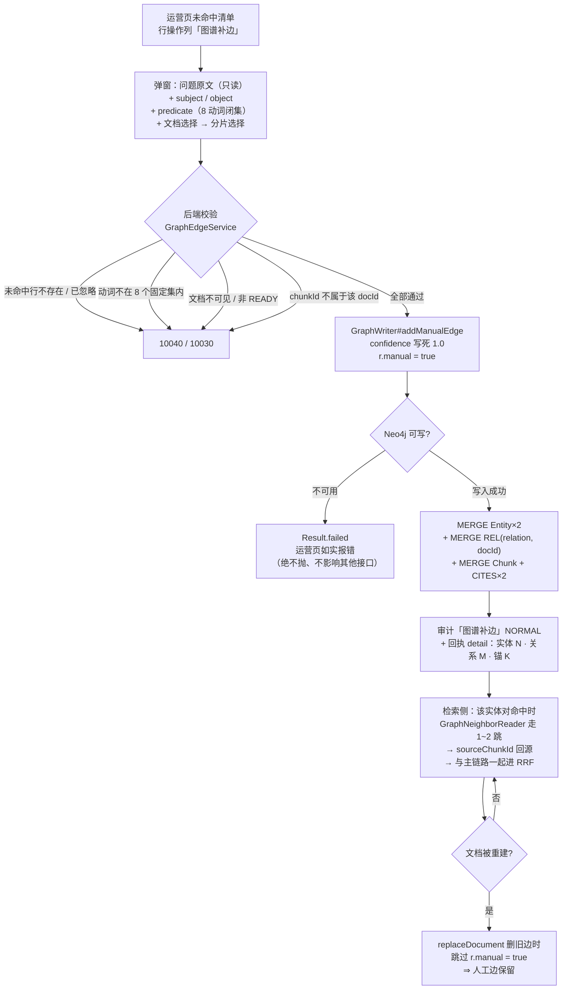

> 状态：🟡 进行中 · Sprint S9 · 阶段 D（M12 图谱补边 + 测试可靠性/存储收敛）· 建档 2026-09-23

# 2026-09-23 · S9 · M12 · 阶段 D —— 人工补边（未命中闭环最后一步）+ 清四条尾账

> 任务：`T-C04`（1 项）· O 轨 `#232` / `#233` / `#234` + 开关端点前端接线
> 来源：`docs/进度/03-Sprint排期.md:1464`（`S9-M12-C` 明确把 `T-C04` 判给本批）· `docs/进度/02-任务清单.md:416`
> 上游计划：`ai_knowledge_web/plan/2026-09-23-S9-M12-C.md`（本批要销的账见第 1 节）

---

## 1. 开工条件检查

**依赖清单来源**（逐条注明出处，不许凭印象）：

| # | 依赖项 | 档位 | 现状（代码/文档实证） | 结论 |
|---|---|---|---|---|
| 1 | `T-C02`（检索侧 1~2 跳补召回）—— `T-C04` 的依赖列 | ✅ | `GraphNeighborReader.java:81-102`（`REL*1..2` 路径 + `confidence >= 0.6` + 回源 `sourceChunkId`）· `GraphRetriever.java:76-124` · `02-任务清单.md:414` 记 `T-C02` 已完成 | 满足 |
| 2 | `T-C03`（开关端点 + `sys_setting` 事实源） | ✅ | `GraphFeatureToggle.java:37` · `SystemFeatureService.setGraphSwitch` · `V43` 已应用（flyway `43 / s9 graph feature switch / 1`） | 满足 |
| 3 | **`confidence = 1` 能被检索侧接受** | ✅ | 需求 `07:472` 只划下限（`< 0.6` 不参与跳转）⇒ `1.0` 必然 ≥ 0.6；`GraphNeighborReader:84` 的 `all(r IN rels WHERE r.confidence >= $minConfidence)` 原样放行 | 满足 |
| 4 | **补齐的边其 `sourceChunkId` 必须能在 MySQL 里查到** | ✅ | `GraphRetriever.java:106-110`：`chunk == null` 时 `continue`（悬空锚点**静默丢**）⇒ 本批的锚点必须是**真 `sys_chunk.id`**，由操作员选文档 + 分片保证 | 满足（口径见 §3.2） |
| 5 | **关系动词必须落在固定集合** | ✅ | 需求 `07:468` 逐字划定 8 个：`基于/提出者/包含/使用/依赖/属于/负责/引用` | 满足（校验见步 2） |
| 6 | **真实模型可用**（`#231` 的前置，也是本批 E2E 的前置） | ✅ **本批新确认** | 实测三条通路全 `200`：`chat` → `deepseek-flash`（`/chat/completions`）· `embed` → `BAAI/bge-m3` · `rerank` → `BAAI/bge-reranker-v2-m3`。⚠️ `S9-M12-A`~`C` 三批记录的是 relay `402: Insufficient Balance` —— **本批开工时已恢复** | 满足（`#231` 可销，见步 9） |
| 7 | 演示数据（`config/document_config/index_config`） | ✅ | `.env` 三把 key 齐（`CHAT`/`EMBEDDED`/`RERANKER`），`sys_model_config` 4 行全 `is_active=1` | 满足 |
| 8 | docker 6 服务 | ✅ | `kb-mysql`/`kb-neo4j`/`kb-minio`/`kb-valkey`/`milvus-standalone`/`milvus-etcd` 全 `Up`（`healthy`） | 满足 |
| 9 | 种子基线 | ✅ | 实测 `sys_kb=8` · `sys_user=128` · `sys_document=0` · `sys_chunk=0` · `sys_qa_miss=0` · Neo4j `0` 节点 | 满足（干净基线） |

**BLOCKER 汇总**：无。

**⚠️ 已知偏差**（不拒绝施工，第 9 节销账）：

| # | 偏差 | 影响 | 处置 |
|---|---|---|---|
| D-1 | 🔴 **需求 `07:544` 说的「未命中问题详情」在页面上不存在** | 实测 `OpsQaView.vue` 只有**未命中清单表格**（`:308`），**没有详情页/抽屉** —— 该页的入口在**行操作列** `:349-364`（已有「补文档 / 重放验证 / 更多」三个）。 | 入口挂**操作列**（与 `T-C04` 验收要点「入口在未命中详情」同义：指的正是那一行的详情区）。**不新建详情页**（那是页面重构，见 §3.3）。计划 §10 记一条：需求措辞与页面结构对不上，回填时给需求方一条订正建议 |
| D-2 | 🔴 **补边写的是 Neo4j，而 `GraphWriter#replaceDocument` 会按 `docId` 先把旧边全删** | `GraphWriter.java:148`：`MATCH ()-[r:REL]-() WHERE r.docId = $docId DELETE r`。若人工边的 `docId` 取「操作员挑的那篇文档」，则**那篇文档一重建，人工边就被静默清掉** —— 而现象是「补过的边过几天没了」。 | 本批**必须**同时做「人工边在重建时保留」（步 3）：给人工边打 `r.manual = true`，删旧边时排除它。判据 8 用「重建后人工边仍在、自动边全换」钉住 |
| D-3 | ⚠️ `#233` 的射程比账上宽一格 | 账上写 3 个测试类，实测 **4 处**：`GraphNeighborReaderTest:31` · `GraphRetrieveFlowTest:43` · `GraphRetrieveTimeoutTest:33` + **`src/test/resources/application.properties:71`**（`m05.graph.retrieve.enabled=false`）。 | 一并清（步 6） |
| D-4 | ⚠️ `#232` 的归属列写的就是本批，而 `S9-M12-C` §3.3 曾以「混批会让验收变大杂烩」为由推后 | 与本批主题（图谱）无交集。**但**：① 它属 O 项，而 O 配额连续 22 批低于下限 4；② 它现成有判据落点（`DocMoveThenPurgeFlowTest` 是 C 批刚立的）；③ 「能尽早做就尽早做」是既定口径。 | **收进本批**，但**独立成一组步骤**（步 10~12），验收表里与图谱判据**分开两张子表**，不让"大杂烩"成立 |

> 判据只有一条：**这条不满足，代码写下去会不会白写**。

### 结论

- [x] ✅ **可以开工** —— 9 条依赖全部满足，无 BLOCKER；D-1~D-4 四条偏差逐条有处置

---

## 2. 开工时间

| 项 | 值 |
|---|---|
| 建档 / 开工日 | 2026-09-23 |
| 预计投入 | **≈10.5 人天**（Sprint 容量 ≈ 10 人天）—— `T-C04` 前端 ≈2.5 · 后端 ≈2.5 · 判据与取证 ≈1.5 · `#232` ≈2 · `#233`+`#234`+开关接线 ≈1.5 · 文档回填 ≈0.5 |
| 实际投入 | *回填时补* |

> O 轨配额：`#232`(≈2) + `#233`(≈0.3) + `#234`(≈0.5) + 开关端点前端接线(≈1) ≈ **3.8 人天**。
> ⚠️ **仍略低于下限 4**（连续第 23 批）—— 如实记，不凑数（见 §9）。

---

## 3. 开工内容

### 3.1 步骤

**A 组 · `T-C04` 人工补边（后端）**

| 步 | 做什么（文件/类 → 动作 → 产出） | 依赖 | 可并行 |
|---|---|---|---|
| 1 | `GraphWriter#addManualEdge(docId, chunkId, subject, predicate, object)`（新）→ `MERGE (s:Entity)`/`(o:Entity)` + `MERGE (s)-[r:REL {relation, docId}]->(o) SET r.confidence = 1.0, r.sourceChunkId = chunkId, r.manual = true` + `MERGE (c:Chunk {chunkId})` + 两条 `CITES`。**返回** `Result(applied, entities, relations, cites, detail)`。**永不抛**（承 `G9-3`：Neo4j 挂了不能影响运营页） | 步 3 的字段名 | 与 B 组 |
| 2 | `GraphEdgeService`（新，`service/`）→ 业务校验**先于**写图：① 未命中行存在且未 `IGNORED`（否则 `10040`/`10030`）；② `predicate` ∈ 需求 `07:468` 的 **8 个固定动词**（越界报 `10030`，**不静默落一条动词自造的边**）；③ `subject`/`object` 非空白且不相等；④ `docId` **可见**（走既有库/文档可见性，与 `DocDetailService#requireVisibleDoc` 同一口径）+ `status = READY`；⑤ `chunkId` **确实属于该 `docId`**（`sys_chunk` 查一行，查不到报 `10030`）。⇐ **1 与 5 是 D-2 说的"悬空锚点"的唯一防线**：`GraphRetriever` 对悬空锚点是**静默 `continue`**，写进去看不出来 | 步 1 | 与 B 组 |
| 3 | `GraphWriter#replaceDocument` 的删旧边两行（`:148` / `:150`）加条件 → `... AND (r.manual IS NULL OR r.manual = false)`。⚠️ **`CITES` 也一并**（否则重建后 `(:Chunk)` 锚没了、`MATCH (c:Chunk) WHERE NOT (()-[:CITES]->(c)) DELETE c` 会把人工边指着的 Chunk 节点删掉 → 人工边变成悬空锚点） | — | — |
| 4 | `OpsQaController` 加 `POST /ops/qa/misses/{id}/graph-edge`（`@RequiresPerm("ops:qa:handle")` + `@AuditLog(module = AuditModule.QA, action = "图谱补边", risk = RiskLevel.NORMAL)`）→ 请求体 `{subject, predicate, object, docId, chunkId}`，**`confidence` 不收**（服务端写死 `1.0`，需求 `03:102`；收客户端传的值等于让"人工=1"这条口径可被绕过） | 步 2 | — |
| 5 | `AuditRiskPolicy` 的 `NOT_HIGH_RISK` 登记「图谱补边」**带理由**（§4.3 的纪律：新动作要么进高危类，要么在"不计入"里留证据）。理由：只**新增**一条边、影响面限于命中该实体对的提问、可由删除该边完全回退 —— 与"开关图谱旁路"（**全站**行为变更）不是同一量级。⇒ `AuditCoverageFlowTest#expectedActions()` 冻结清单 **48 → 49** | 步 4 | — |

**B 组 · `T-C04` 人工补边（前端）**

| 步 | 做什么 | 依赖 | 可并行 |
|---|---|---|---|
| 6 | `OpsQaView.vue` 操作列加「图谱补边」按钮（`T-C04` 的验收要点「入口在未命中详情」）→ 打开 `el-dialog`：① 展示该条问题的原文（只读）；② `subject`/`object` 两个输入框（**默认带入该问题的原文**，让"实体名逐字照抄"这条 C 批立的规则在这里也成立）；③ `predicate` 用 **8 个固定动词的 `el-select`**（自由输入会造出检索侧永远匹配不到的动词）；④ **文档 + 分片选择器**（文档下拉走 `GET /api/kb/{kbId}/docs` 或 `GET /doc/all`；选定后分片下拉走 `GET /api/doc/{id}/chunks`，显示 `order_no` + 内容前 N 字）；⑤ 提交后 `ElMessage` 回**后端返回的 `detail`**（"实体合计 N · 关系 M · 回源锚 K"），**不写死前端文案** | 步 4 的契约 | 与 A 组 |
| 7 | `types` + `api/index.ts` 加 `opsApi.addGraphEdge(id, body)`，返回体与 `GraphWriter.Result` 对齐 | 步 4 | — |

**C 组 · 四条尾账**

| 步 | 做什么 | 依赖 | 可并行 |
|---|---|---|---|
| 8 | **`#233`** 清空转属性（4 处：3 个测试类的 `@TestPropertySource` + `src/test/resources/application.properties:71`），并**同步改掉 `GraphRetrieveFlowTest:38-40` 那句把"测试期默认关着"写成事实的 javadoc**。⚠️ 删完**必须复跑那 3 个类**——它们此前靠那个属性拿到"关着"的前置，删掉会不会让判据变成空断言（`S7-M06-F` 的形状） | — | 与所有组 |
| 9 | **`#231` 量真实锚定率** → 真模型已可用 ⇒ 用**同一入口**（`RelationAnchorRateProbeTest` 的位置）**把替身模型换成真 chat 模型**，对**真实文档**量锚定率，并**同时量「C 批的逐字照抄提示词」到底有没有把数抬上去**（这是 C 批 §8 判据 13 明确"量不出来、换成文本断言"的那条账）。⚠️ **取证方式先自检**：真模型是随机的 ⇒ 数**不是**逐位可复现的（承 `S8-M10-B` 的「幂等不能按分数逐位相同写」），判据只能是**区间 + 样本量**，不是等号 | 依赖 6（真模型） | 与所有组 |
| 10 | **`#234`** `check-ledgers.mjs` 的 L4a 窗口收口：`filesTouchedBy` 换成**按计划建档日之后的提交范围**（`--since=<建档日>`），或**明确降级为"只查最终态"并在文件头写清边界**。⚠️ 必须**先答**：本批 §1 已实测出「勾选先于落笔」是**真违规**（探针批那两个文件），收窄窗口会把它从报告里**抹掉** —— 所以这一条要与 `#224` 的 L6 一起判：**闸是"抓事实"还是"抓时序"** | — | 与所有组 |
| 11 | **开关端点前端接线**（`S9-M12-C` §9-5 的账）：`10-接口约定汇总.md:338-339` 两处都还写着「⚠️ 前端仍未接入」⇒ 在**系统/模型配置页**加一个开关（`GET`/`PUT /api/system/feature/graph`），并把两处文档的"未接入"注记**如实撤掉** | — | 与所有组 |

**D 组 · `#232` 移库搬对象**

| 步 | 做什么 | 依赖 | 可并行 |
|---|---|---|---|
| 12 | `DocAttributeService` 的 `moveToKb` 分支 → 移动时**把 MinIO 对象搬到新库前缀**（copy + 删旧 + 改 `storage_path`/`parse_path`），而不是只改 `kb_id` 列。⚠️ **顺序**：先 copy 成功再改库、最后删旧 —— 反过来会在中途失败时**丢文件**（`S7-M06-E` 的「鉴权 → 签名 → 写记录 → 返回」同一条纪律：把不可逆的那一步放最后） | — | 与所有组 |
| 13 | 收尾：`DocLifecycleService#referencedObjectKeys` 的排除集（C 批为"移库不搬对象"造的兜底）**保留不删** —— 存量数据里还有这种行，删掉会重新打开 `#223` | 步 12 | — |

### 3.2 业务流程图

> 触发条件：跨 ≥3 个组件（前端 → 控制器 → 服务 → Neo4j + MySQL 校验）✅ · 有事务/写边界 ✅ ⇒ 必须画。



### 3.3 明确不做（范围控制）

| 不做的事 | 原因 | 归属批次 |
|---|---|---|
| **未命中详情页 / 抽屉**（新建一个页面） | 实测该页面不存在（D-1），而需求只要求"有一个补边入口"。新建整页是页面重构，与"补一条边"不成比例 | 页面重构批（若需求方坚持） |
| **图谱补边的撤销 / 删除边接口** | 需求 `07:544` 只写了"添加"。⚠️ 但**没有撤销入口**意味着误补只能用 Cypher 手工删 —— 已登记 §9，**建议紧跟一批**（有判据价值的负向锚） | `S9-M12-E` 或页面批 |
| **对象名不再绑 `kbId`**（`#232` 的另一条路） | 要迁移**存量**对象名（不可逆、且要改遍所有读 `storage_path` 的地方） | 长期（已记 §9） |
| **图谱补边进审计的"变更对照"**（`changes` 的 `{label,before,after}`） | 它没有"变更前"（新增一条边）。写 `before = '—'` 是硬凑 —— 那会让"变更对照"这一列失去区分度 | — |
| **`G9-4` 分题型验收达标** | 它要**评测集 + 图有边**两件同时成立。本批只让图**有边**（补边的能力），图**稀疏**的现状不会因为"能做补边"就改变；达标判定要真跑 `T-711` 的题型 A/B | `S9-M13` |
| **`#236`**（`02-Sprint交付台账.md` 停更十批） | C 批已判"刻意不补"，本批维持 —— 补十节历史追述会让台账失真 | 独立小批或长期 |

### 3.4 本批假设

| # | 假设 | 若被证伪的后果 |
|---|---|---|
| 1 | **操作员能挑到"对的"分片** —— 需求没规定怎么帮操作员挑，本批给的是"文档 → 分片"两级下拉 + 内容预览 | 挑错了分片 ⇒ 边写进去、检索也跳得到，但**回源指向一段不相关的原文**（比没有更糟：`RelationAnchor` 的类注释说"看起来是通的"）。⇒ 若实测发现难以挑对，要补"按问题关键词搜分片"或"默认挑 top1 低分分片"。**证伪记录进 §9** |
| 2 | **`confidence = 1` 与自动边在检索侧同权**（都只是过 0.6 门槛） | `GraphNeighborReader:86` 的 `score = reduce(... score * r.confidence)` **把置信度当乘数** ⇒ 人工边（1.0）会让整条路径的分**高于**自动边（0.7×0.8）⇒ 人工补的边**排序更前**。这是**特性不是缺陷**（人工确认过的关系确实更可信），但要写进结论，否则下一个人会以为是 bug。**已核对代码，成立** |
| 3 | `subject`/`object` **逐字出现在锚定的分片正文里**（"回源才找得到出处"，C 批立的规则） | 本批**不校验**这条（校验它要拿分片文本 `contains`，而那会让"先补边后改文档"的正常用法被误拒）。⇒ 若操作员写了正文里没有的写法，边会**跳得到但溯源语义弱**。**如实记 §9** |

---

## 4. 数据变更清单

| 类型 | 内容 | 回滚方式 |
|---|---|---|
| 新建表 / 改表 | **无** —— 人工边落在 **Neo4j**（`REL` 边加一个 `manual` 布尔属性 + 新增属性值 `confidence = 1.0`），MySQL 侧一行不动 | — |
| 迁移文件 | **无**（不占用 `V44`） | — |
| 种子数据 | **无**（不新增演示数据） | — |
| NULL 分支 | ⚠️ **存量 `REL` 边没有 `manual` 属性**（`S9-M12-A`~`C` 写进去的）⇒ 步 3 的条件必须写成 `r.manual IS NULL OR r.manual = false`。**写成 `r.manual = false` 会让全部存量边漏删**（重建后边翻倍），而现象是"重建后关系变多了"—— 一个静默的数据腐化 | — |
| 新持久化产物 | ⚠️ **`(:Chunk)` 节点的数量会因人工边增加**（每个被挑中的分片一个）—— 它已由 `GraphWriter#deleteDocument(s)` 的 `MATCH (c:Chunk) WHERE NOT (()-[:CITES]->(c)) DELETE c` 兜底，**无需新增清理入口** | — |

> 跑过的迁移**只增不改**（改已执行的 `V*.sql` 会导致校验和不符、启动失败）。

---

## 5. 依赖与工具决策

**默认不引**。先给不引的替代方案，再给候选对比，最后给推荐。

| 方案 | 做法 | 代价 | 结论 |
|---|---|---|---|
| 不引依赖（既有栈） | 写边复用 `GraphWriter` 既有的**裸 `Driver` + Cypher**（`S9-M12-A` 的选择，理由见该类 javadoc：图模型只有 3 节点 + 2 边，`MERGE` 幂等用 Cypher 最直接）；校验复用 `EntityManager` 原生查询；前端复用 Element Plus + 既有 `docApi.chunks` / `kbApi.docs` | 无 | ✅ **采用** |
| 候选 A：引 Spring Data Neo4j | 用 `@Node`/`@Relationship` 声明式建模 | 多一个抽象、多一套映射；`MERGE` 幂等语义反而要绕；且 `GraphWriter#replaceDocument` 的"按属性删旧边"在 SDN 里表达更别扭 | ❌ 不引 |
| 候选 B：引图算法库（GDS）做路径推荐 | 自动推荐"该补哪条边" | 需求没要求推荐；且 GDS 要在 Neo4j 里装插件，与"可整体关闭、主链路不依赖 Neo4j"的 `I-16` 方向相反 | ❌ 不引 |

**同类产品对比**：无候选 ⇒ 不适用。

**推荐**：**不引新依赖**，全部用既有栈。
**理由**：① 本批的写侧是"1 条边 + 2 个节点"，`GraphWriter` 里已有同形的 Cypher（`:181-193`），新方法是它的子集；② 引入 SDN 会让 `GraphWriter` 出现**两套写法**（旧的裸 Driver + 新的 SDN），而 `S9-M12-A` 的类注释已把"为什么走裸 Driver"论证过一遍，再来一套会让下一个人不知道该跟哪个；③ 与需求 `11:113`「主链路永不依赖 Neo4j」同向 —— 少一层自动配置就少一个启动期失败点。

---

## 6 + 7. 验收方法与标准

### 子表 A · `T-C04` 图谱补边

| # | 判据（对齐门禁号） | 验收方法（可直接粘的命令/脚本） | 期望结果 | 证据落点 |
|---|---|---|---|---|
| 1 | **补边能写进图，且 `confidence = 1`**（需求 `03:102`） | `mvn -B -f F:/work/code/ai-knowledge/ai_knowledge_web/pom.xml -Dtest=GraphManualEdgeFlowTest test` | `GraphWriter#relationsOf(docId)` 回一条，`confidence == 1.0`、`sourceChunkId == 挑的分片` | 新用例 `GraphManualEdgeFlowTest` |
| 2 | **补完能被检索侧真的跳出来**（需求 `07:544` 的闭环） | 同上（用例内构造：真文档 → 真分片 → 补边 → `retrievalService.search(reader(), <含该实体的问题>, List.of(kbId))`） | 结果里出现 `source == "graph"` 且 `chunkId == 补边时挑的那个` | 同上 |
| 3 | **悬空锚点被挡在入口**（D-2 的防线） | 用例传一个**不属于该文档**的 `chunkId` | 回 `10030`，且**图里一条边都没多**（补边前后 `relationCountOf` 相等） | 同上 |
| 4 | **动词闭集**（需求 `07:468`） | 用例传 `predicate = "喜欢"` | 回 `10030`；传齐 8 个合法动词**全部成功** | 同上 + 参数化 |
| 5 | **越权：不可见文档不能被锚** | 用例用 A 身份补一条锚到 B 私有文档的边 | 回业务错，**图里零变化** | 同上 |
| 6 | **审计「图谱补边」落库**（走**真 HTTP**，`operator`/`apiPath` 取自请求上下文） | 真 `POST` 打端点后查 `sys_audit_log where action = '图谱补边'` | `module = '问答'`、`risk_level = '普通'`、`operator`/`api_path` 非空；`AuditCoverageFlowTest` 冻结清单 **48 → 49** | `GraphManualEdgeFlowTest` + `AuditCoverageFlowTest` |
| 7 | **Neo4j 不可用时不影响运营页**（承 `G9-3`） | 用例把 `Driver` 指向坏端口 | 接口**不抛**，回可读的失败说明；`GET /ops/qa/misses` 照常 200 | 同上 |
| 8 | 🔴 **重建后人工边仍在、自动边全换**（D-2 的判据） | 用例：补人工边 → 调 `GraphWriter#replaceDocument` 重建该文档（只给自动关系） | 重建后：人工边**还在**（`manual == true`）、自动边**是新的一批**（旧的没了）、**边不翻倍**（存量无边 `manual` 属性这条也覆盖） | 同上 + 证伪 |
| 9 | 🔴 **`I-16` 不被本批破坏**（`G9-1`） | `mvn ... -Dtest=GraphRetrieveDisabledTest,GraphFeatureToggleTest test` | 开关关闭时链路仍与未开启一致（既有判据全绿） | 既有用例 |
| 10 | **页面入口存在且能提交**（`T-C04` 验收要点） | `cd ai_knowledge_app && node scripts/e2e-graph-edge.mjs --base=http://127.0.0.1:5174` | 未命中清单 → 点「图谱补边」→ 弹窗 → 选文档/分片 → 提交 → 回执含"实体 N · 关系 M" → **收尾探针残留 = 0** | 新脚本 `e2e-graph-edge.mjs` |
| 11 | **前端 `check.mjs` 通过**（type-check + build） | `cd ai_knowledge_app && node scripts/check.mjs` | 通过 | — |
| 12 | ✅ **销 `#231`：真实锚定率量出来了** | `mvn ... -Dtest=RelationAnchorRateRealModelTest test`（**真 chat 模型**，替代替身） | 给出**区间 + 样本量**（不是等号）；与 C 批的替身值（62.5%）**并列写出**，并注明两者不可比 | 新用例 + 结论文档 |
| 13 | ✅ **销 `#233`：空转属性清零** | `grep -rn "m05.graph.retrieve.enabled" ai_knowledge_web/src/` | **零命中**（或仅剩注释里"曾经有过"的说明行）；且 `GraphNeighborReaderTest` / `GraphRetrieveFlowTest` / `GraphRetrieveTimeoutTest` **单独复跑全绿** | — |
| 14 | ✅ **销 `#234`：L4a 口径收口** | `cd ai_knowledge_app && node scripts/check-ledgers.mjs` | 退出码 `0`，**且文件里写清"它查的是最终态还是时序"**（二选一都要留下边界句） | `check-ledgers.mjs` 头注 |
| 15 | **开关端点前端接线**（销 `S9-M12-C` §9-5） | `node scripts/e2e-system-graph.mjs --base=http://127.0.0.1:5174`（或并入既有 system E2E） | 页面上真有开关 → 关掉 → 重新加载仍是关 → 恢复；`10-接口约定汇总.md` 两处"前端未接入"注记**已撤** | 新/改脚本 + 文档 |

### 子表 B · `#232` 移库搬对象

| # | 判据 | 验收方法 | 期望结果 | 证据落点 |
|---|---|---|---|---|
| 16 | 🔴 **移动后对象在新库前缀下、旧前缀下没有它** | `mvn ... -Dtest=DocMoveThenPurgeFlowTest test`（C 批已立的类，本批加一格） | MinIO `documents/{新库}/` 下有该对象、`documents/{旧库}/` 下**没有**；`storage_path` 已指向新库 | `DocMoveThenPurgeFlowTest` |
| 17 | **移动中途失败不丢文件** | 用例注入 copy 失败 | 库归属**保持原样**（回滚）、对象仍在旧前缀、**能下载** | 同上 |
| 18 | **`#223` 不复发** | 移动 → 清源库 → 检查目标库文档仍可下载 | 对象还在、下载 200（C 批的判据**保留并仍绿**） | 既有 + 新增 |

### 子表 C · 收尾

| # | 判据 | 验收方法 | 期望结果 | 证据落点 |
|---|---|---|---|---|
| 19 | 全量回归 | `export JAVA_HOME='F:/work/dev_tools/jdk/jdk-25.0.4.1'` + `mvn -B -f F:/work/code/ai-knowledge/ai_knowledge_web/pom.xml test` | `Failures` 数 **不高于**基线 1（那 1 红是 `#235`，见 §9） | surefire |
| 20 | 种子核对 | 见下方命令块 | `sys_user = 128` · `sys_kb = 8` · `sys_document = 0` · `sys_chunk = 0` · `sys_qa_miss = 0` · Neo4j **0 节点** | — |
| 21 | 闸 | `node scripts/check-ledgers.mjs` · `node scripts/check.mjs` · `node scripts/check-enums.mjs` | 三条全绿（`check-ledgers` 见判据 14） | — |

**观察项**（不计成败，页面写死的展示值登记在此）：
- 补边回执的 `detail` 文案（"实体合计 N · 关系 M · 回源锚 K"）—— 后端产出，不在判据里。
- 弹窗里分片预览的截断长度（前端写死的展示值）。

**证伪清单**（每条做完**当场记录"它红了没有"**——`S9-M12-A` 的教训：证伪是预测，预测可以是错的）：
| 破坏 | 目标判据 | 预期 |
|---|---|---|
| 把 `confidence` 改成客户端可传 | 1 | 传 0.5 时 `relationsOf` 回 0.5 ⇒ 红 |
| 去掉步 3 的 `r.manual` 条件 | 8 | 重建后人工边消失 ⇒ 红 |
| 把 `manual` 条件写成 `r.manual = false`（漏 `IS NULL`） | 8 | 存量边漏删 ⇒ 边翻倍 ⇒ 红 |
| 去掉步 2 的 `chunkId` 归属校验 | 3 | 悬空锚点写进图、检索侧静默丢 ⇒ 红 |
| copy/改库/删旧的顺序对调 | 17 | 中途失败丢文件 ⇒ 红 |

**种子核对**（跑完必做）：

```bash
set -a && . ai_knowledge_web/.env && set +a
docker exec kb-mysql mysql -u"$MYSQL_USERNAME" -p"$MYSQL_PASSWORD" "$MYSQL_DATABASE" -N -e "select count(*) from sys_user where deleted_at is null;"
docker exec kb-neo4j cypher-shell -u "$NEO4J_USERNAME" -p "$NEO4J_PASSWORD" --format plain "MATCH (n) RETURN count(n) AS nodes"
```

---

---

# 以下为开工后回填

> **提交节奏（两次）**：1~7 节写完即提交一次（`docs(plan): <批次> 开工计划`）；
> 8~10 节写完再提交一次（`docs(plan): <批次> 验收回填`）。让 git log 上「计划 → 结果」成对可查。

## 8. 验收结果

| # | 判据 | 实测结果 | 证据（命令 / 文件:行 / 测试名） |
|---|---|---|---|

**测试基线**：`Tests run: N, Failures: 0, Errors: 0, Skipped: 0`（上批 939 / 1 红 → 本批 M）

> 失败就照实写失败，不许改成"部分通过"。

---

## 9. 遗留问题

| # | 项 | 原因 | 归属批次 | 是否有判定点/注释留在代码里 |
|---|---|---|---|---|

---

## 10. 建议

- *回填时补*

---

## 附：本批同步的文档回填

- [ ] **`docs/进度/00-开工速览.md` §1/§2/§3/§4** → 当前定位 / 本批任务行 / 门禁现状 / 缺口账（**必改**）
- [ ] `docs/进度/02-任务清单.md` → `T-C04` 置 ✅
- [ ] `docs/进度/03-Sprint排期.md` → 「交付状态」段
- [ ] `docs/进度/README.md` → 看板状态 + 完成日期
- [ ] `docs/进度/变更记录/01-变更记录.md` → 追加一行
- [ ] `docs/需求文档/10-接口约定汇总.md` → §11 加 `POST /ops/qa/misses/{id}/graph-edge` + §13/§14 字段；`13-接口变更记录.md` 加一行
- [ ] `ai_knowledge_web/plan/汇总.md` → §1/§2/§3（`#231`/`#232`/`#233`/`#234` 销账）
- [ ] 本文件状态行 → ✅ 已完成
