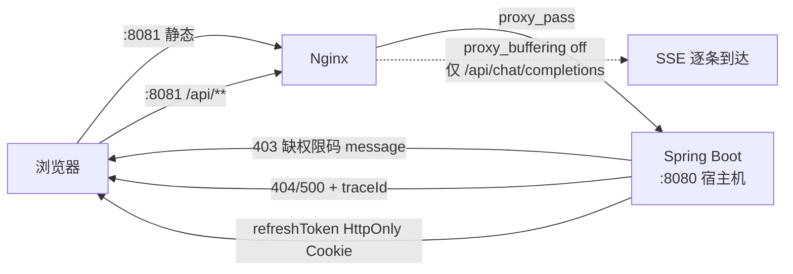

> 状态：🟡 进行中 · Sprint S9 · 阶段 M13-A（部署产物 + 跨域复验 + 错误页支撑）· 建档 2026-09-28

# 2026-09-28 · S9 · M13 · 阶段 A —— Nginx 部署产物 + 刷新链路复验 + 403 缺权限码

> 任务：`T-D03` · `T-D01` · `T-D02`（3 项）· 来源：`docs/进度/03-Sprint排期.md` §Sprint 9（`03:1405-1438`）
> 上游计划：`ai_knowledge_web/plan/2026-09-23-S9-M12-D.md`（本批要销的账见第 1 节）
> 门禁：**`G9-6`（SSE 生产可用）** · **`G9-9`（错误页支撑）**

---

## 1. 开工条件检查

**依赖清单来源**（逐条注明出处，不许凭印象）：

| # | 依赖项 | 档位 | 现状（代码/文档实证） | 结论 |
|---|---|---|---|---|
| 1 | `T-D03` 依赖 `T-D01`（`02:427`） | ✅ | `T-D01` 本批同做；`SecurityConfig:119-125` 默认白名单为 `http://localhost:[*]`，**含 8081**，无需改配置 | 满足 |
| 2 | `T-D04`/`T-D05` 依赖 `T-D03`（`02:428-429`） | ✅ | **本批不做**，留下一批（见 3.3） | 不适用 |
| 3 | `T-D01` 依赖 `T-100`（`02:425`） | ✅ | `T-100` 令牌体系（access 2h / refresh 7d `HttpOnly`）状态 ✅（`02:95`） | 满足 |
| 4 | `T-D02` 依赖 `T-001`（`02:426`） | ✅ | `T-001` 统一响应体 + 全局异常处理 ✅（`02:50`）；`GlobalExceptionHandler` 16 成员在位 | 满足 |
| 5 | Nginx 部署载体（`docker-compose.yml`） | ✅ | 已有 6 服务（`docker-compose.yml:19-243`）+ `kb-network:258`；**新增 `nginx` 服务挂同一网络** | 满足 |
| 6 | 前端构建脚本 | ✅ | `ai_knowledge_app/package.json:12` 有 `build`（`vue-tsc` + `vite build`） | 满足 |
| 7 | CORS 跨域能力（`T-D01` 前置） | ✅ | `SecurityConfig:119-125` 默认放开 localhost 任意端口；`setAllowCredentials(true)` + `setAllowedOriginPatterns` 已配 | 满足 |
| 8 | **`G9-9` 403 缺权限码** | ⛔→✅ | **实测无任何回传通路**：`RequiresPermAspect:60` 抛两参 `BizException`，未带 `codes`；`BizException.detail` 的 javadoc 明写「**不返回给前端**」且为 `transient`（**刻意封闭，非遗漏**）；`handleBiz:55` 仅吐 `code+message`；`ApiResponse` 仅四字段。**本批新开通路（用户裁定 A 档：拼进 message）** | 满足（需施工） |
| 9 | `G9-9` 404 三来源收口 | ✅ | 用户 2026-09-28 确认「是」；`GlobalExceptionHandler:139` `handleNoResource(NoResourceFoundException)` 在位，**本批以实测复核** | 满足 |
| 10 | 环境（docker 6 服务 + 后端 8080） | ⚠️ | 需开工时实起；`ai_knowledge_web/.env` 存在（含 `MYSQL_PORT` 等），后端端口未在 `.env` 固定（见 3.4 假设 3） | 满足（待实测） |

**BLOCKER 汇总**：**无**（原「Nginx 配置不存在」一条，经用户 2026-09-28 裁定走 A′ 方案 —— 容器化 Nginx + 宿主机 build 挂载，已解除）

**⚠️ 已知偏差**（不拒绝施工，第 9 节销账）：

- `00-开工速览.md` §1 仍写 `S9-M12-D` **进行中**，而 `plan/汇总.md` §1/§2 与批次计划正文均已标 ✅ 已完成 —— **口径不一致**，本批回填时对齐（归属本批，见第 9 节）。
- `G9-4`（图谱分题型验收）**不在本批**：它不依赖 `T-D0x`，但要评测集 A/B + 图密度支撑，宜单独成批。

> 判据只有一条：**这条不满足，代码写下去会不会白写**。

### 结论

- [x] ✅ 可以开工
- [ ] ⛔ 拒绝施工

---

## 2. 开工时间

| 项 | 值 |
|---|---|
| 建档 / 开工日 | 2026-09-28 |
| 预计投入 | 2.5 人天（Sprint 容量 ≈ 10 人天） |
| 实际投入 | *回填时补* |

**决策纪要**（用户 2026-09-28 逐条裁定）：

| # | 决策 | 取值 |
|---|---|---|
| 1 | Nginx 对外端口 | **8081**（后端仍 8080，避开冲突） |
| 2 | 后端运行方式 | **宿主机 `mvn spring-boot:run`**（不写 Dockerfile） |
| 3 | 前端产物来源 | **宿主机 `npm run build` 后只读挂载 `dist/`** |
| 4 | 本批范围 | **`T-D03` + `T-D01` + `T-D02`** |
| 5 | `G9-6` 取证 | **`curl -N` 正向 + 反向证伪**（改回 `proxy_buffering on` 验证转不转红） |
| 6 | 403 缺权限码 | **A 档 —— 拼进 message，零契约变更** |

---

## 3. 开工内容

### 3.1 步骤

| 步 | 做什么（文件/类 → 动作 → 产出） | 依赖 | 可并行 |
|---|---|---|---|
| 1 | **`deploy/nginx.conf`（新增）** → 静态根 `dist` + `location /api` 反代 `host.docker.internal:8080`，**`/api/chat/completions` 单独加 `proxy_buffering off` + `proxy_cache off` + `X-Accel-Buffering no` + `proxy_read_timeout`** | — | |
| 2 | **`docker-compose.yml`** → 新增 `nginx` 服务（`nginx:alpine`，`ports: 8081:80`，只读挂载 `nginx.conf` 与 `ai_knowledge_app/dist`，加入 `kb-network`） | 步 1 | |
| 3 | **前端构建** → `npm run build` 产出 `ai_knowledge_app/dist`（`.gitignore` 确认 dist 不入库） | — | |
| 4 | **`RequiresPermAspect#check`** → 权限失败分支：把缺失权限码（按 `logic` 语义算出真正缺的那些）拼进 `BizException` 的 message | — | |
| 5 | **后端起服务** → 宿主机 `mvn spring-boot:run --server.port=8080`，确认连上 6 个基础服务 | 步 2、3 | |
| 6 | **`G9-6` 正向取证** → `curl -N` 从 **Nginx 8081** 打 SSE，记录帧到达时间戳 | 步 5 | |
| 7 | **`G9-6` 反向证伪** → `proxy_buffering on` 重启 Nginx，重跑，**确认是否转红（或确认测不出）** | 步 6 | |
| 8 | **`G9-9` 403 取证** → 用无权限账号直调需权限接口，断言 message 含缺失权限码 + `traceId` 存在 | 步 5 | |
| 9 | **`G9-9` 404/500 取证** → 三种 404 来源 + 触发一次 500，断言 `traceId` | 步 5 | |
| 10 | **`T-D01` 刷新链路复验** → Nginx 8081 上登录 → 刷新 → 断言换新成功、`document.cookie` 读不到 `refreshToken` | 步 5 | |
| 11 | **回归** → `mvn test` 全量（含既有 `RequiresPerm` 相关用例） | 步 4 | |

### 3.2 业务流程图

> 触发条件：① 跨 ≥3 个组件 ✅（浏览器 → Nginx → 后端 → 前端错误页）② 无异步任务 ③ 无状态机 ④ 无并发幂等。
> **满足①，故画。**



### 3.3 明确不做（范围控制）

| 不做的事 | 原因 | 归属批次 |
|---|---|---|
| `T-D04` 性能验证 | 依赖 `T-D03` 产物，须先有稳定部署 | `S9-M13-B` |
| `T-D05` 安全加固 | 依赖 `T-D03`；且 Markdown sanitize 大概率是**真缺口**非验收 | `S9-M13-B` |
| `T-D06` 前端全量回归 | 部署不稳时回归的红会与部署问题混淆，定位不清 | `S9-M13-B` |
| `G9-4` 图谱分题型验收 | 不依赖 `T-D0x`，需评测集 A/B + 图密度；单独成批 | `S9-M13-C` 或独立批 |
| `G9-7`/`G9-8` XSS/越权 | 属 `T-D05` 范畴 | `S9-M13-B` |
| 给 `ApiResponse` 加结构化字段 | 用户裁定 A 档；且类注释明确守"恰好四字段"契约 | 不做（若产品要结构化另立） |
| 后端容器化 | 用户裁定后端跑宿主机 | 不做 |

### 3.4 本批假设

| # | 假设 | 若被证伪的后果 |
|---|---|---|
| 1 | `host.docker.internal` 在 Docker Desktop for Windows 上可解析到宿主机 | Nginx 反代不通 → 改用宿主机 IP 或 `--add-host`，**属部署配置问题，不影响业务代码** |
| 2 | `handleNoResource` 确实收口全部三种 404 来源（用户 2026-09-28 已确认，**仍需实测复核**） | 若有来源漏成 Spring 默认 404 白页 → `G9-9` 部分不达标，`T-D02` 工时增加 |
| 3 | 后端默认监听 8080 | 若被占用/改端口 → 调整 Nginx `proxy_pass` 目标，**不改业务代码** |
| 4 | `proxy_buffering on` 能让 SSE 退化为一次性到达（可用于反向证伪） | 若改回 `on` 后帧**仍逐条到达** → 说明**本门禁在当前部署形态下测不出东西**，照实记录（**不视为通过**） |
| 5 | 前端 `dist` 构建在无 mock 下能正常起（`VITE_USE_MOCK=false`） | 前端路由/接口报错 → 先修构建口径再取证 |

---

## 4. 数据变更清单

| 类型 | 内容 | 回滚方式 |
|---|---|---|
| 新建表 / 改表 | **无** | — |
| 迁移文件 | **无**（不新增 `V*.sql`） | — |
| 种子数据 | **无变更**（取证用既有账号；不新建演示数据） | — |
| NULL 分支 | 不适用（无新可空列） | — |
| 新增非数据库产物 | `deploy/nginx.conf`（新文件）· `docker-compose.yml` 加 `nginx` 服务 · `ai_knowledge_app/dist`（构建产物，**不入库**） | 删文件 / `git revert` |

> 跑过的迁移**只增不改**（改已执行的 `V*.sql` 会导致校验和不符、启动失败）。

---

## 5. 依赖与工具决策

**默认不引**。先给不引的替代方案，再给候选对比，最后给推荐。

| 方案 | 做法 | 代价 | 结论 |
|---|---|---|---|
| 不引依赖（既有栈） | 仅新增 `nginx:alpine` **基础镜像**（不引 Java/前端依赖），复用既有 `docker-compose.yml` 与 `npm run build` | 需拉一次镜像 | ✅ **采用** |
| 候选 A：本机装 Nginx | 宿主机安装 Nginx 二进制，配 `conf` 指向 `dist` | 需装环境、污染开发机；且**与 docker-compose 的 6 服务割裂** | ❌ 否 |
| 候选 B：Vite dev server 当生产 | `npm run dev` 直接对外 | **不满足 `G9-6`**（Vite proxy 无 `proxy_buffering` 概念，验的不是被测对象）；且 dev server 非生产用途 | ❌ 否（用户 2026-09-28 已裁定） |
| 候选 C：后端也容器化 | 写 Dockerfile + 改连接配置 | 要把 5 个连接的 `localhost` 改成服务名，改动面大，本批装不下 | ⏸️ 留待将来 |

**同类产品对比**（有候选时填）：

- **Caddy**：配置更短（自动 HTTPS），但 `proxy_buffering` 等价物为 `flush_interval`，与本仓门禁的"`proxy_buffering off`"**口径不对齐**，取证时需额外解释
- **Nginx**：门禁原文就是它；`proxy_buffering off` 是文档级标准做法；`nginx:alpine` 体积小（≈20MB）

**推荐**：**`nginx:alpine` 容器（compose 新增服务）** · **理由**：① 门禁 `G9-6` 原文指定 Nginx，用别的要额外论证等价性；② 不污染开发机；③ 与既有 `docker-compose.yml` 同一套编排；④ 不动后端与前端代码结构。

> 无新 Java/npm 依赖；仅新增一个基础设施镜像。**无 `V*.sql` 迁移。**

---

## 6 + 7. 验收方法与标准

| # | 判据（对齐需求门禁号 G?-?） | 验收方法（可直接粘的命令/脚本） | 期望结果 | 证据落点 |
|---|---|---|---|---|
| 1 | **`G9-6`** Nginx `proxy_buffering off` 后 SSE **逐条到达** | `curl -N -X POST http://127.0.0.1:8081/api/chat/completions -H "Authorization: Bearer $TOKEN" -H "Content-Type: application/json" -d '{...}'`（>1s 的问答），逐行记录到达时间 | 帧的到达时间**分散**（非同一时刻集中到达） | 本文件 §8 + 终端时间戳 |
| 2 | **`G9-6` 反向证伪** | 把 `nginx.conf` 的 `proxy_buffering off` 改为 `on`，`docker compose restart nginx`，重跑判据 1 | **帧变一次性到达**（判据 1 转红）。⚠️ **若仍逐条到达 ⇒ 记为「本部署形态下测不出」**，不得当作通过 | 本文件 §8 |
| 3 | **`G9-9`** 403 能拿到**缺少的权限码** | 用低权限账号 token 直调需 `@RequiresPerm` 的接口（如 `DELETE /api/kb/{id}`），`curl` 取响应体 | HTTP **403** + `message` **含具体权限码**（如 `doc:update`）+ `traceId` 非空 | 本文件 §8 + `RequiresPermAspect:60` |
| 4 | **`G9-9`** 404 三来源都能拿到 `traceId` | ① 不存在路径 `curl -i http://127.0.0.1:8081/api/nonexistent` ② 不存在的资源 id ③ 已软删资源 id | 三者均返回**统一响应体 + 非空 `traceId`** | 本文件 §8 |
| 5 | **`G9-9`** 500 能拿到 `traceId` | 触发兜底异常（或单测直调 `handleUnexpected`），`curl` 取响应 | HTTP 500 + `traceId` 非空 | 本文件 §8 |
| 6 | **`T-D01`** 同源部署下刷新正常 | 在 `:8081` 登录拿 `refreshToken` Cookie → `curl -b cookies.txt -X POST http://127.0.0.1:8081/api/auth/refresh` | 返回新 access token，刷新成功 | 本文件 §8 |
| 7 | **`T-D01`** `HttpOnly` 成立 | 浏览器 `document.cookie` 不含 `refreshToken`；且 `curl` 响应头 `Set-Cookie` 含 `HttpOnly` | 前端**读不到** refreshToken | 本文件 §8 |
| 8 | **回归** —— 既有用例不被破坏 | `export JAVA_HOME='F:/work/dev_tools/jdk/jdk-25.0.4.1'` + `mvn -B -f F:/work/code/ai-knowledge/ai_knowledge_web/pom.xml test` | `Tests run: N, Failures: 0, Errors: 0`（基线 953） | 本文件 §8 |
| 9 | **前端构建可用** | `cd F:/work/code/ai-knowledge/ai_knowledge_app && npm run build` | 构建成功、产出 `dist/` | 本文件 §8 |

**观察项**（不计成败）：

- ⚠️ **跨源行为**：后端 `8080` 直接对前端 `8081` 发请求（真跨域），记录 `SecurityConfig` 当前 CORS 行为 —— **不是上线形态（上线同源），仅登记事实**，供将来拆域部署参考
- ⚠️ **`proxy_buffering on` 若测不出差异**：记录为"本部署形态下该门禁无区分度"，**不等于生产环境一定不需要该配置**（Nginx 版本/内核/网络栈不同）

**种子核对**（跑完必做）：

```bash
set -a && . ai_knowledge_web/.env && set +a
docker exec kb-mysql mysql -u"$MYSQL_USERNAME" -p"$MYSQL_PASSWORD" "$MYSQL_DATABASE" -N -e "select count(*) from sys_user where deleted_at is null;"
```

---
---

# 以下为开工后回填

> **提交节奏（两次）**：1~7 节写完即提交一次（`docs(plan): <批次> 开工计划`）；
> 8~10 节写完再提交一次（`docs(plan): <批次> 验收回填`）。让 git log 上「计划 → 结果」成对可查。

## 8. 验收结果

| # | 判据 | 实测结果 | 证据（命令 / 文件:行 / 测试名） |
|---|---|---|---|
| 1 | | | |
| 2 | | | |
| 3 | | | |
| 4 | | | |
| 5 | | | |
| 6 | | | |
| 7 | | | |
| 8 | | | |
| 9 | | | |

**测试基线**：`Tests run: 953, Failures: 0, Errors: 0, Skipped: 2`（上批 953 → 本批 *回填时补*）

> 失败就照实写失败，不许改成"部分通过"。
> **取证条件不具备时**，该行实测结果填 `⏸️ 挂起 —— 待 <批次> 取证`，
> 并在那批的 8 节做**合并回填**（两批计划文件同时更新、同时提交）。

---

## 9. 遗留问题

| # | 项 | 原因 | 归属批次 | 是否有判定点/注释留在代码里 |
|---|---|---|---|---|
| 1 | ⚠️ `00-开工速览.md` §1 与 `plan/汇总.md` §1/§2 口径不一致（"进行中" vs "已完成"） | `S9-M12-D` 回填时漏改速览 §1 的定位行 | **本批回填时对齐** | 本文件 §1 偏差段 |
| 2 | | | | |

> 没有遗留写「无」。**本批若"先施工后补写第 1 节"，也必须在此登记一条**（违规留痕）。

---

## 10. 建议

- 对下批的排期 / 口径 / 风险建议。没有写「无」。

---

## 附：本批同步的文档回填

- [ ] **`docs/进度/00-开工速览.md` §1/§2/§3/§4** → 当前定位 / 本批任务行 / 门禁现状 / 缺口账（**必改**，它是下一批的唯一入口）
- [ ] `docs/进度/02-任务清单.md` → `T-D01`/`T-D02`/`T-D03` 置 ✅（未做的不动）
- [ ] `docs/进度/03-Sprint排期.md` → 「交付状态」段
- [ ] `docs/进度/README.md` → 看板状态 + 完成日期（**备注只写一行短结论 + 指针**）
- [ ] `docs/进度/变更记录/01-变更记录.md` → 追加一行
- [ ] `docs/需求文档/13-接口变更记录.md` → **403 响应 message 语义明确化**（A 档是否算契约变更，回填时按实际写）
- [ ] `ai_knowledge_web/plan/汇总.md` → 总览 + §3 遗留并入 + §1 当前定位改下一批
- [ ] 本文件状态行 → ✅ 已完成
- [ ] `.workbuddy/memory/2026-09-28.md` → 交接
