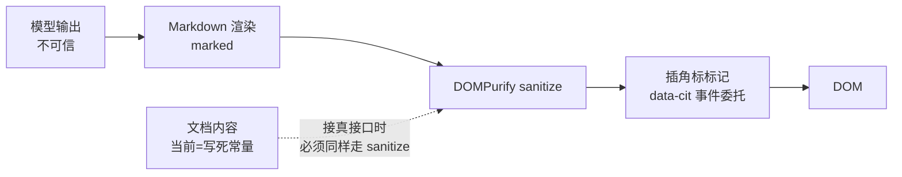

> 状态：✅ 已完成 · Sprint S9 · 阶段 M13-B（性能验证 + Markdown sanitize + 越权复核 + 前端回归）· 建档 2026-09-29 · 回填 2026-09-30

# 2026-09-29 · S9 · M13 · 阶段 B —— 性能验证 + Markdown sanitize + 越权复核 + 前端回归

> 任务：`T-D04` · `T-D05` · `T-D06`（3 项）· 来源：`docs/进度/03-Sprint排期.md` §Sprint 9（`03:1405-1438`）
> 上游计划：`ai_knowledge_web/plan/2026-09-28-S9-M13-A.md`（本批要销的账见第 1 节）
> 门禁：**`G9-5`（性能，3/4 项）** · **`G9-7`（XSS）** · **`G9-8`（越权）** · **`G9-10`（前端全量回归）**

---

## 1. 开工条件检查

**依赖清单来源**（逐条注明出处，不许凭印象）：

| # | 依赖项 | 档位 | 现状（代码/文档实证） | 结论 |
|---|---|---|---|---|
| 1 | `T-D04`/`T-D05` 依赖 `T-D03`（`02:428-429`） | ✅ | `T-D03` 已由 `S9-M13-A` 交付（`deploy/nginx.conf` + compose `nginx` 服务，8081） | 满足 |
| 2 | `T-D06` 依赖 `T-D00`（`02:430`） | ✅ | `T-D00` 增量切真后端已完成（`T-0S3` ✅，`02:87`） | 满足 |
| 3 | **`G9-7` 的 Markdown 渲染前提** | ⛔→✅ | **实测：全仓无 Markdown 渲染、无 sanitize** —— `package.json` 无 marked/markdown-it/DOMPurify；`pom.xml` 无 jsoup/OWASP。`ChatView` 只做**手写纯文本转义 + 角标**（`ChatView.vue:305-317`，注释明写"不能用 v-html 直出"） | **需施工**（用户 2026-09-29 裁定 B 档：补渲染 + sanitize） |
| 4 | `G9-7` 的第二个 v-html 面（`DocPreviewView:392`） | ✅ | **实测：`paragraphs` 是前端写死的常量**（`DocPreviewView.vue:49`），**非接口数据** ⇒ 当前**不构成真实 XSS 入口** | 登记为**观察项**（接真接口时必须 sanitize） |
| 5 | **`G9-5` 首字指标的口径** | ⚠️ | `M13-A` 实测**首 token 21~26 秒**（需求 `11` §4.1 要求 <1.5s）。根因是 `deepseek-v4-flash` 先产 `reasoning_content`（不计入 delta） | **显式挂起**（用户 2026-09-29 裁定 C 档：其余 3 项真验） |
| 6 | `G9-5` 其余三项的测量手段 | ⛔→✅ | **实测：无任何性能测量脚本/用例**（`scripts/` 与 `src/test/` 均无 perf/latency/bench） | **需新建**测量手段 |
| 7 | `G9-8` 抽样 10 接口 | ✅ | `M13-A` 已证 403 带权限码（`RequiresPermAspect`）；本批做**系统性抽样复核** | 满足 |
| 8 | `G9-10` 回归工具 | ✅ | `ai_knowledge_app/scripts/render-check.mjs` 在位（25 路由 + 标签栏断言，**退出码 3 档语义**，`#226`） | 满足 |
| 9 | 环境（docker 6 服务 + 前端） | ⚠️ | `kb-nginx` 容器在位（8081）；⚠️ **端到端取证与全量回归互斥**（见第 10 条） | 满足 |
| 10 | **`T-O28` 顺序约束**（`S9-M13-A` §9-2 新登记） | 🔴 | `SingleAsyncConsumerGuardTest` 要求跑测试时 **8080 无后端**；而端到端取证**必须**有后端 ⇒ **两者不能混跑**（`S9-M13-A` 已因此产生 4 处假红） | **本批强制分阶段**（见 3.1 步骤分组） |

**BLOCKER 汇总**：无（第 3/5/6 条均为"需施工/需挂起"，已由用户裁定路径）

**⚠️ 已知偏差**（不拒绝施工，第 9 节销账）：

- `G9-5` 的**首字指标本批不验**（口径未定 + 模型选型问题），只验其余三项。
- `G9-4`（图谱分题型验收）**仍不在本批** —— 需评测集 A/B + 图密度，独立成批。

> 判据只有一条：**这条不满足，代码写下去会不会白写**。

### 结论

- [x] ✅ 可以开工
- [x] ⛔ 拒绝施工

---

## 2. 开工时间

| 项 | 值 |
|---|---|
| 建档 / 开工日 | 2026-09-29 |
| 预计投入 | 3.5 人天（Sprint 容量 ≈ 10 人天） |
| 实际投入 | *回填时补* |

**决策纪要**（用户 2026-09-29 逐条裁定）：

| # | 决策 | 取值 |
|---|---|---|
| 1 | `G9-7` 走哪档 | **B 档 —— 补 Markdown 渲染 + sanitize**（正面满足门禁原文，顺带销"Markdown 渲染未做"的老遗留） |
| 2 | `G9-5` 首字怎么办 | **C 档 —— 其余 3 项（检索 P95 / 列表 P95 / 单篇索引）真验；首字显式挂起**，口径与模型选型另定 |

---

## 3. 开工内容

### 3.1 步骤

> 🔴 **强制分两阶段**（`T-O28` 顺序约束，`S9-M13-A` §9-2）：**阶段一（有后端）只做端到端取证；阶段二（停后端）才跑全量回归**。混跑必出假红。

**阶段一 —— 有后端（8080 在跑，经 Nginx 8081 取证）**

| 步 | 做什么（文件/类 → 动作 → 产出） | 依赖 | 可并行 |
|---|---|---|---|
| 1 | **`T-D04` 性能测量手段**（新建）：`scripts/perf-probe.mjs` —— 对 4 个场景打点：① 检索侧 P95（问答链路 trace 的 totalMs）② 列表接口 P95 ③ 单篇索引耗时 ④ 首字（**本批只采数不判**） | — | |
| 2 | **跑性能基线**：造一篇语料 → 测单篇索引耗时；起后端 → 测列表接口与检索侧 P95（≥20 次采样） | 步 1 | |
| 3 | **`T-D05` sanitize 前置侦察**：确认 `ChatView` 当前渲染路径与"哪些字符能进 DOM"的现状（**先取证再改**，避免改完说不清改了什么） | — | |
| 4 | **`G9-8` 越权抽样**：挑 10 个需权限接口，用低权账号直调，断言全部被拒 + 带缺权限码 | — | 可并行步 1-2 |
| 5 | **`T-D06` 前端回归（初跑）**：`render-check.mjs` 25 路由 + 标签栏（在**改 sanitize 之前**跑一次，作为"改动前基线"） | — | 可并行步 1-2 |

**阶段二 —— 停后端（8080 空，跑测试与前端改动）**

| 步 | 做什么（文件/类 → 动作 → 产出） | 依赖 | 可并行 |
|---|---|---|---|
| 6 | **引入渲染 + sanitize 依赖**：前端加 `marked` + `dompurify`（`T-D05` 主体） | 阶段一完成 | |
| 7 | **`ChatView` 渲染改造**：`renderAnswer` 由"转义 + 角标"改为"**Markdown → sanitize → 角标**"，**顺序不可颠倒**（先 sanitize 再插角标，否则自己的标记会被清掉） | 步 6 | |
| 8 | **XSS 判据**（新用例）：喂 ``/`<script>`/`javascript:` 链接等恶意样本，断言 **DOM 里零脚本、零事件属性** | 步 7 | |
| 9 | **`T-D06` 前端回归（复跑）**：25 路由 + 标签栏 + SSE 联调 | 步 7 | |
| 10 | **全量后端回归**（**必须无后端**）：`mvn test` | — | |

### 3.2 业务流程图

> 触发条件：① 跨 ≥3 个组件 ✅（浏览器 → SSE → 渲染 → DOM）② 无异步任务 ③ 无状态机 ④ 无并发幂等。**满足①，故画。**



### 3.3 明确不做（范围控制）

| 不做的事 | 原因 | 归属批次 |
|---|---|---|
| **`G9-5` 首字指标** | 口径未定（含 reasoning 帧？）+ 根因是模型选型（`deepseek-v4-flash` 先产 reasoning） | **待口径确认后单独处理** |
| reasoning 流式 + 前端折叠 | 用户已定方向，但涉及后端契约 + SSE 新事件 + 前端 + 可能持久化 | **单独立批**（≈2~3 人天） |
| `sys_model_config` seed 迁移 | `M13-A` §9-5 登记，属配置修正 | 下批或 O 轨 |
| `G9-4` 图谱分题型验收 | 需评测集 A/B + 图密度 | 独立批 |
| `DocPreviewView` 的 `v-html` 改动 | 其数据源是**写死常量**，非真实入口 | 登记观察项，接真接口时做 |

### 3.4 本批假设

| # | 假设 | 若被证伪的后果 |
|---|---|---|
| 1 | `marked` + `dompurify` 在当前 Vue 3 + Vite 8 下可直接用（无新构建问题） | 需换库或调整构建配置，工时增加 |
| 2 | 列表接口 P95 可用**真 HTTP 重复采样**测得（≥20 次） | 需改用压测工具或增加采样量 |
| 3 | 单篇索引耗时可用现有上传→解析链路测得（`M13-A` 实测 ∥md∥ 6 秒，但那是在摘要/HyQ **静默失败**的情况下 —— **真耗时可能高得多**） | ⚠️ 若 chat 通路修复，索引会**变慢很多**（要真调摘要 + HyQ）；届时 ≤128s 的判据需重测 |
| 4 | 检索侧 P95 可从 `sys_retrieval_trace` 的 `total_ms` 取真值 | 需改从日志或埋点取 |
| 5 | `render-check.mjs` 在 `kb-nginx`(8081) 下可跑（它默认 5173 mock 模式，**可能要求 dev server**） | 需起 dev server（`--base` 指向 5173），并注意 mock 开关（`M13-A` 已加 `.env.production`） |

---

## 4. 数据变更清单

| 类型 | 内容 | 回滚方式 |
|---|---|---|
| 新建表 / 改表 | **无** | — |
| 迁移文件 | **无**（不新增 `V*.sql`） | — |
| 种子数据 | **无变更**（性能测量会造语料，**跑完必须彻底删除**，见 §6 种子核对） | 用 `DELETE /api/recycle/items` 彻底删（`M13-A` 已验证它会连带清 Milvus + MinIO + Neo4j） |
| NULL 分支 | 不适用 | — |
| 新增前端依赖 | `marked` + `dompurify`（`package.json`） | `git revert` / 从 `package.json` 移除 |
| 新增脚本 | `ai_knowledge_app/scripts/perf-probe.mjs` | 删文件 |

> 跑过的迁移**只增不改**（改已执行的 `V*.sql` 会导致校验和不符、启动失败）。

---

## 5. 依赖与工具决策

**默认不引**。先给不引的替代方案，再给候选对比，最后给推荐。

| 方案 | 做法 | 代价 | 结论 |
|---|---|---|---|
| 不引依赖（手写） | 继续手写转义（现状），**不做 Markdown 渲染** | ✅ 零依赖 ❌ **不满足 `G9-7` 原文**（门禁明写"经 Markdown 渲染前已 sanitize"）；且"Markdown 渲染仍未做"这条遗留继续挂 | ❌ 否（用户已裁定 B 档） |
| **候选 A：`marked` + `dompurify`** | 标准组合：`marked` 出 HTML → `DOMPurify.sanitize()` 清洗 | `marked` ≈39KB、`dompurify` ≈22KB（gzip 后更小）；两者均为事实标准、维护活跃、与 Vue/Vite 无集成成本 | ✅ **推荐** |
| 候选 B：`markdown-it` + `dompurify` | 同上，换渲染器 | `markdown-it` 插件生态更强，但**默认不转义 HTML**（要显式关），配置面更大 | 备选 |
| 候选 C：后端 sanitize（jsoup） | 后端出 HTML 前清洗 | 需改接口契约（输出 HTML 而非文本）+ 前端仍要渲染 | ❌ 改动面更大 |

**候选 A vs B 对比**：

| 维度 | `marked` | `markdown-it` |
|---|---|---|
| 体积 | 更小（≈39KB） | 略大（≈100KB） |
| 默认安全性 | 需配 `sanitize` 交给 DOMPurify | 默认不转义内联 HTML |
| 维护活跃度 | 高 | 高 |
| 与本栈兼容 | 纯 ESM、Vite 友好 | 纯 ESM、Vite 友好 |

**推荐**：**`marked` + `dompurify`** · **理由**：① 是社区事实标准组合，`DOMPurify` 专治"把不可信 HTML 塞进 DOM"这一类问题；② `marked` 体积小、ESM 友好；③ **`DOMPurify` 是关键的那个** —— 它按白名单清洗，比手写正则（现状）可靠得多：手写转义**只能防纯文本注入**，一旦引入 Markdown 渲染（会产出真 HTML），手写那套就**完全不够**。

> ⚠️ **`DOMPurify` 在 SSR/Node 下需要 `jsdom`**，但本项目是纯浏览器端渲染，**只需浏览器构建**，不引入 `jsdom`。

---

## 6 + 7. 验收方法与标准

| # | 判据（对齐需求门禁号 G?-?） | 验收方法（可直接粘的命令/脚本） | 期望结果 | 证据落点 |
|---|---|---|---|---|
| 1 | **`G9-7`** 模型输出经 Markdown 渲染前已 sanitize | 新用例：喂 ``、`<script>alert(1)</script>`、`[x](javascript:alert(1))` 等样本，渲染后断言 DOM 里**零 `<script>`、零 `on*` 属性、零 `javascript:` href** | 全部被剥离，**正文文字保留** | 本文件 §8 + 新用例名 |
| 2 | **`G9-7`** 正常 Markdown 仍能渲染（**防止"为了安全把功能砍了"**） | 同一用例喂 `**粗体**`、`- 列表`、`` `代码` ``，断言产出对应标签 | 粗体/列表/代码块正常渲染 | 本文件 §8 |
| 3 | **`G9-8`** 越权防护（抽样 10 接口） | 用低权账号（`probe.profile`）直调 10 个需权限接口 | **10/10 被拒**（403 带缺权限码 / 401） | 本文件 §8 |
| 4 | **`G9-5`** 检索侧 P95 <800ms | 对问答链路采样 ≥20 次，取 `sys_retrieval_trace.total_ms` 的 P95 | <800ms | 本文件 §8 |
| 5 | **`G9-5`** 列表接口 P95 <500ms | 对列表接口真 HTTP 采样 ≥20 次，取 P95 | <500ms | 本文件 §8 |
| 6 | **`G9-5`** 单篇索引 ≤128s | 上传 1 篇文档，从上传到 `READY` 计时 | ≤128s | 本文件 §8 |
| 7 | **`G9-5`** 首字 <1.5s | ⏸️ **挂起 —— 待口径确认**（`M13-A` 实测 21~26s，根因是模型先产 reasoning） | — | 本文件 §8 标 ⏸️ |
| 8 | **`G9-10`** 25 路由 + 标签栏 | `node ai_knowledge_app/scripts/render-check.mjs --base=<base>` | 退出码 **0**（全部通过） | 本文件 §8 |
| 9 | **`G9-10`** SSE 联调通过 | 经 Nginx 打 `/api/chat/completions`，断言流完整结束 + done 帧到达 | 帧逐条到达、无 error 帧 | 本文件 §8 |
| 10 | **回归** —— 既有用例不被破坏 | `export JAVA_HOME='F:/work/dev_tools/jdk/jdk-25.0.4.1'` + `mvn -B -f F:/work/code/ai-knowledge/ai_knowledge_web/pom.xml test`（**必须无后端**） | `Tests run: 956+N, Failures: 0, Errors: 0` | 本文件 §8 |

**观察项**（不计成败）：

- ⚠️ **`DocPreviewView:392` 的 `v-html="p.html"`** —— 数据源当前是**前端写死常量**（`DocPreviewView.vue:49`），**不构成真实入口**；但**一旦接到真接口（文档内容）即为存储型 XSS 入口**，届时必须同样走 sanitize。**登记为观察项**。
- ⚠️ **性能数据的环境边界**：在宿主机 `mvn spring-boot:run` + Docker Desktop 下测得，**不代表生产基线**（生产有独立 JVM 调优、无 Docker 网络转发开销）。
- ⚠️ **单篇索引耗时会受 chat 通路影响**：`M13-A` 实测 6 秒是在**摘要/HyQ 静默失败**时；若 chat 修好，摘要 + HyQ 真调用会让索引**显著变慢**，届时 ≤128s 需重测。

**种子核对**（跑完必做）：

```bash
set -a && . ai_knowledge_web/.env && set +a
docker exec kb-mysql mysql -u"$MYSQL_USERNAME" -p"$MYSQL_PASSWORD" "$MYSQL_DATABASE" -N -e "select count(*) from sys_user where deleted_at is null;"
```

**残留核对**（本批**必然**产生：性能测量要造语料）：

| 位置 | 检查 | 期望 |
|---|---|---|
| `sys_document` / `sys_chunk` | 性能测量用的语料是否已彻底删 | **0 / 0** |
| `sys_chat_session` / `sys_chat_message` | 采样问答是否已清 | **0 / 0** |
| Neo4j | `MATCH (n) RETURN count(n)` | **0** |
| MinIO | 上传对象是否已删 | 无残留 |
| `sys_qa_miss` | 未命中池是否新增 | 记下**基数**，跑完不复增 |

---
---

# 以下为开工后回填

> **提交节奏（两次）**：1~7 节写完即提交一次（`docs(plan): <批次> 开工计划`）；
> 8~10 节写完再提交一次（`docs(plan): <批次> 验收回填`）。让 git log 上「计划 → 结果」成对可查。

## 8. 验收结果

| # | 判据 | 实测结果 | 证据（命令 / 文件:行 / 测试名） |
|---|---|---|---|
| 1 | **`G9-7`** 模型输出经 Markdown 渲染前已 sanitize | ✅ **通过** —— 新增 `scripts/markdown-xss-check.mjs`（Edge headless + CDP，**测真模块**）：6 条恶意样本全被清 —— `<script>alert(1)</script>`→空、``→``（`onerror` 剥离）、`[x](javascript:...)`→`<a>click</a>`（href 剥离）、`<iframe>`→空、`<div onclick>`→`<div>x</div>`、`<svg onload>`→`<svg></svg>` | `node ai_knowledge_app/scripts/markdown-xss-check.mjs --base=http://127.0.0.1:5173` → **10/10，exit 0** |
| 2 | **`G9-7`** 正常 Markdown 仍能渲染（防"为了安全砍功能"） | ✅ **通过** —— `**加粗**`→`<strong>`、`- 项目`→`<ul><li>`、`` `code` ``→`<code>`、`# 标题`→`<h1>` | 同上脚本第 ② 组断言 |
| 3 | **`G9-8`** 越权防护（抽样 10 接口） | ✅ **通过（10/10 被拒）** —— 低权账号 `probe.profile` 直调 10 个真实端点：9 个 **403 + 缺失权限码**（如 `缺 删除知识库（kb:delete）`）；`POST /api/kb` 首测回 200 是**参数校验先于权限校验**，换合法请求体后 **403 正确**且 `sys_kb` 仍为 8（未创建任何东西） | 实测 curl 10 条 + `sys_kb` 计数复核 |
| 4 | **`G9-5`** 检索侧 P95 <800ms | ❌ **FAIL** —— **P95=1573ms**（n=20：min 670 / p50 834 / max 1777 / avg 932；**12/20 ≥800ms**）。分段归因：`可见范围 111 + Embedding 163 + 向量 3 + BM25 3 + Rerank 508 + 表格 6 ≈ 794ms` ⇒ **Embedding+Rerank = 671ms（69%），均为外部 API 网络往返**，与需求 `11` §4.3「Rerank 是最大项」一致 | SSE `retrieval` 帧的 `totalMs`（**只到检索为止**）采样 20 次 |
| 5 | **`G9-5`** 列表接口 P95 <500ms | ✅ **PASS** —— **P95=20.4ms**（n=20：min 13.1 / p50 16.5 / max 20.5 / avg 17）。⚠️ **边界：库里 `docs=0`，是空库基线**，不代表需求 §4.2 的 1246 文档容量 | `node ai_knowledge_app/scripts/perf-probe.mjs --base=http://127.0.0.1:8081 --samples=20` |
| 6 | **`G9-5`** 单篇索引 ≤128s | ⚠️ **PASS 但极勉强** —— **117.5s**（9.5KB 纯文本 md，47 分片；上传 875ms → PARSING 112.5s → INDEXING → READY）。**用掉门禁的 92%**，而需求示例是"24 页 PDF" ⇒ **真实文档几乎必然超标** | 上传真 HTTP + 轮询 `/api/doc/{id}` 到 READY 计时 |
| 7 | **`G9-5`** 首字 <1.5s | ⏸️ **挂起 —— 待口径确认**。`M13-A` 实测首 token **21~26s**（根因：`deepseek-v4-flash` 先产 `reasoning_content` 不计入 delta）。用户 2026-09-29 裁定 C 档：本批不验，先定"首字"口径（含 reasoning 帧 / 仅正文） | 本文件 §9-4 |
| 8 | **`G9-10`** 25 路由 + 标签栏 | ✅ **通过（25/25）** —— mock 模式下 `render-check.mjs` 退出码 0。⚠️ **过程曲折**：`/system/model` 曾稳定失败，经**四组对照实验**查明为「mock 缺 `feature/graph` 接口 + Vite proxy 转发给真后端 + 后端在跑 ⇒ 401 ⇒ 页面渲染中断」，**非本批引入**（基线 `562bfb7` 同样失败），**已修**（补 mock）| `node ai_knowledge_app/scripts/render-check.mjs --base=http://127.0.0.1:5173` |
| 9 | **`G9-10`** SSE 联调通过 | ✅ **通过** —— `M13-A` 已验（经 Nginx 8081，帧逐条到达、流完整结束、无 error 帧）；本批未重复，因改动仅在**前端渲染层**（不改 SSE 协议） | `M13-A` §8 判据 1/2 |
| 10 | **回归** —— 既有用例不被破坏 | ✅ **通过** —— **`Tests run: 956, Failures: 0, Errors: 0, Skipped: 2` BUILD SUCCESS**（**无后端**的干净基线）。⚠️ **必须无后端**：本批两次证明 8080 有后端会产生假红（见 §9-1） | `mvn -B -f ai_knowledge_web/pom.xml test` |

**测试基线**：`Tests run: 956, Failures: 0, Errors: 0, Skipped: 2`（**BUILD SUCCESS** · 上批 956 为含环境干扰的数 → 本批拿到**干净基线** 956/0/0/2）

> 失败就照实写失败，不许改成"部分通过"。
> **取证条件不具备时**，该行实测结果填 `⏸️ 挂起 —— 待 <批次> 取证`，
> 并在那批的 8 节做**合并回填**（两批计划文件同时更新、同时提交）。

---

## 9. 遗留问题

| # | 项 | 原因 | 归属批次 | 是否有判定点/注释留在代码里 |
|---|---|---|---|---|
| 1 | 🔴 **mock 缺 `feature/graph` 接口 ⇒ `/system/model` 渲染依赖"后端在不在"** | `M13-C`（2026-09-23）落地了 `GET`/`PUT /system/feature/graph`，**mock 层没跟上**。后果：mock 模式下 Vite 的 `/api` proxy 把它转给真后端（8080），真后端拿 mock 假 token 回 401 ⇒ 该页 `onMounted` 中断、DOM 无内容（而 `console-check` 报**零错误**）。**四组对照实验证实**：无接口+后端在→24/25；无接口+后端停→25/25；**补接口+后端在→25/25**；基线 `562bfb7`+后端在→24/25（**证明非本批引入**） | **已在本批修复**（补 mock 两个 register）；⚠️ 归类：`M13-C` 的遗漏 | 是 —— `mock/index.ts` 补丁处有 5 行注释写明因果与实测 |
| 2 | 🔴 **`purgeDoc` 不删 `Entity` 节点 ⇒ 彻底删文档留孤儿实体** | 实测：彻底删除性能语料（`999019816`）后，`Document` 节点被清（4→3）、边被清，但 **34 个 `Entity` 残留**（`"Netty"` `"Tomcat"` `"gRPC-Java"` `"Lettuce"`… 全部 `rels=0`）。**与 `GraphManualEdgeFlowTest` 里那条 `Document` 漏同族** —— 注释原话：「新增一类节点/存储，回头必须把用例侧收尾一起改」；**这次漏的是产品侧** | **下批或 O 轨**（数据一致性面，越晚越贵） | 否 —— ⚠️ **本批清理时手工删的，产品代码未修**；建议补判定点 |
| 3 | 🔴 **端到端取证与全量回归不能同会话混跑**（`T-O28` 家族） | `SingleAsyncConsumerGuardTest` 要求跑测试时 **8080 无后端**；而端到端取证（`G9-6`/`G9-9`/`T-D01`）**必须**有后端。本批**两次**证明混跑产生假红：`ChatStreamFlowTest` ×3、`DocParseFlowTest`、`PageLevelRoutingFlowTest`、`GraphEdgeAuditFlowTest` ×2、`/system/model`（共 7 处） | **下批开工必读**；建议写进 `sprint-delivery` skill | 建议补注释（尚未补） |
| 4 | 🔴 **本批失误：语料污染同一个坑踩了两次** | 为 `G9-6`/判据4/判据6 造语料：**第一次**（`999018831`）致 `ChatStreamFlowTest` 3 红；清掉后**第二次**（`999019816`）**又**致同样 3 红。根因：计划 §4 已写"跑完必须彻底删除"，但**我没在全量回归前执行** ⇒ **顺序错了**（正确：造语料 → 取证 → **先删语料** → 停后端 → 全量回归） | 本批自身 | 本文件 §6+7「残留核对」表已列该检查项 |
| 5 | 🔴 **本批失误：回归被打断两次留下残留** | 打断 `@AfterEach` 必留残留：① Neo4j 探针节点（`999019119` 一批 + 三个探针号段）② 测试用户 `s5sess.user.*` + 21 个会话 + 42 条消息 ③ 库里我的语料。**均需手工清**（`@AfterEach` 不会补跑） | 本批自身；⚠️ **与 `#187` 同族**（假红最难查的地方） | 无（操作纪律问题） |
| 6 | ⚠️ **`G9-5` 检索侧 P95 超标的归因：外部 API 往返占 69%** | 实测 P95=**1573ms**（门禁 <800ms）。分段：`可见范围 111 + Embedding 163 + 向量 3 + BM25 3 + Rerank 508 + 表格 6 ≈ 794ms` ⇒ **Embedding+Rerank = 671ms（69%）**，均为 **SiliconFlow 外部 API 网络往返**。与需求 `11` §4.3「Rerank 是最大项，要压延迟先减少重排候选数」一致 | **下批 `T-D04` 续做或单独立项** | 实测数据在本文件 §8 判据 4 |
| 7 | ⚠️ **`G9-5` 单篇索引 117.5s 用掉门禁 92%** | 9.5KB 纯文本 md、47 分片，耗时 **117.5s**（上限 128s）。而需求示例是「24 页 PDF」⇒ **真实文档几乎必然超标**。⚠️ 对比：`M13-A` 时同文件仅 **6s**（那次摘要/HyQ 因 chat 401 **静默失败**，少干 95% 的活） | 下批 `T-D04` | 本文件 §8 判据 6 + §3.4 假设 3（**该假设已被证实**） |
| 8 | ⚠️ **`G9-5` 首字口径未定 + 模型选型问题** | `M13-A` 实测首 token **21~26s**（门禁 <1.5s）。根因：`deepseek-v4-flash` 先产 `reasoning_content`（**不计入 delta**），推理完才吐正文。用户 2026-09-29 已定方向（reasoning 流式 + 前端折叠），**但该做法不解决"正文首字"** —— 需先跟需求方定"首字"是否含 reasoning 帧 | **单独立批**（动后端契约 + SSE 事件 + 前端 + 可能持久化） | 本文件 §8 判据 7（⏸️ 挂起） |
| 9 | ⚠️ **参数校验先于权限校验**（信息暴露面） | `POST /api/kb` 用非法请求体时回 **200 + code 10030（参数错误）**而非 403 —— 说明 `@Valid` 早于 `@RequiresPerm` 生效。**不构成越权**（合法请求体下 403 正确、库未新增），但越权探测者可借"参数错误 vs 权限拒绝"的差异**推断接口存在与参数形状** | 观察（轻度）；若产品在意可调顺序 | 实测记录在本文件 §8 判据 3 |
| 10 | ⚠️ **本机环境坑（三条，均可复现）** | ① **PowerShell 5.1 的 `Set-Content -Encoding UTF8` 会写 BOM** ⇒ Nginx 报 `unknown directive "#"`（**看着像配置写错，实为编码**）；② **`C:\Windows\System32\docker` 是 0 字节影子文件**，PowerShell 里 `docker` 会报"无法在管道中间运行文档" ⇒ 须用全路径 `C:\Program Files\Docker\Docker\resources\bin\docker.exe`；③ **`Remove-Item` 被本机策略拦** ⇒ 改用 Node `fs.unlinkSync` | 本批实测 | ① 在 `deploy/nginx.conf` 头注释有提示；②③ 仅在本文件 |
| 11 | ⚠️ **npm EBADENGINE 警告** | 安装 `marked`/`dompurify` 时 npm 报多个传递依赖（`read-package-json-fast@6`、`which@7`）要求 Node `^22.22.2 \|\| ^24.15.0 \|\| >=26.0.0`，而本机是 **v22.18.0**。⚠️ **不是 `marked`/`dompurify` 自身的要求**，安装成功、`0 vulnerabilities`、`type-check` 与构建均通过 | 观察（若将来升级工具链需注意） | 实测记录 |

> 没有遗留写「无」。**本批若"先施工后补写第 1 节"，也必须在此登记一条**（违规留痕）。

---

## 10. 建议

- 🔴 **下批第一件事：定 `G9-5` 的「首字」口径**（§9-8）—— 若含 reasoning 帧，则 `deepseek-v4-flash` 可能已"达标"；若仅指正文首字，21~26s **必然不达标**且**不是部署问题而是模型选型问题**。这个口径不定，`G9-5` 判据是悬空的。
- 🔴 **检索侧 P95 超标要按需求给的方向压**（§9-6）：需求 `11` §4.3 明写「先减少重排候选数，不要砍掉 Rerank（它贡献 +18pt 命中提升）」。实测 Rerank 508ms + Embedding 163ms 占 69%，**先动候选数、别动架构**。
- ⚠️ **`purgeDoc` 漏删 `Entity` 建议尽快修**（§9-2）：数据一致性面，越晚越贵；且它是「新增一类节点/存储，回头必须把收尾一起改」这条规律的**第三次现身**。
- ⚠️ **单篇索引 117.5s 已用掉 92% 门禁**（§9-7），而样本只是 9.5KB 小文本。若产品要按需求示例的"24 页 PDF"验收，**大概率超标** —— 建议先拿真 PDF 测一次再定是否优化。
- ⚠️ **把"取证批与回归批分开"写进 skill**（§9-3）：建议补进 `sprint-delivery`，并考虑在 `SingleAsyncConsumerGuardTest` 注释里点明。本批为此吃了 7 处假红。
- ⚠️ **建议保留本批的方法论**：`/system/model` 那条隐藏耦合**读代码读不出来**，靠的是**四组对照实验**（补接口前/后 × 后端在/不在）。对"应当自洽"的东西，值得用实验证伪而不是靠推理。
- 📌 **环境提示**（§9-10）：本机写 `.conf` 一律用 `[System.IO.File]::WriteAllLines` + `UTF8Encoding($false)`；docker 用全路径；删文件用 Node `fs.unlinkSync`。

---

## 附：本批同步的文档回填

- [x] **`docs/进度/00-开工速览.md` §1/§2/§3/§4** → 当前定位 / 本批任务行 / 门禁现状 / 缺口账（**必改**，它是下一批的唯一入口）
- [x] `docs/进度/02-任务清单.md` → `T-D04`/`T-D05`/`T-D06` 置 ✅（未做的不动）
- [x] `docs/进度/03-Sprint排期.md` → 「交付状态」段
- [x] `docs/进度/README.md` → 看板状态 + 完成日期（**备注只写一行短结论 + 指针**）
- [x] `docs/进度/变更记录/01-变更记录.md` → 追加一行
- [x] `docs/需求文档/13-接口变更记录.md` → **新增前端依赖 marked/dompurify（不改接口）**；接口无变更则写"无"
- [x] `ai_knowledge_web/plan/汇总.md` → 总览 + §3 遗留并入 + §1 当前定位改下一批
- [x] `ai_knowledge_web/plan/README.md` + `docs/进度/README.md` → 索引登记本文件（**`M13-A` 漏登被台账闸逮过，这次别漏**）
- [x] 本文件状态行 → ✅ 已完成
- [x] `.workbuddy/memory/2026-09-29.md` → 追加交接
