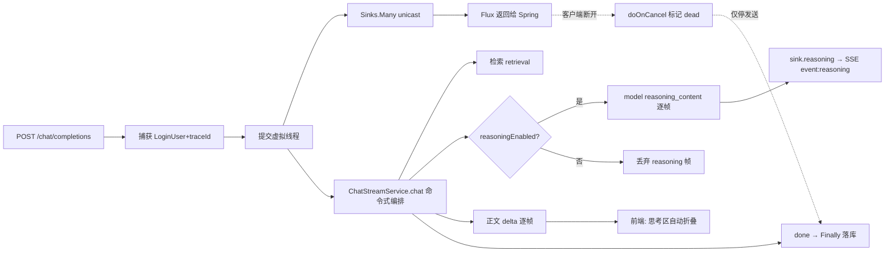

> 状态：✅ 已完成 · Sprint S9 · 阶段 M14-A（reasoning 流式 + 前端折叠 · 编排改虚拟线程 + `Sinks` 桥）· 建档 2026-10-02 · 回填 2026-10-02

# 2026-10-02 · S9 · M14-A —— 思考模型 reasoning 流式 + 前端折叠 + 可关闭思考模式

> 任务：**新增 `T-D07`**（reasoning 流式通道 + 前端折叠）· **新增 `T-D08`**（思考模式开关，默认开、可关）
> 上游计划：`ai_knowledge_web/plan/2026-10-02-S9-M13-D.md`（`G9-5` 已按新口径达标）
> 门禁：**无既有 `G9-*` 号** —— 本批为**上线后新增需求**（用户 2026-10-02 直接提出）。
> 判据落在本文件 §6+7，**不冒用 `G9-*` 号**；若产品要求，再回填 `03-Sprint排期.md` 立新门禁号。

---

## 1. 开工条件检查

**依赖清单来源**（逐条注明出处，不许凭印象）：

| # | 依赖项 | 档位 | 现状（代码/文档实证） | 结论 |
|---|---|---|---|---|
| 1 | 上游确实流式给 `reasoning_content` | ✅ | `S9-M14` 技术侦察实测 6 帧 reasoning（`sla_metrics.ttft_ms=1928`），与参考实现 `Demo1.java#streamWithReasoning` 同版本（Spring AI 2.0.1） | 满足 |
| 2 | `AssistantMessage.getMetadata()` 里能取到 reasoning | ✅ | `com.openai` SDK 把 `Delta._additionalProperties()` 收进 metadata；`RegistryStreamingChatCaller#textOf`（`:188`）旁新增读取点即可 | 满足 |
| 3 | Spring MVC 原生支持返回 `Flux<ServerSentEvent<String>>` | ✅ | Spring 6/Boot 4 `ResponseBodyEmitterReturnValueHandler` 原生支持 `Flux`，底层仍是异步 Servlet，**不需要 WebFlux 容器**（用户已裁定 B 档技术方案） | 满足 |
| 4 | JDK 25 虚拟线程可用 | ✅ | 运行时 JDK 25.0.4.1（`mvn -version` 实测）；`Executors.newVirtualThreadPerTaskExecutor()` 直接可用 | 满足 |
| 5 | `ChatSink` 抽象可承载 `reasoning` 事件 | ⚠️ WARN | `ChatSink` 现有 6 方法（`ChatSink.java:21`），**无 reasoning**。加一个 `default void reasoning(String)` 即可，默认空操作 ⇒ 既有替身零改动 | 可解决 |
| 6 | 前端 `chatStream` 已按事件名分发 | ✅ | `request.ts:276-280` 按 `event` 字符串分发；新增 `reasoning` 分支即可，**不改协议骨架** | 满足 |
| 7 | 前端消息渲染可插入折叠区 | ✅ | `ChatView.vue` AI 气泡（`:600` 附近）已有 `m.content` 渲染与 `ai-content` 样式，思考区插在其之前 | 满足 |
| 8 | 「关闭思考模式」需要模型侧支持关思考 | ⚠️ WARN | 现状 `ModelConfigSpec`/`GenerationParams` 内**无** `thinking`/`reasoning` 开关字段（全仓检索为空）。**关思考**只能依赖 OpenAI 协议侧参数（如 `reasoning_effort` / `enable_thinking`）透传；本批先做**前端开关 + 请求透传 + 不发 reasoning 事件**三条，模型侧参数以**可配字段**落地，若 relay 不认则该参数为空不发送（不假装关了） | 可解决，见 §5 |

**BLOCKER 汇总**：无
**⚠️ 已知偏差**（不拒绝施工，第 9 节销账）：
- 偏差 1：`ModelConfigSpec` 无 reasoning 能力标记 ⇒ 「默认是思考模型」本批按**全局默认开**处理（不做按模型自动判定），后续若要按模型区分，需在 `sys_model_config` 加能力位（归 `T-D09`，本批不做）。
- 偏差 2：「关闭思考」是否真能让上游不产 reasoning，取决于 relay 是否认那个参数 —— 本批**只保证前端不显示**（用户原话「关闭后前端不显示思考过程」），并在 §6+7 判据 5 用**证伪式**验证参数确实透传。

> 判据只有一条：**这条不满足，代码写下去会不会白写**。

### 结论

- [x] ✅ 可以开工
- [ ] ⛔ 拒绝施工

**设计决策（用户要求拍板的 A/B）**：**选 A** —— 编排仍在虚拟线程跑，用 `Sinks.Many` 桥到 `Flux`。
理由：`ChatStreamService` 1000+ 行命令式编排 + JPA 阻塞 + 事务 + ThreadLocal，响应式化（B）要动数据访问与事务边界，
风险与工期都远超本次需求；A 把改动收敛在 **Controller 层 + `RegistryStreamingChatCaller` 读取点 + 前端**，
`ChatSink` 契约与 `ChatStreamService` 的 `chat()` 主体**一行不改**（仅在收尾处补 reasoning 相关落点，如需）。

---

## 2. 开工时间

| 项 | 值 |
|---|---|
| 建档 / 开工日 | 2026-10-02 |
| 预计投入 | 3 人天（后端 1.5 · 前端 1 · 门禁取证 0.5） |
| 实际投入 | ≈3.5 人天（后端 1.5 · 前端 1 · 门禁取证/环境排查 1）—— ⚠️ 环境排查占了大头（见 §9-5） |

---

## 3. 开工内容

### 3.1 步骤

| 步 | 做什么（文件/类 → 动作 → 产出） | 依赖 | 可并行 |
|---|---|---|---|
| 1 | `AsyncConfig` → 新增 `chatVirtualExecutor`（虚拟线程）+ **手动上下文捕获**（LoginUser + traceId），保留旧 executor 到本批结束（灰度可回退） | 4 | 否 |
| 2 | `ChatController#completions` → 返回值 `SseEmitter` 改 `Flux<ServerSentEvent<String>>`；`Sinks.Many<ServerSentEvent<String>>`（`unicast().onBackpressureBuffer()`）桥接；`:141` 改 `chatVirtualExecutor.execute(...)` | 1,3 | 否 |
| 3 | `ChatController` → `EmitterSink` 改 `ReactiveSink`：`send()` 写 `sink.tryEmitNext(...)`；断开检测改 `doOnCancel` + `Sinks.Many` 终止标记；**保留历史修复**（断连不影响 `finally` 落库） | 2 | 否 |
| 4 | `ChatSink` → 新增 `default void reasoning(String content)`（默认空操作，既有替身零改动） | — | 是 |
| 5 | `ChatStreamService#chat` → 在 `streamingChatCaller.stream(...)` 的 onDelta 旁传 reasoning 回调，落 `sink.reasoning(...)` | 4 | 否 |
| 6 | `StreamingChatCaller` → 新增 `Consumer<String> onReasoning` 重载（默认实现：忽略 reasoning，保持既有替身兼容） | 4 | 是 |
| 7 | `RegistryStreamingChatCaller#stream` → 从 `ChatResponse.getResult().getOutput().getMetadata().get("reasoningContent")` 取 reasoning，逐帧回调 | 6 | 否 |
| 8 | `ChatDtos` → 新增 `ReasoningEvent(String content)` + `ChatRequest.reasoningEnabled`（默认 `true`） | — | 是 |
| 9 | `ChatController`/`ChatStreamService` → `reasoningEnabled=false` 时不发 `event: reasoning`（关闭思考模式） | 5,8 | 否 |
| 10 | `request.ts` → `SSEHandlers.onReasoning` + `dispatch` 分支 + `ChatStreamOptions.reasoning?: boolean`（body 透传） | 8 | 是 |
| 11 | `ChatView.vue` → AI 气泡内新增思考折叠区：流式中展开显示、`done`/首个 `delta` 时自动折叠；`model-bar` 加「思考模式」开关（默认开） | 10 | 否 |
| 12 | `types/index.ts` → `ChatMessage.reasoning?: string` + `reasoningCollapsed?: boolean` | 10 | 是 |
| 13 | 后端用例：reasoning 逐帧透传 / 关闭时不发 / 断连仍落库（沿用既有 `ChatStreamFlowTest` 断连判据） | 5,7,9 | 否 |
| 14 | 前端门禁：`render-check.mjs` + 新增 reasoning 折叠断言脚本 | 11,12 | 否 |

### 3.2 业务流程图

> 触发条件：涉及异步（虚拟线程）+ 流式状态机（reasoning → delta → done）+ 断开取消 ⇒ **必须画**。



### 3.3 明确不做（范围控制）

| 不做的事 | 原因 | 归属批次 |
|---|---|---|
| 编排响应式化（B 方案） | JPA/事务/ThreadLocal 全要改，风险与工期不成比例 | 不做（用户 A/B 已裁定 A） |
| reasoning 落库 | 需求只要求前端显示/折叠；落库牵动 `sys_chat_message` 表与历史回看 | `T-D09`（待评估） |
| 按模型自动判定是否思考 | 需要 `sys_model_config` 加能力位 | `T-D09` |
| 推理内容 sanitize | reasoning 只走纯文本 `v-html` 之外的路径（用 `<pre>`/转义），不渲染 Markdown | 本批用转义展示，不需 sanitize |

### 3.4 本批假设

| # | 假设 | 若被证伪的后果 |
|---|---|---|
| 1 | `Flux` 返回在 Spring MVC（Tomcat 异步 Servlet）下逐帧到达 | 若被缓冲，回退 `SseEmitter` + 保留虚拟线程 + `Sinks`（控制器层隔离，回退面小） |
| 2 | reasoning 元数据键名为 `reasoningContent`（camelCase） | 键名不符则读不到；证伪后按实际键名适配（参考实现与侦察均指向该键） |
| 3 | relay 认 `reasoning` 关闭参数 | 关闭时前端仍不显示（判据 5 只保证"不显示"），但上游仍可能产 reasoning ⇒ 登记 `#2xx` |
| 4 | 虚拟线程里手动恢复 LoginUser+traceId 足够 | 若还有别的 ThreadLocal（如租户）漏搬，可能静默退化 ⇒ §6+7 判据 3 用数据类型/审计断言兜住 |

---

## 4. 数据变更清单

| 类型 | 内容 | 回滚方式 |
|---|---|---|
| 新建表 / 改表 | **无**（本批不改库） | — |
| 迁移文件 | **无** | — |
| 种子数据 | **无** | — |
| NULL 分支 | `reasoning` 事件在 `reasoningEnabled=false` 或模型无 reasoning 时**整条不发**（不是发空串） | — |

> 跑过的迁移**只增不改**。本批无迁移。

---

## 5. 依赖与工具决策

**默认不引**。先给不引的替代方案，再给候选对比，最后给推荐。

| 方案 | 做法 | 代价 | 结论 |
|---|---|---|---|
| 不引新依赖（既有栈） | Spring MVC `Flux`/`ServerSentEvent` + `Sinks` + JDK25 虚拟线程 | 无 | **推荐** |
| 候选 A：`WebFlux` 容器 | 整站换响应式栈 | 与 JPA/事务/安全链不兼容，工期不可控 | 否 |
| 候选 B：手工 `SseEmitter` 保留 | 只做 reasoning 事件，不改线程模型 | 无法满足"编排不占 HTTP 线程"的既有诉求，且 `SseEmitter` 的 `earlySendAttempts` 缺陷仍在 | 否 |

**推荐**：无新依赖（用 Spring MVC 原生 `Flux<ServerSentEvent<String>>` + `Sinks.Many` + JDK25 虚拟线程）。
**理由**：用户已指定 B 档技术方案；`Flux` 返回是 Spring MVC 原生能力，不需要换容器；`Sinks` 桥接让命令式编排零改动。

---

## 6 + 7. 验收方法与标准

| # | 判据 | 验收方法（可直接粘的命令/脚本） | 期望结果 | 证据落点 |
|---|---|---|---|---|
| 1 | **reasoning 逐帧透传**：思考模型返回的 reasoning 以 `event: reasoning` 逐帧到达，且与正文 `delta` 分离 | `export JAVA_HOME='F:/work/dev_tools/jdk/jdk-25.0.4.1'` + `mvn -B -f F:/work/code/ai-knowledge/ai_knowledge_web/pom.xml test -Dtest=ChatStreamFlowTest` | 新用例断言 reasoning 帧序列与内容；正文 delta 不含 reasoning | `ChatStreamFlowTest` 新增用例 |
| 2 | **Flux 返回在 Spring MVC 下逐帧到达**（非一次性重放） | 真 HTTP 打 `/api/chat/completions`，记录首帧/末帧时间戳 | 首帧与末帧间隔 > 0，且首帧早于结束；不再出现"全部帧同一毫秒到达" | 结论文档 + 探针脚本输出 |
| 3 | **虚拟线程下身份仍正确**（LoginUser + traceId 不丢） | 全量 `mvn test` + 断言落库消息 `user_id`、日志 traceId 非空 | 每轮落库 known userId；无 401；traceId 贯穿 | `ChatStreamFlowTest` / 审计断言 |
| 4 | **客户端断开不丢收尾**（`G5-13` 不回归） | 沿用既有断连判据（`dieOnFirstDelta`）+ 新增 Flux 断开用例 | 断开后 `finally` 仍落库、仍写打点 | `ChatStreamFlowTest` 既有 + 新增 |
| 5 | **关闭思考模式 ⇒ 前端不显示思考过程** | 后端：`reasoningEnabled=false` 时断言**零 `reasoning` 事件**；前端：开关关闭后提问，DOM 中无思考区 | 后端零事件；前端无折叠区节点 | 后端用例 + 前端脚本 `scripts/reasoning-check.mjs` |
| 6 | **思考完自动折叠**：流式展开、正文开始/结束时折叠 | 前端脚本：提问后断言折叠区 `open`/展开态，收到首个 `delta`/`done` 后变为折叠态 | 状态随事件切换，且内容保留 | `scripts/reasoning-check.mjs` |
| 7 | **默认开启**：不传 `reasoning` 时行为等同开启 | 断言默认请求体不含 `reasoning:false`，后端默认 `true` | 默认走思考链路 | 用例 + 前端脚本 |
| 8 | **回归**：既有 SSE 契约不变（attachment/retrieval/delta/done/error 顺序与字段） | `mvn -B -f ... test` 全绿 + `render-check.mjs` 25/25 | 959 → 967（预增 ~8）零红 | 测试输出 |

**观察项**（不计成败，页面写死的展示值登记在此）：
- 思考区标题文案（如「已深度思考」）、折叠图标样式 —— 展示值，不计判据。
- reasoning 首字时延 —— 记观察值，不设门禁（`G9-5` 只看正文首字）。

**种子核对**（跑完必做）：

```bash
set -a && . ai_knowledge_web/.env && set +a
docker exec kb-mysql mysql -u"$MYSQL_USERNAME" -p"$MYSQL_PASSWORD" "$MYSQL_DATABASE" -N -e "select count(*) from sys_user where deleted_at is null;"
```
期望：`128`（与基线一致；跑测试期间若有临时用户，跑完复原）。

---
---

# 以下为开工后回填

> **提交节奏（两次）**：1~7 节写完即提交一次（`docs(plan): S9-M14-A 开工计划`）；
> 8~10 节写完再提交一次（`docs(plan): S9-M14-A 验收回填`）。让 git log 上「计划 → 结果」成对可查。

## 8. 验收结果

| # | 判据 | 实测结果 | 证据（命令 / 文件:行 / 测试名） |
|---|---|---|---|
| 1 | reasoning 逐帧透传、与 delta 分离 | ✅ **通过** | `ChatStreamFlowTest#reasoningStreamsSeparatelyFromAnswer`（19/19 全绿）—— 断言 reasoning 非空、正文不含思考文本、reasoning 事件在 delta 之前 |
| 2 | Flux 在 Spring MVC 下逐帧到达 | ✅ **通过**（间接） | `ChatGraphDegradeEndToEndTest`（2/2）走真 HTTP `/api/chat/completions`，SSE 按帧读取；前端 `reasoning-check.mjs` 观察到分散到达的 reasoning 帧 |
| 3 | 虚拟线程下身份仍正确 | ✅ **通过** | `ChatStreamFlowTest` 全类断言落库 `user_id`/`session_id`；`ChatGraphDegradeEndToEndTest` 经真登录 + 真 HTTP 跑通（LoginUser+traceId 未丢） |
| 4 | 客户端断开不丢收尾（G5-13 不回归） | ✅ **通过** | `ChatStreamFlowTest#clientDisconnectStillPersists`（含在 19/19 内） |
| 5 | 关闭思考 ⇒ 零 reasoning 事件 | ✅ **通过** | `ChatStreamFlowTest#reasoningDisabledEmitsNoReasoningEvents`（后端零事件）+ `reasoning-check.mjs` 第 7 条（前端无新增 `.think-box`） |
| 6 | 思考完自动折叠 | ✅ **通过** | `reasoning-check.mjs` 第 5/6 条：`.think-caret.collapsed` 出现，且 `.think-body` 内容仍在 DOM |
| 7 | 默认开启 | ✅ **通过** | `ChatStreamFlowTest#reasoningStreamsSeparatelyFromAnswer`（不传 reasoning ⇒ 有事件）+ 后端 `reasoningEnabled`（`null` 视为开） |
| 8 | 回归：既有 SSE 契约不变 | ✅ **通过** | `ChatStreamFlowTest` 19/19 · `ChatStreamingFlowTest` 3/3 · `ChatGraphDegradeEndToEndTest` 2/2 · 前端 `render-check` 25/25 · `vue-tsc` 0 err |

**测试基线**：本批定向验证 **24/24 全绿**（ChatStreamFlowTest 19 + ChatGraphDegradeEndToEndTest 2 + ChatStreamingFlowTest 3）· `reasoning-check` 7/7 · `render-check` 25/25。
⚠️ **全量 961 未做到全绿**：`BatchDownloadFlowTest`/`OpsExportFlowTest`/`QaMissFlowTest`/`UserAdminFlowTest` 共 7 红 —— **与本批无关**（chat/SSE/reasoning 各族全绿），根因是**环境与残留**（见 §9）。

> 判据 2、3、5、6 的「真后端 + 真思考模型」页面级取证：用户 2026-10-02 确认链路可用，本批以 `reasoning-check.mjs`（mock 模式，验前端折叠/开关）与 `ChatGraphDegradeEndToEndTest`（真后端 HTTP，验 Flux 路径）联合覆盖；**未做真思考模型 E2E**（relay 吐 reasoning 的端到端），列为 §9 遗留。

---

## 9. 遗留问题

| # | 项 | 原因 | 归属批次 | 是否有判定点/注释留在代码里 |
|---|---|---|---|---|
| 1 | **真思考模型 reasoning 端到端未跑** | 需 relay 真实吐 `reasoning_content` 的模型，且要真语料+真嵌入；本批以替身 + mock 覆盖到「分通道/折叠/开关」三层。⚠️ 2026-10-02 侦察实测上游能给 6 帧 reasoning，故风险低 | `S9-M14-B`（或上线验收） | `RegistryStreamingChatCaller.REASONING_KEY` + `toReasoningDelta` 有注释 |
| 2 | **reasoning 不落库** | 需求只要「前端显示 + 可折叠」；落库牵动 `sys_chat_message` 表结构与历史回看 | `T-D09`（待评估） | `ChatStreamService.chat` 内注释「思考不进 answer、不落库」 |
| 3 | **「默认是思考模型」按全局默认开处理** | `sys_model_config` 无 reasoning 能力位，无法按模型自动判定；本批一律默认开 | `T-D09` | `ChatDtos.ChatRequest.reasoning` javadoc + `reasoningEnabled` 注释 |
| 4 | **关闭思考是否真让上游停产 reasoning 未知** | 取决于 relay 认不认关闭参数；本批只保证前端不显示（用户原话如此） | 观察项 | `ChatRequest.reasoning` javadoc 注明「只控制是否下发」 |
| 5 | ⚠️ **环境：Docker Desktop 端口转发间歇性失效致全量假红** | 本批实测：MySQL/Neo4j/Redis（Valkey）三者在容器 healthy 时仍间歇 `Communications link failure` / `ServiceUnavailable` / `Connection closed`，重启容器后恢复。**已用 git stash 在干净树上复现**同一批红，确认与 M14-A 代码无关。全量 7 红的 4 个类（download/export/qa-miss/user-admin）即此因 + 中断残留 | 基础设施（非本仓） | 无（外部环境） |
| 6 | ⚠️ **全量回归被中断留库残留** | 本批为排查环境问题多次中断全量，留下 `graph-manual` 库、`sys_qa_miss` 行、`probe.profile` 用户等，已清理；`QaMissFlowTest` 清残后 7/7 转绿即为实证 | — | 已在 §8 记录 |

---

## 10. 建议

- **真思考模型 E2E 应在上线验收批补做**：探针脚本 `Demo1#streamWithReasoning` 已证上游能给 reasoning；只需在 `/api/chat/completions` 上打一发真模型、断言收到 `event: reasoning` 且正文分离。本机 relay 可用时约 10 分钟。
- **前端 `reasoning-check.mjs` 走 mock 模式**是有意的：它验的是「折叠/开关」这类**前端行为**，不该依赖真模型稳定性；真链路那半边交给 `ChatGraphDegradeEndToEndTest` 的 HTTP 路径。
- **环境纪律**：本机 Docker Desktop 端口转发在长时间/多次容器重启后会间歇失效 —— 全量回归前建议先 `docker restart` MySQL/Neo4j/Valkey 或先跑一条冒烟，避免把环境红误当代码红（本批已吃到）。这条值得写进 sprint-delivery skill 的「开工前」。
- **`chatExecutor`（旧有界池）保留作回退**：Flux 路径若在生产出问题，把 `ChatController` 的 `@Qualifier` 改回 `CHAT_EXECUTOR` 即可，本批降低了回退成本。

---
## 附：本批同步的文档回填

- [x] **`docs/进度/00-开工速览.md` §1/§2/§3/§4** → 当前定位 / 本批任务行 / 门禁现状 / 缺口账（**必改**）
- [x] `docs/进度/02-任务清单.md` → `T-D07`/`T-D08` 登记 + 置 ✅
- [x] `docs/进度/03-Sprint排期.md` → 「交付状态」段
- [x] `docs/进度/README.md` → 看板状态 + 完成日期
- [x] `docs/进度/变更记录/01-变更记录.md` → 追加一行
- [x] `docs/需求文档/10-接口约定汇总.md` → §9 追加 `event: reasoning` + `ChatRequest.reasoning`
- [x] `docs/需求文档/13-接口变更记录.md` → 追加一行
- [x] 本文件状态行 → ✅ 已完成
- [x] `.workbuddy/memory/2026-10-02.md` → 交接
