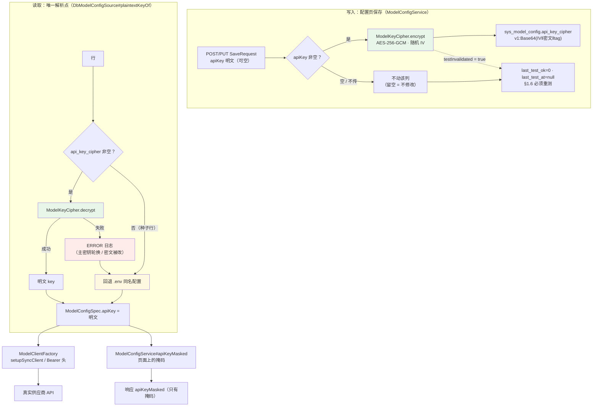

> 状态：🟡 进行中（代码 · 用例已完成；待页面验收）· 结项后配置批 · 阶段 模型密钥加密落库 · 建档 2026-10-11

# 2026-10-11 · 结项后 · 配置批 —— 模型 API Key 加密落库（页面可录入 · 调用时解密）

> 任务：**无 `T-xxx`**（结项后功能补齐）· 来源：用户 2026-10-11 反馈
> 「`http://localhost:5173/#/system/model` 页面 chat 模型不对 …… 前端模型配置页面要可以配置 API Key，
> 数据库加密保存，现在的方案是 key 读取的 .env，数据库没存 api_key。
> **注意调用真实 API 时，不要用加密的 api_key**」
> 上游：`S6-M09-A`（模型配置进 DB，但**密钥不落库** —— 该计划 §3.3 / §9-9 `#173`）· `S6-M09-C`（配置页）· `T-D03`（mock 开关）
> 用户裁定（2026-10-11）：① 主密钥用**新建的 `MODEL_KEY_SECRET`**（不复用 `JWT_SECRET`）
> ② dev **走真后端**（提交 `.env.development`）③ 文档按项目惯例**全套**同步

---

## 1. 开工条件检查

| # | 依赖项 | 档位 | 现状（代码/文档实证） | 结论 |
|---|---|---|---|---|
| 1 | 页面为何显示错的对话模型 | ✅ | `vite.config.ts:14` 判据是 `VITE_USE_MOCK !== 'false'`，未定义 ⇒ **mock 开**；仓里只有 `.env.production`（写 `false`），**没有 `.env.development`**；在跑的 dev server（PID 36044）就是裸 `vite` ⇒ 页面渲染 `src/mock/data.ts:980` 的样例 `DeepSeek-V3（硅基流动）`。**真后端 DB 行是对的**（`sys_model_config` id=1 = `deepseek/deepseek-v4-flash` @ `commandcode.ai`） | 满足（根因已定） |
| 2 | 需求是否本来就要求加密落库 | ✅ | 《09》§1.5「API Key **加密存储，保存后不再明文回显**（带「更换」按钮）」· §1.15「**API Key 落库需加密**（如 AES + 环境密钥），日志中必须脱敏」· §1.16「保存后不回显明文，日志中不出现明文」 ⇒ **本次是回归需求，不是偏离** | 满足 |
| 3 | 列与实体是否已就绪 | ✅ | `V1__init_skeleton_schema.sql:189` 建了 `api_key_cipher VARCHAR(512) NULL COMMENT '加密后的 API Key；NULL = 用环境变量里同名配置'`；`SysModelConfig.apiKeyCipher` 已映射 ⇒ **不需要新增迁移**（当前最高 `V44`） | 满足（省一次迁移） |
| 4 | 密钥注入点 | ✅ | 全仓唯一构造点 `ModelClientFactory`：`OpenAiSetup.setupSyncClient(spec.baseUrl(), spec.apiKey(), …)`（`:105` / 异步 `:127`）、`SiliconFlowRerankClient:108` 的 `Bearer ` 头 ⇒ 只要求 `spec.apiKey()` 是明文，**下游一行不用改** | 满足 |
| 5 | 密钥解析现状（**两条路**） | ⚠️ | `DbModelConfigSource` 里 `listEnabled` 走 `apiKeyOf(type)`、`specOf(row)` 也走 `apiKeyOf(type)` —— 同一条语义写了两处。掩码侧（`ModelConfigService#apiKeyMasked`）是**第三处** | **需收敛为一处** |
| 6 | 加解密工具 | ⛔→✅ | 全仓无 AES/GCM/`TextEncryptor`/Jasypt（`javax.crypto` 只出现在 `JwtService` 签 JWT）；`pom.xml` 有 `hutool-all` 但只用其 `captcha` ⇒ **本批用纯 JDK `javax.crypto` 实现，不引依赖** | **需施工**（新类） |
| 7 | 主密钥载体 | ✅ | `application.yml` 的 `app.model.*` 段已存在（`:277`）；`jwt.secret: ${JWT_SECRET}`（无默认 ⇒ 缺就启动失败）是**反面**参照 —— 本项**必须**给空默认 | 满足 |
| 8 | 验收手段 | ✅ | `ModelConfigFlowTest` 是**真 HTTP + 真 MySQL**，天然带 `jdbc` 直查；加解密本身可纯单测（不起上下文） | 满足 |

**BLOCKER 汇总**：无
**⚠️ 已知偏差**：
- **服务端不把 `apiKey` 做成必填**（需求 §1.5 写「必填」）。理由：强制必填会打破 `ModelConfigFlowTest.createChat`（不传 key）与**所有靠 `.env` 兜底的创建路径**，而本次回归的整个前提就是**保留 `.env` 回退**（`V1` 列注释的语义）。「必填」只作为页面提示 → 记入 §9。
- **页面级 E2E 仍未做**：设备限制（本机无法自动化浏览器），本次只做到契约层与真库层 —— 与 `S6-M09-A` §9 判据 13 同一条缺口，**仍挂着**。

> 判据只有一条：**这条不满足，代码写下去会不会白写**。

### 结论

- [x] ✅ 可以开工（依赖齐备，成本口径已定）
- [ ] ⛔ 拒绝施工

---

## 2. 开工时间

| 项 | 值 |
|---|---|
| 建档 / 开工日 | 2026-10-11 |
| 预计投入 | 1 人天（加解密类 + 解析点收敛 + 契约 + 页面 + 用例 + 文档） |
| 实际投入 | 1 人天（同批完成代码 · 10 条单测 · 4 条集成用例 · 文档同步） |

---

## 3. 开工内容

### 3.1 方案（用户裁定）

| # | 决策 | 说明 |
|---|---|---|
| ① | 算法 = **AES-256-GCM**，格式 `v1:Base64(IV‖密文‖tag)` | 纯 JDK；随机 IV ⇒ 同明文两次加密不同；版本前缀给将来换算法留出口 |
| ② | 主密钥 = **新变量 `MODEL_KEY_SECRET`**（`app.model.key-secret`） | 与 `JWT_SECRET` 解耦：轮换 JWT 令牌密钥不该连带弄坏模型密钥 |
| ③ | **缺主密钥不阻止启动** | 只 WARN + `enabled()=false`，保存 Key 被明确拒（带下一步动作）；密钥继续回退 `.env` |
| ④ | 解析优先级：**密文可解 → 明文；否则回退 `.env`** | 正是 `V1` 列注释承诺的语义 ⇒ 种子行与历史行为**零变化** |
| ⑤ | dev 提交 `.env.development`（`VITE_USE_MOCK=false`） | mock 的默认值是"危险的那一侧"，不写文件就是假数据 |

### 3.2 步骤

| 步 | 做什么（文件 → 动作 → 产出） | 依赖 | 可并行 |
|---|---|---|---|
| 1 | 新增 `core/security/ModelKeyCipher.java`（AES-GCM + 版本前缀 + 三条降级语义） | — | |
| 2 | `ModelProperties` 加 `keySecret`（**`@ToString.Exclude`**）+ `application.yml` `app.model.key-secret`（空默认）+ `.env` / `.env.example` | 步 1 | 可并行步 1 |
| 3 | **收敛解析点**：`DbModelConfigSource#plaintextKeyOf(row)` 成为唯一入口；`listEnabled`/`specOf`/`toSpec` 全部改道 | 步 1 | |
| 4 | `ModelConfigDtos.SaveRequest` 加 `apiKey`（**只进不出**）；`ModelConfigService`：`applyEditable` 加密写入、`update` 的 `testInvalidated` 补 Key、`apiKeyMasked(String)` 改吃解析后的明文 | 步 3 | |
| 5 | 前端：`ModelConfigSavePayload` 类型 · 弹窗「掩码 + 更换按钮 + 留空即不修改」· `saveModel` 带 key · mock 不再把明文写回 item | 步 4 | |
| 6 | `ai_knowledge_app/.env.development`（`VITE_USE_MOCK=false`） | — | 可并行 |
| 7 | 用例：`ModelKeyCipherTest`(7) · `DbModelConfigSourceTest`(3) · `ModelConfigFlowTest` 增 4 条 | 步 1-5 | |
| 8 | 文档：本文件 · `10` §14 · `13` 变更记录 · 订正 `2026-09-18-S6-M09-A` §3.3/§9-9 · `汇总-归档` §C | 步 7 | |

### 3.3 业务流程图

> 图里的关键点只有一个：**写入那一侧是密文，读取那一侧必须先回到明文**。
> 掩码与客户端构造**共用**同一个解析点 —— 若各走一条路，"页面显示的 key"与"真正发出去的 key"
> 会在解密失败时悄悄分叉（本仓记过同族的「看不见的失效」）。

### 3.4 明确不做（范围控制）

| 不做的事 | 原因 | 归属批次 |
|---|---|---|
| **密钥轮换 / 重加密迁移工具** | 需要"新旧两把主密钥并存 + 批量重写"的完整设计；当前只有轮换后的**降级**路径（回退 `.env` + ERROR 日志） | 有需求时另立（§9-1） |
| **清空已存密钥**（回到用 `.env` 的那把） | 接口没有"清空"语义（空 = 不改动）。要做需要一个显式标志位 | 有需求时另立 |
| **页面上显示"加密不可用 / 解密失败"的状态位** | 需要新增响应字段或健康端点字段；本次先靠启动 WARN 与初现 ERROR 日志 | §9-1 的备选 |
| 把 `apiKey` 做成服务端**必填** | 会打破 `.env` 回退路径与既有用例（见 §1 已知偏差） | 不做 |
| 密钥加密的**端到端页面用例** | 设备限制，本次只到契约层 + 真库层 | 与 `S6-M09-A` 判据 13 同一笔账（§9-2） |

### 3.5 本批假设

| # | 假设 | 若被证伪的后果 |
|---|---|---|
| 1 | `MODEL_KEY_SECRET` 是**高熵随机串**（运维 `openssl rand -base64 48` 生成），不是人类口令 | 若是短口令，SHA-256 派生的密钥可被离线爆破 ⇒ 应换 PBKDF2；已在类注释与本文件写明 |
| 2 | `VARCHAR(512)` 够用（明文 ≤ 353 字符） | 更长的 key 会被**明确拒绝**（10030），不是截断 —— 边界有单测钉住 |
| 3 | 解密失败时"回退 `.env`"优于"直接报错" | 若用户要"宁可报错也别用错的 key"，需改成抛错；当前取"先别把整条链路弄挂" |
| 4 | 单实例部署，主密钥来自进程环境 | 多实例时每个实例必须有**同一个** `MODEL_KEY_SECRET`，否则各解各的密文 |

---

## 4. 数据变更清单

| 对象 | 变更 | 说明 |
|---|---|---|
| `sys_model_config.api_key_cipher` | **开始真的被写**（此前恒 NULL） | 列早已存在（`V1:189`，`VARCHAR(512) NULL`），**无 DDL 变更、无新迁移** |
| 种子四行 | **不变**（仍 `NULL`） | `ModelConfigSeeder:97` 不动 ⇒ 它们继续用 `.env` 的同类密钥，历史行为一字未改 |
| 新增环境变量 | `MODEL_KEY_SECRET` | 本机 `.env` 已生成随机值；`.env.example` 已补（含轮换警示） |
| 前端新增文件 | `ai_knowledge_app/.env.development` | `VITE_USE_MOCK=false` ⇒ dev 默认真后端 |

---

## 5. 依赖与工具决策

| 方案 | 做法 | 代价 | 结论 |
|---|---|---|---|
| **纯 JDK `javax.crypto`（选定）** | `AES/GCM/NoPadding` + `SecureRandom` + Base64 | 需自己定格式与降级语义（≈40 行） | ✅ 选定：**不引依赖**，与仓里唯一的 crypto 类 `JwtService` 同族 |
| `hutool-all` 的 `cn.hutool.crypto` | 已间接在依赖里（只用过 captcha） | 引一个"顺带可用"的工具库做**密钥落库**，错误语义不透明 | ❌ 否决 |
| Jasypt / Spring `TextEncryptor` | 声明式加解密 | S6-A 立据时已否决（§5）：引入密钥管理问题而当时无对象可加密 | ❌ 沿用否决 |
| 复用 `JWT_SECRET` 当主密钥 | 零新增配置 | 轮换 JWT 会让**库里所有密钥同时解不开** | ❌ 用户裁定独立变量 |

---

## 6. 验收判据

| # | 判据 | 落点 |
|---|---|---|
| 1 | 落库的是密文：`v1:` 前缀 · 与明文逐字不同 · 不含明文子串 | `ModelConfigFlowTest#apiKeyIsEncryptedAtRest` |
| 2 | 响应只回掩码，且**掩码来自解密后的明文**（头三位 / 尾四位对得上） | 同上（这一条同时证明服务端解得开） |
| 3 | 响应体任何情况下都不含明文与 `apiKey` 字段名 | 同上 + 既有 `apiKeyNeverLeaks` |
| 4 | 改 API Key → `needRetest=true` 且 `last_test_ok=0`、`last_test_at=null` | `editingKeyInvalidatesTest` |
| 5 | **留空 = 不修改**：改备注不冲掉密钥；真填了才换 | `blankApiKeyKeepsStoredCipher` |
| 6 | 密文解不开 → 接口不 500，回退 `.env` | `undecryptableCipherDegradesInsteadOfFailing` |
| 7 | 加解密往返 / 随机 IV / 篡改检测 / 换密钥 / 缺密钥 / 长度边界 | `ModelKeyCipherTest`（7 条） |
| 8 | 解析唯一入口：有密文出明文、无密文/坏密文回退 `.env`、轮换后降级 | `DbModelConfigSourceTest`（3 条） |
| 9 | 页面显示真后端的对话模型（不再是样例 `DeepSeek-V3`） | ⚠️ **待人工验收**（见 §7 步 2） |

---

## 7. 验证方式

| 步 | 命令 / 动作 | 期望 |
|---|---|---|
| 1 | `mvn -o test -Dtest='ModelKeyCipherTest,DbModelConfigSourceTest'` | 10/10 绿 |
| 1' | `mvn -o test -Dtest='ModelConfigFlowTest'`（需 `kb-mysql`） | 15/15 绿（含新增 4 条） |
| 2 | 重启后端 + 前端，打开 `/system/model` | ① 显示 `deepseek/deepseek-v4-flash` / `commandcode.ai`（**验收「走真后端」**）② 无"DeepSeek-V3（硅基流动）"样例 |
| 3 | 编辑该行 → 点「更换」→ 填 Key → 保存 | 收到「需重新测试」提示；该行「启用」置灰 |
| 4 | `docker exec kb-mysql mysql -ukb_user -pkb_password knowledge_base -e "select id, model_type, api_key_cipher from sys_model_config"` | 该行 `api_key_cipher` 形如 `v1:…`，**与明文 key 逐字不同** |
| 5 | 页面上「测试」→「启用」→ 问答页发一句 | 正常回答（若把密文当 key 发出去，供应商会 401 —— 这条是真判据） |
| 6 | 回归：`npm run check:api` · `npm run type-check` | 无新增红 |
| 6' | ⚠️ **页面级回归要在 mock 模式下跑**：`VITE_USE_MOCK=true npm run dev` 后再 `npm run check:layout` / `check:render` | 全绿（**真后端模式下这两个闸会 exit 2「前置不满足」** —— 它们用写死的 `mock_selftest_token` 注入登录态，且 `/system/model` 那条断言的就是 mock 的费用三态夹具） |

---

## 8. 交付物

| 文件 | 动作 |
|---|---|
| `core/security/ModelKeyCipher.java` | 新增（AES-256-GCM · 版本前缀 · 三条降级语义） |
| `core/ai/DbModelConfigSource.java` | 收敛为唯一解析点 `plaintextKeyOf` |
| `core/ai/ModelProperties.java` | `keySecret`（`@ToString.Exclude`） |
| `service/ModelConfigService.java` | 加密写入 · `testInvalidated` 补 Key · 掩码改吃明文；移除已无用的 `ModelProperties` 注入 |
| `dto/system/ModelConfigDtos.java` | `SaveRequest.apiKey`（只进不出） |
| `entity/SysModelConfig.java` · `application.yml` · `.env` · `.env.example` | 注释/配置同步 |
| `core/security/ModelKeyCipherTest.java` · `core/ai/DbModelConfigSourceTest.java` | 新增（10 条） |
| `service/ModelConfigFlowTest.java` | 增 4 条 |
| `src/types/index.ts` · `src/api/index.ts` · `views/system/ModelConfigView.vue` · `src/mock/index.ts` | 前端：类型 · 弹窗「更换」形态 · mock 不落明文 |
| `ai_knowledge_app/.env.development` | 新增（dev 走真后端） |
| `10-接口约定汇总.md` §14 · `13-接口变更记录.md` · `2026-09-18-S6-M09-A.md` §3.3/§9-9 · `汇总-归档.md` §C · `plan/README.md` | 文档同步 / 旧裁定订正 |

---

## 9. 遗留与风险

| # | 事 | 现状 | 归属 |
|---|---|---|---|
| 1 | 🔴 **主密钥轮换会静默降级** | 轮换 `MODEL_KEY_SECRET` 后已存密文**全部解不开** → 回退 `.env` 密钥 + ERROR 日志。表面一切正常，**唯一信号是日志**。⚠️ 若 `.env` 里那把 key 恰好还能用，连症状都没有 | 备选：给配置页/健康端点加一个"加密不可用 / 有行解密失败"的状态位；或做重加密迁移工具 |
| 2 | ⚠️ **页面级 E2E 仍缺**（与 `S6-M09-A` 判据 13 同一笔账） | 契约层与真库层已钉死；"页面真的渲染出来了"没人证 | 与 `S6-M09-A` §9 判据 13 合并 |
| 3 | ⚠️ **服务端不强制 `apiKey` 必填** | 与 §1.5「必填」不一致（见 §1 已知偏差）；靠"新建指向别家供应商的模型时用户自然会填"兜 | 需求方确认后定 |
| 4 | ⚠️ **`SaveRequest` 是 record，`toString()` 含 `apiKey`** | 现有代码只打标量日志（id/type），未打印整个 request；已写进 record 的 javadoc 守住 | 后续新增日志时自查 |
| 5 | ⚠️ **本批改了 dev 默认（走真后端）** | 团队里想用 mock 演示的人需要 `VITE_USE_MOCK=true npm run dev`；且真后端登录要用真账号。🔴 **连带影响**：`check:layout` / `check:render` 是 **mock 模式闸**（写死 `mock_selftest_token` 注入登录态，`/system/model` 那条还断言 mock 的费用三态夹具）⇒ 真后端模式下它们会 **exit 2「前置不满足」**（不是红）。已把「起 mock 现在要显式 `VITE_USE_MOCK=true`」写进 `lib/dev-server.mjs#requireMockMode` 的提示与两个脚本的头注 —— 那句旧提示写的是"**不带** `VITE_USE_MOCK=false`"，本批之后它是**错的** |
