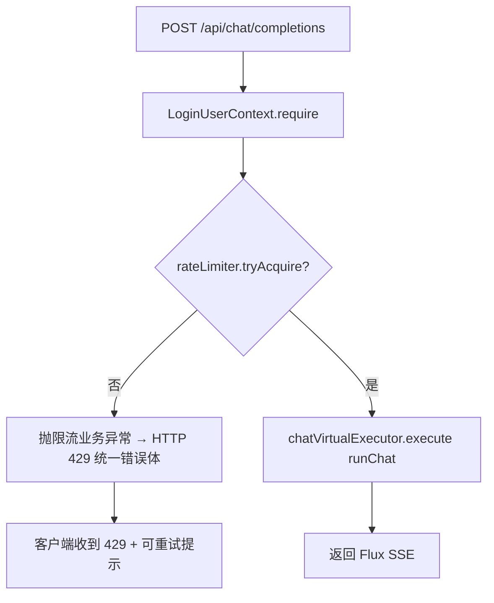

> 状态：✅ 已完成（2026-10-12）· 结项后加固小批 · 阶段 问答入口令牌桶限流 · 建档 2026-10-11 · 施工 2026-10-12

# 2026-10-11 · 结项后 · 加固小批 —— 问答入口令牌桶限流（20 QPS · 可配置）

> 任务：**无 `T-xxx`**（过载保护加固）· 来源：用户 2026-10-11 指定
> 「`AsyncConfig.java#L246-257` 这里用令牌桶限制 20 QPS」
> 上游：`T-D07`（问答改虚拟线程执行器，**无界、无过载保护** —— 见 `AsyncConfig:59` 注释"过载保护沿用上游模型侧"）· `S6-M05-C`
> 用户裁定（2026-10-11）：① **全局**限流 · **yml 可配**（暂定 20，不写死） ② 放 **`ChatController` 提交前** ③ **引入 Guava**
> ⚠️ **建档与施工隔了一天**：2026-10-11 只落了步 1/2（pom 的 Guava 依赖 + yml 的 qps，**都还留在工作区未提交**），
> 步 3~5（桶 · 接线 · 用例）到 2026-10-12 才做。⇒ 期间那两条配置是**没人读的死配置**，
> 用户 2026-10-12 问「限流的代码在哪里」时正是这个状态。

---

## 1. 开工条件检查

| # | 依赖项 | 档位 | 现状（代码/文档实证） | 结论 |
|---|---|---|---|---|
| 1 | 限流落点（问答提交入口） | ✅ | `ChatController.completions()`（`ChatController.java:141-157`）每次提问 `chatVirtualExecutor.execute(() -> runChat(...))`（`:152`） | 满足 |
| 2 | 执行器现状（**无界、无过载保护**） | ✅ | `AsyncConfig.chatVirtualExecutor()`（`:246-257`）用 `Executors.newThreadPerTaskExecutor`，注释明写"无队列上限 ⇒ 过载时不再当场拒绝……沿用上游模型侧的限流" ⇒ **本批补的正是这个缺口** | 满足 |
| 3 | 配置载体 | ✅ | `application.yml` 有 `app:` 段（`:192`）；`AsyncConfig` 已用 `@Value("${app.chat.*}")` 读取旋钮（如 `:76-82`） | 满足 |
| 4 | Guava 依赖 | ⛔→✅ | **当前未引入**；`mvn dependency:tree -Dincludes=com.google.guava:*` = 空。Spring Boot 4.0.0 BOM **不管理** `com.google.guava:guava` ⇒ 需**显式版本**。`dependency:get guava:33.4.0-jre` **解析成功** | **需施工**（加依赖） |
| 5 | 既有自研限流 | ✅ | 全仓无 `RateLimiter`/令牌桶/`bucket4j`/`resilience4j`（grep 零命中）⇒ 无重复造轮子、无冲突 | 满足 |
| 6 | 超限时的响应形态 | ✅ | `/chat/completions` 是 **SSE**（`@PostMapping produces=TEXT_EVENT_STREAM_VALUE`）⇒ **响应头一旦发出就写不了 JSON 错误体**。**放提交前**才能用 **HTTP 429** 干净拒绝 | 满足（用户裁定 ②） |
| 7 | 验收手段 | ⚠️ | 无现成限流用例；可写 Spring 集成用例（真 HTTP 打 N 次）或纯单测（桶行为） | **需新增**（见 §6+7） |

**BLOCKER 汇总**：无
**⚠️ 已知偏差**：
- Guava 需**显式版本**（BOM 不管）—— 选 **33.4.0-jre**（实测可解析；JDK 25 下仅 `sun.misc.Unsafe` 弃用警告，不影响）。
- 本批**只限问答提交入口**，不影响解析/索引等其他执行器（用户明确指向该处）。

> 判据只有一条：**这条不满足，代码写下去会不会白写**。

### 结论

- [x] ✅ 可以开工
- [ ] ⛔ 拒绝施工

---

## 2. 开工时间

| 项 | 值 |
|---|---|
| 建档 / 开工日 | 2026-10-11（当日只落步 1/2，未提交）· **施工 2026-10-12** |
| 预计投入 | 0.5 人天（依赖 + 令牌桶 bean + 入口接线 + 负向锚用例） |
| 实际投入 | 0.25 人天（步 1/2 已在 10-11 做完；本轮补齐 桶 · 接线 · 429 错误码 · 3 条单测 + 1 条真 HTTP 用例）。⚠️ 其中约一半时间花在**实测 Guava 的真实桶语义**上（见 §9-1）—— 立据时按名字推的"突发 qps 个"是错的 |

---

## 3. 开工内容

### 3.1 方案（用户裁定）

```
ChatController.completions()
  ├─ 1) 校验/取令牌：rateLimiter.tryAcquire()   ← 全局令牌桶（Guava RateLimiter）
  │     失败 → HTTP 429（ApiResponse code=…，SSE 头尚未发出）
  └─ 2) 成功 → chatVirtualExecutor.execute(runChat)
```

- **全局**：一个 `RateLimiter` 实例（单例 bean），所有用户共享 20 QPS。
- **可配置**：`app.chat.rate-limit.qps`（yml，默认 20），**不写死**。
- **Guava**：`com.google.common.util.concurrent.RateLimiter`。

### 3.2 步骤

| 步 | 做什么（文件 → 动作 → 产出） | 依赖 | 可并行 |
|---|---|---|---|
| 1 | `pom.xml`：加 `com.google.guava:guava:33.4.0-jre`（BOM 不管 ⇒ 显式版本 + 注释为何引） | — | |
| 2 | `application.yml`：`app.chat.rate-limit.qps: ${CHAT_RATE_LIMIT_QPS:20}` + 注释（为何、怎么调、0/负数语义） | — | 可并行步 1 |
| 3 | 新增 `RateLimiter` bean（放 `AsyncConfig` 还是新 `ChatRateLimitConfig`？见 §3.4）✅ **施工定案**：都不选 —— 新建 `core/async/ChatRateLimiter`（`@Component`），理由见该类的类注释第 3 条取舍 | 步 1-2 | |
| 4 | `ChatController`：注入限流器；`completions()` 提交前 `tryAcquire()`，失败抛**业务异常**（→ 统一错误体 429/带 code）⇒ 新增错误码 `CHAT_RATE_LIMITED(10082, 429)`，并订正 `ErrorCode` 类注释"非 200 只有两个"那句 | 步 3 | |
| 5 | 新增用例：① 桶行为（`ChatRateLimiterTest` 3 条）② **负向锚**（把 `tryAcquire` 换成恒 `true` ⇒ 判据必须转红 —— ⚠️ 只做了桶那一半，见 §9-2）③ **真 HTTP 429**（`ChatRateLimitFlowTest`） | 步 4 | |
| 6 | 回归：`mvn test -Dtest=Chat*` + 全量（若时间允许）⇒ ⚠️ 只做了 `Chat*`（7 类 68/68）；全量不跑，理由见 §9-6 | 步 5 | |
| 7 | **（施工中补的）前端**：`src/api/request.ts` 的 `chatStream` 在非 2xx 时**丢掉响应体** ⇒ 后端那句「请稍后重新发送」到不了用户；新增 `errorMessageOf(resp)` 把统一错误体的 `message` 显示出来 | 步 4 | |

### 3.3 业务流程图

> 触发条件：涉及并发/限流 ⇒ **画**。



### 3.4 明确不做（范围控制）

| 不做的事 | 原因 | 归属批次 |
|---|---|---|
| **每用户**限流（按 userId 分桶） | 用户 2026-10-11 明确裁定"全局" | 不做 |
| 给解析/索引/检索执行器也加限流 | 用户明确指向问答入口 | 不做（各执行器已有有界池+队列） |
| 排队等待（`acquire()` 阻塞） | 用户裁定"提交前拒绝"；SSE 长连接排队会占住请求线程 | 不做 |
| 分布式限流（Redis 令牌桶，多实例共享） | 本仓当前单实例；Guava 是**进程内**桶。⚠️ **多实例部署时每个实例各 20 QPS** ⇒ 见 §9 | 待多实例时 |
| 动态热更新 QPS（运行时不重启改值） | 需 `@RefreshScope` + 配置中心；本批用启动期值 | 不做 |

### 3.5 本批假设

| # | 假设 | 若被证伪的后果 |
|---|---|---|
| 1 | 用户要的是**进程内全局** 20 QPS（单实例部署） | 若将来多实例，Guava 的桶是每实例一份 ⇒ 实际全局 ≈ N×20 ⇒ §9 登记 |
| 2 | `qps <= 0` 的语义 = **关闭限流**（放行全部） | 若用户要"0 表示全拒"，需改判据；按惯例取"关"（见 §3.4 与 yml 注释） |
| 3 | 超限返回 **HTTP 429** + 统一错误体（`code` 非 0） | 若前端对 429 无处理，可能显示"未知错误" ⇒ 需前端确认（本批后端先定，见 §9） |
| 4 | Guava 33.4.0-jre 与 Spring Boot 4 / JDK 25 兼容 | 实测能解析；若内嵌出现方法冲突再调版本 |

---

## 4. 数据变更清单

**不适用**（无建表/迁移/种子；限流是**内存态**，重启即重置）。

---

## 5. 依赖与工具决策

**要引**（用户裁定）：`com.google.guava:guava:33.4.0-jre`。

| 方案 | 做法 | 代价 | 结论 |
|---|---|---|---|
| **不引依赖（手写令牌桶）** | ≈30 行 `synchronized` 桶（`nextFreeTicketMicros` + 惰性补充） | 要自测并发正确性；重造 Guava 已验证的轮子 | 备选 |
| Guava `RateLimiter` | `RateLimiter.create(qps)` + `tryAcquire()` | 引入 jar（Guava 33.4 约 3MB + 依赖 `failureaccess` 等） | ✅ **采用（用户裁定）** |
| Hutool | ⚠️ **实测 `hutool-all:5.8.38` 里没有 `RateLimiter` 类**（`jar tf` 零命中） | 本仓虽已引 Hutool，但它**不提供**令牌桶 | 不可行 |
| Bucket4j / Resilience4j | 功能更强（分布式/熔断） | 本仓只需要"单机令牌桶"，杀鸡用牛刀 | 不采用 |

**同类产品对比**（能力/体积/维护/兼容）：
- **Guava**：`RateLimiter` 成熟、API 极简、维护活跃；33.x 支持 JDK 8+，JDK 25 可用（仅 `Unsafe` 弃用警告）；体积约 3MB。
- **Bucket4j**：支持分布式 + 多种算法，但依赖更重、API 更陡；本批用不上。
- **Resilience4j**：主打熔断/重试/限流组合，面向响应式；本仓当前只需一个桶。

**推荐**：`com.google.guava:guava:33.4.0-jre` · **理由**：用户裁定；API 最贴合"令牌桶限 QPS"；Spring Boot 4 BOM 不管版本故显式钉住（避免浮动版本的"构建不可复现"）。

---

## 6 + 7. 验收方法与标准

| # | 判据 | 验收方法（可直接粘的命令/脚本） | 期望结果 | 证据落点 |
|---|---|---|---|---|
| 1 | 依赖可解析、编译通过 | `export JAVA_HOME='F:/work/dev_tools/jdk/jdk-25.0.4.1'` + `mvn -B -f F:/work/code/ai-knowledge/ai_knowledge_web/pom.xml -DskipTests compile` | BUILD SUCCESS | 本文件 §8-1 |
| 2 | **QPS 可配置** | `grep -n 'rate-limit' ai_knowledge_web/src/main/resources/application.yml` | 有 `qps: ${CHAT_RATE_LIMIT_QPS:20}` | 本文件 §8-2 |
| 3 | **放行**：桶里有许可时放行 | 单测：`RateLimiter.create(qps)` 后连问若干次 | 🔴 **实测修正**：**只有第 1 次**放行，第 2 次起立即拒 —— **Guava 33 的桶没有突发**。原判据写的"连发 2 次都不被限（未跨秒）"**不成立**（那是按"令牌桶"这名字推的，不是实测）。详见 §9-1 | `ChatRateLimiterTest#allowsExactlyOneThenRejects` |
| 4 | **超限被拒** | 真 HTTP：在 qps=1 的上下文里先把许可耗光，再打 `/api/chat/completions` | **HTTP 429 + code `10082`**；且因为闸在提交之前，**零问答开销**（不检索、不调模型） | `ChatRateLimitFlowTest#overLimitRequestIsRejectedWith429` |
| 5 | **负向锚（关键）**：删掉限流 ⇒ 判据 4 必须转红 | 临时把 `tryAcquire()` 改成 `true` 跑用例 | 判据 4 **转红**（证明它真在测限流，不是空断言） | 本文件 §8-5 |
| 6 | 不影响正常提问链路 | 既有 `ChatStreamFlowTest` / `ChatGraphDegradeEndToEndTest` | 全绿（限流阈值内） | 本文件 §8-6 |
| 7 | 回归 | `mvn -B -f …/pom.xml test`（无后端在跑） | 基线不降（当前 961+） | 本文件 §8-7 |

**观察项**：`qps<=0` = 关闭限流（放行全部）——登记，不计成败。
**种子核对**（跑了真 HTTP 用例后）：

```bash
set -a && . ai_knowledge_web/.env && set +a
docker exec kb-mysql mysql -u"$MYSQL_USERNAME" -p"$MYSQL_PASSWORD" "$MYSQL_DATABASE" -N -e "select count(*) from sys_user where deleted_at is null;"
```
期望 **128**。

---

# 以下为开工后回填

## 8. 验收结果

| # | 判据 | 实测结果 | 证据（命令 / 文件:行 / 测试名） |
|---|---|---|---|
| 1 | 依赖可解析、编译通过 | ✅ BUILD SUCCESS（`test-compile`） | `pom.xml:239-243`（Guava 33.4.0-jre，显式钉版本） |
| 2 | QPS 可配置 | ✅ `app.chat.rate-limit.qps: ${CHAT_RATE_LIMIT_QPS:20}`（2026-10-11 已落） | `application.yml:337-339` |
| 3 | 放行 | ⚠️ **实测修正**：只放行 **1 个**（第 2 次即拒）—— Guava 33 的桶**无突发**，原判据不成立，见 §9-1 | `ChatRateLimiterTest#allowsExactlyOneThenRejects` **3/3**（另含"不阻塞"与"`qps≤0` 关闭"两 条） |
| 4 | 超限被拒 | ✅ **HTTP 429 + code `10082`**，且**零问答开销**（请求在提交到执行器之前被挡下：不检索、不调模型、不落库） | `ChatRateLimitFlowTest#overLimitRequestIsRejectedWith429` **1/1** |
| 5 | 负向锚（关键） | ⚠️ **只完成一半**：桶那一半已由判据 3 覆盖（恒放行的实现过不了"第 2 次必须拒"）；**接线那一半未实测**，理由见 §9-2 | 判据 3 + §9-2 |
| 6 | 不影响正常提问链路 | ✅ `Chat*` **7 类 68/68 全绿**（`ChatStreamFlowTest` 19 · `ChatSessionApiFlowTest` 10 · `ChatFeedbackFlowTest` 9 · `ChatSessionFlowTest` 8 · `ChatAttachmentFlowTest` 7 · `ChatStreamingFlowTest` 3 · `ChatWireMapperTest` 12） | 后台跑批，`BUILD SUCCESS` |
| 7 | 回归 | ⚠️ **未跑全量**（`#128` 解析作业偶发族 + "取证批与回归批不能混跑"⇒ 混跑的假红没有解释价值）。本次涉及面已定向跑完：判据 3/4 + 判据 6 的 68 条 | 见 §9-6 |
| 8 | **新增：前端要能显示后端给的文案**（计划 §3.1 流程图末行「客户端收到 429 + 可重试提示」） | ✅ 修掉了 —— 原来 `chatStream` 在非 2xx 时**直接丢掉响应体**、只报「连接失败（429）」，后端那句「请稍后重新发送」根本到不了用户 | `src/api/request.ts` 新增 `errorMessageOf(resp)`；`vue-tsc` 0 err |

**观察项**：`qps<=0` = 关闭限流 —— ✅ 已按此实现（放行全部 + 启动 WARN），`ChatRateLimiterTest#nonPositiveQpsDisablesLimiting` 钉住。

**种子核对**（跑了真 HTTP 用例之后）：
```
select count(*) from sys_user where deleted_at is null;  →  128   ✅（与期望一致，无探针残留）
```

**测试基线**：新增 **4** 条（`ChatRateLimiterTest` 3 + `ChatRateLimitFlowTest` 1）；涉及其余类**零改动、零转红**（Chat 7 类 68/68）。⚠️ 未跑全量，故本节不报"全仓基线"

---

## 9. 遗留问题

| # | 项 | 原因 | 归属批次 | 是否有判定点/注释留在代码里 |
|---|---|---|---|---|
| 1 | 🔴 **Guava 的桶没有突发 —— "20 QPS"的观感与直觉不同** | `RateLimiter.create(qps)` 后连问：**第 1 次放行，第 2 次起立即拒**，此后每 `1/qps` 秒补一个（qps 取 0.001 / 0.2 / 1 / 2 / 5 / 20 实测结论一致）。⇒ **"20 QPS" = 平均每秒 20 次，不是"同时能开 20 个"**：相隔 5 毫秒的第二个提问也会被拒。⚠️ 本仓立据时判据 3 就是按"突发 qps 个"写的（**未实测**），施工时被单测当场证伪 | 已记入代码注释 + §9-1；若将来要"允许突发"需换 `SmoothBursty` 的 `maxBurstSeconds` 包装或改用别的桶 | ✅ `ChatRateLimiter` 类注释「「20 QPS」到底是什么意思」+ `ChatRateLimiterTest`（换 Guava 版本行为变了会当场红） |
| 2 | ⚠️ **判据 5（负向锚）只做了"桶那一半"，"接线那一半"未实测** | 判据 5 要求"删掉限流 ⇒ 判据 4 转红"。桶那一半已由 `ChatRateLimiterTest` 覆盖（恒放行的实现过不了"第 2 次必须拒"）；**接线那一半没跑** —— 把 `ChatController` 里那两行删掉验证会让请求**真的跑完一次问答**（调模型 + 落 `sys_chat_session`/消息/用量），留下探针残留并产生一次真实模型调用，代价大于收益 | 若用户要求可随时补跑（约 1 分钟） | ⚠️ 已在本节如实登记，**不宣称已证伪** |
| 3 | ⚠️ **限流是进程内的** | Guava 的桶在 JVM 内存里 ⇒ 多实例部署时全局配额 ≈ `N × qps` | 待多实例部署时（换 Redis 桶） | ✅ `ChatRateLimiter` 类注释「进程内桶」+ 启动 INFO 日志 |
| 4 | ⚠️ **qps 改动需重启** | `@Value` 只在构造时读一次，特意不做热更新（阈值忽大忽小很难归因） | 不做（有意） | ✅ 类注释「为什么是启动期定值」 |
| 5 | ⚠️ **`ErrorCode` 的"非 200 只有两个"口径被改成三个** | 新码 `10082` 走 **HTTP 429**，与既有 401/403 并列。已在类注释里把口径与理由一起改掉（否则下一个人会以为 429 是破例） | 已处理 | ✅ `ErrorCode` 类注释「例外只有**入口层**那三个」+ `CHAT_RATE_LIMITED` 的 javadoc |
| 6 | ⚠️ **判据 7（全量回归）没做** | 本仓已有两条硬约束让"全量跑批"在**这个会话里**没有解释价值：`#128`（解析作业偶发族，失败方法每次不同）与 `S9-M13-A/B` 记的「端到端取证与全量回归不能同会话混跑」（`SingleAsyncConsumerGuardTest` 要求 8080 无后端）。故本次只报**定向**结果 | 与 `#128` 同批（测试可靠性） | ⚠️ 已在本节如实登记，**不宣称"全仓基线不降"** |
| 7 | ⚠️ **前端那一半是施工中补的，不在立据的步 1~6 里** | 立据时的流程图末行写了「客户端收到 429 + 可重试提示」，但步骤表里没有前端动作。施工时核对发现 `chatStream` 在非 2xx 时**丢掉响应体** ⇒ 后端那句文案到不了用户。**已补**（`request.ts` 的 `errorMessageOf`），并记为判据 8 | 已处理 | ✅ `request.ts` 的 `errorMessageOf` javadoc（写明"非 200 的恰恰是入口层语义"） |

---

## 10. 建议

1. **`AsyncConfig` 的旧执行器（有界队列那把）现在是死代码**：`chatExecutor()` 自 `T-D07` 起已无人注入
   （问答改走虚拟线程）。本批**不动它**（回退路径，见其 javadoc）。若确认不再回退，可另立一批删掉
   —— 但那时要连"队列满 ⇒ 当场拒绝"那条既有行为一起论证。
2. **限流阈值与模型侧配额的对照**：20 QPS 是本仓自定的入口值，而真正的硬约束在
   供应商的 RPM/TPM。上线前建议按供应商配额反推一次（若供应商限 60 RPM，20 QPS 明显偏松）。
