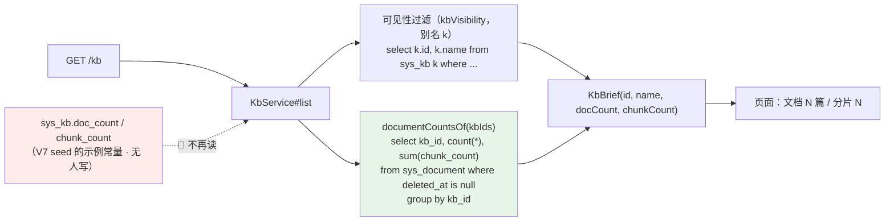

> 状态：🟡 进行中（代码 · 用例已完成；待页面验收）· 结项后缺陷修复 · 阶段 `/kb` 列表文档数归真 **+ 删掉那两个示例列**（`V45`）· 建档 2026-10-12

# 2026-10-12 · 结项后 · 缺陷修复 —— 知识库列表的文档数/分片数改成现算（并删除那两个示例列）

> 任务：**无 `T-xxx`**（结项后缺陷修复）· 来源：用户 2026-10-12 反馈
> 「`http://localhost:5173/#/kb` 这个页面的值是 mock 吗？数据和真实情况对不上」
> 上游：`plan/2026-09-16-S4-M05-A.md` §1 **W3** + §9 第 3 条（该分叉**早已登记**，一直没人销）· `V7__s2_kb_skeleton_and_grants.sql:28`
> 用户裁定（2026-10-12）：① **改代码 · 列表改成现算** ② 追加「**全部都改**」（5 个消费方）
> ③ 追加「**删掉**」—— 把 `sys_kb.doc_count / chunk_count` 两列随 `V45` 一并删除

---

## 1. 开工条件检查

| # | 依赖项 | 档位 | 现状（代码/数据实证） | 结论 |
|---|---|---|---|---|
| 1 | 页面是不是 mock | ✅ | **不是**。dev server（PID 32524）启动于 **10-12 10:32**，晚于 `.env.development`（10-11 22:02，`VITE_USE_MOCK=false`）⇒ mock 中间件没装，`/api` 代理到 8080。旁证：页面 8 个库名与真库逐字一致，而 mock 是**另一套**（`mock/data.ts:269-278`：项目管理制度库 / 销售话术与案例库 / 财务政策与报销库 / 信息安全规范库 / 研发知识沉淀库 / 客户交付资料库…） | 满足（根因在别处） |
| 2 | "对不上"的根因 | ✅ | 列表回显 `sys_kb.doc_count / chunk_count`，而那两列是 `V7:28` 建表时 seed 的**示例常量**（128/42/316/87/23/220/230/200 · chunk 8240/1180/12640/2610/640/4400/4542/4250）；实测 `sys_document` **0 行** ⇒ 页面说"文档 128"而库里 0 篇 | 满足（根因已定） |
| 3 | 那两列有没有写侧 | ⛔ | **没有任何代码写过它们**：`setDocCount` 全仓零调用、无 UPDATE 语句；建库那次是 `KbService:314` 写死的 `0, 0`。唯一"写"它们的是**测试夹具**（`RetrievalFlowSupport:212` / `ReindexFlowTest:347` 手工 `+1` 模拟） | ⇒ 读它必假 |
| 4 | 真数从哪来（同源口径） | ✅ | `DocService#page:346` 已经是现算：`count(*) from sys_document where deleted_at is null and kb_id = ?`，其 javadoc `:324-326` **明确点名**了这列是"示例冗余列"并刻意避开（"知识库列表说 128 篇、这里说 0 篇"） | 满足（照它复制口径） |
| 5 | 可见性过滤不能被破坏 | ✅ | `DataScopeService#kbVisibility` 返回**裸拼进 where** 的片段，且假定别名 `k`；其注释明写"用子查询而不是 join，加 join 会改变调用方 from 形态"。⇒ 本批**不改 from 子句**（计数走独立聚合查询，见 §3.1） | 满足 |
| 6 | 验收手段 | ✅ | `KbModuleFlowTest` 已断言列表 `total`/`size`（未断言计数）；`DocUploadFlowTest:357` 有"total 与 list 都从 `sys_document` 实查"的同族判据可参照 | 满足（新增 1 个类） |

**BLOCKER 汇总**：无
**⚠️ 已知偏差 / 范围变化**：
- 立据时按用户第一轮的裁定**只改知识库列表**；核出「同一个假数还有 4 个读取点」后用户 2026-10-12 追加裁定「**全部都改**」⇒ 本批最终覆盖 **5 个消费方**，并把计数口径收敛到**一个新类** `KbCountReader`（见 §3.1）。只改其中几处会从"库内双答案"变成"**跨页双答案**"，更糟。
- 顺带改了一条**既有验收判据**（`KbWriteFlowTest#storageQuotaMatchesDictionary` 断言 `docCount == 1246`）——它把假数冻成了标准。改为"与 `sys_document` 现货一致"。
- 页面级 E2E 仍未做（设备限制），本次只到契约层 + 真库层。

> 判据只有一条：**这条不满足，代码写下去会不会白写**。

### 结论

- [x] ✅ 可以开工
- [ ] ⛔ 拒绝施工

---

## 2. 开工时间

| 项 | 值 |
|---|---|
| 建档 / 开工日 | 2026-10-12 |
| 预计投入 | 0.3 人天（一处查询 + 一条聚合 + 一个用例类） |
| 实际投入 | 0.3 人天（5 处消费方 + 1 个共用类 + 3 条新用例 + 1 条判据改口径 + 2 处夹具清理；定向 90/90 绿） |

---

## 3. 开工内容

### 3.1 步骤

| 步 | 做什么（文件 → 动作 → 产出） | 依赖 |
|---|---|---|
| 1 | 新增 `service/KbCountReader`：**唯一的计数口径**（`countsOf` / `countOf` / `totalsOfActiveKbs`），按 `sys_document.deleted_at is null` 现算，分片取 `sum(chunk_count)` | — |
| 2 | `KbService#list`：主查询收成 `select k.id, k.name`（**不动 from/where 形态**，见 §1-5），计数走 reader | 步 1 |
| 3 | `KbService#configRowOrDeny`：索引 5/6 由 `k.doc_count/k.chunk_count` **改写为现算值**（保持索引表稳定，不牵动 `diffConfig` 的 `row[13..16]`）⇒ 知识库设置页 + 重建影响预估同时归真 | 步 1 |
| 4 | `KbService#storageQuota`：`sum(sys_kb.doc_count/chunk_count)` → `totalsOfActiveKbs()`；**订正 javadoc 里"上传时维护的投影"那句错话** | 步 1 |
| 5 | `KbGrantService#list`/`#detail`：select 里去掉 `doc_count`，改由 reader 合并 | 步 1 |
| 6 | `KbLifecycleService`：`Row` 缩成 `(id, name)`（那两个字段唯一用途是删除日志）；日志改调 reader 现算 | 步 1 |
| 7 | 新增 `KbListCountFlowTest`（2 条 · **夹具故意把冗余列写成 999/8888**，写 0 的话旧实现也会过） | 步 2 |
| 8 | `KbWriteFlowTest#storageQuotaMatchesDictionary` → `#storageQuotaMatchesDocuments`：**改口径**（与现货一致，不写死 1246/38502）；`impactShapeAndMonotonic` 的基线改成**自己造真文档** | 步 3-4 |
| 9 | 清掉两处**已失效**的夹具维护：`ReindexFlowTest`/`RetrievalFlowSupport` 里 `update sys_kb set doc_count/chunk_count ±N` | 步 3 |
| 10 | 定向回归：KB 七类 + DocUpload + Reindex + 检索降级 | 步 9 |

### 3.2 业务流程图

> 关键点：计数的**唯一来源**是 `sys_document` —— 与库内文档列表、与上传后的实际篇数同源，
> 所以上传/删除文档后各处数字会自己跟着变，**不再需要一个没人维护的冗余列**。
> 五个消费方（知识库列表 / 设置页 / 重建影响预估 / 授权页 / 配额卡）全部经 `KbCountReader`。

### 3.3 明确不做（范围控制）

| 不做的事 | 原因 | 归属批次 |
|---|---|---|
| 给 `sys_kb.doc_count/chunk_count` 补写侧（上传 +1、删除 -1） | 那是"维护冗余投影"的路线，要覆盖上传/删除/软删/恢复/重建/移库**每一条**路径，漏一条就是新的静默漂移；现算没有这个问题 | 不推荐（除非有性能证据） |
| **删掉**那两列（`ALTER TABLE`） | ✅ **本批做了**（用户 2026-10-12 追加裁定「删掉」）：`V45` 删列 + `SysKb` 去字段 + 16 个夹具/脚本去列。它们既无人读也无人写，留着会让人以为有意义 | 已完成 |
| 把 seed 的示例值改成 0 | 治标：读侧不改的话，只是把"128 的谎"换成"0 的谎"（上传后仍是 0） | 不做 |
| 补 seed 文档数据（12 行 + 真实文件） | 属"示例数据字典对齐"另一件事 | 不在本批 |

### 3.4 本批假设

| # | 假设 | 若被证伪的后果 |
|---|---|---|
| 1 | 分片数口径 = 各文档 `chunk_count` 之和 | 若用户要的是 `sys_chunk` 实际行数，需改为按 `doc_id` 数 `sys_chunk`（两者在解析成功时应相等，`DocRecordWriter:707` 回填的就是它） |
| 2 | 只数**未软删**文档；配额侧只算**未软删的库** | 与 `DocService#page`、`T-407` 同口径；若回收站里的文档/库也要计入，需另说 |
| 3 | 每次列表/配额多一条聚合查询可接受 | 库数量级小；若将来库数上千，改成 join 或物化视图 |

---

## 4. 数据变更清单

**`V45__drop_sys_kb_sample_counters.sql`：删除 `sys_kb.doc_count` 与 `sys_kb.chunk_count` 两列。**

| 对象 | 变更 | 说明 |
|---|---|---|
| `sys_kb.doc_count` | **DROP COLUMN** | seed 的示例常量（128/42/316…），无人读也无人写 |
| `sys_kb.chunk_count` | **DROP COLUMN** | 同上（8240/1180/…） |
| `SysKb` 实体 | 删两个字段 | 不删会让 `ddl-auto: validate` 启动失败 |
| `KbService.CONFIG_SELECT` | 移出这两列 | ⇒ **索引 7 及以后整体前移 2**，索引表与全部 `row[N]` 同步改（已逐行核对） |
| 建库 INSERT | 去掉两列 | 原来写死 `0, 0` |
| 测试夹具 / e2e 脚本 | 16 个 Java 类 + `e2e-doc-detail.mjs` | 去掉 INSERT 的列与值；`4` 处 `update sys_kb set <这两列>` 属死维护，直接删 |

⚠️ **数据损失**：seed 的 1246 / 38502 消失。那不是"删了真实数据" —— `sys_document` 里本来
就没有对应的行（`V12` 明确"本表不 seed 任何行"），两个数从来只是 `V7` 的示例展示值。
**回滚**：要恢复得重加列 + 重新 seed，而 seed 值已无从对齐。

⚠️ **顺序**：删列**必须**与"五个消费方改成现算"同批 —— 先删列会让 `KbService` 的
`select k.doc_count` 当场报 `Unknown column`（实测：`DocDetailFlowTest` 一句遗留的
`update sys_kb set chunk_count` 就是这么被逮出来的）。

---

## 5. 依赖与工具决策

无新依赖、无新工具。

---

## 6. 验收判据

| # | 判据 | 落点 |
|---|---|---|
| 1 | 库下 0 篇文档时，列表报 `docCount = 0` | `KbListCountFlowTest#countsArePerKbAndTrackSoftDelete` |
| 2 | 两个库各自计数互不串（不分组的实现会红）+ 软删的不计入（漏 `deleted_at is null` 会红） | 同上 |
| 3 | 🔴 **`sys_kb` 上不再有那两列**（查 `information_schema`）⇒ 谁加回来当场红 | `KbListCountFlowTest#sampleCounterColumnsAreGone` |
| 4 | 配额的文档数/分片数 = `sys_document` 现货（**不再等于写死的 1246 / 38502**） | `KbWriteFlowTest#storageQuotaMatchesDocuments` |
| 5 | 重建影响预估的基线来自真文档：自造 300 分片 → 参数不变时 `chunkAfter == 300`、窗口减半则翻倍 | `KbWriteFlowTest#impactShapeAndMonotonic` |
| 6 | 列表的可见性/分页/筛选不变；设置页 / 授权页 / 解析配置页字段不变 | `KbModuleFlowTest` 12/12 · `KbGrantFlowTest` 8/8 · `KbWriteFlowTest` 12/12 · `DocParseFlowTest`(定向) |
| 7 | 迁移可应用且实体校验通过（应用启动即为判据） | `V45` 实测 `Successfully applied 1 migration … now at version v45` |

> ⚠️ 判据 1/2 的夹具**故意造两个库**：原先的"把冗余列写成 999/8888"随删列失效了，
> 换成分组隔离 + 软删过滤两把更有牙齿的锚。

---

## 7. 验证方式

| 步 | 命令 / 动作 | 期望 |
|---|---|---|
| 1 | `mvn -o test -Dtest=KbListCountFlowTest` | 2/2 绿（**含 V45 首次应用**） |
| 2 | `-Dtest='KbModuleFlowTest,KbWriteFlowTest,KbGrantFlowTest,KbDeleteFlowTest,RecycleFlowTest,UserAdminFlowTest'` | **59/59 绿** |
| 3 | `-Dtest='DocDetailFlowTest,DocVersionFlowTest,DocWriteFlowTest,DocReindexGuardFalsifyTest,DocRollbackFlowTest,ParseQualityFlowTest,S2AuditFlowTest,AuditChangeContractTest,DeptServiceTest,ReindexFlowTest'` | **84/84 绿** |
| 4 | `-Dtest='RetrievalDegradeFlowTest,RetrievalScopeFlowTest,TableLookupFlowTest,HybridRetrievalFlowTest,RetrievalTraceBeforeTop1FlowTest'` | **27/27 绿** |
| 5 | `-Dtest=DocUploadFlowTest`（**单独跑**，见 §9-6） | 15/15 绿 |
| 6 | 重启后端 → 打开 `/kb` | 8 个库的「文档」全部显示 **0**；下载页配额卡 / 设置页 / 授权页同为 0 |
| 7 | `docker exec kb-mysql mysql … -e "show columns from sys_kb"` | **无** `doc_count` / `chunk_count` |

---

## 8. 交付物

| 文件 | 动作 |
|---|---|
| `service/KbCountReader.java` | **新增** —— 唯一的计数口径（3 个方法 + `Counts` 记录） |
| `service/KbService.java` | `list` / `config` / `impact` / `storageQuota` 归真 · `CONFIG_SELECT` 去两列并**重排索引** · 建库 INSERT 去两列 · 订正 `storageQuota` 的错 javadoc |
| `service/KbGrantService.java` | `list` / `detail` 去掉 `doc_count`，改走 reader |
| `service/KbLifecycleService.java` | `Row` 缩成 `(id, name)`；删除日志现算 |
| `service/DocService.java` | javadoc 同步（那两列已删） |
| `entity/SysKb.java` | 删两个字段 + 留下一段"不要加回来"的说明 |
| `db/migration/V45__drop_sys_kb_sample_counters.sql` | **新增**（删列 + 记为什么） |
| `test/.../service/KbListCountFlowTest.java` | **重写**（3 条：分组隔离 / 软删过滤 / `information_schema` 断言列已删） |
| `test/.../KbWriteFlowTest.java` · `ReindexFlowTest.java` · `pipeline/retrieve/RetrievalFlowSupport.java` · `DocDetailFlowTest.java` | 夹具去列 / 清死维护 / 估算判据自造真基线 |
| 其余 12 个测试类 + `ai_knowledge_app/scripts/e2e-doc-detail.mjs` | 夹具 INSERT 去列 |
| `plan/README.md` · `汇总.md` | 索引与总览各加一行 |

---

## 9. 遗留与风险

| # | 事 | 现状 | 归属 |
|---|---|---|---|
| 1 | ✅ **原登记的 4 个读取点已全部归真**，且两列**已删除** | 生产代码里再没有"读那两个假列"的地方（也没有那两个列了） | 已销 |
| 2 | ⚠️ **页面级验证未做** | 无浏览器自动化；本次到契约层 + 真库层 | 与 `S6-M09-A` 判据 13 同一笔账 |
| 3 | 🔴 **本批逮到一条"假数反向长进测试"的连锁** | `ReindexFlowTest` 与 `RetrievalFlowSupport` 的夹具**主动维护** `sys_kb.chunk_count`（理由写"`impact` 拿它当基线"），`DocDetailFlowTest` 也有一句；`KbWriteFlowTest` 的配额判据把 1246/38502 写死（理由"与示例数据字典一致"）。⇒ 假数据一旦被当成基线，就**把实现绑住了**。已全部清理 | 已处理 + 记入本节 |
| 4 | ⚠️ `sys_kb.chunk_count` 与 `sys_document.chunk_count` 的**口径差异** | 后者是 `DocRecordWriter:707` 回填的**顶层块**数（不含表格子块）。本批取后者求和 | 若检索侧要的是含子块的总数，需另立 |
| 5 | ⚠️ **`#128`「解析作业未被领取执行」偶发族（既有，与本批无关）** | 本批跑 `DocParseFlowTest` 时红 3/22，症状 `expected "INDEXING"/"FAILED" but was "UPLOADED"`（`drainOnce()` 没领到作业），**两次跑红的三个方法不同**；把那三个方法**单独挑出来跑 3/3 全绿**。🔴 **这不是本批引入** —— `汇总.md` §3 的 **`#128`** 已登记同一现象（"失败方法每次不同"，并明记**已在改动前代码 `aed775d` 上复现**，`DocParseFlowTest` 两次都 5/22 红），机制未查明、未销账。⚠️ 同族的还有 `S9-M13-A/B` 记的「端到端取证与全量回归不能同会话混跑」（`SingleAsyncConsumerGuardTest` 要求 8080 无后端） | **独立小批（测试可靠性）** —— 本批只在计划里留痕，不修 |
| 6 | ⚠️ **本批报数按"小组跑"给，不报全量** | 因为 `#128` 与混跑约束的存在，把十几个类塞一次 surefire 调用会出**假红**（实测：`DocUploadFlowTest` 混跑红 2、单跑 15/15） | 与 `#128` 同批 |

