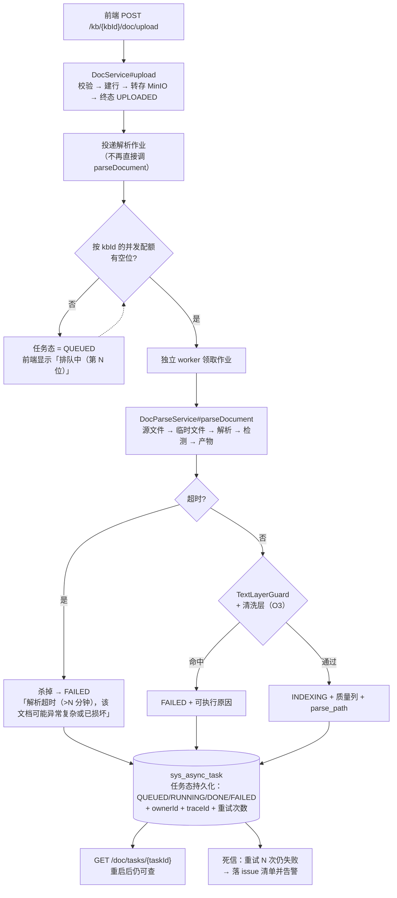

> 状态：✅ 已完成（`S4-E1`，2026-09-17 · **降级版**，见下）· 优先级 **P0** · 预估 5 人天 · 依赖：无
>
> ⚠️ **交付时的两处范围收窄 + 两处实物订正**（全文 `plan/2026-09-17-S4-E1.md`）：
> ① **worker 取「同 JVM、独立线程池 + 有界队列」**（用户 2026-09-17 裁定）→
>    痛点 #2 的 **OOM 隔离本批没解决**，登记为遗留；
> ② **步 5 的「整篇 wall-clock 超时」只做了一半** —— 等锁超时已落地，强杀运行中的解析线程
>    在同 JVM 下做不到（与 ① 同一限制）；
> ③ **订正 `:14`**：「一把 `ReentrantLock`（`PdfDocumentParser.java:55`）」**实物不是** ——
>    那是 `private static final Object LOCK` + `synchronized (LOCK)`，`synchronized` **没有 `tryLock`**，
>    照原文写会编译不过。本批已把它**换成** `ReentrantLock` 才实现了超时；
> ④ **订正步 2**：「新增 QUEUED 态」—— `AsyncTaskStatus.PENDING` 的 label **本来就是「排队中」**，
>    复用即可，不加同义词。

# O1 · 解析执行架构解耦

## 1. 优化什么

把**解析**从 Web 进程的 `ak-task-*` 线程池里搬出去，成为**独立 worker**；
同时补齐三件现在完全没有的东西：**逐任务超时**、**按知识库的并发配额**、**任务态持久化**。

## 2. 痛点（现状实证）

| # | 现状 | 后果 |
|---|---|---|
| 1 | ~~`PdfDocumentParser` 一把 `ReentrantLock`（`PdfDocumentParser.java:55`），**全局串行**~~ ⚠️ **订正**：实物是 `private static final Object LOCK` + `synchronized (LOCK)`（`Object` **没有 `tryLock`**，见文件头订正 ③）。全局串行的性质不变 | 并发上传时解析全部排队。`T-513` 文件夹批量导入落地后，一个库几千篇 = **数小时**，期间所有人的单篇上传一起等这一把锁 |
| 2 | 解析跑在 `ak-task-*`（core=4/max=8，`AsyncConfig.java`），与 Web 请求**共享同一个 JVM 与堆** | PDFBox/opendataloader 的 OOM **直接打死 API 进程** —— 解析和在线服务是最不该共享堆的两件事 |
| 3 | **无 wall-clock 超时** | 一个畸形 PDF 能占住那把锁无限久 → **整个解析队列停摆**，且没有 kill 手段 |
| 4 | 100MB 源文件要**落临时文件**（opendataloader 只吃路径），`parse.json` 用 Jackson 全量 `writeValueAsBytes` / 全量 `readTree` | 单篇解析峰值内存 ≈ 源文件 × 2~3；`sys_parse_issue` 无行数上限，2000 页扫描件 = 2000 行 |
| 5 | `CallerRunsPolicy`（`AsyncConfig.java`） | 队列满时**反压到 HTTP 请求线程**：用户看到的是"上传卡住"，不是"排队中"。语义上是把容量问题转嫁给了用户 |
| 6 | 任务态若在内存（`AsyncTaskService`） | 重启即丢，`GET /doc/tasks/{taskId}` 返回 `10045`，用户无法知道"刚才那篇到底怎么了" |

> 一句话：**现在的解析"能跑通"，但它的失败模式是「整站一起慢、一起死、且说不出为什么」。**

## 3. 业务流程

## 4. 做法

| 步 | 做什么 | 为什么这样切 |
|---|---|---|
| 1 | **任务态落库** `sys_async_task`（`task_id` / `type` / `status` / `owner_id` / `trace_id` / `stage` / `percent` / `attempt` / `error_msg` / `created_at` / `updated_at`） | 这张表是后面所有事的地基：配额、重试、审计（O6）都要读它 |
| 2 | **新增 QUEUED 态**（`DocStatus` 不新增，用任务态承载）⚠️ **订正**：`AsyncTaskStatus.PENDING` 的 label 本来就是「排队中」，**直接复用**，不加同义词 | 文档状态机是"用户可见的生命周期"，排队属于"任务调度"，两者不该混在一个枚举里 |
| 3 | **worker 独立进程**：新增 `ParseWorkerApplication`（同仓库第二个 `main`），只加载解析所需依赖（MinIO + MySQL + Jackson + opendataloader + Tika），**不加载 Web/Security/Neo4j/Milvus** | 内存隔离；OOM 打死的是 worker，API 继续服务 |
| 4 | **领取式消费**：`select ... for update skip locked` 从 `sys_async_task` 领 RUNNING | 不用引入 MQ（Redis 已有 → 也可用 Stream，但表驱动更简单且天然持久） |
| 5 | **超时**：`parseDocument` 外层包 `Future.get(timeout)` + 超时中断；PDF 路径的 `ReentrantLock` 换成**带超时的 `tryLock`** | 超时必须有可执行文案（`G4-3`）："解析超时（超过 5 分钟），该文档可能已损坏或异常复杂，请确认后重试" |
| 6 | **配额**：按 `kbId` 的并发上限（默认 2）+ 全局上限（默认 = worker 线程数） | 一个库的批量导入不能饿死其他人的单篇上传 —— 这正是现在 `CallerRunsPolicy` 做不到的事 |
| 7 | **重试与死信**：可重试错误（基础设施类）退避重试 3 次；不可重试错误（无文本层、GBK、超限）**直接终态** | 区分"我们的问题"与"文档的问题"——对用户撒谎说"重试中"比直接说"这文件不行"更糟 |
| 8 | **内存**：产物超过阈值（建议 8MB）改流式写 MinIO，不再 `writeValueAsBytes` 全量驻留 | 批量导入时这是真实的内存事件 |
| 9 | **`sys_parse_issue` 聚合**：单文档超过 N 行（建议 200）时只存前 N 行明细 + 一条 `其余 M 页同类问题` 汇总行 | 接口截断 100 只解决了响应大小，没解决表增长 |

> **不引入 MQ 的理由**：这个规模用不到 Kafka/RabbitMQ 的吞吐，而它们的运维成本与"任务态要查得到"的需求（`GET /doc/tasks/{taskId}`）并不匹配。表驱动 + `skip locked` 是 PostgreSQL/MySQL 上的成熟范式，且**天然持久化**。

## 5. 验收判据

| # | 判据 | 方法 | 期望 |
|---|---|---|---|
| 1 | worker 独立可启动、可水平扩 | `java -jar` 起两个 worker 实例 | 两实例互不冲突，各自领到作业 |
| 2 | 超时真的会 kill | 造一个超大/畸形 PDF | 到时抛 `FAILED` + 超时文案；**锁被释放**，后续作业继续 |
| 3 | 配额生效 | 同一 kb 并发投 10 篇 | 在跑 ≤ 2；第 3 篇起 `QUEUED`；**另一 kb 的单篇不被阻塞** |
| 4 | worker 重启不丢任务 | 起 worker → 处理中 kill -9 → 重启 | 未完成任务回到 `QUEUED` 被重新领取 |
| 5 | API 不受解析影响 | 解析 100MB 期间持续打 `GET /health` | P95 不劣化；worker OOM 时 API 存活 |
| 6 | 任务态可查 | `GET /doc/tasks/{taskId}`（进程重启后） | 仍返回正确 `stage/percent/errorMsg` |

## 6. 不做 / 风险

| 项 | 说明 |
|---|---|
| ❌ 不引入 MQ | 见上；若将来要"跨服务扇出"再评估 |
| ❌ 不做分布式锁/选主 | 表驱动 `skip locked` 已够；worker 无状态 |
| ⚠️ 风险：worker 与 API **共用一套代码** | 用 `@Profile` / 独立 `main` 控制装配，**不要复制粘贴解析代码** —— 两处实现必然漂移 |
| ⚠️ 风险：现有 `DocService#upload` 的任务体要拆 | 现在是"转存 + 解析"同一任务体（`DocService.java:169-209`）。拆分后**上传终态回到 `UPLOADED`**，`INDEXING` 由 worker 写入 —— 这会动到 S4-A/S4-B 的既有用例（`DocUploadFlowTest` 判据 17 的状态采样、`e2e-doc-parse` 的等待条件），需同批改夹具 |
