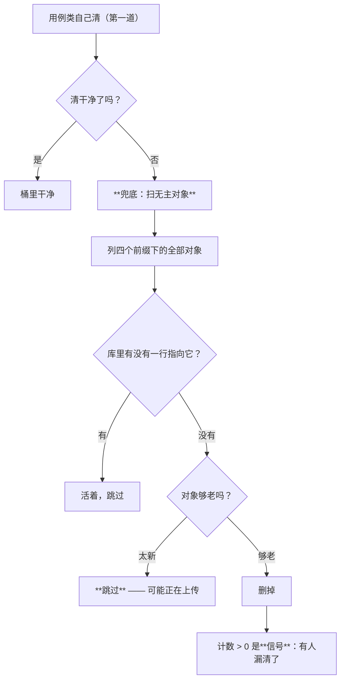

> 状态：🟢 **已登记入册** · 建档 2026-09-18 · 来源：`S6-M05-C` §9 的 `#190` + `#194`（用户 2026-09-18 裁定收进 O 目录）

# `O10` · 探针产物兜底（**用户裁定收进 O 目录**）

## 1. 优化什么

**让"某一类产物被漏清"从"永久累积"变成"多一次 DELETE"。**

具体是**一层兜底**：Java 用例侧（`mvn test`）目前对 MinIO 对象**没有任何兜底** ——
只有"每个用例类各自删自己造的那些"。本方案补一层与归属无关的观测点 + 删除。

## 2. 痛点（现状实证）

### 2.1 「每个类自己清」这条约定**已被证明会漏**

`#130` 的原话：实测有十余个用例类各写一份 `cleanProbeData`，其中 `DocUploadFlowTest` 那份
删了 5 张表、**唯独漏 `sys_async_task`** —— 一轮全量留下 **76 行**，而它们因为 `sys_kb` 行先被删，
**在库里谁也看不见**。

SQL 侧后来补了 `ProbeCleanup#sweepOrphanKbArtifacts`（"不问'你清了没有'，只问'库里还剩不剩无主的东西'"）。
**MinIO 侧没有对等物。**

### 2.2 Java 侧现状：四个前缀、四份手写清理、零兜底（2026-09-18 实测）

| 前缀 | 归属列 | Java 侧现在谁删 |
|---|---|---|
| `documents/{kbId}/{docId}/…` | `sys_document.storage_path` | `ParseWorkerFlowTest` · `DocParseFlowTest` **各写一遍** `removeObject` |
| `parsed/{kbId}/{docId}/…` | `sys_document.parse_path` | 同上两处 |
| `chat-attachments/{userId}/…` | `sys_chat_attachment.object_key` | `ChatAttachmentFlowTest` 自己删 |
| `avatars/{userId}/…` | `sys_user.avatar` | **没人删**（`#78`：每轮各涨 1 个） |

⚠️ **四份手写**这件事本身就是 `#130` 判定的那个形状。

### 2.3 脚本侧的同类已修，**Java 侧没有对等物**（本方案的直接动机）

`S6-M05-C` 修了脚本侧的 `#163`（问答附件按 `userId` 前缀收）与 `#187`（超时判据变红）。
**同一类问题在 Java 用例侧原样存在。**

### 2.4 代价是实测过的

- `#78`：`avatars/` 与 `audit-export/` **每轮各涨 1 个**；
- `S4-M05-C2` 实测：桶里攒到 **1030 个**对象，而 `storage-quota` 会**全桶递归列举** ⇒
  读超时 ⇒ **把毫不相干的 `KbWriteFlowTest` 拖红**（现象离原因极远）；
- `S6-M05-C` 实测：`chat-attachments/689/` 下 **10 个对象、DB 0 行**（全是历轮 E2E 漏下的）。

### 2.5 🔴 **量"桶里有几个对象"要用客户端，不要 `ls` 数行**（本方案施工时踩到）

施工中我按 `ls -1R /data/rag-documents/documents | wc -l` 读出 **523 行**、
`parsed/` **382 行**，合起来报了个"**905 个孤儿对象**"，并据此发起了一次
**不可逆批量删除**的请示（用户未答）。

**用兜底自己那个客户端一量：四个受覆盖前缀全是 0。** 差**两个数量级**。

根因：**MinIO 删掉对象后不修剪空目录** ⇒ `documents/1002xxx/…` 这些**空壳目录**照样被 `ls` 列出来。
（本轮真实数据：`documents/` `parsed/` `avatars/` `chat-attachments/` 各 **0 个对象**；
`audit-export/` **121 个** —— 而那正是本方案**故意不覆盖**的那个前缀，理由见 §6。）

**判据**：**用与删除同一个工具去量** —— `listObjects` 说什么才算什么。
与 `#136`「闸说干净与真的干净是两件事」是同一条纪律的又一次现身：
这一次是**"观测工具与被观测对象不是同一个"**。

⚠️ **这条差点造成实际损失**：那个错数字把"清理一点垃圾"升级成了
"要不要删 905 个对象"的决策 —— **错误的量测不只给错结论，还会给错量级的结论**。

## 3. 业务流程

**「够老吗」那一跳是本方案唯一的防误删机制**，理由见 §4 步 3。

## 4. 做法

### 步 1 · 一个与归属无关的观测点

判据照 `sweepOrphanKbArtifacts` 那条走：**不问"你清了没有"，只问"桶里还剩不剩无主的东西"**。

### 步 2 · 覆盖四个前缀（**一次收口一整类，不一个一个补**）

只在 `documents/` 上做等于把同一个坑留给另外三个 —— 而本仓已经为"一处一处补"付过四次学费。

### 步 3 · 🔴 **必须带时间下限**（防误删唯一的一跳）

**上传路径是"先落桶、后落行"**：
- `ChatAttachmentService#upload`：`storage.store(...)` → 再 `repository.save(row)`；
- `DocStorage` 同族（`store` 先 PUT，行由调用方写）。

⇒ "对象在、行不在"在**上传进行中**是**正常状态**。
不带时间下限的话，兜底会把**正在上传的对象删掉** —— 那是**用一个防残留的机制制造数据丢失**，
与本仓「闸必须放在建探针之前」那条是同一条纪律（用防残留的闸制造残留）。

⚠️ 阈值要**可传参**：生产默认取一个足够大的值（分钟级），用例传 `Duration.ZERO`
—— 否则这个兜底**没法被用例验证**，而"没被验证的兜底"与"没有兜底"在证据上是同一件事。

### 步 4 · 接进用例基座的收尾

与 `sweepOrphanKbArtifacts` **同一处**（`ApiTestSupport#@AfterEach`）—— 两处分开会各自演化。
⚠️ **成本如实说**：每用例一次 `listObjects`。本仓测试环境的桶**通常是空的**（基线 0 对象），
所以实际是一次往返；但它**随桶内对象数线性增长**，量大了要改成"每类一次"。

### 步 5 · 计数 > 0 要**可见**

≥0 不报等于白扫。与 kb 族同一条：**它是信号，不是正常现象**。

## 5. 验收判据

| # | 判据 | 验收方法 | 期望结果 |
|---|---|---|---|
| 1 | **无主对象能被扫出来并删掉** | 造一个对象（四个前缀各一个）+ **不造** DB 行 → 跑 sweep | 四个都被删；返回计数 = 4 |
| 2 | **有主对象一个都不能碰** | 造对象 + 造对应 DB 行 → 跑 sweep | 对象**还在**；计数 = 0 |
| 3 | 🔴 **负向锚：没有"有主保护"就会误删** | 临时去掉 DB 行检查 → 重跑判据 2 | 判据 2 **转红** |
| 4 | 🔴 **负向锚：没有"时间下限"就会误删在途对象** | 造一个"刚上传、行还没写"的对象 → 用**默认阈值**跑 sweep | 对象**还在**（被判为"可能正在上传"） |
| 5 | **计数 > 0 时可见** | 判据 1 的那一轮 | 计数被报出来（不是静默） |
| 6 | **四个前缀全覆盖** | 逐个前缀断言 | 全中 |
| 7 | **实测残留在收尾后归零** | 跑一轮全量 `mvn test` 前后各查一次桶 | 前后一致（增量 0） |

## 6. 不做 / 风险

| 项 | 结论 |
|---|---|
| **不做**：把生产代码加一个 `listObjects` 供测试用 | ❌ 生产代码不该为测试长出能力。兜底是**测试侧**的关切（`S4-D2` 的 `probe-teardown` 同理，它是脚本侧独立的） |
| **不做**：`audit-export/` 前缀 | 它的归属列不存在（`#78` 已登记），**要等它有归属列才能判无主** —— 与 `#194` 同族 |
| ⚠️ **风险**：误删在途对象 | 由 §4 步 3 的时间下限挡住；**判据 4 就是钉它的** |
| ⚠️ **风险**：扫描成本随桶增长 | 已声明（§4 步 4）；到量了改成"每类一次"。**现在不改**——在没有量的地方做优化是本末倒置 |
| ⚠️ **边界**：只覆盖"有归属列的前缀" | 没有归属列的对象**结构上判不了无主**（`audit-export/` 就是）。这条边界要写进代码 javadoc，否则下一个人会以为"兜底 = 全桶都管" |
| **`#194`**（更早轮次的孤儿查不到） | 本方案的兜底是**扫全前缀**，天然不受"只查本轮快照"的限制 ⇒ **顺带解掉 `#194`** |

## 7. 与其它 O 项的关系

- 与 `O7`（存储寻址与生命周期）：`O7` 回答"**留存规则是什么**"，本项回答"**探针的残留怎么兜底**"。
  两者不重叠 —— `O7` 是产品口径，本项是测试可靠性。
- 与 `S4-D2` 的 `probe-teardown`：**脚本侧 vs Java 用例侧**，同一条纪律的两个落点。
  本项是 Java 侧那个缺位对等物的补齐。
