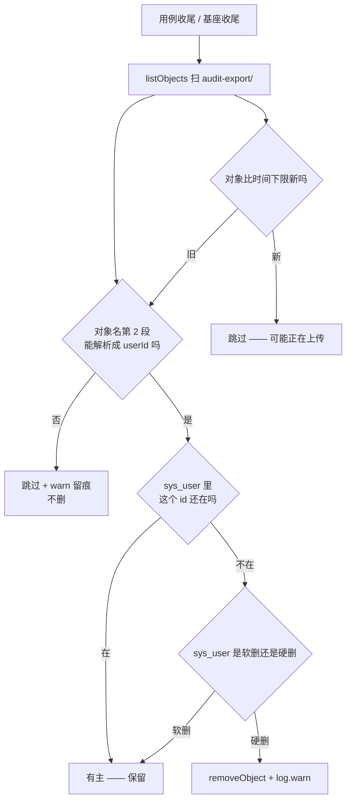

> 状态：🟢 **已登记入册** · 建档 2026-09-19 · 来源：`S6-M09-C` §9 的 `#228`（用户 2026-09-19 裁定先登记成 `T-O11` 再动手）

# `O11` · `audit-export/` 兜底（**最后一个没有兜底的前缀**）

## 1. 优化什么

**让 MinIO 的第六个前缀也能被兜底扫到。**

`O10` 给四个**有归属列**的前缀装上了兜底（`ProbeCleanup#sweepOrphanMinioObjects`），
并在 javadoc 里明确写下边界：

> **只覆盖"有归属列的前缀"。** 没有归属列的对象**结构上判不了无主** ——
> `audit-export/` 就是（`#78` 已登记：它没有归属列）。

本方案要动的是**那句"结构上判不了"**。查完之后结论是：
**`#78` 说的"没有归属列"是对的，但"判不了无主"是错的** ——
归属不在**列**里，而在**对象名的路径里**。

## 2. 痛点（现状实证）

### 2.1 实测：它是唯一还在涨的前缀（2026-09-19）

逐前缀用**客户端**（`listObjects`，不是 `ls`）数真对象：

| 前缀 | 真对象 | 有兜底吗 |
|---|---|---|
| `documents/` · `parsed/` · `chat-attachments/` · `avatars/` · `images/` | **各 0** | ✅ `T-O10` 四前缀 + `images/`（`T-512`） |
| **`audit-export/`** | 🔴 **137**（Sep 15~19 **每天都有**） | ❌ **没有** |

⇒ 「**MinIO 五个前缀真对象 0**」这句话**是对的但不完整**：
清理清单是个**白名单**，白名单外的产物没人管，而闸照样绿（`#149` 那个形态的又一次复现）。

### 2.2 为什么它每轮都涨：**清了任务行，没清对象**

`AuditQueryFlowTest#cleanExportTasks`（`AuditQueryFlowTest.java:91-97`）：

```java
for (String taskId : exportTaskIds) {
    jdbc.update("delete from sys_async_task where task_id = ?", taskId);
}
```

**任务行回 0，桶里的 CSV 一份不少。** 于是 `sys_async_task` 的基线永远是 0（看着干净），
而 `audit-export/` 单调上涨 —— **闸只看库、不看桶，所以这件事结构上不可见**。

### 2.3 🔴 为什么"加一列"这条路走不通（**本条是本方案的根据，别省**）

`#78` 记的是"它没有归属列"，读起来像"当初没设计"。**查完代码发现不是**：

`SysAsyncTaskRepository#find`（`SysAsyncTaskRepository.java:254`）的注释原文：

> ⚠️ `result` **不持久化**（它是任务体内的对象，无法通用地序列化）。
>    重启后拿到的 result 为 null

而 `objectKey` 只存在于 `AuditExportService#submit` 写进 `context.complete(payload)` 的那个 `payload` 里
（`AuditExportService.java:115-123`）。**任务一结束，`objectKey` 在全库就再也没有落点了。**

⇒ 三条推论，每条都改变做法：

1. **加列不是"顺手加一列"** —— 要新列/新表 + 迁移 + 决定"导出文件的生命周期归谁管"；
2. **任何"事后找回导出文件"的能力现在都不存在** —— 页面上给的 24h 预签名 URL 一过期，
   那份 CSV **谁也提不动**（`fileUrl` 也是同一个 payload 的一部分）；
3. 但 **`objectKey` 的构成里带着归属**：`AuditExportService#store`（`AuditExportService.java:144`）

```java
String objectKey = PREFIX + userId + "/" + LocalDateTime.now().format(STAMP) + "-audit.csv";
```

⇒ **`audit-export/{userId}/…` —— 路径的第 2 段就是 `userId`。**

> **方法学**：`#78` 那条登记**没有被推翻，是被拆开了** ——
> "没有（DB 的）归属**列**"✔ · "因此判不了无主"✘。
> 这与 `S6-M05-C2` §8 那两条"遗留条目的前提会过期，核实比修更值钱"是同一件事。

### 2.4 代价

与 `O10` §2.4 同一条链：桶里对象多了 ⇒ `storage-quota` **全桶递归列举** ⇒ 读超时 ⇒
**把毫不相干的用例拖红**（`S4-M05-C2` 实测：攒到 1030 个对象时命中过）。
另外 `audit-export/` 装的是**审计日志 CSV**（含操作人、IP、变更前后值）——
**无 TTL 地永久留在对象存储里**，本身是一条**留存规则缺口**（见 §6）。

## 3. 业务流程



> ⚠️ 图里那个 `G` 分支**不是装饰** —— `O10` §3 已经证明"时间下限是防误删**唯一**的一跳"，
> 本方案**继承同一条**（上传路径是先落桶后落行）。

## 4. 做法

### 步 1 · 归属不进 SQL，改进**路径解析**

`ProbeCleanup` 现在的 `MINIO_PREFIXES` 是 `{前缀, 表, 列}` 三元组，
本方案把它扩成**两类**：

| 类型 | 判据 | 前缀 |
|---|---|---|
| `COLUMN`（`O10` 已有） | `select count(*) from {表} where {列} = 对象名` | 那五个 |
| **`PATH_USER_ID`（本方案新增）** | **对象名第 2 段 → `sys_user.id` 是否存在** | `audit-export/` |

### 步 2 · 判据必须**先确认删除语义**（⚠️ 动手前先查）

`sys_user` 到底是**硬删**还是**软删**，决定 `PATH_USER_ID` 比的是
`id 存在` 还是 `deleted_at is null`。

> 本仓先例：`#187` 的追根发现**生产删库是软删**（文档/分片/分区全保留）⇒ 那个守卫是
> "为一条不存在的流程写代码"。**同一个坑不要再踩一次**：查清楚再写。

### 步 3 · 根因那一半：`AuditQueryFlowTest` 收尾**连带删对象**

兜底是第二道。第一道是**造它的地方自己清**（`#130` 的教训：只靠兜底 = 把清理成本常态化）。

⚠️ 对象名**不在行里**（§2.3），所以只能在**删任务行之前**按
`audit-export/{userId}/` 前缀 + **本轮时间下限**去收，且**必须放在必走路径上**
（`O10` 的同一条纪律：放 `step()` 里、放 `finally` 之外，中途失败就不执行）。

### 步 4 · 计数 > 0 要**可见**

`> 0` 是**信号**（说明有类漏清了），`log.warn` 要带上前缀与对象名 —— 与 `O10` 同款。

## 5. 验收判据

| # | 判据 | 方法 | 期望 |
|---|---|---|---|
| 1 | **只删无主的**（负向锚是重点） | `OrphanMinioSweepTest` 新增两条：造 `audit-export/{不存在id}/x.csv` ⇒ 必删；造 `audit-export/{真实id}/x.csv` ⇒ **必留** | 两条都过 |
| 2 | 测试侧不再往桶里留 | 跑 `-Dtest=AuditQueryFlowTest` **前后**各数一次 | **增量 0** |
| 3 | 存量 137 个**不动** | 同上 | 报实际值并说明为什么不动（§6） |

## 6. 不做 / 风险

| 不做 | 原因 |
|---|---|
| **加 DB 归属列 / 落 `objectKey`** | `result` 不持久化是**通用**设计（不是导出的特例）⇒ 改它要动 `AsyncTaskService` 的序列化契约 + 迁移 + 留存口径，是另一个设计决定 |
| **手工清掉现存 137 个** | 它们的归属（`admin`）**真的存在** ⇒ 兜底判"有主"是**对的**，不该删。真要清 = O7 的 TTL 规则或人工 |
| **`audit-export/` 的 TTL / 留存规则** | 属 `O7` 的规则表口径（§2.4 那条留存缺口）—— 本方案只做**兜底**，不替它定 TTL |

**风险**：`PATH_USER_ID` 的归属是**约定**（路径第 2 段），不是**约束**。
⇒ 一旦有人改了 `store()` 的对象名格式，兜底会**静默失效**（扫不到任何"有主"的对象 →
判成无主 → **把真实导出删掉**）。

🔴 **对策（必做，不是"建议"）**：在 `store()` 与 `MINIO_PREFIXES` 两处写**互相指认**的注释，
并**加一条用例断言对象名前缀与解析器对得上**（拿 `AuditExportService` 真产出的 key 去喂解析器）。
这与 `#202`/`#203`「新增 MinIO 前缀只有 javadoc 在管，已经被抓过一次」是同一条教训：
**约定要有机器检查，光写注释一定会漏。**

## 7. 与其它 O 项的关系

- **它是 `O10` 的补完**：`O10` 交付了"有归属列的前缀"的兜底，并**显式留下了 `audit-export/` 这个缺口**；
  本方案补的就是那个缺口，且**沿用 `O10` 的全部纪律**（时间下限 / 客户端计数 / `>0` 是信号）。
- **它属用户 2026-09-18 裁定要收进 O 目录的那一类**：「测试/清理基础设施」
  （先例 `T-O10`）—— 而不是"评审认为该补的能力"。
- **不替代 `O7`**：`O7` 定**规则**（该留多久），`O11` 只做**兜底**（漏了的怎么扫出来）。
