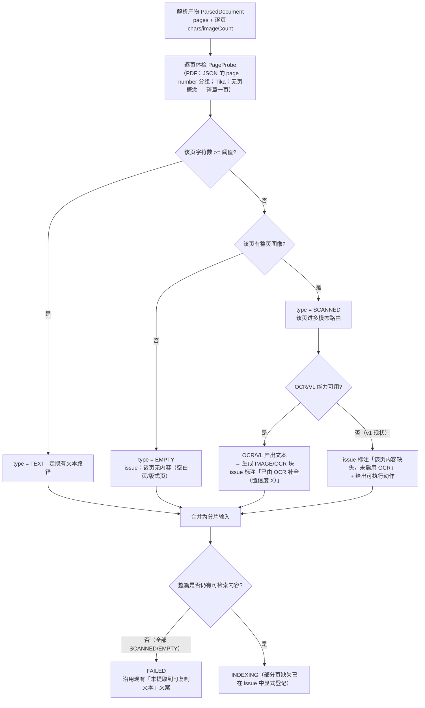

> 状态：⬜ 待认领 · 优先级 **P0** · 预估 4 人天 · 依赖：O1

# O2 · 页级文本层与多模态路由

## 1. 优化什么

把「无文本层」判定从**文档级**下沉到**页级**，并把 OCR / VL 从"整篇要不要开"变成**逐页的路由决策**。

## 2. 痛点（现状实证）

现在 `TextLayerGuard.check`（`TextLayerGuard.java:51`）的判据是**整篇**：`chars == 0` 或（`pages >= 2` 且 `chars/页 < 20`）。

这挡住的是"整篇扫描件"（21.8MB → 0 字 → `FAILED`，S4-B 的 P0 项，做得对）。它挡不住的是**混合型文档**：

| 场景 | 现状结果 |
|---|---|
| 40 页合同：38 页有文本层 + 2 页是盖章后的扫描插入页 | 平均值很高 → **guard 放行 → 状态 `INDEXING`**；那 2 页内容**永远搜不到** |
| 正文 + 一页扫描的资质附件 | 同上 |
| 有密码但允许打开、被限制复制文本的 PDF | 解析出空内容 → 落到同一条静默路径 |

`sys_parse_issue` 里**确实会**产出"该页未提取到任何可复制文本（疑似整页扫描图）"这类行 —— 但那是**可见**，不是**被解决**：没有路由、没有兜底、用户看到告警也不知道自己丢了 5% 的内容。

> 《02-需求总览》把「**静默降级视为缺陷**」写成验收口径第一条。**这个形态恰好是它**：文档报告 `INDEXING`/`READY`，而部分内容不在索引里，且没有任何环节告诉用户"这 2 页不在"。

## 3. 业务流程

## 4. 做法

| 步 | 做什么 | 说明 |
|---|---|---|
| 1 | `ParsedDocument` 增加**逐页指标** `PageStat(pageNo, chars, imageCount, kind)` | PDF 侧 opendataloader 的 JSON 元素树**已经带 `page number`**（`PdfDocumentParser` 已在读它算 `pageNo`），按页分组即可，**不需要重新解析** |
| 2 | `TextLayerGuard` 增加页级判据，**文档级判据保留为兜底** | 两层判据的关系：文档级 = 「整篇不可用则失败」；页级 = 「部分不可用则登记并路由」。**保留文档级**是因为它已经证明了价值（挡住 21.8MB 空产出） |
| 3 | `ParsedDocument.DocumentIssue` 增加 `kind` 与 `disposition`（`MISSING` / `OCR_FILLED` / `EMPTY_PAGE`） | 让 issue 从"通知"升级为"**处置记录**"—— 这是企业知识库该有的粒度 |
| 4 | 抽取 `PageContentRouter` 接口（`route(PageStat) -> PageAction`），v1 实现为 `NoOpRouter`（只登记不处理） | **路由位先留、能力后接**：v1 口径"OCR 不做"不变，但代码形状支持 S6 的 `T-512`/`T-907` —— 接 VL 模型时只换实现，不动管线 |
| 5 | 前端 `KbUploadView` 告警条与文档列表：区分「内容缺失（未处理）」与「已补全」两种标记 | 现在只有一种红色告警，用户无法判断"这问题要不要管" |
| 6 | 文档级 `chars` 口径不变（仍是**已提取到的**文本量），但**新增** `pagesWithText / pagesTotal` 进质量列 | "40 页里 38 页有文本"比"平均 300 字/页"信息量大得多 |

> **为什么是页级而不是"文档类型分流"**：真实文档里扫描页是**混进来**的（盖章页、附件页、扫描件插页），按文档类型分流覆盖不到这种最常见的情况。

## 5. 验收判据

| # | 判据 | 方法 | 期望 |
|---|---|---|---|
| 1 | 混合文档：有文本的页仍正常进产物 | 造一份 38 页文本 + 2 页扫描图（或直接用 `健康生活方式.pdf` 拼页） | `status = INDEXING`；`pagesWithText = 38`；`chars` 与纯文本版相当 |
| 2 | 那 2 页**出现在 issue 清单且带处置标记** | `GET /kb/{kbId}/parse-issues` | 行内含 `pageNo` 与 `kind = SCANNED`、`disposition = MISSING` |
| 3 | 整篇扫描件行为**不回归** | 21.8MB 样本 | 仍 `FAILED` + 「未提取到可复制文本…启用 OCR」 |
| 4 | 空白页不误报成扫描页 | 含空白页的样本 | `kind = EMPTY`，且不计入"内容缺失"告警条 |
| 5 | 单页短文档不误报（S4-B W1' 的教训） | 27 字节 MD | 不命中任何页级判据 |
| 6 | 单页 PDF 的页级判定与文档级一致 | 单页扫描件 | 两者同判 `FAILED` |

## 6. 不做 / 风险

| 项 | 说明 |
|---|---|
| ❌ v1 不实现 OCR / VL 实调 | 保持 `T-0S1 §一-5` 口径（`.env.example:85`）。本方案交付的是**路由位 + 页级登记**，不是 OCR 能力 |
| ❌ 不自建 OCR 微服务 | 若将来要做，优先托管 API + 复用 `ModelClientRegistry`；只有"必须内网"才自托管（且那是**加一个容器**，不是微服务） |
| ⚠️ 风险：阈值下沉后会**变敏感** | 文档级有平均值稀释，页级是逐页判。现有 `MIN_CHARS_PER_PAGE = 20` 直接在页级复用会误报"封面页/版权页"（只有书名与年份）。**页级阈值必须另取**（建议 10）并**先跑样本**，或对首页/末页放宽 |
| ⚠️ 风险：Tika 路径没有页概念 | `.docx`/`.xlsx` 的 XHTML 无页号 → 整篇视为一页（`kind` 只可能是 `TEXT`/`EMPTY`）。**这不是缺陷，是格式事实**，但要在 issue 里如实体现，不能让用户以为"Word 文档页页都体检过" |
